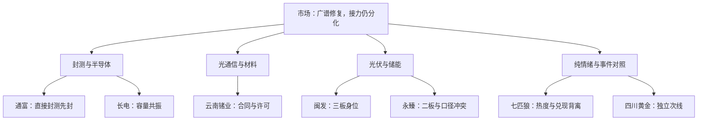

# 2026年11月5日 · 主线研判

> ⚠️ **数据源时间错位**：研究交易日为11月5日，市场量价事实为11月4日收盘。盘前取数不等于今日盘中事实。

> **数据源新鲜度**：partial · **降级状态**：true · **置信度**：0.476

## 一句话结论

**观察科技修复核心，区分旧情绪兑现；封测优先、材料有硬事件、光伏保留，未授开仓权。**

## 🧭 详细分析

市场付钱给科技链修复：上涨4667家、下跌779家，118封板、33炸板。炸板率21.85%未触发35%减半，但前日涨停池收盘均值仍为−0.32%，所以大阳线不等于接力主升。沿用R1的情绪=震荡，不把其45%研究上限当账户正预算；真实账户停买/预算未知，原保护不变。

本轮主模板选**三格**，比较切换、低位前排及当前核心，不把五种打法拼成超级策略。半导体批量首板的合力强于单一旧高标；CPO材料长单有直接对象但也有出口条件；光伏部分核心延续而政策转发未核。三方向均只做研究身份，11月5日可交易性待竞价与D1逐票裁决。

候选形成之前已把R4硬事件、成长12家、红利TOP20、一字预测12对象、历史锚与纯情绪并行比较。四川黄金以真实首板进入次线，不因专题旧标签排除；武汉天源和翰宇保留具名事件研究，但消息真不等于核心强。未用旧计划缺席标计划外，也不以历史无scope清观察池。

七匹狼热榜第一同时跌约9.97%、净出4.20亿元；九牧王跌5.19%、净出1.68亿元。这个反证针对旧核心的兑现，不是否认纯情绪题材。2026马年提前交易2027羊年是正确研究时钟，但本轮缺独立传播、同轮次梯队与监管后切换证据；不能先编名字梗，再让深中华A上涨替旧叙事作证。

## 📊 主线五维与范围

分数先于展示、晚于市场与核心比较；沿用五维，不新增权重或硬阈值。表中持续性1日为下一交易日的研究假设，不是已实现连续天数。封板率均按所取最新成分与非ST涨停/收盘炸板交集计算，不混官方活跃榜统计。

| 主线 | 热度/资金/涨停/叙事/共振 | 分数 | 封板率及分母 | 持续性假设 | 次日预期 |

|---|---|---:|---|---|---|

| 先进封装/半导体修复 | 18 / 19 / 20 / 13 / 16 | 86 | 95.00%（19/20） | 1日 | 分歧 |

| 光通信/磷化铟事件链 | 20 / 17 / 16 / 18 / 13 | 84 | 85.71%（12/14） | 1日 | 分歧 |

| 光伏/储能修复 | 15 / 16 / 16 / 9 / 16 | 72 | 78.57%（22/28） | 1日 | 分歧 |

### 先进封装/半导体修复

- **大资金意图**: 先看市场奖励：半导体行业+10.64%、净入195.890708亿元，先进封装概念净入111.497764亿元；成分股19封板/1炸板，明显强于旧高位接力。 这只是供应商主力分类与价格行为，不是已知机构真实账户意图。

- **为什么走强**: 封测直接载体通富先于长电封板；北方华创是设备容量核心，不以流入最大替代封测龙一。存储与设备同属芯片修复支路，不拆成三条重复主线。

- **逻辑够不够硬**: 五日先进封装仍-76.366001亿元，只确认11月4日修复合力，不宣称完整新主升或旧轮次自然延续。 跨源支持保留三态，不以R编号当独立原始证据。

阶段：回补形成，行情轮次待核。真实启动年龄未知，round_id与event_at均为空；本研究有效至当日开盘，新增官方事件/竞价事实即时重评，不追溯补造旧首次可用。

| 研究层级 | 标的 | 昨涨幅 | 流通亿元 | 东财单日/5日净额亿元 | 板型/核心判据 |

|---|---|---:|---:|---|---|

| 龙头 | 通富微电 `002156.SZ` | 10.01% | 642.34 | 8.645 / 1.009 | 首板收封；开板0次，日换手6.76%；无分钟横盘证据，不认证经典换手板；本轮直接封测双核心中先封，13:47首封、零开板；东财热榜第7，先进封装19家封板。与长电相比优先身位/封板时序，不以历史锚分低否决。广义封装成分还有更早新洁能/托伦斯，非同类封测，不称全成分绝对首封。 |

| 龙二 | 长电科技 `600584.SH` | 9.99% | 925.84 | 10.819 / -1.234 | 首板收封；开板4次，日换手5.79%；无分钟横盘证据，不认证经典换手板；直接封测容量核心，14:07首封、4次开板后收封，单日东财资金10.81935亿高于通富；封板晚且承接反复多于通富所以龙二，不仅按资金金额换龙。 |

| 龙三 | 北方华创 `002371.SZ` | 10.00% | 3894.96 | 8.123 / 16.273 | 首板收封；开板0次，日换手1.68%；无分钟横盘证据，不认证经典换手板；半导体设备容量核心，5日净入16.272944亿；设备与封测业务分开，只作本线第三研究对象，不因金额第一抢封测龙一。 |

| 龙三 | 博杰股份 `002975.SZ` | 10.00% | 106.90 | 0.898 / -0.092 | 首板收封；开板0次，日换手9.29%；无分钟横盘证据，不认证经典换手板；主题历史锚TOP3之一且本轮首板，保留研究；封板晚于直接封测双核心，业务受益份额与人气地位未充分核实，不递补龙一。 |

| 龙三 | 沃格光电 `603773.SH` | 10.01% | 128.40 | 0.434 / -1.020 | 首板收封；开板2次，日换手8.25%；无分钟横盘证据，不认证经典换手板；历史锚与首板共振可研究，但首封14:34偏晚、近120日炸板率43.5%为月度旧统计而非当日市场率，不能凭股性标签提级。 |

#### 通富微电 · 观察

- **买入理由**: 这里只列研究假设，不构成买入建议。①本轮直接封测双核心中先封，13:47首封、零开板；东财热榜第7，先进封装19家封板。与长电相比优先身位/封板时序，不以历史锚分低否决。广义封装成分还有更早新洁能/托伦斯，非同类封测，不称全成分绝对首封。 ②当期价格/资金锚：涨幅10.01%，东财净额8.645亿元；产业或事件关系不能替代执行门禁。

- **风险点**: ①先进封装5日净额仍负，单日大涨不证明反转。 ②首板隔日承接、原始业务/治理公告与RR由R5/R6/D1逐票核。 RR和止损距离未知，禁止清单只部分核，不把unknown填0。

- **止损条件**: 此处是研究失效条件，不是R2订单止损价。下一交易日该股与同线另一核心均收跌且未封板，或原合同/许可/主营关联被新官方披露证伪，本轮接力假设降级并交D1重评；真实持仓T+1与有效退出方案仍由执行侧处理。

- **可验证假设**: 24—72小时检查本股与同线核心的收盘收益是否均大于0、板块封板家数是否至少保持2家，并核原事件是否新增取消/限制；任一失败记录为本轮假设未证成，不盘后改名补票。

- **四项门禁记录**: 板型见上表；龙头条件3条研究已核；RR未知、止损距离未知；禁止项未全核。态度=观察，执行资格未授予。

#### 长电科技 · 观察

- **买入理由**: 这里只列研究假设，不构成买入建议。①直接封测容量核心，14:07首封、4次开板后收封，单日东财资金10.81935亿高于通富；封板晚且承接反复多于通富所以龙二，不仅按资金金额换龙。 ②当期价格/资金锚：涨幅9.99%，东财净额10.819亿元；产业或事件关系不能替代执行门禁。

- **风险点**: ①先进封装5日净额仍负，单日大涨不证明反转。 ②首板隔日承接、原始业务/治理公告与RR由R5/R6/D1逐票核。 RR和止损距离未知，禁止清单只部分核，不把unknown填0。

- **止损条件**: 此处是研究失效条件，不是R2订单止损价。下一交易日该股与同线另一核心均收跌且未封板，或原合同/许可/主营关联被新官方披露证伪，本轮接力假设降级并交D1重评；真实持仓T+1与有效退出方案仍由执行侧处理。

- **可验证假设**: 24—72小时检查本股与同线核心的收盘收益是否均大于0、板块封板家数是否至少保持2家，并核原事件是否新增取消/限制；任一失败记录为本轮假设未证成，不盘后改名补票。

- **四项门禁记录**: 板型见上表；龙头条件3条研究已核；RR未知、止损距离未知；禁止项未全核。态度=观察，执行资格未授予。

#### 北方华创 · 观察

- **买入理由**: 这里只列研究假设，不构成买入建议。①半导体设备容量核心，5日净入16.272944亿；设备与封测业务分开，只作本线第三研究对象，不因金额第一抢封测龙一。 ②当期价格/资金锚：涨幅10.00%，东财净额8.123亿元；产业或事件关系不能替代执行门禁。

- **风险点**: ①先进封装5日净额仍负，单日大涨不证明反转。 ②首板隔日承接、原始业务/治理公告与RR由R5/R6/D1逐票核。 RR和止损距离未知，禁止清单只部分核，不把unknown填0。

- **止损条件**: 此处是研究失效条件，不是R2订单止损价。下一交易日该股与同线另一核心均收跌且未封板，或原合同/许可/主营关联被新官方披露证伪，本轮接力假设降级并交D1重评；真实持仓T+1与有效退出方案仍由执行侧处理。

- **可验证假设**: 24—72小时检查本股与同线核心的收盘收益是否均大于0、板块封板家数是否至少保持2家，并核原事件是否新增取消/限制；任一失败记录为本轮假设未证成，不盘后改名补票。

- **四项门禁记录**: 板型见上表；龙头条件完整条数未知；RR未知、止损距离未知；禁止项未全核。态度=观察，执行资格未授予。

#### 博杰股份 · 观察

- **买入理由**: 这里只列研究假设，不构成买入建议。①主题历史锚TOP3之一且本轮首板，保留研究；封板晚于直接封测双核心，业务受益份额与人气地位未充分核实，不递补龙一。 ②当期价格/资金锚：涨幅10.00%，东财净额0.898亿元；产业或事件关系不能替代执行门禁。

- **风险点**: ①先进封装5日净额仍负，单日大涨不证明反转。 ②首板隔日承接、原始业务/治理公告与RR由R5/R6/D1逐票核。 RR和止损距离未知，禁止清单只部分核，不把unknown填0。

- **止损条件**: 此处是研究失效条件，不是R2订单止损价。下一交易日该股与同线另一核心均收跌且未封板，或原合同/许可/主营关联被新官方披露证伪，本轮接力假设降级并交D1重评；真实持仓T+1与有效退出方案仍由执行侧处理。

- **可验证假设**: 24—72小时检查本股与同线核心的收盘收益是否均大于0、板块封板家数是否至少保持2家，并核原事件是否新增取消/限制；任一失败记录为本轮假设未证成，不盘后改名补票。

- **四项门禁记录**: 板型见上表；龙头条件完整条数未知；RR未知、止损距离未知；禁止项未全核。态度=观察，执行资格未授予。

#### 沃格光电 · 观察

- **买入理由**: 这里只列研究假设，不构成买入建议。①历史锚与首板共振可研究，但首封14:34偏晚、近120日炸板率43.5%为月度旧统计而非当日市场率，不能凭股性标签提级。 ②当期价格/资金锚：涨幅10.01%，东财净额0.434亿元；产业或事件关系不能替代执行门禁。

- **风险点**: ①先进封装5日净额仍负，单日大涨不证明反转。 ②首板隔日承接、原始业务/治理公告与RR由R5/R6/D1逐票核。 RR和止损距离未知，禁止清单只部分核，不把unknown填0。

- **止损条件**: 此处是研究失效条件，不是R2订单止损价。下一交易日该股与同线另一核心均收跌且未封板，或原合同/许可/主营关联被新官方披露证伪，本轮接力假设降级并交D1重评；真实持仓T+1与有效退出方案仍由执行侧处理。

- **可验证假设**: 24—72小时检查本股与同线核心的收盘收益是否均大于0、板块封板家数是否至少保持2家，并核原事件是否新增取消/限制；任一失败记录为本轮假设未证成，不盘后改名补票。

- **四项门禁记录**: 板型见上表；龙头条件完整条数未知；RR未知、止损距离未知；禁止项未全核。态度=观察，执行资格未授予。

风险：先进封装5日净额仍负，单日大涨不证明反转。；本批主板封测首板群体多，通富只是直接封测前排，不称全半导体唯一总龙。；首板隔日承接、原始业务/治理公告与RR由R5/R6/D1逐票核。

### 光通信/磷化铟事件链

- **大资金意图**: CPO热榜第一、12封板/2炸板，东财概念单日净入139.565937亿元；云南锗业首板与双平台人气构成直接材料事件载体。 这只是供应商主力分类与价格行为，不是已知机构真实账户意图。

- **为什么走强**: AOI年度合同和出口许可/退款取消条款来自同一公告，正反不拆成两个独立支持。云南锗业是R4业务映射的上游，不冒充THS CPO成分股。

- **逻辑够不够硬**: 新易盛与中际旭创属于大跌后的容量修复；新易盛5日虽正但价格仍深度回撤，不能把它们改称已确认右侧趋势股。 跨源支持保留三态，不以R编号当独立原始证据。

阶段：事件带动修复，持续性未确认。真实启动年龄未知，round_id与event_at均为空；本研究有效至当日开盘，新增官方事件/竞价事实即时重评，不追溯补造旧首次可用。

| 研究层级 | 标的 | 昨涨幅 | 流通亿元 | 东财单日/5日净额亿元 | 板型/核心判据 |

|---|---|---:|---:|---|---|

| 龙头 | 云南锗业 `002428.SZ` | 10.00% | 492.24 | 15.227 / 10.927 | 首板收封；开板3次，日换手13.15%；无分钟横盘证据，不认证经典换手板；具名AOI年度合同、早盘首板、THS第9/DC第2，材料支路辨识度与容量换手成立；R4同时保留出口许可及取消条款，不把订单当确定利润。 |

| 龙二 | 新易盛 `300502.SZ` | 13.35% | 2465.53 | 25.041 / 4.478 | 非涨停修复大阳；不认证主升趋势；光模块人气容量修复，THS新进前20；5日资金4.477992亿正但5日价格仍约-23.48%，只作龙二研究，不认证主升趋势恢复。 |

| 龙三 | 中际旭创 `300308.SZ` | 11.07% | 5920.18 | 17.400 / -18.144 | 非涨停修复大阳；不认证主升趋势；全市场辨识度和容量高，但5日资金与价格仍弱，保留为容量对照，不以单日净入和11%涨幅替代新主升确认。 |

| 龙三 | 华盛昌 `002980.SZ` | 10.00% | 72.19 | 0.951 / -0.674 | 首板收封；开板0次，日换手11.70%；无分钟横盘证据，不认证经典换手板；CPO历史锚TOP3且本轮首板，纳入研究；不是本次具名材料合同直接受益主体，广概念标签不等于业绩映射。 |

#### 云南锗业 · 观察

- **买入理由**: 这里只列研究假设，不构成买入建议。①具名AOI年度合同、早盘首板、THS第9/DC第2，材料支路辨识度与容量换手成立；R4同时保留出口许可及取消条款，不把订单当确定利润。 ②当期价格/资金锚：涨幅10.00%，东财净额15.227亿元；产业或事件关系不能替代执行门禁。

- **风险点**: ①CPO5日主力净额-295.726267亿元；下游缺料也可能抑制交付。 ②新易盛/中际旭创5日价格回撤明显，不把大阳线当下降趋势风险已解除。 RR和止损距离未知，禁止清单只部分核，不把unknown填0。

- **止损条件**: 此处是研究失效条件，不是R2订单止损价。下一交易日该股与同线另一核心均收跌且未封板，或原合同/许可/主营关联被新官方披露证伪，本轮接力假设降级并交D1重评；真实持仓T+1与有效退出方案仍由执行侧处理。

- **可验证假设**: 24—72小时检查本股与同线核心的收盘收益是否均大于0、板块封板家数是否至少保持2家，并核原事件是否新增取消/限制；任一失败记录为本轮假设未证成，不盘后改名补票。

- **四项门禁记录**: 板型见上表；龙头条件3条研究已核；RR未知、止损距离未知；禁止项未全核。态度=观察，执行资格未授予。

#### 新易盛 · 观察

- **买入理由**: 这里只列研究假设，不构成买入建议。①光模块人气容量修复，THS新进前20；5日资金4.477992亿正但5日价格仍约-23.48%，只作龙二研究，不认证主升趋势恢复。 ②当期价格/资金锚：涨幅13.35%，东财净额25.041亿元；产业或事件关系不能替代执行门禁。

- **风险点**: ①CPO5日主力净额-295.726267亿元；下游缺料也可能抑制交付。 ②新易盛/中际旭创5日价格回撤明显，不把大阳线当下降趋势风险已解除。 RR和止损距离未知，禁止清单只部分核，不把unknown填0。

- **止损条件**: 此处是研究失效条件，不是R2订单止损价。下一交易日该股与同线另一核心均收跌且未封板，或原合同/许可/主营关联被新官方披露证伪，本轮接力假设降级并交D1重评；真实持仓T+1与有效退出方案仍由执行侧处理。

- **可验证假设**: 24—72小时检查本股与同线核心的收盘收益是否均大于0、板块封板家数是否至少保持2家，并核原事件是否新增取消/限制；任一失败记录为本轮假设未证成，不盘后改名补票。

- **四项门禁记录**: 板型见上表；龙头条件完整条数未知；RR未知、止损距离未知；禁止项未全核。态度=观察，执行资格未授予。

#### 中际旭创 · 观察

- **买入理由**: 这里只列研究假设，不构成买入建议。①全市场辨识度和容量高，但5日资金与价格仍弱，保留为容量对照，不以单日净入和11%涨幅替代新主升确认。 ②当期价格/资金锚：涨幅11.07%，东财净额17.400亿元；产业或事件关系不能替代执行门禁。

- **风险点**: ①CPO5日主力净额-295.726267亿元；下游缺料也可能抑制交付。 ②新易盛/中际旭创5日价格回撤明显，不把大阳线当下降趋势风险已解除。 RR和止损距离未知，禁止清单只部分核，不把unknown填0。

- **止损条件**: 此处是研究失效条件，不是R2订单止损价。下一交易日该股与同线另一核心均收跌且未封板，或原合同/许可/主营关联被新官方披露证伪，本轮接力假设降级并交D1重评；真实持仓T+1与有效退出方案仍由执行侧处理。

- **可验证假设**: 24—72小时检查本股与同线核心的收盘收益是否均大于0、板块封板家数是否至少保持2家，并核原事件是否新增取消/限制；任一失败记录为本轮假设未证成，不盘后改名补票。

- **四项门禁记录**: 板型见上表；龙头条件完整条数未知；RR未知、止损距离未知；禁止项未全核。态度=观察，执行资格未授予。

#### 华盛昌 · 观察

- **买入理由**: 这里只列研究假设，不构成买入建议。①CPO历史锚TOP3且本轮首板，纳入研究；不是本次具名材料合同直接受益主体，广概念标签不等于业绩映射。 ②当期价格/资金锚：涨幅10.00%，东财净额0.951亿元；产业或事件关系不能替代执行门禁。

- **风险点**: ①CPO5日主力净额-295.726267亿元；下游缺料也可能抑制交付。 ②新易盛/中际旭创5日价格回撤明显，不把大阳线当下降趋势风险已解除。 RR和止损距离未知，禁止清单只部分核，不把unknown填0。

- **止损条件**: 此处是研究失效条件，不是R2订单止损价。下一交易日该股与同线另一核心均收跌且未封板，或原合同/许可/主营关联被新官方披露证伪，本轮接力假设降级并交D1重评；真实持仓T+1与有效退出方案仍由执行侧处理。

- **可验证假设**: 24—72小时检查本股与同线核心的收盘收益是否均大于0、板块封板家数是否至少保持2家，并核原事件是否新增取消/限制；任一失败记录为本轮假设未证成，不盘后改名补票。

- **四项门禁记录**: 板型见上表；龙头条件完整条数未知；RR未知、止损距离未知；禁止项未全核。态度=观察，执行资格未授予。

风险：CPO5日主力净额-295.726267亿元；下游缺料也可能抑制交付。；云南锗业长单并非全部当期收入；出口许可未认证完成。；新易盛/中际旭创5日价格回撤明显，不把大阳线当下降趋势风险已解除。

### 光伏/储能修复

- **大资金意图**: 光伏概念单日净入72.420613亿元，成分交集22封板/6炸板；闽发三板、永臻二板，阳光电源作容量，不因20cm自动排除。 这只是供应商主力分类与价格行为，不是已知机构真实账户意图。

- **为什么走强**: 闽发光伏支架边框与永臻主营产品由本轮同花顺问财业务查询核实；两票20—50亿仅注明风险不一刀切。

- **逻辑够不够硬**: 美国选举/IRA/FCC转发尚未官方核实，不作为硬政策已落地。武汉天源正式合同是储能工程独立研究增量，不据36.4亿总合同升它为核心。 跨源支持保留三态，不以R编号当独立原始证据。

阶段：修复扩散，非已认证新周期。真实启动年龄未知，round_id与event_at均为空；本研究有效至当日开盘，新增官方事件/竞价事实即时重评，不追溯补造旧首次可用。

| 研究层级 | 标的 | 昨涨幅 | 流通亿元 | 东财单日/5日净额亿元 | 板型/核心判据 |

|---|---|---:|---:|---|---|

| 龙头 | 闽发铝业 `002578.SZ` | 10.11% | 35.65 | 0.805 / 1.179 | 3连板收封；开板0次，日换手12.50%；无分钟横盘证据，不认证经典换手板；光伏成分当前最高3板，非情绪全市场唯一总龙；本轮业务查询有光伏支架/边框，12.50%换手能交易，身位先于永臻但首封晚于永臻，不隐去相反证据。 |

| 龙二 | 永臻股份 `603381.SH` | 10.01% | 24.36 | 0.355 / 0.642 | 2连板收封；开板0次，日换手13.11%；无分钟横盘证据，不认证经典换手板；主营光伏边框、二板早封，板内龙二；不能因闽发高一板就改称它为低位唯一主推，双方资金口径冲突及历史样本弱须R5核。 |

| 龙三 | 阳光电源 `300274.SZ` | 7.20% | 1288.54 | 7.124 / 12.681 | 非涨停修复大阳；不认证主升趋势；容量趋势观察，近5日资金连续回流可核，但未涨停、非当前高度龙；不拿大容量修复票替代普通10cm妖股通道。 |

#### 闽发铝业 · 观察

- **买入理由**: 这里只列研究假设，不构成买入建议。①光伏成分当前最高3板，非情绪全市场唯一总龙；本轮业务查询有光伏支架/边框，12.50%换手能交易，身位先于永臻但首封晚于永臻，不隐去相反证据。 ②当期价格/资金锚：涨幅10.11%，东财净额0.805亿元；产业或事件关系不能替代执行门禁。

- **风险点**: ①光伏概念5日-41.90706亿元，短窗修复不等于产业盈利反转。 ②流通20—50亿元，需实际承接且不可因低价忽略。 RR和止损距离未知，禁止清单只部分核，不把unknown填0。

- **止损条件**: 此处是研究失效条件，不是R2订单止损价。下一交易日该股与同线另一核心均收跌且未封板，或原合同/许可/主营关联被新官方披露证伪，本轮接力假设降级并交D1重评；真实持仓T+1与有效退出方案仍由执行侧处理。

- **可验证假设**: 24—72小时检查本股与同线核心的收盘收益是否均大于0、板块封板家数是否至少保持2家，并核原事件是否新增取消/限制；任一失败记录为本轮假设未证成，不盘后改名补票。

- **四项门禁记录**: 板型见上表；龙头条件3条研究已核；RR未知、止损距离未知；禁止项未全核。态度=观察，执行资格未授予。

#### 永臻股份 · 观察

- **买入理由**: 这里只列研究假设，不构成买入建议。①主营光伏边框、二板早封，板内龙二；不能因闽发高一板就改称它为低位唯一主推，双方资金口径冲突及历史样本弱须R5核。 ②当期价格/资金锚：涨幅10.01%，东财净额0.355亿元；产业或事件关系不能替代执行门禁。

- **风险点**: ①光伏概念5日-41.90706亿元，短窗修复不等于产业盈利反转。 ②流通20—50亿元，需实际承接且不可因低价忽略。 RR和止损距离未知，禁止清单只部分核，不把unknown填0。

- **止损条件**: 此处是研究失效条件，不是R2订单止损价。下一交易日该股与同线另一核心均收跌且未封板，或原合同/许可/主营关联被新官方披露证伪，本轮接力假设降级并交D1重评；真实持仓T+1与有效退出方案仍由执行侧处理。

- **可验证假设**: 24—72小时检查本股与同线核心的收盘收益是否均大于0、板块封板家数是否至少保持2家，并核原事件是否新增取消/限制；任一失败记录为本轮假设未证成，不盘后改名补票。

- **四项门禁记录**: 板型见上表；龙头条件完整条数未知；RR未知、止损距离未知；禁止项未全核。态度=观察，执行资格未授予。

#### 阳光电源 · 观察

- **买入理由**: 这里只列研究假设，不构成买入建议。①容量趋势观察，近5日资金连续回流可核，但未涨停、非当前高度龙；不拿大容量修复票替代普通10cm妖股通道。 ②当期价格/资金锚：涨幅7.20%，东财净额7.124亿元；产业或事件关系不能替代执行门禁。

- **风险点**: ①光伏概念5日-41.90706亿元，短窗修复不等于产业盈利反转。 ②闽发及永臻流通盘20—50亿，历史股性与板数不能消除成交承接风险。 RR和止损距离未知，禁止清单只部分核，不把unknown填0。

- **止损条件**: 此处是研究失效条件，不是R2订单止损价。下一交易日该股与同线另一核心均收跌且未封板，或原合同/许可/主营关联被新官方披露证伪，本轮接力假设降级并交D1重评；真实持仓T+1与有效退出方案仍由执行侧处理。

- **可验证假设**: 24—72小时检查本股与同线核心的收盘收益是否均大于0、板块封板家数是否至少保持2家，并核原事件是否新增取消/限制；任一失败记录为本轮假设未证成，不盘后改名补票。

- **四项门禁记录**: 板型见上表；龙头条件完整条数未知；RR未知、止损距离未知；禁止项未全核。态度=观察，执行资格未授予。

风险：光伏概念5日-41.90706亿元，短窗修复不等于产业盈利反转。；永臻东财单日净入0.355372亿、同花顺净出0.108147亿，方向冲突保留，不取平均。；闽发及永臻流通盘20—50亿，历史股性与板数不能消除成交承接风险。

## 🔎 未选对照、事件与纯情绪

| 对照方向 | 态度 | 为什么没有进入三条主推 |

|---|---|---|

| 短剧/影视/出版情绪 | 观察 | 实际比较三板浙文、大晟、龙版。R3短剧4→9，成分4封板/3炸板；传媒单日净入7.649331亿但5日-2.155441亿，弱于芯片修复。大晟负净资产/退市风险交R6，非全传媒财务雷；浙文经营无新重大变化不等于永远无业务。龙版不在所取短剧99成分内，按出版关联单列，不能借其三板美化短剧统计。保留其真实承接观察，不用新名字补旧线。 |

| 人形机器人/物理AI | 观察 | R3 L1+L2与概念第2；机器人概念22封板/10炸板、东财净入81.389839亿但5日-326.247414亿，人形5日-194.757704亿。福莱、兆威是真实10cm首板研究；小米整班作业/供应链说法尚未官方认证，江苏雷利个人立案不外推整个板块。旧days16→1不证明新轮次。 |

| 共享储能工程事件 | 观察 | 武汉天源为R4正式合同直接映射，36.4亿系联合体总额，份额/垫资/回款待核；11月4日+7.50%但东财净出0.088179亿，消息发布后当日价格未有。保留真实研究，不因资金单项负数硬禁；不以合同金额授核心。 |

| 创新药/GLP-1事件 | 观察 | 翰宇HY3003为首次临床许可，非上市批准；创新药概念单日9.013647亿、5日-14.976914亿。翰宇+7.07%但东财净出0.225781亿，不把未反应盘后消息说成价格否定；核心地位尚未确认。 |

| 黄金/资源弹性对照 | 观察 | 成长池四川黄金已实际首板、单日净入0.855906亿，贵金属行业+10.45%、净入23.489549亿，有真实合力而非死水防守。作为科技修复之外的竞争方向保留；未完成全黄金成分梯队和题材热度核验，不将一只旧成长候选晋为已审龙头。 |

| 羊年/狼/名字梗跨年情绪 | 观察 | 按2026马年交易2027羊年预期研究，不因当前年份排除。七匹狼用户线索和模型羊/狼联想分开；本批未找到独立传播原文认证羊年市场共识或监管后资金换名字。七匹狼-9.971%、净出4.200172亿，九牧王-5.1948%、净出1.684639亿，热榜不能掩盖旧核心兑现。深中华A首板与历史股性是真线索，但无证据属于羊狼同轮次，不递补为新龙；监管对象和交易限制逐票交R5/R6。 |

### 历史锚不是现成龙头

五主题TOP3已默认进入候选发现后比较。先进封装的博杰/沃格、CPO的华盛昌保留研究；中京、合锻以及光伏旧锚未胜当前直接核心，不按历史锚分强行升位。新能/顺钠当前无涨停且5日资金位于板内top3之外，按原规则已核两项可标杂毛，不占执行；未知30日席位不算第三项。

| 主题 | 历史锚 | 当日涨幅 | 本轮处理 |

|---|---|---:|---|

| 先进封装 | 中京电子 `002579.SZ` | 4.51% | 龙三；默认纳入研究发现后比较：历史锚分不是当前地位。未成为本轮直接业务/封板时序/人气领先者；未选不是只有资金排名一项的硬禁。 |

| 先进封装 | 沃格光电 `603773.SH` | 10.01% | 龙三；进入本轮主线研究候补，不能替代当前双核心 |

| 先进封装 | 博杰股份 `002975.SZ` | 10.00% | 龙三；进入本轮主线研究候补，不能替代当前双核心 |

| 共封装光学(CPO) | 中京电子 `002579.SZ` | 4.51% | 龙三；默认纳入研究发现后比较：历史锚分不是当前地位。未成为本轮直接业务/封板时序/人气领先者；未选不是只有资金排名一项的硬禁。 |

| 共封装光学(CPO) | 合锻智能 `603011.SH` | 5.56% | 龙三；默认纳入研究发现后比较：历史锚分不是当前地位。未成为本轮直接业务/封板时序/人气领先者；未选不是只有资金排名一项的硬禁。 |

| 共封装光学(CPO) | 华盛昌 `002980.SZ` | 10.00% | 龙三；进入本轮主线研究候补，不能替代当前双核心 |

| 光伏概念 | 新能股份 `000595.SZ` | 0.64% | 杂毛；默认纳入研究发现后比较：历史锚分不是当前地位。未成为本轮直接业务/封板时序/人气领先者；未选不是只有资金排名一项的硬禁。；原杂毛规则已核命中资金5日top3外+板数低于龙头2板以上，本轮不进执行。 |

| 光伏概念 | 杭电股份 `603618.SH` | 6.25% | 杂毛；默认纳入研究发现后比较：历史锚分不是当前地位。未成为本轮直接业务/封板时序/人气领先者；未选不是只有资金排名一项的硬禁。；原杂毛规则已核命中资金5日top3外+板数低于龙头2板以上，本轮不进执行。 |

| 光伏概念 | 顺钠股份 `000533.SZ` | 3.14% | 杂毛；默认纳入研究发现后比较：历史锚分不是当前地位。未成为本轮直接业务/封板时序/人气领先者；未选不是只有资金排名一项的硬禁。；原杂毛规则已核命中资金5日top3外+板数低于龙头2板以上，本轮不进执行。 |

| 机器人概念 | 锋龙股份 `002931.SZ` | 6.02% | 龙三；默认纳入研究发现后比较：历史锚分不是当前地位。未成为本轮直接业务/封板时序/人气领先者；未选不是只有资金排名一项的硬禁。 |

| 机器人概念 | 科森科技 `603626.SH` | 6.02% | 龙三；默认纳入研究发现后比较：历史锚分不是当前地位。未成为本轮直接业务/封板时序/人气领先者；未选不是只有资金排名一项的硬禁。 |

| 机器人概念 | 襄阳轴承 `000678.SZ` | -3.85% | 龙三；默认纳入研究发现后比较：历史锚分不是当前地位。未成为本轮直接业务/封板时序/人气领先者；未选不是只有资金排名一项的硬禁。 |

| 短剧游戏 | 欢瑞世纪 `000892.SZ` | 3.56% | 杂毛；默认纳入研究发现后比较：历史锚分不是当前地位。未成为本轮直接业务/封板时序/人气领先者；未选不是只有资金排名一项的硬禁。；原杂毛规则已核命中资金5日top3外+板数低于龙头2板以上，本轮不进执行。 |

| 短剧游戏 | 天娱数科 `002354.SZ` | 6.64% | 杂毛；默认纳入研究发现后比较：历史锚分不是当前地位。未成为本轮直接业务/封板时序/人气领先者；未选不是只有资金排名一项的硬禁。；原杂毛规则已核命中资金5日top3外+板数低于龙头2板以上，本轮不进执行。 |

| 短剧游戏 | 传智教育 `003032.SZ` | 4.00% | 杂毛；默认纳入研究发现后比较：历史锚分不是当前地位。未成为本轮直接业务/封板时序/人气领先者；未选不是只有资金排名一项的硬禁。；原杂毛规则已核命中资金5日top3外+板数低于龙头2板以上，本轮不进执行。 |

### 成长池十二家逐票比较

| 对象 | 昨涨幅 | 本轮处理 |

|---|---:|---|

| 九华旅游 `603199.SH` | -2.07% | 旅游方向未见本轮主线合力，且本票下跌/净出；旧财务候选不晋级短线核心。 |

| 赛诺医疗 `688108.SH` | 5.83% | 有医疗成长历史线索，本轮上涨但净出、医疗器械行业资金弱；不是已审创新药事件核心。 |

| 上海沿浦 `605128.SH` | 4.72% | 本轮汽车配件上涨有净入，缺可比前排地位；不凭财务旧代理替代市场核心。 |

| 润本股份 `603193.SH` | -0.12% | 旧成长候选本轮微跌，缺主线与前排证据。 |

| 天德钰 `688252.SH` | 7.44% | 半导体修复同涨，但资金净出且无首板/热点前排地位证据，保留财务专题不抢封测核心。 |

| 路维光电 `688401.SH` | 14.33% | 本轮涨14.33%是真实修复，净流出仍存；旧文此前大跌与本日反弹分开，不追溯成稳定主升。 |

| 兴齐眼药 `300573.SZ` | 3.92% | 眼药成长线索不等于当前GLP-1或封测主线受益；缺新地位。 |

| 百普赛斯 `301080.SZ` | 16.17% | 本轮大涨16.17%和小额净入已核；此前-19.70%不是便宜理由，未证实新趋势/板块核心，不用财务代理抄底。 |

| 中微半导 `688380.SH` | 11.74% | 半导体上涨11.74%，净流出接近零但不填0，缺前排/封板证据；不因同板块就认龙。 |

| 大博医疗 `002901.SZ` | 0.43% | 财务补证仍非完整资格，本轮涨幅和资金未体现短线前排。 |

| 合合信息 `688615.SH` | 1.87% | AI软件财务历史线索，未见本轮封测或光通信直接映射和核心地位；子公司资质不能给母公司。 |

| 四川黄金 `001337.SZ` | 10.00% | 首板及资源合力真实，纳入黄金次线研究而非机械抛弃旧成长池；未完成黄金全板块核心排名。 |

红利TOP20全部作当期行情/资金比较，未据月度高息授予短线地位；8只现金覆盖反证、4家银行未全核及153只未核范围原样保留。不能把高息当低风险，也不因传统行业标签永久排除。其余逐源对象的完整对照见机读JSON，不是源MD全文阅读。

## 🧪 交叉验证与历史裁决

| 主线 | R3 | R4 | R7 | 已核分母 |

|---|---|---|---|

| 先进封装/半导体修复 | True | 未知：映射未核 | True（仅单日修复） | 2 |

| 光通信/磷化铟事件链 | True | True | True（仅单日修复） | 3 |

| 光伏/储能修复 | True | 未知：映射未核 | True（仅单日修复） | 2 |

共识主题仅材料事件链一条，四个研究视角不等于四份独立底层原件，无法同口径归一化则综合分为null。历史包run_id已一致，唯一E1经验的scope、轮次和适用窗口未认证，裁决deferred；仅作为本轮核传媒覆盖/时序的待证假设，不当事前冻结预测兑现或规则批准。

六项专题来源逐源裁决：锚、精确股性、成长池有限证据与一字对象比较为有限adopted；红利deferred；空专题反馈unknown。上游R4内嵌日历另列deferred，未把上游采纳自动继承。

## 📌 关键证据

- 量价：当期5572条日线、118涨停/33炸板，五日行情与资金逐日核取，龙虎榜按不同交易日去重；同票多个上榜原因不重复计天数。

- 材料：R4的AOI合同与出口许可/取消条款同源同时保留，源公告只算一份；未声称R2重新阅读全文PDF。

- 资金：永臻东财+0.355亿元对同花顺−0.108亿元，原口径冲突单列；不是跨源双重支持。

- 范围：同花顺板块前20与成分交集口径有差异：芯片活跃榜46、成分交集47；光伏活跃榜23、成分交集22。未合并分母或把榜单days当轮次年龄。

## 数据源审计

| 源 | 日期 | 状态 | 记录与边界 |

|---|---|:--:|---|

| R1 | 2026-11-05 | 🟢 | 未知；本轮版本新鲜度ok；上游覆盖仍degraded，原缺口不升级 |

| R3 | 2026-11-05 | 🟢 | 未知；本轮版本新鲜度ok；上游覆盖仍partial，原缺口不升级 |

| R4 | 2026-11-05 | 🟢 | 未知；限定返回范围，不代表全部资格已审 |

| R7 | 2026-11-05 | 🟢 | 未知；本轮版本新鲜度ok；上游覆盖仍partial，原缺口不升级 |

| Tushare行情 | 2026-11-05 | 🟢 | 5572；限定返回范围，不代表全部资格已审 |

| Tushare每日指标 | 2026-11-05 | 🟢 | 5572；限定返回范围，不代表全部资格已审 |

| Tushare涨停 | 2026-11-05 | 🟢 | 118；限定返回范围，不代表全部资格已审 |

| Tushare炸板 | 2026-11-05 | 🟢 | 33；限定返回范围，不代表全部资格已审 |

| Tushare资金截面 | 2026-11-05 | 🟢 | 6031；限定返回范围，不代表全部资格已审 |

| Tushare成分 | 2026-11-05 | 🟢 | 231；限定返回范围，不代表全部资格已审 |

| 同花顺问财行情/业务 | 2026-11-05 | 🟢 | 4；限定返回范围，不代表全部资格已审 |

| 同花顺多板块扩展问句 | 2026-11-05 | 🔴 | 30；返回股票并集1787，非目标板块表；不把30行当完整概念统计，未继续抓无关分页；初始单条件板块前20查询已成功。 |

| WeFlow | 未知 | 🔴 | 未知；缺失；R3双层正文+热榜降级保留 |

| raw hotlist_signals | 未知 | 🔴 | 未知；不存在；消费R3已核末榜diff而非伪造另一个独立来源 |

| 因子层 | 未知 | 🔴 | 未知；未发现本周文件，factor_layer_degraded=true |

| 历史/市场反馈包 | 未知 | 🟡 | 1；仅一条11月2日E1经验，scope与round未认证；未另读历史 |

| 专题运输投影 | 2026-11-05 | 🟡 | 6；保留有限截取、partial与旧事实窗口；不是全量即时行情 |

## ⚠️ 不确定性 / 反证

本稿状态partial，原因是证据局部未闭环，不是研究中止。R3/7原partial保留，因子缺失不虚构IC/IR。真实启动催化和行情轮次仍未知，生命周期仅定性修复形成；年龄1/3/5的程序结果只作非事实敏感性，不改阈值、不映射买权。

主线内部分大阳仍是下跌后的回补，不能给非涨停容量票贴趋势股分类就当主升。全部主线研究对象均缺完整逐票必要风险与RR，研究top2身份保留，execution_eligible=false不是账户预算0。R6独占hard_reject，D1仍须独立核权限、T+1与价位，不准从候补自动替换被否龙头。

## 🤝 与其他 R/D/E 的关系

- 依赖：本轮R1_style、R3_sentiment、R4_news、R7_capital_flow及唯一R2_history_context。

- 被消费：R5精确匹配本轮代码画像；R6只读本JSON内嵌源证据；D1独立成案；E1按原窗口核验，不补造事前方向。

## Sub-Agent 元数据

- skill: analyze_main_sectors_v1 + filter_leader_v1

- artifact: data/research/20261105/R2_main_sectors.json

- model: gpt-6.1-sol

- 生成方式：当前唯一模型阶段执行者，未启动其他模型会话；真实盘前研究，非冻结回放。
