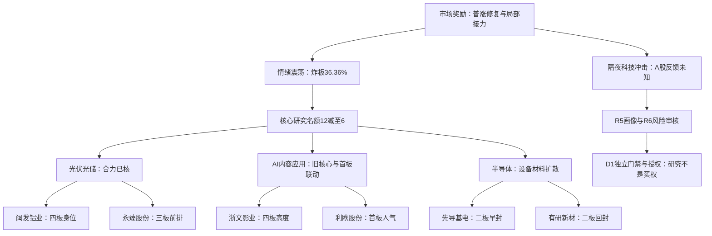

# 2026年11月6日 · 主线研判

> 数据源新鲜度：partial ｜ 降级状态：是 ｜ 置信度：0.448
> 情绪=震荡；以下是研究观察，不是买入名单。有效预算、停买、T+1与交易授权均未改变。

## 一句话结论
光伏、AI内容与半导体列研究主线；隔夜冲击待核，六票仅观察，不授买权。

## 详细分析

市场昨日为普涨修复：5571只中4869涨、625跌，中位涨幅2.0181%；前日涨停样本次日收盘溢价中位4.26285%。市场确实为部分接力和板块扩散付钱，不能继承旧报告的全天主跌地图，也不能从研究观察空缺推断全市场无机会。

但84只封板、48只炸板，对应炸板率36.36%。R1的high_chop温度与“主线扩散型”风格并不矛盾：广度修复不代表所有接力好做。本轮按正常每线4个核心研究名额，三线12个减至6个；发现、专题对照和必要风险覆盖未缩减。

隔夜R4已记录纳指约跌5.5%、费半约跌12%，精确终值存在报道差异。这个冲击晚于昨日A股价格事实，今日尚未开盘，不能称已经被A股消化，也不能把政治呼吁改写成已生效全国禁令。三条是T-1合力已核的研究主线，今日已确认可交易主线仍为空，不是永久禁买政策。

主模板只选“树干”：先辨市场温度，再核板块合力和核心承接。不把五套打法拼接，不给价位、仓位或临盘下单指令。六只均有RR、监管及完整禁止项待核，交R5画像、R6反证及D1独立裁决；D1首次成案前计划身份全部未知。

## 🧭 市场—主线—核心关系

图已按阅读端Mermaid 11.4.0实际渲染为SVG，不是仅检查代码围栏。

## 📊 三条研究主线

| 主线 | 热度 | 资金 | 涨停 | 叙事 | 共振 | 总分 | 研究态度 |
|---|---:|---:|---:|---:|---:|---:|---|
| 光伏/光储修复 | 19 | 19 | 19 | 13 | 18 | 88 | 观察：T日承接未确认 |
| AI内容应用/短剧 | 18 | 17 | 17 | 11 | 18 | 81 | 观察：T日承接未确认 |
| 半导体自主可控 | 16 | 19 | 15 | 9 | 10 | 69 | 观察：T日承接未确认 |

分数只作比较，不能独立硬禁。主线数量不等于今日开仓数量。

### 1. 光伏/光储修复｜88分｜观察

主线 = 光伏/光储修复，持续性 = 3日（未来研究验证窗口，不是已证运行天数），封板率 = 未知，明日预期 = 分歧。

- **大资金意图**: 资金在交易光储风险回补与边框前排扩散，这是资金分类和价格支持的解释假设，不是已经识别买方机构。光伏设备末日净入32.36亿元、五日60.71亿元；电力设备父级不能再相加。
- **为什么走强**: 光伏概念22家封板、行业设备11家；非ST交叉池闽发四板、永臻三板，与阳光电源容量上涨相互印证。消息中海外需求和供给侧改善仍未完全转化为订单。
- **逻辑够不够硬**: 市场合力比消息标题更硬，经营兑现仍不足；闽发、永臻均缩量一字，小流通盘与可得性风险并存。金刚的算力合同不能给全光伏加一票硬订单。

稳定板块ID：`885531.TI`。真实启动时点、同轮延续链未闭环，round_id与event_at保留空；生命周期函数缺年龄输入，未用0或榜单days冒填。板块封板率缺“封板+炸板同成分”分母，不能套用全市场63.64%。

| 角色 | 股票 | 昨涨幅 | 连板 | 流通亿 | 换手 | 板型与资格 |
|---|---|---:|---:|---:|---:|---|
| 龙一 | 闽发铝业 `002578.SZ` | 9.90% | 4 | 39.18 | 2.24% | 缩量一字四板；沪深10cm同权，流通39.18亿属20—50亿风险带。；仅观察 |
| 龙二 | 永臻股份 `603381.SH` | 9.98% | 3 | 26.79 | 2.40% | 缩量一字三板；历史股性仅5个有效封单样本且近期评级差，不把三板升级成长妖。；仅观察 |

#### 闽发铝业｜龙一研究画像入口

- **大资金意图**: 本轮未取得可比的R7个股净额，不从板块流入推导其资金身份；仅核实际身位与成交。
- **为什么走强**: 光伏交叉成分非ST最高4板，与永臻边框链形成3/4板；同花顺归因同时含液冷、机器人与扭亏，不能说纯光伏总龙。
- **逻辑够不够硬**: 龙头纪律已核2条；未满三条，仍是身位候选不是完整真龙认证。月度股性好、近期极佳，均不是今日状态认证。

- **买入理由**: 本栏仅列研究理由，不构成买入建议。第一，光伏交叉成分非ST最高4板，与永臻边框链形成3/4板；同花顺归因同时含液冷、机器人与扭亏，不能说纯光伏总龙。 第二，已核成交与同题材扩散支持把它交R5深入画像，而非凭眼熟或历史股性挑票。

- **风险点**: 缩量一字四板；沪深10cm同权，流通39.18亿属20—50亿风险带。 第二，隔夜冲击后的板块承接、监管异动和交易限制仍待必要核验；禁止清单命中项未知，不写成“未命中”。

- **止损条件**: R2不设交易止损或价位。研究逻辑失效条件为本轮核心开板后不能回封且同题材跟随转弱，或官方新增实质限制；届时撤销强势延续假设。实际持仓动作由D1依原授权和T+1规则制定，不由本报告下达。

- **可验证假设**: 下一完整A股交易日，核核心收盘是否仍涨停（是/否）、同主题封板家数相对本轮基数是否下降（已取同成分时比较），以及当日可比资金净额是否为正。接力与板块扩散必须分别记录；缺数据为未知，不补零。一字继续封死则可得性低；若开板须核真实换手与边框链承接，弱转强或分离均是待验证假设，不能靠新字辈接续旧叙事。 RR目前未知，维持watch。

#### 永臻股份｜龙二研究画像入口

- **大资金意图**: 本轮未取得可比的R7个股净额，不从板块流入推导其资金身份；仅核实际身位与成交。
- **为什么走强**: 光伏设备最高非ST3板、早于多数光伏首板；龙二不能越过闽发四板；流通26.79亿保留但警示。
- **逻辑够不够硬**: 龙头纪律已核2条；未满三条，仍是身位候选不是完整真龙认证。月度股性差、近期差，均不是今日状态认证。

- **买入理由**: 本栏仅列研究理由，不构成买入建议。第一，光伏设备最高非ST3板、早于多数光伏首板；龙二不能越过闽发四板；流通26.79亿保留但警示。 第二，已核成交与同题材扩散支持把它交R5深入画像，而非凭眼熟或历史股性挑票。

- **风险点**: 缩量一字三板；历史股性仅5个有效封单样本且近期评级差，不把三板升级成长妖。 第二，隔夜冲击后的板块承接、监管异动和交易限制仍待必要核验；禁止清单命中项未知，不写成“未命中”。

- **止损条件**: R2不设交易止损或价位。研究逻辑失效条件为本轮核心开板后不能回封且同题材跟随转弱，或官方新增实质限制；届时撤销强势延续假设。实际持仓动作由D1依原授权和T+1规则制定，不由本报告下达。

- **可验证假设**: 下一完整A股交易日，核核心收盘是否仍涨停（是/否）、同主题封板家数相对本轮基数是否下降（已取同成分时比较），以及当日可比资金净额是否为正。接力与板块扩散必须分别记录；缺数据为未知，不补零。与闽发联动成立需开板后仍有光伏前排承接；若只有一字封单、无可成交换手，不由预测一字率授予隔夜单。 RR目前未知，维持watch。

### 2. AI内容应用/短剧｜81分｜观察

主线 = AI内容应用/短剧，持续性 = 1日（未来研究验证窗口，不是已证运行天数），封板率 = 未知，明日预期 = 分歧。

- **大资金意图**: 传媒净入34.92亿元，广告营销子级净入20.07亿元不能再加到传媒；资金可能交易内容制作效率与流量变现预期，不能说已核盈利反转。
- **为什么走强**: AI应用17家封板，浙文四板与利欧首板人气形成高度—容量结构；短剧与AI应用是同一叙事家族，不当两条独立主线。
- **逻辑够不够硬**: 题材与资金共振存在，但R4引力AI短剧收入不足0.1%、芒果承诺延期为真实反证；现有传播不足以认证商业化。浙文若兑现，不用同字低位票强续旧叙事。

稳定板块ID：`886108.TI`。真实启动时点、同轮延续链未闭环，round_id与event_at保留空；生命周期函数缺年龄输入，未用0或榜单days冒填。板块封板率缺“封板+炸板同成分”分母，不能套用全市场63.64%。

| 角色 | 股票 | 昨涨幅 | 连板 | 流通亿 | 换手 | 板型与资格 |
|---|---|---:|---:|---:|---:|---|
| 龙一 | 浙文影业 `601599.SH` | 10.00% | 4 | 53.62 | 2.74% | 缩量一字四板；当日换手2.74%，此前股性月表近期弱；高位本身不是替换龙一理由。；仅观察 |
| 龙二 | 利欧股份 `002131.SZ` | 10.03% | 1 | 257.03 | 8.48% | 首板回封，Tushare开板1次；流通257.03亿、换手8.48%；历史月表近期差。；仅观察 |

#### 浙文影业｜龙一研究画像入口

- **大资金意图**: 本轮未取得可比的R7个股净额，不从板块流入推导其资金身份；仅核实际身位与成交。
- **为什么走强**: AI应用真实成分最高4板；AI漫剧/短剧归因与R3同族；不能被同花顺旧纺织行业标签静默漏掉。
- **逻辑够不够硬**: 龙头纪律已核2条；未满三条，仍是身位候选不是完整真龙认证。月度股性中、近期弱，均不是今日状态认证。

- **买入理由**: 本栏仅列研究理由，不构成买入建议。第一，AI应用真实成分最高4板；AI漫剧/短剧归因与R3同族；不能被同花顺旧纺织行业标签静默漏掉。 第二，已核成交与同题材扩散支持把它交R5深入画像，而非凭眼熟或历史股性挑票。

- **风险点**: 缩量一字四板；当日换手2.74%，此前股性月表近期弱；高位本身不是替换龙一理由。 第二，隔夜冲击后的板块承接、监管异动和交易限制仍待必要核验；禁止清单命中项未知，不写成“未命中”。

- **止损条件**: R2不设交易止损或价位。研究逻辑失效条件为本轮核心开板后不能回封且同题材跟随转弱，或官方新增实质限制；届时撤销强势延续假设。实际持仓动作由D1依原授权和T+1规则制定，不由本报告下达。

- **可验证假设**: 下一完整A股交易日，核核心收盘是否仍涨停（是/否）、同主题封板家数相对本轮基数是否下降（已取同成分时比较），以及当日可比资金净额是否为正。接力与板块扩散必须分别记录；缺数据为未知，不补零。旧核心先手兑现与四板延续竞争：须比较自身开板承接、利欧和内容首板梯队；仅找同字或低位后排不证明新轮。 RR目前未知，维持watch。

#### 利欧股份｜龙二研究画像入口

- **大资金意图**: 本轮R7个股资金有可比核验，但净额只代表供应商分类，不证明机构真实动机。
- **为什么走强**: 首板人气容量载体，东财人气第1，同花顺第21；R7当日+9.134223亿且XTick同向，数字营销/智能体直接归因；并非按净额挤占四板龙一。
- **逻辑够不够硬**: 龙头纪律已核3条；核心研究认定不代替监管、RR与交易门禁。月度股性好、近期差，均不是今日状态认证。

- **买入理由**: 本栏仅列研究理由，不构成买入建议。第一，首板人气容量载体，东财人气第1，同花顺第21；R7当日+9.134223亿且XTick同向，数字营销/智能体直接归因；并非按净额挤占四板龙一。 第二，已核成交与同题材扩散支持把它交R5深入画像，而非凭眼熟或历史股性挑票。

- **风险点**: 首板回封，Tushare开板1次；流通257.03亿、换手8.48%；历史月表近期差。 第二，隔夜冲击后的板块承接、监管异动和交易限制仍待必要核验；禁止清单命中项未知，不写成“未命中”。

- **止损条件**: R2不设交易止损或价位。研究逻辑失效条件为本轮核心开板后不能回封且同题材跟随转弱，或官方新增实质限制；届时撤销强势延续假设。实际持仓动作由D1依原授权和T+1规则制定，不由本报告下达。

- **可验证假设**: 下一完整A股交易日，核核心收盘是否仍涨停（是/否）、同主题封板家数相对本轮基数是否下降（已取同成分时比较），以及当日可比资金净额是否为正。接力与板块扩散必须分别记录；缺数据为未知，不补零。与四板内容核心联动而非补位篡位；一旦题材兑现、回封失效或隔夜冲击压制应用需求，首板不能当免疫；半路/回封须D1确认。 RR目前未知，维持watch。

### 3. 半导体自主可控｜69分｜观察

主线 = 半导体自主可控，持续性 = 1日（未来研究验证窗口，不是已证运行天数），封板率 = 未知，明日预期 = 分歧。

- **大资金意图**: 设备与材料吸收资金，半导体末日净入61.04亿元、设备54.32亿元为嵌套口径；与PCB、通信不构成全科技普涨逻辑。
- **为什么走强**: 先导与有研同为二板，先导首封更早，有研人气更强且真实换手较充分；瑞芯二板晚封、金螳螂配套分支早封均保留对照。
- **逻辑够不够硬**: 它只有69分仍进入研究主线，因为设备材料合力和核心地位有证据，分数不是硬禁。隔夜科技链暴跌尚无A股反馈，国产替代不代表免疫，因此只观察，不把昨日强势直接外推为今日可交易。

稳定板块ID：`885756.TI`。真实启动时点、同轮延续链未闭环，round_id与event_at保留空；生命周期函数缺年龄输入，未用0或榜单days冒填。板块封板率缺“封板+炸板同成分”分母，不能套用全市场63.64%。

| 角色 | 股票 | 昨涨幅 | 连板 | 流通亿 | 换手 | 板型与资格 |
|---|---|---:|---:|---:|---:|---|
| 龙一 | 先导基电 `600641.SH` | 10.00% | 2 | 288.68 | 2.32% | 二板快速封板非一字；换手2.32%；问财业务沿用旧称万业时期资料，现名与业务归属待R5核。；仅观察 |
| 龙二 | 有研新材 `600206.SH` | 10.00% | 2 | 324.99 | 10.98% | 二板多次回封；Tushare开板6次、问财3次，保留差异不择优；收盘回封不等于全日稳定。；仅观察 |

#### 先导基电｜龙一研究画像入口

- **大资金意图**: 本轮未取得可比的R7个股净额，不从板块流入推导其资金身份；仅核实际身位与成交。
- **为什么走强**: 半导体直接业务二板中09:31首封，早于有研09:39及瑞芯10:06；金螳螂09:25更早但属洁净室配套分支，必须并列不抹掉其领先。
- **逻辑够不够硬**: 龙头纪律已核3条；核心研究认定不代替监管、RR与交易门禁。月度股性中、近期极佳，均不是今日状态认证。

- **买入理由**: 本栏仅列研究理由，不构成买入建议。第一，半导体直接业务二板中09:31首封，早于有研09:39及瑞芯10:06；金螳螂09:25更早但属洁净室配套分支，必须并列不抹掉其领先。 第二，已核成交与同题材扩散支持把它交R5深入画像，而非凭眼熟或历史股性挑票。

- **风险点**: 二板快速封板非一字；换手2.32%；问财业务沿用旧称万业时期资料，现名与业务归属待R5核。 第二，隔夜冲击后的板块承接、监管异动和交易限制仍待必要核验；禁止清单命中项未知，不写成“未命中”。

- **止损条件**: R2不设交易止损或价位。研究逻辑失效条件为本轮核心开板后不能回封且同题材跟随转弱，或官方新增实质限制；届时撤销强势延续假设。实际持仓动作由D1依原授权和T+1规则制定，不由本报告下达。

- **可验证假设**: 下一完整A股交易日，核核心收盘是否仍涨停（是/否）、同主题封板家数相对本轮基数是否下降（已取同成分时比较），以及当日可比资金净额是否为正。接力与板块扩散必须分别记录；缺数据为未知，不补零。外盘风险下自主可控分离须实际核验；二板早封不保证第三板，若与材料龙二共同受压且无扩散则否定设备独立强假设。 RR目前未知，维持watch。

#### 有研新材｜龙二研究画像入口

- **大资金意图**: 本轮R7个股资金有可比核验，但净额只代表供应商分类，不证明机构真实动机。
- **为什么走强**: 半导体材料二板、人气榜第3，换手10.98%有容量；封板晚于先导，不因热榜更高改写首封顺序；多次回封质量须核。
- **逻辑够不够硬**: 龙头纪律已核3条；核心研究认定不代替监管、RR与交易门禁。月度股性好、近期极佳，均不是今日状态认证。

- **买入理由**: 本栏仅列研究理由，不构成买入建议。第一，半导体材料二板、人气榜第3，换手10.98%有容量；封板晚于先导，不因热榜更高改写首封顺序；多次回封质量须核。 第二，已核成交与同题材扩散支持把它交R5深入画像，而非凭眼熟或历史股性挑票。

- **风险点**: 二板多次回封；Tushare开板6次、问财3次，保留差异不择优；收盘回封不等于全日稳定。 第二，隔夜冲击后的板块承接、监管异动和交易限制仍待必要核验；禁止清单命中项未知，不写成“未命中”。

- **止损条件**: R2不设交易止损或价位。研究逻辑失效条件为本轮核心开板后不能回封且同题材跟随转弱，或官方新增实质限制；届时撤销强势延续假设。实际持仓动作由D1依原授权和T+1规则制定，不由本报告下达。

- **可验证假设**: 下一完整A股交易日，核核心收盘是否仍涨停（是/否）、同主题封板家数相对本轮基数是否下降（已取同成分时比较），以及当日可比资金净额是否为正。接力与板块扩散必须分别记录；缺数据为未知，不补零。存储材料与设备联动；隔夜费半冲击后若自身率先修复且带动材料扩散才支持弱转强，晚封与反复开板使先手兑现风险更大。 RR目前未知，维持watch。

## 🔀 次线与形成前对照：为什么不选

消息直催化、产业趋势、纯情绪同台比较，不先锁旧票再补故事。以下观察对象不扩大六票核心名额，也不自动进入执行池。

| 研究方向 | 代码对照 | 本轮裁决与原因 |
|---|---|---|
| 锂电材料/电解液 | 002709.SZ, 300750.SZ | 天赐45万吨框架真实受益关系较直接；问财11/5+5.45%、主力+1.6564亿，R7电池5日+75.13亿。框架不是锁定利润，未核本轮该分支身位/全梯队；保留强次线，不因比半导体分数高就机械替换已核核心地位。 |
| 电网设备/特高压 | 601096.SH | 宏盛华源中标26包约7.25亿真实直催化；11/5仅+0.80%，R7电力设备父级资金不能证明电网分支全体。未核分支领涨梯队，不将公告主体封为龙头。 |
| 创新药 | 688302.SH, 300199.SZ, 002603.SZ | 海创对外许可、翰宇临床许可、以岭注册证书分清不同阶段；海创+7.29%、翰宇+9.51%有反应，不因无涨停或20cm前缀否定。尚未核同题材领涨扩散及完整核心地位；R7化学制药5日仍净出。 |
| 机器人/人形 | 605488.SH, 688836.SH | 概念16个涨停且R3 L1+L2成立，不能因旧龙断板全局否定；机械设备5日-31.35亿仅父级代理，现有主线前排证据更明确。福莱2板是观察对照，不因新低位自动递补。 |
| 算力租赁 | 300093.SZ | 金刚不超15.36亿元合同有新增事件，18:38报道在11/5涨停之后，禁止用后披露解释当日上涨；融资与可解除批次并存，问财当日-0.3912亿。不能凭合同上限和涨停直接晋级；R4宏观冲击仍在。 |
| 羊年/狼及名字梗 | 002029.SZ, 000017.SZ | 2026马年/2027羊年为跨年预期时钟，不是日期错误；七匹狼仅用户历史待核线索，本轮-4.73%、主力-0.5202亿，不纳入核心。深中华二板不能由名字自行拼成同一梗；未核实际传播与同族扩散，保留假设而不造叙事。 |

### 专题与心智锚对照

| 对照对象 | 昨涨幅 | 流通亿 | 态度 | 未入核心或保留原因 |
|---|---:|---:|---|---|
| 七匹狼 `002029.SZ` | -4.73% | 58.95 | 不进 | 不进本批核心：用户提出羊/狼线索有效但不是市场合力；本轮-4.73%且负净额，仅两项截面不能证明主题永不成立，后续实际传播/合力可重评。 |
| 海创药业 `688302.SH` | 7.29% | 35.14 | 观察 | 观察：许可首付款现金与认股权证分列，+7.29%/正净额，20—50亿风险带；未核同题材前排不进核心六票。 |
| 四川黄金 `001337.SZ` | 9.55% | 171.07 | 观察 | 不进本批核心：+9.55%有强势价格、R7贵金属净入为正，不静态否定资源进攻；未核其同板块首位与梯队，成长池不是龙头资格。 |
| 天赐材料 `002709.SZ` | 5.45% | 437.76 | 观察 | 强次线观察：主营匹配电解液框架，价格和净额均正；尚缺同分支完整梯队/龙头排序，不把45万吨当确定利润。 |
| 金刚光伏 `300093.SZ` | 20.00% | 52.06 | 观察 | 降级观察：20cm涨停与合同皆真实，不因代码前缀拦截；合同在收盘后报道、融资及可解除批次待核，负净额与价格冲突，不能充当光伏营业订单或确定性受益龙。 |
| 闽发铝业 `002578.SZ` | 9.90% | 39.18 | 观察 | 闽发：非ST光伏交叉池四板、真实光伏边框映射；纳入龙一研究观察，不把负单日净额当硬否决。 |
| 中微半导 `688380.SH` | 1.72% | 120.95 | 观察 | 不进本批核心：历史成长质量未全核，11/5+1.72%对照二板材料/设备辨识度不足；不混淆中微半导与688012中微公司。 |
| 翰宇药业 `300199.SZ` | 9.51% | 185.21 | 观察 | 观察：+9.51%、正净额，有FDA临床许可但非获批商业化；不因专题总市值上限退出误写业绩恶化。 |
| 以岭药业 `002603.SZ` | 0.37% | 221.72 | 观察 | 观察：药品注册证真实但11/5+0.37%、负净额，未核板块核心地位；不把后披露归因为昨日上涨。 |
| 路维光电 `688401.SH` | 3.88% | 94.20 | 观察 | 不进本批核心：历史成长池优先补证对象，11/5+3.88%、正净额可观察；未证处于本轮设备材料最高身位/人气前排，回购非直接注销，股东增持未实施不能混同。 |
| 宏盛华源 `601096.SH` | 0.80% | 62.27 | 观察 | 观察：公告直受益但+0.80%反应及净额不足证明主线前排；非因静态传统行业排除。 |
| 炬华科技 `300360.SZ` | 0.44% | 57.76 | 观察 | 专题对照进入形成前比较；旧红利partial、估值固定10/30；本轮价格分别+0.44%/-1.34%、日振幅不足2%，无已核新催化或核心领涨，不用股息率替代市场奖励。主力资金字段无日期不冒认同日。 |
| 中远海控 `601919.SH` | -1.34% | 2212.44 | 观察 | 专题对照进入形成前比较；旧红利partial、估值固定10/30；本轮价格分别+0.44%/-1.34%、日振幅不足2%，无已核新催化或核心领涨，不用股息率替代市场奖励。主力资金字段无日期不冒认同日。 |
| 顺钠股份 `000533.SZ` | 10.02% | 66.91 | 观察 | 心智锚默认进入发现候选比较；当日首板属数据中心/变压器/核电多重归因；光伏3/4板前排已明，非用首板替换一字身位龙；减半后不占核心六票。 |
| 杭电股份 `603618.SH` | 1.55% | 163.51 | 观察 | 心智锚默认进入发现候选比较；当前未涨停，不证明没有机会，但缺本轮前排身位/持续热度超越证据；历史锚分不能覆盖当日4/3/2板与人气。减半后保留比较、不列核心六票。 |
| 天娱数科 `002354.SZ` | 2.69% | 136.83 | 观察 | 心智锚默认进入发现候选比较；当前未涨停，不证明没有机会，但缺本轮前排身位/持续热度超越证据；历史锚分不能覆盖当日4/3/2板与人气。减半后保留比较、不列核心六票。 |
| 九安医疗 `002432.SZ` | 0.96% | 238.99 | 观察 | 心智锚默认进入发现候选比较；当前未涨停，不证明没有机会，但缺本轮前排身位/持续热度超越证据；历史锚分不能覆盖当日4/3/2板与人气。减半后保留比较、不列核心六票。 |
| 魅视科技 `001229.SZ` | 1.06% | 22.55 | 观察 | 心智锚默认进入发现候选比较；当前未涨停，不证明没有机会，但缺本轮前排身位/持续热度超越证据；历史锚分不能覆盖当日4/3/2板与人气。减半后保留比较、不列核心六票。 |
| 中京电子 `002579.SZ` | 1.99% | 71.70 | 观察 | 心智锚默认进入发现候选比较；当前未涨停，不证明没有机会，但缺本轮前排身位/持续热度超越证据；历史锚分不能覆盖当日4/3/2板与人气。减半后保留比较、不列核心六票。 |
| 一鸣食品 `605179.SH` | 1.51% | 91.39 | 观察 | 专题对照进入形成前比较；股性历史分高不构成当下主线地位；当前未见消费领涨梯队支持，减半后不入核心。 |
| 桂发祥 `002820.SZ` | 3.99% | 19.38 | 不进 | 专题对照进入形成前比较；流通19.3838亿<20亿，既有市值硬限制剔除；极佳股性不解除门禁。 |
| 欢瑞世纪 `000892.SZ` | 4.94% | 34.76 | 观察 | 心智锚默认进入发现候选比较；当前未涨停，不证明没有机会，但缺本轮前排身位/持续热度超越证据；历史锚分不能覆盖当日4/3/2板与人气。减半后保留比较、不列核心六票。 |
| 新能股份 `000595.SZ` | 3.82% | 55.68 | 观察 | 心智锚默认进入发现候选比较；当前未涨停，不证明没有机会，但缺本轮前排身位/持续热度超越证据；历史锚分不能覆盖当日4/3/2板与人气。减半后保留比较、不列核心六票。 |

阳光电源与中微公司分别保留光伏、设备容量验证锚，不因净流入领先挤掉身位龙。福石、慈文、瑞芯等实际成员均在机读候选覆盖索引留痕。海源、贝特利等不足20亿，以及ST亿晶，按既有硬条件剔除；不因低位就递补，更不把所有未入六票的股票统称杂毛。

心智锚三主题TOP3已按原文件hash核对后定向读取，并用本轮行情逐票比较。它们默认进入发现比较，不等于自动保留执行位置。股性历史极佳也不能解除桂发祥不足20亿的硬线。羊年/狼线索按2027年提前预期理解，但尚无本轮同族合力证据；深中华二板不被模型硬拼成羊狼链。

## 🔗 交叉验证与历史裁决

| 研究主线 | R3 | R4正催化 | R7 | 已查分母 | 支持摘要 |
|---|---|---|---|---:|---|
| 光伏/光储 | 支持 | 本轮已查无可比正催化 | 行业限定映射支持 | 3 | 2/3 |
| AI内容应用 | 支持、同族去重 | 已核风险，不提供正催化 | 传媒/广告营销支持 | 3 | 2/3 |
| 半导体 | 主题共振未覆盖，个股热度另记 | 隔夜行业冲击 | 设备材料支持 | 2 | 1/2 |

四源共同正向共识清单为空，不等于无机会。R3热榜与问财同花顺不算两套独立底层事实；传媒与广告营销等父子资金不加总；金刚合同正反报道是同一事件，不计两份催化。

唯一历史包run_id与本批一致，但history状态unreplayable、没有可复核的同轮历史立场。包中仅一条2026-11-02 E1市场反馈，原scope/round/冻结预测未知，裁决deferred；其传媒遗漏问题用于提出核验问题，当前结论仍由本轮证据独立形成。不把E1经验当已批准规则或旧预测兑现，不另读历史MD。

专题运输六来源逐源裁决：锚、精确代码股性、成长对照、红利对照及一字可得性素材被限定采用；复盘专题反馈原文为空，采用及效果unknown。上游R4内嵌催化日历另逐源声明，仅限定使用延期线索，不冒称日历全文已读。原source_id、hash、status、真实时点、limitations和相关原文均保留在JSON。

## 关键证据

- 实时Tushare涨停统计：84封板、48炸板，炸板率36.36%；涨停天梯另含ST对象，与非ST统计范围分开。
- 实时同花顺问财：光伏涨停成员23、AI应用17、芯片13。光伏与Tushare概念榜22口径不一，不强行修成一致；交叉成员不累计成市场总数。
- 本轮R7：光伏设备、传媒、半导体设备/材料有实际资金支持；不是“所有科技都强”。
- 本轮R4：引力收入风险、金刚融资和后续批次、亚玛顿延期及隔夜科技冲击均保留反证。
- 本轮R3：光伏与短剧/AI应用的榜单、正文共振已核，传播不是资金身份或盈利认证。

## 数据源审计

| 源 | 日期 | 状态 | 记录/覆盖与限制 |
|---|---|:--:|---|
| Tushare实时limit_cpt_list | 2026-11-05 | 🟢 | 返回20主题；直接调用，概念成员重叠 |
| Tushare实时limit_list_d / limit_step | 2026-11-05 | 🟢 | 132条封板/炸板，天梯单独核ST |
| 同花顺官方OpenAPI | 2026-11-05 | 🟢 | 板块20行、三主题涨停成员、事件/锚/容量对照；页总数已核 |
| R1_style.json | 2026-11-06 | 🟡 | 本批primary，源degraded；市场奖励、温度与减半约束已读 |
| R3_sentiment.json | 2026-11-06 | 🟡 | 本批primary，源degraded；热榜和正文节选，非群聊全文阅读 |
| R4_news.json | 2026-11-06 | 🟡 | 本批primary，源partial；18事件和相关原文索引内嵌 |
| R7_capital_flow.json | 2026-11-06 | 🟡 | 本批primary，源partial；历史包字节预算排除不代表当前文件不可用 |
| manifest / 公众号 / 群聊 / 热榜raw | 2026-11-06 | 🟡 | manifest严重度2；叙事与热榜经R3/R4定向消费，不冒称直接全文读取所有raw |
| 心智锚 / 股性表 | 2026-11-02 | 🟡 | 历史版本hash匹配；仅三主题TOP3和六个代码精确统计 |
| 成长专题 | 2026-11-05 | 🟡 | 仅运输节选；行情原为11月4日，严格完整TOP5为空 |
| 红利专题 | 2026-11-02 | 🟡 | 原partial，估值固定10月30日，现金覆盖反证保留 |
| 一字预测 | 2026-11-05 | 🟡 | 预测目标11月6日匹配；概率与样本未重验，不采排单指令 |
| 显式专题复盘反馈 | 2026-11-05 | 🟡 | 运输原文为空，采用unknown |
| R2唯一历史包 | 2026-11-06 | 🟡 | run_id已核；历史unreplayable，唯一E1反馈同轮未核 |
| 每周因子快照 | 2026-11-06 | 🔴 | 目录缺失；factor_layer_degraded=true，不补算历史因子 |

## 不确定性 / 反证

1. 一致扩散后若旧四板兑现而低位无实际跟随，不能靠找字辈或同名维持旧轮；观察名单不是接盘义务。
2. 同花顺“近5日”本次实际返回11月2日至5日四个交易会话，不冒充标准五交易日；Tushare资金与问财分类差异保留，不择优挑数。
3. 有研开板次数Tushare为6、问财为3。当前仅能确认多次回封，不能据单源写承接无瑕疵。
4. 生命周期真实起点、板块炸板分母和监管完整性尚缺；无数据不补零，不填假轮次。辅助因子缺失不全局禁买，必要缺证只限制对应对象执行资格。
5. 本轮未取得可验证账户硬预算或停买来源，均保持未知；绝不从旧市场意见继承0预算，也不擅自恢复正额度。R6的hard_reject权、既有保护及人工确认均保持。

## 与其他 R/D/E 的关系

- 依赖：本轮R1_style、R3_sentiment、R4_news、R7_capital_flow四个JSON及唯一历史包。
- 被消费：R5对本轮六票精确代码画像；R6仅用本JSON内嵌证据反证；D1独立决定买点、RR、计划身份与授权；E1按本次真实窗口验证，不追溯补预测。
- R2已完成同会话filter_leader_v1逐票层级过滤：只留龙一龙二研究位，六票execution_eligible均false；没有重开研究模型，也没有制造自动替补。

## Sub-Agent 元数据

- skill: analyze_main_sectors_v1@1.4 + filter_leader_v1
- artifact: data/research/20261106/R2_main_sectors.json
- 生成耗时: 757 秒（截至研究签发，不含后续交付校验）
- model: gpt-6.1-sol
- 状态: partial；真实缺口已列，不把研究交付写成必要交易审核完成。
