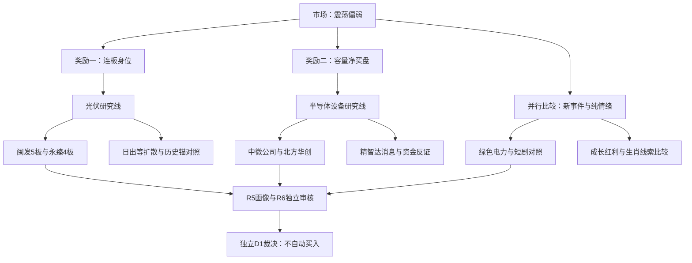

# 2026年11月9日 · 主线研判

> 数据源新鲜度：partial；降级状态：是；置信度：0.476。
> 本报告是当日真实盘前研究，不是回放。行情截至11月6日收盘，消息和周末热榜按各源时点单列。

## 一句话结论

观察：光伏连板与半导体设备容量优先研究，交易合力未确认，不拿后排替代核心。

## 🧭 先认市场：奖励、温度与权限分开

市场奖励的是少数连板的身位与容量核心的相对抗跌，不是全市场风险偏好回升。11月6日上涨758家、下跌4741家，中位数跌1.87%；前日涨停池收盘反馈中位数为-1.74%。因此，五板高度不能覆盖大多数接力者的亏损。R1温度为高位震荡，**情绪=震荡偏弱**；这是上一交易日事实，不预写今日走势。

本轮保留两条优先研究线、六组次线对照；**已确认可交易主线为0条**。这里的0是本轮尚未完成“市场—板块—核心—必要风险”确认，不是证明全市场无机会，也不是账户零预算。R1的20%仅为有时限的市场研究上限建议，最迟09:30失效，须由D1/P1用新证据重评；本报告不另给仓位。真实用户单票15%、总仓80%、最多5只等上限照旧，账户当日硬预算仍未知，不能从未知推成正额度。

唯一主模板选“三格”：龙头、补涨、切换。它用于解释地位，不混成五套超级策略。通道仍交D1依据当日赚钱效应与逐票门禁裁决；本轮无买卖价位、无下单指令。D1首次成案前，计划身份全部未知，不以旧计划未列票认定“计划外”。

| 市场截面 | 11月6日事实 | 研究含义 |
|---|---:|---|
| 收盘涨停 / 未封炸板 / 跌停 | 32 / 14 / 15 | 炸板率30.43%，全市场封板率69.57% |
| 前日涨停池 | 84只全匹配，中位数-1.74% | 近零均值不等于多数赚钱 |
| 最高板 | 闽发、浙文均5板 | 数板是辨识度，不是全部龙头认证 |
| 市场主力净额 | -524.97亿元 | 少数板块修复不能当全面资金进攻 |
| 砍半纪律 | 30.43%低于35% | 不把11月5日36.36%错移到11月6日 |

## 🔆 研究主线一：光伏概念，而非光伏普涨

**主线=光伏概念（研究线），持续性=5日活跃下限，封板率=60%，明日预期=分歧。** 同一当前614成分投影到11月2—6日，每天都有涨停；这只证明至少五天活跃，不认证首次启动，更不据此造行情round_id。11月6日实际交集9只收盘涨停、6只未封；与最强概念接口10家不完全一致，范围差异保留，不用接口的cons_nums当成分总数。

- **大资金意图**: 可解释为把部分风险预算集中在有高度、有名字辨识度的接力票，而不是买整个光伏产业。东财概念当日净流出29.93亿元，但五日仍净流入57.76亿元；一日分歧和一周积累必须同时看。
- **为什么走强**: 闽发5板、永臻4板构成当下身位；日出东方的周末人气与首板扩散构成另一层观察。不能反过来先编“东方字辈”故事，再把所有同字上涨视为验证。
- **逻辑够不够硬**: 连板与封板数据真实，产业新增强催化未核；闽发加工费风险与光伏资金转出是实质反证。模型有限定位为高潮/分歧，不断言已经退潮；生命周期真实年龄未知，未给算法塞假年龄。

| 研究层级 | 个股 | 昨涨幅 | 昨板数 | 流通市值亿元 | 判断 |
| 龙头 | 闽发铝业 `002578.SZ` | +10.11% | 5 | 43.14 | 观察，非交易资格 |
| 龙二 | 永臻股份 `603381.SH` | +10.03% | 4 | 29.48 | 观察，非交易资格 |
| 龙三 | 日出东方 `603366.SH` | +10.04% | 1 | 73.09 | 观察，非交易资格 |
| 龙三 | 新亚制程 `002388.SZ` | +10.07% | 3 | 33.77 | 观察，非交易资格 |
| 龙三 | 安彩高科 `600207.SH` | +9.91% | 1 | 53.16 | 观察，非交易资格 |

历史锚并未静默丢弃：光伏TOP3新能股份、杭电股份、顺钠股份先进入比较，再以实际地位裁决。五日DC资金在当前成分中分别排116、542、50，当前板数分别1、0、0，均命中“资金top3之外＋高度比5板龙头低超过2板”两项，**在光伏龙头排序中rank=杂毛**。这是板块与时点限定，不否定新能作为独立电力首板对照；也不把旧锚定分当实时总龙资格。

闽发的高度地位不因加工费风险被偷换成低位票；合法出口是观察核心与空缺，不是自动补位。永臻是一字板，排不到不等于其他票应获资格。日出、安彩、新亚保留研究，但龙三身份不因上位被否自动上移。

## 🧩 研究主线二：半导体设备容量，与存储概念分开

**主线=半导体设备（研究线），资金持续性=3日，涨停封板率=未知，明日预期=分歧。** 27只当前成分与涨停/未封名单交集为0，封板率分母为0，所以不是0%也不是100%。资金行业净流入7.40亿元、五日118.34亿元，但板块当日跌2.33%；只有资金选择和相对抗跌，尚无完整赚钱效应修复。

- **大资金意图**: 同一分类内，中微公司、北方华创五日净额排前二，支持容量资金在设备国产化方向选择核心的假设；不能将行业主力数据解释成某个机构账户的真实意图。
- **为什么走强**: 此处“强”指资金及相对抗跌，不是绝对普涨。中微平收、北方跌0.18%，对照设备行业跌2.33%；而直接消息对象精智达跌7.48%、当日资金转出，说明消息与资金分层。
- **逻辑够不够硬**: R4精智达原文给出交付和产品证据，但1月、9月合同是旧订单，不是新签大单。设备与存储芯片、掩膜版不能只凭“半导体”三个字混成同一主线。中微/北方保留容量核心研究，仍缺T0承接及逐票画像。

| 研究层级 | 个股 | 昨涨幅 | 五日DC净额亿元 | 流通市值亿元 | 判断 |
| 龙头 | 中微公司 `688012.SH` | +0.00% | 32.98 | 2393.18 | 观察，非10cm妖股替代品 |
| 龙二 | 北方华创 `002371.SZ` | -0.18% | 23.80 | 4073.16 | 观察，非10cm妖股替代品 |
| 龙三 | 拓荆科技 `688072.SH` | -1.16% | 12.51 | 1412.41 | 观察，非10cm妖股替代品 |
| 龙三 | 精智达 `688627.SH` | -7.48% | 2.37 | 210.85 | 观察，非10cm妖股替代品 |

## ⚖️ 五维比较：只列已核证据，不为缺失补零

| 研究方向 | 热度/20 | 资金/20 | 涨停/20 | 叙事/20 | 共振/20 | 已核小计 | 完整总分 |
| 光伏概念 | 18 | 8 | 17 | 未知 | 未知 | 43/60 | 未完整 |
| 半导体设备 | 未知 | 18 | 4 | 14 | 未知 | 36/60 | 未完整 |
| 电力/绿色电力 | 未知 | 13 | 13 | 10 | 未知 | 36/60 | 未完整 |
| 短剧游戏/传媒情绪 | 15 | 7 | 12 | 10 | 未知 | 44/80 | 未完整 |
| 商业航天 | 20 | 5 | 7 | 未知 | 未知 | 32/60 | 未完整 |
| 机器人/消费级具身智能 | 14 | 5 | 10 | 15 | 未知 | 44/80 | 未完整 |
| 算力服务/磷化铟事件对照 | 未知 | 未知 | 未知 | 16 | 未知 | 16/20 | 未完整 |
| 生肖/名字梗观察 | 未知 | 未知 | 未知 | 未知 | 未知 | 0/0 | 未完整 |

每维仍为原0—20口径，没有新增权重。完整总分未知，不用已核小计冒充100分制，不按分数独立禁主线。R3五群失联使双源共振未知；周末L1在榜可以描述热度，不能独立顶替共振。光伏跨源核查只在已查R4正催化、R7日内资金两项中计0/2支持；这不是“没有市场机会”。设备为2/2支持，也不是三源齐备，更不是胜率或买权。四源共识主题为空。

## 🔀 次线与对照：为什么不选其他对象

| 对象 | 已核证据 | 本轮裁决及未晋级原因 |
|---|---|---|
| 电力/绿色电力 | DC概念+6.91亿；THS同名+3.55亿；电力行业+9.40亿 | 观察：电力五日仍-23.24亿，三个纯电力首板未形成完整接力地位；单日防守不自动变进攻主线 |
| 浙文影业及短剧 | 五板最高；短剧成分3U、1D；广电治理与精品扶持同文 | 观察：政策正反面不重复加权；浙文监管工作函实际限制未知，不虚构处罚或忽略风险 |
| 商业航天 | 周末热榜第1；当日DC-59.12亿、五日-99.28亿 | 降级研究：缺直接新事件与更完整传导；不是只因负资金一票否决 |
| 上纬新材/机器人 | 原文确认下线1万台；实现收入占比低 | 观察：下线不等于销售；盘后/周末消息不能用消息前跌幅一票否定，等待T0价格资金反应 |
| 杰创智能 | 暂定含税49.152亿服务合同，浮价、分批60个月 | 观察：融资、采购和验收不确定，五日DC为负；不把合同总额当收入或利润承诺 |
| 光智科技 | 2027—2029年供货意向与出口许可条件 | 观察：五日资金为正，最终协议与许可未完成，保留事件试错研究而非授予买权 |
| 七匹狼/生肖名字梗 | 当日+0.45%，五日DC-3.54亿；两源当日净额冲突 | 未纳入leaders：缺本批独立传播和跟风梯队；2026马年/预期2027羊年时钟无误，不以无产业政策否定纯情绪 |
| 贝特利 | 三板且预测目标日正确，流通16.10亿 | 不进：低于既有20亿硬线，非因301前缀 |
| 春光科技 | 三板、流通45.80亿、一字预测对象 | 观察：业务受益与板块带动未核，不凭预测概率替代龙头认定 |

成长池12家全部进入对照：九华旅游、赛诺医疗、上海沿浦、润本股份、天德钰、路维光电、兴齐眼药、百普赛斯、中微半导、大博医疗、合合信息、四川黄金。成长与质量观察有价值，但本轮未证其占据上述两线前二地位；芯片设计/掩膜版不无损映射设备。**中微半导与中微公司不是同一代码**。合合信息因市值变化回池不代表业绩改善，百普赛斯大跌不包装为低吸。原报告“严格通过0家”保留为证据闭环数，不扩成全市场结论。

红利月度TOP20同样先比较再裁决，包含炬华、中远、欧派、富维、航民、格力、国泰、海尔、云天化、老凤祥、四家银行及其余月度对象。10月30日旧息率和partial认证不自动变成今日资金核心；实时防守流入可研究，但未出现其逐票涨停带动与核心地位证据。本轮不以“老登”静态标签否定传统行业，也不让低波动权重代替妖股通道。逐一代码、实时涨跌与资金结果在JSON对照表中保留。

## 🧠 逐票研究链：四项必要字段不省略

以下“买入理由”仅指待证研究命题；所有票的盈亏比、止损距离与完整禁止清单仍未知。**RR未核不填0，研究观察不构成执行资格。** “止损条件”是研究假设失效条件，不是卖出指令或R2价位设计。

### 闽发铝业 `002578.SZ`｜光伏概念｜龙头｜观察

板型：开板后收盘回封；龙头认定：已确认2条/至少3条，研究rank不等于完整龙头；RR与止损距：未知；禁止清单命中：未知，未作全部通过。

- **大资金意图**: 仅描述公开净额选择：当日DC-0.7024亿元、五日+1.3049亿元；无法由接口净额认证机构主观意图。
- **为什么走强**: 同花顺光伏成分内5板最高，与浙文影业并列市场最高；涨停换手12.50%。但DC单日净卖出0.7024亿，THS净卖出1.6478亿，加工费风险公告已见，不能把封单当净买盘。
- **逻辑够不够硬**: 目前只够研究；板型描述、地位排序和事件原文分别有边界，尚未完成三项龙头认证与风险门禁。

**买入理由**：①研究地位/业务命题为：同花顺光伏成分内5板最高，与浙文影业并列市场最高；涨停换手12.50%。但DC单日净卖出0.7024亿，THS净卖出1.6478亿，加工费风险公告已见，不能把封单当净买盘。 ②以本轮已核日线、流通盘与资金记录作验证锚，不以来源文件存在或历史评分冒充资格。

**风险点**：加工费竞争/毛利率风险公告；日内净卖出；20—50亿流通盘风险。 另有T+1不能当天纠错及未知RR的必要限制。

**止损条件**：若次日核心地位被实际竞争者取代、无法形成已记录板块联动，或原事件关键前提被新公告否定，研究命题降级；真实已持仓行为由D1与执行既有规则裁决。

**可验证假设**：未来1—3个交易时段核“核心是否继续保持同通道前排、资金方向与价格是否同向、板块是否出现真实联动”；若只有单票高度而扩散和承接不出现，原合力假设不成立。观察点不是新增交易阈值，竞价一字与未开板结论只用真实T0记录验证。

### 永臻股份 `603381.SH`｜光伏概念｜龙二｜观察

板型：一字涨停；龙头认定：已确认1条/至少3条，研究rank不等于完整龙头；RR与止损距：未知；禁止清单命中：未知，未作全部通过。

- **大资金意图**: 仅描述公开净额选择：当日DC+0.4779亿元、五日+1.5940亿元；无法由接口净额认证机构主观意图。
- **为什么走强**: 4板、首封与末封均为竞价时段且日线一字；DC5日+1.5940亿，20—50亿流通盘风险。地位次于闽发，排不到不以低位杂毛替代。
- **逻辑够不够硬**: 目前只够研究；板型描述、地位排序和事件原文分别有边界，尚未完成三项龙头认证与风险门禁。

**买入理由**：①研究地位/业务命题为：4板、首封与末封均为竞价时段且日线一字；DC5日+1.5940亿，20—50亿流通盘风险。地位次于闽发，排不到不以低位杂毛替代。 ②以本轮已核日线、流通盘与资金记录作验证锚，不以来源文件存在或历史评分冒充资格。

**风险点**：一字难成交；流通29.48亿元；历史股性快照较旧且非未来封板率。 另有T+1不能当天纠错及未知RR的必要限制。

**止损条件**：若次日核心地位被实际竞争者取代、无法形成已记录板块联动，或原事件关键前提被新公告否定，研究命题降级；真实已持仓行为由D1与执行既有规则裁决。

**可验证假设**：未来1—3个交易时段核“核心是否继续保持同通道前排、资金方向与价格是否同向、板块是否出现真实联动”；若只有单票高度而扩散和承接不出现，原合力假设不成立。观察点不是新增交易阈值，竞价一字与未开板结论只用真实T0记录验证。

### 日出东方 `603366.SH`｜光伏概念｜龙三｜观察

板型：未开板涨停（是否一字另核）；龙头认定：已确认0条/至少3条，研究rank不等于完整龙头；RR与止损距：未知；禁止清单命中：未知，未作全部通过。

- **大资金意图**: 仅描述公开净额选择：当日DC+1.5560亿元、五日+1.4781亿元；无法由接口净额认证机构主观意图。
- **为什么走强**: 人气靠前、52次历史涨停与首板封板；DC当日+1.5560亿，但本轮高度非龙一，霸榜只为警报不证明出货。保留人气对照，不越过龙一/龙二。
- **逻辑够不够硬**: 目前只够研究；板型描述、地位排序和事件原文分别有边界，尚未完成三项龙头认证与风险门禁。

**买入理由**：①研究地位/业务命题为：人气靠前、52次历史涨停与首板封板；DC当日+1.5560亿，但本轮高度非龙一，霸榜只为警报不证明出货。保留人气对照，不越过龙一/龙二。 ②以本轮已核日线、流通盘与资金记录作验证锚，不以来源文件存在或历史评分冒充资格。

**风险点**：霸榜不等于已派发；首板身份非本轮高度龙；历史股性近期评级中。 另有T+1不能当天纠错及未知RR的必要限制。

**止损条件**：若次日核心地位被实际竞争者取代、无法形成已记录板块联动，或原事件关键前提被新公告否定，研究命题降级；真实已持仓行为由D1与执行既有规则裁决。

**可验证假设**：未来1—3个交易时段核“核心是否继续保持同通道前排、资金方向与价格是否同向、板块是否出现真实联动”；若只有单票高度而扩散和承接不出现，原合力假设不成立。观察点不是新增交易阈值，竞价一字与未开板结论只用真实T0记录验证。

### 新亚制程 `002388.SZ`｜光伏概念｜龙三｜观察

板型：未开板涨停（是否一字另核）；龙头认定：已确认1条/至少3条，研究rank不等于完整龙头；RR与止损距：未知；禁止清单命中：未知，未作全部通过。

- **大资金意图**: 仅描述公开净额选择：当日DC+0.2948亿元、五日+1.1838亿元；无法由接口净额认证机构主观意图。
- **为什么走强**: 3板且新亚制程在氟化工主题TOP3历史锚中，DC5日+1.1838亿；光伏成分重叠不是纯度证明，不能凭氟化工一只涨停认证独立主线。
- **逻辑够不够硬**: 目前只够研究；板型描述、地位排序和事件原文分别有边界，尚未完成三项龙头认证与风险门禁。

**买入理由**：①研究地位/业务命题为：3板且新亚制程在氟化工主题TOP3历史锚中，DC5日+1.1838亿；光伏成分重叠不是纯度证明，不能凭氟化工一只涨停认证独立主线。 ②以本轮已核日线、流通盘与资金记录作验证锚，不以来源文件存在或历史评分冒充资格。

**风险点**：跨概念成分不等于纯度；流通33.77亿元；3板相对5板存在中位风险。 另有T+1不能当天纠错及未知RR的必要限制。

**止损条件**：若次日核心地位被实际竞争者取代、无法形成已记录板块联动，或原事件关键前提被新公告否定，研究命题降级；真实已持仓行为由D1与执行既有规则裁决。

**可验证假设**：未来1—3个交易时段核“核心是否继续保持同通道前排、资金方向与价格是否同向、板块是否出现真实联动”；若只有单票高度而扩散和承接不出现，原合力假设不成立。观察点不是新增交易阈值，竞价一字与未开板结论只用真实T0记录验证。

### 安彩高科 `600207.SH`｜光伏概念｜龙三｜观察

板型：开板后收盘回封；龙头认定：已确认1条/至少3条，研究rank不等于完整龙头；RR与止损距：未知；禁止清单命中：未知，未作全部通过。

- **大资金意图**: 仅描述公开净额选择：当日DC+0.7543亿元、五日+0.7638亿元；无法由接口净额认证机构主观意图。
- **为什么走强**: 光伏设备首板且DC单日+0.7543亿；作为低位扩散实证，不因资金流入较强替代高辨识度龙一。
- **逻辑够不够硬**: 目前只够研究；板型描述、地位排序和事件原文分别有边界，尚未完成三项龙头认证与风险门禁。

**买入理由**：①研究地位/业务命题为：光伏设备首板且DC单日+0.7543亿；作为低位扩散实证，不因资金流入较强替代高辨识度龙一。 ②以本轮已核日线、流通盘与资金记录作验证锚，不以来源文件存在或历史评分冒充资格。

**风险点**：仅首板、低位扩散非总龙；板块资金转出且历史近期股性弱。 另有T+1不能当天纠错及未知RR的必要限制。

**止损条件**：若次日核心地位被实际竞争者取代、无法形成已记录板块联动，或原事件关键前提被新公告否定，研究命题降级；真实已持仓行为由D1与执行既有规则裁决。

**可验证假设**：未来1—3个交易时段核“核心是否继续保持同通道前排、资金方向与价格是否同向、板块是否出现真实联动”；若只有单票高度而扩散和承接不出现，原合力假设不成立。观察点不是新增交易阈值，竞价一字与未开板结论只用真实T0记录验证。

### 中微公司 `688012.SH`｜半导体设备｜龙头｜观察

板型：未形成收盘涨停板，完整形态未核；龙头认定：已确认0条/至少3条，研究rank不等于完整龙头；RR与止损距：未知；禁止清单命中：未知，未作全部通过。

- **大资金意图**: 仅描述公开净额选择：当日DC+1.8179亿元、五日+32.9811亿元；无法由接口净额认证机构主观意图。
- **为什么走强**: 实际已取27只半导体设备成分中，5/5有效日DC净流入累计32.9811亿排名第1；T-1平收。是容量资金核心，不冒充10cm情绪妖股，也不由资金第一自动认证可买。
- **逻辑够不够硬**: 目前只够研究；板型描述、地位排序和事件原文分别有边界，尚未完成三项龙头认证与风险门禁。

**买入理由**：①研究地位/业务命题为：实际已取27只半导体设备成分中，5/5有效日DC净流入累计32.9811亿排名第1；T-1平收。是容量资金核心，不冒充10cm情绪妖股，也不由资金第一自动认证可买。 ②以本轮已核日线、流通盘与资金记录作验证锚，不以来源文件存在或历史评分冒充资格。

**风险点**：资金净额不是可执行收益；行业仍跌；无完整画像与T0结构。 另有T+1不能当天纠错及未知RR的必要限制。

**止损条件**：若次日核心地位被实际竞争者取代、无法形成已记录板块联动，或原事件关键前提被新公告否定，研究命题降级；真实已持仓行为由D1与执行既有规则裁决。

**可验证假设**：未来1—3个交易时段核“核心是否继续保持同通道前排、资金方向与价格是否同向、板块是否出现真实联动”；若只有单票高度而扩散和承接不出现，原合力假设不成立。观察点不是新增交易阈值，竞价一字与未开板结论只用真实T0记录验证。

### 北方华创 `002371.SZ`｜半导体设备｜龙二｜观察

板型：未形成收盘涨停板，完整形态未核；龙头认定：已确认0条/至少3条，研究rank不等于完整龙头；RR与止损距：未知；禁止清单命中：未知，未作全部通过。

- **大资金意图**: 仅描述公开净额选择：当日DC+6.1048亿元、五日+23.7954亿元；无法由接口净额认证机构主观意图。
- **为什么走强**: 同口径成分5日净流入23.7954亿第2，单日+6.1048亿，跌0.18%相对板块抗跌；仅研究容量龙二，不以当日资金替代T0买点。
- **逻辑够不够硬**: 目前只够研究；板型描述、地位排序和事件原文分别有边界，尚未完成三项龙头认证与风险门禁。

**买入理由**：①研究地位/业务命题为：同口径成分5日净流入23.7954亿第2，单日+6.1048亿，跌0.18%相对板块抗跌；仅研究容量龙二，不以当日资金替代T0买点。 ②以本轮已核日线、流通盘与资金记录作验证锚，不以来源文件存在或历史评分冒充资格。

**风险点**：容量核心不等于情绪龙；未核连续成交承接；股性弱不单独否定容量通道。 另有T+1不能当天纠错及未知RR的必要限制。

**止损条件**：若次日核心地位被实际竞争者取代、无法形成已记录板块联动，或原事件关键前提被新公告否定，研究命题降级；真实已持仓行为由D1与执行既有规则裁决。

**可验证假设**：未来1—3个交易时段核“核心是否继续保持同通道前排、资金方向与价格是否同向、板块是否出现真实联动”；若只有单票高度而扩散和承接不出现，原合力假设不成立。观察点不是新增交易阈值，竞价一字与未开板结论只用真实T0记录验证。

### 拓荆科技 `688072.SH`｜半导体设备｜龙三｜观察

板型：未形成收盘涨停板，完整形态未核；龙头认定：已确认0条/至少3条，研究rank不等于完整龙头；RR与止损距：未知；禁止清单命中：未知，未作全部通过。

- **大资金意图**: 仅描述公开净额选择：当日DC-0.3550亿元、五日+12.5146亿元；无法由接口净额认证机构主观意图。
- **为什么走强**: 5日DC+12.5146亿排名第3；当日-0.3550亿，保持龙三研究身份，不因688前缀排除亦不自动递补。
- **逻辑够不够硬**: 目前只够研究；板型描述、地位排序和事件原文分别有边界，尚未完成三项龙头认证与风险门禁。

**买入理由**：①研究地位/业务命题为：5日DC+12.5146亿排名第3；当日-0.3550亿，保持龙三研究身份，不因688前缀排除亦不自动递补。 ②以本轮已核日线、流通盘与资金记录作验证锚，不以来源文件存在或历史评分冒充资格。

**风险点**：当日净额转出；排名第3不能自动顶替前二。 另有T+1不能当天纠错及未知RR的必要限制。

**止损条件**：若次日核心地位被实际竞争者取代、无法形成已记录板块联动，或原事件关键前提被新公告否定，研究命题降级；真实已持仓行为由D1与执行既有规则裁决。

**可验证假设**：未来1—3个交易时段核“核心是否继续保持同通道前排、资金方向与价格是否同向、板块是否出现真实联动”；若只有单票高度而扩散和承接不出现，原合力假设不成立。观察点不是新增交易阈值，竞价一字与未开板结论只用真实T0记录验证。

### 精智达 `688627.SH`｜半导体设备｜龙三｜观察

板型：未形成收盘涨停板，完整形态未核；龙头认定：已确认0条/至少3条，研究rank不等于完整龙头；RR与止损距：未知；禁止清单命中：未知，未作全部通过。

- **大资金意图**: 仅描述公开净额选择：当日DC-1.8980亿元、五日+2.3690亿元；无法由接口净额认证机构主观意图。
- **为什么走强**: R4直接事件映射：旧存储测试合同按节奏交付与SoC ATE产品推出；不是新签大单。股价-7.4762%、当日DC-1.8980亿，事件真实性与资金选择冲突，降为研究对照。
- **逻辑够不够硬**: 目前只够研究；板型描述、地位排序和事件原文分别有边界，尚未完成三项龙头认证与风险门禁。

**买入理由**：①研究地位/业务命题为：R4直接事件映射：旧存储测试合同按节奏交付与SoC ATE产品推出；不是新签大单。股价-7.4762%、当日DC-1.8980亿，事件真实性与资金选择冲突，降为研究对照。 ②以本轮已核日线、流通盘与资金记录作验证锚，不以来源文件存在或历史评分冒充资格。

**风险点**：公告涉及旧订单而非新大单；价格-7.48%与资金转出；新产品商业化未知。 另有T+1不能当天纠错及未知RR的必要限制。

**止损条件**：若次日核心地位被实际竞争者取代、无法形成已记录板块联动，或原事件关键前提被新公告否定，研究命题降级；真实已持仓行为由D1与执行既有规则裁决。

**可验证假设**：未来1—3个交易时段核“核心是否继续保持同通道前排、资金方向与价格是否同向、板块是否出现真实联动”；若只有单票高度而扩散和承接不出现，原合力假设不成立。观察点不是新增交易阈值，竞价一字与未开板结论只用真实T0记录验证。

### 新能股份 `000595.SZ`｜电力/绿色电力｜龙三｜观察

板型：开板后收盘回封；龙头认定：已确认1条/至少3条，研究rank不等于完整龙头；RR与止损距：未知；禁止清单命中：未知，未作全部通过。

- **大资金意图**: 仅描述公开净额选择：当日DC+0.4699亿元、五日+0.2527亿元；无法由接口净额认证机构主观意图。
- **为什么走强**: 电力原始涨停首封最早，新能首板、DC当日+0.4699亿；历史锚TOP1不等于当下总龙，旧股性名称为宝塔实业，代码精确映射而非新发明名字梗。
- **逻辑够不够硬**: 目前只够研究；板型描述、地位排序和事件原文分别有边界，尚未完成三项龙头认证与风险门禁。

**买入理由**：①研究地位/业务命题为：电力原始涨停首封最早，新能首板、DC当日+0.4699亿；历史锚TOP1不等于当下总龙，旧股性名称为宝塔实业，代码精确映射而非新发明名字梗。 ②以本轮已核日线、流通盘与资金记录作验证锚，不以来源文件存在或历史评分冒充资格。

**风险点**：核心带动未核、T0承接未核；资金和历史锚不能替代主线地位。 另有T+1不能当天纠错及未知RR的必要限制。

**止损条件**：若次日核心地位被实际竞争者取代、无法形成已记录板块联动，或原事件关键前提被新公告否定，研究命题降级；真实已持仓行为由D1与执行既有规则裁决。

**可验证假设**：未来1—3个交易时段核“核心是否继续保持同通道前排、资金方向与价格是否同向、板块是否出现真实联动”；若只有单票高度而扩散和承接不出现，原合力假设不成立。观察点不是新增交易阈值，竞价一字与未开板结论只用真实T0记录验证。

### 立新能源 `001258.SZ`｜电力/绿色电力｜龙三｜观察

板型：开板后收盘回封；龙头认定：已确认1条/至少3条，研究rank不等于完整龙头；RR与止损距：未知；禁止清单命中：未知，未作全部通过。

- **大资金意图**: 仅描述公开净额选择：当日DC+1.2924亿元、五日+1.3007亿元；无法由接口净额认证机构主观意图。
- **为什么走强**: 电力首板、DC当日+1.2924亿，绿色电力历史锚TOP2；缺足够持续性与主线地位，不能用净流入升级龙一。
- **逻辑够不够硬**: 目前只够研究；板型描述、地位排序和事件原文分别有边界，尚未完成三项龙头认证与风险门禁。

**买入理由**：①研究地位/业务命题为：电力首板、DC当日+1.2924亿，绿色电力历史锚TOP2；缺足够持续性与主线地位，不能用净流入升级龙一。 ②以本轮已核日线、流通盘与资金记录作验证锚，不以来源文件存在或历史评分冒充资格。

**风险点**：核心带动未核、T0承接未核；资金和历史锚不能替代主线地位。 另有T+1不能当天纠错及未知RR的必要限制。

**止损条件**：若次日核心地位被实际竞争者取代、无法形成已记录板块联动，或原事件关键前提被新公告否定，研究命题降级；真实已持仓行为由D1与执行既有规则裁决。

**可验证假设**：未来1—3个交易时段核“核心是否继续保持同通道前排、资金方向与价格是否同向、板块是否出现真实联动”；若只有单票高度而扩散和承接不出现，原合力假设不成立。观察点不是新增交易阈值，竞价一字与未开板结论只用真实T0记录验证。

### 东方新能 `002310.SZ`｜电力/绿色电力｜龙三｜观察

板型：未开板涨停（是否一字另核）；龙头认定：已确认0条/至少3条，研究rank不等于完整龙头；RR与止损距：未知；禁止清单命中：未知，未作全部通过。

- **大资金意图**: 仅描述公开净额选择：当日DC+1.3216亿元、五日+1.3000亿元；无法由接口净额认证机构主观意图。
- **为什么走强**: 电力首板、DC当日+1.3216亿且周末热榜靠前；名称历史变化和当前资产纯度须R5核，单字共现不证明名字主线。
- **逻辑够不够硬**: 目前只够研究；板型描述、地位排序和事件原文分别有边界，尚未完成三项龙头认证与风险门禁。

**买入理由**：①研究地位/业务命题为：电力首板、DC当日+1.3216亿且周末热榜靠前；名称历史变化和当前资产纯度须R5核，单字共现不证明名字主线。 ②以本轮已核日线、流通盘与资金记录作验证锚，不以来源文件存在或历史评分冒充资格。

**风险点**：核心带动未核、T0承接未核；资金和历史锚不能替代主线地位。 另有T+1不能当天纠错及未知RR的必要限制。

**止损条件**：若次日核心地位被实际竞争者取代、无法形成已记录板块联动，或原事件关键前提被新公告否定，研究命题降级；真实已持仓行为由D1与执行既有规则裁决。

**可验证假设**：未来1—3个交易时段核“核心是否继续保持同通道前排、资金方向与价格是否同向、板块是否出现真实联动”；若只有单票高度而扩散和承接不出现，原合力假设不成立。观察点不是新增交易阈值，竞价一字与未开板结论只用真实T0记录验证。

### 浙文影业 `601599.SH`｜短剧游戏/传媒情绪｜龙头｜观察

板型：开板后收盘回封；龙头认定：已确认2条/至少3条，研究rank不等于完整龙头；RR与止损距：未知；禁止清单命中：未知，未作全部通过。

- **大资金意图**: 仅描述公开净额选择：当日DC+1.0898亿元、五日+1.8652亿元；无法由接口净额认证机构主观意图。
- **为什么走强**: 5板最高与已披露监管工作函并存；DC单日+1.0898亿而THS-7.6126亿，跨源冲突显著，不抹平。
- **逻辑够不够硬**: 目前只够研究；板型描述、地位排序和事件原文分别有边界，尚未完成三项龙头认证与风险门禁。

**买入理由**：①研究地位/业务命题为：5板最高与已披露监管工作函并存；DC单日+1.0898亿而THS-7.6126亿，跨源冲突显著，不抹平。 ②以本轮已核日线、流通盘与资金记录作验证锚，不以来源文件存在或历史评分冒充资格。

**风险点**：监管工作函的官方全文与限制待核；THS与DC净额冲突；传媒当日资金流出。 另有T+1不能当天纠错及未知RR的必要限制。

**止损条件**：若次日核心地位被实际竞争者取代、无法形成已记录板块联动，或原事件关键前提被新公告否定，研究命题降级；真实已持仓行为由D1与执行既有规则裁决。

**可验证假设**：未来1—3个交易时段核“核心是否继续保持同通道前排、资金方向与价格是否同向、板块是否出现真实联动”；若只有单票高度而扩散和承接不出现，原合力假设不成立。观察点不是新增交易阈值，竞价一字与未开板结论只用真实T0记录验证。

### 思美传媒 `002712.SZ`｜短剧游戏/传媒情绪｜龙三｜观察

板型：未开板涨停（是否一字另核）；龙头认定：已确认0条/至少3条，研究rank不等于完整龙头；RR与止损距：未知；禁止清单命中：未知，未作全部通过。

- **大资金意图**: 仅描述公开净额选择：当日DC+0.5476亿元、五日+0.7889亿元；无法由接口净额认证机构主观意图。
- **为什么走强**: 短剧首板、DC当日+0.5476亿；是扩散对照，不因龙头有监管线索自动转正。
- **逻辑够不够硬**: 目前只够研究；板型描述、地位排序和事件原文分别有边界，尚未完成三项龙头认证与风险门禁。

**买入理由**：①研究地位/业务命题为：短剧首板、DC当日+0.5476亿；是扩散对照，不因龙头有监管线索自动转正。 ②以本轮已核日线、流通盘与资金记录作验证锚，不以来源文件存在或历史评分冒充资格。

**风险点**：核心带动未核、T0承接未核；资金和历史锚不能替代主线地位。 另有T+1不能当天纠错及未知RR的必要限制。

**止损条件**：若次日核心地位被实际竞争者取代、无法形成已记录板块联动，或原事件关键前提被新公告否定，研究命题降级；真实已持仓行为由D1与执行既有规则裁决。

**可验证假设**：未来1—3个交易时段核“核心是否继续保持同通道前排、资金方向与价格是否同向、板块是否出现真实联动”；若只有单票高度而扩散和承接不出现，原合力假设不成立。观察点不是新增交易阈值，竞价一字与未开板结论只用真实T0记录验证。

### 城市传媒 `600229.SH`｜短剧游戏/传媒情绪｜龙三｜观察

板型：未开板涨停（是否一字另核）；龙头认定：已确认0条/至少3条，研究rank不等于完整龙头；RR与止损距：未知；禁止清单命中：未知，未作全部通过。

- **大资金意图**: 仅描述公开净额选择：当日DC+0.3025亿元、五日+0.4733亿元；无法由接口净额认证机构主观意图。
- **为什么走强**: 短剧首板但成交与地位证据有限；早封仅为相对时序，不构成主线龙二认证。
- **逻辑够不够硬**: 目前只够研究；板型描述、地位排序和事件原文分别有边界，尚未完成三项龙头认证与风险门禁。

**买入理由**：①研究地位/业务命题为：短剧首板但成交与地位证据有限；早封仅为相对时序，不构成主线龙二认证。 ②以本轮已核日线、流通盘与资金记录作验证锚，不以来源文件存在或历史评分冒充资格。

**风险点**：核心带动未核、T0承接未核；资金和历史锚不能替代主线地位。 另有T+1不能当天纠错及未知RR的必要限制。

**止损条件**：若次日核心地位被实际竞争者取代、无法形成已记录板块联动，或原事件关键前提被新公告否定，研究命题降级；真实已持仓行为由D1与执行既有规则裁决。

**可验证假设**：未来1—3个交易时段核“核心是否继续保持同通道前排、资金方向与价格是否同向、板块是否出现真实联动”；若只有单票高度而扩散和承接不出现，原合力假设不成立。观察点不是新增交易阈值，竞价一字与未开板结论只用真实T0记录验证。

### 上纬新材 `688585.SH`｜机器人/消费级具身智能｜龙三｜观察

板型：未形成收盘涨停板，完整形态未核；龙头认定：已确认0条/至少3条，研究rank不等于完整龙头；RR与止损距：未知；禁止清单命中：未知，未作全部通过。

- **大资金意图**: 仅描述公开净额选择：当日DC+0.4637亿元、五日+1.3748亿元；无法由接口净额认证机构主观意图。
- **为什么走强**: R4直接公告映射且当日DC+0.4637亿；公告后T0反应尚未知，历史-1.65%不能否定周末事件。保留事件试错研究，不冒充产业龙。
- **逻辑够不够硬**: 目前只够研究；板型描述、地位排序和事件原文分别有边界，尚未完成三项龙头认证与风险门禁。

**买入理由**：①研究地位/业务命题为：R4直接公告映射且当日DC+0.4637亿；公告后T0反应尚未知，历史-1.65%不能否定周末事件。保留事件试错研究，不冒充产业龙。 ②以本轮已核日线、流通盘与资金记录作验证锚，不以来源文件存在或历史评分冒充资格。

**风险点**：下线量不是销量；新业务收入占比低；公告后价格反应尚未知。 另有T+1不能当天纠错及未知RR的必要限制。

**止损条件**：若次日核心地位被实际竞争者取代、无法形成已记录板块联动，或原事件关键前提被新公告否定，研究命题降级；真实已持仓行为由D1与执行既有规则裁决。

**可验证假设**：未来1—3个交易时段核“核心是否继续保持同通道前排、资金方向与价格是否同向、板块是否出现真实联动”；若只有单票高度而扩散和承接不出现，原合力假设不成立。观察点不是新增交易阈值，竞价一字与未开板结论只用真实T0记录验证。

### 杰创智能 `301248.SZ`｜算力服务/磷化铟事件对照｜龙三｜观察

板型：未形成收盘涨停板，完整形态未核；龙头认定：已确认0条/至少3条，研究rank不等于完整龙头；RR与止损距：未知；禁止清单命中：未知，未作全部通过。

- **大资金意图**: 仅描述公开净额选择：当日DC-0.0798亿元、五日-0.4236亿元；无法由接口净额认证机构主观意图。
- **为什么走强**: 签订暂定含税49.152亿算力服务合同，订单量价浮动、分批60个月、融资与验收风险；DC5日-0.4236亿。不是将合同总额作为利润。
- **逻辑够不够硬**: 目前只够研究；板型描述、地位排序和事件原文分别有边界，尚未完成三项龙头认证与风险门禁。

**买入理由**：①研究地位/业务命题为：签订暂定含税49.152亿算力服务合同，订单量价浮动、分批60个月、融资与验收风险；DC5日-0.4236亿。不是将合同总额作为利润。 ②以本轮已核日线、流通盘与资金记录作验证锚，不以来源文件存在或历史评分冒充资格。

**风险点**：融资与采购可能影响履约；分批浮价非收入承诺；五日资金负。 另有T+1不能当天纠错及未知RR的必要限制。

**止损条件**：若融资/设备采购或验收失败、订单被取消，合同兑现命题失效；不由R2生成止损价。

**可验证假设**：未来1—3个交易时段核“核心是否继续保持同通道前排、资金方向与价格是否同向、板块是否出现真实联动”；若只有单票高度而扩散和承接不出现，原合力假设不成立。观察点不是新增交易阈值，竞价一字与未开板结论只用真实T0记录验证。

### 光智科技 `300489.SZ`｜算力服务/磷化铟事件对照｜龙三｜观察

板型：未形成收盘涨停板，完整形态未核；龙头认定：已确认0条/至少3条，研究rank不等于完整龙头；RR与止损距：未知；禁止清单命中：未知，未作全部通过。

- **大资金意图**: 仅描述公开净额选择：当日DC+0.2830亿元、五日+4.0666亿元；无法由接口净额认证机构主观意图。
- **为什么走强**: 2027—2029磷化铟供货意向预计不低于6.01亿美元，最终协议与出口许可未完成；5日DC+4.0666亿不能代替必要许可。
- **逻辑够不够硬**: 目前只够研究；板型描述、地位排序和事件原文分别有边界，尚未完成三项龙头认证与风险门禁。

**买入理由**：①研究地位/业务命题为：2027—2029磷化铟供货意向预计不低于6.01亿美元，最终协议与出口许可未完成；5日DC+4.0666亿不能代替必要许可。 ②以本轮已核日线、流通盘与资金记录作验证锚，不以来源文件存在或历史评分冒充资格。

**风险点**：最终协议和出口许可未完成；意向可能调整取消；不能把金额当利润。 另有T+1不能当天纠错及未知RR的必要限制。

**止损条件**：若最终协议未能签订或出口许可被否/协议取消，原供货兑现命题失效；不由R2生成止损价。

**可验证假设**：未来1—3个交易时段核“核心是否继续保持同通道前排、资金方向与价格是否同向、板块是否出现真实联动”；若只有单票高度而扩散和承接不出现，原合力假设不成立。观察点不是新增交易阈值，竞价一字与未开板结论只用真实T0记录验证。

## 🔎 关键证据与跨源冲突

1. Tushare在线日线5573条、日指标5573条；涨跌停5日613条；DC概念531条、行业496条。成分采用当前Y且未出表版本，不冒充首次启动日成分。
2. 龙虎榜首次请求因缺trade_date失败，随后按11月2—6逐日重拉均成功；披露日期去重不等于某游资反复联手。未披露不当作无游资。
3. 浙文同日DC约+1.09亿元、THS约-7.61亿元；闽发DC约-0.70亿元、THS约-1.65亿元；七匹狼DC约+0.18亿元、THS约-0.13亿元。口径冲突保留，不取平均，更不从单一净额断言派发。
4. 股性xlsx只消费17条精确代码投影，历史名称和统计窗口保留。永臻历史最高1板与当前4板不冲突——时间窗口不同；不能拿旧评级覆盖当前身位。
5. 指定历史包run_id匹配，但records与market_feedback为空，逐evidence_id裁决数为0；没有另读E1历史正文。旧轮次全部未知，不追溯造首次可用时点。

## 数据源审计

| 源 | 日期 | 状态 | 覆盖与限制 |
|---|---|:--:|---|
| R1_style | 2026-11-09 | 🟡 | 原状态degraded；市场事实截至11月6日，有时限的20%研究建议非硬预算 |
| R3_sentiment | 2026-11-09 | 🟡 | partial；周末热榜L1与五群缺失分开，不把空共振写false |
| R4_news | 2026-11-09 | 🟡 | partial；28条事件已比较，必要原文内嵌；非全市场公告审计 |
| R7_capital_flow | 2026-11-09 | 🟡 | partial；文件实际可读，运输包不可用不等于当前资金不可用 |
| Tushare SDK/MCP | 2026-11-09 | 🟢 | 本次在线请求；事实为11月6日及已声明多日窗口 |
| Hithink官方API | 2026-11-09 | 🟡 | 两次查询成功；板块问句实际为正流入子集，跨源金额口径不混合 |
| 龙虎榜补拉 | 2026-11-09 | 🟢 | 5个真实交易日均返回；非30日机构/游资身份全核 |
| 公众号与群聊 | 2026-11-09 | 🟡 | 通过R3/R4字段消费；公众号38篇、核心8/10，五群不可用；未声称重复全文读取 |
| 因子快照 | 2026-11-09 | 🔴 | 目录不存在，factor_layer_degraded=true，不新造因子 |
| 主题锚/股性 | 2026-11-02 | 🟡 | 两文件哈希匹配；597目录、7主题TOP3和17条股性精确投影，非全量研究 |
| 成长池 | 2026-11-09 | 🟡 | 用户运输有限前缀；12家对照，完整条件缺口保留 |
| 红利池 | 2026-11-01 | 🟡 | 披露截止11月1日、估值10月30日；partial不升级 |
| 一字预测 | 2026-11-06 | 🟡 | 预测目标11月9日匹配；概率非命中，贝特利命中原市值硬线 |
| 复盘专题反馈 | 2026-11-06 | 🟡 | 运输原文为空，采用与效果unknown |
| R2唯一历史包 | 2026-11-09 | 🟡 | run_id核对通过；unreplayable、0条逐项证据，不续用旧round |
| R4内嵌催化日历 | 2026-11-07 | 🟡 | 已见前缀与来源索引，逐事项延期采纳，不重复计独立性 |

## 🧾 专题与历史裁决

R2专题context身份和context_sha256原样入JSON。六个本轮source索引完整保留，另携带R4内嵌日历；逐源7项裁决中，主题锚、股性、成长池、红利池与一字预测仅按上述用途采纳；空复盘专题反馈为unknown；R4日历为deferred。源文的partial、生成时点、事实日、投影省略范围没有升级。直接催化用R4事件原文，不把日历同稿再算独立支持。

历史包仅能证明本轮运输身份，不能证明旧报告同sector/round；由于包里没有evidence_id，history_adjudications为空数组，并在history_context披露原因和所有缺口。不能为满足形式造一个已采用历史经验。所有完整主次线对象均显式给出sector_id、round_id、event_at与有效窗口：来源ID不足和首次启动不明均为null；带时区窗口在JSON，正文不堆秒级时间。

## ⚠️ 不确定性与反证

当前尚无T0竞价、开盘资金与真实承接，因此“两个研究方向”不能读作“两个买入主线”。光伏的高度、设备的容量是两种不同奖励，不将其焊成同一策略。各条主线真实首次启动年龄未核，生命周期算法没有接受假年龄；光伏高潮/分歧仅是模型有限判断，设备阶段保留未知。五维完整总分未知不构成全市场停买，真实风险、个股必要缺证与账户硬限制各自作用于相应对象。

R6是实质硬否决唯一来源，本轮R2没有替R6发票；同板块龙三不因龙一被否自动递补。R5须对本轮精确代码做画像，R6只消费本轮研究JSON内嵌证据，不需要打开任何Markdown或联网。真实硬预算、T+1、人工确认与原执行保护均不变。

## 🔗 与其他R/D/E的关系

- 依赖：本轮R1、R3、R4、R7与唯一指定历史包；历史包缺正文不停止研究。
- 被消费：R5逐票画像、R6独立反证、D1独立成案；E1以后按真实结果回填，不预写兑现。
- 重评窗口：09:25后由竞价和新增资金证据重评研究意见，不自动延续旧判断。

## Sub-Agent 元数据

- skill：analyze_main_sectors_v1@1.4；filter_leader_v1已在同一会话完成层级标注。
- artifact：data/research/20261109/R2_main_sectors.json。
- 方法：本会话LLM比较裁决；在线数据与确定性算术取证，没有再启动模型/委派。
- model：gpt-6.1-sol。
- 状态：partial（证据缺口已列，不冒充全流程完整认证）。
