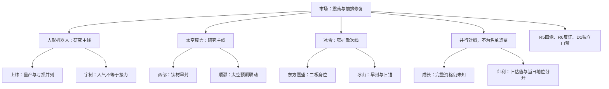

# 2026年11月10日 · 主线研判

> 数据源新鲜度：partial　｜　降级：true　｜　置信度：0.392
> 所有行情为2026-11-09完成交易日；本报告是2026-11-10盘前研究，不是竞价或盘中事实。

## 🧭 一句话结论

**观察机器人与太空算力核心；冰雪窄扩散留次线。情绪=震荡，18减至9，研究不等于买权。**

## 🌊 先认市场：市场到底在奖励什么

54涨停与44炸板并存，全市场封板率55.10%、炸板率44.90%。2242家上涨、3148家下跌，中位数为负、成交继续收缩，不能写成全面主升。前日涨停池收盘反馈均值约+4.17%，但开盘到收盘均值仅约+0.24%；市场奖励的是先手和前排修复，不是任何时点追价都能赚到相同收益。

沿用R1的高位震荡温度，不由阶段预设固定通道。本轮只用**树干模板**：市场奖励、主题扩散、核心地位，再核必要风险。R1的35%只是带有效窗口的研究市场意见，不是账户预算；账户当日有效预算未知，不抬成正额度，也不从旧计划无限继承0。用户既有15%单票、40%板块、80%总仓、5只持仓等硬线原样保留，R2不另发仓位调整。

## 🗺️ 主线与对照全景

图表已按发布端Mermaid 11.4.0实际浏览器渲染SVG，不仅检查围栏或语法。

## 📊 五维研究比较：先看合力，再看分数

| 研究方向 | 热度 | 资金 | 涨停 | 叙事 | 共振 | 合计 | 裁决 |
|---|---:|---:|---:|---:|---:|---:|---|
| 人形机器人 | 18 | 16 | 17 | 17 | 18 | 86 | 观察：主线候选 |
| 商业航天/太空算力 | 19 | 14 | 18 | 18 | 18 | 87 | 观察：主线候选 |
| 冰雪产业 | 18 | 13 | 16 | 11 | 16 | 74 | 观察：次线 |
| PCB | 14 | 18 | 15 | 14 | 15 | 76 | 观察：修复对照 |
| CPO | 14 | 19 | 13 | 12 | 13 | 71 | 观察：修复对照 |
| 银行 | 9 | 14 | 3 | 8 | 7 | 41 | 观察：风格切换对照 |

以上是原五维各0—20分的研究裁量，不是胜率，不改权重或阈值。机器人86排在航天87之前，是因为本体叙事与前排市场辨识更聚焦；PCB76不机械挤掉冰雪74的独立季节窗口。排序不由分数单独决定，更不产生买权。

### 🤖 人形机器人：合力已扩散，风险也在核心上

**主线 = 人形机器人，持续性 = 1日，封板率 = 50.00%，明日预期 = 分歧。**

“1日”仅认证昨日这次扩散截面，不是声称真实行情年龄只有一天。497个当前成分均有日线，341家上涨，中位涨幅约1.01%，9涨停、9炸板未封，9只涨停全部首板。确有广度，但承接质量不是强一致。

- **大资金意图**: 对本体量产、物理AI交互与数据瓶颈迁移下注是可检验假设，不是已知机构持仓动机。THS概念净流入30.4669亿元，与R7窄机器人行业4.6126亿元不同篮子，不相加。
- **为什么走强**: R3概念热榜8→2、本体人气回升，与真实9只涨停相互印证；上纬之前已有多票封板，不能伪造单票带动全板的因果。
- **逻辑够不够硬**: 生产下线与项目签约提供事件锚，但下线不等于交付、回款或盈利。上纬需求验证与亏损反证必须保留；完整龙头三项与RR未闭环，不能把研究龙一写成可买。

### 🚀 商业航天/太空算力：先涨与晚间发布分开

**主线 = 商业航天/太空算力，持续性 = 1日，封板率 = 56.00%，明日预期 = 分歧。**

当前511成分中510有日线，335家上涨，中位涨幅约0.75%，14涨停、11炸板未封。13只首板、润贝航科1只二板；这张宽概念名单不等于14只都受益于太空算力。润贝高度真实，但航空材料/服务映射不能强塞成钛材或太空云核心。

- **大资金意图**: 资金可能交易轨道基础设施与太空AI的远期增量；现有订单和营收归属仍需R5核实。THS概念日净额5.6336亿元，R7航天装备6.6373亿元是相邻工业篮子，不能互相冒充完整验证。
- **为什么走强**: 西部材料早封、顺灏同花顺83→38及东财99→10，显示先手资金选择；星云发布报道在昨日收盘之后，不能倒用作解释早盘封板。
- **逻辑够不够硬**: 星云产业发起主体是直接新线索，中科星图因此进入研究；但注册资本不是实缴或订单。钛材单柜测算仍有冲突，跨源同稿不重复计权。

### ❄️ 冰雪：封得住，不等于整个板块都涨

**次线 = 冰雪产业，持续性 = 1日，封板率 = 100.00%，明日预期 = 分歧。**

62个当前成分只有30家上涨、中位数0，6涨停、0收盘炸板；两只二板、四只首板。100%是“已经触板者”的分母，不是全体成分涨停概率，也不证明已成全天唯一主线。

- **大资金意图**: 季节性天气与文旅传播吸引短周期轮动是竞争性解释，是否持续从科技迁入尚未知。雪人和冰山五日东财净入分别7.0183、4.3432亿元，不能当整板块合计。
- **为什么走强**: R3概念热榜20→3；东方嘉盛二板身位、冰山早封与雪人人气容量各有不同证据。东方嘉盛首封早于同为二板的龙江交通，但不因此自动证明业务受益更强。
- **逻辑够不够硬**: R4没有核全冰雪直接催化与收入映射，未知留null，不写false。涨停家数上升不能替代订单、客流或次日承接。

## 🧩 逐票研究候选与T+1反证

候选身份是“研究观察”；同版D1首次成案前，今日计划归属全部未知。全部RR/结构止损距离未知，因此没有执行前置资格。排名仅为题材内研究排序；目前没有任何一只获本轮完整三项龙头认证。龙三不因龙一被否自动替补。

| 主题 | 代码/名称 | 研究层级 | 昨日板型 | 流通亿元 | 态度 |
|---|---|---|---|---:|---|
| 人形机器人 | `688585.SH` 上纬新材 | 龙头（暂定） | 首板、回封统计 | 871.34 | 观察 |
| 人形机器人 | `688836.SH` 宇树科技 | 龙二（暂定） | 未封板 | 215.43 | 观察 |
| 人形机器人 | `002931.SZ` 锋龙股份 | 龙三（暂定） | 首板、回封统计 | 88.85 | 观察 |
| 商业航天/太空算力 | `002149.SZ` 西部材料 | 龙头（暂定） | 首板、未开板统计 | 202.63 | 观察 |
| 商业航天/太空算力 | `002565.SZ` 顺灏股份 | 龙二（暂定） | 首板、未开板统计 | 111.72 | 观察 |
| 商业航天/太空算力 | `688568.SH` 中科星图 | 龙三（暂定） | 未封板 | 258.26 | 观察 |
| 冰雪产业 | `002889.SZ` 东方嘉盛 | 龙头（暂定） | 2板、未开板统计 | 41.21 | 观察 |
| 冰雪产业 | `000530.SZ` 冰山冷热 | 龙二（暂定） | 首板、未开板统计 | 57.43 | 观察 |
| 冰雪产业 | `002639.SZ` 雪人集团 | 龙三（暂定） | 首板、回封统计 | 105.29 | 观察 |

### 上纬新材 · `688585.SH`

**买入理由**：此处仅陈述研究入池依据，不是买入指令。T-1机器人弹性、人气核心；20cm首板、33.25亿元成交，R3产业叙事及R4万台下线均有对应；不将下线当交付。早盘已有多票封板，不能把本票当全板唯一启动者。 另外，已用本轮日线与每日指标核到真实价格、流通盘，而非因专题文件提到代码就授予资格。

**风险点**：R4 E005需求、收入占比及亏损反证实质存在；本轮不进执行，保留核心观察，不用低位后排替代风险核心。 完整禁止清单与本轮监管对象有效性未逐票核全；RR及结构止损距离仍未知，不能编成达标。

**止损条件**：本阶段不出执行止损价。研究撤销条件是次日核心承接消失且同主题出现明确扩散失败，或事件原件证伪相应业务关系；T+1、既有账户保护与D1独立退出规则不变。

**可验证假设**：下一至三个交易日核验该票能否继续带来同主题前排赚钱效应；对照昨日封板与人气位置、次日昨日涨停池反馈及事件新增实质状态。出现零新增同题材封板并伴核心不再承接，视为扩散假设反证，不把阈值改成新交易规则。若消息兑现而回封失效、板块不能继续扩散，先手兑现假设占优；若维持板块响应，则观察分歧后合力，非抄底。

### 宇树科技 · `688836.SH`

**买入理由**：此处仅陈述研究入池依据，不是买入指令。R3热股35→2；T-1上涨9.0433%，是本体人气对照，不因688前缀拒绝；未涨停，不冒充高度龙。 另外，已用本轮日线与每日指标核到真实价格、流通盘，而非因专题文件提到代码就授予资格。

**风险点**：交易拥挤、日内冲高回落；五日THS净额5.4411亿与东财1.2558亿分口径，禁止相加。 完整禁止清单与本轮监管对象有效性未逐票核全；RR及结构止损距离仍未知，不能编成达标。

**止损条件**：本阶段不出执行止损价。研究撤销条件是次日核心承接消失且同主题出现明确扩散失败，或事件原件证伪相应业务关系；T+1、既有账户保护与D1独立退出规则不变。

**可验证假设**：下一至三个交易日核验该票能否继续带来同主题前排赚钱效应；对照昨日封板与人气位置、次日昨日涨停池反馈及事件新增实质状态。出现零新增同题材封板并伴核心不再承接，视为扩散假设反证，不把阈值改成新交易规则。本体叙事若获次日承接而非单点冲高，可与上纬联动；未封板时不以热榜第二自动转成接力资格。

### 锋龙股份 · `002931.SZ`

**买入理由**：此处仅陈述研究入池依据，不是买入指令。原锚定分86.3；T-1普通10cm涨停，10.77%换手，沪深同权；作为情绪通道比较对象，锚定分不代替最新地位。 另外，已用本轮日线与每日指标核到真实价格、流通盘，而非因专题文件提到代码就授予资格。

**风险点**：原000084.KP人形锚与本轮886069.TI成分口径不同，须保留映射缺口；尾盘回封并非竞价强一字。 完整禁止清单与本轮监管对象有效性未逐票核全；RR及结构止损距离仍未知，不能编成达标。

**止损条件**：本阶段不出执行止损价。研究撤销条件是次日核心承接消失且同主题出现明确扩散失败，或事件原件证伪相应业务关系；T+1、既有账户保护与D1独立退出规则不变。

**可验证假设**：下一至三个交易日核验该票能否在不替代既有核心的前提下形成真实联动；对照昨日封板与人气位置、次日昨日涨停池反馈及事件新增实质状态。出现零新增同题材封板并伴核心不再承接，视为扩散假设反证，不把阈值改成新交易规则。本体核心的联动响应决定补涨能否被市场承认；没有带动证据则不把历史股性封成新总龙。

### 西部材料 · `002149.SZ`

**买入理由**：此处仅陈述研究入池依据，不是买入指令。太空算力钛材细分T-1最早封板09:30、无开板、流通202.63亿；比只沾大概念的2板润贝映射更直接，龙一限定该细分而非整张511成分高度榜。 另外，已用本轮日线与每日指标核到真实价格、流通盘，而非因专题文件提到代码就授予资格。

**风险点**：T-1价格几乎全天封板、只有3.03%换手，次日可得性与需求兑现两重风险；R3钛材单柜测算冲突未消除。 完整禁止清单与本轮监管对象有效性未逐票核全；RR及结构止损距离仍未知，不能编成达标。

**止损条件**：本阶段不出执行止损价。研究撤销条件是次日核心承接消失且同主题出现明确扩散失败，或事件原件证伪相应业务关系；T+1、既有账户保护与D1独立退出规则不变。

**可验证假设**：下一至三个交易日核验该票能否继续带来同主题前排赚钱效应；对照昨日封板与人气位置、次日昨日涨停池反馈及事件新增实质状态。出现零新增同题材封板并伴核心不再承接，视为扩散假设反证，不把阈值改成新交易规则。已被先手交易的钛材预期若再大幅高开，未必有T+1盈亏比；观察分歧承接与顺灏联动，不把早封当可成交。

### 顺灏股份 · `002565.SZ`

**买入理由**：此处仅陈述研究入池依据，不是买入指令。R3热度同花顺83→38、东财99→10；T-1首封09:30:06、零开板、4/8强势，太空算力题材辨识优于泛成分。 另外，已用本轮日线与每日指标核到真实价格、流通盘，而非因专题文件提到代码就授予资格。

**风险点**：参股及远期太空AI商业化不是现有订单和业绩；历史4/8不等于4连板。 完整禁止清单与本轮监管对象有效性未逐票核全；RR及结构止损距离仍未知，不能编成达标。

**止损条件**：本阶段不出执行止损价。研究撤销条件是次日核心承接消失且同主题出现明确扩散失败，或事件原件证伪相应业务关系；T+1、既有账户保护与D1独立退出规则不变。

**可验证假设**：下一至三个交易日核验该票能否继续带来同主题前排赚钱效应；对照昨日封板与人气位置、次日昨日涨停池反馈及事件新增实质状态。出现零新增同题材封板并伴核心不再承接，视为扩散假设反证，不把阈值改成新交易规则。若西部继续有合力，本票可作同叙事联动；反之太空计算远景被先手兑现，就不能依靠再找谐音或低位后排续故事。

### 中科星图 · `688568.SH`

**买入理由**：此处仅陈述研究入池依据，不是买入指令。R4 E001直接列星云产业发起主体；T-1+2.5345%，新事件映射与市场核心并行比较。非因为旧名单缺席而排除。 另外，已用本轮日线与每日指标核到真实价格、流通盘，而非因专题文件提到代码就授予资格。

**风险点**：注册资本不是实缴/销售订单；发布稿16:14在T-1收盘之后，不能倒用作解释当日早盘资金；当前人气/封板地位弱于西部顺灏。 完整禁止清单与本轮监管对象有效性未逐票核全；RR及结构止损距离仍未知，不能编成达标。

**止损条件**：本阶段不出执行止损价。研究撤销条件是次日核心承接消失且同主题出现明确扩散失败，或事件原件证伪相应业务关系；T+1、既有账户保护与D1独立退出规则不变。

**可验证假设**：下一至三个交易日核验该票能否在不替代既有核心的前提下形成真实联动；对照昨日封板与人气位置、次日昨日涨停池反馈及事件新增实质状态。出现零新增同题材封板并伴核心不再承接，视为扩散假设反证，不把阈值改成新交易规则。次日若新发布吸引真实承接才可能形成切换；当前只是事件观察，不用未封板的新消息替代已被市场选出的核心。

### 东方嘉盛 · `002889.SZ`

**买入理由**：此处仅陈述研究入池依据，不是买入指令。本轮冰雪成分最高2板并列，首封09:30早于龙江09:30:04，零开板，原锚TOP3；只是62成分身位研究排序，不认证全市场总龙。 另外，已用本轮日线与每日指标核到真实价格、流通盘，而非因专题文件提到代码就授予资格。

**风险点**：流通41.21亿元处于20—50亿警示带；冰雪直接收入和真实催化未由R4核全，不拿物流标签当充分受益关系。 完整禁止清单与本轮监管对象有效性未逐票核全；RR及结构止损距离仍未知，不能编成达标。

**止损条件**：本阶段不出执行止损价。研究撤销条件是次日核心承接消失且同主题出现明确扩散失败，或事件原件证伪相应业务关系；T+1、既有账户保护与D1独立退出规则不变。

**可验证假设**：下一至三个交易日核验该票能否继续带来同主题前排赚钱效应；对照昨日封板与人气位置、次日昨日涨停池反馈及事件新增实质状态。出现零新增同题材封板并伴核心不再承接，视为扩散假设反证，不把阈值改成新交易规则。2板的次日高开可能已兑现大部分隔夜收益；需核板块前排反馈，不能把冰雪六只封板误当全体普涨。

### 冰山冷热 · `000530.SZ`

**买入理由**：此处仅陈述研究入池依据，不是买入指令。冰雪原锚TOP1，T-1首板09:32:21零开板、14.8%换手，五日四个上榜日提供交易活跃证据；优先于未涨停的旧锚冰轮。 另外，已用本轮日线与每日指标核到真实价格、流通盘，而非因专题文件提到代码就授予资格。

**风险点**：THS流通61.01亿与Tushare57.43亿口径差异未解，均高于50亿但不平均；历史4/8非4板，不能按补涨位置造高度。 完整禁止清单与本轮监管对象有效性未逐票核全；RR及结构止损距离仍未知，不能编成达标。

**止损条件**：本阶段不出执行止损价。研究撤销条件是次日核心承接消失且同主题出现明确扩散失败，或事件原件证伪相应业务关系；T+1、既有账户保护与D1独立退出规则不变。

**可验证假设**：下一至三个交易日核验该票能否继续带来同主题前排赚钱效应；对照昨日封板与人气位置、次日昨日涨停池反馈及事件新增实质状态。出现零新增同题材封板并伴核心不再承接，视为扩散假设反证，不把阈值改成新交易规则。若雪人午后反复开板风险传导，本票需核开板后承接；早封与容量可交易性并非次日继续强的保证。

### 雪人集团 · `002639.SZ`

**买入理由**：此处仅陈述研究入池依据，不是买入指令。R3冰雪热度跃升、R7东财单日资金榜第4；T-1成交27.45亿、换手26.76%，是人气容量观察对象，不靠净流入挤占2板身位。 另外，已用本轮日线与每日指标核到真实价格、流通盘，而非因专题文件提到代码就授予资格。

**风险点**：首封13:09、4次开板至14:43回封，承接质量弱于早封前排；不是14点以后首次点火，不能误命中尾盘首封禁项。 完整禁止清单与本轮监管对象有效性未逐票核全；RR及结构止损距离仍未知，不能编成达标。

**止损条件**：本阶段不出执行止损价。研究撤销条件是次日核心承接消失且同主题出现明确扩散失败，或事件原件证伪相应业务关系；T+1、既有账户保护与D1独立退出规则不变。

**可验证假设**：下一至三个交易日核验该票能否在不替代既有核心的前提下形成真实联动；对照昨日封板与人气位置、次日昨日涨停池反馈及事件新增实质状态。出现零新增同题材封板并伴核心不再承接，视为扩散假设反证，不把阈值改成新交易规则。次日真正弱转强需市场承接而非高开后兑现；资金统计只说明成交分档，不证明游资护盘或锁仓。

## ⚖️ 为什么没有选对照对象

| 来源/方向 | 实际比较 | 本轮不晋级的原因 |
|---|---|---|
| 历史锚 | 大业、天娱、魅视、中京、冰轮与现有核心并行 | 先进入研究比较；未封板或未证明本轮前排地位，不能靠旧锚分替换已获市场承认的核心。KP与TI成分不当同一个篮子 |
| 成长12家 | 赛诺、天德、路维、中微、兴齐等全部与live行情核对 | 专题完整资格仍0家闭环，不是全市场0机会；这些票未形成此轮前排封板或人气合力，不据此否定长期成长。路维股东名册不当新增回购 |
| 红利20家 | 炬华、中远海控、家居家电、银行等与当日行情并行 | 月报估值仍为10月30日、partial；银行修复有资金但未形成同等涨停梯队，不能用旧息率榜代替当前核心 |
| 高股性 | 桂发祥、九牧王、合富、胜通 | 桂发祥流通约18.76亿命中不足20亿硬线；其余历史连板不是今日地位认证。胜通首板真实，保留资源轮动比较而不贴成三主题龙头 |
| 一字预测 | 闽发、日出、东方新能、保利 | 预测目标日匹配，但概率不是命中或可成交。闽发6板仍缺金属板块扩散；东方新能GPU采购不是客户订单且有履约风险 |
| 名字梗/跨年 | 七匹狼与羊/狼线索 | 2026马年、预期2027羊年时钟正确，不因此排除；本轮未核真实传播与梯队，不把模型联想冒充市场共识 |
| 新事件 | 金固、中科星图与上纬/宇树、西部/顺灏对照 | 金固低收入占比与增持未实施并列；中科星图有直接事件映射，保留研究候补而不靠新消息直接授龙一 |
| PCB/CPO | 超声、奥士康及光互联核心 | 修复有资金不等于新轮首发；材料涨价的上下游效应不同。不是因为板块“老”或20cm前缀而剔除 |

前置收敛比较18只到研究leaders9只，严格减半；更广的专题与历史锚对照仍在JSON留痕，不把“比较过”偷换成“已入候选”。全市场moneyflow_dc截面恰达6000返回上限，仅精确引用已匹配代码，不认证该次返回为完整全市场排名。

## 🔎 不确定性 / 反证

真实轮次起点、同篮子连续资金天数未认证，所以所有方向的round_id与生命周期stage留null，不向整数判定器填假0或假1。event_at只有太空发布报道的真实带时区时点，其余缺证为null；有效窗口是本轮研究假设到开盘前的重评窗口，不伪造过去首次可得时间。

唯一历史包run_id已吻合，但records和market_feedback为空，且旧R2缺scope/window；history_adjudications以evidence_id=null、unknown交付，不捏造逐条经验或冻结预测兑现。旧E1经验不改评分、预算或交易授权。

R3、R4、R7均为partial；机器人、航天与冰雪的R7完整主题支持未知，逐项null而非“不在前十所以无资金”。本轮没有形成四源可比完整交集，consensus_themes为空；不把同一转发/接口重复加权。因子快照目录缺失，factor_layer_degraded=true，未编IR、IC或因子名次。

R4内嵌run_id匹配，但历史包关于checked-report mismatch的提示仍披露；本轮读取不是外部程序交付收据校验成功。专题只使用已运输截取与明确核取的锚字段；不是专题全文阅读或4508行逐行核验。复盘专题反馈为空，采用及效果unknown。

## 数据源审计

| 源 | 日期 | 状态 | 覆盖与限制 |
|---|---|:--:|---|
| R1市场基线 | 2026-11-09 | 🟡 | 当日重算degraded，非盘中事实 |
| R3共振/热榜 | 2026-11-09 | 🟡 | 5主题L1+L2，partial；原群匿名且同稿去重 |
| R4事件/公告 | 2026-11-10 | 🟡 | 21事件，本轮run_id；收据不一致提示保留 |
| R7资金 | 2026-11-09 | 🟡 | 10票与行业篮子；不能替代精确主题全篮 |
| Tushare日线/每日指标 | 2026-11-09 | 🟢 | 各5573唯一代码，本轮live查询 |
| Tushare涨停/成分 | 2026-11-09 | 🟢 | 11日1318板型记录，5个主题最新成分；静态成分回看 |
| Tushare龙虎榜 | 2026-11-09 | 🟢 | 首次范围调用报必填trade_date，已分5日成功重试；不认证30日无机构 |
| 同花顺问财 | 2026-11-09 | 🟢 | 筛板20、精确概念4、股票10；与THS热榜同底层不重算独立源 |
| fetch manifest | 2026-11-10 | 🟡 | 仅源索引与severity，未逐条重读raw |
| 公众号/群聊raw | 2026-11-10 | 🟡 | 通过R3/R4相关原文摘录，非raw全文阅读 |
| WeFlow | 2026-11-10 | 🔴 | 可选源本轮未读；沿R3退场降级，不造三层共振 |
| 股性/锚 | 2026-11-02 | 🟡 | 哈希核取、相关锚TOP3；非全表逐行阅读 |
| 成长扩池 | 2026-11-10 | 🟡 | 运输前缀，行情11月9日，生成结构认证未知 |
| 红利月报 | 2026-10-30 | 🟡 | partial；估值固定旧日，银行可持续性缺口保留 |
| 一字预判 | 2026-11-09 | 🟡 | 目标11月10日；预测不是命中/排单授权 |
| 历史/专题复盘反馈 | 2026-11-10 | 🔴 | 历史包不可重放、反馈正文空，unknown |
| 周度因子快照 | 2026-11-10 | 🔴 | 目录缺失；跳过，不改权重 |

## 🔗 与其他R/D/E的关系

依赖：本轮R1_style、R3_sentiment、R4_news、R7_capital_flow JSON；唯一R2_history_context；用户运输的六源专题包。R4内嵌日历source_id单独deferred，不把R4的adopted自动继承成R2采纳。

交付R5：精确匹配本轮9个leaders，图像/财务/监管等必要缺口由对应owner核；禁新或预算未知不停止画像。交付R6：本轮JSON内嵌原文与逐票缺口，R6的hard_reject保持唯一硬否决来源。交付D1：研究排序、事实时间、null轮次、18→9减半和分层门禁；不授予开仓权限，不自动启用龙三。

## Sub-Agent 元数据

- skill: analyze_main_sectors_v1@1.4 + filter_leader_v1
- artifact: data/research/20261110/R2_main_sectors.json
- evidence: data/research/20261110/R2_evidence_20261110.json
- model: gpt-6.1-sol
- 生成耗时: 981秒（从本轮首个时钟核验至封版；不含此前历史包首读）
- method: llm_v1；确定性辅助只抓取、计算、验证，不调用其他研究模型
- confidence: 0.70 × 0.7 × 0.8 = 0.392
- status: partial；证据交付，不冒充必要审核已完成
- token_usage: usage_unknown；不是0，不保证低于努力目标
