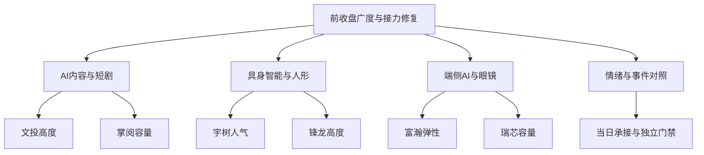

# 2026年11月11日 · 主线研判

> ⚠️ **数据源时间错位**：文件为11日盘前研究，市场事实截至10日收盘。今日竞价、承接与可交易主线尚未确认。
> **数据源新鲜度**：partial · **降级状态**：true · **置信度**：0.392

## 一句话结论
观察AI内容、具身与端侧三线；纯情绪有结构但未闭环，九票仅研究，不授买权。

## 🧭 先看市场奖励，再比较对象
前收盘市场奖励的是“能扩散的接力＋有辨识度的AI映射”，不是固定行业偏好。R1核得上涨4273家、下跌1149家，前日54只涨停池次日收盘平均反馈约+4.91%。非ST涨停93只、跌停0只、最终炸板19只，炸板率约16.96%；市场高度7板，但4—6板空档说明高度并非完整梯队。R1的“主升”只描述前收盘温度，不能替代本日市场。

采用一套主模板：**三格（龙头／补涨／切换）**。不把首板隔日、总龙锁仓和高位分歧硬焊在一起。内容资金/涨幅扩散最清楚，因此列首比较；具身89分高于内容86分，来自人气与新模型证据，分数不独立决定主位，更不决定买权。

| 研究主线 | 五维辅助分 | 前收盘合力 | 持续性与封板率 | 明日预期 |
|---|---:|---|---|---|
| AI内容／短剧游戏 | 86 | 传媒+4.53%、净入46.88亿；短剧概念+4.51%、问财净买31.16亿 | 实际连续日数未知；3日验证窗；封板率未知 | 分歧 |
| 具身智能／人形机器人 | 89 | 机器人行业+4.36%、净入3.84亿；锋龙二板、宇树人气双榜第一 | 实际连续日数未知；3日验证窗；封板率未知 | 分歧 |
| 端侧AI／AI眼镜 | 82 | 眼镜+4.07%、问财净买38.07亿；芯片与整机扩散 | 实际连续日数未知；3日验证窗；封板率未知 | 分歧 |

这里的3日是核验窗口，不是伪造的已持续天数。三个概念可重叠，净额不能相加。Tushare板块统计存在`up_nums > cons_nums`，未核字段语义；不拿两列相除造封板率。精确启动轮次和事件首次可用时刻均未证，JSON的`round_id/event_at`为null，意见有效窗最迟至开盘，竞价反证可提前使其失效。

## 🧩 主线一：AI内容／短剧游戏
- **大资金意图**: 可检验假设是资金交易AI生产降本与IP变现外溢。传媒当日净额与多票封板支持这一选择，但不是长期机构配置承诺。
- **为什么走强**: 文投二板先定高度，掌阅、慈文早盘封板，板块扩散不只依赖尾盘20cm；R3短剧/AI视频升温，R4当前内嵌收评和行业资料解释需求侧。
- **逻辑够不够硬**: 行情合力硬于“每家都能赚钱”。上证报采访中稳定盈利不足1%的判断只是受访者口径，却足以反驳降本必然高利润；上海电影利润下滑原公告不能省掉。首选是研究地位，不是盈利预测。

## 🤖 主线二：具身智能／人形机器人
- **大资金意图**: 本体、触觉数据与模型进步形成想象空间；宇树双榜第一和63.80亿元成交说明人气集中，不能据此证明任何第三方订单。
- **为什么走强**: R4内嵌厂商页面显示4983小时触觉预训练，R3文本讨论模型外溢，锋龙二板、福莱5天3板与多环节首板响应。模型厂商、转载和券商评论不算多份独立订单证据。
- **逻辑够不够硬**: 模型确有原文，A股收入映射未完整闭环。华培公告明确机器人产品尚无收入，上纬公告提示占比较低；它们限制对应公司兑现叙事，不能扩成全行业无机会。宇树人气核心保留，但严格龙一过滤所需高度或5日资金第一未证，不让低位后排自动替代。

## 🥽 主线三：端侧AI／AI眼镜
- **大资金意图**: 市场在交易AI入口、视觉处理与整机渗透，富瀚弹性和瑞芯容量同时有承接表征；不是因为20cm或大市值就静态排斥。
- **为什么走强**: 富瀚20cm首板、东财人气11，单日龙虎榜净买约2.68亿；瑞芯5天3板、R7五日净入约13.52亿。创维在眼镜样本更早封板，仍须保留作领涨结构对照，不能只挑喜欢的票。
- **逻辑够不够硬**: 眼镜与MR/世界模型不是同一产品或同一供应链。PICO日期群文仍有分歧，旧官微产品并非本期新订单；瑞芯5日约+29.55%后的RR须由D1独立推导。

## 📋 九只研究对象：地位不等于开仓资格

| 主线 | 代码／名称 | 研究地位 | 板型 | 流通亿 | 态度 |
|---|---|---|---|---:|---|
| AI内容/短剧游戏 | `600715.SH` 文投控股 | 龙头 | 普通10cm二板，0次开板；不是缩量一字认证 | 81.58 | 观察 |
| AI内容/短剧游戏 | `603533.SH` 掌阅科技 | 龙二 | 普通10cm首板回封，1次开板 | 143.96 | 观察 |
| AI内容/短剧游戏 | `002343.SZ` 慈文传媒 | 龙三 | 普通10cm首板，0次开板 | 44.19 | 观察 |
| 具身智能/人形机器人 | `688836.SH` 宇树科技 | 龙头 | 未涨停的趋势/抱团本体核心；不能认证板上接力 | 228.97 | 观察 |
| 具身智能/人形机器人 | `002931.SZ` 锋龙股份 | 龙二 | 普通10cm二板，0次开板 | 97.74 | 观察 |
| 具身智能/人形机器人 | `605488.SH` 福莱新材 | 龙三 | 普通10cm首板回封，MCP2次开板/问财1次存在口径冲突 | 171.03 | 观察 |
| 端侧AI/AI眼镜 | `300613.SZ` 富瀚微 | 龙头 | 创业板20cm首板，0次开板 | 175.86 | 观察 |
| 端侧AI/AI眼镜 | `603893.SH` 瑞芯微 | 龙二 | 普通10cm首板，5天3板不是3连板 | 987.25 | 观察 |
| 端侧AI/AI眼镜 | `000810.SZ` 创维数字 | 龙三 | 普通10cm首板，0次开板 | 135.74 | 观察 |

全部逐票保留“板型＋龙头认定支持项＋RR＋禁止清单状态”。RR与止损距未知，禁止清单只做局部核验，不把空命中列表当全阴性。filter_leader_v1已执行：只标前置排名，龙三不递补；本次执行合格对象为0，这是未授资格，不是全市场停买或研究池清零。

### 文投控股 · 600715.SH
- **买入理由**: 这里只解释研究入选而非买入指令：2连板、开盘后早封；东财人气3，内容簇高度与人气锚。单日龙虎榜微净卖不隐藏，三日榜不重复加权。；与本条主线实际批量反应比较，而不是从旧名单反贴故事。
- **风险点**: 单日龙虎榜-222.97万元与强封板并存；AI降本不等于作品利润；公司业务兑现待R5。完整监管/禁止清单与RR未核，不能因研究三项支持宣称开仓资格齐全。
- **止损条件**: R2不定价位、不生成订单；研究逻辑的撤销条件是公告证实映射错误，或本日核心转弱且板块跟风赚钱效应消失。若后续获持仓，具体退出由D1按同一理由制定，T+1等保护不变。
- **可验证假设**: 未来1—3个交易日分别核核心地位是否维持、首板/二板跟风是否延续和已述业务映射是否被公司否认；任一与原事实相反即降级该研究，不用后排自动替补。

### 掌阅科技 · 603533.SH
- **买入理由**: 这里只解释研究入选而非买入指令：内容IP/阅读锚，首封早于慈文，14.51%换手与20.44亿元成交；R7五日净流入5.370927亿元。未用资金排名替代2板龙一。；与本条主线实际批量反应比较，而不是从旧名单反贴故事。
- **风险点**: 首板非连板高度龙；投流成本与IP变现未充分核验。完整监管/禁止清单与RR未核，不能因研究三项支持宣称开仓资格齐全。
- **止损条件**: R2不定价位、不生成订单；研究逻辑的撤销条件是公告证实映射错误，或本日核心转弱且板块跟风赚钱效应消失。若后续获持仓，具体退出由D1按同一理由制定，T+1等保护不变。
- **可验证假设**: 未来1—3个交易日分别核核心地位是否维持、首板/二板跟风是否延续和已述业务映射是否被公司否认；任一与原事实相反即降级该研究，不用后排自动替补。

### 慈文传媒 · 002343.SZ
- **买入理由**: 这里只解释研究入选而非买入指令：微短剧直接业务线索、热榜56→14与无开板；保留对照但不能因早封/资金支持跃过文投高度或掌阅容量。；与本条主线实际批量反应比较，而不是从旧名单反贴故事。
- **风险点**: 流通20—50亿警示；板块内第三研究位，不递补执行。完整监管/禁止清单与RR未核，不能因研究三项支持宣称开仓资格齐全。
- **止损条件**: R2不定价位、不生成订单；研究逻辑的撤销条件是公告证实映射错误，或本日核心转弱且板块跟风赚钱效应消失。若后续获持仓，具体退出由D1按同一理由制定，T+1等保护不变。
- **可验证假设**: 未来1—3个交易日分别核核心地位是否维持、首板/二板跟风是否延续和已述业务映射是否被公司否认；任一与原事实相反即降级该研究，不用后排自动替补。

### 宇树科技 · 688836.SH
- **买入理由**: 这里只解释研究入选而非买入指令：同花顺/东财本期双榜1、+6.2863%、成交63.7997亿元与27.5107%换手；是人气本体核心，不把前缀688当过滤理由。纯连板高度不是它。；与本条主线实际批量反应比较，而不是从旧名单反贴故事。
- **风险点**: 冲高809收761.01，今日承接未知；严格filter龙一所需5日资金top1/高度top1未证，执行前置资格未知。完整监管/禁止清单与RR未核，不能因研究三项支持宣称开仓资格齐全。
- **止损条件**: R2不定价位、不生成订单；研究逻辑的撤销条件是公告证实映射错误，或本日核心转弱且板块跟风赚钱效应消失。若后续获持仓，具体退出由D1按同一理由制定，T+1等保护不变。
- **可验证假设**: 未来1—3个交易日分别核核心地位是否维持、首板/二板跟风是否延续和已述业务映射是否被公司否认；任一与原事实相反即降级该研究，不用后排自动替补。

### 锋龙股份 · 002931.SZ
- **买入理由**: 这里只解释研究入选而非买入指令：历史人形锚首位且两日连续封板，前收盘二板，非缩量一字；作为本体控制权叙事高度锚，不用其替代人气总核心。；与本条主线实际批量反应比较，而不是从旧名单反贴故事。
- **风险点**: 优必选旧收购叙事不是本日新订单；本轮问财人形TI成分未返回该票，与KP锚口径不同。完整监管/禁止清单与RR未核，不能因研究三项支持宣称开仓资格齐全。
- **止损条件**: R2不定价位、不生成订单；研究逻辑的撤销条件是公告证实映射错误，或本日核心转弱且板块跟风赚钱效应消失。若后续获持仓，具体退出由D1按同一理由制定，T+1等保护不变。
- **可验证假设**: 未来1—3个交易日分别核核心地位是否维持、首板/二板跟风是否延续和已述业务映射是否被公司否认；任一与原事实相反即降级该研究，不用后排自动替补。

### 福莱新材 · 605488.SH
- **买入理由**: 这里只解释研究入选而非买入指令：模型触觉数据需求对应柔性传感/采集手套研究链，5天3板、两平台人气上升；不是确认蚂蚁新增供货。；与本条主线实际批量反应比较，而不是从旧名单反贴故事。
- **风险点**: 当日回封次数供应商冲突保留；传感器收入与模型实际供应关系待R5。完整监管/禁止清单与RR未核，不能因研究三项支持宣称开仓资格齐全。
- **止损条件**: R2不定价位、不生成订单；研究逻辑的撤销条件是公告证实映射错误，或本日核心转弱且板块跟风赚钱效应消失。若后续获持仓，具体退出由D1按同一理由制定，T+1等保护不变。
- **可验证假设**: 未来1—3个交易日分别核核心地位是否维持、首板/二板跟风是否延续和已述业务映射是否被公司否认；任一与原事实相反即降级该研究，不用后排自动替补。

### 富瀚微 · 300613.SZ
- **买入理由**: 这里只解释研究入选而非买入指令：20cm首板、东财11且先于瑞芯微上板，22.17亿元成交与13.61%换手；视觉芯片产品线由问财旧官微映射，龙虎榜单日净买2.68393亿。；与本条主线实际批量反应比较，而不是从旧名单反贴故事。
- **风险点**: 20cm波动/次日兑现压力，非前缀禁令；旧产品发布不是本期新品客户份额确认。完整监管/禁止清单与RR未核，不能因研究三项支持宣称开仓资格齐全。
- **止损条件**: R2不定价位、不生成订单；研究逻辑的撤销条件是公告证实映射错误，或本日核心转弱且板块跟风赚钱效应消失。若后续获持仓，具体退出由D1按同一理由制定，T+1等保护不变。
- **可验证假设**: 未来1—3个交易日分别核核心地位是否维持、首板/二板跟风是否延续和已述业务映射是否被公司否认；任一与原事实相反即降级该研究，不用后排自动替补。

### 瑞芯微 · 603893.SH
- **买入理由**: 这里只解释研究入选而非买入指令：5天3板容量锚，成交41.45亿元、流通约987.25亿，R7五日净流入13.516161亿；保留容量角色，不因市值大否定。；与本条主线实际批量反应比较，而不是从旧名单反贴故事。
- **风险点**: 5日涨幅29.5484%后追价需独立RR；SoC叙事不直接等于PICO新增独供。完整监管/禁止清单与RR未核，不能因研究三项支持宣称开仓资格齐全。
- **止损条件**: R2不定价位、不生成订单；研究逻辑的撤销条件是公告证实映射错误，或本日核心转弱且板块跟风赚钱效应消失。若后续获持仓，具体退出由D1按同一理由制定，T+1等保护不变。
- **可验证假设**: 未来1—3个交易日分别核核心地位是否维持、首板/二板跟风是否延续和已述业务映射是否被公司否认；任一与原事实相反即降级该研究，不用后排自动替补。

### 创维数字 · 000810.SZ
- **买入理由**: 这里只解释研究入选而非买入指令：AI眼镜样本最早首封，是整机与具身数采交叉前排；13:01早封保留，未证两平台人气超过富瀚，不凭资金净额拔升。；与本条主线实际批量反应比较，而不是从旧名单反贴故事。
- **风险点**: 旧VR短剧/眼镜业务不等于新PICO订单；跨三概念不计三份独立市场合力。完整监管/禁止清单与RR未核，不能因研究三项支持宣称开仓资格齐全。
- **止损条件**: R2不定价位、不生成订单；研究逻辑的撤销条件是公告证实映射错误，或本日核心转弱且板块跟风赚钱效应消失。若后续获持仓，具体退出由D1按同一理由制定，T+1等保护不变。
- **可验证假设**: 未来1—3个交易日分别核核心地位是否维持、首板/二板跟风是否延续和已述业务映射是否被公司否认；任一与原事实相反即降级该研究，不用后排自动替补。

## ⚖️ 为什么不选对照对象
| 对照来源／对象 | 本轮证据 | 研究裁决与理由 |
|---|---|---|
| 历史锚：欢瑞／天娱／传智；中京／华盛昌／博杰 | 六股均重新逐码核日线和流通市值；正收益不等于最强 | 观察：TOP3默认入锚候选比较，但当前前排地位不及已选核心，不用历史分挤掉当日强者 |
| 桂发祥 | 历史股性81.4分；本次流通约19.83亿 | 不进：命中流通不足20亿硬线，历史高分不能豁免 |
| 七匹狼 | 前收盘+5.30%、流通约63.41亿 | 观察：用户羊/狼线索已比较，传播与核心地位未核，不因2026马年排斥2027羊年预期，也不拿上涨作谐音成立证据 |
| 闽发／东方新能／日出／大东方／龙江／光洋 | 七板、三板、二板结构真实；光洋问财涨停原因直接含羊字辈 | 观察情绪竞争线：闽发龙虎榜净卖约1.51亿；龙江11次开板且净卖约1.11亿；日出董高减持期、大东方利润下滑。纯情绪不因无产业政策排除，但不凑成已确认统一主线 |
| 亚玛顿 | 二板一字、流通约40.86亿；预测目标日匹配 | 观察：复牌非过户，SINGULUS合同不是其订单，拥挤与真实承接待核 |
| 奥比中光 | R4直接合作线索，前收盘+2.77% | 观察次线：EGORGB-D与Touch新增供货不同；必要画像交R5，未凭单事件授龙一 |
| 永贵电器 | 生效合同含税约5690万元；+3.16% | 观察次线：合同直接，但未证轨交整板合力；金额不当利润，不强挤主线 |
| 成长五席 | 路维+3.60%、天德钰+3.15%、中微+1.93%、赛诺+0.73%、兴齐-1.24% | 暂缓主推：比较的是本轮短线核心而非给公司质量判坏；旧报告完整条件通过0家仍是缺口，不是全市场无机会 |
| 红利炬华／银行 | 炬华-0.44%；R7银行整体净流出 | 暂缓主推：未见本轮资金切换；不因“防守”永久排除，旧月报partial不能升级认证 |
| 上海电影／华培／上纬／捷荣 | 当前R4原公告含利润下滑、收入未形成或行政处罚事先告知 | 降级相关兑现叙事，不把一般风险公告等同停牌，不替R6制造hard_reject |
| 商业航天／顺灏 | 厂商合同真实；航天双期霸榜，顺灏两日大宗减持398万股 | 次线观察：霸榜不是已证派发，合同不自动映射A股订单；减持是对象反证，不是全市场否决 |

## 🧾 专题与历史如何使用
六份运输专题逐源索引、hash、原status、source_timing、limitations及必要原文片段均留在JSON。内容明确精简，不宣称阅读原扩池/红利MD全文，也没有读取4508行股性全表。运输本身不等于采纳；空专题复盘反馈为unknown。成长和红利对照在候选形成前已比较，而不是只给旧核心贴标签。

唯一可选历史包run_id已核对。本包历史records为空、scope/window不可重放；一条E1反馈仅采用为“比较传媒双侧和冰雪核心分化”的待核经验，本轮用当前R7与实时问财重核。它不是事前冻结预测的兑现，不继承排序规则、预算或买权。上游105个source_id也逐项声明：未展开OCR等保持unknown，不将上游adopted自动搬成本轮已采用。

## 关键证据
- 当前R1：93涨停、19最终炸板、前日54股全匹配反馈；来源本轮`R1_style.json`的E01—E04。
- 实时同花顺问财：概念横截面20行；带资金字段的人形涨停查询仅14行，放宽后20行，不能把遗漏6行当负面。内容/眼镜统计家数与查询成员有覆盖差，不混用分母。
- 当前R7：传媒、人形机器人、消费电子及半导体资金；行业与概念口径分开，不用板块前十缺席证明无资金。
- 当前R4：厂商模型与合同、公司风险公告及RSS行业资料。转载/截图/工具多条不构成多个独立订单事实。

## 数据源审计
| 源 | 日期 | 状态 | 备注 |
|---|---|:--:|---|
| Tushare MCP涨停／梯队／日线／指标／龙虎榜 | 2026-11-11 | 🟢 | 在线读取最新已收盘事实；多代码逗号查询空后逐码重取 |
| 同花顺问财官方OpenAPI | 2026-11-11 | 🟢 | 10次查询含重试；返回前收盘数据，不是今日盘口 |
| R1风格 | 2026-11-11 | 🟡 | 当前版本degraded；事实日为前收盘 |
| R3情绪与热榜 | 2026-11-11 | 🟡 | 当前版本degraded；采用四主题摘要，未展开全部OCR |
| R4新闻与公告 | 2026-11-11 | 🟡 | 当前版本partial；引用内嵌片段，不冒充重新下载原文 |
| R7资金 | 2026-11-11 | 🟡 | 当前版本partial；行业与个股证据范围有限 |
| 公众号／匿名群文 | 2026-11-11 | 🟡 | 仅当前R3/R4内嵌消费，不独立重计信源；WeFlow退役不恢复 |
| 月度主题锚 | 2026-11-02 | 🟡 | hash匹配，实读五相关题材TOP3；不冒充逐题材分析 |
| 股性／成长／红利／一字专题 | 2026-11-11 | 🟡 | 使用运输投影，真实事实时点及省略范围见JSON |
| 唯一历史包 | 2026-11-11 | 🟡 | run_id一致；历史空缺，不读取其他历史报告替代 |
| 因子快照 | 2026-11-11 | 🔴 | 目录不存在；跳过，不以0分惩罚对象 |

## 不确定性 / 反证
本次没有冻结前轮预测，因此不能宣布抓对昨日传媒，也不倒填轮次或首次可用立场。生命周期函数需要真实年龄，缺起点不拿零或1伪跑；逐主线stage保持未知，板块封板率也未知。存在个股回封次数和资金供应商口径冲突，保留而非择优删掉。尚无完整5日板内资金排序、30日席位频次、监管对象与RR认证；它们限制相应对象的执行升级，不证明整个市场不值得研究。

真实账户停买、有效硬预算含0、仓位上限、人工确认、T+1及逐票R6硬否决均不变。旧市场性零仓意见没有无限继承；本轮账户预算未知，既不抬成正额度，也不复制为R1零仓建议。D1首次成案前计划身份全为未知。

## 与其他 R/D/E 的关系
- 依赖：本轮R1_style、R3_sentiment、R4_news、R7_capital_flow四份JSON及唯一历史包。
- 被消费：R5对九只主线研究对象及明确次线线索做必要画像；R6仅消费本轮JSON内嵌并独立反证；D1独立成案、逐票门禁和授权。

## Sub-Agent 元数据
- skill: analyze_main_sectors_v1；filter_leader_v1同会话完成
- artifact: data/research/20261111/R2_main_sectors.json
- method: llm_v1；model: gpt-6.1-sol
- 主线五维分为研究排序辅助，不是胜率或买权
- Mermaid: 与发布端一致的11.4.0实际浏览器SVG渲染通过，18750字节
