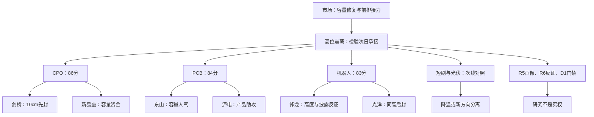

# 2026年11月12日 · 主线研判

> 数据新鲜度：partial；研究状态：partial；置信度：0.56。
> 本报告服务11月12日盘前，行情事实为11月11日收盘。最新消息按各自首次观察日期保留，不冒充盘中验证。

## 🎯 一句话结论
容量光通信与PCB优先研究，机器人保留高度核心；短剧、光伏降级对照，所有对象仍非买入许可。

## 🧭 先认市场，再认核心

市场在为容量科技回流与前排接力付钱，而不是所有低价或名字梗。上一收盘日全A有行情5574家，上涨3538家、下跌1827家；非ST涨停85家、收盘未封19家，炸板率18.27%，全市场封板率81.73%。前日涨停池当日收盘平均反馈仍为+2.92%，但高度从七板降至四板、广度收窄。因此沿用本轮R1“主线扩散型、高位震荡”的温度判断，不把指数反弹直接推成新一轮情绪主升。

本轮只采用92科比三格主模板：龙头、补涨、切换。比较的是旧核心承接、真实低位前排和竞争方向，而不是同时运行五套交易法。R1的55%是带有效窗口的市场研究意见，不是账户可用预算；本轮真实账户硬预算未知，既有停买、零额度、仓位硬上限、T+1和人工授权均未改变。

候选形成前已经比较连板公开资料：today没有有效正文，保持unknown；mainline只运输1625字，显示机器人26→22、光通信新增13、PCB4及短剧5。机器人与Tushare34→27都是收缩，但篮子不同不能相加。网站光通信核心“东方通信”当前实际为1连板、区间3天2板，尾盘首封且5次开板，不如剑桥的当日先封地位；不是机械复制网站名单。日出东方的4板高度真实，但可成交换手弱，不能以“总龙”标签替代资格。

情绪页只比较3600/5749字前缀：连续高潮第二天，温度约80.28；历史同景次日降温41%、高潮38%。这给出两个竞争剧本，不是股票涨停概率。若高标兑现、后排跟不上，降温剧本成立；若容量与10cm前排仍有批量响应，再讨论延续。官网进口政策撤销的归因未由R4核实，不写成既成利好。

## 🗺️ 主线与核心结构

| 研究主线 | 五维分：热/资/板/叙/振 | 总分 | 已核资金持续性 | 沪深成分封板率 | 次日预期 |
|---|---|---:|---|---:|---|
| 共封装光学(CPO) | 19/19/18/12/18 | 86 | 3交易日 | 100.00% | 分歧 |
| PCB概念 | 17/18/17/16/16 | 84 | 3交易日 | 100.00% | 分歧 |
| 机器人概念 | 18/16/19/13/17 | 83 | 3交易日 | 83.33% | 分歧 |

主线=CPO/PCB/机器人，持续性=已核3交易日，封板率分别100%/100%/83.33%，明日预期=分歧。封板率是当前成分与沪深非ST涨停/炸板表交集；100%不代表涨停股从未打开，更不代表次日胜率。三个名称也不是三个独立风险簇，CPO与PCB共属同一算力硬件回流。

五维分只是研究排序，不独立禁止低分方向或授予高分方向买权。真实启动催化和行情轮次起点尚未确认，所有主次线的round_id/event_at保留null；sector_id采用本轮稳定板块代码。有效窗口是本报告实际生成至09:25竞价重评，既不是追溯补造题材首次可用，也不无限继承旧报告立场。生命周期函数缺真实age_days未运行，不输入排名days或0伪造阶段。

### 🟢 共封装光学(CPO)：研究优先，不授买权

- **大资金意图**: 资金更像在容量硬件里重建交易预期：DC光通信模块单日约190.90亿元、连续三日净入，新易盛五日资金居当前CPO全成分第一。它证明买盘出现，不证明机构已经完成中长期建仓。
- **为什么走强**: 热榜从11升1、板块涨4.62%，剑桥先封，容量票放量大涨。官网政策叙事尚未核实，不能把反弹归因偷换为禁令撤销。
- **逻辑够不够硬**: 有THS人气与东财资金两类证据，R4光通信直接政策/订单事实仍未知。剑桥的先封、新易盛的容量分开比较；R5仍须核实业务与必要风险。

| 层级 | 股票 | 昨涨幅 | 板型 | 流通亿元 | 五日净额亿元 | 态度 |
|---|---|---:|---|---:|---:|---|
| 龙头 | 剑桥科技 603083.SH | 10.00% | 首板，开板后回封 | 322.30 | 2.42 | 观察，待R5/R6/D1 |
| 龙二 | 新易盛 300502.SZ | 16.98% | 非涨停；接力板型未确认 | 2697.66 | 32.38 | 观察，待R5/R6/D1 |
| 龙三 | 华盛昌 002980.SZ | 10.00% | 首板，未打开 | 76.80 | 0.83 | 观察，过滤出执行层 |
| 龙三 | 中京电子 002579.SZ | 2.42% | 非涨停；接力板型未确认 | 74.16 | -0.10 | 观察，过滤出执行层 |
| 龙三 | 合锻智能 603011.SH | 5.93% | 非涨停；接力板型未确认 | 95.32 | 1.33 | 观察，过滤出执行层 |

### 🟡 PCB概念：研究优先，不授买权

- **大资金意图**: 东山126.54亿元成交与人气重排说明大资金愿意承接容量，而不是只抱小盘壳。其五日净流出5.61亿元与单日净流入23.16亿元相反，是修复强于持续吸筹的警示。
- **为什么走强**: 东山、沪电、深南及其他产品环节形成批量封板，问财PCB净入90.58亿元、DC另一篮子约110.73亿元；不能相加或平均成更强共识。
- **逻辑够不够硬**: R4生益“未接撤单”支持订单反证消解，但不是新增订单；奥士康否认英伟达/谷歌合作且相关收入不足1%，单股逻辑不能由板块利好抵销。

| 层级 | 股票 | 昨涨幅 | 板型 | 流通亿元 | 五日净额亿元 | 态度 |
|---|---|---:|---|---:|---:|---|
| 龙头 | 东山精密 002384.SZ | 10.00% | 首板，未打开 | 1276.25 | -5.61 | 观察，待R5/R6/D1 |
| 龙二 | 沪电股份 002463.SZ | 10.00% | 首板，开板后回封 | 1728.31 | 2.89 | 观察，待R5/R6/D1 |
| 龙三 | 中京电子 002579.SZ | 2.42% | 非涨停；接力板型未确认 | 74.16 | -0.10 | 观察，过滤出执行层 |
| 龙三 | 宝鼎科技 002552.SZ | 5.54% | 非涨停；接力板型未确认 | 126.40 | -0.47 | 观察，过滤出执行层 |
| 龙三 | 合锻智能 603011.SH | 5.93% | 非涨停；接力板型未确认 | 95.32 | 1.33 | 观察，过滤出执行层 |

### 🟡 机器人概念：研究优先，不授买权

- **大资金意图**: 三日净入仍在，但涨停数收缩，资金可能从普涨改为核心竞争；锋龙/光洋同为三板，先封、换手、人气比单看资金名次重要。
- **为什么走强**: 政策和物理AI讨论支持想象空间，锋龙/光洋高度与襄阳/福莱二板构成梯队；同时不是每个广义机器人涨停都来自相同催化。
- **逻辑够不够硬**: 锋龙机器人零收入及36个月不注资、光洋收入低且未盈利、福莱柔性传感收入极低都有本轮R4公司披露。保留纯情绪研究而非编利润，R6可据原事实独立反证。

| 层级 | 股票 | 昨涨幅 | 板型 | 流通亿元 | 五日净额亿元 | 态度 |
|---|---|---:|---|---:|---:|---|
| 龙头 | 锋龙股份 002931.SZ | 10.01% | 3连板，开板后回封 | 107.53 | 3.90 | 观察，待R5/R6/D1 |
| 龙二 | 光洋股份 002708.SZ | 10.01% | 3连板，开板后回封 | 135.51 | 3.26 | 观察，待R5/R6/D1 |
| 龙三 | 襄阳轴承 000678.SZ | 10.02% | 2连板，开板后回封 | 97.39 | -0.14 | 观察，过滤出执行层 |
| 杂毛 | 科森科技 603626.SH | 2.81% | 非涨停；接力板型未确认 | 174.57 | 4.92 | 观察，过滤出执行层 |
| 龙三 | 福莱新材 605488.SH | 10.00% | 2连板，未打开 | 188.13 | 4.22 | 观察，过滤出执行层 |

## 🔀 次线、直接事件与未选对象

| 方向 | 分数 | 态度 | 本轮裁决 |
|---|---:|---|---|
| 短剧游戏 | 63 | 降级 | 旧核心文投高辨识度仍在，但短剧概念单日资金-13.85亿，网站5家与当前成分4封2炸不同口径；不把AI游戏新演示当已兑现业绩。 |
| 光伏概念 | 61 | 降级 | 高标4板/3板仍强，但DC概念连续4交易日资金流出，网站涨停4→7不是资金同步转向；太空光伏外国订单不等于A股收入。 |
| 存储芯片 | 63 | 降级 | 同花顺资金与R4企业级涨价支持产业比较，但模组利润挤压、部分晶圆未涨；昨日兆易五日流出13.37亿、长鑫流出20.26亿，不拿企业级涨价一概外推全链。尚无本轮足够核心研究席，不为数造票。 |

文投仍是短剧高辨识度观察对象，区间16天9板与当前3连板分开。凯撒是网络游戏二板试错比较，不是文投被否后的自动替补；果麦20cm高换手也不变成10cm妖股。光伏日出/亚玛顿保留高度，单日一字预测只提示一致和可成交性，不能拿预测素材排隔夜单。亚玛顿被原过滤器标低换手等已核风险，不拿低位后排递补。

直接催化对象在截断前已比较：生益科技“未接撤单”不等于新增订单，昨日+8.39%但五日资金约-9.35亿元，未进入本批核心；金杯电工真实中标仍未签合同、营收占比约2.88%，昨日+0.58%缺核心联动；卫星化学207亿元是多年投资，昨日+0.34%、五日流出约2.82亿元，不把资本开支当短期利润。Anthropic电子设计原型完成与未过电气/热/认证限制并存，没有由它创造A股订单名单。

中际旭创+15.07%、成交312.29亿元、五日净入16.06亿元，源杰科技20cm首板、五日净入16.03亿元，均已实际比较，不是杂毛也不因300/688被排除。CPO本轮五席用于两个当前核心和三历史锚，二者留作同地位容量/弹性对照；五席之外不是可自动补位的执行名单。七匹狼是此前单日用户线索，2026四季度提前交易2027羊年预期并非日历错误，但本轮-4.20%、五日流出约0.51亿元，尚无已核传播梯队合力，不纳入本次核心。

成长池只读运输摘录：旧文完整资格认证0家不等于全市场无合格公司。红利月报估值停在10月30日、status=partial，不因榜单提及变当前合格或以静态防守标签排除。专题反馈为空、历史包unreplayable且无evidence_id，因此没有捏造一条history_adjudications；包的run_id、顶层哈希、空记录与字节预算缺口已完整留存JSON。

## 🧪 逐票研究假设与风险

以下四段中的“买入理由”仅为可供R5/R6检验的研究命题；“止损条件”为撤回研究逻辑的条件，不是R2制定的交易止损、买点或仓位。所有票RR及止损距离仍未知，态度=观察；禁止清单空命中数组也不代表14项全通过。

### 剑桥科技 · 603083.SH · 龙头

- **买入理由**: 研究命题一：CPO现有成分中当日最早09:34封板，1次打开后回封。与光迅13:46、源杰14:08、东方通信14:35比较为10cm先封核心；25.58亿元成交与8.07%换手支持流动性，不认证新增订单。 研究命题二：共封装光学(CPO)的市场响应可作共同背景，但不代替个股订单与门禁。

- **风险点**: 本轮未取得该股完整公告/交易限制清单，不能据未命中宣称无负面；行情回流不等于持续主升。 当前板型为首板，开板后回封，个股五日与单日资金分开；盈亏比未认证。

- **止损条件**: 若本轮认定的核心不再有板块响应，或公司原文否定研究采用的业务映射，则撤回相应研究假设、交D1处理；不临时换故事，不在此给交易价位。

- **可验证假设**: 下一至三个交易日逐日核剑桥科技是否仍处原主题前排、是否有至少另一只同主题沪深票形成正反馈，以及当日资金/收盘封板与本轮相反；响应为0或核心身份丢失时，原联动命题不成立。R5核业务、R6核反证、D1核计划与RR后才能讨论买权。

### 新易盛 · 300502.SZ · 龙二

- **买入理由**: 研究命题一：CPO可比全成分五日资金排名第1（32.378309亿元），当日+16.975%，双榜前排。容量中军/趋势研究对照，非涨停不当连板；不因300否决。 研究命题二：共封装光学(CPO)的市场响应可作共同背景，但不代替个股订单与门禁。

- **风险点**: 本轮未取得该股完整公告/交易限制清单，不能据未命中宣称无负面；行情回流不等于持续主升。 当前板型为非涨停；接力板型未确认，个股五日与单日资金分开；盈亏比未认证。

- **止损条件**: 若本轮认定的核心不再有板块响应，或公司原文否定研究采用的业务映射，则撤回相应研究假设、交D1处理；不临时换故事，不在此给交易价位。

- **可验证假设**: 下一至三个交易日逐日核新易盛是否仍处原主题前排、是否有至少另一只同主题沪深票形成正反馈，以及当日资金/收盘封板与本轮相反；响应为0或核心身份丢失时，原联动命题不成立。R5核业务、R6核反证、D1核计划与RR后才能讨论买权。

### 华盛昌 · 002980.SZ · 龙三

- **买入理由**: 研究命题一：CPO历史锚第三，首板但非最早封板，五日资金排名54。保留龙三观察，不用锚分替代地位。 研究命题二：共封装光学(CPO)的市场响应可作共同背景，但不代替个股订单与门禁。

- **风险点**: 本轮未取得该股完整公告/交易限制清单，不能据未命中宣称无负面；行情回流不等于持续主升。 当前板型为首板，未打开，个股五日与单日资金分开；盈亏比未认证。

- **止损条件**: 若本轮认定的核心不再有板块响应，或公司原文否定研究采用的业务映射，则撤回相应研究假设、交D1处理；不临时换故事，不在此给交易价位。

- **可验证假设**: 下一至三个交易日逐日核华盛昌是否仍处原主题前排、是否有至少另一只同主题沪深票形成正反馈，以及当日资金/收盘封板与本轮相反；响应为0或核心身份丢失时，原联动命题不成立。R5核业务、R6核反证、D1核计划与RR后才能讨论买权。

### 中京电子 · 002579.SZ · 龙三

- **买入理由**: 研究命题一：CPO/PCB历史锚第一，今+2.42%未涨停、五日净流出；先入初筛但不占核心执行席，历史49次涨停非今日确定性。 研究命题二：共封装光学(CPO)的市场响应可作共同背景，但不代替个股订单与门禁。

- **风险点**: 本轮未取得该股完整公告/交易限制清单，不能据未命中宣称无负面；行情回流不等于持续主升。 当前板型为非涨停；接力板型未确认，个股五日与单日资金分开；盈亏比未认证。

- **止损条件**: 若本轮认定的核心不再有板块响应，或公司原文否定研究采用的业务映射，则撤回相应研究假设、交D1处理；不临时换故事，不在此给交易价位。

- **可验证假设**: 下一至三个交易日逐日核中京电子是否仍处原主题前排、是否有至少另一只同主题沪深票形成正反馈，以及当日资金/收盘封板与本轮相反；响应为0或核心身份丢失时，原联动命题不成立。R5核业务、R6核反证、D1核计划与RR后才能讨论买权。

### 合锻智能 · 603011.SH · 龙三

- **买入理由**: 研究命题一：CPO/PCB历史锚，今+5.93%未封板、五日净入1.33亿元；缺当前前排时序人气，保留研究不替代龙一。 研究命题二：共封装光学(CPO)的市场响应可作共同背景，但不代替个股订单与门禁。

- **风险点**: 本轮未取得该股完整公告/交易限制清单，不能据未命中宣称无负面；行情回流不等于持续主升。 当前板型为非涨停；接力板型未确认，个股五日与单日资金分开；盈亏比未认证。

- **止损条件**: 若本轮认定的核心不再有板块响应，或公司原文否定研究采用的业务映射，则撤回相应研究假设、交D1处理；不临时换故事，不在此给交易价位。

- **可验证假设**: 下一至三个交易日逐日核合锻智能是否仍处原主题前排、是否有至少另一只同主题沪深票形成正反馈，以及当日资金/收盘封板与本轮相反；响应为0或核心身份丢失时，原联动命题不成立。R5核业务、R6核反证、D1核计划与RR后才能讨论买权。

### 东山精密 · 002384.SZ · 龙头

- **买入理由**: 研究命题一：PCB产品主线13:11先封于沪电13:13、深南13:55，东财人气第1/同花顺7，成交126.54亿元与换手10.32%为容量核心。五日净额-5.609114亿与单日+23.159144亿并列；光洋归广义PCB但当轮叙事为机器人，不挪其3板给PCB高度。 研究命题二：PCB概念的市场响应可作共同背景，但不代替个股订单与门禁。

- **风险点**: 本轮未取得该股完整公告/交易限制清单，不能据未命中宣称无负面；行情回流不等于持续主升。 当前板型为首板，未打开，个股五日与单日资金分开；盈亏比未认证。

- **止损条件**: 若本轮认定的核心不再有板块响应，或公司原文否定研究采用的业务映射，则撤回相应研究假设、交D1处理；不临时换故事，不在此给交易价位。

- **可验证假设**: 下一至三个交易日逐日核东山精密是否仍处原主题前排、是否有至少另一只同主题沪深票形成正反馈，以及当日资金/收盘封板与本轮相反；响应为0或核心身份丢失时，原联动命题不成立。R5核业务、R6核反证、D1核计划与RR后才能讨论买权。

### 沪电股份 · 002463.SZ · 龙二

- **买入理由**: 研究命题一：PCB容量龙二研究席，13:13首封、3次开板，成交69.39亿元、五日净入2.8911亿元。是当前两核心比较顺位，不把全成分五日资金排名10说成第2。 研究命题二：PCB概念的市场响应可作共同背景，但不代替个股订单与门禁。

- **风险点**: 本轮未取得该股完整公告/交易限制清单，不能据未命中宣称无负面；行情回流不等于持续主升。 当前板型为首板，开板后回封，个股五日与单日资金分开；盈亏比未认证。

- **止损条件**: 若本轮认定的核心不再有板块响应，或公司原文否定研究采用的业务映射，则撤回相应研究假设、交D1处理；不临时换故事，不在此给交易价位。

- **可验证假设**: 下一至三个交易日逐日核沪电股份是否仍处原主题前排、是否有至少另一只同主题沪深票形成正反馈，以及当日资金/收盘封板与本轮相反；响应为0或核心身份丢失时，原联动命题不成立。R5核业务、R6核反证、D1核计划与RR后才能讨论买权。

### 宝鼎科技 · 002552.SZ · 龙三

- **买入理由**: 研究命题一：PCB历史锚第二但当日+5.54%未封板、五日净出0.4674亿元；历史股性不替代本轮资金选择，龙三不替补执行。 研究命题二：PCB概念的市场响应可作共同背景，但不代替个股订单与门禁。

- **风险点**: 本轮未取得该股完整公告/交易限制清单，不能据未命中宣称无负面；行情回流不等于持续主升。 当前板型为非涨停；接力板型未确认，个股五日与单日资金分开；盈亏比未认证。

- **止损条件**: 若本轮认定的核心不再有板块响应，或公司原文否定研究采用的业务映射，则撤回相应研究假设、交D1处理；不临时换故事，不在此给交易价位。

- **可验证假设**: 下一至三个交易日逐日核宝鼎科技是否仍处原主题前排、是否有至少另一只同主题沪深票形成正反馈，以及当日资金/收盘封板与本轮相反；响应为0或核心身份丢失时，原联动命题不成立。R5核业务、R6核反证、D1核计划与RR后才能讨论买权。

### 锋龙股份 · 002931.SZ · 龙头

- **买入理由**: 研究命题一：机器人3板并列高度，09:30:21早于光洋09:43:45，1次打开回封，历史锚第一。R4官方披露前三季机器人零收入、36个月不注资；只保留纯情绪高度龙研究席，不编业绩或注资。 研究命题二：机器人概念的市场响应可作共同背景，但不代替个股订单与门禁。

- **风险点**: 前三季未产生机器人零部件收入；优必选承诺收购完成后36个月不注入所持资产。 当前板型为3连板，开板后回封，个股五日与单日资金分开；盈亏比未认证。

- **止损条件**: 若本轮认定的核心不再有板块响应，或公司原文否定研究采用的业务映射，则撤回相应研究假设、交D1处理；不临时换故事，不在此给交易价位。

- **可验证假设**: 下一至三个交易日逐日核锋龙股份是否仍处原主题前排、是否有至少另一只同主题沪深票形成正反馈，以及当日资金/收盘封板与本轮相反；响应为0或核心身份丢失时，原联动命题不成立。R5核业务、R6核反证、D1核计划与RR后才能讨论买权。

### 光洋股份 · 002708.SZ · 龙二

- **买入理由**: 研究命题一：机器人3板并列高度、后于锋龙封板，换手18.02%，近五日龙虎榜3个交易日。单日主力-1.129191亿、五日+3.257098亿并列；机器人收入低且未盈利，研究龙二不是利润核心认证。 研究命题二：机器人概念的市场响应可作共同背景，但不代替个股订单与门禁。

- **风险点**: 机器人业务处市场拓展阶段且收入占比较低、尚未盈利；前三季扣非为-3159.30万元属已披露背景。 当前板型为3连板，开板后回封，个股五日与单日资金分开；盈亏比未认证。

- **止损条件**: 若本轮认定的核心不再有板块响应，或公司原文否定研究采用的业务映射，则撤回相应研究假设、交D1处理；不临时换故事，不在此给交易价位。

- **可验证假设**: 下一至三个交易日逐日核光洋股份是否仍处原主题前排、是否有至少另一只同主题沪深票形成正反馈，以及当日资金/收盘封板与本轮相反；响应为0或核心身份丢失时，原联动命题不成立。R5核业务、R6核反证、D1核计划与RR后才能讨论买权。

### 襄阳轴承 · 000678.SZ · 龙三

- **买入理由**: 研究命题一：机器人锚第三，2板、同花顺热股第3，换手37.39%与6次开板、五日净出0.135481亿并列；高度落后两只3板，保留龙三不借人气升位。 研究命题二：机器人概念的市场响应可作共同背景，但不代替个股订单与门禁。

- **风险点**: 本轮未取得该股完整公告/交易限制清单，不能据未命中宣称无负面；行情回流不等于持续主升。 当前板型为2连板，开板后回封，个股五日与单日资金分开；盈亏比未认证。

- **止损条件**: 若本轮认定的核心不再有板块响应，或公司原文否定研究采用的业务映射，则撤回相应研究假设、交D1处理；不临时换故事，不在此给交易价位。

- **可验证假设**: 下一至三个交易日逐日核襄阳轴承是否仍处原主题前排、是否有至少另一只同主题沪深票形成正反馈，以及当日资金/收盘封板与本轮相反；响应为0或核心身份丢失时，原联动命题不成立。R5核业务、R6核反证、D1核计划与RR后才能讨论买权。

### 科森科技 · 603626.SH · 杂毛

- **买入理由**: 研究命题一：机器人历史锚第二；当前0连板、五日资金全成分排名11，命中top3外与0板低于3板龙头-2两项，rank=杂毛仅作原执行过滤，不是公司价值结论。不伪造30日龙虎榜阴性。 研究命题二：机器人概念的市场响应可作共同背景，但不代替个股订单与门禁。

- **风险点**: 本轮未取得该股完整公告/交易限制清单，不能据未命中宣称无负面；行情回流不等于持续主升。 当前板型为非涨停；接力板型未确认，个股五日与单日资金分开；盈亏比未认证。

- **止损条件**: 若本轮认定的核心不再有板块响应，或公司原文否定研究采用的业务映射，则撤回相应研究假设、交D1处理；不临时换故事，不在此给交易价位。

- **可验证假设**: 下一至三个交易日逐日核科森科技是否仍处原主题前排、是否有至少另一只同主题沪深票形成正反馈，以及当日资金/收盘封板与本轮相反；响应为0或核心身份丢失时，原联动命题不成立。R5核业务、R6核反证、D1核计划与RR后才能讨论买权。

### 福莱新材 · 605488.SH · 龙三

- **买入理由**: 研究命题一：电子皮肤叙事2板、换手11.57%，仅龙三观察。R4披露柔性传感收入极低、订单不确定、转债风险，不用转债活跃冒充正股利润与承接。 研究命题二：机器人概念的市场响应可作共同背景，但不代替个股订单与门禁。

- **风险点**: 柔性传感项目收入占比极低且研发订单不确定；11月11日福新转债收948.111元、转股溢价67.12%、换手1088.81%见同日转债公告。 当前板型为2连板，未打开，个股五日与单日资金分开；盈亏比未认证。

- **止损条件**: 若本轮认定的核心不再有板块响应，或公司原文否定研究采用的业务映射，则撤回相应研究假设、交D1处理；不临时换故事，不在此给交易价位。

- **可验证假设**: 下一至三个交易日逐日核福莱新材是否仍处原主题前排、是否有至少另一只同主题沪深票形成正反馈，以及当日资金/收盘封板与本轮相反；响应为0或核心身份丢失时，原联动命题不成立。R5核业务、R6核反证、D1核计划与RR后才能讨论买权。

### 文投控股 · 600715.SH · 龙头

- **买入理由**: 研究命题一：短剧核心观察，双榜1/3，16天9板是区间数、当前3连板；9次开板不支持无分歧加速，比较旧核兑现与新AI游戏分流。 研究命题二：短剧游戏的市场响应可作共同背景，但不代替个股订单与门禁。

- **风险点**: 本轮未取得该股完整公告/交易限制清单，不能据未命中宣称无负面；行情回流不等于持续主升。 当前板型为3连板，开板后回封，个股五日与单日资金分开；盈亏比未认证。

- **止损条件**: 若本轮认定的核心不再有板块响应，或公司原文否定研究采用的业务映射，则撤回相应研究假设、交D1处理；不临时换故事，不在此给交易价位。

- **可验证假设**: 下一至三个交易日逐日核文投控股是否仍处原主题前排、是否有至少另一只同主题沪深票形成正反馈，以及当日资金/收盘封板与本轮相反；响应为0或核心身份丢失时，原联动命题不成立。R5核业务、R6核反证、D1核计划与RR后才能讨论买权。

### 凯撒文化 · 002425.SZ · 龙二

- **买入理由**: 研究命题一：网络游戏2板前排，09:30首封与东财17、换手16.37%支持低位试错研究；流通35.24亿谨慎。AI演示未闭环利润，不自动替补文投。 研究命题二：短剧游戏的市场响应可作共同背景，但不代替个股订单与门禁。

- **风险点**: 流通20—50亿元需警示；本轮未取得该股完整公告/交易限制清单，不能据未命中宣称无负面；行情回流不等于持续主升。 当前板型为2连板，开板后回封，个股五日与单日资金分开；盈亏比未认证。

- **止损条件**: 若本轮认定的核心不再有板块响应，或公司原文否定研究采用的业务映射，则撤回相应研究假设、交D1处理；不临时换故事，不在此给交易价位。

- **可验证假设**: 下一至三个交易日逐日核凯撒文化是否仍处原主题前排、是否有至少另一只同主题沪深票形成正反馈，以及当日资金/收盘封板与本轮相反；响应为0或核心身份丢失时，原联动命题不成立。R5核业务、R6核反证、D1核计划与RR后才能讨论买权。

### 果麦文化 · 301052.SZ · 龙三

- **买入理由**: 研究命题一：果麦20cm首板、换手52.45%与3次开板，出版/IP扩散非10cm妖股；流通39.29亿谨慎，研究龙三，不因20cm涨幅升位。 研究命题二：短剧游戏的市场响应可作共同背景，但不代替个股订单与门禁。

- **风险点**: 流通20—50亿元需警示；本轮未取得该股完整公告/交易限制清单，不能据未命中宣称无负面；行情回流不等于持续主升。 当前板型为首板，开板后回封，个股五日与单日资金分开；盈亏比未认证。

- **止损条件**: 若本轮认定的核心不再有板块响应，或公司原文否定研究采用的业务映射，则撤回相应研究假设、交D1处理；不临时换故事，不在此给交易价位。

- **可验证假设**: 下一至三个交易日逐日核果麦文化是否仍处原主题前排、是否有至少另一只同主题沪深票形成正反馈，以及当日资金/收盘封板与本轮相反；响应为0或核心身份丢失时，原联动命题不成立。R5核业务、R6核反证、D1核计划与RR后才能讨论买权。

### 日出东方 · 603366.SH · 龙头

- **买入理由**: 研究命题一：4板与网站总龙称号相符，但竞价一字、换手1.15%，可成交承接未知。光伏资金连出，不因名字东方或4板认定新主线；只保留次线高度观察。 研究命题二：光伏概念的市场响应可作共同背景，但不代替个股订单与门禁。

- **风险点**: 本轮未取得该股完整公告/交易限制清单，不能据未命中宣称无负面；行情回流不等于持续主升。 当前板型为竞价一字，未打开，个股五日与单日资金分开；盈亏比未认证。

- **止损条件**: 若本轮认定的核心不再有板块响应，或公司原文否定研究采用的业务映射，则撤回相应研究假设、交D1处理；不临时换故事，不在此给交易价位。

- **可验证假设**: 下一至三个交易日逐日核日出东方是否仍处原主题前排、是否有至少另一只同主题沪深票形成正反馈，以及当日资金/收盘封板与本轮相反；响应为0或核心身份丢失时，原联动命题不成立。R5核业务、R6核反证、D1核计划与RR后才能讨论买权。

### 亚玛顿 · 002623.SZ · 杂毛

- **买入理由**: 研究命题一：光伏3板、流通44.94亿，一字换手0.44%；控制权和太空光伏叙事不等于完成过户或国内订单，仅次线高度对照。 研究命题二：光伏概念的市场响应可作共同背景，但不代替个股订单与门禁。

- **风险点**: 流通20—50亿元需警示；本轮未取得该股完整公告/交易限制清单，不能据未命中宣称无负面；行情回流不等于持续主升。 当前板型为竞价一字，未打开，个股五日与单日资金分开；盈亏比未认证。

- **止损条件**: 若本轮认定的核心不再有板块响应，或公司原文否定研究采用的业务映射，则撤回相应研究假设、交D1处理；不临时换故事，不在此给交易价位。

- **可验证假设**: 下一至三个交易日逐日核亚玛顿是否仍处原主题前排、是否有至少另一只同主题沪深票形成正反馈，以及当日资金/收盘封板与本轮相反；响应为0或核心身份丢失时，原联动命题不成立。R5核业务、R6核反证、D1核计划与RR后才能讨论买权。

## 🔎 关键证据

- 本轮在线Tushare日线/每日指标均5574条，涨停/炸板104条；资金五个交易日分别返回6031/6032条，18个研究代码均匹配五日后计算，不使用初次8000条截断范围结果。
- R3双源传播与热榜只确认人气；distribution_alert为空限其实际核验范围，不等于所有高位股没有派发。
- R4的锋龙、光洋、福莱、奥士康披露反证已嵌入研究JSON；本轮R2继承原件证据，不冒充再次打开全部公告。
- R7行业资金与本轮DC概念、个股资金分层保存，同provider不同接口不算新的独立资金证据。cross_validation只对已查非null项取均值，CPO直接催化未知不填false。
- 9个本轮专题索引与上游新增催化日历均有逐源裁决，连板网同站点不重复加权；未形成四个底层独立来源的完整交集，consensus_themes为空。

## 数据源审计

| 源 | 日期 | 状态 | 备注 |
|---|---|:--:|---|
| fetch manifest | 2026-11-12 | 🟡 | severity=2，按源降级，不全局停买 |
| R1_style | 2026-11-12 | 🟡 | 实际已读，status=degraded；广度/溢价/温度仍可用 |
| R3_sentiment、热榜差分 | 2026-11-12 | 🟡 | 实际已读，status=degraded；匿名观点不冒充昨夜指定KOL |
| R4_news | 2026-11-12 | 🟡 | 实际已读，status=partial；官方事实与推断分层 |
| R7_capital_flow | 2026-11-12 | 🟡 | 实际已读，status=partial；行业不当单股 |
| tushare daily/daily_basic/limit_list_d | 2026-11-11 | 🟢 | 本轮在线重拉，5574/5574/104条 |
| tushare limit_cpt_list/ths_member | 2026-11-11 | 🟢 | 历史榜单261条、七组当前成分；非真实轮次认证 |
| 同花顺问财选板块CLI | 2026-11-11 | 🟢 | 本轮19项，has_more=false；同THS不算独立复核 |
| DC概念资金/MCP与SDK | 2026-11-11 | 🟢 | 本轮全概念与五条历史资金序列；与R7同provider |
| DC个股五日资金 | 2026-11-11 | 🟢 | 逐日重拉，纠正初次8000条上限风险 |
| top_list 龙虎榜 | 2026-11-11 | 🟡 | 五日逐日重拉成功；30日机构/游资阴性未核 |
| 公众号/群聊/WeFlow | 2026-11-12 | 🟡 | 仅继承本轮R3/R4已运输证据，未自称原始全文读取；WeFlow按上游缺口 |
| lianban:today | 2026-11-12 | 🔴 | invalid，无正文，不判断 |
| lianban:mainline/qingxu | 2026-11-11 | 🟡 | 1625字全文运输/3600字前缀；版本未知，非会员全文 |
| 题材锚、股性XLSX | 2026-11-02 | 🟡 | 原哈希已核，六主题锚与指定20行；历史月度资料 |
| 成长池 | 2026-11-11 | 🟡 | 只读运输摘录；行情为11月10日，未升格今日资格 |
| 红利池 | 2026-10-30 | 🟡 | 月报partial，估值/披露截止与本轮不同 |
| 一字预判 | 2026-11-11 | 🟡 | 预测目标11月12日匹配，非命中与买权 |
| 催化日历 | 2026-11-11 | 🟡 | 只继承R4内嵌前缀，不旁读MD或重新认证原文 |
| 唯一历史反馈包 | 2026-11-12 | 🔴 | run_id一致、记录为空、unreplayable；经验/成效unknown |
| 周度IR因子 | 2026-11-12 | 🔴 | 快照目录不存在，跳过因子层而非填0 |
| DataPro备源 | 2026-11-12 | 🟡 | 本轮未调用，主资金源可用；不能据未调用声称down |

## ⚠️ 不确定性与反向剧本

最强反向剧本是容量反弹次日兑现、高标一致后松动、旧题材后排失去赚钱效应；如果机器人三板竞争与光通信容量同步失去响应，不能继续找同字或谐音低位后排维持旧叙事。相反，若旧核分歧后有真实承接，新事件或游戏低位方向与指数/情绪分离成立，应由本轮新证据重评，而非永久禁止某个通道。

全局昨日炸板率未到35%，本轮没有强行砍半候选；若实时达到35%，按已有纪律明确情绪=震荡/主跌并减半。所有真实账户限制不变，R6硬否决不可被R2过滤。当前20条题材内研究记录去重18只，并非20个执行席；龙三不因龙一被否而自动递补。执行池为空表示R2没有交易授权，不是“全市场无机会”。

## 🤝 与其他R/D/E的关系

- 依赖：同版R1_style、R3_sentiment、R4_news、R7_capital_flow，唯一指定历史包，以及本轮运输专题。
- 交R5：对JSON中18个去重研究代码核业务、财务、风险，不据专题提及重新扩成已合格池。
- 交R6：只消费本轮JSON内嵌事实/原文投影，逐票反证，保留其唯一硬否决权。
- 交D1：三个研究优先方向、次线对照、同源/缺口/未知与有效窗口；先形成当轮计划，再核价位RR和实际预算。

## Sub-Agent 元数据

- skill: analyze_main_sectors_v1；后处理filter_leader_v1已在同一候选集执行。
- artifact: data/research/20261112/R2_main_sectors.json
- status: partial；缺真实轮次起点、周度因子及逐票必要审核，未冒充complete。
- model: gpt-6.1-sol
- 资源观测：usage_unknown，不填0、不保证低于努力目标；08:30为observe_only交付目标，未产生预算或交易授权变化。

- 生成耗时：1037秒（从本阶段首次系统取证至发布前验收）。
- 图表验收：Mermaid 11.4.0浏览器实际渲染SVG成功，22782字节；非仅正则或解析通过。
