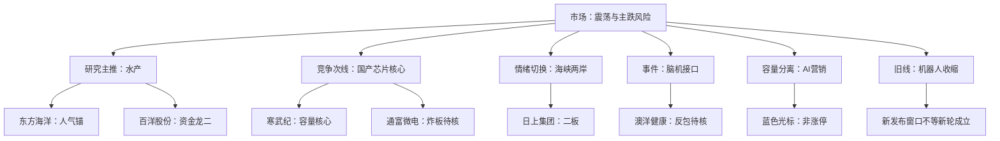

# 2026年11月13日 · 主线研判

> 数据源新鲜度：partial；研究降级：是；置信度：0.5355。行情基准为2026-11-12，不是11月13日盘中。

## 一句话结论
情绪=震荡/主跌风险；水产是唯一研究主推，七票仅观察，不授予执行资格。

## 🧭 市场先于个股

市场并不是在为所有“热门科技”付钱。R1的5573只行情中4635只下跌；前日85只涨停股，昨日收盘反馈均值为-0.87%、中位数-2.05%，而开盘均值尚有+2.17%。因此问题不是有没有高标，而是开盘得到的接力利润能否留下。37只封板、35只炸板对应48.61%，高度5板尚存，但不足以支持全面主升。本报告沿用R1的温度判断，不另造风格分类。

水产出现“指数逆势上涨、窄板块净流入、三只封板”的同向事实，不能因它属于传统消费就静态视作防御。半导体则是少数容量核心获资金，而广芯片仍在亏钱；机器人窄题材的涨停家数连续收缩，不能把热度第二名当作资金正在进攻。两种结构要分开：水产研究隔日接力，容量核心用作竞争方向比较，不把五套打法焊成超级策略。本轮唯一主模板为“北京炒家首板隔日”，实际通道与买卖节点由D1独立裁决。

历史包的run_id已核一致，但records和market_feedback均为空，状态为unreplayable。它不能证明同轮延续，更没有可逐evidence_id采纳的经验。所有板块round_id保留null；未核行情起点的event_at为null，研究窗口从真实生成时刻起至开盘，不能追溯成历史首次立场。水产当前连续净流入只有1日，不等于已经证明题材从昨天首次启动；年龄缺证，也不把生命周期模块输入补成0或1。这里的局部研究主推不是已确认可交易主线。

R1的30%是有来源、事实日和开盘前有效窗口的市场研究意见，不是账户正额度，更不是从旧计划继承的强制预算。真实账户有效预算本轮未知；任何原有零预算、停买、T+1、人工确认及R6逐票否决保持不变。首次D1成案前，七票in_today_plan均未知。

## 🔎 研究主线与竞争方向

| 方向 | 五维：热度/资金/涨停/叙事/共振 | 小计 | 明确态度与依据 |
|---|---|---:|---|
| 水产概念 | 18/14/18/10/14 | 74 | 观察：唯一研究主推，三封板、板块上涨与资金同向 |
| 芯片核心 | 16/14/9/15/16 | 70 | 观察：资金集中于核心，宽板并未确认扩散 |
| 海峡两岸 | 18/7/15/12/17 | 69 | 观察：日上二板地位明确，区域资金流出 |
| AI应用/营销 | 17/12/8/12/16 | 65 | 观察：蓝色光标容量分离，不代表全应用回流 |
| 机器人 | 17/5/11/15/14 | 62 | 降级：扩散转收缩，发布会尚未形成新轮资金确认 |
| 零售/大消费 | 16/6/13/9/11 | 55 | 降级：大东方不能代替消费广度 |
| 脑机接口 | 11/9/9/16/8 | 53 | 观察：事件真实程度有限，个股强、板块流出 |
| 造船合同 | 8/8/6/18/9 | 49 | 观察：合同成立不等短线主线成立 |
| 天然气 | 11/6/12/9/7 | 45 | 观察：高度尚在，今日燃气资金转出 |
| 创新药 | 9/未知/6/17/8 | 已知维40 | 观察：审批与竞争双面，未归零未知资金 |

分数只是五维研究比较，不是预测胜率或执行阈值；芯片达到70也没有自动升级主线。创新药40仅为已知维小计，不能与完整五维榜单机械比较。周度IR因子目录不存在，本轮跳过，不补零、不改变五维权重。

### 水产：强在局部合力，危险在核心承接

主线=水产概念，持续性=1日（最新连续净流入窗口，非题材年龄），封板率=100%（18只当日成分中，3只封板、0只收盘炸板），明日预期=分歧。分母只包括触板的非ST样本，不是18只全部涨停，也不是100%晋级率。昨日DC板块上涨1.74%、净流入4.747113亿元；前一日净流出0.887235亿元，不能称资金已连续进攻多日。

- **大资金意图**: 可观察到资金集中百洋、水产饲料及渔业，但这些是成交分类统计，不是实际机构账户吸筹证明。它更像科技亏钱扩散时寻找窄消费情绪出口，而不是全市场转防御的认证。
- **为什么走强**: 东方海洋先封、百洋随后、好当家跟随，构成同题材三封板；东方海洋的多平台人气锚强化辨识度。纯情绪无需先有产业政策才能研究，但名字相同不等于同一收入链。
- **逻辑够不够硬**: 涨幅、成分交集、资金与人气有证；本轮没有R4直接水产硬事件。东方海洋26次开板、当日净流出0.526370亿元，百洋11次开板，次日承接是实质反证。R3消费传播、R7窄行业支持与同底层行情不当成四份独立利好。

### 芯片：承认容量核心，不把宽板亏钱藏起来

研究方向=国产芯片核心；观测持续性=3日（R7行业11月10日至12日窗口，不代表最长连续天数或题材年龄），封板率=36.36%（THS现成分交集4封7炸），明日预期=分歧。该成分表无历史有效期认证，所以只称现成分投影，不冒充官方历史全口径。

- **大资金意图**: 寒武纪在广芯片现成分与窄AI芯片成分的五日资金均居第一，是核心集中事实；不能反推所有科技都在被买。
- **为什么走强**: 寒武纪上涨8.11%、成交201.72亿元，通富净流入8.62亿元但冲板失败。资金愿意为国产容量核心付钱，不代表普通连板生态已经修复。
- **逻辑够不够硬**: R7东财半导体净流入23.53亿元，而THS半导体净流出44.95亿元、THS广芯片概念净流出172.11亿元。分类和计量差异必须保留，不平均。中芯同一季报的利用率改善与Q4毛利率回落/资本开支下降并存；“天普三板=芯片龙头”的网站归因，被R4公司否认AI业务等具体材料反证。

### 福建、脑机、AI营销：有对象，但不硬凑主线

海峡两岸观察持续性=1日（本次榜单窗口），封板率=50%（现成分投影5封5炸），明日预期=分歧。日上2板早于福建水泥和九牧王，地位不因当日净流出0.35亿元而被抹掉；但THS概念净流出64.40亿元，不能称全线资金进攻。

- **大资金意图**: 福建是区域情绪切换假设；澳洋是事件后单票分离；蓝色是营销资金集中。三者不能合并成一条“新科技消费主线”。
- **为什么走强**: 日上身位为2板，澳洋反包且五日资金居该概念成员第一，蓝色在AI应用现成分中五日资金第一；这些都是保留研究席的原因。
- **逻辑够不够硬**: 福建AI政策与具体收入映射未核；脑机9项标准是立项而非实施，澳洋尚只核到纪律龙头四项中的2项；蓝色上涨10.89%不是20cm封板。辅助热度缺项不清空观察，必要地位、风险和RR缺证则不授予执行资格。

## 🎯 七票观察：地位、风险与可验证假设

| 代码/名称 | 本轮研究层级 | 板型或状态 | 流通市值亿元 | 当日/5日净入亿元 | 执行态度 |
|---|---|---|---:|---|---|
| 002086.SZ 东方海洋 | 水产龙一，纪律暂核3/4 | 反复回封首板，17天9次涨停背景 | 81.58 | -0.5264 / -1.4278 | 观察，RR未知 |
| 002696.SZ 百洋股份 | 水产龙二，纪律暂核3/4 | 首板回封，11次开板 | 39.04 ⚠️ | +4.5829 / +5.4278 | 观察，RR未知 |
| 688256.SH 寒武纪 | 容量龙一，纪律暂核3/4 | 非涨停容量上涨 | 6118.75 | +14.0631 / +34.2086 | 观察，RR未知 |
| 002156.SZ 通富微电 | 封测对照龙二，纪律暂核3/4 | 涨停后炸板未封 | 733.84 | +8.6229 / +8.6601 | 观察，RR未知 |
| 002593.SZ 日上集团 | 区域龙一，纪律暂核3/4 | 二板换手回封 | 29.31 ⚠️ | -0.3490 / +0.6598 | 观察，RR未知 |
| 002172.SZ 澳洋健康 | 过滤器研究龙一，完整龙头未认证2/4 | 4天2板反包 | 50.96 | +4.4915 / +6.4498 | 观察，RR未知 |
| 300058.SZ 蓝色光标 | 营销容量龙一，纪律暂核3/4 | +10.89%，非20cm封板 | 513.34 | +23.4714 / +20.2045 | 观察，RR未知 |

“暂核3/4”不是完整开仓资格七项已过；不确定项仍为unknown。过滤器只确认研究前二层级，不授予执行。所有票禁止清单全检均未完成，confirmed_hits空数组不等“无风险”。百洋和日上的20—50亿元区间明确警示，不偷偷恢复50亿元一刀切门槛。

### 东方海洋

**买入理由**: 仅指研究假设，非下单理由：水产三票最早首封；三平台人气锚明确。它的辨识度不能被单日资金榜替换。

**风险点**: 开板26次且收盘才最终回封；当日与五日主力都净流出。17天9次涨停背景说明当日“首板”不等低位。

**止损条件**: R2仅列研究逻辑失效条件：若人气锚继续失去承接且同题材助攻无法形成隔日正反馈，撤销本轮主推假设；实际持仓处置、价格止损由D1/执行侧制定。

**可验证假设**: 在下一交易日核同口径水产封板数相对3家的扩散/收缩、东方海洋最终封板与资金净方向；不拿盘前人气代替盘中验证，不新设交易阈值。

### 百洋股份

**买入理由**: 仅指研究假设：18只水产成分五日资金第一；原预制菜月度锚前三且昨日与水产联动。仍列龙二，不凭资金第一篡位龙一。

**风险点**: 36.51%换手与11次开板并存；39.04亿元流通盘需警示。资金统计不是锁筹证明，次日兑现可能大。

**止损条件**: 若水产锚失效且百洋只剩孤立拉升，撤销“主线龙二助攻”假设；R6否决龙一不自动赋予其替补买权，真实止损交D1。

**可验证假设**: 下一交易日比较资金净流向、回封承接和同题材联动；五日+5.4278亿元是回看事实，不是未来五日收益预测。

### 寒武纪

**买入理由**: 仅指研究假设：国产算力容量辨识度；两个已查成员集合中五日资金均第一。688前缀不影响常规主线研究资格。

**风险点**: 个股逆势不等广芯片扩散；不同板块资金口径相反，盘后产业消息仍有双面解释。未做本轮R5趋势与完整负面画像。

**止损条件**: 若容量核心分离失效且广芯片负反馈继续扩散，撤销“窄核心可传导”假设；不在R2编入场价或止损价。

**可验证假设**: 下一至三个交易日核核心相对广芯片的反馈、成交与资金符号，观察是否从个股集中转向可验证跟随；不把8.11%写成20cm封板。

### 通富微电

**买入理由**: 仅指研究假设：封测人气与当日8.62亿元净入；可与寒武纪构成国产链不同环节对照，而不是主观挖低位杂毛。

**风险点**: 收盘属于炸板未封，不是成功首板；广芯片资金承接仍弱。五日资金不是整个芯片前二，不能假造全板块资金龙二认定。

**止损条件**: 若冲高兑现持续且不能恢复核心辨识度，撤销封测对照龙二假设；价格门禁与真实持仓处理交R5/D1。

**可验证假设**: 下一交易日核是否修复前日冲板失败以及核心与跟随反馈，区分真实弱转强与先手兑现；不能只看净流入一项。

### 日上集团

**买入理由**: 仅指研究假设：区域2板身位第一；首封早于福建水泥及九牧王，且有实际换手。纯情绪允许研究，不先要求政策收入兑现。

**风险点**: 29.31亿元流通盘、31.26%换手；当日净流出且旧股性近期评级差。区域政策与公司受益尚未核定。

**止损条件**: 若区域跟随消失且日上地位或承接失效，撤销切换假设；不换一只便宜后排顶上，不替D1定止损。

**可验证假设**: 下一交易日对照2板核心的晋级/断承接、区域封板扩散及资金；不能因11月3日曾出现区域题材就自报同轮延续。

### 澳洋健康

**买入理由**: 仅指研究假设：本轮反包与概念成员五日资金第一；R4标准立项提供间接研究线索。事件与公司收入并未被等号连接。

**风险点**: 脑机概念整体下跌且资金转出；目前只核2/4项完整龙头纪律，单票强不能证明板块带动或产业订单。

**止损条件**: 若标准事件无法带来同题材扩散、只剩孤立反包，撤销“事件转主线”假设；是否开仓与价格止损独立交D1。

**可验证假设**: 下一至三个交易日核原标准立项附件、公司业务相关性以及跟随是否形成；不是以原件未取得就全市场停研。

### 蓝色光标

**买入理由**: 仅指研究假设：AI应用现成分五日资金第一；单日净流入23.47亿元且有热榜辨识度。300前缀不构成剔除理由。

**风险点**: 全应用概念仍跌2.44%；资金可能只集中营销个股。昨日不是20cm涨停，不能套普通首板接力板型。

**止损条件**: 若分离强度消失而应用跟随持续走弱，撤销容量分离研究假设；不把首板模板擅自改为总龙锁仓，实际止损由D1独立给出。

**可验证假设**: 下一交易日核个股资金与应用/营销扩散是否同向，分别记录；不能以营销行业净入代替全应用净入。

## ⚖️ 为什么不选这些对照对象

实际比较14个对象，按炸板率既有纪律减半为7个研究候选；以下7个不是偷偷保留的候选池，而是未纳入证据。未选不等坏公司，也不是因为旧计划缺席。

| 对照对象 | 处理 | 本轮理由 |
|---|---|---|
| 好当家 | 观察，龙三不进候选 | 水产后封跟随，历史最高2板、股性弱，未证核心；低价不替代地位 |
| 北方华创 | 观察，设备分支对照 | 资金有效，但中芯资本开支双面事件需核；本轮不抢算力/封测前二研究席 |
| 九牧王 | 不进，本轮后排“杂毛”标签 | 14:30首次上板且1板落后日上；旧股性极佳不替代当日地位，未谎称已命中两项量化杂毛规则 |
| 吉视传媒 | 观察，不进候选 | 首板与资金为真，但AI容量人气锚已有蓝色；减半后不重复占席 |
| 中重科技 | 观察，承认窄机器人高度 | 2板地位保留，但旧线资金流出、扩散收缩，非单因“高位/旧题材”否定 |
| 中国船舶 | 观察，硬事件不直给席位 | 合同未生效、远期交付；昨日行情不足证明短线主线，不把买卖两端算两次需求 |
| 恒瑞医药 | 观察，等待事件后市场反应 | 新审批为真，但昨日行情在公告前，不能当作事件无效证明，也不直接授予短线地位 |

另核：兴欣新材流通市值12.35亿元，按既有20亿元线不进；天普的AI注入/借壳叙事被公司原件反证，降级，不充当芯片龙头。日出东方、大东方保留最高标事实，但公司风险、承接及板块合力不能被数板覆盖。R4唯一首板研究映射拓斯达已实际比较：CloudRobo部署不等新订单，昨日跌6.11%、净流出1.66亿元，未证当前核心，不是因300前缀排除。

历史股性锚已实际核9个题材前三，不默认把历史中百、金健、魅视、艾艾等替代当日核心。水产稳定ID为BK0967.DC，目录没有同名锚，不能把宽“海洋经济”或“预制菜”前三强塞进水产。成长专题五席、红利月度池和四个一字预判对象均做了来源比较，但没有本轮短线地位或触发买权；预测概率不拿来排隔夜单。复盘专题反馈原文为空，采用及效果仍unknown。

## 🔗 连板参考的真实影响与反向剧本

在候选形成前比较today、mainline、qingxu三页公开正文：它们改变的是对“消费窄线竞争、机器人收缩、高度与容量分开”的研究理解，不强制换成网站名单。机器人网站窄矩阵26→22→5，与THS34→27→8不能混算；today标退潮31.6°，mainline时间线却标冰点8°，版本未知，不能择一个有利温度当事实。qingxu只采用运输的前3600/5738字符，历史同景48%不是本轮选票胜率。三页同站、榜单底层可能相同，不重复算独立共识。

反向剧本不是“指数跌所以都不能做”：若水产人气锚承接继续走弱且跟随收缩，研究主推降级；若国产容量核心传导得到实际跟随，而宽板亏钱效应收敛，重新比较主线。若机器人新发布窗口有真实资金选择，按新催化与实际起点重评，不永久贴旧线退潮标签。没有证据时round_id仍未知，不用生成日期冒充新轮。

## 关键证据

- R1当日E_LIMIT/E_PREMIUM：37封板、35炸板，前日涨停池收盘反馈中位-2.05%；决定研究温度与减半，不授权交易。
- R2实时Tushare dc_member及limit_list_d：水产18只历史日成分与三封板交集；独立核金额单位，封板率100%只针对曾触板样本。
- R2实时moneyflow_dc五日全表：寒武纪、百洋、澳洋、蓝色在各自已查成员集合的资金排序；金额分类不是机构账户。
- hithink-sector-selector：实际查询前20概念，宽泛融资融券/国企等标签成分重叠，未因涨停家数排名直接选主线。
- R4公司原件及事件映射：天普无AI业务等风险、日出东方/大东方/惠发风险，与中芯、脑机、船舶/新药双面事件共同进入初筛比较。

## 数据源审计

| 源 | 日期 | 状态 | 覆盖及限制 |
|---|---|:--:|---|
| R1_style正式主产物 | 2026-11-13 | 🟡 | 已实际读取；degraded；事实日2026-11-12 |
| R3_sentiment正式主产物 | 2026-11-13 | 🟡 | 已实际读取；degraded；传播不等市场确认 |
| R4_news正式主产物 | 2026-11-13 | 🟡 | 已实际读取；partial；原件与媒体级别分别保留 |
| R7_capital_flow正式同日主产物 | 2026-11-13 | 🟡 | canonical链接解析同日dated primary，非staging；partial |
| Tushare实时接口 | 2026-11-13 | 🟢 | 最新已完成日2026-11-12；37封板/35炸板/5573行情与指标；5个交易日资金逐表6032行且代码唯一 |
| dc_member/水产历史日成分 | 2026-11-12 | 🟢 | 18只；水产3封0炸；宽THS成员无历史有效期认证 |
| Tushare独立ST列表接口 | 2026-11-13 | 🔴 | SDK报接口名无效；非ST涨停口径与名称已核，不冒充完整监管审计 |
| Tushare龙虎榜 | 2026-11-12 | 🟢 | 已补正为逐交易日请求，最近5日成功；不外推30日无席位 |
| 同花顺选板块CLI | 2026-11-13 | 🟢 | 20条完整返回，保留实测trace及结果；同底层不重复算支持 |
| 连板today | 2026-11-12 | 🟡 | 4677字符匿名公开正文；收盘页，会员/隐藏脚本未取得 |
| 连板mainline | 2026-11-12 | 🟡 | 1577字符公开正文；edition未知，8°与其他页冲突 |
| 连板qingxu | 2026-11-12 | 🟡 | 本轮研究限运输前3600/5738字符，非全文 |
| 主题心智锚 | 2026-11-02 | 🟡 | hash匹配；9题材前三精确比较，非597题材全部理解 |
| 股性工作簿 | 2026-11-02 | 🟡 | hash匹配；9代码精确查询，其中寒武纪无行，未填零 |
| 成长专题有限投影 | 2026-11-12 | 🟡 | 旧行情2026-11-11；五席非完整合格精选，未读MD全文 |
| 红利池有限投影 | 2026-11-01 | 🟡 | 原报告partial，估值日2026-10-30，未读MD全文 |
| 一字预判 | 2026-11-12 | 🟡 | 4对象预测目标日匹配；不是命中或买权 |
| 复盘专题反馈投影 | 2026-11-12 | 🟡 | 正文为空，采用效果unknown |
| R4内嵌催化日历 | 2026-11-12 | 🟡 | 只消费上游片段，原作者“原件已读”不是本模型认证 |
| 唯一历史反馈包 | 2026-11-13 | 🟡 | run_id一致、0 records、0 market_feedback，unreplayable |
| 周度IR因子层 | 2026-11-13 | 🔴 | 目录缺失；跳过量化因子，不改原评分权重 |
| fetch manifest | 2026-11-13 | 🟡 | global severity=2；不因辅助源质量分全局停买 |

## 不确定性 / 反证

七票均未取得本轮R5完整画像、结构RR与D1方案；本报告不提供入场价、止损价或仓位。RR<2或止损距<5%的既有门禁仍在，未知也不冒充已过。R6是唯一实质hard_reject来源，本轮没有R2签发的hard_reject。现有开仓七项、禁止清单十四项、账户预算与权限全部独立有效。

历史包缺正文，不能校准过去预测兑现或确认同一行情轮次；专题月度统计有时间窗，不能回填为当日成交。水产18成分有完整当日版本，芯片/脑机/AI的THS现成分只能做限定范围排序；行业与概念、股票与板块、同站转载不能互相替代。辅助缺证不证明没有机会，必要缺证只限制受影响对象。

## 与其他 R/D/E 的关系

- 依赖：本轮R1、R3、R4、R7正式JSON以及唯一历史包。原文证据、source_id及逐源裁决已嵌入同版R2 JSON。
- R5：对main_lines与secondary_lines中的7只真实研究候选画像，脑机完整龙头仅核2/4项等缺口不隐去。
- R6：只消费本轮R2及其他同版研究JSON内嵌证据，保留东方海洋承接反证、芯片资金口径矛盾与公告风险，不要求其另读MD/raw或联网。
- D1：首次计划前不造“计划外”身份；逐票独立认定资格，执行池允许为空。既有硬预算和授权不因本研究改变。
- E1：同口径回看水产三板扩散、核心承接及容量分离是否成立，不把本次研究生成时点追溯成旧预测。

## Sub-Agent 元数据

- skill：analyze_main_sectors_v1@1.4；filter_leader_v1已逐票应用。
- artifact：data/research/20261113/R2_main_sectors.json。
- model：gpt-6.1-sol；方法标签仅用于审计，不是验证通过证明。
- 生成耗时：1142秒（本阶段开始至首次完整验收观察；后续复验另计，不冒充供应商抓取耗时）。
- 生命周期：水产年龄缺证，未拿缺省值运行定段；阶段/轮次未知明示，不据此清研究。
