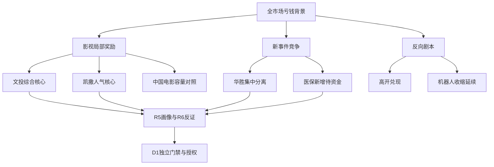

> ⚠️ **数据源时间错位**
> 文件名声明交易日2026-11-16；实际基础行情2026-11-13（T-1）。这是11/16盘前判断，不是已发生的周一走势；周末事件事实另留原时点。

# 2026年11月16日 · 主线研判

> 数据源新鲜度：partial。行情事实截至2026-11-13；周末消息与热度不冒充周一成交。
> 降级状态：true。置信度：0.392。仅研究，不授权交易。

## 一句话结论
**观察影视传媒两个人气核心，算力分离与医保新事件竞争；不把二冰当必修复。**

## 📊 先认市场，再认局部奖励

情绪=震荡/主跌。R1实取全市场765涨、4748跌，昨日涨停池收盘中位反馈-4.27%，涨停37、跌停33、炸板21，炸板率36.21%。这说明先手高开后兑现仍占优势，不是37个涨停就能推出全市场可进攻。R1的20%只是本轮市场仓位意见、适用至开盘复核，不是账户预算；本轮真实硬预算未知，既不填0，也不抬成正额度。

主线=影视传媒（研究），持续性=1日承接假设，封板率=80%，明日预期=分歧。这里的封板率是同花顺文化传媒当前成分交叉周五涨停/炸板所得8/(8+2)，不是全市场63.79%，也不是网站短剧9家的分母。文化传媒指数仍跌0.53%，196个有行情成员仅55上涨；真正被奖励的是其中的院线和少数情绪核心，而非所有AI应用、游戏或传媒。

本轮主模板只选92科比三格：龙头、补涨、切换。没有把总龙锁仓、首板隔日等五套拼接；主跌只是温度，不静态禁某个通道。任何新开仓都要等D1按真实承接、RR及独立风险核验，研究观察不等于买权。炸板纪律落地为真实研究短名单10→5，未入选的对象仍保留广覆盖审计，不变相塞进执行池。

## 🧭 主线、竞争方向与五维比较

| 方向 | 热度/资金/涨停/叙事/共振 | 总分 | 明确态度及原因 |
|---|---|---:|---|
| 影视传媒/短剧情绪映射 | 19/12/18/11/17 | 77 | 观察唯一研究主线，院线扩散而宽泛短剧资金流出 |
| 国产算力 | 17/7/14/10/16 | 64 | 观察华胜集中分离，不将单股净入当全线回流 |
| 创新药 | 8/5/5/19/未知 | 未知 | 观察医保新事件；已核四维小计37，不补0 |
| 机器人 | 15/3/12/14/14 | 58 | 降级次线，旧梯队收缩且概念连续转出 |
| 商业航天 | 14/4/4/17/13 | 52 | 观察事件；上面级塔捕不等于两级全回收 |
| 农业/猪肉 | 8/10/10/未知/未知 | 未知 | 观察防守转攻，已核三维小计28，不编完整梯队 |

五维是对先前市场比较的解释，不是收益概率、固定排序阈值或准入门槛。医保消息比传言硬，但周五还没有全线合力；这不是证明周一不会形成新主线。所有完整板块对象都写稳定sector_id；真实启动催化/首发时点不足，round_id与event_at保留null。研究意见从本轮真实生成起到开盘初核有效，不把报告生成日当行情轮次。

- **大资金意图**: 影视院线行业单日净入13.87亿元、五日9.64亿元，影视概念净入8.41亿元，体现局部风险资金从普跌中寻找情绪出口的假设；不是已证明机构统一买整个传媒。
- **为什么走强**: 文投反包与院线6只行业封板形成扩散，文化传媒8封2炸；周末凯撒/文投热度前二延续注意力。对手盘是已有先手，不是凭新闻想象的新资金。
- **逻辑够不够硬**: 有价格、资金和传播对照，但海外短剧付费榜9/10说法未独立核，短剧概念当日净出28.32亿元，传媒大行业净出20.96亿元；只能支持窄子方向研究，不能认全线主升。

## 🔎 连板公开正文对裁决的实际影响

候选形成前已比较today、mainline和qingxu所运输公开正文。采纳传媒局部扩散与二冰亏钱背景，但不照抄它的机器人并列主线：网站窄矩阵机器人26→22→5→4，同花顺广概念34→27→8→7且周五7封7炸，两种范围不可相加，却都说明旧线收缩。机器人概念周五净出163.64亿元，发布会媒体排期不能把老周期改名为新启动。

核心也有分歧：网站推凯撒为短剧核心、法狮龙为算力核心；本轮把文投认作综合情绪龙一、凯撒龙二，华胜作为算力集中资金核心对照。文投的首封、反包扩散和五日净入强于凯撒；华胜的人气和个股资金强于法狮龙。北纬3连板仅作游戏高度对照，数板不等于综合总龙。网站天普4板总龙标签不能覆盖R4的开市停牌原件；黄仁勋辞职与天普AI注入不采为已核催化。

qingxu只裁决运输前3600字符，不声称全文或会员资料已读。31次历史同景、次日上证上涨率48%不是本日修复证据或选票胜率；mainline的5°与today约19°存在版本冲突，版本未知不升级为收盘事实。反向剧本是旧核心高开兑现、短剧资金继续退出，或新医保事件取得承接后抢走资金。三个网页同源，不算三票独立确认。

## 🎯 五只研究候选：过滤后均未获执行许可

| 地位 | 股票 | 周五板型 | 流通亿元 | 5日净入亿元 | 龙头纪律通过数 | RR/禁止清单 |
|---|---|---|---:|---:|---:|---|
| 龙头 | 文投控股 600715.SH | 反包首板 | 97.32 | 5.90 | 3/4 | RR未知；已核命中无，完整14项未完 |
| 龙二 | 凯撒文化 002425.SZ | 反包首板 | 36.44 | 1.44 | 3/4 | RR未知；已核命中无，完整14项未完 |
| 龙三 | 中国电影 600977.SH | 首板 | 318.32 | 1.10 | 1/4 | RR未知；已核命中无，完整14项未完 |
| 龙头 | 华胜天成 600410.SH | 首板 | 156.80 | 10.02 | 2/4 | RR未知；已核命中无，完整14项未完 |
| 龙头 | 通化金马 000766.SZ | 首板 | 159.33 | 2.66 | 1/4 | RR未知；已核命中无，完整14项未完 |

文投/凯撒分别只作研究龙一、龙二；中国电影leader_rank=filtered_out，不因龙一被否自动递补。华胜与通化是竞争方向的低位前排对象，认定未过三条，不能只靠首板或流入命名总龙。所有票in_today_plan=null，未用旧计划缺席提前制造计划外禁令；300/688与主板同权，920及ST等原保护不变。

### 文投控股｜观察，不授买权

- **大资金意图**: 情绪反包带影视扩散；五日净入5.90亿与周末人气第2可核。
- **为什么走强**: 观察：周末同花顺第2，首封早于凯撒；反包带影视扩散、成交10.45亿、换手10.90%，五日净入5.90亿。文化传媒实取成分内连续高度并列第一（1板），以累计人气、扩散综合优于网站单选凯撒；不把5天4板写成5连板。
- **逻辑够不够硬**: 已核3条龙头纪律；业务或话题不能替代全市场合力，RR仍未知。

- **买入理由**: 仅保留研究理由，不是买入指令。情绪反包带影视扩散；五日净入5.90亿与周末人气第2可核。

- **风险点**: 旧核心累积获利、高开兑现；宽泛短剧资金持续流出，不能把影视扩散当新生命周期。

- **止损条件**: 若文投失去前排承接且院线跟风由封板转普遍回落，则“局部核心带动”研究逻辑失效；交易价位由D1独立推导。

- **可验证假设**: 下一交易日核文投承接、院线前排是否保持相对市场优势、文化传媒封板反馈；若核心与跟风同时走弱，撤回延续假设。

### 凯撒文化｜观察，不授买权

- **大资金意图**: 文化传媒成分/游戏行业映射而非伪造短剧营收；4天3板与周末人气13→1可核。
- **为什么走强**: 观察：周末同花顺13→1，4天3板但连续高度1；封单1.50亿、换手13.70%，五日净入1.44亿。接纳网站游戏心智核心但不照抄综合龙一；当前THS短剧游戏成分未列该票，以文化传媒成员与游戏行业映射，不造短剧收入。
- **逻辑够不够硬**: 已核3条龙头纪律；业务或话题不能替代全市场合力，RR仍未知。

- **买入理由**: 仅保留研究理由，不是买入指令。文化传媒成分/游戏行业映射而非伪造短剧营收；4天3板与周末人气13→1可核。

- **风险点**: 流通36.44亿小盘风险；历史近期炸板37.5%仅月度口径，不能把高热当必封或派发事实。

- **止损条件**: 若人气第一不能转换承接且文投/院线失联，则“龙二联动”假设失效；不据此自动换杂毛。

- **可验证假设**: 下一交易日比较其实际承接与文投相对地位；只有注意力没有板块反馈则不确认接力。

### 中国电影｜观察，不授买权

- **大资金意图**: 院线产业属性与真实6只行业封板对应；周五成交18.99亿/流通318.32亿提供容量对照。
- **为什么走强**: 观察：中国电影成交18.99亿、流通318.32亿作院线容量对照；首封晚、回封5次，不因资金流入代替人气核心。仅结构研究，不作龙一被否后的自动替补。
- **逻辑够不够硬**: 已核1条龙头纪律；业务或话题不能替代全市场合力，RR仍未知。

- **买入理由**: 仅保留研究理由，不是买入指令。院线产业属性与真实6只行业封板对应；周五成交18.99亿/流通318.32亿提供容量对照。

- **风险点**: 首封较晚、回封5次；容量大不是情绪龙头，股性投影未覆盖，不填历史板数。

- **止损条件**: 若成交容量不能支撑院线跟风且转为普遍兑现，则容量承接假设失效；该票本就不具自动替补资格。

- **可验证假设**: 下一交易日检查院线量价与核心联动；仅该票放量而跟风走弱不视作板块合力。

### 华胜天成｜观察，不授买权

- **大资金意图**: 国产算力部署/迁移是产业假说，非已证订单；周五首板与五日净入10.02亿显示个股集中选择。
- **为什么走强**: 观察：算力首板，同花顺周末3、东财1，五日净入10.02亿、周五10.78亿；算力概念当日-95.56亿且连续两日流出，是个股集中分离，不是板块已共振主升。
- **逻辑够不够硬**: 已核2条龙头纪律；业务或话题不能替代全市场合力，RR仍未知。

- **买入理由**: 仅保留研究理由，不是买入指令。国产算力部署/迁移是产业假说，非已证订单；周五首板与五日净入10.02亿显示个股集中选择。

- **风险点**: 板块净出95.56亿、连续两日转出；周末热榜不产生新成交，5日无龙虎榜不是30日无游资。

- **止损条件**: 若个股资金分离消失且算力跟风未修复，则分离假设失效；R5仍需核业务纯度，不以热度代替。

- **可验证假设**: 下一交易日核华胜承接是否同时带算力封板/广度改善；只强一票仍不升为已确认主线。

### 通化金马｜观察，不授买权

- **大资金意图**: 医保目录公司原件与医药业务映射可核；周五是创新药成分唯一封板且五日净入2.66亿。
- **为什么走强**: 观察：创新药成分周五唯一封板，开板6次、五日净入2.66亿；R4医保目录有原件映射但2027年实施，对应产品收入需画像。仅低位前排对照，不由目录直接授核心地位。
- **逻辑够不够硬**: 已核1条龙头纪律；业务或话题不能替代全市场合力，RR仍未知。

- **买入理由**: 仅保留研究理由，不是买入指令。医保目录公司原件与医药业务映射可核；周五是创新药成分唯一封板且五日净入2.66亿。

- **风险点**: 支付执行在2027年、收入贡献未核；周五开板6次且医药整体弱，单票封板不证明全线进攻。

- **止损条件**: 若对应产品支付/准入不符或新事件无法获得核心承接，则目录驱动试错假设失效；不编止损价。

- **可验证假设**: 下一交易日核目录相关直接对象的承接与扩散；24—72小时只检验市场传导，不要求政策马上形成收入。

## 🧪 为什么不选对照对象

消息先纳初筛而非给旧票补故事。尚品宅配有直接原件，但流通18.45亿元低于20亿元，且数据集免费、科研教育占89.3%，按现有规则不进，不是因创业板前缀。禾元生物首次医保纳入映射直接，仍未形成已核市场核心，留观察；游族14.28亿元闪存订单净额确认对当期收入影响非常小且采购占资，利扬并购尚待审计融资交割，新宙邦60万吨长协远期非强制，德明利拟投资未签且不并表，天孚注销回购不能掩盖周五下跌10.94%。这些各有独立证据，不代表它们无机会，更不等于已合格。

心智锚TOP3已先纳研究比较再截断：新华传媒周五跌停、天娱数科弱且五日净出2.62亿元、欢瑞未封、传智教育弱于当日前排，不能仅因旧锚分高替换新证据。博纳热度上升但未封，北纬3板保留高度对照；主跌中不以低位后排递补被否核心。国统虽2板但开板16次、无本轮主线地位，rank=杂毛，不进；不伪称完整杂毛过滤四项已查齐。

猪肉是问财概念涨幅第一，金新农与天邦有首板，不能因传统行业就排除；但水产好当家2板不能混成猪肉同题材高度。银行确有12.26亿元流入和指数抗跌，仍未见本轮足够封板扩散，不拿旧红利榜替代动态市场。羊/狼、生肖与名字梗允许按2027羊年预期研究；七匹狼本轮周五跌9.30%、缺实际传播与梯队，不继承单日点名或编梗选股。

## 关键证据

- 市场风险：765涨/4748跌、涨停池中位-4.27%，来源R1与本轮日线交叉。
- 结构范围：文化传媒8封2炸、短剧7封3炸、机器人7封7炸；当前成分不是历史冻结成分，分类范围留限。
- 资金双向：院线行业+13.87亿，但短剧概念-28.32亿；moneyflow_dc个股原单位万元、板块moneyflow_ind_dc原单位元，已分别换算，不能混除。
- R4原件：天普停牌、金辰澄清、医保新增及尚品直接布局均在候选形成时纳入，不靠新闻标题认证利润。
- 历史包run_id一致但records与market_feedback均为空；逐evidence_id无对象，不造ID，不绕读其他历史报告。运输失败不是原判断失败或成功。

## 数据源审计

| 源 | 日期 | 状态 | 备注 |
|---|---|:--:|---|
| R1_style | 2026-11-16 | 🟡 | degraded，广度/负反馈可用，仓位意见非账户预算 |
| R3_sentiment | 2026-11-16 | 🟡 | degraded，周末榜为注意力，转载同源去重 |
| R4_news | 2026-11-16 | 🟡 | partial，公司原件与媒体/未核传言分层 |
| R7_capital_flow | 2026-11-16 | 🟡 | partial，院线流入不替代宽概念资金 |
| Tushare MCP limit_cpt/limit_list | 2026-11-13 | 🟢 | 本轮在线抽核；涨停37，主线排名非独立源多票 |
| Tushare SDK横截面 | 2026-11-13 | 🟢 | 5571日线/指标、554概念资金；7题材成分交叉 |
| Tushare SDK个股资金 | 2026-11-13 | 🟢 | 62代码各5日，个股万元与板块元分开 |
| Tushare龙虎榜 | 2026-11-13 | 🟡 | 区间接口失败后逐日补齐5日；完整30日席位未核 |
| 同花顺问财 | 2026-11-13 | 🟢 | 复合条件空后放宽为涨幅前20，is_cache=0；同花顺数据 |
| 连板公开today/mainline/qingxu | 2026-11-13 | 🟡 | 公共投影，qingxu仅运输前缀；会员/版本未知不升级 |
| 心智锚/个股股性 | 2026-11-02 | 🟡 | 原hash已核；7题材TOP3与5代码定向投影，非全表理解 |
| 周度因子IR | 未取得 | 🔴 | 路径缺失，factor_layer_degraded=true，不编因子排名 |
| fetch公众号/群聊/weflow | 2026-11-16 | 🟡 | 叙事消费R3/R4已绑定证据；不重复计转载，不声称R2全文读完原消息 |
| 历史/市场反馈包 | 2026-11-16 | 🟡 | run一致，但运输字节预算失败、证据为空，不旁路旧历史 |
| 扩池/红利/复盘专题 | 2026-11-13 | 🟡 | 仅运输节选；红利估值实为2026-10-30，复盘反馈0字符 |

## 不确定性 / 反证

第一，传媒是局部而非全线，短剧概念净流出构成实质反证；不能把跨源摘要1.0解释成完整三源验证或胜率。R3支持、R7仅院线子方向支持，R4直接正催化未知，只核两项，四源共识清单为空。

第二，生命年龄和启动轮次未核。已有函数用假设age=1/10作敏感性诊断，返回不同阶段，不将其情景输入冒充真实年龄；研究判定旧核心反包后分歧，不凭榜单days=1造新轮次。每条板块都保留round_id=null，不继承不匹配的旧轮次。

第三，所有候选RR与完整禁止清单仍未知，已核无命中不等于门禁通过。主线/次线主推数可以为空，本轮保留五只是真实观察，不授权执行。R6是唯一hard_reject来源，真实停牌、小流通等事实照录但不由R2抢投反证否决票。

## 与其他 R/D/E 的关系

依赖本轮R1/R3/R4/R7；R5核五只真实画像与尚未闭环的产品/业务贡献，R6只消费同版内嵌JSON证据，D1独立选择计划身份、RR、执行通道与有效预算。旧市场no_trade/零仓意见仅在原窗口有意义，不能无限继承；真实用户/账户停买、有效硬预算含0、T+1及现有授权保护均保持。

## Sub-Agent 元数据

- skill: analyze_main_sectors_v1；龙头标注filter_leader_v1已执行。
- artifact: data/research/20261116/R2_main_sectors.json
- method: llm_v1_market_first；model: gpt-6.1-sol。
- history: 仅指定运输包；知识来源逐source_id留取舍，不因文件存在声称全文采纳。

- 图表验收: Mermaid 11.4.0真实SVG渲染通过，21779字节；正文与机读契约检查通过。
