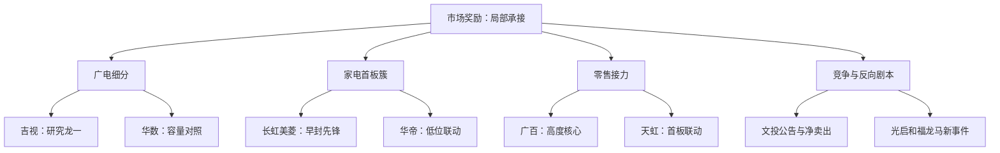

# 2026年11月17日 · 主线研判

> **数据源新鲜度**: partial　**降级状态**: true　**置信度**: 0.448
> **口径**：11月17日真实盘前生成，市场事实为11月16日收盘；不把T-1数据说成今日行情。

## 🎯 一句话结论

**观察广电两核与消费切换；零售承接分化，游戏旧核降级，消息直接受益另留研究。**

## 🧭 详细分析

市场仍在为局部承接付钱，而不是为普遍接力付钱。R1记录上涨1136、下跌4344、涨停32、跌停60；前涨停股反馈均值+0.99%与中位-1.45%背离。炸板16/48=33.33%，未触发35%机械砍半，却不代表风险低。沿用R1震荡分化温度，不把网站退潮26.8°或另一页冰点5°强行统一，更不把历史指数同景概率搬成个股续板概率。

在候选形成前，先比较连板today/mainline/qingxu运输正文：家电新增4家、零售3家，而传媒矩阵5对7收缩，机器人此前26/22家后降温。网站把北纬列总龙、凯撒列短剧核心，但本轮问财将北纬归因四足机器人/物联网/手游，将凯撒归因AI游戏/IP。故高度温度计、情绪人气与真实细分资金分开，不把网站名单直接当选股指令，也不靠北字辈或谐音续旧叙事。2026年四季度的2027羊年是可研究预期，但本轮没有实际传播与资金共振证据，七匹狼不作固定候选。

R7电视广播当日+6.79亿、5日+9.87亿，却与传媒整体当日-25.32亿、游戏-12.17亿同时存在。吉视/华数按细分独立研究；这不是文投被降级后的自动替补。家电4只跨冰洗、厨电、小家电封板，并有海信/美的容量扩散；零售有广百3板及两只首板，但行业资金仍负，旧核大东方、国芳跌停。三条是研究主推，不等于三条已确认可交易主线。R1的2是涨停数量代理，不是已命名主线的硬上限。

消息、产业与纯情绪并行比较：光启17.904亿合同、福龙马预售、顺钠回购、朗特并购、医保事件均在截断前进入对照。消息可核不等于地位可核；光启前日弱不能否定盘后新订单，但尚无新一日买盘，福龙马预售规模也未核。储能方案有效而电池涨停是多分支集合，不能把野马锌锰/换届、世龙氯化亚砜与所有固态装车合并叙事。旧红利/成长节选不自动提供当日核心资格。

唯一主模板为**三格：龙头、补涨、切换**。不融合反核或总龙锁仓；R2不出买卖价位或仓位。研究候选继续交R5，R6是唯一硬否决来源，D1按真实账户预算、T+1、同版计划和完整门禁另判。本轮RR未知，所有执行资格未授予；不把计划尚未成案写成“计划外”。

### 五维比较：先有对象判断，再有辅助分数

|研究主推|热度|资金|涨停|叙事|共振|合计|持续性观察窗|封板率口径|11月17日预期|
|---|---:|---:|---:|---:|---:|---:|---|---|---|
|电视广播/AI微短剧局部承接|18|17|15|12|15|77|1日，非承诺|66.67%（2封/1炸，行业匹配样本）|分歧|
|家用电器低位首板簇|15|15|18|10|14|72|1日，非承诺|80.00%（4封/1炸，行业匹配样本）|分歧|
|一般零售接力/消费扩散|17|9|18|11|16|71|1日，非承诺|75.00%（3封/1炸，行业匹配样本）|分歧|

分数只作研究排序；没有新评分、胜率或硬阈值。主线专属封板率仅上述行业触板股样本，不是全部概念成分。真实启动轮次/首次催化时刻尚缺，`round_id=null`；有效窗从本次实际生成至午间，竞价及开盘新增事实可提前使判断失效。

### 电视广播/AI微短剧局部承接｜观察

- **大资金意图**: 先区分细分与全传媒：R7电视广播单日+6.794484亿、5日+9.871284亿；传媒整体-25.320044亿，两者不能相加或互代。这是资金选择假设，不是账户持仓追踪。
- **为什么走强**: 吉视、华数两只封板，吉视东财热榜4、同花顺15，实际先封且大单代理5日净入5.912亿；华数为145.17亿容量对照。
- **逻辑够不够硬**: R3的OTT大屏叙事是传播假设，不把牌照当短剧平台收益；文投风险不自动转成广电订单。 独立必要风险仍需R5/R6核验，1日承接失效即否定主升推断。

|角色|代码/名称|T-1涨幅|板数|流通亿|5日大单代理亿|态度/资格|
|---|---|---:|---:|---:|---:|---|
|龙头|`601929.SH` 吉视传媒|+10.04%|1|103.30|5.912012|观察，不授执行|
|龙二|`000156.SZ` 华数传媒|+10.05%|1|145.17|1.514581|观察，不授执行|

#### 吉视传媒｜龙头研究思考

- **买入理由**: 这是研究入选理由，不是买单。细分两只封板中先封（10:12）、东财热榜4、5日大单代理+5.912亿；辨识/扩散/容量三条有研究证据，不称全市场总龙。 业务/事件映射只取本轮已核供应商归因，产业利润仍待R5。

- **风险点**: 一日回流而非已确认主升；2天内反包不等于低位；OTT流量到利润的权益和合同未核；当前RR与完整禁止清单未核。

- **止损条件**: 仅定义研究逻辑失效，不给交易止损价。若下一交易日本票不能维持前排承接，且同方向已选前排全部失去封板/扩散，则撤销本研究核心假设；真实持仓动作由同版D1与T+1约束决定。

- **可验证假设**: 未来1个交易日检查本票封板是否保持、同方向是否至少1只前排晋级或新增封板、资金方向能否延续；若三项均不成立则判切换/接力失败。该阈值是本文待证研究假设，不新增交易门禁。

#### 华数传媒｜龙二研究思考

- **买入理由**: 这是研究入选理由，不是买单。细分封板与R3内容锚共同支持；大单代理当日+1.732亿，龙虎榜单日净买+1.189634亿，容量大但封板晚于吉视且开板3次。 业务/事件映射只取本轮已核供应商归因，产业利润仍待R5。

- **风险点**: 华数不是全传媒龙二，只是细分容量对照；尚无OTT新增订单与收入兑现；当前RR与完整禁止清单未核。

- **止损条件**: 仅定义研究逻辑失效，不给交易止损价。若下一交易日本票不能维持前排承接，且同方向已选前排全部失去封板/扩散，则撤销本研究核心假设；真实持仓动作由同版D1与T+1约束决定。

- **可验证假设**: 未来1个交易日检查本票封板是否保持、同方向是否至少1只前排晋级或新增封板、资金方向能否延续；若三项均不成立则判切换/接力失败。该阈值是本文待证研究假设，不新增交易门禁。

### 家用电器低位首板簇｜观察

- **大资金意图**: 家电4只封板，覆盖冰洗/厨电/小家电；海信家电+7.5171%、美的+2.3523%提供容量扩散对照，不是单票秒拉。这是资金选择假设，不是账户持仓追踪。
- **为什么走强**: R7家电+1.165798亿但5日-0.611021亿；白色家电+2.818393亿、5日+11.513827亿，子行业不重复加总。
- **逻辑够不够硬**: 首次封板长虹领先华帝，再到小熊、北鼎；名字梗不是取代家电归因的证据。 独立必要风险仍需R5/R6核验，1日承接失效即否定主升推断。

|角色|代码/名称|T-1涨幅|板数|流通亿|5日大单代理亿|态度/资格|
|---|---|---:|---:|---:|---:|---|
|龙头|`000521.SZ` 长虹美菱|+9.95%|1|37.73|0.565445|观察，不授执行|
|龙二|`002035.SZ` 华帝股份|+10.12%|1|36.60|0.720935|观察，不授执行|
|龙三|`002959.SZ` 小熊电器|+10.01%|1|50.70|0.419502|观察，不授执行|
|龙三|`300824.SZ` 北鼎股份|+19.94%|1|27.43|0.541952|观察，不授执行|

#### 长虹美菱｜龙头研究思考

- **买入理由**: 这是研究入选理由，不是买单。四只普通家电封板中首封最早09:47、开板0次，后续厨电/小家电扩散，流通37.72亿元；不是因低价或名字选入。 业务/事件映射只取本轮已核供应商归因，产业利润仍待R5。

- **风险点**: 流通37.72495亿，20—50亿谨慎；问财41.149亿与Tushare37.725亿口径差异未核；均过20亿，不升级为已核一致；当前RR与完整禁止清单未核。

- **止损条件**: 仅定义研究逻辑失效，不给交易止损价。若下一交易日本票不能维持前排承接，且同方向已选前排全部失去封板/扩散，则撤销本研究核心假设；真实持仓动作由同版D1与T+1约束决定。

- **可验证假设**: 未来1个交易日检查本票封板是否保持、同方向是否至少1只前排晋级或新增封板、资金方向能否延续；若三项均不成立则判切换/接力失败。该阈值是本文待证研究假设，不新增交易门禁。

#### 华帝股份｜龙二研究思考

- **买入理由**: 这是研究入选理由，不是买单。首封紧随长虹、东财新进热榜16、大单代理+0.746亿优于本批小熊/北鼎；综合位置第二，并非历史红利榜自动上位。 业务/事件映射只取本轮已核供应商归因，产业利润仍待R5。

- **风险点**: 流通36.59936亿谨慎，3次开板；月度红利池指2026Q3经营现金同比-39.5%，旧股息不是护城河；当前RR与完整禁止清单未核。

- **止损条件**: 仅定义研究逻辑失效，不给交易止损价。若下一交易日本票不能维持前排承接，且同方向已选前排全部失去封板/扩散，则撤销本研究核心假设；真实持仓动作由同版D1与T+1约束决定。

- **可验证假设**: 未来1个交易日检查本票封板是否保持、同方向是否至少1只前排晋级或新增封板、资金方向能否延续；若三项均不成立则判切换/接力失败。该阈值是本文待证研究假设，不新增交易门禁。

#### 小熊电器｜龙三研究思考

- **买入理由**: 这是研究入选理由，不是买单。小家电首板、开板0次、流通50.70亿，证明板块扩散；首封晚，不用较高价格或稳定封板替换已定龙一。 业务/事件映射只取本轮已核供应商归因，产业利润仍待R5。

- **风险点**: 研究龙三不进执行池，不能因龙一被否而自动递补；当前RR与完整禁止清单未核。

- **止损条件**: 仅定义研究逻辑失效，不给交易止损价。若下一交易日本票不能维持前排承接，且同方向已选前排全部失去封板/扩散，则撤销本研究核心假设；真实持仓动作由同版D1与T+1约束决定。

- **可验证假设**: 未来1个交易日检查本票封板是否保持、同方向是否至少1只前排晋级或新增封板、资金方向能否延续；若三项均不成立则判切换/接力失败。该阈值是本文待证研究假设，不新增交易门禁。

#### 北鼎股份｜龙三研究思考

- **买入理由**: 这是研究入选理由，不是买单。20cm首板是弹性效应证据；保留研究不是前缀限制。封板晚且8次开板、封单约291万元，不能因涨幅20%取代10cm先锋。 业务/事件映射只取本轮已核供应商归因，产业利润仍待R5。

- **风险点**: 流通27.4313亿谨慎；多次开板；不是已核趋势低吸资格；当前RR与完整禁止清单未核。

- **止损条件**: 仅定义研究逻辑失效，不给交易止损价。若下一交易日本票不能维持前排承接，且同方向已选前排全部失去封板/扩散，则撤销本研究核心假设；真实持仓动作由同版D1与T+1约束决定。

- **可验证假设**: 未来1个交易日检查本票封板是否保持、同方向是否至少1只前排晋级或新增封板、资金方向能否延续；若三项均不成立则判切换/接力失败。该阈值是本文待证研究假设，不新增交易门禁。

### 一般零售接力/消费扩散｜观察

- **大资金意图**: 广百3板领先天虹、鹏飞首板，3家封板形成高度/低位梯队；广百东财热榜新进10。这是资金选择假设，不是账户持仓追踪。
- **为什么走强**: 广百封单1.994694亿、0开板是当日强封事实，不是次日一字命中；次日是否可成交未知。
- **逻辑够不够硬**: 零售行业单日-0.713795亿、5日-12.015957亿；大东方与国芳跌停使旧消费线分化，不把家电回流直接借给所有商超。 独立必要风险仍需R5/R6核验，1日承接失效即否定主升推断。

|角色|代码/名称|T-1涨幅|板数|流通亿|5日大单代理亿|态度/资格|
|---|---|---:|---:|---:|---:|---|
|龙头|`002187.SZ` 广百股份|+10.04%|3|53.76|1.330961|观察，不授执行|
|龙二|`002419.SZ` 天虹股份|+9.98%|1|61.63|0.883608|观察，不授执行|
|龙三|`002356.SZ` 鹏飞绿能|+10.04%|1|33.04|未知|观察，不授执行|

#### 广百股份｜龙头研究思考

- **买入理由**: 这是研究入选理由，不是买单。零售当前3连板最高，09:30封住后有天虹/鹏飞首板跟随；热榜10与6.14%换手共同支持研究辨识度、扩散、容量。 业务/事件映射只取本轮已核供应商归因，产业利润仍待R5。

- **风险点**: 三板接力T+1隔日兑现；板块总体资金负；一字预测不是已成交，强封无价格安全垫需D1重算RR；当前RR与完整禁止清单未核。

- **止损条件**: 仅定义研究逻辑失效，不给交易止损价。若下一交易日本票不能维持前排承接，且同方向已选前排全部失去封板/扩散，则撤销本研究核心假设；真实持仓动作由同版D1与T+1约束决定。

- **可验证假设**: 未来1个交易日检查本票封板是否保持、同方向是否至少1只前排晋级或新增封板、资金方向能否延续；若三项均不成立则判切换/接力失败。该阈值是本文待证研究假设，不新增交易门禁。

#### 天虹股份｜龙二研究思考

- **买入理由**: 这是研究入选理由，不是买单。首封09:32仅次广百，流通61.63亿、当日大单代理+0.946亿、东财新进20；身份为零售低位联动，不以储能概念标签归政策核心。 业务/事件映射只取本轮已核供应商归因，产业利润仍待R5。

- **风险点**: 非板块最高；首板不等于低估或必晋级；当前RR与完整禁止清单未核。

- **止损条件**: 仅定义研究逻辑失效，不给交易止损价。若下一交易日本票不能维持前排承接，且同方向已选前排全部失去封板/扩散，则撤销本研究核心假设；真实持仓动作由同版D1与T+1约束决定。

- **可验证假设**: 未来1个交易日检查本票封板是否保持、同方向是否至少1只前排晋级或新增封板、资金方向能否延续；若三项均不成立则判切换/接力失败。该阈值是本文待证研究假设，不新增交易门禁。

#### 鹏飞绿能｜龙三研究思考

- **买入理由**: 这是研究入选理由，不是买单。零售首板的扩散样本，09:36较晚且3次开板；保留龙三不自动替代。 业务/事件映射只取本轮已核供应商归因，产业利润仍待R5。

- **风险点**: 流通33.043亿谨慎；5日个股资金本轮未拉，未知；当前RR与完整禁止清单未核。

- **止损条件**: 仅定义研究逻辑失效，不给交易止损价。若下一交易日本票不能维持前排承接，且同方向已选前排全部失去封板/扩散，则撤销本研究核心假设；真实持仓动作由同版D1与T+1约束决定。

- **可验证假设**: 未来1个交易日检查本票封板是否保持、同方向是否至少1只前排晋级或新增封板、资金方向能否延续；若三项均不成立则判切换/接力失败。该阈值是本文待证研究假设，不新增交易门禁。

## 🔄 竞争方向与不选理由

|方向/对照对象|裁决|理由与反向证据|
|---|---|---|
|短剧游戏/存量情绪核心：北纬科技、凯撒文化、文投控股、金逸影视|观察/次线|保留真核心观察，但整体价格/资金负反馈与直接风险高；不是因高位一个标签否定。 连板网将北纬列总龙、凯撒列短剧核心；问财实际北纬四足机器人/物联网/手游，凯撒AI游戏/IP，不接受单一短剧总龙归因。|
|固态/储能电池分支：紫竹高科、领湃科技、世龙实业|观察/次线|有政策和局部封板，但分支收益关系/整体资金尚不足认定统一新主线。 连板网锂电4家与limit_cpt广概念5家是不同口径，不能叠加。|
|冰雪季节叙事：龙江交通、冰山冷热|观察/次线|主题资金与两核反向，尚无统一受益链及持续接力。 R3热度上升与概念冰雪经济+1.404368亿相符；行业制冷空调却净流出3.527375亿，语义不全等同。|
|电网/变压器：顺钠股份|观察/次线|消息/低位对照研究，不补造五维齐备或龙头资格；待后续研究必要证据。 R4回购1.2—2.4亿与行业催化，11月16日已首板；大单代理当日+2.027亿，但行业5日-19.354334亿。|
|航空超材料订单：光启技术|观察/次线|消息/低位对照研究，不补造五维齐备或龙头资格；待后续研究必要证据。 R4原公告17.904亿合同直接受益，商业关联强；11月16日-1.7876%，不因旧股价弱否定盘后新订单。|
|环卫机器人/具身应用：福龙马|观察/次线|消息/低位对照研究，不补造五维齐备或龙头资格；待后续研究必要证据。 R4直接点名福龙马联合研发并预售；11月16日+3.3088%、5日大单代理+2.717亿，但日内代理为负。|
|光互联并购事件：朗特智能|观察/次线|消息/低位对照研究，不补造五维齐备或龙头资格；待后续研究必要证据。 R4拟收购成都奥捷51%，附条件未生效；11月16日+4.9518%，事件先纳入并行比较而非旧票补故事。|
|创新药医保事件：海思科|观察/次线|消息/低位对照研究，不补造五维齐备或龙头资格；待后续研究必要证据。 R4公告医保产品及2027年执行，现期不能直接算新增放量；消息真实仍保留。|
|猪肉低位接力：金新农|观察/次线|消息/低位对照研究，不补造五维齐备或龙头资格；待后续研究必要证据。 二板0开板、3日龙虎榜净买0.271801亿，消费中的独立低位效应；不因农业旧标签否定。|
|国统、九阳、湖北广电|观察/降级|国统有3板但缺主题合力；九阳炸板未封；湖北广电断板且席位卖出，不因人数不足补龙三。|
|瀛通、欧亚、利仁|不进|实时流通市值低于20亿；名字、概念和旧股性不得豁免。|
|历史心智锚|观察对照|家电锚国芳属百货、合锻属专用机械；传媒旧锚新华跌停、欢瑞等弱反馈，保留比较而不自动替代实际核心。|

杂毛过滤不造结论：没有足够证据证明某对象同时命中原四项中的两项，当前已确认杂毛名单为空。弱后排不等于被认证杂毛；龙三仍不进执行池。

## 🔎 关键证据

- R1：涨停32、跌停60、炸板16、前涨停中位-1.45%，与均值正收益背离，限制主升解释。
- Tushare本次实时接口：非ST涨停32、炸板16、每日指标5572、当前在市5579、ST名单196；交易日历确认11月17日开市。
- 同花顺问财：家电20只横截面、零售20只横截面、传媒6只归因、电池5只归因、事件4只核对。截断仅公开研究范围，不冒充全行业深研。
- R7：电视广播+6.79亿与传媒-25.32亿并列，重复的Ⅱ/Ⅲ层级不相加。
- R4 E009：文投AI漫剧收入占比2.57%且未经审计、条件性退市风险；不是已ST或已停牌。
- 历史包：run_id匹配，但历史records为空/轮次无作用域；仅将E1“比较家电/零售/储能”转为本轮核验假设，不认证事前预测或收益。

## 数据源审计

|源|日期|状态|记录数/范围|备注|
|---|---|:--:|---|---|
|R1_style|2026-11-17|🟡|本批相关字段|degraded，事实日11月16日；非账户预算|
|R3_sentiment|2026-11-17|🟡|4个L1+L2主题及热榜信号|同稿去重，未读回全部原群消息|
|R4_news|2026-11-17|🟡|27条事件对象及风险映射|继承上游原件核验边界，不自称R2重读全部公告|
|R7_capital_flow|2026-11-17|🟡|行业资金与个股覆盖|标准路径存在，partial并非完全缺失|
|Tushare MCP/SDK|2026-11-17|🟢|32封板、16炸板；5572每日指标|本轮实时调用，事实日11月16日|
|同花顺问财|2026-11-17|🟢|5问55条；初筛另16概念|源站概念口径与东财不完全相同|
|连板today/mainline/qingxu|2026-11-16|🟡|4281/1534/3600字公开投影|qingxu原5740字、会员不可见；非独立行情加权|
|心智锚/股性表|2026-11-02|🟡|6主题TOP3及本轮代码精确行|历史属性，不是今日封单/买权|
|成长/红利专题|2026-11-16|🟡|运输节选；红利估值2026-10-30|成长闭环0非全市场不合格，红利partial|
|一字预测|2026-11-16|🟡|2只，目标11月17日|预测素材，不是命中或排单指令|
|本次唯一历史包|2026-11-17|🟡|1个E1反馈证据ID|原轮次未知；仅待核经验|
|周度IR因子|2026-11-17|🔴|目录不存在|factor_layer_degraded=true，不补造因子分|
|可选weflow|2026-11-17|🔴|未接入|沿R3有效备源，未全局禁买|

## ⚠️ 不确定性 / 反证

本轮status为partial：因子缺失、真实轮次起点与生命周期整数输入不足，不能硬调用算法补年龄；广电只有两只合格封板研究对象，不填第三只。沪深10cm优先仅是情绪通道偏好，北鼎/领湃20cm没有前缀禁令。问财长虹流通41.15亿与Tushare37.72亿有差异，全部按保守较小口径且均过20亿，不伪称核对一致。板块层级重叠与同源转载不额外计独立源。

若文投风险扩散压垮吉视/华数，广电分离假设失败；若广百、家电四首板缺晋级且消费弱核继续跌停，切换也失败。相反，光启合同或福龙马发布后出现独立板块扩散，D1应重新比较事件方向，不固守旧消费/传媒名单。R6的真实hard_reject不得被排名或好分数覆盖。

## 🤝 与其他 R/D/E 的关系

- 依赖：本批R1/R3/R4/R7 JSON、唯一R2_history_context与运输专题；实际版本hash已存JSON。
- R5：对本轮明确代码做必要画像，包含保留的消息直接受益与核心风险对照；不能因禁新或预算未知停止研究。
- R6：只读本轮JSON内嵌证据/上游索引和本轮候选，不读取MD或另行联网；对文投等核真实风险，未知不投硬否决。
- D1：自行核预算、逐票RR及禁止清单、当前竞价与开盘承接；首次成案前计划身份一律未知。
- E1：只将真实冻结版本与后续观测比较，不把研究观察写成交或收益。

## Sub-Agent 元数据

- skill: analyze_main_sectors_v1 / filter_leader_v1
- artifact: data/research/20261117/R2_main_sectors.json
- model: gpt-6.1-sol
- 方法：LLM裁决；确定性脚本仅取证、算术、过滤与校验，无第二模型会话。
- 生成耗时：以外部启动/结束回执为准，本文不补造。
- Mermaid：已用阅读端 Mermaid 11.4.0 实际渲染SVG，回执见 data/research/20261117/R2_delivery_validation.json；其余逐项校验与本报告状态分开记录。
