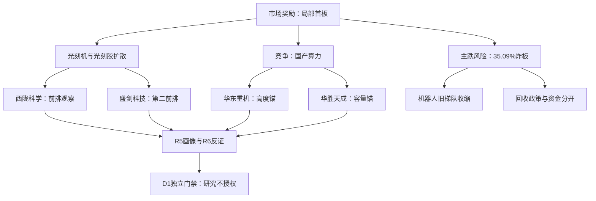

# 2026年11月18日 · 主线研判

> **数据源新鲜度**：partial · **降级状态**：是 · **置信度**：0.56
> 本文为盘前研究，不是交易计划。行情事实截止11月17日收盘，未取得18日竞价。所有账户预算、真实停买和执行保护保持原状。

## 🧭 一句话结论

**情绪=主跌；光刻首板为研究首选，算力为竞争方向；4只观察，无开仓授权。**

## 📊 详细分析

市场奖励必须先于故事。R1实核上涨/下跌`1326/4119`、涨停/跌停`37/67`，20只收盘炸板，炸板率`35.0877%`；最高非ST只有3板。首板风格指数`+1.0148%`，2板以上风格`-3.898%`。因此本轮主模板只选“首板隔日”，不拼总龙锁仓、三格等策略；主跌是T-1风险状态，不是18日必跌预测，通道仍由D1用真实承接动态决定。

在个股预选前已比较连板today公开4108字、mainline公开1608字及qingxu的3600/5635字前缀。矩阵显示芯片相对13日4家向17日11家再扩散，而机器人从10日26家、11日22家缩到17日2家，家电从16日4家缩到3家。**这改变的是方向比较：光刻优于机器人旧高潮延续，而不是把四次冰点读成必反弹。** 矩阵空白不当0、公开版本未知不升级收盘；11月4日芯片36家提醒这不是被证明“首次启动”的新轮次。三页同站不计三份独立支持。

同花顺问财实时返回光刻胶`+2.8289%`、净买入`6.938683亿元`，光刻机`+2.7799%`、净买入`7.627926亿元`，概念重叠不能相加。Tushare光刻胶榜单6家，对照当前81成员×收盘非ST涨停池为7家，差异来自包含北交所佳先等口径；后者7封3炸，封板率70%。光刻机52当前成员中5封1炸，封板率83.3333%。**网站合并“光刻11家”不能替代任一单概念统计。** R7设备五日净入39.53131亿元，电子化学品五日仍净出7.454677亿元，上位行业不冒充精确概念持续性。

消息、产业趋势和纯情绪同步比较。R4国产替代仅medium传导假设，BIS许可制及生效日缺口不能被包装成全面断供；回收政策是真实原文，但中再、华新当日未形成强接力，清研/超越流通盘不合格，政策不能抹去股东供给风险。英伟达量产交付与财报增长真实，毛利率/中国收入约束也真实。九阳官方否认华为合作，长虹风险披露与旧利润下降不能因“家电三板块票”而消失。纯情绪亦未被预先否定：华东/华胜有实际算力映射，不凭“华字”另造共识；阳光照明属于老线反包对照，2027羊年预期可提前研究，但本轮没有核到羊狼实际共识，不凭模型联想造票。

| 层次 | 研究方向 | 五维分：热/资/板/叙/振 | 态度与核心依据 |
|---|---|---|---|
| 研究主线 | 光刻机/胶国产替代 | 18/15/18/13/18＝82 | 🟡 观察：低位首板扩散、两概念正收益正资金；非已确认可交易主线 |
| 竞争次线 | 国产算力GPU/系统 | 17/11/14/14/17＝73 | 🟡 观察：华东高度、华胜容量；宽板块仍负，资金口径冲突 |
| 同事件簇 | 半导体材料/制造 | 16/17/14/12/17＝76 | 🟡 观察：有研容量确认较强，但8次开板、仅单日资金正；不重复凑主线 |
| 比较次线 | 家电/消费 | 14/12/15/8/11＝60 | 🟡 观察：两只二板仍有地位，扩散未加强，公告反证具体 |
| 收缩对照 | 机器人/名字梗 | 12/未知/7/7/未知 | 🔴 降级：旧梯队收缩，资金/共振缺口保留未知 |
| 事件对照 | 回收/固废政策 | 未知/未知/8/17/未知 | 🟡 观察：硬政策不等于资金已选，必要市值风险逐票限制 |
| 反向对照 | CPO/海外算力硬件 | 17/6/5/15/13＝56 | 🔴 降级：核心负收益、通信设备资金出；不因热榜高认定上涨 |

分数是研究比较，不是胜率或交易门槛。73/76分不强制进主线，82分也不取得买权。**主线=光刻机/胶，持续性=1日研究验证窗，封板率=70%（胶口径），明日预期=分歧。** 1日是本次推演窗，不是证明该线刚运行1日；真实首次催化、年龄、round_id与event_at未知并保留null。生命周期函数仅在观测片段1日条件下给formation，不用函数标签补造轮次。所有完整方向对象从真实生成时点生效，开盘即重评，不追溯立场。

### 🔎 光刻主线：资金到底在押什么

- **大资金意图**: 两概念当日正资金、设备五日正但化学品五日负，更像弱市从宽科技向部分国产配套集中；这是资金行为解释，订单大小净额不是机构账户身份证。
- **为什么走强**: 双榜热度1/2、首板同批扩散与板块正收益相互支持；叙事是本土供给稀缺性，而非已核HBM新增订单。真主营/股东与机构席位仍交R5。
- **逻辑够不够硬**: 配套试剂/FPD历史关联可以解释研究映射，不能证明先进光刻胶增量。R3/R4支持研究，R7仅上位行业代理，精确光刻项保留null；兼容跨源摘要1.0只基于已核2项，不是三源全支持。

### 🔄 竞争方向：算力、材料与其他剧本

- **大资金意图**: 华胜DC当日7.142015亿、五日12.699704亿，有研当日14.88758亿、五日9.874529亿，说明容量核心局部回流，不代表全科技机构加仓；回收政策对象尚未展示同等合力。
- **为什么走强**: 华东唯一3板是高度锚、华胜反包与有研材料涨停有辨识度；但华东缩量、华胜THS/DC符号冲突、有研8次打开均限制“普遍走强”的解释。家电双二板是独立比较项，不等于没有机会。
- **逻辑够不够硬**: 算力BIS传导、材料国产替代、回收原文各有来源，兑现还未同样确认；机器人26→2收缩、CPO核心下跌构成对照。不能靠再找同字低位票维持旧高潮叙事；反向剧本是光刻兑现、容量不扩散、市场继续杀跌，亦须容纳开盘后广度与接力同步改善的上修剧本。

## 🎯 四只研究观察对象

炸板率触及35%：先完成全市场、事件、纯情绪覆盖，再将8只预选减半至4只。光刻原4只保留西陇/盛剑；算力原4只保留华东/华胜。未入选者留在比较索引，不当执行替补。

| 身份 | 标的 | 板型 | 流通市值/亿元 | 龙头四条已核 | RR/禁止清单 |
|---|---|---|---:|---|---|
| 主线研究龙头 | 西陇科学 002584.SZ | 首板回封；THS开板0与SDK1冲突 | 38.058119 | 2/4；未满3条 | RR未知；全清单未完成，观察 |
| 主线研究龙二 | 盛剑科技 603324.SH | 首板未开；全日一字未核 | 30.371887 | 0/4充分确认；早封不等于真龙 | RR未知；低换手风险，观察 |
| 次线高度锚 | 华东重机 002685.SZ | 3连板、竞价封板 | 67.508485 | 1/4；数板不是总龙 | RR未知；缩量一致风险，观察 |
| 次线容量锚 | 华胜天成 600410.SH | 反包3天2板，连续板数1 | 167.654037 | 2/4；未满3条 | RR未知；资金口径冲突，观察 |

以上龙头/龙二是R2研究层级，不是假装通过四条纪律；已核条目与待核项在JSON逐票保存。所有execution_eligible=false，未完成R5/R6/D1，不人为宣布全市场禁新仓。所有in_today_plan=null，首次成案前不造计划外身份。300/688正常参与常规研究，只有920维持现行执行限制。

### 西陇科学：研究龙头，观察

- **买入理由**: 此处仅述研究理由，不发买单。其一，光刻胶配套试剂具历史业务映射，属于本轮首选事件簇；其二，早于多数10cm助攻封板，R3东财热度10且DC五日净入1.281970亿元，不因盘子处于20—50亿元就回避。
- **风险点**: 其一，配套试剂不是已核自产先进光刻胶；其二，38.06亿元流通盘须谨慎，首封/开板provider差异与次日承接未知，不能用净入代替监管风险核验。
- **止损条件**: 研究假设撤销条件，而非R2交易止损：若官方资料否定所述主营映射，或18日该股失去前排且同线助攻同步转弱，则撤销“低位核心联动”假设，交D1按原执行保护处理；不编造止损价。
- **可验证假设**: 在18日开盘至次日复核窗，核它是否仍为板块前排、同线收盘是否至少有其他助攻封板；若只剩单票、无其他助攻，不能确认“能带板块”。阈值只用于检验这条研究假设，不新增交易门禁。

### 盛剑科技：研究龙二，观察

- **买入理由**: 其一，FPD剥离/蚀刻液历史映射落在本轮光刻配套比较中；其二，与西陇同批最早10cm，SDK首封稍后而THS同刻，DC五日净入0.118735亿元，是前排比较而非仅凭便宜补涨。
- **风险点**: 其一，FPD配套不等于EUV光刻胶；其二，换手1.6505%低于光刻胶现成员中位3.8084%，流通30.37亿元谨慎，未证实充分换手与人气共识。不能因此单项判“杂毛”。
- **止损条件**: 若R5确认业务映射错误，或主线改善而该股失去同批前排、助攻关系无法成立，撤销研究龙二身份；不为凑数把其他龙三直接升位，也不出价格单。
- **可验证假设**: 18日至19日核在真实成交中是否出现可承接换手、是否与西陇及主线同步产生正反馈；若只有锁单无可成交承接，早封不等于可执行机会。

### 华东重机：次线高度锚，观察

- **买入理由**: 其一，实时天梯独立确认唯一非ST3板，并非抄网站总龙标签；其二，GPU叙事与系统容量核心可共同检验国产算力能否形成助攻，DC五日净入3.070347亿元。
- **风险点**: 其一，竞价封板、当日换手3.38%，缩量一致不满足“数板即真龙”；其二，THS当日负1.210608亿元而DC正0.513341亿元，不能平均；网站GPU映射不等于东数西算成分完整同集合。
- **止损条件**: 若高度股兑现、容量核心与新助攻同步失败，则撤销“高度带动切换”假设；一字预测不能变成接盘或排隔夜单许可。
- **可验证假设**: 18日及次日核最高标实际反馈、是否能换手且有同线助攻；只有继续封单、没有接力扩散，不确认总龙。目标日是否一字当前未知。

### 华胜天成：次线容量锚，观察

- **买入理由**: 其一，R3同花顺/东财热榜8/2，14.03亿元成交提供容量地位线索；其二，DC当日7.142015亿、五日12.699704亿与反包共存，适合检验国产算力核心承接，而非把反包写成连续二板。
- **风险点**: 其一，THS该次解析窗仅11月12日至17日，不是完整5交易日，符号仍与DC冲突；其二，IT行业五日净出21.387054亿元，BIS与外部算力毛利率约束未解除，不能从个股大净入推全链主升。
- **止损条件**: 若核心成交后无承接，且高度/容量共振假设失效，撤销次线容量研究资格；如要推交易止损由D1基于真实价位完成，不用反包叙事拖延原保护。
- **可验证假设**: 18日至19日核华胜是否与高度锚形成分离或联动、是否有新助攻及行业资金持续改善；若仍靠单票反包、板块不扩散，则该次线不晋为独立主线。

## 🧩 为什么不选对照对象

| 对照对象 | 本轮取舍，不等于永久否定 |
|---|---|
| 海立、江化微 | 真实映射、当日封板、DC五日正；但封板晚于主线前排，不因净入更大取代地位；列研究龙三比较，不自动替补 |
| 联合化学 | 20cm与正常市值都不是排除理由；首封晚、2025旧半年报交付预期未获本轮订单核验，缩减后不列主推 |
| 国林科技 | 最早20cm对照是真线索，但流通19.658446亿低于20亿元，不因网站龙头标签越界 |
| 广百股份 | 仅+5.6063%且未收盘涨停；网站4板总龙称号与事实冲突，不采用 |
| 九阳股份 | 热榜1与收盘板均确认；官方否认合作和界定参股边界构成实质反证，交R6裁决，不把拥挤警报本身当派发 |
| 长虹美菱、小熊电器 | 双二板有研究价值；未取得足够新增扩散，长虹成本/汇率/需求风险不得藏掉，不用旧利润下降单项封死家电 |
| 科华数据、金盾股份 | 分别是增持计划/认缴投入，不是主力已买或GPU销售；股价未成前排，不以好公告强替市场核心 |
| 中再资环、华新科技 | 回收映射可成立，涨幅负而地位未核；不把一次正净入升龙头。超越、清研流通<20亿元，必要风险限定到票 |
| 月度锚TOP3 | 五方向各TOP3均入预筛比较；光刻机三锚全跌、胶两锚炸板、算力三锚弱。旧锚不删除，但不能压过当日选择。家电锚利仁流通17.03亿元不合格 |
| 成长五席、月度红利 | 前者不等于完整认证，后者估值10月30日且partial；没有当日核心证据就不取代光刻。成长本地hash已变，仅消费原运输片段 |

本轮未取得至少两项“杂毛”已证实条件，不为满足标签编造一只杂毛；30日席位、全板块5日净入排名未知。filter_leader_v1已经对全部4只leaders执行研究层级与资格标注，龙三及以下只留比较。所有完整方向对象的稳定sector_id保留来源ID，round_id/event_at缺证为null。

## 🔗 关键证据

- R1市场证据：37U、67D、20Z，昨日涨停池中位反馈负0.44985%；首板与高位接力反馈不同。
- 本轮Tushare Pro实时SDK：5573日线、5573日指标、5580在市名册、196风险警示、124条限价记录；SDK不伪装成MCP。
- Tushare MCP：limit_cpt_list、limit_list_d、limit_step本轮实调，核首板潮和唯一3板；底层相同，不算SDK独立交叉。
- 同花顺问财：概念正主力净入筛选20行；光刻机/胶联合概念3页60/60/5，125只唯一代码。近5日自然语言解析窗不可靠，改以SDK精确11日至17日5交易日。
- R7：有研/华胜具体股资金与设备、材料、IT行业窗口均保留；同花顺与东财口径冲突不合并。
- R4：26个事件的事实、反证及证据索引继承，不冒充R2重新阅读了所有官方原件。

## 数据源审计

| 源 | 日期 | 状态 | 记录数与覆盖 |
|---|---|:--:|---|
| R1_style | 2026-11-18 | 🟡 | 1份；degraded，行情11月17日；20%仅市场意见不是预算 |
| R3_sentiment | 2026-11-18 | 🟡 | 1份；热榜与匿名机构群语义共振，partial |
| R4_news | 2026-11-18 | 🟡 | 1份、26事件；原文事实与传导假设分层，partial |
| R7_capital_flow | 2026-11-18 | 🟡 | 1份；行业/个股最新T-1，ETF自身缺口不外推全局 |
| Tushare MCP/SDK行情 | 2026-11-18 | 🟢 | 实调；5573日线、5573日指标、5580名册、196 ST、124限价记录 |
| Tushare板块/成分 | 2026-11-18 | 🟢 | 201历史前20榜行；光刻胶81/机52/算力428/家电187当前成员 |
| Tushare龙虎榜 | 2026-11-18 | 🟢 | 5交易日85/69/69/70/93条；首次错误参数已修复；不是30日席位核验 |
| 同花顺问财 | 2026-11-18 | 🟢 | selector20；光刻125唯一、算力4、回收4；selector含正净入隐式条件 |
| 连板today/mainline/qingxu | 2026-11-17 | 🟡 | 3个公开投影，同站；情绪正文截取，会员隐藏未核 |
| 公众号/群聊补充 | 2026-11-18 | 🟡 | 经R3/R4本批引用消费；不声称86篇或全群原文全文阅读 |
| 题材锚/月度股性 | 2026-11-02 | 🟡 | 597目录运输；实核五方向各TOP3；xlsx只校hash、未读4508全表 |
| 成长专题运输 | 2026-11-18 | 🟡 | 原截取非全文；当前文件hash不同，未借新版本冒充原运输 |
| 红利专题运输 | 2026-11-02 | 🟡 | 估值10月30日、partial；未作当日动量依据 |
| 一字板预测 | 2026-11-17 | 🟡 | 3只预测匹配目标18日；尚无目标日命中证据 |
| 复盘专题反馈 | 2026-11-17 | 🟡 | 所给显式反馈文本0字；采用/效果unknown，不读整份找规则 |
| 唯一历史包 | 2026-11-18 | 🔴 | run_id匹配，records=0、market_feedback=0，unreplayable |
| 周度IR因子 | 2026-11-18 | 🔴 | 未找到快照；factor_layer_degraded=true，不伪造因子排名 |

## ⚠️ 不确定性 / 反证

核心反证不是“资料分低”：是37板之外67跌停、接力中位负、光刻旧高潮后再扩散而真实轮次未知，及候选主营映射/换手/资金口径并未形成完整核心闭环。若18日光刻首板批量兑现且算力容量也不能扩大助攻，需撤销修复假设；若真实广度、昨日涨停溢价与核心同步改善，必须重评R1旧市场意见，不能把20%或主跌标签无限冻结。账户硬预算目前未知，绝不抬成正额度。

RR与止损距未知，4票均观察。R5应完成真实候选画像，R6只用本轮JSON内嵌证据逐票反证并拥有唯一hard_reject权；R2未因未查而造硬否决。政策原文、发布会排期、历史股性、一字概率和网站总龙称号均不授予买权。置信度0.70×1.00×0.80＝0.56，不是预测胜率。

历史包顶层sha256及逐源专题source_id/hash/时点/limitations已内嵌JSON；历史无evidence_id，不伪造history_adjudications条目，包级unknown写history_context。R1内嵌qingxu同源去重，R4内嵌旧催化日历列deferred；专题共10个唯一source_id逐源裁决。

## 🔁 与其他 R/D/E 的关系

- 依赖：同日R1_style、R3_sentiment、R4_news、R7_capital_flow；版本hash随JSON绑定。
- R5：对4只实际leaders画像，不能把比较对象或专题代码提及直接升级为合格候选。
- R6：消费本轮JSON已嵌来源与反证，不借MD/网络旁路；主控不干预hard_reject。
- D1：独立确定是否有可交易主线、今日计划身份、价位/RR/止损与真实授权，不继承任何研究分数为门禁。
- E1：检验首板联动与反向剧本，不能把空历史包当已验证经验。

## Sub-Agent 元数据

- skill: analyze_main_sectors_v1；filter_leader_v1已执行（研究层，不是执行许可）
- artifact: data/research/20261118/R2_main_sectors.json
- model: gpt-6.1-sol
- 生成耗时：真实工具会话起点至最终生成由JSON审计留存；不编造耗时
- 验证：Pydantic显式契约通过；Mermaid真实SVG与仓库交叉验证回执随最终验收记录
