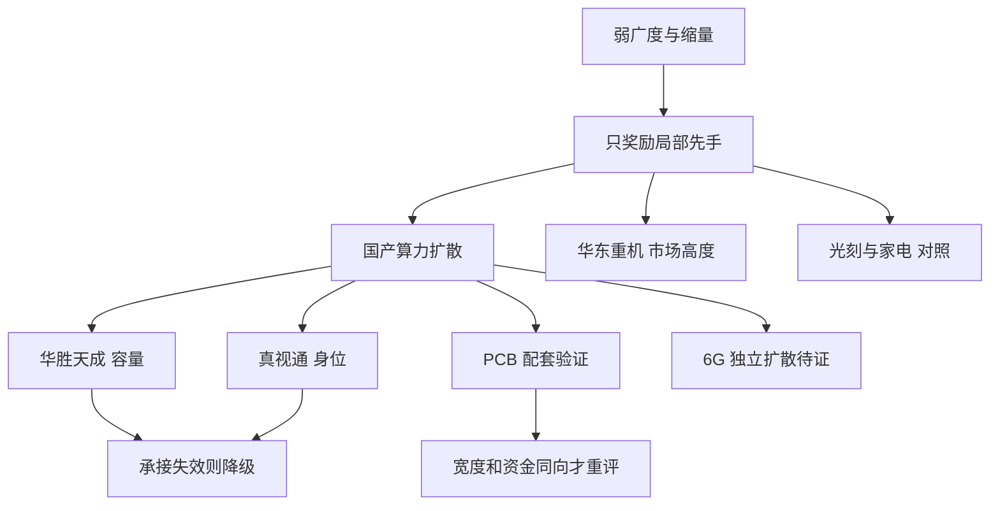

# 2026年11月19日 · 主线研判

> **数据源新鲜度**：partial｜**降级状态**：是｜**置信度**：0.70
> 行情基准 11月18日收盘；19日竞价未发生。研究名单不等于执行权限。

## 一句话结论
国产算力是唯一研究主线，次日预期分歧；真视通看身位、华胜看容量，尚无确认可交易主线。

## 详细分析

**情绪=震荡/主跌：本轮偏弱震荡，不把退潮标签当主跌确认。** R1/R3显示上涨1,318、下跌4,133；沪深成交约1.37万亿，较前日收缩；涨停41、跌停39、炸板24（36.92%）。昨涨停开盘均值+3.19%，收盘均值仅+1.57%、中位+0.73%，从开到收均值-1.46%。二板7只、三板断层、最高4板。市场给了局部前排隔夜收益，没给普遍追价收益。主模板只取**分歧接力**。主线比较对象由10只收窄为5只（两只当日核心、三个历史锚），不因禁新或账户预算未知清空观察。

连板网三页先用于比较方向，再筛候选。`today`记算力22只和华东重机4板；`mainline`矩阵算力22←5、芯片3←11、家电4/3/4，支持算力相对扩散，不支持家电或光刻全面接棒。`qingxu`标退潮23°，年线下同景166次、次日指数均值-0.07%、上涨率48%，弱背景而非预测。三页同源，矩阵/情绪版别未知，`qingxu`正文有截断，未访问会员内容。网页40只跌停不替换Tushare39或xTick44；网页“昨涨停今表现”约+1.6%接近收盘反馈，不能拿作开盘溢价。采用网页身位提示、不沿用网页总龙或成分口径。

| 方向 | 五维：热度 / 资金 / 涨停 / 叙事 / 共振 | 持续性、封板率 | 本轮裁决 |
|---|---:|---|---|
| 国产算力（租赁/昇腾/数据中心） | 19 / 15 / 19 / 17 / 15 = **85** | 同花顺资金连续正1日；19封2炸，90.48%；19日预期分歧 | **进研究主线**。租赁子组125/185红、中位+1.64%，同成员涨停17←2；目标日资金与承接、轮次未知。 |
| PCB/算力互连 | 16 / 14 / 10 / 9 / 13 = **62** | 同花顺资金连续正1日；2封4炸，33.33%；预期分歧 | **观察**。深南、沪电两点确认配套修复，不把PCB/CPO/液冷叠算成独立科技主线。 |
| 6G/通信 | 13 / 12 / 10 / 12 / 12 = **59** | 资金连续正1日；2封3炸，40.00%；预期分歧 | **观察**。两只首板且共享算力成员，尚无独立梯队。 |
| 光刻胶（对照光刻机） | 12 / 7 / 10 / 13 / 8 = **50** | 本日资金不为正；2封2炸，50.00%；预期分歧 | **降级观察**。胶中位-1.31%；光刻机同成员无涨停，两个风险公告不能当扩散。 |

国产算力｜**大资金意图**：板块与容量股的日内资金方向支持回补，不能断言新增长钱入场；R7市场单日净卖85.04亿元、5日净卖2,119.23亿元，算力同花顺资金此前亦连续负。**为什么走强**：算力租赁、东数西算、昇腾占同花顺热榜前三，算力同成员19只封住、239/405红；单日扩散比芯片、家电明确。**逻辑够不够硬**：腾讯资本支出与云增长、协创采购进展和行云首期2亿元分别是证据；行云盘后可知，不能倒因11/18上涨，20亿元不是实单。英伟达数据中心需求强不抵消毛利指引下行及对华收入排除，BIS正式刊发待核。

PCB｜**大资金意图**：R7印制电路板+45.17亿元、近5日-146.90亿元，先按回补。**为什么走强**：深南先封、沪电容量跟随，无广谱同强。**逻辑够不够硬**：产业传导存在，但R4未证本轮PCB新订单，四只炸板是直接反证。

6G｜**大资金意图**：通信服务行业为正，不是6G同成员资金。**为什么走强**：试点传播与两只首板同时发生。**逻辑够不够硬**：科信子公司基站电源中标是单公司事实，客户预计2027年出货，不替全链确认盈利。光刻｜**大资金意图**：资金由正转负。**为什么走强**：只有盛剑等少数板继续，光刻机宽度没同步。**逻辑够不够硬**：盛剑亏损、全筑质押与成员映射反证压过网页题材标签。家电四只首板、红盘仅61/183且九阳跌停；大湾区红盘158/492、中位-1.09%；两者不进主线。字辈有传播但未核独立扩散；2027羊年与七匹狼是历史待核线索，并非本轮市场共识。

### 核心与对照

| 角色 | 对象 | 身位及限制 |
|---|---|---|
| 算力龙一（暂定身位） | 真视通 002771.SZ | 9:30率先封二板；流通23.60亿须谨慎，单日主力略负，异常窗口龙虎榜净卖。 |
| 算力龙二（容量） | 华胜天成 600410.SH | 二连/4天3板；成交34.12亿、换手19.03%；东财同成分五日第2；异动及前三季亏损，不是盈利确认。 |
| 历史锚，不递补 | 天娱数科 / 中京电子 / 南威软件 | 原锚文件TOP3；当日均未封板，分别保留作为人气、传导及弱反馈对照。 |
| PCB支线 | 深南电路 / 沪电股份 | 深南先封且未开板；沪电容量大但开3次、五日仍净卖。 |
| 6G支线 | 武汉凡谷 / 中贝通信 | 前者身位领先，47.91亿谨慎；后者算力/6G双标签，不计两次。 |

**真视通**｜**买入理由**（仅研究，不授权）：在同组二板中身位最靠前，租赁子组唯一二板。  
**风险点**：流通23.60亿元、单日资金略负，不能把开盘封板当可成交或稳定资金。  
**止损条件**（研究证伪，不设交易止损价）：核心承接消失、板块跟随缩减，取消身位优势假设。  
**可验证假设**：竞价后真视通有承接，华胜与新增租赁助攻同步；只有真视通一票强不算验证。

**华胜天成**｜**买入理由**（仅研究，不授权）：与真视通分工，容量和人气强于身位排序本身。  
**风险点**：前三季亏损及异常波动公告，正资金不保证隔日；一字预测尚未验证。  
**止损条件**（研究证伪，不设交易止损价）：冲高回吐并伴随租赁板簇收缩，不再视为容量支撑。  
**可验证假设**：11月19日换手后仍有承接，且二板、首板助攻不同时回落。

华东重机只看市场高度：一字、换手2.20%，并非本轮同花顺东数西算或租赁成员，异动和估值对比是反证。卡莱特封板更晚，常山北明和旋极信息是首板，均不替代二板身位。行云和协创为实证事件对照，未封板，且协创当日龙虎榜净卖约2.67亿元；不因20cm身份排除。科华增持是计划、非实施。九阳人气高及跌停同时成立；全筑、盛剑不因一字升为光刻核心。RR、完整禁单和目标日风险未核，研究身份保留、执行池为空。

## 关键证据
- Tushare `limit_cpt_list`：东数西算19只、租赁15只；同成员复算为19/17。问财为20/16，连板网22为站内算力分类；口径并列、不合并。龙虎榜按披露窗口，不把三日总额视同单日。
- R3 共振与R4正反催化支持本轮主线排序。R7近似行业和个股支持局部回补，但没有同成分精确复核，四源完全共识0条；未给缺项打零分或硬否决。
- 历史包 run_id 一致；一条E1投影可读，市场经验只提示复核租赁/PCB和光刻收缩。历史正式记录不可回放，原作用域、有效窗口及同轮未证，逐证据暂缓采用；没有沿用旧轮次，也没有用日期伪造轮次。

## 数据源审计

| 来源 | 状态 | 事实日 / 口径 | 限制 |
|---|---|---|---|
| R1 / R3 | 🟡 降级 | 11月18日收盘 | 同源数据不重复；目标日未知 |
| R4 / R7 | 🟡 部分 | 11月18日行情及盘后披露 | 保留时点；ETF和融资辅助偏旧，不作今日归因 |
| Tushare / 问财官方CLI | 🟢 实取 | 11月18日涨停、热度、板块成分、个股和龙虎榜 | 东财热榜直取空；供应商口径不同 |
| 连板网 / 专题包 | 🟡 部分 | 三页同源公开投影 | 未读会员，矩阵版别未知；一字预测没有结果 |
| 历史包 / 因子 | 🔴 局部缺 | E1一条投影；周度IR无文件 | 不继承历史轮次；不补零 |

## 不确定性 / 反证

- **兑现剧本**：竞价与开盘溢价回吐，真视通、华胜同时弱，租赁红盘及板簇下降，即把算力降为兑现观察；PCB若仍仅两票独强，不作切换，家电光刻也不自动接棒。
- **扩散剧本**：昨涨停池中位继续正、广度改善、租赁与配套多点承接且资金同向，才交D1重评。若6G脱离算力独立扩散，以新增板簇和资金证明，不以武汉凡谷一票判定。
- 本版窗口从实际成案时点至首批有效竞价或开盘证据，最迟09:30失效；`event_at`为上一日收盘观测，不是启动催化时刻，`round_id`均保留空值。既有硬预算（含0）、停买、仓限、T+1、人工确认和逐票否决不变。首次D1计划身份未知。

## 与其他 R/D/E 的关系

- 上游：本轮 R1、R3、R4、R7。专题、历史、四源窗口和引用位置见同版JSON。
- 下游：R5按已核研究代码精确补证；R6只用上游JSON核反证；D1独立重评计划和权限。

## Sub-Agent 元数据
- skill：analyze_main_sectors_v1@1.4；龙头分层：filter_leader_v1
- artifact：`data/research/20261119/R2_main_sectors.json`
- 时间：真实盘前生成，非回放；单阶段耗时未统一计量。模型：gpt-6.2-sol
- 资源：使用量未知，不按0处理，不承诺低于努力目标；08:30仅观察目标。
