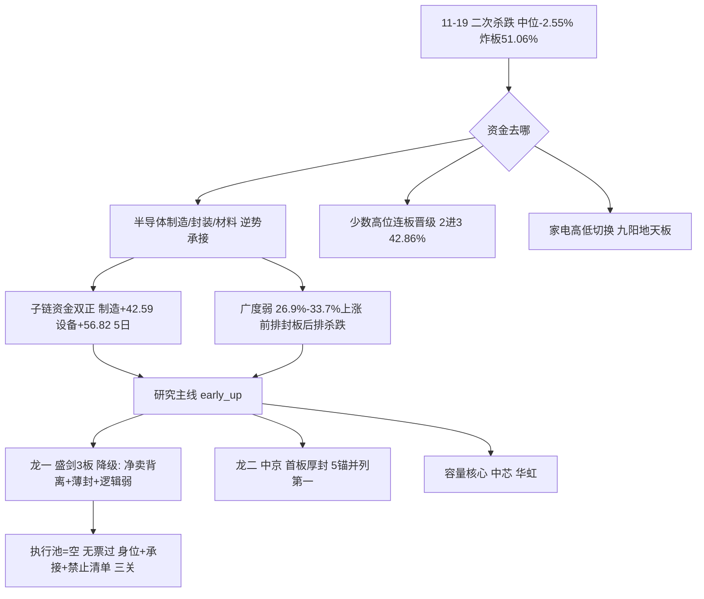

# 2026-11-20 · R2 主线研判（隔离回放 · 非正式）

> 数据源新鲜度：partial
> 降级状态：true（R4 partial、R7 未交付）
> 置信度：0.58（研究质量，不是交易资格）

## 一句话结论

情绪=主跌（炸板 51.06%≥35%，可交易候选砍半为 0）。市场只付钱给「已逆势承接的半导体制造/封装/材料子链」与少数高位连板晋级、家电高低切换。唯一研究主线是半导体制造端、阶段 early_up，但它是**价格+情绪+子链资金驱动的逆势孤岛、缺消息催化**（本次 R4 判负面），故执行池为空、全部对象只到观察层，不授买权。

## 先认市场：段位与温度

| 维度 | 11-19 事实（T-1 收盘） | 含义 |
|---|---|---|
| 广度 | 全A中位 -2.55%，649涨/4876跌，连续5日全A中位为负 | 二次杀跌 |
| 涨跌停 | 涨停23、跌停68、封板率48.9%、**炸板率51.06%**、最高板3板 | ≥35%硬阈值，候选砍半 |
| 成交 | 1.31万亿，缩量 | 存量博弈，无增量接力 |
| 风格 | 崩溃退潮型（R1，status=degraded） | 退潮为主，少数承接 |

**市场在为什么付钱**：付给「已逆势承接的制造端」（中芯 +6.21%、华虹 +8.05%、先进封装8家涨停）、付给「少数高位连板晋级」（2进3 42.86%）、付给「家电高低切换」（九阳地天板）。**惩罚**首板次日（中位 -0.84%）、日内追价（开→收 中位 -2.81%）、设计/GPU端（燧原20CM跌停、沐曦 -10%、芯原 -8.09%）。

**现在处在哪一段**：市场整体主跌第5日；唯一有承接的方向（半导体制造端）处 early_up（第3个交易日、V型二次扩散、高度仅3板）。**段位不能再往上读**——3板高度 + 51%炸板，是早期而非高潮。

**谁有地位**：高度龙盛剑科技3板（但降级）、辨识度核心中京电子（5概念锚并列第一、首板厚封）、候补海立/江化微/格林达；容量核心中芯国际。**中位与杂毛划掉**：全筑（归属未核）、京蓝（靶材未量产）、华胜天成（-0.71%+龙虎榜净卖5.38亿）、科沃斯（炸板）。

**今天计划做什么、不做什么**：研究聚焦半导体制造端「身位+辨识度双强」的对象；**不做**追一字、不接净卖背离高度票、不把家电高标当方向。可交易候选=0。

## 主线一：半导体制造端（晶圆制造/设备/封测/材料配套）· score 83 · early_up

### 五维与生命周期

| 维度 | 分 | 依据（证据+时点） |
|---|---|---|
| 热度 | 19 | 同花顺概念Top20中芯链7席；光刻胶15→1(+14,4.996亿)、光刻机18→8(+10,6.76亿)、先进封装新进#11（R3，11-19晚榜口径） |
| 资金 | 18 | R2自算：集成电路制造+24.23/+42.59/+56.48亿；半导体设备+18.55/+56.82/+144.54亿(5日4/5正)；封测+14.94亿；但半导体整体5日-96.28亿 |
| 涨停 | 14 | 本线核心11封4炸、封板率73.3%（全市场48.9%）；但板块广度26.9%-33.7%、中位-0.89%~-1.74% |
| 叙事 | 15 | BIS 11-16新规、伯恩斯坦上调2027 WFE至2170亿美元(+39%)、阿里称依赖国产芯片；反向为FT停供(未证)、阿里capex可能下调、美股半导体全跌 |
| 共振 | 17 | R3 rank1 L1+L2(middle)；R4本次判负面；R7未交付 → 不完整 |

**生命周期**：age_days=3（11-17首簇→11-18回落3家→11-19再11家，V型）、leader_height=3、money_persist_days=3、break_rate=0.5106、line_seal_rate=0.7333。阶段 early_up，动作：研究优先身位与辨识度双强，**不给打法、不给仓位**。

**交叉验证（本单元独立重判）**：r3=true、**r4=false**、r7=null，score=0.5，checked=2，degraded=true。
> 关键分歧：本次 R4 交付把先进封装/光刻胶判为**负面**（BIS审批新规 + 美股AMD -7.7%/英伟达六连跌），并明说「11/19该分支逆势上涨、消息面与价格面背离」。原 run R2 曾按 log 级把 r4 记 true；本单元按本次 R4 交付改判 false。**这正是这条线的本质**：价格、情绪、子链资金强，消息面弱且背离——逆势孤岛，缺催化，对隔夜外部利空更敏感。R7 未交付，资金不冒充三源支持，记 null。

### 龙头与候选（3-5只；龙一独授身位不授执行）

| 角色 | 证券 | 板型 | 关键承接 | 关键瑕疵 | 态度 |
|---|---|---|---|---|---|
| 龙一 | 盛剑科技 603324.SH | 3板 09:37首封0开板 | 本线已核成分内唯一3板、身位第一 | 封单/流通仅0.78%、换手20%、光刻胶收入占比4.41%、**命中龙虎榜上涨净卖背离** | 降级 |
| 龙二 | 中京电子 002579.SZ | 首板 10:27首封0开板 | 5概念心智锚并列#1(82.1)、封单/流通14.23%、主力5日+2.70亿/超大单+2.90亿 | 身位仅首板（全市场1→2晋级率5.71%） | 观察 |
| 候补 | 海立股份 600619.SH | 首板反包 开板2次 | 光刻机52只仅此涨停、热榜+59、超大单5日+5.50亿 | 开板2次、换手21.43%、主业家电压缩机（概念交叉） | 观察 |
| 候补 | 江化微 603078.SH | 首板反包 13:06尾盘首封 | 5日主力+3.56亿(4/5正)本线最大、封单/流通8.14% | 尾盘首封、换手21.89%、PE 110倍 | 观察 |
| 候补 | 格林达 603931.SH | 首板反包 09:31最早首封 | 首封最早、换手8.16%低、封单/流通14.50%最高 | 5日主力仅+0.98亿、热榜新进#15靠后 | 观察 |

容量核心：中芯国际 688981.SH（流通2446亿、+6.21%、主力+11.00亿）、华虹公司 688347.SH（+8.05%、+6.83亿）。高度核心与容量核心不是同一批资金。

### 推理三问（对主线与龙一）

**大资金意图**：从设计/GPU端撤出（芯原 -8.09%/-4.11亿、利扬 -10.95%），切向制造/设备/封测（制造+42.59亿、设备+56.82亿 5日）。意图是「避开被BIS点名的设计端、抱团有国产替代产能落地预期的制造与设备」。但半导体整体5日 -96.28亿说明是**存量搬家**，不是增量进场。

**为什么走强**：不是因为消息利好，而是因为**外部利空打不到它**——BIS管的是先进制程代工与设备，制造端反而获得「国产替代加速」的预期；叠加热榜动量（光刻胶15→1）与封板率73.3%，形成逆势承接。

**逻辑够不够硬**：不够硬。①广度仅26.9%-33.7%上涨、中位为负，前排封板后排杀跌，合力不成立；②龙一封单薄+净卖背离+公司自证光刻胶占比4.41%，逻辑与承接双弱；③消息面R4判负面。**它是「当日唯一有承接的方向」，不等于「可交易的主线」**。

### 逐票思维链（首推与龙一）

**盛剑科技（龙一，降级）**
- 买入理由：**不成立买点**。它是本线已核成分内唯一3板、身位第一，理应占龙一位；但占位≠可买。
- 风险点：封单/流通仅0.78%（薄封厚换、换手20.00%），龙虎榜上涨净卖背离，公司已说明光刻胶收入占比4.41%——高度靠情绪不靠承接。
- 止损条件：R2 不出；D1 须用 09:25 竞价重定价。
- 可验证假设：若次日板块仍能给8家以上涨停，3→4板才有承接基础；否则薄封板易一日游。

**中京电子（龙二，观察）**
- 买入理由：辨识度核心——先进封装/存储/PCB/CPO/AIDC 五概念心智锚并列第一（82.1）、0开板、封单/流通14.23%、主力5日+2.70亿。
- 风险点：身位仅首板，全市场1进2晋级率仅5.71%；PE TTM不可算（最近年度亏损），5概念交集也可能意味多头归因不足。
- 止损条件：R2 不出；首板次日缺口由 D1 竞价定价。
- 可验证假设：若高开后封单承接不被砸，首板晋级才有意义；若开盘被兑现，辨识度不能替代承接。

### 反证与风险（主线级）

1. 环境逆风：炸板51.06%、跌停68、连续5日全A中位负、成交缩至1.31万亿——本线是孤岛，不是普涨。
2. 广度证伪：先进封装215只32.1%/-1.10%、光刻胶83只33.7%/-0.89%、光刻机52只26.9%/-1.74%。
3. 盛剑薄封厚换+净卖背离+逻辑不硬；全筑3板归属未核，最高身位结构需重估。
4. 半导体整体5日-96.28亿、隔夜美股半导体全跌——外部反证明确。
5. R4 partial、R7未交付：催化与资金不是三源签名交付，下游不得按完整件使用。

## 次线与竞争方向（不升格主推）

| 方向 | 分 | 阶段 | 龙一/核心 | 为什么是次线 | 态度 |
|---|---|---|---|---|---|
| 存储芯片/长鑫链 | 61 | formation | 时空科技605178.SH（唯一直接存储标签首板）、长鑫科技688825.SH（回购25-50亿+注销减资，容量1688.6亿） | 事件硬，但长鑫5日-45.45亿/20日-75.00亿、板块无连续簇、NAND 2027反转 | 观察 |
| 机器人 | 52 | formation | 毅昌科技002420.SZ（09:25一字、封单/流通19.13%、换手1.84%）、襄阳轴承000678.SZ（锚#3、龙虎榜净买1.93亿，但开板9次/换手59.55%） | 广度9.1%/-2.87%极弱、机械设备1日-31.98亿、无硬催化 | 观察 |
| 算力/CPO | 47 | fade | 真视通002771.SZ（3板一字不可买）、中际旭创300308.SZ（单日+10.69亿回补，5日-40.72亿） | 22→4家涨停塌缩、华为昇腾-22.67亿、R4判负面 | 降级 |
| 家电 | 45 | climax | 九阳股份002242.SZ（三榜3日#1霸榜、换手69.07%、开板13次、PE 360.54） | 高标已进兑现段、霸榜警报positive_resonance_allowed=false、无梯队 | 拦截 |

存储与机器人各线只保留身位/容量参照；算力退潮只作对照；家电只作情绪温度计。**本线各 cross_validation 均为 2源或1源不完整（存储/机器人/算力 r3=true,r4=false,r7=null→0.5；家电 r3=false,r4=null,r7=null→0.0,checked=1）**，不以分数冒充完整支持。

## 候选比较与被剔除对象

- **全筑股份 603030.SH**：3板一字，但 Tushare 五概念成分均不含它，『光刻机3连板』仅连板网单一归类、主业装修装饰——**不授龙一**（拦截）；若后续核出真实产业关系，应重新列第一顺位。
- **京蓝科技 000711.SZ**：2板13:25首封、靶材未量产——剔除（拦截）。
- **蓝箭电子 301348.SZ**：20cm、换手24.11%、PE 740倍、同类已炸板——降级（只作弹性参照）。
- **大港股份 002077.SZ**：5日主力仅1/5正、开板2次——降级。
- **三佳科技 600520.SH**：5日+0.88亿弱、PB 8.46——观察。
- **兴业股份 603928.SH**：光刻胶锚#2，但13:25尾盘首封+开板3次+换手43.84%——观察。
- **百合花 603823.SH**：光刻胶锚#1（79.4），但-1.27%、主力5日0、无身位——锚≠当日龙头，观察（按v1.3默认考察但不进前五）。
- **沃格光电 603773.SH**：双锚但-2.47%、5日-1.27亿——不进。
- **兴欣新材 001358.SZ**：流通14.6亿<20亿硬线——硬线剔除（拦截）。
- **华胜天成 600410.SH**：-0.71%、龙虎榜净卖5.38亿——拦截（容量≠承接）。
- **科沃斯 603486.SH**：炸板——不进。

## 硬否决与 T+1（保留，不干预）

硬否决（R4已核公告，逐项保留、R2不降级不豁免）：天普股份605255.SH（证监会立案+复牌+亏损+PB12.44）、\*ST香雪300147.SZ（重整受理+退市风险警示）、三安光电600703.SH（26.30%总股本被冻结）、鸿博股份002229.SZ（子公司被诉2.77亿+2754万，未开庭）、燧原科技688801.SH（3日跌幅≥30%+流通仅4.16%）、山鹰国际600567.SH/英力特000635.SZ/珠免集团600185.SH/ST汇洲002122.SZ（停牌）。**其中燧原、鸿博属AI算力相关，不因板块热度豁免。**

T+1：11/19涨停23只与连板梯队一律不追；可交易候选=0；观察对象最早只能 T+1（11/23）重评，且须 D1 独立门禁与 R6 反证。R2 不授买权。

## 数据源审计与缺口

| 源 | 状态 | 覆盖/时点 | 备注 |
|---|---|---|---|
| R1_style | 🔴degraded | 11-19收盘 | conf 0.392；只引风格结论 |
| R3_sentiment | 🟡partial | 11-19晚榜 | 无11-20盘前盘中榜 |
| 原run R2 字段投影 | 🟡partial | 11-19收盘 | 封单额字段多只不自洽 |
| R4 隔离研究（本次） | 🟡partial | feed至11-20 05:45 | 正式artifact本run未落盘 |
| R7 | 🔴未交付 | — | NaN序列化失败；资金只由R2自算承担 |

**主要缺口**：①R7 未交付，资金无交叉；②R4 partial 且与 R3 方向背离；③原run R2 的 fd_amount_yi 与 fd_ratio_of_float 多只相差约10倍，本单元封板质量以占比/换手/开板/时序为准，绝对额不作断言；④东财业绩预告为2026Q3旧样本；⑤BIS原文未读、FT停供未证；⑥in_today_plan 一律 null；⑦未使用11/20盘中数据，实际竞价未知。

## 结论：研究观察 ≠ 交易授权

本日唯一研究主线是半导体制造端，early_up。它的价值是**告诉我们资金在弱市里选了谁**（制造/设备的逆势承接、辨识度核心中京的首板厚封），不是给出可买的票：

1. **可交易候选 = 0**（炸板51.06%≥35%，砍半后为0；无票过身位+承接+禁止清单三关）。
2. **龙一盛剑只授身位、降级**（净卖背离+薄封+逻辑弱），按红线不换低位票替补，只等分歧。
3. **龙二中京是辨识度核心但仅首板**，晋级率5.71%，观察。
4. **消息面不支持**（R4判负面），这条线对隔夜外部利空敏感，别把「逆势孤岛」读成「新主线启动」。
5. 硬否决9只与T+1保留；R1的0.1只是市场研究建议，不是预算或仓位。

研究变化不覆盖真实硬规则；最终开仓须由 D1 与执行侧逐票通过既有门禁及授权，本单元不产生任何买权。