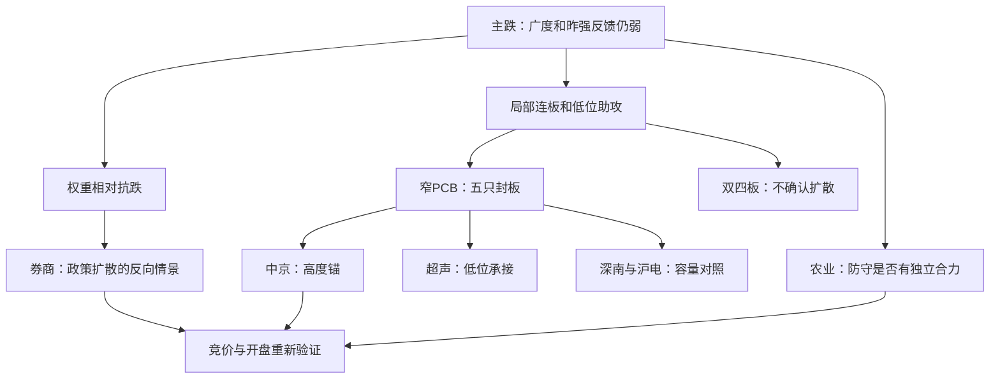

# 2026-11-23 · 主线研判

> 数据新鲜度：partial｜状态：degraded｜研究置信度：0.392（不是胜率）

## 一句话结论

**主跌底色未改，窄PCB居研究首位；没有已确认可交易主线。**

## 详细分析

周五市场奖励的是少量连板先手和指数权重的相对抗跌，不是普遍追价。313涨、5,236跌，全A中位跌5.08%，昨涨停池收盘中位同样跌5.08%，首板仅1/18晋级。上证50涨0.45%，中证1000跌4.89%。炸板率降到20%并不代表市场修复：两只四板之下三板缺席，只有一只非ST二板。连板网情绪页的连续冰点确认短线仍冷；同景只有5例，不用“冰点天数”预测反弹。R1市场性不新增风险建议在竞价重评、最迟开盘失效，不是账户预算。

**大资金意图：** 东财窄PCB行业连续3日净流入，周五+20.39亿；问财同名行业+10.54亿。两口径支持资金更集中在窄行业，不证明是同一批资金在迁移。东财窄行业5日仍净流出4.17亿；广PCB概念5日净流出82.20亿，同花顺广义概念跌4.85%。不能把窄行业的相对优势外推到CPO或算力。

**为什么走强：** 窄行业两只容量股在周三先封，周四只剩中京首板，周五中京晋二后又有四只同伴涨停；48只中20只上涨、中位跌1.02%，5只封板、0只炸板。这个局部结构胜过“两个四板谁更高”的解释。真视通所在算力租赁只有一只封板；盛剑四次开板且公司否认生产光刻胶。连板网矩阵支持算力收缩、PCB起势，但时间线只到周四、空格不作零，三页同源只记一份公开参考。

**逻辑够不够硬：** PCB目前硬的是板簇、梯队和分口径可复核的资金，不是订单兑现。周末产业媒体有供给紧张报道；发布时间晚于周五，不能证明早期启动由此驱动。R4海外算力风险也未消失。R3 PCB只有榜单关注，尚没有同口径正向共振；所以74分是研究优先级，不是执行结论。

## 关键证据

| 方向 | 热度 / 资金 / 涨停 / 叙事 / 共振 | 研究裁决 |
|---|---|---|
| 印制电路板（窄行业） | 18 / 17 / 18 / 9 / 12＝74 | 局部轮动早期：周三到周五3个交易日；周五窄行业封板率100%，非全市场；盘前先验为分歧、反抽偏窄。 |
| 先进封装（区别半导体设备及光刻胶） | 15 / 8 / 17 / 13 / 10＝63 | 先进封装与设备分离；有公告、没扩散，盛剑只作高位情绪锚。 |
| 算力租赁／AIDC弱支线 | 16 / 5 / 10 / 11 / 14＝56 | 真视通四板无法覆盖租赁概念的低广度与净流出。 |
| 人形机器人 | 15 / 5 / 13 / 9 / 13＝55 | 赛事热度未变成资金承接，不做机器人整体回流。 |
| 猪肉及农业防守轮动 | 18 / 10 / 12 / 7 / 7＝54 | 猪肉相对抗跌，水产、种植、养殖不合并归因。 |
| 证券／稳市反向情景 | 10 / 9 / 3 / 19 / 11＝52 | 保证金11月30日才生效；券商要以宽度和资金响应证明政策扩散。 |
| AI应用／视频 | 14 / 5 / 10 / 9 / 14＝52 | 周末热榜改善，狭义视频两板不是资金切换。 |

| 对象 | 研究定位 | 为什么入选或不升位 |
|---|---|---|
| 中京电子 `002579.SZ` | 龙一 | 窄行业唯一2板；较早先封，4家窄行业同伴之后封；东财个股5日+5.35亿但窄行业第4，地位来自带动而非资金第一。 |
| 超声电子 `000823.SZ` | 龙二 | 首板首个窄行业助攻，零开板；窄行业东财5日第3，单日净+8.11亿、单日龙虎榜净买+4.41亿（不当持仓）。不是二板高度。 |
| 深南电路 `002916.SZ` | 候补 | 18日同沪电两板启动窗口；20日-0.59%相对抗跌、5日资金窄行业第二，证明容量能承接，不能替换板位。 |
| 沪电股份 `002463.SZ` | 候补 | 窄行业5日实测第一+13.83亿，18日有板；20日-0.96%，与中京比较后不把资金排名等同当日龙一。 |
| 宝鼎科技 `002552.SZ` | 候补 | 广义PCB历史锚次位且在窄行业，但20日-1.02%，5日净额近零，无当日升位证据；保留历史辨识度观察。 |

**中京电子｜龙一（研究位）**

- **买入理由（研究假设，不是建议下单）：** 唯一窄PCB二板，零开板且有四个低位同伴随后封板。优先验证它遇到卖盘时的承接，而不是押一字。
- **风险点：** 两日异常波动公告提示偏离，公司并无已披露的新增经营变化；该区域的首板晋级背景不佳。
- **止损条件（研究失效，非交易指令）：** 孤板、高开回吐且超声和容量股同步失守，撤回核心延续判断。不预设卖价或绕过T+1。
- **可验证假设：** 若中京承接站稳、超声及同组出现跟随且深南/沪电相对强，才验证修复有层次；单票强不成立。

**超声电子｜龙二（研究位）**

- **买入理由（研究假设）：** 是窄线最早的首板助攻，零开板，单日主力口径净流入8.11亿，龙虎榜当日净买4.41亿；五日窄行业资金第三。
- **风险点：** 换手约19.95%，首板先手兑现风险实际存在；资金分类不是持仓承诺。
- **止损条件（研究失效）：** 若只有自身抬价而容量、板簇转弱，撤销承接判断，不以它机械替补龙一。
- **可验证假设：** 容量承接和同伴晋级出现，才支持“低位接力而非单股活跃”。实际RR、价格结构和必要风险归D1/R6。

澳弘、满坤、骏亚保留为同组比较，不以20cm前缀排除满坤，但首封在后、流通约48亿，未超过超声身位。沪电五日资金排名第一但周五未封，不用资金榜替换高度；宝鼎是历史锚、资金近零，合锻则不在窄行业。华友回购、复星回购、联合光电上会均有直接事件，不能代替板块合力。四季度另核跨年纯情绪：2026是马年、市场可提前交易2027羊年，但有限群聊和公众号未核到七匹狼成组传播，11月20日该股下跌，未见独立梯队。冰山冷热首板有辨识度，但换手偏高、冰雪板块弱，不升主线。

## 数据源审计

| 源 | 状态 | 日期（北京时间） | 样本数 | 限定 |
|---|---|---|---:|---|
| R1 | 🟡 ok | 2026-11-23 | 1 | degraded；run_id_and_frozen_input_sha_match |
| R3 | 🟡 ok | 2026-11-23 | 1 | degraded；run_id_and_frozen_input_sha_match |
| R4 | 🟡 ok | 2026-11-23 | 1 | partial；run_id_and_frozen_input_sha_match |
| R7 | 🟡 ok | 2026-11-23 | 1 | partial；pipeline_start_match_no_top_level_run_id |
| Tushare | 🟢 ok | 2026-11-23 | 28 | 28为非ST涨停核心口径；逐日龙虎榜补齐，列表按代码去重）。 |
| 问财 | 🟢 ok | 未记录单独时刻 | 43 | 分口径列示；主营仅匹配两条，非四条。 |
| 连板网 | 🟡 ok | 2026-11-23 | 3 | 只读同根公开投影，状态partial；11/20非目标日。 |
| 公众号与群聊 | 🟡 ok | 未记录单独时刻 | 164 | 164为行数；核关键词与可见例文，非完整图像。 |
| DataPro（R7） | 🔴 error | 2026-11-23 | 未知 | 4013；另有同日Tushare及问财，非全局缺资金。 |
| 因子周快照 | 🔴 error | 未记录单独时刻 | 未知 | 未找到，因子层跳过。 |

## 不确定性 / 反证

A：基准仍是窄反抽。若窄PCB两级前排、容量和同伴不同向，首选降级。B：同步验证券商能否把周末稳市预期扩到中小盘、昨强反馈与跌停收敛；只稳上证50不成立。C：若科技与券商均弱，猪肉和农业须自身形成持续承接；孤板不是切换。竞价出现有效可比数据即重评。研究观察18只、执行池空：并非评分硬禁，也不是未知预算被设为0。

E1仅供设置检验。公开旧复盘无显式专题反馈，历史包无可重放的冻结轮次；其午盘资金与7只混归组不能替代收盘窄PCB数据。红利旧样本只提供建业现金流反证，股性运输投影未命中本轮，旧成长池严格闭环为零。隔夜一字预判匹配目标日但尚未兑现。上述信息不改变规则、计划身份或交易授权。

## 与其他 R/D/E 的关系

依赖本轮R1、R3、R4和R7；R5精确匹配本轮研究候选，R6只消费本次嵌入证据并独立审核，D1在真实竞价、点位、预算及权限到齐后另行立案。本批 `in_today_plan` 未知。

## Sub-Agent 元数据

- 技能：analyze_main_sectors_v1@1.4；原龙头过滤 filter_leader_v1
- 机读：`data/research/20261123/R2_main_sectors.json`
- 主模板：92科比三格轮换，仅用于比较高度、低位与切换，不映射固定仓位或通道
- 模型：gpt-6.2-sol；流水线至成案经过时间见机读时点，模型净耗时与用量未计量
