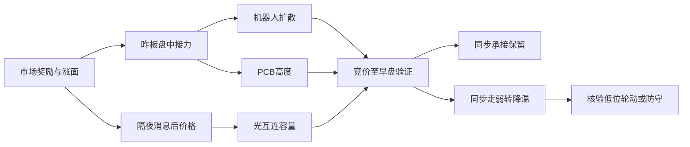

# 2026年11月24日 · 主线研判

> 11月23日收盘行情与11月24日盘前已可见资料。降级交付，研究置信度 0.78；非胜率、非交易授权。

## 一句话结论
机器人居首，PCB与光互连并列次席；研究优先看广度和容量承接，不抢高位加速。

## 详细分析
**市场在奖励什么。** 沪深成交约1.55万亿元，较前日增加约1,307亿元；4,658涨、783跌、129平。中证1000涨2.90%，沪深300仅涨0.09%。昨涨停池28只，开盘溢价中位仅+0.29%，收盘收益中位+9.99%，16只晋级：奖励主要来自盘中扩散，而不是开盘普遍可兑现。146家涨停中130家首板；双5板、无4板、1只3板、13只2板，说明扩散比高位连续性强。不认唯一全市场总龙。R1的65%只保留为市场研究意见，不转成本轮额度。

**先比公开三页，再筛候选。** `today` 给出机器人67家及首封时序：克来早于本体，但公告明确其不涉及人形；宇树13:44才封，不能追认成上午推手。`mainline` 给出机器人67／4／2及算力6对11月18日的22，故把机器人列首、算力保留次线、AI视频列独立低位竞争方向；PCB两行不是同一篮子，不能直接相加。`qingxu` 的用途限情绪同景，不能给板块加一份独立权重。三页同源，会员内容未采；主线矩阵和情绪页版本未知，未升格收盘或盘中事实。涨停口径并列：连板网机器人归类67、问财广义机器人68；同花顺成分回算人形53、问财人形52，不用跨口径差额推涨停真伪。

**情绪阶段与次日假设。** 已绑定的11月23日事实为**高潮**，情绪页版次未知；同源收盘页佐证，并不产生11月24日盘中读数。绑定展示行：修复1%、升温3%、高潮36%、降温33%、退潮15%、冰点11%，为取整展示，共99%，不补余量，精确样本分母未核。分开的同景是“上证年线下方且高潮第1天”96次（环境标签未自行重算），展示首位高潮33%、次位降温30%，次日上证均值+0.12%、上涨54%、温度Δ −33.1°。页面另列37次子样本，精确过滤未核，不混入分母。11月24日首选**高潮**、备选**降温**：昨日广度、接力与隔夜消息后的实际价格反应支持前者；纳指收+6.52%低于开盘+7.19%，海外广度及成交量未核，出口管制反证仍在。若开盘后昨板溢价、涨面和助攻同步收缩，容量放量走弱，改判**降温**；不报数值后验。

| 研究排序 | 1／3／5日净额（亿元） | 成分封板率 | 热度／资金／涨停／叙事／共振 | 目标日预期 |
|---|---:|---:|---|---|
| 机器人概念／人形执行器 | +93.62／-110.76／-224.16 | 68封10炸，87.2% | 20／15／20／14／17＝86 | 分歧 |
| PCB／元件 | +57.43／+44.45／+79.48 | 11封1炸，91.7% | 16／19／17／12／14＝78 | 分歧 |
| CPO／光互连 | +87.16／+31.34／+49.90 | 8封0炸，100.0% | 16／18／13／16／15＝78 | 分歧 |
| AI应用／视频短剧 | +16.03／-59.14／-112.84 | 20封4炸，83.3% | 15／9／16／10／13＝63 | 分歧 |
| 光刻胶 | +4.25／-2.13／+5.05 | 5封0炸，100.0% | 13／11／13／10／13＝60 | 分歧 |
| 算力租赁 | +3.39／-38.10／-10.38 | 4封1炸，80.0% | 12／8／13／14／12＝59 | 分歧 |

净额按东财板块分类，封板按同花顺成分与Tushare涨跌停回配，两者范围不同，均不跨板块加总。五维分数不是独立门槛；PCB与光互连同分，PCB有更清楚的分支高度和跟随，故先列。

### 机器人概念／人形执行器 · 主线研究

- **大资金意图**：大单当日回流+93.62亿，不等于五日-224.16亿已反转；本体与执行器需共同承接。 这是量价解释，不是账户身份识别。
- **为什么走强**：主线首位：机器人/人形成交支持的广度扩散；同花顺名册68封10炸，+3.80%中位；公开67、E1行业55不能相加。
- **逻辑够不够硬**：标准/产品叙事多为传播；斯菱75.6573%标的股权是草案、公司级证据；克来无人形产品、长华机器人收入约8.8万、凡拓数据采集无营收。

拓普是容量核心、宇树是弹性核心。京东方、胜宏、中京的跨概念资金/高度不等于人形机器人主导地位。克来、长华、凡拓虽有早封或二板，但直接业务反证压低地位，不用低位补涨票自动递补。故此线不硬认龙一/龙二。

**拓普集团 601689.SH｜容量核心｜观察**

- **买入理由**（仅研究竞争理由，非许可）：27.61亿元成交首板，执行器容量；广义资金第4、人形第3，未超过合格身位标准
- **风险点**：换手封板；流通约 919.7 亿元；触及杂毛过滤至少两项，研究留痕不递补；非执行首位，不递补。
- **止损条件**（仅研究失效，不设交易价）：若该票承接未能传导至同线，重评其地位；目标日结构未见，盈亏比未核。
- **可验证假设**：观察其回封后执行器能否共同扩散。

**宇树科技 688836.SH｜弹性核心｜观察**

- **买入理由**（仅研究竞争理由，非许可）：本体20cm首板及东财人气第1，13:44才封、五日净出，不冒认早盘领涨
- **风险点**：首封后未开板，未据此认一字；流通约 213.0 亿元；非执行首位，不递补。
- **止损条件**（仅研究失效，不设交易价）：若该票承接未能传导至同线，重评其地位；目标日结构未见，盈亏比未核。
- **可验证假设**：与容量共同承接才保留弹性定位。

**锋龙股份 002931.SZ｜早盘心智锚｜观察**

- **买入理由**（仅研究竞争理由，非许可）：机器人原序第一锚、早盘首板，五日净出；非狭义人形名册
- **风险点**：换手封板；流通约 86.0 亿元；非执行首位，不递补。
- **止损条件**（仅研究失效，不设交易价）：若该票承接未能传导至同线，重评其地位；目标日结构未见，盈亏比未核。
- **可验证假设**：先看早封能否带助攻。

**科森科技 603626.SH｜早盘心智锚｜观察**

- **买入理由**（仅研究竞争理由，非许可）：泛机器人第二锚、早盘首板但五日净出，不替代本体
- **风险点**：换手封板；流通约 132.3 亿元；非执行首位，不递补。
- **止损条件**（仅研究失效，不设交易价）：若该票承接未能传导至同线，重评其地位；目标日结构未见，盈亏比未核。
- **可验证假设**：低位助攻须有独立承接。

**襄阳轴承 000678.SZ｜反包心智锚｜观察**

- **买入理由**（仅研究竞争理由，非许可）：泛机器人第三锚，3天2板非连板；午后封板且减速器体量澄清
- **风险点**：首封后未开板，未据此认一字；流通约 85.9 亿元；R4已核监管或业务澄清，R6独立裁决；非执行首位，不递补。
- **止损条件**（仅研究失效，不设交易价）：若该票承接未能传导至同线，重评其地位；目标日结构未见，盈亏比未核。
- **可验证假设**：看同业响应，不把公告澄清当利好。

### PCB／元件 · 主线研究

- **大资金意图**：PCB和印制电路板分别+79.48/+100.85亿元五日（不同板块不累加），相对机器人资金更持续，仍须防止高度脱离容量。 这是量价解释，不是账户身份识别。
- **为什么走强**：连续有跟随，名册11封1炸、230/240上涨；若看公开主分类仅PCB概念(PCB)3家，单列PCB2家，不合并。
- **逻辑够不够硬**：没有以本轮硬公告确认中京个股新驱动；其换手约30.34%、六次开板，兼作分歧温度计。

**中京电子 002579.SZ｜高度核心｜观察**

- **买入理由**（仅研究竞争理由，非许可）：唯一3连板、09:30首封、PCB五日第3；六次开板，封单约1.02亿
- **风险点**：换手封板；流通约 85.9 亿元；分支身位或资金名次第一；目标日结构与收益风险比未核，仅研究。
- **止损条件**（仅研究失效，不设交易价）：若该票承接未能传导至同线，重评其地位；目标日结构未见，盈亏比未核。
- **可验证假设**：3板回流要带动同行，不靠独自缩量。

**沪电股份 002463.SZ｜容量核心｜观察**

- **买入理由**（仅研究竞争理由，非许可）：PCB五日净额第一，但涨2.96%无板，不顶替高度
- **风险点**：未涨停；流通约 1598.3 亿元；非执行首位，不递补。
- **止损条件**（仅研究失效，不设交易价）：若该票承接未能传导至同线，重评其地位；目标日结构未见，盈亏比未核。
- **可验证假设**：容量与前排同时承接才确认。

**宝鼎科技 002552.SZ｜心智锚｜观察**

- **买入理由**（仅研究竞争理由，非许可）：PCB原序第二锚；无板、五日第44
- **风险点**：未涨停；流通约 107.7 亿元；非执行首位，不递补。
- **止损条件**（仅研究失效，不设交易价）：若该票承接未能传导至同线，重评其地位；目标日结构未见，盈亏比未核。
- **可验证假设**：没有同业响应不递补。

**合锻智能 603011.SH｜心智锚｜观察**

- **买入理由**（仅研究竞争理由，非许可）：PCB原序第三锚；无板、五日净出
- **风险点**：未涨停；流通约 70.9 亿元；触及杂毛过滤至少两项，研究留痕不递补；非执行首位，不递补。
- **止损条件**（仅研究失效，不设交易价）：若该票承接未能传导至同线，重评其地位；目标日结构未见，盈亏比未核。
- **可验证假设**：需资金和同线转强，不因标签递补。

**生益科技 600183.SH｜容量对照｜观察**

- **买入理由**（仅研究竞争理由，非许可）：材料成交59.78亿元，五日第6且无板
- **风险点**：未涨停；流通约 1465.1 亿元；非执行首位，不递补。
- **止损条件**（仅研究失效，不设交易价）：若该票承接未能传导至同线，重评其地位；目标日结构未见，盈亏比未核。
- **可验证假设**：看产业材料能否与板内前排同步。

### CPO／光互连 · 主线研究

- **大资金意图**：新易盛和中际旭创同期大额成交且净流入；通信设备和CPO资金方向一致，不算独立机构确认。 这是量价解释，不是账户身份识别。
- **为什么走强**：光模块容量与近5日净额支撑；同花顺CPO名册8封，包含跨类中京，不把8家全部视为光模块。
- **逻辑够不够硬**：R4中际明确回购方案而未实施；隔夜硬件反弹有新实价，但出口管制与公司治理反证仍在，不倒用隔夜消息解释昨日。

**新易盛 300502.SZ｜容量核心｜观察**

- **买入理由**（仅研究竞争理由，非许可）：五日净额+35.90亿元居首、成交205.61亿元、+9.92%非涨停；领先不靠低位补涨
- **风险点**：未涨停；流通约 2275.6 亿元；分支身位或资金名次第一；目标日结构与收益风险比未核，仅研究。
- **止损条件**（仅研究失效，不设交易价）：若该票承接未能传导至同线，重评其地位；目标日结构未见，盈亏比未核。
- **可验证假设**：与中际共振并扩散，才维持产业首位。

**中际旭创 300308.SZ｜事件容量核心｜观察**

- **买入理由**（仅研究竞争理由，非许可）：五日第二、成交227.67亿元；20–40亿元回购方案在收盘后获知，未实施
- **风险点**：未涨停；流通约 4630.7 亿元；非执行首位，不递补。
- **止损条件**（仅研究失效，不设交易价）：若该票承接未能传导至同线，重评其地位；目标日结构未见，盈亏比未核。
- **可验证假设**：消息后独强或兑现不晋位。

**中京电子 002579.SZ｜心智锚｜观察**

- **买入理由**（仅研究竞争理由，非许可）：CPO首锚、名册3板，但传播及梯队主要指向PCB，不重复认光模块高度龙
- **风险点**：换手封板；流通约 85.9 亿元；非执行首位，不递补。
- **止损条件**（仅研究失效，不设交易价）：若该票承接未能传导至同线，重评其地位；目标日结构未见，盈亏比未核。
- **可验证假设**：验证是否实际带光模块而不只带PCB。

**合锻智能 603011.SH｜心智锚｜观察**

- **买入理由**（仅研究竞争理由，非许可）：CPO第2锚，无板、五日净出
- **风险点**：未涨停；流通约 70.9 亿元；触及杂毛过滤至少两项，研究留痕不递补；非执行首位，不递补。
- **止损条件**（仅研究失效，不设交易价）：若该票承接未能传导至同线，重评其地位；目标日结构未见，盈亏比未核。
- **可验证假设**：题材标签不替代传导。

**华盛昌 002980.SZ｜心智锚｜观察**

- **买入理由**（仅研究竞争理由，非许可）：CPO第3锚，无板且缺乏独立带动
- **风险点**：未涨停；流通约 61.4 亿元；非执行首位，不递补。
- **止损条件**（仅研究失效，不设交易价）：若该票承接未能传导至同线，重评其地位；目标日结构未见，盈亏比未核。
- **可验证假设**：不挤占新易盛、中际容量比较。

### AI应用／视频短剧 · 次线观察

- **大资金意图**：单日资金正、三五日净出；短剧名册11封均首板，真视通跨类5板不算AI应用高标。 这是量价解释，不是账户身份识别。
- **为什么走强**：公开17板与名册20板均显示扩散，是机器人承接失败时的低位竞争方向之一。
- **逻辑够不够硬**：未见全板块硬催化，宣传或局部应用不能冒充营收。

**浙文影业 601599.SH｜低位前排｜观察**

- **买入理由**（仅研究竞争理由，非许可）：AI视频早盘首板，短剧成分五日资金第1；流通盘42.4亿元
- **风险点**：换手封板；流通约 42.4 亿元；20–50亿元流通盘谨慎；非执行首位，不递补。
- **止损条件**（仅研究失效，不设交易价）：若该票承接未能传导至同线，重评其地位；目标日结构未见，盈亏比未核。
- **可验证假设**：仅传媒前排与首板扩散独立才重比晋升。

### 光刻胶 · 次线观察

- **大资金意图**：光刻胶五日+5.05、三日-2.13，光刻机当日-1.12，不能相互抵消或合并。 这是量价解释，不是账户身份识别。
- **为什么走强**：公开芯片9家为宽类，光刻胶名册5封0炸，独立5板但不是全市场共振。
- **逻辑够不够硬**：盛剑监管工作函与业务占比直接削弱叙事；不能列为板块停买或低位递补。

**盛剑科技 603324.SH｜高度核心｜观察**

- **买入理由**（仅研究竞争理由，非许可）：板块5板，监管工作函；电子化学品营收占比4.41%、毛利率负
- **风险点**：首封后未开板，未据此认一字；流通约 44.5 亿元；20–50亿元流通盘谨慎；R4已核监管或业务澄清，R6独立裁决；次线高度仅作观察。
- **止损条件**（仅研究失效，不设交易价）：若该票承接未能传导至同线，重评其地位；目标日结构未见，盈亏比未核。
- **可验证假设**：高标孤强而本体不响应则仅观察高度。

**西陇科学 002584.SZ｜低位助攻｜观察**

- **买入理由**（仅研究竞争理由，非许可）：二板有呼应、流通20–50亿元，不替代受压的5板
- **风险点**：换手封板；流通约 40.9 亿元；20–50亿元流通盘谨慎；触及杂毛过滤至少两项，研究留痕不递补；非执行首位，不递补。
- **止损条件**（仅研究失效，不设交易价）：若该票承接未能传导至同线，重评其地位；目标日结构未见，盈亏比未核。
- **可验证假设**：同板块共振才确认助攻。

### 算力租赁 · 次线观察

- **大资金意图**：单日+3.39/五日-10.38亿元，未恢复先前扩散；双五板之一不是全市场唯一总龙。 这是量价解释，不是账户身份识别。
- **为什么走强**：公开6家对照11/18的22家；租赁成分4封1炸。
- **逻辑够不够硬**：行云合同、蜂助手服务器贸易和摩尔线程回购不等于算力租赁全面重估。

**真视通 002771.SZ｜高度核心｜观察**

- **买入理由**（仅研究竞争理由，非许可）：5板09:25首封但6次开板、60.4%换手、流通31.4亿，不是一字
- **风险点**：竞价先封后有开板，非一字；流通约 31.4 亿元；20–50亿元流通盘谨慎；次线高度仅作观察。
- **止损条件**（仅研究失效，不设交易价）：若该票承接未能传导至同线，重评其地位；目标日结构未见，盈亏比未核。
- **可验证假设**：需大换手后承接并带动同簇。

**行云科技 300209.SZ｜事件对照｜观察**

- **买入理由**（仅研究竞争理由，非许可）：五年约2.99亿元服务合同明确，目标日联动未证
- **风险点**：未涨停；流通约 161.2 亿元；触及杂毛过滤至少两项，研究留痕不递补；非执行首位，不递补。
- **止损条件**（仅研究失效，不设交易价）：若该票承接未能传导至同线，重评其地位；目标日结构未见，盈亏比未核。
- **可验证假设**：验证消息后独强还是板块传导。

## 关键证据
- 机器人：同花顺广义成分1,127/1,225上涨；涨停簇广，但五日仍净出。机器人以昨日有合力、今日待复核定级，并非已证明多日趋势反转。
- PCB：中京三板六次开板，预判文件对本目标日匹配，但不是实际一字或排单依据。沪电和生益作为容量对照；东晶属于元器件对照，旧成长池仅因价格提升门槛，不证明新催化。宝鼎、合锻留月度锚，不递补。
- 光互连：新易盛容量领先，中际旭创回购方案属昨日收盘后可知，仅检验今日消息后价格和同行传导；不把两者伪装成同一种高度核心。东山、青山与月度锚各有属性，未证明可替代容量首位。
- 新事件、产业与纯情绪同台比较：斯菱收购草案、行云算力合同是可核公司级材料；前者昨日涨幅早于可见报道，后者尚无板块传导；不硬挤昨日扩散更强的主线。光刻胶与算力的两个5板分别看，不因同高度晋级为总龙。2026马年与2027羊年预期分开；七匹狼是11月4日用户线索，本轮未核传播与梯队，不把名字联想当资金选择。

## 数据源审计
| 源 | 状态 | 时点 | 备注 |
|---|---|---|---|
| R1／R3 | 🟡 降级／部分 | 同批盘前，行情事实 11月23日 | 指纹与历史包绑定一致；大盘基线和情绪展示不是两份独立行情 |
| R4／R7 | 🟡 部分 | 同批盘前 | 主件直接逐项读取；历史包字节限制不代表主件缺席；R7按启动时点和同批回执关联 |
| Tushare SDK／问财 | 🟢 可用 | 本轮盘前回查 11月23日 | 5,570只日线；另查8成分组、5日个股资金、30交易日龙虎榜；问财按代码重查股名误匹配 |
| 连板网 | 🟡 有限公开 | 11月24日早间采集、事实11月23日 | 三页同源，缺会员，不同页面版次按源保留 |
| 专题与历史 | 🟡 有限 | 原事实日各异 | 逐源裁决、保留证据截取；E1缺同轮同窗，实际兑现未知 |
| 周度因子 | 🔴 缺 | 本轮 | 快照缺失；只降级因子层 |

## 不确定性 / 反证
- 第一反证：机器人涨面、容量和早盘助攻一起失速。若PCB/CPO保持独立成交与涨面，切换到科技内部承接；若仅高开无传导，或短剧只剩零星首板，不立新主线。
- 券商并非默认反向仓：同口径证券Ⅱ五日−22.58亿元，中信、国泰海通收跌；融资保证金政策11月30日起生效。水产公开热度仍在，但板块单日净出、东方海洋13次开板且亏损，旧红利表也不能证明天然气本轮获承接。两类只在当日量价真实扩散后重评。
- E1历史包与本轮 run_id 一致，但历史主线无可复用的轮次窗口；关于周末催化、资金承接和风险标签只作为待证假设，不更改规则，不视作事前预测兑现。各线11月23日收盘事实与本次盘前推断分别记录；启动时点与同轮证据不足，轮次留空，不倒填。研究窗口自本稿生成开始，首次盘中复核或反证触发即重评，最迟10:00结束。
- 研究观察保留，执行池为空：无目标日真实结构、盈亏比和逐票R6证据，不由此推导全局停买或账户零预算。D1初次成案前计划身份未知；现有硬预算、授权与保护保持不变。

## 与其他 R/D/E 的关系
- 依赖本轮 R1／R3／R4／R7。R5只对本轮已核代码精确匹配，R6只消费本轮研究JSON内嵌证据，D1独立重评市场意见与执行权限。

## Sub-Agent 元数据
- Skill：analyze_main_sectors_v1@1.4；龙头过滤：filter_leader_v1；模板：分歧接力。
- Artifact：`data/research/20261124/R2_main_sectors.json`；模型：本轮 canghai-research。
