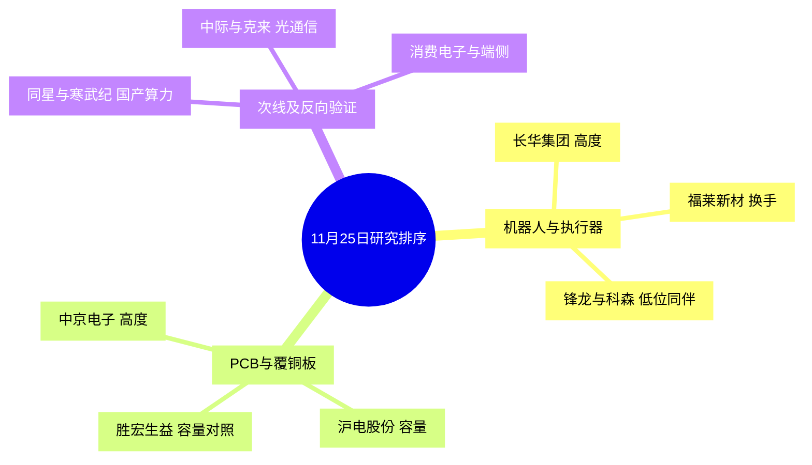

# 2026年11月25日 · 主线研判

> **数据源新鲜度**：partial ｜ **情绪=震荡**（炸板风险标记，不是阶段）｜ **确认可交易主线**：无。

## 🧭 一句话结论
机器人仍是接力首线，PCB保留高度观察；国产算力有扩散但未升主线。

## 📊 详细分析

沿用R1“震荡分化型”（风格非情绪阶段），先手仍有收盘奖励，开盘追价没有普遍奖励；两市放量但广度下行，权重局部相对强不是普涨。

11月24日沪深量 `16,548.62亿元`、放量 `6.58%`；`1,952涨／3,498跌`，中位 `−0.67%`。此前涨停池开盘中位 `+3.72%`，收盘中位 `+3.26%`、109/146收红，开到收中位 `0.00%`。55封、68未回封、2跌停，梯队为25二板→4三板→1四板，旧双5板掉队。不能把先手溢价当开盘买方收益。

先比较today、mainline、qingxu：today证实事实日55涨停/68未回封/最高4板和仍有25二板；mainline同站显示机器人67→19仍领跑，算力6→7是少数逆向扩散，PCB 2→2留高度，AI应用17→4、芯片9→4收缩，空白不补0；qingxu保留“降温”基线与“退潮”历史首位，故研究的是局部接力，不把连板数量增加当成全面再扩散。三页同源、主线矩阵版本未知；无11/25盘面。

六态事实基线：**降温**，事实日11月24日，本轮原生快照约06:06，qingxu版本未知，today同源收盘口径交叉，11月25日盘中估计未得。页面取整转移：修复11%、升温16%、高潮17%、降温17%、退潮31%、冰点7%；不归一，不补余量，分母未核。年线下、降温第1天同景82次，首位退潮28次，显示约34%；精确完整行和同筛选第二去向未核。次日上证均涨0.12%与上涨率58%不是短线胜率。

11/24盘前英伟达复职叙事对应创业板高开+3.88%、后收−0.05%，量增而涨面83.63%→35.01%，只作时序联动。隔夜费半−7.88%、纳指−1.48%、NVDA−5.86%且量约前日0.49倍，道指+0.85%，并非全面风险出清。富联派现、南亚扩产、小鹏WorldGPT及行云GPU合同没有11/25现金时段的发布后价量确认；6G试点15:15后消息不可归因给11/24收盘。首选退潮，保持历史第一；备选降温：109/146昨板收红、25二板、仅2跌停，若广度止缩、核心开板承接并带两档同伴、有效成交和昨板反馈改善且跌停未扩，则改备选；广度与昨板持续扩散再评估修复。

| 研究方向 | 热度 | 资金 | 涨停 | 叙事 | 共振 | 合计 | 裁决 |
|---|---:|---:|---:|---:|---:|---:|---|
| 机器人／执行器 | 18 | 13 | 19 | 12 | 15 | 77 | 研究主线 |
| PCB／覆铜板 | 15 | 18 | 14 | 12 | 15 | 74 | 研究主线 |
| 国产算力／液冷 | 13 | 16 | 15 | 14 | 10 | 68 | 次线观察 |
| 光通信／CPO | 16 | 18 | 11 | 8 | 13 | 66 | 次线观察 |
| 消费电子／端侧 | 13 | 15 | 13 | 12 | 10 | 63 | 次线观察 |
| 半导体设备／芯片 | 13 | 12 | 12 | 10 | 13 | 60 | 次线观察 |
| AI应用／短剧 | 12 | 8 | 13 | 9 | 13 | 55 | 次线观察 |
| 农业／猪肉与水产 | 12 | 8 | 14 | 9 | 8 | 51 | 次线观察 |

### 机器人／执行器 · 77
- **大资金意图**: 更可能是部分资金从本体向汽零、触觉与丝杠试做低位接力；宽概念正负分桶冲突，实际买方与对手方未知。
- **为什么走强**: 19家仍第一但67→19；与用概念成分计算的31家是不同口径，不能相加。汽零是有证据的副轴，单列验证而不重复算一条主线。东财宽机器人+20.80亿/近5日−117.18亿，人形+8.90/−38.18，东财执行器−1.49亿、汽零+6.71亿；同花顺宽机器人−58.24亿，显示当日资金分歧。长华3板领高度、福莱2板展示换手，锋龙与科森是有当日板的历史锚；宁波东力只是同步竞价，襄阳冲高非封板。
- **逻辑够不够硬**: 同花顺可见成分与Tushare同日封板/未回封交叉为 `32/26`，封板率 `55.2%`；R7资金近5日有 `2/5` 日为正。没有证实新订单，前排一字微成交、群热度分歧及同源转载不加证。

| 研究排序 | 代码 | 对象 | 涨幅 | 板型 | 取舍 |
|---|---|---|---:|---|---|
| 龙一 | `605018.SH` | 长华集团 | +10.01% | 一字锁价 | 执行器事实日三板最高，优于竞价同封的宁波/光洋；只有约8.8万元业务、丝杠无定点，不能把盘面身位当订单。 |
| 龙二 | `605488.SH` | 福莱新材 | +10.01% | 回封板 | 触觉数据分支二板，09:33开板一次后封、成交10.08亿，明显高于锋龙2.41亿和科森3.78亿；用换手桥接而非把题材订单坐实。 |
| 候补 | `002931.SZ` | 锋龙股份 | +10.01% | 回封板 | 机器人历史锚第一、早盘二板；开板一次与题材热度支持辨识，不能替代长华高度或福莱换手。 |
| 候补 | `603626.SH` | 科森科技 | +9.98% | 早盘封板 | 机器人历史锚第二、二板延续；端侧与机器人交叉，不重复当两条独立助攻。 |
| 候补 | `000678.SZ` | 襄阳轴承 | +4.82% | 未封板 | 机器人历史锚第三，+4.82%且冲高回落、33.84%换手、东财单日−2.17亿；仅保留锚观察。 |

#### 长华集团：仅研究
- **买入理由**: 仅说明研究排序，不授权买入。事实日`一字锁价`、流通`58.38亿`；执行器事实日三板最高，优于竞价同封的宁波/光洋；只有约8.8万元业务、丝杠无定点，不能把盘面身位当订单。
- **风险点**: 多题材回流但扩散收缩；同花顺宽概念资金净流出，长华不是产业兑现。 目标日交易条件、逐票反证及盈亏比未核。
- **止损条件**: 此处只设研究失效条件，不设止损价；前排失去自身承接且同板块助攻同步走弱，撤延续假设。
- **可验证假设**: 首个有效盘面到10:00，竞价板若开，承接站稳同时丝杠/触觉多票仍有正收益才支持接力；独强不算带动。

#### 福莱新材：仅研究
- **买入理由**: 仅说明研究排序，不授权买入。事实日`回封板`、流通`153.57亿`；触觉数据分支二板，09:33开板一次后封、成交10.08亿，明显高于锋龙2.41亿和科森3.78亿；用换手桥接而非把题材订单坐实。
- **风险点**: 多题材回流但扩散收缩；同花顺宽概念资金净流出，长华不是产业兑现。 目标日交易条件、逐票反证及盈亏比未核。
- **止损条件**: 此处只设研究失效条件，不设止损价；前排失去自身承接且同板块助攻同步走弱，撤延续假设。
- **可验证假设**: 首个有效盘面到10:00，若低位分支同时走弱或跌回事实日低点而无法收复，则撤二位假设。

### PCB／覆铜板 · 74
- **大资金意图**: 资金可能集中维护硬件容量与高度两端；日内容量已有获利回吐，不能把订单桶叫成机构同向加仓。
- **为什么走强**: 网站2→2，4板独高不等于板块广谱；PCB同花顺成分实测3封7未回封，东财印制电路板+33.92亿、近5日+151.87亿但板块收−0.42%。中京是高度锚，沪电、胜宏、生益检验容量。南亚董事会批28.8亿元建设尚待审批投产，旧日冲高回落不足以取代前排；胜宏+6.27%仍从130回落122.32，不追认容量普涨。
- **逻辑够不够硬**: 同花顺可见成分与Tushare同日封板/未回封交叉为 `3/7`，封板率 `30.0%`；R7资金近5日有 `5/5` 日为正。资金有持续但价格未扩散，隔夜费半是反证；R4有真实事件但并未证实行业整体净催化。

| 研究排序 | 代码 | 对象 | 涨幅 | 板型 | 取舍 |
|---|---|---|---:|---|---|
| 龙一 | `002579.SZ` | 中京电子 | +9.98% | 一字锁价 | PCB历史锚第一、市场唯一4板，09:25封且0开板；成交8.33亿为前5日约0.79倍，事实日整日锁价。 |
| 龙二 | `002463.SZ` | 沪电股份 | +1.73% | 未封板 | PCB可见成分5日东财约+29.02亿居首；容量对照而非接力替代。胜宏当日收幅优于沪电且问财5日第一，沪电的入列理由是同口径累积和更直接容纳大资金，不称绝对资金第一。 |
| 候补 | `002552.SZ` | 宝鼎科技 | -4.21% | 未封板 | PCB历史锚第二；收−4.21%，五日流量与当日梯队不足以升位。 |
| 候补 | `603011.SH` | 合锻智能 | +0.91% | 未封板 | PCB历史锚第三，但证券行业是专用机械，未证实PCB收入传导，收+0.91%且未封。 |

#### 中京电子：仅研究
- **买入理由**: 仅说明研究排序，不授权买入。事实日`一字锁价`、流通`94.52亿`；PCB历史锚第一、市场唯一4板，09:25封且0开板；成交8.33亿为前5日约0.79倍，事实日整日锁价。
- **风险点**: 高度与容量背离；沪电/东山/生益高开回吐，隔夜芯片集中下跌。 目标日交易条件、逐票反证及盈亏比未核。
- **止损条件**: 此处只设研究失效条件，不设止损价；前排失去自身承接且同板块助攻同步走弱，撤延续假设。
- **可验证假设**: 首个有效盘面到10:00，若打开后能恢复承接并有实质板群响应才支持真正带动；一字继续只能读温度。

#### 沪电股份：仅研究
- **买入理由**: 仅说明研究排序，不授权买入。事实日`未封板`、流通`1625.89亿`；PCB可见成分5日东财约+29.02亿居首；容量对照而非接力替代。胜宏当日收幅优于沪电且问财5日第一，沪电的入列理由是同口径累积和更直接容纳大资金，不称绝对资金第一。
- **风险点**: 高度与容量背离；沪电/东山/生益高开回吐，隔夜芯片集中下跌。 目标日交易条件、逐票反证及盈亏比未核。
- **止损条件**: 此处只设研究失效条件，不设止损价；前排失去自身承接且同板块助攻同步走弱，撤延续假设。
- **可验证假设**: 首个有效盘面到10:00，90.66→84.13，若仅权重高开而不带PCB扩散就不算确认；不是高度龙替补。

次线比较（分数不是独立硬禁）：
- **国产算力／液冷**：公开涨停6→7且魅视/同星二板，资金算力+35.12亿/5日+100.56亿，冷却分支+10.14亿/5日−97.27亿，AIDC−3.07亿。行云真实合同不是回款，11/24成交23.21亿、收+0.05%且弱于开盘；保留同星换手、寒武纪容量，不升为确认主线。
- **光通信／CPO**：公开2板块涨停，克来是情绪三板并无足够光模块收益证据，公告说不涉人形产品也不能把它自动转正成光模块产业中军。东财CPO+62.72亿/5日+146.81亿却中际开463.20收417.00、新易盛−0.74%、天孚+4.53%；R4将后二者收益互换，采用精确代码日线，不抹去冲高回吐。中际东财与xTick资金方向冲突。
- **消费电子／端侧**：独立比较折叠屏/端侧，不并入AI短剧：消费电子零部件及组装+25.62亿/5日+22.87亿，但宽概念+17.43/−77.88，科森联创跨题材重叠，维信诺14:40才封。华为Mate X8新品是真催化，不等于供应商订单，一天价格反应未分离。
- **半导体设备／芯片**：事实日涨停9→4（题材标签）；芯片宽概念13家与人形等重叠，半导体设备/存储反应不同。淳中披露亏损、一彬12.6亿触发流通盘线，隔夜费半显著承压；芯片非静态禁区，仍要看国产标分离。
- **AI应用／短剧**：涨停17→4，R3同花顺AI应用8→13，东财AI应用−12.92亿、短剧互动游戏5日−27.34亿。浙文比文投早且二板但5次开板，横店9次，文投14:54封、32.77%换手，不用单只尾板逆转板块结论。
- **农业／猪肉与水产**：金新农与东方海洋同为3板，但猪肉/水产分支各自未扩散；金新农36.6亿且东财猪肉5日−8.59亿，东方海洋10次开板、双主业亏损。若科技走弱，须看到农业广度与资金回流再确认，不因两个高标自动切换。

## 🔍 关键证据与反证

- 事实日最高标中京与机器人长华、克来分别观察；高度一字代表稀缺而非充分换手。次线国产算力可与外盘弱势分离；若只有寒武纪独强，不取代已见主线。
- 消费电子端侧与机器人汽零分别做交叉核验：不能把两类全算共同扩散。若机器人、PCB同时失去承接，先验证算力和端侧是否有独立板群，农业与孤立反包仍不足接替；若只有指数回升而广度不跟，不改首选。
- 纯情绪与实业平行比较：九阳反6天4板、华东重机反8天6板、汇洲摘帽二板，均没有在该事实日证实独立的板群带动。2026马年、交易预期可指向2027羊年；七匹狼旧用户线索未在本轮94篇/397条的关键词范围找到传播，只记对照，不将上涨当梗证据。
- 一彬12.6亿、ST中路按既有硬线排除；不因300/688前缀或研究分剔除。机器人历史锚、PCB历史锚只作辨识度对照，不以股性替换实际身位。
- 历史包run已核，旧R2无法校验同轮与窗口，E1仅提出已单独比较的研究假设（汽零、端侧、容量回吐）；不承认事前冻结的预测效果、不继承旧价规或执行结论。
- 轮次与实际启动时点未核，不追填。各线研究有效窗从本次成案起，09:25核竞价，有可比开盘数据即重评，最迟10:00。D1计划身份与账户有效预算未知，现有硬约束继续有效。专题复盘无显式反馈；红利/小盘旧资料只保留截取，不用名单结果制造防御资格。

## 数据源审计

| 源 | 日期 | 状态 | 备注 |
|---|---|:--:|---|
| R1 | 2026-11-25 | 🟡 | 市场事实取11月24日收盘；11月25日盘中未发生、未使用。两风格样本不足30日，隔夜外盘部分指标滞后或未核；群夜间方向证据不足。 |
| R3 | 2026-11-25 | 🟡 | 目标日盘前；量价、榜单观察日11/24；群聊、图片、阶段、逐票证据覆盖缺口分列。 |
| R4 | 2026-11-25 | 🟡 | 公告原件为有范围核查；news_major无正文、OCR无可用文字、部分海外快照失鲜、未核逐票全部风险及资金验证。不构成全市场停买。 |
| R7 | 2026-11-25 | 🟡 | 11/24主力、游资、IF及海外价格已核；ETF份额、两融滞后一档；DataPro 4013；最新汇率未核。 |
| Tushare事实日截面 | 2026-11-25 | 🟢 | 55封／68未回封，股票状态取事实日截面。 |
| Tushare板块及个股资金 | 2026-11-25 | 🟢 | 20主题；个股5交易日资金；榜单源22交易日（含本轮R7），不等于参与者身份。 |
| 问财官方 | 2026-11-25 | 🟡 | 主题返回20/390；PCB 20/137，机器人语义检索仅2行不作全池；算力查超时，用Tushare成分及R7。 |
| manifest.json | 2026-11-25 | 🟢 | 总严重度2；非交易硬禁。 |
| wechat_official_20.jsonl | 2026-11-25 | 🟢 | 本轮关键词检索与R3/R4已核摘要；不称逐篇全文。 |
| wechat_cli_5groups.jsonl | 2026-11-25 | 🟢 | 匿名关键词检查，同稿不独立。 |
| 连板网公开页 | 2026-11-25 | 🟡 | 三页同源；非会员全量；mainline/qingxu版本未知。 |
| 历史反馈包 | 2026-11-25 | 🟡 | 包run匹配；无可重放旧R2窗口，E1仅待核经验。 |
| 题材历史锚 | 2026-11-02 | 🟢 | 11/02源；按SHA锚定，主线Top3投影非全量。 |
| 专题可选证据 | 2026-11-25 | 🟡 | 月度股性/红利、旧成长、本轮一字预测及缺显式反馈的旧复盘各自仅投影。 |
| 周度因子 | 2026-11-25 | 🔴 | 目录缺失，跳过因子层，不把缺项用作门禁。 |
| DataPro／DC概念成分 | 2026-11-25 | 🟡 | R7回执4013；DC精确查询空，THS作为不同口径，不拼数据。 |
| 用户配置与论点 | 2026-11-25 | 🟢 | 黑白名单空；未找到活跃书面论点，不冒用长期主线。 |

## 🧾 Sub-Agent 元数据

- 依赖：当日R1/R3/R4/R7逐文件读取、交付摘要核匹配；R4/R7历史包只因字节预算未带，不是本轮文件缺失。
- R5只匹配本轮已核代码，R6只消费同版JSON内嵌证据；流通20–50亿谨慎，必要核验未齐不产生任何推荐执行资格。
- 本次为现场盘前研究，不是回放。资源量未知、不补零。
- artifact: `data/research/20261125/R2_main_sectors.json`
