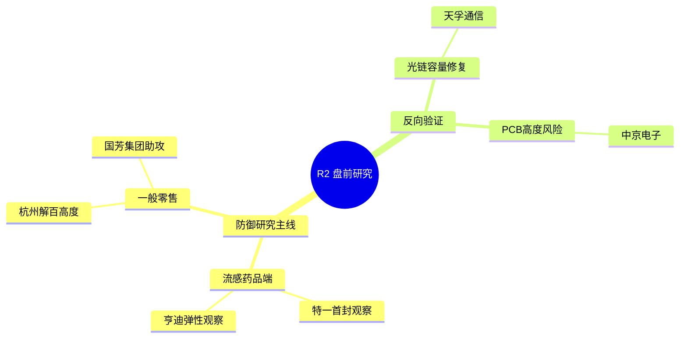

# 2026-11-26 · 主线研判

> 数据截至前收与隔夜已核切片｜新鲜度 partial｜置信度 0.62（研究质量，非概率）

## 🎯 一句话结论
流感与一般零售是两条防御研究主线；光链是修复反例。未确认可交易主线。

## 🧭 市场奖励与候选比较
11/25 全A仅 `586` 涨、`4,926` 跌，沪深缩量 `16.43%`；昨板 `55` 只全部匹配，开盘均值 `+2.05%`、收盘中位 `−4.47%`、7只收于跌停。涨停 `51`、未回封 `30`、跌停 `43`，最高隔至尾盘才升五板。**情绪=震荡/主跌**是既有炸板运行标签，不是市场阶段。`37.04%` 未回封率触发既有研究候选缩减，26个比较对象留13个研究观察；没有生成交易池。不因缺数据、旧计划或未知账户额度停止研究。

- **today**：五板中京、四板克来和金新农代表接力高度，却不是同一条产业主线；医药12板为早段低位扩散，零售四板有三板核心和异地助攻。网页昨板均值 `−0.6%` 与全池匹配 `−1.37%` 不混；`9/30` 仅昨连板晋级，`14/55` 另含昨首板。
- **mainline**：机器人 `67→19→3`、算力 `6→7→4`、零售 `3→1→4`、光通信 `2→2`。不同成分口径拆算；PCB末格空白不是零，11/19时间线不是11/25事实。以当日行情和资金定排序，不照网页标签选龙头。
- **qingxu**：本轮绑定事实是11/25「冰点」，未知版次；11/26盘中未观测。总体展示先验：修复53%、升温2%、高潮12%、降温缺、退潮4%、冰点26%；分母未核，不归一不补余量。连续≥4天行样本5、首位冰点（60%）；页面另列年线下5例（上证次日均值+0.10%、上涨40%），两组条件交集未核，不当成精确第6天概率。
- **目标日首选冰点，备选修复**：昨板兑现与广度仍差，优先于总体先验首位；最强反证是纳指从盘中约−3.32%收窄到−0.62%、费半−0.65%，加上未回封率下降和局部防御承接。不同于R7首选修复，不以旧CFD替代最新收盘。若广度、量能、昨板兑现、低位晋级与容量助攻在同一窗口改善，再重排；单指数翻红或一只高标再封不成立。

## 📊 五维研究排序与核心判定
| 研究排序 | 热度 / 资金 / 涨停 / 叙事 / 共振 | 得分 | 窗口判定 |
|---|---|---:|---|
| 流感／药品端（医药商业为扩散对照） | 18 / 12 / 19 / 15 / 14 | 78 | 东财大单连续正 1 日；样本封板率 82.3%（14封/3未回封）；盘前预期分歧 |
| 一般零售／百货 | 15 / 15 / 16 / 12 / 14 | 72 | 东财大单连续正 1 日；样本封板率 57.1%（4封/3未回封）；盘前预期分歧 |
| 光通信／CPO容量修复 | 15 / 9 / 12 / 14 / 12 | 62 | 东财大单连续正 0 日；样本封板率 100.0%（1封/0未回封）；盘前预期分歧 |
| 猪肉／农业存量接力 | 12 / 11 / 15 / 10 / 12 | 60 | 东财大单连续正 1 日；样本封板率 100.0%（2封/0未回封）；盘前预期分歧 |
| PCB／覆铜板 | 13 / 6 / 10 / 14 / 9 | 52 | 东财大单连续正 0 日；样本封板率 100.0%（1封/0未回封）；盘前预期退潮 |
| 机器人／执行器 | 17 / 4 / 12 / 12 / 6 | 51 | 东财大单连续正 0 日；样本封板率 未核；盘前预期退潮 |
| 算力租赁／AIDC存量 | 10 / 7 / 14 / 13 / 7 | 51 | 东财大单连续正 0 日；样本封板率 未核；盘前预期退潮 |
| 小家电／九阳人气抱团 | 16 / 8 / 11 / 8 / 7 | 50 | 东财大单连续正 0 日；样本封板率 未核；盘前预期退潮 |

封板率按同一成分切片计算，不等于网页独占题材分组。问财流感13封与直接成分交集14封不同；其中天圣制药流通不足20亿，好当家是水产主标签，均不拿来认证药品龙头。空分项以机读口径为准，分数不单独裁决交易资格。

### 主线一｜流感／药品端
- **大资金意图**: 价量更像风险收缩下在少数药品前排做防御。东财+8.75亿元，但同花顺按大单买卖差净负、东财近5日−18.12亿，不能认证机构普遍加仓。
- **为什么走强**: R4定位11/24流行季通报传播；次日药品前排早封，THS流感概念涨0.58%。比猪肉的孤立四板有更宽低位响应。医药商业是扩散对照，不外推整个创新药或公司新增销量。
- **逻辑够不够硬**: 催化和首板群成立，持续性仅首个完整响应日。流感只排出低位首封与弹性角色；特一同时命中两条既有杂毛筛查条件，不立龙一，亨迪不递补。第二日须看到药品同组二板和流通端的真实助攻，而非麦角硫因独立走强。

### 主线二｜一般零售／百货
- **大资金意图**: 一般零售当日与5日大单均为正，百货涨1.84%，但新零售宽口径仍跌，资金更集中在局部实体渠道，非全消费换挡。
- **为什么走强**: 杭州解百三板、首封后未打开，中央商场、国芳、家家悦分批助攻；东财成分29/58上涨。非杭州零售也有响应，优于只看本地客流或珠免单一重组。
- **逻辑够不够硬**: 珠免复牌和定价风险独立；杭州解百风险提示未消解。若杭州高度和异地助攻不同步，即便首选修复逐步成立，也不能给该线新增确认。当前实际行情轮次未定位。

#### 特一药业（002728.SZ）｜降级
- **买入理由**: 仅记录研究假设，不构成买入。09:31:33 药品端首板且0开板；R4流行季直接价格映射，Tushare与问财均核价，但5日主力第15且问财当日净卖，不能称板块龙一。优先于石药景峰的首封时序与负5日大单，也优先于流通端人民同泰的4次开板。
- **风险点**: 流通 `41.86` 亿、换手 `2.78%`；已核风险和流向分歧见上，目标日盘口、同伴及RR未核。禁止项：mid_laggard。
- **止损条件**: R2不设交易止损或价格；研究失效：若高开后特一回吐、亨迪和第二批首板不承接，则证伪先封带动而非认定回踩机会。
- **可验证假设**: 目标日开盘第一轮有效同窗以昨日收盘、同组红盘/晋级与量能检验；仅前排个股收强不算同组改善。

#### 亨迪药业（301211.SZ）｜观察
- **买入理由**: 仅记录研究假设，不构成买入。09:33:24 +19.98%且无开板，单日龙虎榜净买0.445亿，有独立弹性；问财当日净卖0.181亿，龙虎榜不等于全市场资金；相较康芝两开板、拓新19.1亿低于硬线，亨迪适作弹性确认，不替代10cm核心。
- **风险点**: 流通 `46.40` 亿、换手 `4.65%`；已核风险和流向分歧见上，目标日盘口、同伴及RR未核。禁止项：未确认新增命中，非完整放行。
- **止损条件**: R2不设交易止损或价格；研究失效：若20cm独强、10cm续板与药品同伴不跟，视作单票弹性而非板块加速。
- **可验证假设**: 目标日开盘第一轮有效同窗以昨日收盘、同组红盘/晋级与量能检验；仅前排个股收强不算同组改善。

#### 杭州解百（600814.SH）｜观察
- **买入理由**: 仅记录研究假设，不构成买入。一般零售样本唯一三板，09:30:03首封零开板，近5日大单第2；第1红旗连锁是资金对照，非当日高度；风险公告及问财当日净卖提示强板与吸筹不能画等号。
- **风险点**: 流通 `61.38` 亿、换手 `5.44%`；已核风险和流向分歧见上，目标日盘口、同伴及RR未核。禁止项：未确认新增命中，非完整放行。
- **止损条件**: R2不设交易止损或价格；研究失效：若高开未守住昨收、同时国芳和家家悦不能助攻，三板只剩分歧兑现。
- **可验证假设**: 目标日开盘第一轮有效同窗以昨日收盘、同组红盘/晋级与量能检验；仅前排个股收强不算同组改善。

#### 国芳集团（601086.SH）｜观察
- **买入理由**: 仅记录研究假设，不构成买入。同业四只涨停中的非杭州前排，0开板、五日大单第3且问财当日+0.46亿，收盘成交约5.01亿；中央商场首封更早，但开1次且仅31.82亿、5日第4；国芳优于家家悦的筹码持续度。
- **风险点**: 流通 `71.59` 亿、换手 `7.25%`；已核风险和流向分歧见上，目标日盘口、同伴及RR未核。禁止项：未确认新增命中，非完整放行。
- **止损条件**: R2不设交易止损或价格；研究失效：若杭州开盘回吐而国芳独强，先核家家悦及百货广度，不自动晋为可交易龙一。
- **可验证假设**: 目标日开盘第一轮有效同窗以昨日收盘、同组红盘/晋级与量能检验；仅前排个股收强不算同组改善。

#### 天孚通信（300394.SZ）｜观察
- **买入理由**: 仅记录研究假设，不构成买入。当日+7.65%、成交117.16亿，R7东财与xTick异口径均为正；同组成分10/100上涨，中际−1.92%、新易盛虽5日资金第一却未走强；不能用克来一字或青山纸业标签给CPO双重背书。
- **风险点**: 流通 `1424.37` 亿、换手 `8.21%`；已核风险和流向分歧见上，目标日盘口、同伴及RR未核。禁止项：未确认新增命中，非完整放行。
- **止损条件**: R2不设交易止损或价格；研究失效：若天孚回流同时中际、新易盛等同组改善，才检验科技修复；独强不算合力。
- **可验证假设**: 目标日开盘第一轮有效同窗以昨日收盘、同组红盘/晋级与量能检验；仅前排个股收强不算同组改善。

### 次线与不纳入理由
- **光通信与PCB分开**：天孚+7.65%、成交117.16亿，适合验证容量回流；东财CPO仅10/100上涨。克来四板一字只担当温度，公告不支持以光模块标签等同主营。中京五板尾封、有日榜净卖，不能带动PCB仅9/215红盘。南亚项目有产业硬度但价格和审批未确认，保留为反向比较，不顶替高度。
- **猪肉、水产分开**：金新农板块内高度及5日资金居首，猪肉仅8/39涨。正虹流通不足20亿；水产当日价量强但驱动和分母不同。承接未扩散之前只看金新农的换手，不判农业集体接力。
- **机器人、算力、家电**：宁波东力优于铁流的封板稳定性但没有板块追随；小鹏盘后计划不回填盘中反应。全筑反包高度不替代算力净流出。九阳有三榜人气与日榜净买，但7开板及二次风险提示并存，独立观察，不判已派发或红利主线。群内谐音传播不等于羊年/字辈梯队。
- **专题对照**：流感三只月度原序锚只用于核验旧地位，部分命中原过滤不递补；无人零售不等于一般零售。旧扩池器械对象、月度红利亚宝/方盛不替换前收前排；次日一字预测待真实盘口。历史包仅用于提出防御遗漏与科技假修复的研究假设，无可回放旧轮次或规则升格。

## 🔎 关键证据
- R1 全A横截面与昨板反馈；R3 流感/零售热度、机器人霸榜；R4 流行季及风险公告；R7 逐概念资金与两处同名错配反例。R3转引R7的同一金额、连板三页及上游嵌入同一版本，均不当独立支持。
- 部分结构证据来自前收成分交集：一般零售四终封三未回封；CPO天孚有价量而板块净流出，PCB五板只有单独高度。两条线分离而非合并成科技普涨。

## 数据源审计
| 源 | 日期 | 状态 | 备注 |
|---|---|:--:|---|
| R1 | 2026-11-26 | 🟡 | 全A收盘双源一致；两条风格序列、部分外盘/群聊/图像及精确阶段矩阵未核，目标日盘中尚未发生。 |
| R3 | 2026-11-26 | 🟡 | 东财人气25日空、热榜定点切片，群文本分页未核，OCR全超时，隔夜催化反应与精确转移矩阵缺；只影响相关判断。 |
| R4 | 2026-11-26 | 🟡 | 11/25已收盘、隔夜指数新鲜；公告自然日窗已查；news_major仅标题、单股海外腿过期、OCR全超时、同轮R2/R3/R7未就绪。 |
| R7 | 2026-11-26 | 🟡 | T-1主力、龙虎榜与期货为本轮最新；ETF份额与两融滞后一档，海外收盘另有补核，FX和托盘主体未核。 |
| tushare.daily / daily_basic | 2026-11-25 | 🟢 | 直取11/25，流通市值、换手按daily_basic |
| tushare.limit_cpt_list / limit_step / kpl_concept | 2026-11-25 | 🟢 | 三个交易日60题材条、15梯队（含ST）、251开盘啦标签；同列不跨口径相加 |
| tushare.member / moneyflow / top_list | 2026-11-25 | 🟢 | 五个东财成员池及一个同花顺池；五个交易日大单/超大单；21个交易日龙虎榜 |
| 问财概念/个股/行业 | 2026-11-25 | 🟢 | 概念20、个股4、行业样本6（实际返回股票，非行业排名，排除使用） |
| 11/25涨停／未回封切片 | 2026-11-25 | 🟢 | 同轮上游封板总数与直拉梯队交叉，不作为独立资金或消息 |
| 连板公开投影 | 2026-11-25 | 🟡 | today收盘、另两版次unknown；会员及隐藏数据未核 |
| DataPro | 2026-11-26 | 🔴 | 4013坐席/订阅业务错误；不否决其他资金证据 |
| 取阅RSS／群文本／OCR／WeFlow | 2026-11-26 | 🟡 | 从R3/R4已核切片使用；群传播去重，OCR全超时，WeFlow未提供可用增量 |
| 主题锚与周因子 | 2026-11-02 | 🟡 | 索引同hash，现行流感原序3锚另核；周IR快照缺失，不填因子分 |
| R2历史反馈 | 2026-11-26 | 🟡 | run_id匹配；原R2轮次记录不可回放；仅采E1待核假设 |

## ⚠️ 不确定性 / 反证
最迟10:00失效，或首次取得有效的开盘同窗证据时提前重评。若防御前排回吐、光链容量与同伴同步回流且全A广度跟上，则换为修复首选；若单票/指数孤立翻红，不翻案。目标日阶段、预算、计划身份和交易权限均未确认。旧意见、旧仓位或事后虚拟成交不转成本轮事实。

## 🔗 与其他 R/D/E 的关系
- 本轮逐项直读 R1/R3/R4/R7；历史包中R4/R7体积超限不代表文件不可读。R7无显式run_id，按同日时点和原始证据哈希核本批版本。R5只按本轮已核代码查画像，R6按机读内嵌证据核反证，D1独立复核兑现、门禁与权限。

## 🗂️ Sub-Agent 元数据
- Skill: analyze_main_sectors_v1@1.4
- 机读文件：`data/research/20261126/R2_main_sectors.json`
- 模型：gpt-6.2-sol；实际批次启动至生成见 JSON 时点，token用量未完整计量。
