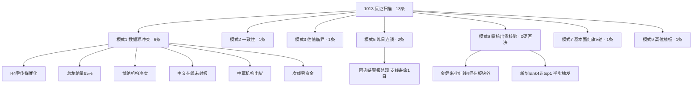

# 2026年10月13日 · 反证 / Devil's Advocate

> **数据源新鲜度**: partial（六上游齐全，R7 为 T-1 盘前批次）
> **降级状态**: true（模式4无库 / 模式7财报轴缺透传 / 模式8不达触发阈值 / 模式10无背离证据）
> **置信度**: 0.80

## 一句话结论

🚫 hard_reject = 0（程序正义），但全场唯一主线在消息面零硬催化、资金面机构净卖、总龙承接缩量95%——这是一条**纯KOL情绪定价的climax独苗线**，13条反证中9条strong，建议执行池砍到2-3只、总仓压破0.45。

## 详细分析

### 一、先认市场：高位震荡杀跌日，独苗独活

R1判定1012为**高位震荡（conf 0.75）**：涨停46家较上一交易日收缩33%、跌停翻倍至19家、炸板率35.21%正踩35%纪律线、全市场涨跌比0.27。但情绪没崩——昨日涨停溢价仍有+1.81%，最高标走到10板，资金把全场流动性极端抱团到**唯一最高标+AI内容一条线**，其余宽基与硬件ETF当日均值-1.69%。这是高低切踩踏，不是普跌熊市。

段位决定动作：落袋为安、只跟总龙与2板新苗、中位（3-6板断层带）一律划掉。R2在方向上与R1一致（只推1条线、stage=climax、无中位票），但反证要追问的是：**这条独苗线的成色够不够硬。**

### 二、反证主线一：消息面零背书（模式1 · strong）

R4硬新闻催化了9个板块——光模块、算力硬件、机器人、稀土、资源、存储、电子烟、苹果链、银行——**没有一个是传媒/短剧/AI内容**。R2自己的交叉验证 `r4_catalyst_match=false`，短剧催化100%来自R3群聊KOL侧。R5逐票核实：5只候选catalyst评分仅45-62，新华传媒/掌阅/吉视/博纳全部标注"无R4独立催化"。

- **大资金意图**：用10板高标吸引全场接力盘，维持情绪锚溢价；
- **为什么走强**：故事（收购界面财联社）+ 高标 + 流动性抱团三重情绪，不是业绩；
- **逻辑够不够硬**：不硬。纯KOL一致性在climax期是双刃剑——R3已出现KOL"高位找补涨"口吻，这通常是主线尾段特征。

### 三、反证主线二：机构在板块内出货（模式1 · strong）

"容量中军承接机构资金"的叙事被龙虎榜直接证伪：

| 标的 | 1012龙虎榜信号 | 结构含义 |
|---|---|---|
| 🟥 新华文轩 | 涨停日净卖-3982万，机构-688万，沪股通疑似对倒 | 涨停净卖出 |
| 🟥 博纳影业 | 机构专用净卖-1733万，疑似对倒（中金财富深圳） | 游资接盘机构出货 |
| 🟧 板块整体 | 机构专用席位净卖7.76亿，卖出含欢瑞/果麦等本线多票 | 机构系统性减仓 |
| 🟩 背景 | 融资融券板块-350亿、富时罗素-253亿、MSCI-232亿 | 存量抱团，非增量 |

而正向的一面同样真实：文娱+10.4亿、影视+10.06亿、AI语料+8.76亿板块净流入，吉视LHB5日净买+1.85亿、掌阅+1.54亿。结论是**游资+散户在买、机构在卖**——板块真实容量远小于R2"中军"假设，只能按小容量情绪线管理仓位。

### 四、反证主线三：总龙的承接正在坍塌（模式1/5/9 · strong）

新华传媒10板看似封死，拆开看：主力净额 **15.7亿 → 0.78亿，单日缩量95%**；一字板换手仅3.38%，筹码锁死但新增承接几乎归零；PE(TTM)337倍、PB5.73（V6估值陷阱strong）；30日三板以上簇+235.6%获利盘。昨日（1012）R6已对9板的它发过strong警报，今天高度+1、警报连续第2日在榜——**风险没有释放，是被一字板延后了。**

模式九裁定：`extreme_tail_risk=true`。它仍是总龙、地位无人替代，但只能用"竞价高开3-6%放量换手"一种剧本确认；一字缩量、低开、核按钮三种情形一律不碰，核按钮同时触发**全主题撤销、降维主跌、仓位0.30以下**。

### 五、六类反证 + 四象限负面识别

**四象限负面（无安全象限）**：

| 象限 | 成员 | 负面识别 | 动作 |
|---|---|---|---|
| 🔥 高情绪·高资金（Q1） | AI内容传媒三强 | climax兑现区：缩量+机构出货+无估值锚 | 只做竞价/换手确认，断板即走 |
| 🎈 高情绪·低资金（Q2） | AI安全、医药涨价 | 群聊刷屏但资金榜无名，与昨日固态链同构 | 高开陷阱，只看不动 |
| 🏦 低情绪·有事件资金（Q3） | 稀土/煤铝/银行 | 有业绩无共振，T+1无接力盘 | 不与主线争仓位 |
| 🗡️ 低情绪·低资金（Q4） | 光模块/存储/钠电 | 利空+热榜批量掉出+资金百亿流出 | 明确拦截，禁左侧抄底 |

### 六、模式六程序正义与红线3

- 金健米业连续2日霸榜热股rank1、当日-8.43%，命中红线4——但属农业线，不在R2主线/候选池，**板块级硬条件不传导**；
- 新华传媒仅rank4（非top1霸榜，R3明示不触红线4），且R5主力5日+3.5亿不满足净流出条件——**两条硬条件均不成立，hard_reject=0**；
- 记为**半步触发**：1013若升top1-3霸榜且主力转净流出，次日直接hard_reject。
- 红线3保护未启用（无hard_reject，不存在候选不足3只问题）。

## 关键证据

- 证据1: R4 sectors_catalyzed 九板块无传媒条目，R2自报 r4_catalyst_match=false · 来源 R4_news/R2
- 证据2: 新华传媒主力净额15.7亿→0.78亿、换手3.38% · 来源 R5 chip_structure
- 证据3: 新华文轩涨停净卖-3982万、博纳机构净卖-1733万、机构席位卖7.76亿 · 来源 R7 lhb_bull_trap
- 证据4: 板块净流入背景为融资融券-350亿/富时罗素-253亿 · 来源 R7 main_force
- 证据5: 金健米业霸榜rank1两日-8.43%（板块外）；新华rank4连续2日拥挤警报 · 来源 R3 distribution_alert
- 证据6: 昨日强支线固态/钠电热榜批量掉出（龙蟠9→67等6只），昨日R6 strong警报兑现 · 来源 R3 dropped_from_top20
- 证据7: 候选5/5无盈利锚：PE337（新华）、PB70（中文在线）、三只PE亏损 · 来源 R5 fundamental_flags

## 数据源审计

| 源 | 状态 | 日期 | 记录数 | 备注 |
|---|---|---|---|---|
| R1 风格 | 🟢 ok | 2026-10-13 | 1 | high_chop conf0.75 |
| R2 主线 | 🟢 ok | 2026-10-13 | 1线5候选 | schema缺top10，R5已记降级 |
| R3 情绪 | 🟢 ok | 2026-10-13 | 3共振主题 | weflow降级沿用双源 |
| R4 消息 | 🟢 ok | 2026-10-13 | 8事件 | 无传媒栏目=反证核心证据 |
| R5 画像 | 🟢 ok | 2026-10-13 | 10票 | F1-F12财报轴未透传 |
| R7 资金 | 🟡 stale | 2026-10-12 | 全量 | 盘前T-1批次，符合时序 |
| 昨日R6 | 🟢 ok | 2026-10-12 | 13条 | 模式5连锁比对 |

## 不确定性 / 自我反证

1. R7为T-1盘前口径，1013竞价真实承接未知——因此所有结论设计为**竞价单点确认制**，不预设封死。
2. 模式七F1-F12财报红旗轴未检（R5未透传+R6禁抓数），5只候选的财务雷未排除；V轴已全覆盖。若后续补数命中F11高质押/F12非标意见，结论可能升级。
3. 中文在线1012仅+3.84%未封板，R2/R5对其身位判断已偏负面，R6维持watch；若1013板块分歧日它逆势转强，属证伪本反证，可重估。
4. 纯KOL情绪线在增量资金进场时可以走得比反证更久——本反证不预测见顶日，只定义**什么信号出现即认错**（总龙核按钮/炸板率破40%/跌停放大）。

## 与其他 R/D/E 的关系

- 依赖: R1_style / R2_main_sectors / R3_sentiment / R4_news / R5_stock_profiles / R7_capital_flow / 昨日R6
- 被消费: D1（main_decision_v1）——hard_reject强制剔除（今日0条）；strong_suggest须接受或在 d1_override 记录理由；soft记入r6_soft_notes
- 给D1的明确建议: execution_pool ≤ 3只（新华仅竞价确认 + 吉视 + 掌阅/吉视二选一），博纳/中文在线移出；总仓<0.45；预设总龙核按钮降维路径
- 给E1/E2: 要求R5补齐F1-F12三表透传；复盘"KOL-only主线在climax期的平均寿命"以激活模式4历史库

## Sub-Agent 元数据

- skill: analyze_devil_advocate_v1
- artifact: data/research/20261013/R6_devil_advocate.json
- 生成耗时: 约 5 分钟（pull-only，零MCP调用）
- model: ark-code-latest
