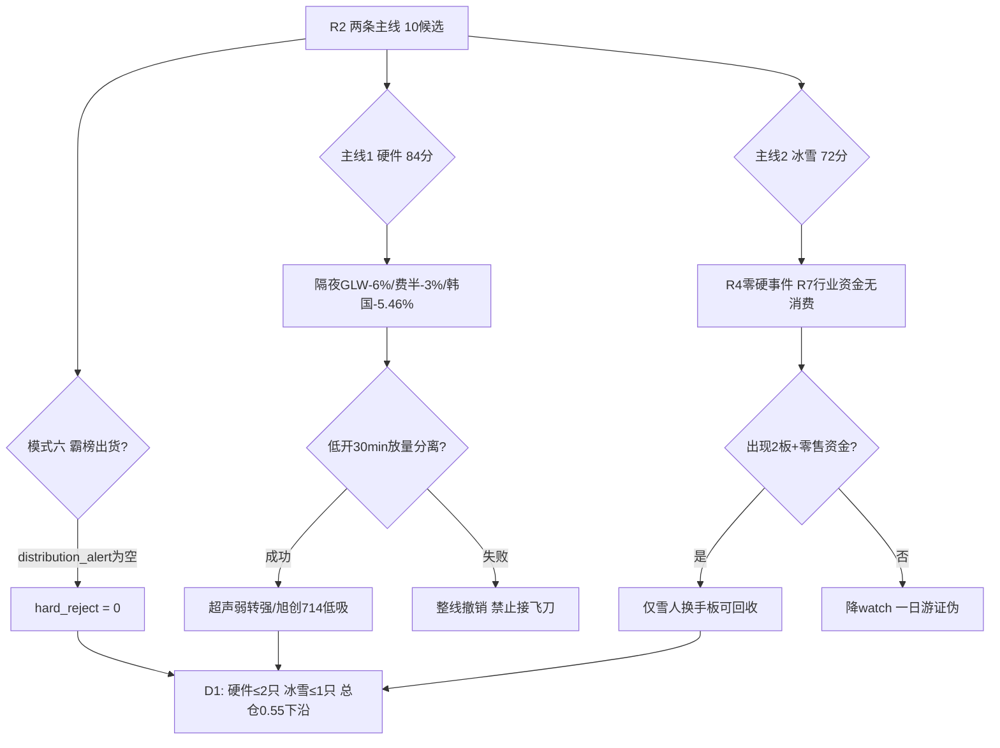

# 2026年10月14日(周三) · **反证 / Devil's Advocate**

> **数据源新鲜度**: ok(R1-R5+R7 六源全齐,trading_gap=0)
> **降级状态**: false(模式4历史库/模式8涨停<100 按规则 degraded,不编造)
> **置信度**: 0.72

## 一句话结论

🚫 **hard_reject 0 条**;但 strong_suggest 6 条——硬件线迎面撞上隔夜外盘暴跌、冰雪线跨源确认仅 0.34、高标派发已被龙虎榜硬数据证实,两条主线都只能走"单一确认剧本",不可直接进攻。

## 详细分析

1014 盘前的反证核心不在个股瑕疵,而在**时间口径**:R2 给全场最高分 84 的 AI 算力硬件主线,其全部资金证据(元件 +32 亿/通信设备 +41 亿)与涨停潮都发生在 1013 白天,而隔夜 GLW 康宁 -6.0%、费半盘中 -3%、美光 -3.88%、韩国综合 -5.46%(5 日 -13.83%)全部发生在 A 股收盘之后。R1 自己把这一点定义为"1014 第一验证点",R7 的海外敏感度表直写 pcb_component="显著承压,警惕高开低走"。这意味着主线 1 在开盘前是一个**未被外盘定价的回流**,开盘 30 分钟分离失败则整线证伪,反证无法在盘前消除,只能设撤销路径。

第二条主线冰雪的问题相反:热度是真的(ths 概念首日登榜即 rank1、hot 值 184813 全场最高、5 群唯一横跨全部题材群),但 R4 的 8 个硬事件无一对应冰雪/旅游/零售,R7 行业资金 top15 无消费/零售/旅游,cross_validation 仅 0.34。它是标准的 Q2(高情绪低资金)结构,与 1012 一日证伪的固态电池链、1013 一日游的 8 只龙虎榜票(1012 LHB 净买 top10 有 8 只 1013 主力转净出)同构。R2 已诚实标注"原则上应降 watch",R6 认同。

最硬的结构性反证来自 R7:博纳影业 28% 换手 + 主力 -1.67 亿、新华文轩龙头破位 -8.09%、大金重工跌停净卖 -2.36 亿、电科思仪 35% 换手 + 机构净卖 -9137 万(全市场最大机构卖出)。这不是个别票暴雷,而是 **high_chop 阶段打板隔日无溢价的市场结构本身**——昨日 R6 对固态链"支线寿命 1 日"和新华传媒"边际承接递减倒计时"的两条警报方向均已兑现。在此结构下,今日所有 early 首板支线(机器人/核聚变/金融IT/军工)都不应获得隔夜仓位。

估值面上,10 只候选 6 只命中估值/盈利红旗但无一条 P0:雪人集团 PE 718(V6 strong)+ Q2 净利 -84.6%、澳弘电子 PE 62.5 + Q2 净利 -24.8% + 涨停三日榜净卖 -0.21 亿、兴森科技 PE 284 + 净利率 -0.14% + 负债率 65%、长白山 PE 94 + 质押 29%。好消息是硬件中军质地真实(旭创 Q2 净利 +228%/ROE 39%、生益 +147%),坏消息是龙一超声电子自己 PE 60、Q2 净利率仅 4%、9 月有三次龙虎榜净卖合计 -5.5 亿的老庄分歧史。

## 关键证据(模式六程序正义)

- 证据 1: R3 `hotlist_signals.distribution_alert = []` 空数组,明确无"同一标的连续 ≥2 日霸榜 top1" → 条件 1 对全部候选不成立 · 来源 R3
- 证据 2: 龙一龙二近 5 日主力净流出条件(2)不成立:雪人净买 +1.33 亿(net_rate 10.28%)、超声封单 3.88 亿 0 开板、旭创韩资逆势净买入 · 来源 R5/R7
- 证据 3: 金健/江淮/九阳连续 2 日 top5 属人气抱团锚,但均不在 R2 候选池,板块级硬条件不传导 · 来源 R3 note
- 半步触发: 澳弘电子涨停净卖 -0.21 亿 + 30 日 +124.7% + 30 日位置 99.8%,1014 若升霸榜且资金续负即升级 hard_reject
- 红线 3 保护: not_triggered(hard_reject=0)

## 四象限负面识别

| 象限 | 成员 | 负面结构 | 态度 |
|---|---|---|---|
| **Q1 高情绪+高资金** | 硬件全线/半导体国产替代 | 资金回流发生在外盘暴跌前,未被定价;板块内已现中京涨停机构净卖 -5610 万 | 只做低开分离,失败整线撤销 |
| **Q2 高情绪+低资金** | 冰雪IP/机器人/核聚变/金融IT | cross 0.34、R4零硬事件、行业资金无名,与固态链/8只LHB票一日游同构 | 高开陷阱,只看不动 |
| **Q3 低情绪+高资金** | 军工/油气油运/东百集团 | 军工叙事空+电科思仪机构最大卖出;油气事件提前反应且是压制风险偏好的双刃剑 | 仅观察,不争仓位 |
| **Q4 低情绪+低资金** | AI内容中位/新能源/金融权重/光伏 | 三重确认派发,博纳/中文在线/新华文轩主力净出,跷跷板已切走 | 明确拦截,禁止低吸 |

## 逐票反证要点(龙一龙二)

**000823 超声电子(硬件龙一)** · 板型=09:31 秒板首板(封单 3.88 亿/0 开板) · 龙头认定过 §2(最早秒板+最厚封单+板块 9 家) · 风险:PE60/净利率 4% 无业绩锚 + 9 月三次 LHB 净卖 -5.5 亿老庄股 + 周线刚收 -8.38% 大阴未确认止跌。**大资金意图**:借 PCB 业绩潮 + Lumentum 长约做超跌回流首板,但隔夜外盘给了先手资金借低开兑现的机会。**逻辑够不够硬**:叙事硬(双 high 催化)、筹码不够硬(老庄二次启动)。态度:**进,但仅低开弱转强单一剧本**;高开追板拦截。

**605058 澳弘电子(硬件龙二)** · 板型=10:20 涨停开 2 次 · 盈亏比全场最差(30 日位置 99.8%/30 日 +124.7%,止损距大而上方是套牢区) · 禁止清单命中"封板净卖"(三日榜 -0.21 亿)。态度:**降级 watch**,板块分离确认 + 超声先走强后才做弹性补涨。

**300308 中际旭创(硬件中军)** · 非涨停打法,Q2 净利 +228%/ROE 39% 是全池唯一硬基本面,韩资净买入提供脱钩证据;但日 K 均线空头、30 日位置 15.7%、5 日 -9.6%,AVGO -1.88% 外盘映射仍在。态度:**进,回踩 714/690 低吸**(主升核心票回踩合规),跌破 690 逻辑证伪即出。

**002639 雪人集团(冰雪高度锚)** · 板型=11:18 一字 0 开板,净买率 10.28% 资金最强 · 但 PE 718/Q2 -84.6% 纯筹码,高净买率=隔日兑现压力同源,15.2-15.33 双重压力。态度:**降级 watch,仅换手二板弱转强回收**,一字缩量不追。

**603099 长白山(冰雪中军)** · PE 94/ROE 0.08%/质押 29%、封单仅 0.35 亿且 13:04 午后才封板。态度:**观察**,板块溢价不走强即剔除。

## 数据源审计

| 源 | 状态 | 抓取时间 | 记录数 | 备注 |
|---|---|---|---|---|
| R1 风格 | 🟢 | 06:26 | 1 | conf 0.68,high_chop 0.52,仓位 0.55 |
| R2 主线 | 🟢 | 07:50 | 2主线/10票 | conf 0.57,因子层 degraded |
| R3 情绪 | 🟢 | 06:42 | 5共振主题 | weflow 永久下线,L1+L2 为最高等级 |
| R4 消息 | 🟢 | 07:45 | 8硬事件 | E008 中东 -0.6 为唯一负面宏观 |
| R5 画像 | 🟢 | 07:12 | 10票 | 快照命中全部 10 票;F1/F2/F6/F12 未透传 |
| R7 资金 | 🟢 | 06:29 | 1 | conf 0.55,概念资金流 THS 行业替代 |
| 昨日 R6 | 🟢 | 前日 07:13 | 13条 | 模式5连锁比对用 |

## 不确定性 / 自我批判

R6 全部结论建立在**盘前磁盘数据**上,最大的两个未决项只能等开盘:其一,硬件"外崩我不崩"的脱钩是否成立存在真实证据(韩资逆势买中芯/德明利/旭创、粤芯 +223%、费半尾盘收窄至 -0.6%、英伟达转涨),若分离成功,今日 strong_suggest 的第一条会被盘中推翻——反证不预测方向,只预设撤销条件;其二,冰雪的行业资金缺口部分来自口径降级(THS 行业无对应栏,概念口径 moneyflow_ind_dc 不可用),不排除零售/旅游资金实际净流入,故给"开盘零售资金 + 二板高度"的回收通道而非直接 hard_reject。模式 7 的 F1/F2/F6/F12 因 R5 未透传标 unverified,未作有罪推定。

## 与其他 R/D/E 的关系

- 依赖: R1_style / R2_main_sectors / R3_sentiment / R4_news / R5_stock_profiles / R7_capital_flow / 昨日 R6
- 被消费: D1(main_decision_v1,hard_reject 强制剔除/strong_suggest 须显式回应)、P1(竞价校准)、E1(复盘反证命中率)

## Sub-Agent 元数据

- skill: analyze_devil_advocate_v1(v1.3 · 含模式7-10 + 四象限)
- artifact: data/research/20261014/R6_devil_advocate.json
- 反证条目: 12(strong 6 / soft 6 / hard 0) · 评估候选: 10
- model: ark-code-latest
- 方法: llm_v1_pull_only(全程只读磁盘 JSON,零 MCP 调用、零新数据抓取)
