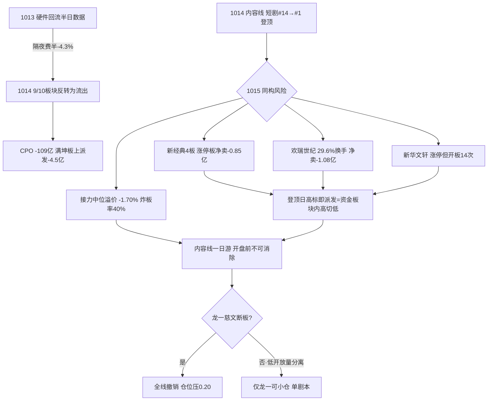

# 2026年10月15日(周四) · 反证 / Devil's Advocate

> **数据源新鲜度**: partial(T-1收盘口径,盘前正常)
> **降级状态**: false(模式4/8结构性degraded,非数据故障)
> **置信度**: 0.78

## 一句话结论

🚫 **hard_reject 0 只,但全场无安全进攻象限——内容线是昨日硬件的同构翻版,execution 至多留龙一一个分离剧本。**

severity 分布:`hard_reject 0 / strong_suggest 8 / soft_suggest 5`(共13条,含四象限总览)

---

## 1. 程序正义:模式六为什么是 0(而不是漏判)

模式六是 R6 唯一硬否决权,双条件必须**同时**满足,今日逐条核对均不成立:

| 条件 | 慈文传媒(龙一) | 新华文轩(候补) |
|---|---|---|
| ①板块命中高置信霸榜出货 | ❌ R3 原文"标注断板/派发风险**而非出货定论**",短剧#14→#1系新登顶非霸榜多日 | ❌ 同上,且警报原文只点其名 |
| ②个股近5日主力净流出 | ❌ 龙虎榜3日**净买+4261万**,股东户数4.26万→3.81万连3期集中 | ❌ 席位反复(-2508/-937后+3233万),非连续净流出 |

✅ 两只列入**半步触发 watch**:1015盘中一旦热榜霸榜+个股/板块资金转净流出,即时升级 hard_reject,不等收盘。
⚠️ 真正已坐实板上派发的 **新经典(-0.85亿,机构-0.30亿)、欢瑞世纪(-1.08亿)、满坤科技(-4.5亿)** 均不在 R2 候选池——派发发生在主线高标梯队内部,这本身就是比硬否决更值得警惕的结构信号。
红线3保护未触发。

---

## 2. 核心反证:今日内容线 = 昨日硬件的同构翻版(strong)

**昨日的错误已经兑现。** 1014 R6 的最强警报是"硬件1013回流建立在半日数据上,隔夜费半否定其可持续性"。R7 硬数据:1013主力净流入top10板块,**1014有9/10反转为净流出**,CPO +17.49亿→**-109.02亿**,科技风格-140.82亿。

而今日 R2 把84分独主线给了 AI 内容,其结构与硬件见顶前一日高度雷同:

推理三问(对独主线 AI 内容):
- **大资金意图**:影视/文娱/AI语料/短剧8席占主力流入榜前11,方向为真;但流入同时高标在板上被卖,意图是**板块内高低切的最后抱团**,不是建仓——全场4496只下跌时唯一的活口,本质是避险式抱团。
- **为什么走强**:红果日活1.68亿(+107%)催化已连续兑现3-4日,R4 权重仅0.62、strength=medium,R2自己承认"明牌、边际钝化";走强靠资金惯性与4板高度锚,不靠新增信息。
- **逻辑够不够硬**:不硬。late高潮段(age5日/高度4板/炸板率40%),KOL公开"等新华传媒断板",老钱等的是兑现信号而非接力信号。

---

## 3. 四象限负面识别:无安全象限

| 象限 | 内容 | 判定 | 候选处理 |
|---|---|---|---|
| 🟥 Q1 高情绪·高资金 | AI内容(短剧/影视/AI语料) | **兑现风险区**:登顶日late+高标板上派发 | 只做龙一低开放量分离,不追高换手板 |
| 🟧 Q2 高情绪·低资金 | PCB低位材料、鱼粉、醋化 | **高开陷阱区**:个股强、板块资金负 | 超声/百洋/醋化全部不追,观察 |
| 🟨 Q3 低情绪·高资金 | 煤炭/高股息/油气/中特估 | **防御容量区**:群聊零共振、银行疲态、IF深贴水-57点 | 无进攻合力,不产生候选 |
| ⬛ Q4 低情绪·低资金 | 军工/染料/创新药/CPO | **双杀回避区**:-14.67亿/#2→#8/霸榜出货/-109亿 | 清空,哈药-6.1%延续出货 |

结论:这是"可选标的极少"的盘面,**空仓是合规选项**,不是空仓焦虑。

---

## 4. 逐票反证清单

| 票 | 身位 | 反面硬伤 | R6态度 |
|---|---|---|---|
| 002343 慈文传媒 | 龙一·4板 | 估值32分:PS16.9/亏损(H1净利率-177.6%),MA5乖离+20%,R3高位抱团警报 | **有条件**:仅低开放量分离,高开一致/秒板不追,断板即走 |
| 002238 天威视讯 | 龙二·容量中军 | 1014仅+2.47%**未涨停**无领涨身位;周线MA60压顶;河马分账题材兑现度待验证;H1-66.7% | watch,高标断板日不接 |
| 603533 掌阅科技 | 龙二·首板 | 融资余额18日+83.5%杠杆追涨;首板开板;31-32套牢区;中位溢价为负 | 拦截追高,仅弱转强 |
| 601811 新华文轩 | 候补 | **开板14次全场最弱封板**,30日+110%,前高仅5.8%,席位反复净卖 | watch不追,模式六半步 |
| 301231 荣信文化 | 候补·20cm | ⚠️R2称"R4 E006点名"但**R4结构化映射无此票**(llm_pure未验证);未封板冲高回落;H1-852%;27亿小盘 | 不进execution,先核验 |
| 000823 超声电子 | 次线观察 | 板块-109亿压制+费半六连跌;户数翻倍筹码分散;虽业绩+90~102%双实锤 | 观察唯一剧本:企稳后低开弱转强 |
| 600183 生益科技 | 次线扩池 | 融资盘-14.8%撤退、大宗143元接盘现价119浮亏、户数翻倍、技术面全空 | **拦截:禁左侧接飞刀** |
| 002696 百洋股份 | 次线·4板 | **孤军**(板块涨停仅2家<3)、L1板块层缺位、3日LHB净卖-1757万、一字换手0.996%流动性陷阱、H1-800% | 不进execution |
| 603968 醋化股份 | 次线·3板 | 龙虎榜净卖-2631万(前日+2895万一日翻转)、开板4次、H1-332%、32亿小盘 | 观察不追 |
| 002493 荣盛石化 | 次线扩池 | 催化最硬(+777%)但日K空头排列30日-15%收最低点;负债74%;V1周期顶待察;金/银/铜夜盘齐跌 | 只观察,等日线企稳 |

**模式七汇总**:10票中**6只PE_TTM亏损**;无存贷双高/商誉炸弹/CFO连负/质押>70%/非标意见/ST双轴任何P0 → 不产生hard_reject;亏损票一律按情绪票管理,不得以基本面补仓。

## 5. 其他反证(soft)

- 📉 **北向口径打架**:R1称无北向实时数据,R7却给"连续20日每日净买20-33亿托底"且序列异常平滑,同日龙虎榜深股通净卖-5.14亿、机构专用净卖-8.19亿。北向"托底"**不得作为D1放宽0.35仓位的证据**。
- 🛢️ **跨资产背离**:商品夜盘金-1.37/银-6.08/铜-1.61/焦煤-4.86,仅油+1%;煤炭/高股息热榜新进但群聊零共振,资源线是孤立脉冲(数据为新闻口径,降级soft)。
- 🎰 **高标赌博风险**:天梯4板<8板,extreme_tail_risk=false;但4板标(慈文/百洋)同梯队的新经典已板上派发,高度内部松动,按赌博上限管理,不隔夜格局。

## 6. 模式执行状态

| 模式 | 状态 | 命中 |
|---|---|---|
| M1 数据源冲突 | ✅ executed | 4(含PCB资金否定/百洋孤军/荣信R4无映射/北向口径) |
| M2 一致性检查 | ✅ executed | 1(R1主跌临界 vs 10票候选体量) |
| M3 估值×主线 | ✅ executed | 2(龙一估值32分/中位梯队三票) |
| M4 历史类比 | ⏸ degraded | 无历史事件库,不编造 |
| M5 昨日错误连锁 | ✅ executed | 1(硬件一日游已兑现→内容同构) |
| M6 霸榜出货 | ✅ executed | hard_reject 0,半步触发2只 |
| M7 基本面红旗 | ✅ executed | P0=0;6/10亏损股 |
| M8 解套盘假繁荣 | ⏸ degraded | 涨停36家<100,前提不满足 |
| M9 高位触板 | ✅ executed | 最高4板,不hard_reject但强警告 |
| M10 跨资产背离 | ◑ partial | 商品数据新闻口径,降级soft |

## 数据源审计

| 源 | 状态 | 口径日 | 备注 |
|---|---|---|---|
| R1 风格 | 🟢 ok | 1014收盘+夜盘新闻 | confidence 高,结论明确降维 |
| R2 主线 | 🟢 ok | 1014 | 独主线已自我砍半,factor层降级 |
| R3 情绪 | 🟢 ok | 1014 | weflow降级,双源仍完整 |
| R4 消息 | 🟢 ok | 1015盘前 | 8事件,内容催化仅medium |
| R5 画像 | 🟢 ok | 1014 | 10票fundamental_flags透传完整 |
| R7 资金 | 🟡 partial | 1014 | 北向口径存疑;vibe-trading全缺;诱多榜质量高 |
| E1 观察追踪 | ⚪ missing | — | observation_tracking缺失,模式5用昨日R6+R7实测核对 |

## 不确定性 / 自我批判

- R6 全部证据停在1014收盘;隔夜外盘对内容线的负反馈(纳指-1.85%)要等竞价验证,"内容一日游"是概率判断非定论——龙一若低开放量分离成功,反证即被市场否决,以盘面为准。
- 模式六今日0条是双条件严格执行的结果,不是认为高位抱团安全;半步触发名单须由盘中/P1实时盯防。
- 商品价格仅新闻口径,未编造期货序列;若盘前有实盘数据,M10可能升级。

## 与其他 R/D/E 的关系

- **依赖**: R1/R2/R3/R4/R5/R7(全部status=complete)+ 20261014 R6
- **被消费**: D1(hard_reject强制剔除[今日0条];strong_suggest须接受或在meta.d1_override记录理由;soft记入r6_soft_notes);P1竞价校准盯半步触发;E1复盘核对"内容一日游"是否兑现
- **对D1的净输入**: execution_pool ≤1只(慈文单剧本);生益/百洋/荣信明确拦截出execution;总仓0.35下沿;主跌触发条件(4板核按钮/跌停20+/创业板-2%)→0.20

## Sub-Agent 元数据

- skill: analyze_devil_advocate_v1 (v1.3)
- artifact: data/research/20261015/R6_devil_advocate.json
- model: ark-code-latest
- 反证条目: 13(strong 8 / soft 5 / hard 0);评估候选: 10
- 未抓取任何新数据,仅读盘上 R1-R5/R7 及昨日 R6 JSON
