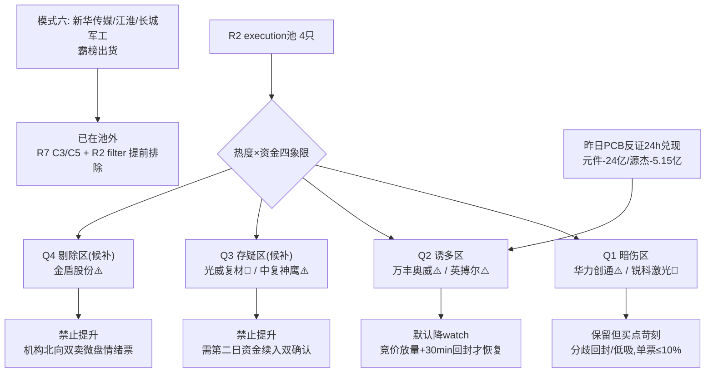

# 2026年10月19日（周一） · 反证 / Devil's Advocate

> **数据源新鲜度**: partial（全量 T-1=1016 收盘口径）
> **降级状态**: false（模式4历史类比降级、E1未上线，不影响主结论）
> **置信度**: 0.78
> **纪律段位**: R1 情绪周期 = 主跌（conf 0.85，炸板率 44.55%、昨日涨停溢价 -1.64%）

## 一句话结论

🚫 **hard_reject 0 条 / ⚠️ strong_suggest 6 条 / 💬 soft_suggest 5 条**：模式六霸榜出货三只（新华传媒/江淮/长城军工）已被 R2 filter 与 R7 C3/C5 提前清出 execution 池，但池内 4 只票全部带伤——军工龙一龙虎榜买、主力 5 日净卖 4.43 亿背离；低空线身处资金未确认的明牌高潮，结构与昨日被证伪的 PCB 主线同构。**默认动作：低空两票降 watch，军工两票限极小仓分歧低吸。**

## 详细分析

### 1. 先认市场：这是主跌段，不是扩散行情

R1 风格表给了"主线扩散型"的表象（涨停 61 家、强板块 20 个），但四条硬证据把它撕回主跌：炸板率 44.55%（49 炸/61 封，踩 35% 砍半线之上）、昨日涨停池 36 只次日平均 -1.64%/中位 -3.51%/仅 33% 收红、11 板孤龙新华传媒之下 5-10 板完全断层、主力全市场净流出 341 亿（流出 3030 家 > 流入 2186 家）。R1 已按周期优先把仓位上限压到 0.30。R2 合规砍半到 2 线各 2 票，但**低空线自判 climax 且 r7_capital_match=false 仍保留 2 个 eligible 名额，在主跌段属偏积极一端**（M2_01）。

### 2. 四象限负面识别（X=热度共识，Y=资金确认）

| 象限 | 含义 | 落入标的 | 反证要点 |
|---|---|---|---|
| **Q1 高热度·资金确认（暗伤区）** | 看似最硬，实则有背离 | 华力创通 ⚠️ / 锐科激光 💬 | 华力：板块资金第1但个股主力 T-2.14亿/5日-4.43亿，与 LHB +1.07亿背离；锐科：5日真金但 T 日超大单翻负、融资 15 日 -12.3%、PE91 |
| **Q2 高热度·资金未确认（诱多区）** | 明牌一致性，接盘位 | 万丰奥威 ⚠️ / 英搏尔 ⚠️ / 保隆科技 💬 / 天汽模 💬 | 板块无行业级主力流入，人气龙江淮 -6.6 亿全市场第1；万丰 19.48 万散户盘无 LHB；英搏尔尾盘烂板开 6 次；保隆/天汽模无资金无机构 |
| **Q3 低热度·单日资金（存疑区）** | 一日脉冲需续证 | 光威复材 💬 / 中复神鹰 ⚠️ | 光威前 5 日 4 日净流出、T 日单日 +2.89 亿且收在 MA60 下；中复神鹰日线空头、融资 -10.3%、股东户数翻倍 |
| **Q4 热度在榜·资金机构双卖（剔除区）** | 标准接力祭品 | 金盾股份 ⚠️ | 早封 20cm 但机构 -305 万+北向 -1376 万双净卖，PE 22801，39 亿微盘纯情绪 |

**execution 池 4 票中 2 票落 Q1、2 票落 Q2，无一处于"高热度+干净资金"象限——池子里没有无瑕疵进攻标的，这个分布本身就是主跌段的反向证据。**

### 3. 模式六核查（唯一 hard_reject 源）

R3 `distribution_alert` 三只逐一比对 R2 execution 池：

| 霸榜出货标的 | 警报依据 | 是否在 execution 池 | R6 裁决 |
|---|---|---|---|
| 新华传媒 600825 | 双平台霸榜（东财#2/同花#3）+11连板+断层天梯+官媒风险提示；R7：5日主力 -10.7 亿 | ❌ 池外（C5 禁抄底高位传媒） | 无 hard_reject，作为竞价情绪锚：开板核按钮=全面降维信号 |
| 江淮汽车 600418 | 热榜#1（rank49→1）+主力 -6.6 亿全市场流出第1 | ❌ 池外（R7 C3 + R2 明确排除） | 无 hard_reject |
| 长城军工 601606 | 总龙一字板但主力 -3.7 亿（5日 -4.1 亿） | ❌ 池外（R2 排除总龙，只做低位补涨） | 无 hard_reject；竞价撤单/核按钮会带崩军工板块情绪 |

**结论：模式六对池内无新增 hard_reject；红线3保护未触发（池内仍有 4 票 ≥3）。** 但三只警报标的是 1019 最重要的情绪观察变量。

### 4. 最锋利的一条反证：低空线 = 昨日 PCB 主线的 24 小时重演（M5_01）

昨日（1016）R6 R6_M1_01 预警 PCB 概念"仅由涨停/资金打分入选，无 R3 共振/R4 催化/R7 资金确认，疑纯游资推动"。24 小时内兑现：元件行业主力 -24 亿全市场最差、R4 高硬度首推源杰科技主力 -5.15 亿（流出第4）、金安国纪 -5.03 亿（第5）、沪电 -3.22 亿（第10）。

今日低空线要素同构：有涨停（23/16/17 家首板）、有卖方密集吹风（长城机械"复制22年机器人"、华创专家会）、**但无行业级主力净流入，人气龙一借板出货全市场第1**。叠加主跌段隔日溢价 -1.64% 与费半八连跌的外部负反馈，低空高开必须按"一致性兑现陷阱"定价——买点只存在于开盘 30 分钟分歧换手后的回封，不存在于高开。10-21 特斯拉财报为证伪节点。

### 5. 池内 4 票逐票思维链

**300045 华力创通（军工龙一·conditional_keep）**
- **大资金意图**：板块 +18 亿行业第1做高低切，但切到它身上的是游资席位（新闸路 3704 万/鲁迅中路 3011 万）+机构小额 0.44 亿，主力口径 5 日 -4.43 亿在板上派发；股东户数涨停前 +12.8% 说明筹码已先分散给跟风盘。
- **为什么走强**：大飞机概念资金领涨身位+利剑军演 10/19 开幕明牌+20cm 突破三线；属板块 beta 无个股公告。
- **逻辑够不够硬**：板块逻辑硬（4源共识0.90），个股逻辑有缝（LHB买/主力卖背离、PE亏损无锚、首板11:13偏晚还开1次、周线 MA20=14.09 强压）。
- **买入理由**：唯一资金确认主线的低位接棒核心，机构不排斥。**风险点**：利好开幕日兑现+主力持续派发。**止损条件**：低开承接无力或跌回 11.5（60分低吸位）下方。**可验证假设**：开盘分歧后回封且主力净额转正；竞价一致高开 8%+ 则假设直接失效。
- R6 态度：**有条件保留，禁追高开，单票 ≤10%**（M1_02/M3_01 strong）。

**300747 锐科激光（军工龙二·池内瑕疵最少）**
- **大资金意图**：5 日 +4.7 亿逐日可查（1014 +2.0 亿/1016 +3.16 亿），是真金白银的低位补涨；但 T 日超大单已翻负 -1718 万，融资盘 15 日 -12.3% 离场，资金内部出现分歧。
- **为什么走强**：军工激光映射+5日+16.4%，日线唯一多头排列。
- **逻辑够不够硬**：资金硬、身份软——1016 未涨停无封板，R5 自认"补涨/助攻非龙头"，R3 未单独点名，PE 91。
- **买入理由**：池内唯一资金连续确认+趋势健康。**风险点**：超大单松动+板块高开时它跟冲易成补涨末端。**止损条件**：38.4（日K低吸位）有效跌破。**可验证假设**：回踩 MA5（36.92）不破且主力续流入。
- R6 态度：**保留，分歧低吸不追高**（M3_01 strong / M3_02 soft）。

**002085 万丰奥威（低空龙一·默认降 watch）**
- **大资金意图**：板块层面是游资封板、老钱派发（江淮 -6.6 亿），万丰自身无 LHB、主力数据缺失、19.48 万散户盘——无法证明有主力在买，只能证明封板资金没砸开。
- **为什么走强**：Roadster 飞行能力周末霸榜+33.2 万意向金+辨识度第1。
- **逻辑够不够硬**：热度满分、资金零分（r7_capital_match=false，共识 0.62 踩线）；估值尚可（PE23/PB3.06）提供的是跌不深的底，不是涨得动的理由。
- **买入理由**：若分歧后回封，板块总龙身位唯一。**风险点**：明牌无预期差、MA60（9.994）压线、周线空头。**止损条件**：封不住板或跌破 9.3。**可验证假设**：竞价放量不一字、30 分钟分歧后回封。
- R6 态度：**默认 watch，回封确认才恢复 execution**（M1_01 strong）。

**300681 英搏尔（低空龙二·默认降 watch）**
- **大资金意图**：板块内唯一机构净买（三席合计 0.37 亿），但 13:01 尾盘才封、开板 6 次为 9 票最差封板质量——机构买的是分歧，封板资金自己都没一致。
- **为什么走强**：电驱 20cm 弹性+Roadster 风扇负压映射。
- **逻辑够不够硬**：2028 前业绩零贡献纯主题，个股机构背书抵不过板块资金背离。
- **买入理由**：弱转强若完成弹性最大。**风险点**：烂板次日低开概率高、压线 MA60。**止损条件**：开盘 15 分钟不能翻红强势即移出当日计划。**可验证假设**：高开后 15 分钟内回封且不再开板。
- R6 态度：**默认 watch，弱转强回封才参与，禁追 20cm 高开**（M1_01 strong / M1_03 soft）。

候补 5 票：金盾股份、中复神鹰 ⚠️ strong 禁止提升（M7_01：机构北向双卖 PE22801 / 技术筹码估值三杀）；光威复材、保隆科技需第二日资金续入+放量双确认（M8_02）；天汽模杂毛缩量封板不提升。

## 关键证据

- 证据 1: 模式六三只霸榜出货标的全部池外，hard_reject=0 · 来源 R3.hotlist_signals.distribution_alert + R2 leaders + R7 dragon_trap_flags
- 证据 2: 华力创通主力 T-2.14 亿/5日-4.43 亿 vs 龙虎榜净买 +1.07 亿背离 · 来源 R7 dragon_trap「20cm涨停分歧」+ R5 chip_structure
- 证据 3: 低空板块无任何行业/概念级主力净流入，江淮 -6.6 亿全市场第1，概念流入 top6 无低空 · 来源 R7 main_force
- 证据 4: 昨日 R6 PCB 预警兑现：元件 -24 亿、源杰 -5.15 亿、金安国纪 -5.03 亿、沪电 -3.22 亿 · 来源 data/research/20261016/R6 + R7 stock_outflow_top10
- 证据 5: 主跌硬指标：炸板率 44.55%、涨停溢价 -1.64%/中位 -3.51%、5-10 板断层、主力 -341 亿 · 来源 R1/R7
- 证据 6: 9 票中 6 票周线空头排列、首板位置处 20 日箱体 79-100%（套牢区）· 来源 R5 chart_vision → 模式8 high_suspicion=true
- 证据 7: 费半八连跌 SMH 周 -9.70%，R4 科技硬 alpha 名单（长鑫/生益/源杰/曙光）与 R7 C2 拦截对撞 · 来源 R1.overseas + R7 C2

## 数据源审计

| 源 | 状态 | 抓取时间 | 记录数 | 备注 |
|---|---|---|---|---|
| R1 style | 🟢 ok | 2026-10-19 06:26 | 1 | conf 0.70，主跌判定 |
| R2 main_sectors | 🟢 ok | 2026-10-19 07:52 | 2主线/9票 | conf 0.49，T-1口径 |
| R3 sentiment | 🟢 ok | 2026-10-19 06:47 | 5主题 | 热榜为1016收盘，WeFlow永久下线 |
| R4 news | 🟢 ok | 2026-10-19 07:35 | 8事件 | R7曾缺席但已补盘后回填 |
| R5 profiles | 🟢 ok | 2026-10-19 07:52 | 9票 | tushare单源，vibe MCP未配置 |
| R7 capital_flow | 🟢 ok | 2026-10-19 06:23 | 1 | 1016收盘口径，北向仅成交额 |
| 昨日 R6 | 🟢 ok | 2026-10-16 13:03 | 1 | 模式五人工比对依据 |
| MCP 主动拉数 | ⚪ 未使用 | — | 0 | 遵守 R6 [file]-only，announcement 例外未触发 |

## 不确定性 / 反证（自我批判）

1. **所有资金/价格口径停在 1016 收盘**：1019 纯内资缩量日（沪深股通休市）的真实承接无法盘前验证，低空"分歧回封"与军工"高低切续接"都只能开盘证伪——这正是将低空两票默认降 watch 的原因，而非给硬否决（模式六条件不满足不硬来）。
2. **模式八 high_suspicion 为结构推定非定量**：无封板量 vs 套牢区精确比例数据，故只给 soft 与 confidence 上限建议，未扩大为 strong。
3. **华力创通的 LHB/主力背离存在口径争议**：LHB 只统计活跃席位，主力净流出含全体大单派发，两口径不必然矛盾，但在主跌段应按更保守口径（派发）处理。
4. 若 1019 竞价低空/军工全线一字无换手，本份反证的"分歧买点"分支整体失效，应直接执行 R1 空仓观察预案——反证不提供逆向抄底理由。

## 与其他 R/D/E 的关系

- 依赖: R1_style / R2_main_sectors / R3_sentiment / R4_news / R5_stock_profiles / R7_capital_flow / 昨日R6
- 被消费: D1（main_decision_v1：6 条 strong_suggest 必须逐条接受或在 meta.d1_override 记录理由）、research_summary.json hard_rejects 字段（本次为空数组）
- 特别提示 D1: R4 科技硬 alpha 名单（M1_04）不得导入 execution；孤龙新华传媒竞价表现为当日情绪总开关

## Sub-Agent 元数据

- skill: analyze_devil_advocate_v1（六类模式 + 模式7-10扩展 + 四象限负面识别）
- artifact: data/research/20261019/R6_devil_advocate.json
- 生成耗时: 约 4 分钟（纯只读消费，零 MCP/零抓数）
- model: ark-code-latest
- counter_arguments: 11 条（strong 6 / soft 5 / hard 0）；模式4降级、模式5以人工比对执行
