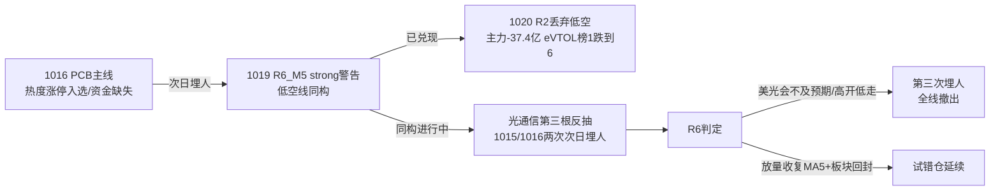

# 2026年10月20日(周二) · 反证 / Devil's Advocate

> **数据源新鲜度**: partial(R7 artifact 缺失,代理口径)
> **降级状态**: true(模式四历史库无;R7 未落盘;L3 共振永久缺失)
> **置信度**: 0.70
> **MCP 调用**: 0 次(全程只读磁盘 JSON,未抓一条新数据)

## 一句话结论

🚫 hard_reject 0 条 · ⚠️ strong_suggest 7 条 · 💬 soft_suggest 4 条 — **两条主线全是空头排列里的超跌反抽,光通信是第三次同构反抽(前两次次日埋人),龙头股资金与身份多处背离;只许计划内试错,不许多头叙事。**

## 段位先于个股:R1 与 R2 的口径冲突

R1 判段位 = `high_chop 主跌后段止跌试盘`,明确"**不是主升**";R2 却把机器人线 stage 写成 `early_up 主升早期(score84)`。这是今日最需要 D1 警惕的张力:

| 口径 | R1(风格) | R2(主线) |
|---|---|---|
| 段位 | 高位震荡/止跌试盘 | 机器人=主升早期 |
| 情绪 | 浓度45·中性偏弱 | 主线1 score84 |
| 广度 | 涨2275/跌3129·中位-0.38%·跌停22 | 板块19家涨停=效应足 |
| 天梯 | 最高仅3板(2只) | leader_height=1 |
| 仓位 | 上限50% | — |

**反证结论(R6_M2_01 strong)**: age=2天、全场无4板空间板、右侧确认三信号(放量长阳/涨停60+/跌停个位数)一条未现 → 维持"试错"定性,禁止 D1 用"主升早期"提高仓位系数。

## 四象限负面识别

```minder
mindmap
  root((1020 反证四象限))
    Ⅰ主线资金 负偏
      机器人簇连续2日净流入但龙一板上净流出
      光通信分裂光模块加23亿对比PCB减26.8亿
      旭创5日主力减34.9亿融资15日减20
      军工减19亿降副线低空减37亿已丢弃
    Ⅱ龙头筹码 负
      兆威尾盘板封单0.59亿板上兑现
      澳弘12板龙虎榜净卖加转债抛压
      宇树流通149亿换手21.9明牌1022
      荣泰纯跟风开板2次
    Ⅲ估值基本面 负偏
      兆威PE83.5扣非减44
      宇树PE343扣非减19
      澳弘PE75扣非减39两次异动公告
      协创负债86.8大合同履约未证
      正面亨通PE29.6旭创PE38润泽PE17
    Ⅳ外部情绪 负偏
      费半止跌仅技术修复美光会未落地
      美元破102高盛十年最快砍科技
      炸板31.3天梯3板广度3129跌
      前两次反抽次日埋人第三次进行中
```

## 霸榜出货(模式六)硬否决审查 — 0 触发

| 检查 | 结果 |
|---|---|
| R3 distribution_alert 名单 | 新华传媒 / 新华文轩 / 长鑫科技 |
| 是否在 R2 龙一龙二候选 | **三者均不在**(AI传媒已被 R2 discarded;长鑫为 R3 excluded) |
| 澳弘电子特殊情形 | R5 自标 distribution_alert,但**不在 R3 霸榜名单、CPO板块未被判霸榜出货 → 硬否决条件(1)不成立**,依规降级 strong(R6_M6_01) |
| 红线3保护(candidate<3) | 无需触发(无硬否决,候选仍10只) |

➡️ **澳弘电子虽不能 hard_reject,实质风险等同拦截**:21日12板 + 弱封板(开4次/封单0.15亿) + 龙虎榜净卖0.21亿 + 5日主力-3.93亿 + 两次异动公告 + 转债不赎回转股抛压 + 扣非-38.7%。建议 D1 直接剔出 execution,极小试错仓都不值得。

## 模式五:昨日反证已兑现 — 同构结构今日重演



昨日(1019)R6 共 6 条 strong,其中低空同构条今日**已被盘面兑现**(整条线 -37.4 亿被 R2 丢入 discarded);军工明牌资金流出条同样延续(-18.96亿,降副线)。"**明牌 + 资金流出 = 出货**"模式连续两日有效。今日同构对象切换为光通信:中军旭创 1019 反抽日竟收绿 -1.39%,是板块内部最诚实的空头信号。

## 逐票思维链(候选池 10 只)

### 600487 亨通光电(光通信龙一) — 态度:观察/仅分歧低吸
- **大资金意图**: GJD 路径"先救总熊头",1239亿容量票60万手/3.99亿封单是反抽日大资金破局首选;但5日主力口径仍-6.17亿,只1019单日+1.73亿。
- **为什么走强**: 光纤现货数倍涨价+短缺至2028+费半止跌,PE29.6/H1扣非+101%是算力线估值最硬。
- **逻辑够不够硬**: 产业逻辑硬,**位置逻辑软** — 30日自76.35回撤-34%,9/28有13.2亿封单跌停套牢盘,距MA20仍-17%。
- **买入理由**: 无(反抽第三根,不追)。**风险点**: 高开低走+美光会证伪。**止损条件**: 跌破开盘价/回封失败。**可验证假设**: 美光10/21研讨会指引上修。

### 300857 协创数据(事件龙二·硬alpha) — 态度:计划内试错·竞价定生死
- **买入理由**: 374.9亿/60个月合同(年化62.5亿远超营收),三源27次命中,1019仅+1.22%未抢跑=预期差最大。
- **风险点(R6_M7_01 strong)**: 负债率86.8%、客户身份/付款能力未披露、微软退出英国Nscale项目是同类合同撤销先例、公告日主力仅+0.01亿=资金观望。
- **止损条件**: 低开低走即"公告被当出货",当日放弃;一字板不排。
- **可验证假设**: 竞价高开5-9%且竞价额放大。

### 003021 兆威机电(机器人龙一) — 态度:降级·只做弱转强确认
- **风险点(R6_M3_01 strong)**: PE83.5+扣非-44%(V2);**涨停日主力净流出0.23亿=板上兑现**;14:08尾盘板非卡位龙、封单仅0.59亿;涨停价67.22精确顶在MA20(67.35)压力下沿。
- **止损条件**: 跌破59.52反弹失败;高开>8%缩量放弃。
- **可验证假设**: 站稳MA20 67.35 + 黄仁勋10/21演讲给量产硬数据。

### 688836 宇树科技(高标情绪锚) — 态度:拦截出 execution
PE343/扣非-19%/流通仅149亿/换手21.9%/10-22自家大会明牌抢跑,extreme_tail_risk=true。二板以上篮子1019已-3.81%,塔在拆钱。只作温度计。

### 605058 澳弘电子(候补) — 态度:拦截(见模式六节,等同硬否决处理)

### 其余 5 只

| 代码 | 名称 | 角色 | R6 态度 | 关键反证 |
|---|---|---|---|---|
| 002050 | 三花智控 | 容量中军 | 观察/分歧低吸 | 5日主力-2.41亿·H1净利-7.5%·MA20压制 |
| 603119 | 浙江荣泰 | 龙二跟风 | 降级watch | 无独立公告/开板2次/PE71,龙一走弱即弃 |
| 300308 | 中际旭创 | 容量中军 | 观察 | 5日主力-34.9亿/融资15日-20%/反抽日收绿 |
| 300442 | 润泽科技 | IDC扩散候补 | 观察 | proxy票无合力/换手0.93%流动性弱 |
| 688160 | 步科股份 | 弹性候补 | 观察 | PE91/未封板/资金信号弱/20cm双向风险 |

## 关键证据

- 证据1: R1 广度背离 — 指数红盘靠权重护盘,3129只下跌/中位-0.38%/跌停22家,"已企稳"不成立 · 来源 R1_style
- 证据2: 光通信资金分裂 — 光模块+23.2亿/CPO+17.1亿 vs PCB -26.8亿/存储+0.5亿;旭创5日-34.89亿 · 来源 R5 + _r7_data
- 证据3: 历史同构 — 1015/1016 两次硬件反抽均次日埋人,昨日 R6_M5 低空同构警告今日兑现(-37.4亿) · 来源 R3/R2/1019R6
- 证据4: 龙位筹码证伪 — 兆威板上净流出0.23亿;澳弘5日-3.93亿+龙虎榜净卖;宇树10/22明牌窗口 · 来源 R5
- 证据5: 霸榜名单与候选池零交集 — 模式六无硬否决对象 · 来源 R3 hotlist_signals

## 数据源审计

| 源 | 状态 | 抓取口径 | 记录数 | 备注 |
|---|---|---|---|---|
| R1 style | 🟢 ok | 1019收盘 | 1 | conf 0.70 |
| R2 sectors | 🟢 ok | 1019收盘 | 2主线+2副线 | factor层降级/filter未跑 |
| R3 sentiment | 🟡 ok但降级 | 1019 | 5主题 | WeFlow永久下线,无L3 |
| R4 news | 🟢 ok | 盘前 | 8事件 | E008为同级负面 |
| R5 profiles | 🟢 ok | 1019 | 10票 | 图表快照22/22命中 |
| R7 capital | 🔴 error | — | 0 | **正式JSON未落盘**,东财缓存代理,无北向/游资协同 |
| 昨日R6 | 🟢 ok | 1019 | 11条 | 模式五连锁依据 |

## 不确定性 / 自我批判

1. R7 正式 artifact 缺失是今日最大盲区:游资协同与北向维度空白(1019沪深股通休市部分解释),若盘中龙虎榜显示机器人龙位获一线游资加仓,本报告对兆威的 strong 可被 P1/P2 部分推翻。
2. 模式四历史类比维持 degraded(无独立事件库);"两次反抽埋人"是上游已载事实并非 R6 新拉数据,但样本仅2次,统计意义有限。
3. 协创合同的真实客户与履约条款无法在 file-only 约束内核验,反证只能停留在"高杠杆+待证"层面,不能替市场判假。
4. R2 leaders 未经 filter_leader 硬约束过滤,R6 是对"候选池"而非"执行池"反证;若 D1 已自行剔除部分标的,对应 strong 条自动消解。

## 与其他 R/D/E 的关系

- 依赖: R1_style / R2_main_sectors / R3_sentiment / R4_news / R5_stock_profiles / _r7_data(代理R7) / 1019 R6
- 被消费: D1(main_decision)— 7条strong必须逐条接受或在 meta.d1_override 记录理由;hard_rejects为空无需强制剔除
- 交棒检验: E1 复盘重点核验①光通信是否第三次埋人②兆威板上净流出后是否一日游③澳弘是否核按钮
- 红线自查: 未抓新数据✅ 未给正向结论✅ 未越权hard_reject✅ 反证11条≥5未硬凑✅ 未使候选<3✅

## Sub-Agent 元数据

- skill: analyze_devil_advocate_v1
- artifact: data/research/20261020/R6_devil_advocate.json
- model: ark-code-latest
- method: llm_v1_file_only · MCP调用0次
