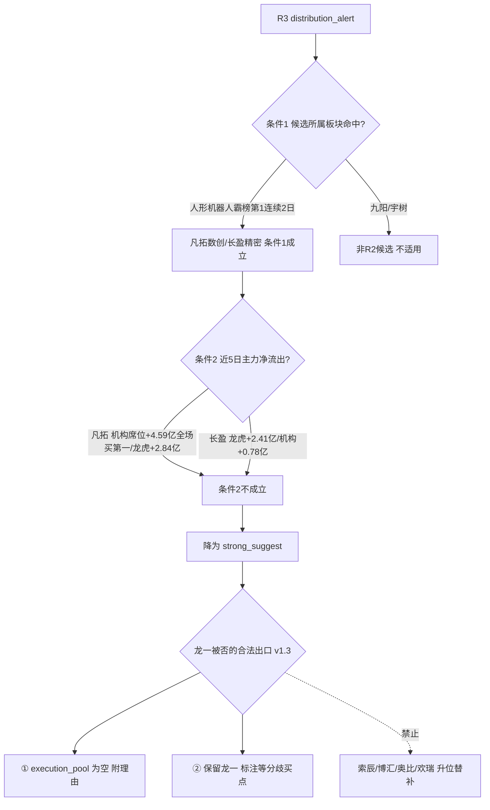

# 2026-10-21 · **反证 / Devil's Advocate**

> **数据源新鲜度**: partial(T-1 收盘截面)
> **降级状态**: false(模式4历史类比 degraded;R7 部分维度 degraded)
> **置信度**: 0.78

## 一句话结论

🚫 hard_reject 0 条;🔴 strong 7 条 / 🟡 soft 5 条 —— 霸榜警报**只命中板块、未命中资金**,双主线在"深坑反抽第二日"被按主升早期定价,执行池三票全部基本面空心。

## 严重度分布与模式六裁决

| 档位 | 条数 | 条目 |
|---|---|---|
| 🚫 hard_reject | 0 | — |
| 🔴 strong_suggest | 7 | M2段位 / M6霸榜(降级) / M1 AI应用 / M3凡拓 / M7欢瑞 / M3长盈 / M5连锁 |
| 🟡 soft_suggest | 5 | M1次线 / M1外盘 / M8解套 / M10存储 / M7池级 |

**模式六硬否决核验(唯一 hard_reject 通道)**:

## 详细分析

**段位错配是今日第一反证。** R1 定性 high_chop(高位震荡)+ 30 日深坑反抽第二日:42 个资产 30 日均收益 -3.56%、均最大回撤 -15.2%,芯片/半导体/科创50 簇 30 日 -21.7%;炸板率 34.9% 贴着 35% 红线;反弹日(3778 涨)主力却净流出 121.7 亿、超大单 -56.1 亿。昨日 R6_M2_01 设定的加仓门槛是"涨停 60+ 且出现合格 4 板空间板"——今日涨停仅 54 家,唯一 4 板吉大正元 open_times=4、涨停日主力 -7.52 亿列陷阱榜第一,门槛**未达成**。R2 却把物理AI(age=2,5 日资金 -144 亿)与 AI应用(age=1,R4 无独立催化)双双标注 early_up 并给出执行位。

**大资金意图**:T-1 的资金行为是"借普涨调仓"而非进攻——国企改革 -131 亿/高股息 -46 亿流出,人工智能 +71 亿/机器人 +66 亿流入,跷跷板强度 strong;但同一块钱在个股层面已现分歧:板块 lead_stock 凡拓获机构 +4.59 亿,而总龙吉大被主力出货 -7.52 亿。**为什么走强**:科技反抽由 GTC 柏林 + 世界模型大会 + 美光研讨会三个明牌时间锚驱动,属于"事件密度全市场第一"而非资金趋势反转。**逻辑够不够硬**:物理AI 新名词发酵第 2-3 日 + 母体人形机器人热榜霸榜第 1 连续 2 日,历史模式是高潮次日先手兑现;宇树连夜风险提示已兑现昨日 R6 的见光死警告。

**AI应用主线成色不足(cv0.67)**。热榜 rank13→3 是本批最干净加速,但 R4 无独立硬事件(抖音征集为 10/19 旧闻,DeepSeek 事件 polarity=-1);龙一吉大 RR≈1、9 月四笔大宗全部折价 -10.5%~-11.1%、中报续亏;R2 授龙二的欢瑞世纪已被 R5 拦截——H1 毛利率 -8.1%、ROE -25.2%、质押 30.6%、10/15 开板 8 次未回封、近月龙虎多次净卖,授位与六维结论直接冲突。

## 关键证据

- 证据 1: 模式6条件2反证 · 凡拓机构席位净买 +4.59 亿(全市场第一)+ 龙虎 +2.84 亿 · 来源 R7/R5
- 证据 2: 总龙陷阱 · 吉大正元涨停日主力 -7.52 亿(陷阱榜#1)+ open_times=4 + 11 席混战 · 来源 R7
- 证据 3: 仓位门槛未达 · 涨停 54<60、4 板吉大漏水;T-1 主力 -121.7 亿/超大单 -56.1 亿 · 来源 R1/R7
- 证据 4: 资金持续性 · 机器人概念 5 日 -144 亿/CPO -119 亿/存储 5 日 -119 亿且 T-1 -22 亿/军工 -22 亿 · 来源 R7
- 证据 5: 筹码派发 · 凡拓 Q2 户数 +180%、索辰 +161%、奥比 +84%;凡拓两融 15 日 +61.9% · 来源 R5
- 证据 6: 昨日连锁兑现 · 宇树见光死警告→公司连夜风险提示;光通信"第三根反抽"警告仍在审理 · 来源 R3/R4
- 证据 7: 次线零验证 · 数据要素事件 19:23 盘后落地零资金反映;军工 cv0.33;两线候选均无 R5 画像 · 来源 R2/R7

## 重点对象四问(思维链)

### 301313 凡拓数创(物理AI龙一)

**买入理由**(R2/R5 主张):20cm 二连板 0 开板 + 机构净买 4.59 亿 + 卖方"大脑最值钱"共识,身位龙成立。
**风险点**:母体霸榜出货警报(板块条件1命中);H1 营收 -27.8%/净利 -64.9% 纯叙事定价(估值维 25 分);Q2 户数 +180% 拉升中派发;31.5% 换手 + 两融 +61.9%;今日 GTC 演讲为明牌兑现节点。
**止损条件**:分歧回落后以 5 日线 36.8(-21%)为纪律线;一字/高开 >8% 无买点;炸板率盘中破 40% 放弃。
**可验证假设**:高开 <5% 且竞价金额放大=预期未打满,弱转强成立;高开低走=霸榜出货由板块传导至个股,条件2将在明日 R6 被重新检验。

### 003029 吉大正元(AI应用龙一·全场总龙开关)

**买入理由**:全市场最高标 4 板,竞价封单 1.12 亿,AI 安全 + DeepSeek 身位。
**风险点**:涨停日主力 -7.52 亿(陷阱榜第一)、炸板 4 次、10/16 龙虎净卖 -1.15 亿、中报续亏、RR≈1;断板则全场打板通道关闭,外溢风险大于单票。
**止损条件**:仅竞价弱转强(高开秒板/封单加厚)极小仓回封;低开或翻绿即判断板,当日禁止一切高位接力。
**可验证假设**:5 板封死=高标独活延续;4 进 5 失败=R1 所述"高低切而非主升"兑现,候选数再砍半。

## 四象限负面识别

| 象限 | 判定 | 核心负面 |
|---|---|---|
| I 主线×资金 | 负偏 | 反弹日主力 -122 亿;机器人 5 日 -144 亿;AI应用词条自身仅 +1.41 亿而龙一 -7.52 亿;数据要素零资金、军工 -22 亿 |
| II 龙头×筹码 | 负 | 吉大陷阱榜第一;凡拓/索辰/奥比 Q2 户数 +180%/+161%/+84%;润建弱板机构 -1.83 亿、超声机构 -4.67 亿;仅凡拓/长盈机构净买为对冲 |
| III 估值×基本面 | 负 | R5 十票八亏(H1),凡拓/吉大/索辰/博汇/欢瑞均 F6 strong;长盈 PE108+净利 -94%;唯一对冲昆仑万维 +227% 但全周期空头无板 |
| IV 外部×情绪 | 负偏 | 炸板率 34.9% 贴红线;高标与全市场极端劈叉;KOSPI -3.73%/美股半导体夜跌/美制裁 5 中企;对冲=广度 2.26 + GJD/ETF 承接 |

## 数据源审计

| 源 | 状态 | 抓取时间 | 记录数 | 备注 |
|---|---|---|---|---|
| R1 风格 | 🟢 | 06:21 | 1 | 42 资产聚类 + T-1 截面 |
| R2 主线 | 🟢 | 07:05 | 2主3次 | factor_layer degraded |
| R3 情绪 | 🟢 | 06:47 | 5主题 | weflow 永久下线,L1+L2 最高级 |
| R4 消息 | 🟢 | 06:34 | 8硬事件 | 外盘快照 degraded |
| R5 画像 | 🟢 | 07:25 | 10票 | 仅两主线,次线无画像 |
| R7 资金 | 🟡 | 06:25 | T-1收盘 | degraded:北向仅成交额/无ETF期权/无vibe MCP |
| 昨日R6 | 🟢 | 前日 07:55 | 11条 | 模式5连锁依据 |
| E1 追踪 | 🔴 | — | 0 | 无 E1 artifact,模式5降级为 R6 自连锁 |
| 新数据抓取 | 🟢 | — | 0 | MCP 调用 0 次,纯文件只读 |

## 不确定性 / 反证

R6 自身的三个软肋:① 模式6条件2检验受字段缺口限制——R5 未透传 main_force_5d_net_wan,本裁决基于机构席位/龙虎榜净额反向推断,若东财个股 5 日主力口径为负,结论可能翻转为 hard_reject(建议 D1 盘中用实时资金流复核凡拓);② 外盘截面冲突(R7 用 10/19 收盘判正面 vs R1/R3 用 10/20 夜盘中判逆风),今夜美股收盘前无定论;③ 模式7无法覆盖次线候选(亨通/澜起/数字认证等无 R5 画像),不构成对它们的清白背书。

## 与其他 R/D/E 的关系

- 依赖: R1_style / R2_main_sectors / R3_sentiment / R4_news / R5_stock_profiles / R7_capital_flow / 前日 R6
- 被消费: D1(main_decision_v1)须对 7 条 strong 逐条接受或在 meta.d1_override 记录理由;hard_rejects[] 为空故无强制剔除项
- 红线: 不抓新数据 ✅ / 不给正向结论 ✅ / 模式6外无 hard_reject ✅ / 反证 12 条不硬凑 ✅ / 龙一被否禁止杂毛替补 ✅ / 每日必产 ✅

## Sub-Agent 元数据

- skill: analyze_devil_advocate_v1 (v1.3)
- artifact: data/research/20261021/R6_devil_advocate.json
- 生成耗时: 约 4 分钟
- model: ark-code-latest
- mcp_calls: 0(new_data_fetched=false)
