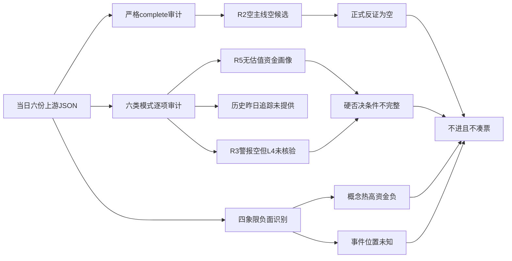

# 2026年10月22日 · 反证 / Devil's Advocate

> 数据源新鲜度：partial；降级：是；置信度：0.21。
> 日期边界：本报告属于2026-10-22盘前，行情截至2026-10-21；未拉取任何新数据。

## 🔴 一句话结论
不进：R2空池，正式反证0条；未触发硬否决不等于通过出货核验。

## 🧭 详细分析
先认市场：情绪=震荡，阶段=高位震荡。R1情绪温度63、风险预算上限50%并不构成交易许可；R2与R3均未授权交易。主线=未认定，持续性=未知，封板率=未知，明日预期=未知。分歧接力仅为选定模板，尚未激活。

再认对象：R2主线、execution_pool及watch_pool均为空，R5因没有合法候选跳过画像。严格按status=complete构建可用性矩阵，六个上游均不满足；可读不等于完整可用。因此正式counter_arguments保持空，不将历史锚点、热榜样本或次级主题升格为候选。

反证边界：下文四项是上游上下文风险审计，不是对不存在的R2候选强凑正式反证。正式反证不足五条，明确不硬凑；风险审计的strong/soft级别仅便于D1显式处理，不具有硬否决效力。

硬否决边界：R3的distribution_alert为空，但其L4联合核验未执行；R5无近5日逐票主力净额。本次硬否决0只既不能解释为资金流入，也不能解释为“没有出货”。公告澄清、热度背离和R7 unavailable不替代模式六的双证据条件。

## 🧪 六类反证审计
| 模式 | 状态 | 证据及边界 |
|---|---|---|
| 一 数据源冲突 | 🟡 上下文审计 | 数据要素、AI应用涨停与概念资金方向背离；不升格正式候选反证 |
| 二 一致性检查 | 🟢 已检查、无实际矛盾 | R1高位震荡，R2空池不授权交易，未发现仍推多条高波动主线 |
| 三 估值×主线 | 🟡 降级 | R5无画像，不能填估值分位、陷阱或逐票RR |
| 四 历史类比 | 🟡 降级 | 本次限定六份当日JSON，无历史事件库，不从记忆引用案例 |
| 五 昨日预期连锁 | 🟡 降级 | 昨日R6及E1追踪不在输入范围，未核验兑现 |
| 六 霸榜出货 | 🟡 无对象且缺证据 | 合格龙一/龙二0只，警报空、L4未完成、R5五日净额缺失 |

## ⚖️ 四象限负面识别
### 情绪热度×概念资金：只识别背离，不确诊派发
本次明确四格：Q1=热高资金正；Q2=热高资金负；Q3=热低资金负；Q4=热低资金正。热高仅定义为R2热度分至少16，资金取同名概念当日主力净额正负。该定义是本报告风险投影，不冒充全系统统一象限模型，也不等同R7资金确认。

| 对象 | 热度证据 | 概念主力净额（元） | 负面识别 | 态度 |
|---|---|---:|---|---|
| 数据要素 | 热度分20、热榜第1、14家涨停 | -215550720 | Q2：热高资金负 | 降级 |
| AI应用 | 热度分16、热榜第6、13家涨停 | -430286592 | Q2：热高资金负 | 观察 |

来源：R2.secondary_lines。两者仅为次级方向，R7未提供有效交叉确认。涨停家数不是封板率，也不能相加当作独立涨停总数。

### 事件极性×价格位置：负面可识别，位置不可编造
按R4事件×位置机制，显式列四格：I=正面×低位；II=正面×高位（兑现风险）；III=负面×高位（冲击风险）；IV=负面×低位（不能机械抄底）。编号仅供本报告使用。

| 负面事件 | 影响范围 | 价格位置 | 所属格 | 态度 |
|---|---|---|---|---|
| E20261022_002 太极股份澄清无具体合作 | 个股级，不能扩大为全行业否定 | 未知 | 未判定 | 不进 |
| E20261022_004 PHP漏洞公网服务暴露风险 | 云服务、互联网服务行业级 | 未知 | 未判定 | 观察 |

R5无价格位置画像，不能因上热榜或涨停便认定高位。R4云服务同时有事件004负面及005正面，必须正负分列，禁止用合计净分抵消风险。

## 🔍 上下文风险审计（不计入正式反证）

### R6_CONTEXT_01 · 数据要素（R2次级观察方向，非主线） · 降级
挑战假设：热度第一和14家涨停足以确认持续资金合力。

- 证据：热度排名1、涨停14家，但概念主力净额-215550720元；封板率、生命周期、龙一均未确认。 来源：`data/research/20261022/R2_main_sectors.json#secondary_lines/0`
- 证据：L1+L2只确认讨论热度，trade_permission=false。 来源：`data/research/20261022/R3_sentiment.json#resonance_top_themes/0`
- **大资金意图**: 热度上升与概念净流出并存，不能判断是换手还是派发；禁止据此认定机构增仓。
- **为什么走强**: 政策叙事与14家涨停解释关注升温，但不能消除净流出反证。
- **逻辑够不够硬**: 资金与传播并非同一指标；有风险背离，不足以确诊霸榜出货。

处理：降级为观察，不把热榜和涨停家数转成开仓资格。

### R6_CONTEXT_02 · 002368.SZ 太极股份（R4负面映射，非R2候选） · 不进
挑战假设：国家数据集团成立等同太极股份直接订单与业绩兑现。

- 证据：R4已核验同一公告：双方尚无具体合作，数据要素业务约占2026H1营收2%；R6未另查公告。 来源：`data/research/20261022/R4_news.json#top_events/1`
- 证据：R2已标不进，未授予龙头或execution资格。 来源：`data/research/20261022/R2_main_sectors.json#negative_stock_actions/002368.SZ`
- **大资金意图**: 无逐票资金测量，不能证明出货或资金迁移。
- **为什么走强**: 上游记录的是题材热度与异动，不是已兑现合同；澄清切断直接受益推演。
- **逻辑够不够硬**: 公告层面反证较硬，但对象不在R2候选池且无5日主力净额，不能触发模式六。

处理：不进：直接合作假设被上游公告证据反驳；不外推整个数据要素行业，不升级为hard_reject。

### R6_CONTEXT_03 · AI应用（R2次级观察方向，非主线） · 观察
挑战假设：海外模型催化与13家涨停意味着国内主题已获多源确认。

- 证据：评分52，概念主力净额-430286592元；R3无精确主题确认，R7交叉确认不可用。 来源：`data/research/20261022/R2_main_sectors.json#secondary_lines/1`
- 证据：云服务同时保留PHP服务暴露风险负面事件004与模型登陆催化005，不得用净分抹去负面。 来源：`data/research/20261022/R4_news.json#sector_polarity_cross_product`
- **大资金意图**: 概念净流出与涨停并存，资金一致配置假设缺支持。
- **为什么走强**: 模型及监管政策提供叙事，13家涨停不等同全主题承接。
- **逻辑够不够硬**: R3未覆盖不等于实际没有共振；R7不可用不等于净流出，必须保留未知。

处理：观察：相邻题材不能替代精确共振，海外产品发布不直接推出A股收入。

### R6_CONTEXT_04 · 300750.SZ 宁德时代（R3负向围观样本，非R2候选） · 观察
挑战假设：两平台当期第1能作为正向共振或霸榜出货确证。

- 证据：R3记录两平台当期第1且下跌12.03%；前期第1为九阳，未触发连续两日Top1。 来源：`data/research/20261022/R3_sentiment.json#hotlist_signals/top1_risk_alert`
- 证据：未执行成交量、上影、龙虎榜、消息联合核验；distribution_alert=[]。 来源：`data/research/20261022/R3_sentiment.json#hotlist_signals/l4_full_confirmation`
- **大资金意图**: 热度来源可以是下跌围观；无R5资金画像，不判断主力真实意图。
- **为什么走强**: 这里是关注度强而价格弱，不能将两者混写成价格走强。
- **逻辑够不够硬**: 负向围观证据来自R3，但连续霸榜和5日主力流出两项条件均未确认。

处理：观察其负向围观性质；拦截将该热榜样本转为正向候选或hard_reject的错误解释。

## ⛔ 霸榜出货 hard_reject 审计
仅对R2 execution_eligible龙一/龙二，且“所属板块高置信distribution_alert”与“R5近5日主力净流出”同时成立才硬否决。只有警报而未确认资金时，最多strong_suggest。本次无合格对象、无高置信警报、无逐票五日净额，hard_rejects为空。

宁德时代的两平台当期第1与下跌12.03%只是R3负向围观样本。前期第1不同，不能冒充连续霸榜；它也不是R2候选。太极的合作澄清不属于霸榜出货证据，不能借此生成hard_reject。

合法出口：允许空执行池；禁止为了凑票让龙二、弹性核心或低位补涨替补被否龙一。当前没有龙一可保留，不能发明“等分歧买点”的票。

## 📌 候选完整性与关键证据
没有首推票、执行票或观察池顶部股票，逐票四段买入思维链不适用；R6不给正向结论。板型、龙头纪律通过数、盈亏比、禁止清单命中均无合法候选可核验，不编造字段值，也不将R4/R3风险对象加入观察池。

- R2.main_lines、execution_pool、watch_pool全空；R5.profiles全空。
- R3.hotlist_signals.distribution_alert为空，l4_full_confirmation明确未执行。
- R7.consumer_constraints明确禁止将诱多观察当作hard_reject；北向净流量不可用不等于流出。
- 主线持续性、封板率及明日预期均缺证据，保留未知。

## 数据源审计
| 源 | 日期 | 状态 | 备注 |
|---|---|:--:|---|
| R1 | 2026-10-22 | 🟡 | 文件已读；上游 `degraded`；只消费既有字段 |
| R2 | 2026-10-22 | 🟡 | 文件已读；上游 `partial`；无主线、无候选 |
| R3 | 2026-10-22 | 🟡 | 文件已读；上游 `degraded`；只消费既有字段 |
| R4 | 2026-10-22 | 🟡 | 文件已读；上游 `partial`；只消费既有字段 |
| R5 | 2026-10-22 | 🟡 | 文件已读；上游 `skipped`；0只画像 |
| R7 | 2026-10-22 | 🟡 | 文件已读；上游 `partial`；资金整体不可用 |

状态说明：frontmatter的ok仅表示对应文件已成功读取，不表示上游complete。此处按分析可用性标🟡；未独立测试接口，不声称任何新接口调用成功或DOWN。R7实际文件带20261022后缀，按真实路径消费，没有伪造标准文件。

## ❓ 不确定性 / 反证
空池是上游资格不足，不是全市场不存在机会，更不是市场必跌。上下文资金背离可能由统计口径、主题成分差异或换手造成，不能越级确诊派发。R3和R4共享传播源，两个Agent不自动等于两个独立证据源。正式反证0条，不能输出“今日无重大反面证据”来暗示完整扫描全绿。

置信度采用保守单源折扣：0.60 × 0.70 × 0.50 = 0.21；该值描述反证覆盖，不是收益概率。模式三、四、五、六的缺口保留，不用新抓数掩盖。

## 🔗 与其他 R/D/E 的关系
- 依赖：当日R1_style、R2_main_sectors、R3_sentiment、R4_news、R5_stock_profiles及R7_capital_flow_20261022六份JSON。
- 被消费：D1、E1；D1不能把hard_rejects为空视为交易通过。上下文strong_suggest应接受，或在meta.d1_override记录理由；soft_suggest可写r6_soft_notes。
- 不修改持仓、不写计划、不扩池、不干预执行。禁止从历史锚点制造今日龙头。

## Sub-Agent 元数据
- skill: analyze_devil_advocate_v1
- artifact: data/research/20261022/R6_devil_advocate.json
- model: gpt-6.1-sol
- method: llm_v1_disk_only
- 生成耗时：未记录完整起始时刻，不填造数。
- 校验：Pydantic自定义skill投影，非仓库统一R6模型；Markdown结构及空池不凑票规则校验。
