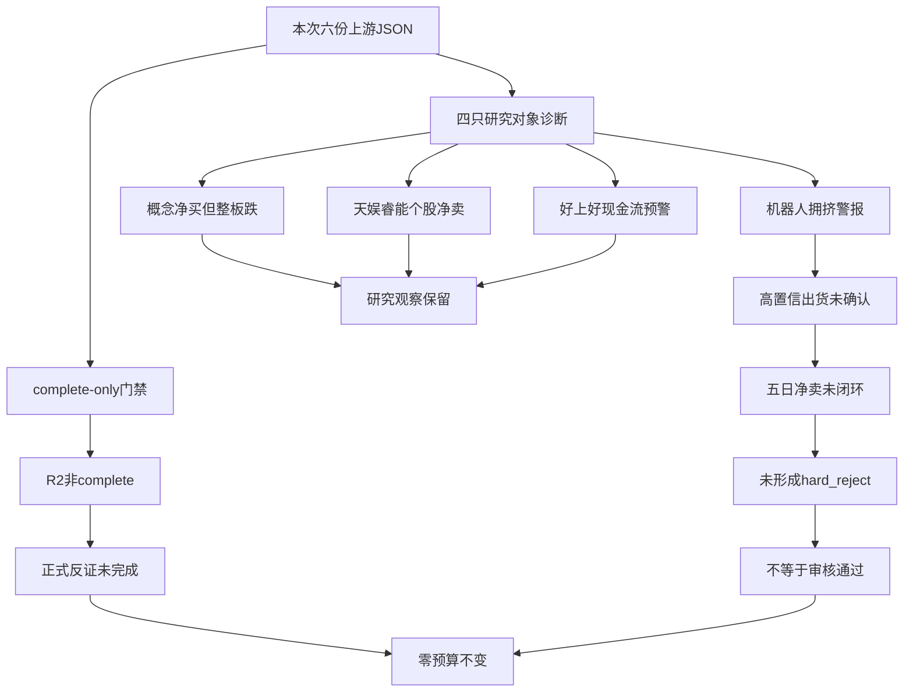

---

date: '2026-10-23'
agent: R6-devil-advocate
skill_version: analyze_devil_advocate_v1@1.0
generated_at: '2026-10-23T14:13:08+08:00'
intraday_recovery: true
CHZL_RESEARCH_RUN_ID: null
confidence: 0.21
degraded: true
analysis_status: partial
formal_review_status: blocked_upstream_not_complete
data_sources:
- name: R1
  path: data/research/20261023/R1_style.json
  status: stale
  captured_at: '2026-10-23T13:09:04+08:00'
  record_count: 1
  error: 上游非complete；stale为兼容审计枚举，不指整份行情错日
- name: R2
  path: data/research/20261023/R2_main_sectors.json
  status: stale
  captured_at: '2026-10-23T13:34:25+08:00'
  record_count: 1
  error: 上游非complete；stale为兼容审计枚举，不指整份行情错日
- name: R3
  path: data/research/20261023/R3_sentiment.json
  status: stale
  captured_at: '2026-10-23T13:22:51+08:00'
  record_count: 1
  error: 上游非complete；stale为兼容审计枚举，不指整份行情错日
- name: R4
  path: data/research/20261023/R4_news.json
  status: stale
  captured_at: '2026-10-23T13:09:43+08:00'
  record_count: 1
  error: 上游非complete；stale为兼容审计枚举，不指整份行情错日
- name: R5
  path: data/research/20261023/R5_stock_profiles.json
  status: stale
  captured_at: '2026-10-23T14:04:34+08:00'
  record_count: 4
  error: 上游非complete；stale为兼容审计枚举，不指整份行情错日
- name: R7
  path: data/research/20261023/R7_capital_flow_20261023.json
  status: stale
  captured_at: '2026-10-23T13:14:09+08:00'
  record_count: 1
  error: 上游非complete；stale为兼容审计枚举，不指整份行情错日
input_freshness: partial
input_freshness_note: 本次上游均为当日盘中恢复文件；行情非同刻，五日资金截至20261022，中报截至20260630。R1 resolved_trade_date=20261022是历史窗口，observation_trade_date=20261023；不把历史窗口当今日行情。
namespace_mismatch: false
data_from_trade_dates:
- '2026-10-23'
- '2026-10-22'
- '2026-06-30'

---

# 2026年10月23日 · 反证 / Devil’s Advocate

> ⚠️ intraday_recovery：当前真实盘中生产恢复，不是盘前重建；不得用于证明早晨预测正确。
> 只消费本次磁盘六份R类JSON。真实generated_at、各源生成/观测时点与SHA血缘见JSON，未抓新数据。
> 情绪=震荡/主跌风险未解除 · confidence=0.21 · status=degraded。

## 🔴 一句话结论
正式反证未完成；四只研究对象保留观察，零硬否决不是全票通过，零预算不变。

## 🧭 详细分析

R4午评与R7显示白酒、保险相对承接；R2/R5则显示AI应用、芯片、机器人首板/2板局部修复。市场奖励的是相对防御和少数辨识度修复，不是已认证的科技整板主升。模板沿用首板隔日研究，不拼成超级策略。

- **大资金意图**: 防御承接和题材局部试错并存，分类净额不能证明机构已完成建仓。
- **为什么走强**: 四票局部修复，但R1仍有32家跌停；日内炸板率曾38.71%，R2研究容量由8减至4，后续回落不能抹除触发。
- **逻辑够不够硬**: 概念资金、热榜和个股报价不同步，同花顺与问财非多个独立源；整板仍跌，接力与公司订单未闭环。

六份文件均存在且为本次恢复版本，但没有status=complete。严格门禁不变：R2非complete使正式counter_arguments=0、candidates_evaluated=0；另行完成四只真实对象的有限负面诊断，research_candidates_audited=4、negative_diagnostics=7。这是生产产物，但不是完整正式反证；analysis_status仍partial，不以“可读”冒充“完整”。

R1早一批全市场最高3板与R2后续机器人样本大业6板存在时点/样本差异，不能选有利数字拼周期。R7情绪基线仍引用昨日41.07%，不得覆盖R1当日口径。R5报价有源内时刻，概念资金只有当日标签和接收时刻，不宣称同刻资金价量背离。

北向2026-10-23及最近5/10/20交易日同口径净买缺失，保留null；不以额度或成交额替代，不抹零R7主力/游资/ETF独立维度，不触发全局R7_STALE。零预算及逐票门禁仍独立有效，既不抬仓也不停止观察研究。

## 🧩 六类反证模式

| 模式 | 正式状态 | 本次处理 |
|---|---|---|
| mode1_数据源冲突 | 🟡 degraded | R2非complete，M1正式停止；可读概念/个股/事件背离存于negative_diagnostics，不伪造正式条目。 |
| mode2_一致性检查 | 🟡 degraded | R1/R2均非complete；观察与零预算分层一致，时间及梯队口径仍有风险。 |
| mode3_估值与主线临界 | 🟡 degraded | R5 partial且无认证执行龙一/龙二的完整估值支持，天奇估值盈利背离仅研究诊断。 |
| mode4_历史类比 | 🟡 degraded | 授权仅本次六上游；输入无可验证历史失败事件库，不扩读、不编造。 |
| mode5_昨日预期错误连锁 | 🟡 degraded | 授权输入未含昨日R6与E1兑现；不把当日涨跌或旧资金当昨日反证成功。 |
| mode6_霸榜出货硬约束 | 🟡 degraded | R2执行龙一/龙二为0；R3两条alert均confirmed_distribution=false；R5 canonical五日字段缺，替代大单字段不自动同义。 |

正式反证不足五条不凑数；历史失败库、昨日R6及E1兑现未在授权输入内，不扩读、不编造。F8仅透传既有负面线索，不启用技能中相互冲突的其他hard_reject扩权。

## 📉 四象限负面识别

高情绪=高关注，不是看多。高资金仅指同名同日TI概念净额为正，不是强度或五日持续性。低关注须有实证，缺测=unknown。

| 象限 | 对象 | 负面识别 |
|---|---|---|
| 高关注×正净额 | AI应用、芯片概念、人形机器人 | 整板下跌，拥挤/单点脉冲/接力失败风险 |
| 高关注×非正净额 | 无闭环板块样本 | 不把天娱、睿能个股净卖混进概念资金轴 |
| 低关注×正净额 | 无认证样本 | 白酒保险低关注轴未核，不强塞 |
| 低关注×非正净额 | 无认证样本 | 不造双低对象 |
| unknown | 白酒/保险、CPO/PCB | 分别缺低关注认证、当前同主题资金闭环 |
| 研究方向 | 当日主力净额（亿元） | 涨跌幅 | 持续性 | 封板率 | 下一交易日预期 | 动作 |
|---|---:|---:|---|---|---|---|
| AI应用 | 24.418655 | -3.6503% | 未知 | 未知 | 分歧（条件推演） | 观察 |
| 芯片概念 | 75.030790 | -4.2852% | 未知 | 未知 | 分歧（条件推演） | 观察 |
| 人形机器人 | 26.556962 | -3.3913% | 未知 | 未知 | 分歧（条件推演） | 观察 |

主线=上述研究方向，不是已确认可交易主线。概念资金来自R2当日字段，缺逐笔时间；热榜较早，不冒充同步。成分重叠不求和。R7行业不匹配不等于概念无资金。

## 🔎 负面诊断（非正式counter_arguments）

### R6_D01 · AI应用/天娱数科

挑战：概念净买不能替代个股承接。

证据：R2 AI应用当日+24.418655亿元但跌3.6503%；天娱盘中主力净卖151979565.74元，R5近5日大单+特大单-899.03万元；R4未确认同题公司订单。

动作：观察；不将概念净买和人气第3当作该票净买或订单证据。

### R6_D02 · 芯片概念/睿能科技

挑战：局部2板不能证明全板修复。

证据：R2概念+75.03079亿元但跌4.2852%；睿能盘中问财净卖26533074元；R5昨日5日大单为正，两者不同日期口径不能称连续净买。

动作：观察；板块、个股、时间和供应商分开，不宣告趋势反转。

### R6_D03 · R1与R2/R5

挑战：零预算意味着停止研究的旧解释不成立。

证据：R1零预算不变，R2保留4只research_only且execution_eligible=false，R5实际完成4只有限覆盖画像；研究与交易分层不存在进攻开仓冲突。

动作：拦截把研究观察当执行许可，也拦截因零预算清空研究；不是逐票hard_reject。

### R6_D04 · 天奇股份

挑战：机器人业务连接不等于盈利高增长。

证据：R5 T-1 PE144.1331，H1净利同比-19.3172%；订单增量未核，不能用正资金或首板推导合理PEG；非认证龙一，正式M3不成立。

动作：观察；记录估值盈利背离，缺历史分位与远期预测不写极贵定论。

### R6_D05 · 人形机器人/天奇股份

挑战：连续top1不能直接定性出货。

证据：R3机器人双日top1但confirmed_distribution=false；天奇R5近5日大单+特大单+6129.44万元；非执行龙一/龙二。

动作：观察；不构成高置信霸榜加五日净卖的合取，不硬否决也不放行。

### R6_D06 · 好上好

挑战：历史高增长不等于现金回报。

证据：R5编号F8：Q1/H1每股CFO -3.2504/-3.4451、EPS均正，累计报告期存在重叠；资产负债率70.2886%不是有息负债/净资产，不能冒充F10。

动作：观察；保留F8风险线索，单季度金额和完整三表未核，不扩成财务硬否决。

### R6_D07 · 跨上游时间与高度

挑战：早一批全市场3板与后来机器人6板不能当同刻共识。

证据：R1 13:02来源全市场max_ladder=3；R2 13:26接收的在线机器人样本记录大业6板且无源内逐笔时间。R7情绪基线仍引用昨日41.07%。

动作：降级时间同步和梯队一致性；不以R7旧基线覆盖R1当日盘中，不选择有利数字拼周期。

## 🚫 霸榜出货hard_reject合取

R3两条alert是机器人概念、华天科技个股，均confirmed_distribution=false。华天个股警报不扩大为整个芯片族出货。四票execution_eligible均false，正式执行龙一/龙二对象0。R5缺canonical main_force_5d_net_wan；替代main_flow_5d为大单+特大单，未证等价，不自动改字段。

| 研究票 | 板块高置信出货 | 五日大单+特大单（万元，截至2026-10-22） | 结果 |
|---|---|---:|---|
| 天娱数科 | 未确认 | -899.03 | 未形成硬否决，非通过 |
| 睿能科技 | 未确认 | 3045.15 | 未形成硬否决，非通过 |
| 好上好 | 未确认 | 1197.57 | 未形成硬否决，非通过 |
| 天奇股份 | 未确认 | 6129.44 | 未形成硬否决，非通过 |

天娱五日大单为负但无匹配高置信板块alert；天奇匹配拥挤但五日大单为正。不得拼凑合取。hard_reject=0，不构成全部审核通过。

## 🧬 四只真实研究对象

以下“买入理由”仅复述R5被挑战的研究假设，不是R6买入结论；四只均观察、不进。止损条件为研究证伪，不是自动卖单。

### 天娱数科 · 002354.SZ · 观察 / 不进

板型：首板（在线连续涨停1天；非封单持续承接证明）。龙头认定：未认定；低位首板研究；已证实纪律条件数=未知，不是完整总龙认证。机会=计划内试错仅研究，未批准交易。

- **大资金意图**: 可观察的是高人气首板与主力净卖相背；大资金可能借应用叙事换手，亦可能先手兑现，无法从涨停断定机构吸筹。

- **为什么走强**: 昨日大跌收在短均线下，今日从低开拉回涨停，属于强修复；仍未越过30日高点，不能称已进入主升。

- **逻辑够不够硬**: 硬数据是报价、量价和中报，AI购物到公司收入的订单链缺失；人气与问财同源信号不能重复计算独立共识。

- **买入理由**: 被挑战的上游假设：AI应用/营销具备研究业务映射，非新增订单结论；今日首板及R2人气第3形成可验证的局部辨识度。不构成R6买入推荐。

- **风险点**: 盘中净卖与首板背离，次日有兑现风险；TTM PE缺、ROE双源不一致，业务弹性与现金兑现仍需核验。

- **止损条件**: 若下一交易日收盘低于本次30日样本MA20且AI应用涨停家数少于3，撤销强修复研究假设；这是观察证伪，不是自动卖单。

- **可验证假设**: 未来1-3个交易日核：收盘站上本次30日高点且AI应用涨停不少于3；否则维持观察或降级。

取价=8.03元，来源为R5所载rt_k，日期2026-10-23，源内时刻原样保留在JSON；止损=null、目标=null、预期赚幅=null、允许亏幅=null、原始RR=null。RR=预期赚幅/允许亏幅，缺证据为未知，不标RR_FAIL。引用规则：SOUL.md:57：既有RR<2或止损距<5%降级watch；用户本次未选择新统一门槛；R5职责禁止出entry/exit价。

禁止清单：已证命中为空，核验=partial_not_all_clear，不等于全清。流通市值=130.6476亿元；20亿硬线保留，20–50亿仅逐票谨慎，不以50亿普遍硬剔除。

### 睿能科技 · 603933.SH · 观察 / 不进

板型：2连板（在线连续涨停字段）。龙头认定：龙头（样本临时）；已证实纪律条件数=1，不是完整总龙认证。机会=计划内试错仅研究，未批准交易。

- **大资金意图**: 昨日大单承接与今日一字形态可解释为抢身位；但R2主力负流向和小流通盘提高封单撤退风险，不把低成交当惜售锁仓铁证。

- **为什么走强**: 昨日从均线下方向上首板，今日一字2板，已经越过本次30日样本最高价；价格强度最明确但没有可成交性证明。

- **逻辑够不够硬**: 有公司原公告硬事件与真实价格锚；审批未完成且买入后次日接力未知，不能把重组预期等同盈利增量。

- **买入理由**: 被挑战的上游假设：收购博泰75%及产业分部重估是已披露的研究催化；2板与早封为R2样本内强身位，非全市场总龙证明。不构成R6买入推荐。

- **风险点**: 流通市值20–50亿元，盘中一字缺少换手承接检验；重组待审批且H1经营现金流为负，题材收入兑现有不确定性。

- **止损条件**: 若重组审核被否、终止，立即撤销重估假设；下一交易日收盘跌回本次30日样本最高价下方且芯片涨停少于3，降级研究。

- **可验证假设**: 未来1-3个交易日核：收盘保持在本次30日样本高点上方、芯片涨停不少于3且原公告无否认；需另核换手和封单，均不自动授权买入。

取价=20.94元，来源为R5所载rt_k，日期2026-10-23，源内时刻原样保留在JSON；止损=null、目标=null、预期赚幅=null、允许亏幅=null、原始RR=null。RR=预期赚幅/允许亏幅，缺证据为未知，不标RR_FAIL。引用规则：SOUL.md:57：既有RR<2或止损距<5%降级watch；用户本次未选择新统一门槛；R5职责禁止出entry/exit价。

禁止清单：已证命中为空，核验=partial_not_all_clear，不等于全清。流通市值=43.4598亿元；20亿硬线保留，20–50亿仅逐票谨慎，不以50亿普遍硬剔除。

### 好上好 · 001298.SZ · 观察 / 不进

板型：首板（在线连续涨停1天；非封单持续承接证明）。龙头认定：未认定；低位首板研究；已证实纪律条件数=未知，不是完整总龙认证。机会=计划内试错仅研究，未批准交易。

- **大资金意图**: 放量首板及小幅户数下降支持资金重新定价分销环节的假设；公司扩张消耗营运资本，承接者可能赌国产替代，也可能只是题材短钱。

- **为什么走强**: 从前期下行区间拉出首板，盘中量超过近期完整日均量并站上20日高点；仍低于30日样本最高价，反转尚待多日验证。

- **逻辑够不够硬**: 官方调研证明业务而非订单，增长数据证明历史而非远期；现金流反证很强，R6需独立评估F8，R5不代行硬否决。

- **买入理由**: 被挑战的上游假设：公司调研原文给出端侧AI产品和原厂合作证据；盘中首板、放量及近5日大单正流向形成研究锚。不构成R6买入推荐。

- **风险点**: 首板次日兑现与芯片整板弱势仍可打断接力；连续报告期负经营现金流及70%以上资产负债率，成长不等于现金收益。

- **止损条件**: 若公司否认原厂合作/业务映射，撤销事件研究；下一交易日收盘跌回本次20日高点下且芯片涨停少于3，降级首板假设。

- **可验证假设**: 未来1-3个交易日核收盘能否守住本次20日高点、芯片涨停不少于3及无业务否认；现金流修复须等后续财报，不能要求72小时兑现。

取价=17.36元，来源为R5所载rt_k，日期2026-10-23，源内时刻原样保留在JSON；止损=null、目标=null、预期赚幅=null、允许亏幅=null、原始RR=null。RR=预期赚幅/允许亏幅，缺证据为未知，不标RR_FAIL。引用规则：SOUL.md:57：既有RR<2或止损距<5%降级watch；用户本次未选择新统一门槛；R5职责禁止出entry/exit价。

禁止清单：已证命中为空，核验=partial_not_all_clear，不等于全清。流通市值=70.7280亿元；20亿硬线保留，20–50亿仅逐票谨慎，不以50亿普遍硬剔除。

### 天奇股份 · 002009.SZ · 观察 / 不进

板型：首板（在线连续涨停1天；非封单持续承接证明）。龙头认定：未认定；低位首板研究；已证实纪律条件数=未知，不是完整总龙认证。机会=计划内试错仅研究，未批准交易。

- **大资金意图**: 五日大单承接和今日放量首板支持资金在工业应用端试错；没有订单和全板上涨证明，不能推论长期机构配置已完成。

- **为什么走强**: 前几日反弹后今日放量首板，盘中越过20/30日样本高点；旧周线仍弱，局部价格修复不等于机器人周期主升。

- **逻辑够不够硬**: 行情与担保原公告可核；机器人订单弹性未核，利润反而下降。两源事实不能替代订单端缺失的关键一环。

- **买入理由**: 被挑战的上游假设：工业场景/物流自动化给出具身数据落地的研究连接；连续大单正流向、放量首板和区间突破提供可证伪市场锚。不构成R6买入推荐。

- **风险点**: 首板不是6板总龙，双日热度拥挤带来兑现；H1利润下滑、TTM高估值及集团内部担保约束中期逻辑。

- **止损条件**: 若公司公告否认机器人业务映射，撤销事件假设；下一交易日收盘跌回本次20日高点下且机器人涨停少于3，降级。

- **可验证假设**: 未来1-3个交易日核收盘能否守住本次20日高点、机器人涨停不少于3；公司级新增订单仍须独立公告，不用量价替代。

取价=17.3元，来源为R5所载rt_k，日期2026-10-23，源内时刻原样保留在JSON；止损=null、目标=null、预期赚幅=null、允许亏幅=null、原始RR=null。RR=预期赚幅/允许亏幅，缺证据为未知，不标RR_FAIL。引用规则：SOUL.md:57：既有RR<2或止损距<5%降级watch；用户本次未选择新统一门槛；R5职责禁止出entry/exit价。

禁止清单：已证命中为空，核验=partial_not_all_clear，不等于全清。流通市值=61.2820亿元；20亿硬线保留，20–50亿仅逐票谨慎，不以50亿普遍硬剔除。

## 🔍 关键证据
- R2三条概念正净额与负收益并存，研究分70/66/48不是交易资格。
- R5本次四只真实画像已完成有限覆盖，不再沿用skipped/空池。
- 好上好F8为两份累计报告期现金流预警，不能把重叠累计口径当两个独立季度；负债率70.2886%也不能冒充F10有息负债率。
- 睿能仅样本临时龙头、已证高度条件1项，20–50亿和一字板可成交性风险仍保留。

## 数据源审计

| 源 | 日期 | 状态 | 备注 |
|---|---|:--:|---|
| R1_style.json | 2026-10-23 | 🟡 | degraded；analysis_status=completed；本次盘中JSON |
| R2_main_sectors.json | 2026-10-23 | 🟡 | partial；analysis_status=completed；本次盘中JSON |
| R3_sentiment.json | 2026-10-23 | 🟡 | degraded；analysis_status=completed；本次盘中JSON |
| R4_news.json | 2026-10-23 | 🟡 | partial；analysis_status=complete；本次盘中JSON |
| R5_stock_profiles.json | 2026-10-23 | 🟡 | partial；analysis_status=completed；本次盘中JSON |
| R7_capital_flow_20261023.json | 2026-10-23 | 🟡 | partial；analysis_status=complete；本次盘中JSON |
| R7北向净买 | 2026-10-23 | 🔴 | 可选维度缺同口径净额及5/10/20日，不使其他维度失效 |
| R5五日大单 | 2026-10-22 | 🟡 | 最近完整交易日窗口，不是今日盘中五日净买 |
| R5中报财务 | 2026-06-30 | 🟡 | 历史披露，不是今日盈利变化 |

仅六份R类JSON作为研究证据；文档只核对职责。未抓新数据，未读raw/reports/私人持仓/账户凭据，未发推送。实际R7文件带日期后缀，未伪称规范文件存在。用户已备份原件，不额外写白名单外.bak。

## ⚠️ 不确定性 / 反证
概念正净额可能是承接，也可能只是供应商分类差异；拥挤可能持续，不等于必然出货。报价、榜单、资金非同刻，不构成完备派发证明。空hard_reject与正式评估0只绝非全票通过；完整估值、历史类比、昨日兑现仍降级。0.21=0.60×0.70×0.50，仅有限诊断证据质量，不是胜率。不以北向缺测形成全局否决，不以一票未知RR停止全研究。

## 🔗 与其他 R/D/E 的关系
- 依赖：当日本次R1–R5/R7 JSON。消费者：D1、E1。
- D1不得把本次degraded改写complete，production_ready=false；零预算不变，研究观察保留。
- hard_reject若形成必须剔除执行，可留研究观察；不得以等分歧买点保留执行，不得龙二/弹性/低位补涨升位替补。
- 正式strong_suggest须接受或记录meta.d1_override；本次正式数组空，诊断不冒充强制效力。
- 不写计划、不调整账户；独立模拟授权不是模拟成交，不提高预算。

## Sub-Agent 元数据
- skill: analyze_devil_advocate_v1
- artifact: data/research/20261023/R6_devil_advocate.json
- model: gpt-6.1-sol
- run_mode: intraday_recovery
- 正式评估0只，研究诊断4只，负面诊断7项，hard_reject 0项。
- 验证：内联Pydantic核心契约与严格门禁，JSON/MD一致、血缘SHA与时序；非仓库生产模型认证。

- 生成耗时: 407.0 秒
