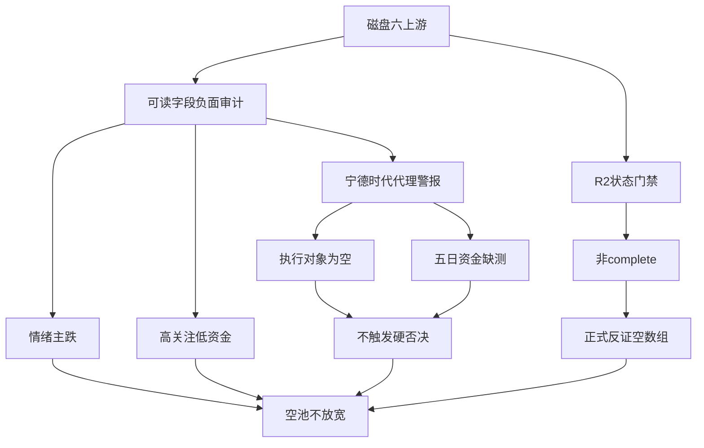

# 2026年10月23日 · 反证 / Devil's Advocate

> **数据源新鲜度**: partial · **降级状态**: true · **置信度**: 0.28
> ⚠️ 提前版磁盘审计；境内行情截至2026-10-22，不是2026-10-23盘中事实。

## 🔴 一句话结论
**情绪=主跌；R2非complete，今日不出正式反证。无硬否决不等于允许开仓。**

## 🧭 详细分析

### 1. 对象与阶段先于反证数量
R1给出主跌、禁止新仓、研究风险预算上限0；R2为降级提前版，股票候选、龙头及执行池全部为空，R5因此跳过画像。技能规定只有`status=complete`才计入`upstream_usable`。本次六个上游均未满足该条件，但文件都可读；不得把“可读”偷换成“完整可用”，也不把降级文件说成丢失。正式`counter_arguments`与`hard_rejects`均为空，不硬凑五条。

- **大资金意图**: 仅从板块榜单可见机器人局部轮动与整板净卖并存，不能认证机构在布局新主升。
- **为什么走强**: 机器人概念热度第一、9只涨停只是局部证据；整板仍下跌，市场炸板率41.07%、跌停48家，讨论升温不能替代赚钱效应。
- **逻辑够不够硬**: 阶段限制与空池一致；板块持续性、封板率及次日接力均缺认证。主线=人形机器人（仅观察），持续性=null，封板率=null，明日预期=null。缺测不伪填方向。

### 2. 机器人：局部净买不能覆盖整板净卖
R2记录人形机器人净流出26.8853亿元；减速器净流入6.4994亿元、机器人执行器净流入6.0056亿元是不同粒度子方向。概念成分重叠，不能相加得出整板回流，也不能把R7未命中行业名单解释成没有概念资金。此处仅作负面审计，不输出股票候选。

- **大资金意图**: 子方向承接可对应局部轮动，也可与其他成分减仓同时发生；净额不能证明主观诱多或锁仓。
- **为什么走强**: R4平台升级催化与R3两层讨论共振解释热度，但不能自动证明A股公司订单或收入兑现。
- **逻辑够不够硬**: 叙事/热度共识没有转化为整板净买共识，维持观察；没有逐票板型、龙头地位、RR与禁止清单认证，禁止补造龙头。

### 3. 霸榜警报：三个缺口不允许升级硬否决
宁德时代`300750.SZ`连续两日热榜第一，但R3明示这是代理警报，`confirmed_distribution=false`，完整L4条件未覆盖。它不在R2执行龙一/龙二中，R5也没有五日主力净额。R3的单日东财净流出171691.7万元与同花顺净流入276714.87万元口径冲突；不得跨供应商相加，不得把单日净卖写成五日净流出。

- **大资金意图**: 跨口径资金方向冲突，不能凭霸榜认定出货意图。
- **为什么走强**: 本报告只确认关注度持续居首，不声称价格或承接走强。
- **逻辑够不够硬**: 执行对象、高置信出货、R5五日资金三项均不能闭环；本次hard_reject=0，代理警报保留观察，不能作为风险解除证明。

### 4. 消费端不得把零上限放宽
R1已披露下游降级/零值fallback可能回退为50%的风险；这是上游指明的消费隐患，本R6没有重新读取或验证消费者代码。D1必须保持主跌、零研究风险预算与空股票池语义；这是阶段一致性守卫，不是R6个股硬否决。研究零预算也不是要求现有持仓即时清仓，存量T与T+1仍由D1处理。

## 🧩 六类模式执行矩阵

| 模式 | 状态 | 磁盘审计结论 |
|---|---|---|
| M1 数据源冲突 | 🟡 degraded | R2非complete，停止正式反证；热度与整板净卖背离见附录 |
| M2 一致性检查 | 🟡 degraded | 可读R1/R2同为主跌禁新仓，无实际进攻候选冲突；不能只因“主线扩散型”标签反向放行 |
| M3 估值×主线临界 | 🟡 degraded | R5空画像，无逐票估值与筹码，不能判昂贵或便宜 |
| M4 历史类比 | 🟡 degraded | 授权输入无可验证历史失败事件库，不扩读、不编造 |
| M5 昨日错误连锁 | 🟡 degraded | 授权输入无昨日R6及E1兑现记录，不能认证昨日反证命中 |
| M6 霸榜出货 | 🟡 degraded | 执行龙一/龙二=0；代理alert不等于高置信出货，五日资金缺测 |

六模式均已检查适用性与数据依赖，不声称完成六模式正式实证分析。模式七至十不扩展；不调用任何财务、公告或行情接口。

## 📉 四象限负面识别（诊断附录）

横轴为关注/讨论热度，不是看多评分；高关注以R3两层共振或R2概念top20为依据。纵轴只用同主题当日主力净额的正负，正值列高、非正列低，不冒充资金强度或五日持续性。低情绪必须有明确证据，缺测保留unknown。

| 象限 | 已能定位的对象 | 负面识别与动作 |
|---|---|---|
| 高情绪×高资金 | 无同粒度闭环实例 | 拥挤、加速后接力风险；不造例子 |
| 高情绪×低资金 | 人形机器人、网络安全、军工、AI应用、CPO | 跌中热度/情绪陷阱；机器人观察，其余不进；不等于确认出货 |
| 低情绪×高资金 | 无已证明低情绪对象 | 孤立承接未必形成主线；美容护理/家电虽净买，情绪轴未证实，不强塞 |
| 低情绪×低资金 | 无完整实例 | 缺接力及流动性风险，未观测不写成低 |
| 未分类 | 基础油、油气开采/油服、减速器/机器人执行器 | 分别缺资金、热度或同粒度情绪，不填零、不跨概念代替 |

| 高关注主题 | R2热度名次 | 同日主力净额（亿元） | 动作 |
|---|---:|---:|---|
| 人形机器人 | 1 | -26.8853 | 观察 |
| 网络安全 | 16 | -25.0282 | 不进 |
| 军工 | 6 | -35.8593 | 不进 |
| AI应用 | 9 | -67.2099 | 不进 |
| CPO | 4 | -127.4268 | 不进 |

各概念存在成分重叠，不汇总上表资金。CPO在R3不构成L1+L2正向共振，但R2概念热度第四足以判“高关注”；跌中热度绝非正向确认。

## 🔍 关键证据
- R1 `market_metrics`：非ST口径涨停33、炸板23、跌停48；统一炸板率41.07%。不混用XTick另一口径。
- R2 `main_lines[0]`：机器人72分、热度第一、资金维0分、执行资格false，leaders为空。资金0分不是净额为零。
- R3 `hotlist_signals.distribution_alert[0]`：宁德时代代理警报，confirmed_distribution=false，单日资金分类相互冲突。
- R4 `top_events`：AI硬件负面事件与CPO经营澄清并存，经营澄清不能自动抵销风险重估；漏洞应急服务不等于增量收入。
- R5 `profiles`为空且status=skipped；并非已做逐票安全认证。
- R7 `northbound.status=unavailable`，confidence=0；主力行业数据仍可读，不能把整个R7抹零，也不能把北向缺测当净流出。

## 数据源审计

| 源 | 日期 | 状态 | 备注 |
|---|---|:--:|---|
| R1_style.json | 2026-10-23 | 🟡 | degraded；境内观测截至2026-10-22，提前版 |
| R2_main_sectors.json | 2026-10-23 | 🟡 | degraded；一条板块观察主线，零股票候选 |
| R3_sentiment.json | 2026-10-23 | 🟡 | degraded；一条代理alert，不是出货定性 |
| R4_news.json | 2026-10-23 | 🟡 | partial；8条事件，仅消费已落盘内容 |
| R5_stock_profiles.json | 2026-10-23 | 🟡 | skipped；零画像，空池主动跳过不代表源故障 |
| R7_capital_flow_20261023.json | 2026-10-23 | 🟡 | partial；使用实际带日期后缀路径，不伪称规范文件存在 |
| R7所载北向净额 | 2026-10-22 | 🔴 | unavailable；语义未认证，不填零 |
| R7所载美股个股截面 | 2026-10-21 | 🟡 | 旧截面；不当作最新隔夜，与境内正常T-1区别披露 |

仅上述六份R类JSON作为行情/研究证据。文档只用于核对输出契约；没有读取原始行情、昨日复盘或历史研究，没有抓新数据。

## ⚠️ 不确定性 / 反证
本报告不足以回答某票会不会跌：没有可执行候选，也没有R5逐票资金。正式零反证是R2完整性门禁造成，不是“全绿”。机器人局部净买可能延续，负面热度诊断也可能被后来同口径净买和广泛承接证伪；本次不做收益预测。0.28仅是磁盘审计质量自评，按0.80×0.70×0.50计算，不是胜率，也不能覆盖R7独立的北向缺失零置信度政策。

无首推、无执行票、无观察池顶部股票，因此每票四段买入思维链、板型/龙头/RR/禁止清单不适用；R6只给反面证据，不借写作模板创造买入理由。正式反证不足五条不凑数。后续若龙一被否，合法出口仅为空执行池或不执行的“等分歧买点”观察；禁止让龙二或低位补涨升位替补。

## 🔗 与其他 R/D/E 的关系
- 依赖：当日R1_style、R2_main_sectors、R3_sentiment、R4_news、R5_stock_profiles、R7_capital_flow_20261023六份JSON。
- 被消费：D1主决策、E1复盘；D1不得把hard_reject为空当新仓许可证。
- hard_reject不得覆盖；strong_suggest须显式接受或记录override。本次两类正式条目均为空，附录诊断不冒充强制否决。

## Sub-Agent 元数据
- skill: analyze_devil_advocate_v1
- artifact: data/research/20261023/R6_devil_advocate.json
- model: gpt-6.1-sol
- 生成耗时: 未记录精确起点，不编造秒数
- 验证: 内联Pydantic核心字段及空池门禁；非仓库生产R6模型。Markdown检查frontmatter、命名空间、三问、审计表及12节点三层以上图；本次不适用逐票推广条款。
