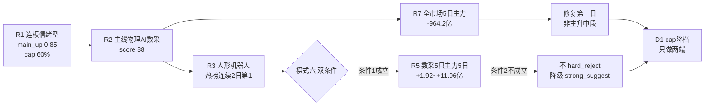

# 2026-10-26 · **反证 / Devil's Advocate**

> **数据源新鲜度**: partial · **降级状态**: yes · **置信度**: 0.56
> **观察基准日**: 2026-10-23 收盘（盘前 T-1，非当日盘中）

## 一句话结论

不否决任何标的，但霸榜降级 + 修复第一日 + 上游 flag 误标，60% 上限不能当进攻许可。

## 详细分析

### 一、反证全景：20 条里 12 条必须显式处理

今天六个上游全部 `complete`，R2 给了 88 分独主线、R1 给了 60% 仓位上限，看起来是"可做且明确"的一天。反证的结果恰恰相反：**没有一条能触发硬否决，但有 12 条要求 D1 逐条写理由**。真正的问题不在个股，在"这一天的性质被贴错了标签"。

| 模式 | 条目 | 最高严重度 | 核心反证词 |
|---|---:|---|---|
| 1 数据源冲突 | 5 | soft | 主线资金分靠母概念代理、存储同名链方向相反、情绪周期双口径 0.45 vs 0.85 |
| 2 一致性检查 | 3 | **strong** | 阶段标 main_up，但自述"主跌末端第一根修复阳线"；首板隔日模板套在 20cm 反包龙一身上 |
| 3 估值×主线临界 | 3 | **strong** | 龙一 PB 95.3% / PS 97.4% 分位、应收 91.7%；龙三 PE 146 且机构净卖出 1.6 亿 |
| 6 霸榜出货 | 2 | **strong** | 条件1成立、条件2全数不成立 → 降级而非否决 |
| 7 基本面红旗 | 4 | **strong** | 海天 3 条、天娱 3 条（商誉距红线 1pt）、粤芯连亏；另发现 2 处 F3 误标 |
| 8 解套盘假繁荣 | 1 | **strong** | 30 日 83.3% 标的仍负收益，涨停 82 家里 85% 是首板 |
| 9 高位触板赌博 | 1 | **strong** | "最高标"通道的两只 6 板都是薄封单烂板，通道实际不可用 |
| 4 历史类比 / 5 昨日连锁 | 0 | degraded | 无历史案例库；上一交易日 R6 正式条目为 0，无可兑现 |
| 10 跨资产背离 | 1 | soft | 候选与大宗商品无映射，不编造；外盘费半背离单列 |

### 二、霸榜出货裁决：为什么 0 条 hard_reject

R3 有两条 `distribution_alert`：人形机器人（概念，连续 2 个交易日热榜第 1）、华天科技（个股，跨平台两日登顶后涨幅衰减）。契约要求**两个条件同时成立**才能硬否决：① 标的所属板块命中霸榜出货；② R5 主力 5 日净额 < 0。

| 标的 | 身位 | 主力5日(亿) | 条件1 | 条件2 | 结论 |
|---|---|---:|---|---|---|
| 利亚德 | 龙一 | +11.96 | 族级逼近 | 否 | 降级 strong |
| 天奇股份 | 龙二 | +3.22 | 族级逼近 | 否 | 降级 strong |
| 福莱新材 | 龙三 | +2.59 | 族级逼近 | 否 | 降级 strong |
| 海天瑞声 | 候补 | +1.92 | 族级逼近 | 否 | 降级 strong |
| 慈星股份 | 候补 | +2.34 | 族级逼近 | 否 | 降级 strong |
| 长鑫科技 | 次线 | **-16.11** | 否 | 是 | soft |
| 中际旭创 | 事件 | **-14.05** | 否 | 是 | soft |
| 其余 3 只 | — | 正 | 否 | 否 | 不触发 |

严格口径下，模式六的触发对象是"R2 中 execution_eligible 的龙一/龙二"，而今日 R2 全部 10 只 `execution_eligible=false`——**触发对象本来为空**。R6 没有采用"无执行资格=免检"，而是把 10 只研究候选全部核对了一遍。结论是稳健的：即便把数采算进人形机器人这个上位概念，**5 只的主力 5 日全为正（合计 +22.03 亿），条件2 仍然全数不成立**，不构成硬否决。

但有一条必须读懂：利亚德的龙虎榜 5.97 亿净买里，营业部 +5.22 亿、机构专用 -0.18 亿；福莱主力 5 日 +2.59 亿，拆开却是机构 -1.60 亿。**主力口径为正，机构口径在跑**——这两者不矛盾，只是说明接盘的是游资和两融，不是机构。

- **大资金意图**: 机构在 10/23 的普涨里做的是减仓换手，不是加仓；真正加杠杆的是游资席位与两融（利亚德两融 5 日 +13.6%）。对手盘是次日接力的散户与量化。
- **为什么走强**: 位置（5 日 +18%~+80%，全部在高位）+ 催化（周末十余场卖方电话会 + 智元开源 + Figure 成功率 9%→56%，全是预期不是订单）+ 筹码（封单 0.53~2.22 亿，换手 11.7%~27.9%，接力盘成本极散）。
- **逻辑够不够硬**: 产业方向硬，当期业绩不硬。R3 自己写了数采的真实收入量级——"帕西尼数采年收入仅 2000-3000 万、天机人形臂 8000 条"，与 5 日 +18%~+80% 的股价弹性不匹配。证伪路径清晰：Q3 订单/项目落地不及预期，或周一炸板率回到 35% 以上。

### 三、四象限负面识别：三个标签都是"情绪高位、钱是借来的"

| 象限 | 对象 | 情绪轴 | 资金轴 | 负面定性 |
|---|---|---|---|---|
| Q1 高情绪高资金 | 人形机器人 | 热榜 #1 | +71.43 亿（5日 +104.12） | 拥挤到红线，共振已被归零 |
| Q1 | 人工智能 | 12→3 跃升 | +114.3 亿（5日 +21.7） | 单日脉冲，前一日 -115.88 亿 |
| Q1 | 东方财富热股 | 聚合榜 | +58.08 亿（5日 **-137.42**） | 单日掩盖 5 日失血 |
| Q3 低情绪高资金 | 数字芯片设计 | 存储链 5→9→12 | +62.46 亿（5日 +87.92） | 资金连贯但没有接力盘 |
| Q4 低情绪低资金 | 银行 / 红利 / 央国企 / PCB | 无榜位 | -29 ~ -77.91 亿 | **价涨钱走**，防御端在失血 |

Q4 这一组是修复日最容易骗人的：央国企改革当日 +1.08% 却净流出 77.91 亿，PCB +1.39% 却 -40.71 亿。**涨着涨着钱走了**，说明这轮反弹是存量从防御搬去超跌，不是增量入场。D1 若因为"防御端便宜"去做防守配置，方向就反了。

Q2（高情绪低资金）今日为空——不是没有可疑对象，而是 CPO（热榜 4→6→10）与存储芯片（5→9→12）在 R7 的 1043 个板块结果里没有同名净额字段。**拒绝用价格跌幅替代资金方向**，所以列入 unclassified 而不是造样本。

### 四、上游自身的两个口径问题（这两条会误导 D1）

**第一，情绪周期有两个互相打架的版本。** `emotion_cycle.json` 用 intraday_fallback 口径算出溢价 +0.29%，判 main_up 0.45、high_chop 0.33，几乎五五开；R1 用 tushare 全涨停池复算 +3.38%，硬命中主升规则给 0.85。差 3.09 个百分点，一个说"勉强主升"，一个说"硬命中"。更危险的是预计算文件的 `phase_action` 写着"猛干龙头，任何位置进都对；加仓或做T"——这句话套在 5 日 +62.7%、打板 RR 0.91 的标的上，是直接的亏钱指令。R1 已经把 cap 压到 60% 并限定"只做两端"，这个矛盾必须由 D1 显式二选一，不能一边用 0.85 的 cap、一边用"任何位置都对"的动作。

**第二，R5 有两条财务红旗标错了判据。** 天奇的 F3 写的是"营收 +17.2% 但净利 -19.3%"——这是增收不增利，不是 F3（应收增速 > 收入增速 × 1.5）；中际旭创的 F3 写"应收/营收 35.9%"，35.9% 连 F9 的 40% 阈值都没到，F3 更无法成立。按误标计数，这两只会被多算一条红旗、可能被推到 strong 档。R6 不采纳这两条，但请 E2 修 R5 的实现——**计数规则会被误标放大，这不是小事**。

## 关键证据

- 证据 1: 数采 5 只主力 5 日全为正，合计 +22.03 亿（利亚德 +11.96 / 天奇 +3.22 / 福莱 +2.59 / 慈星 +2.34 / 海天 +1.92）· 来源 `R5_stock_profiles` chip_structure · 东财 + tushare 双源在 summary 内声明一致
- 证据 2: 全市场 5 日主力净流出 964.2 亿（4/5 日为负）、10 日 -2462.13 亿、20 日 -4982.78 亿 · 来源 `R7_capital_flow` main_force.market_windows
- 证据 3: 人形机器人概念热榜 10/22、10/23 连续第 1，R3 已将其 `positive_resonance` 置 false、贡献归零 · 来源 `R3_sentiment` hotlist_signals.distribution_alert
- 证据 4: 30 日 42 个标的中 35 只负收益（83.3%），20 日创业板 -18.62% · 来源 `R1_style` market_metrics + risks
- 证据 5: 82 家涨停里首板 70 家（85.4%），3 板以上仅 3 家、4/5 板为 0 · 来源 `R1_style` market_metrics.limit_up_structure
- 证据 6: 利亚德龙虎榜营业部 +5.22 亿 / 机构专用 -0.18 亿；福莱机构专用 -1.60 亿 · 来源 `R5_stock_profiles` chip_structure
- 证据 7: 打板口径 RR 全部 0.91（target=昨日溢价中位 +4.55%、stop=-5%），仅兆易 2.10 / 长鑫 3.44 过关且均 non_mainstream · 来源 `R2_main_sectors` rr_proxy
- 证据 8: 中际旭创 5 日 -14.05 亿、两融 -8.48%、10 月大宗 25 笔 5.24 亿（价格 783→590.11）· 来源 `R7_capital_flow` + `R5_stock_profiles`
- 证据 9: 海天瑞声 PE 423 / PEG 2.7 / CFO÷净利 0.1 / 应收 109.9%；粤芯 ROE -61.5%、-48.5% 连亏 · 来源 `R5_stock_profiles` fundamental_flags
- 证据 10: 央国企改革 -77.91 亿而当日 +1.08%、PCB -40.71 亿而当日 +1.39% · 来源 `R7_capital_flow` sector_flows

## 若参与：三只票的思维链（R6 只做反证，不做推荐）

### 天奇股份 002009.SZ（模板内唯一首板，位置最低档）

- **买入理由**: ① 数采链里唯一"真首板 + 低位"组合，10 日低点上方仅 +20.8%，5 日 +18.1%（同板块其余 +37.8%~+80.0%）；② 首封 09:43 全板块最早，心智锚是"数据工厂/训练中心"（参股乐聚、粤港澳万台级产线），与 R4 E002 直接对位；③ 主力 5 日 +3.22 亿，10/23 单日 +2.58 亿占成交 25.2%，板块内净流入率第二。
- **风险点**: ① 封单仅 0.53 亿（0.86%）、盘中开板 2 次，是换手板不是硬板；② 5 年 5 次涨停、1进2 晋级率 0.00/5、炸板率 54.5% → 无连板基因，次日只能做"首板隔日"不能做接力；③ PE 158.5、净利 -19.3%、应收 64%、定增在途，机构覆盖为 0。
- **止损条件**: 跌破 15.80（日线 MA5 下方约 -8.7%）无条件离场；若开盘竞价溢价 < 0 且 10 分钟内不回封，当日不参与。
- **可验证假设**: 24-72h 内可证伪——① 次日竞价溢价是否 ≥ +2%（低于即首板隔日模板失效）；② 板块当日涨停家数能否维持 ≥8 家（跌破即分支退潮）；③ 是否出现第二只数采低位首板（无则说明扩散停止）。

### 利亚德 300296.SZ（龙一，但不在首板模板内）

- **买入理由**: ① 强度/人气/成交三项板块第一，3 日 2 个 20cm，同花顺热榜 37→10；② 光学动捕是数采硬件里唯一"动作捕捉"心智锚（虚拟动点 OptiTrack 国内唯一规模产线）；③ 主力 5 日 +11.96 亿、封单 2.22 亿板块最厚。
- **风险点**: ① 它**不是首板**，是 20cm 反包加速板，套用"首板隔日 +4.55% 溢价"公式会系统性高估胜率；② 打板口径 RR 0.91，低吸口径要回踩 5 日线 -22.7%（当日不可得）→ 两个口径都不达门槛；③ PB 95.3% / PS 97.4% 分位、应收 91.7%、2026H1 净利 -59.7%，机构龙虎榜 -0.18 亿、两融 5 日 +13.6% 是杠杆在接。
- **止损条件**: 跌破 6.85（对应约 -6.4%）离场；开板后 5 分钟内不回封即视为反包失败，不补仓。
- **可验证假设**: ① 次日若高开 > +5% 而 30 分钟内回落至 +2% 以下 → 兑现窗口成立；② 换手能否降到 20% 以下（不能则接力盘继续分散）；③ 龙虎榜是否再现营业部主导、机构净卖（再现则派发确认）。

### 海洋王 002724.SZ / 大业股份 603278.SH（"最高标"通道，R6 判定不可用）

- **买入理由**: 唯一符合 R1"最高标两端"字面条件的对象——6 板、梯队最高。
- **风险点**: ① 海洋王开板 5 次、14:54 才收板、封单仅 0.03 亿（300 万）、换手 28.1%，是烂板；② 大业股份 0 开板硬封但换手 33.4%，且公司公告"机器人腱绳仅客户送样、未量产未产生收益"；③ 5 板/4 板为 0，断崖梯队没有中位缓冲，核按钮时下跌速度比正常梯队快得多。
- **止损条件**: 不参与即无止损问题；若 D1 仍要参与，单票 ≤5%，开盘 15 分钟内不封板即走。
- **可验证假设**: ① 竞价是否有一字/大幅高开（无则说明高度不被认可）；② 当日是否出现 5 板补位（无则断崖确认）。

## 数据源审计

| 源 | 日期 | 状态 | 备注 |
|---|---|:--:|---|
| tushare/R1_style | 2026-10-23 | 🟢 | 全涨停池复算，82 涨停 / 12 炸板 / 6 板 |
| tushare/R2_main_sectors | 2026-10-23 | 🟢 | 1 条主线 88 分 + 5 只列示龙头，execution_eligible=0 |
| tushare+attention/R3_sentiment | 2026-10-23 | 🟡 | 概念榜 + 个股榜 ok；WeFlow 永久下线，共振上限 L1+L2 |
| wechat_rss+RSS/news/R4_news | 2026-10-23 | 🟢 | 8 事件 / 14 板块催化 / 15 首板候选 |
| tushare/vibe/R5_stock_profiles | 2026-10-23 | 🟡 | 10 只六维画像；粤芯技术维度降级、2 只非两融、大宗无 premium |
| tushare/datapro/R7_capital_flow | 2026-10-23 | 🟡 | 1043 板块；北向缺 2026-10-19，SOX/期指基差/隐波缺 |
| weflow-analytics | — | 🔴 | DOWN（ngrok 404）· 永久下线 |
| emotion_cycle（预计算） | 2026-10-23 | 🟡 | intraday_fallback 口径，与 R1 全池复算差 3.09pt |

## 不确定性 / 反证

**这份反证本身的三个软肋，必须先说清楚。**

第一，**模式六的条件2 依赖的是文本解析，不是规范字段**。R5 把"主力 5 日净流入 X 亿"写在 `chip_structure.summary` 里，没有 `main_force_5d_net_wan` 数值字段。我从文本里解析出 10 个数值（summary 内声明东财与 tushare 双源一致），但这是二手口径。如果某只票的 summary 漏写或口径切换，硬否决的判断就会出错。今天结论稳健（5 只全为正、幅度 1.92~11.96 亿，不是临界值），但**字段缺失本身是系统性风险**，须由 R5 修。

第二，**模式 8 的"解套盘比例"是代理指标**。原始定义要按"封板量 vs 历史套牢区"估算，我们没有套牢区数据。我用"30 日负收益标的占比 83.3% > 70%"作代理，`canonical_method_available=false` 已写进 JSON。这个代理能说明"多数筹码在水下"，但不能精确到"今日涨停里有多少是解套盘"。所以 high_suspicion=true 是方向判断，不是精确测量。

第三，**模式 4 与模式 5 都是 degraded，不是"无风险"**。模式 4 没有历史失败案例库，我没有编造类比；模式 5 的上一交易日 R6 是 R2 partial 下的降级运行、正式条目为 0，无可兑现对象。这意味着**"今天没有昨日教训可用"**——这是一个真实的空缺，不是"昨天没出错"。

另外，R3 的 `degraded_reasons` 里有一句"20261026 为非交易日"，与 tushare `trade_cal is_open=1` 冲突。R3 的热榜数据（T-1 收盘榜）本身有效，但这句话如果被 D1 当真，今天就会停盘。R2 已把它记进 validation，R6 再记一次。

## 与其他 R/D/E 的关系

- 依赖: `R1_style`（阶段/仓位/市场结构）、`R2_main_sectors`（主线/龙头/禁止清单/RR）、`R3_sentiment`（霸榜 alert/共振）、`R4_news`（事件极性）、`R5_stock_profiles`（筹码/估值/红旗）、`R7_capital_flow`（板块与个股资金）、`emotion_cycle.json`（双口径校验）、`20261023/R6`（模式五输入）
- 被消费: `D1 主决策`（hard_rejects 强制剔除、strong_suggest 须写 override）、`E1 复盘`（观测 R6 条目兑现率）、`E2 周度进化`（R5 flag 误标 + R3 交易日表述）

## Sub-Agent 元数据

- skill: analyze_devil_advocate_v1@1.3
- artifact: data/research/20261026/R6_devil_advocate.json
- 生成耗时: 约 240 秒（只读本地 JSON，未调用 MCP）
- 用 model: deepseek-v4.1-flash
- 模式覆盖: 1/2/3/6/7/8/9/10 executed，4/5 degraded（无库/无兑现对象）
