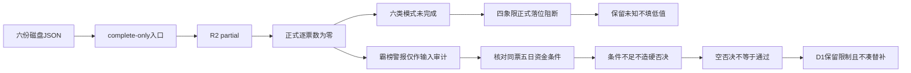

# 2026年10月27日 · **反证 / Devil's Advocate**

> **数据源新鲜度**: partial；境内观测日为2026-10-26，不是今日盘中行情。
> **降级状态**: true；正式可用上游为零。
> **置信度**: 0.12；衡量正式证据可用性，不是下跌概率。

## 🔴 一句话结论
**R2未complete，今日不出正式反证；空硬否决不等于审核通过，不解除禁开仓。**

## 🧭 详细分析
市场为何付钱：上游记录的是机器人相关注意力与局部资金，不能推出全市场普涨。R1情绪=震荡、阶段=高位震荡，涨停55家同时跌停26家，炸板率29.49%；尚未触发35%的候选减半条件，不把阈值外推为已触发。

主线 = 人形机器人，持续性 = 1日，封板率 = 60.87%，明日预期 = 分歧。这里完全转述R2：1日是研究验证窗口，不是持续上涨天数；该方向是结构性研究主线，并非当日已确认可交易主线。R2的mid_up标记也带生命周期降级提示，不能覆盖全市场高位震荡。

谁有地位：R2保留研究排序，但execution_candidates与execution_pool均为空；8只研究候选不等于8只通过审核。R5有5份画像，却同为partial。今天做的是输入、模式和负面线索审计，不做新票发掘、不授开仓资格、不为数量补反证。

今天不做什么：不把partial/degraded改为complete，不把缺失字段填零；不以空hard_rejects给全票发通行证。R6正式逐票评估数为0，六类模式未完成不代表六类均未命中。D1须保留未审核状态和已有交易限制。

## 🧱 六类模式可用性

| 模式 | 状态 | 原因与处置 |
|---|---|---|
| 1 数据源冲突 | 🔴 skipped | R2 partial，R3/R4/R7均非complete；不将未确认误写成已冲突。 |
| 2 一致性检查 | 🔴 skipped | R1 degraded、R2 partial；两者均保留观察及不开仓授权，不编造风格矛盾。 |
| 3 估值×主线临界 | 🔴 skipped | R5 partial；不将缺失估值、RR或财报字段视为高估值命中。 |
| 4 历史类比 | 🟡 degraded | 本次限定只读当日R1-R5/R7 JSON；未提供可验证历史失败样本库。 |
| 5 昨日预期错误连锁 | 🟡 degraded | 本次限定输入没有昨日R6和E1兑现链，不把昨日预测当已兑现。 |
| 6 霸榜出货硬约束 | 🔴 skipped | R2/R3/R5均非complete且execution_candidates为空；无正式可评估对象。宇树警报不自动映射全部机器人股票；资金确认字段缺失。 |

正式counter_arguments为0，hard_reject为0。今日反面证据不足(0条<5)，不硬凑。这里不能写“今日无重大反面证据”，因为正式审核入口尚未满足。

## 🧩 四象限负面识别

情绪×资金是两条独立轴，不是“消息利好×消息利空”。本次只呈现负面测试框架：高低阈值和同板块同窗口确认不足，所有象限成员留空，不把未知当低值。

| 象限 | 负面识别重点 | 正式落位 |
|---|---|---|
| 高情绪×高资金 | 警惕一致性过热与先手兑现，不因双高免检。 | 未评估，无成员 |
| 高情绪×低资金 | 警惕传播扩散而承接不足；不得用龙虎榜单一窗口代替五日主力。 | 未评估，无成员 |
| 低情绪×高资金 | 警惕单日资金回流被误判为新主线，不授低位抄底资格。 | 未评估，无成员 |
| 低情绪×低资金 | 警惕无主线、无地位和无接力，不能因便宜纳入执行。 | 未评估，无成员 |

人形机器人、商贸零售、油气开采均留在未分类区。机器人在R3有混合舆情，在R2精确概念中有正净额，却没有complete R7精确板块确认；汽车零部件不等于全机器人。不能为了落四象限而把机器人强行划入“高热低资”或“高热高资”。

## ⚠️ 霸榜出货hard_reject审计

R3保留宇树科技（688836.SH）连续两次观测榜首的distribution_alert：成交额为此前五日均额2.121倍，上影占振幅约50.20%。这是一条待核负面警报，不是已证明出货。R3同时列有相反证据：东财单日主力净额为正9035.6万元；龙虎榜单日总净额为负既不能替代机构单独净卖，也不能替代五日主力净流出。

- **大资金意图**: 未知。放量长上影可能对应兑现与换手，不能把警报直接写成主力连续离场。
- **为什么走强**: R3记录宇树该观测日上涨7.6923%，不是滞涨；本节只挑战“榜首即安全”的假设，不给正向结论。
- **逻辑够不够硬**: 不够形成模式六正式硬否决。R2/R3/R5均非complete，R2无执行候选，R5未提供宇树同票画像及所需五日资金确认。不得由单票警报外推全板块出货。

模式六必须同时确认：正式执行资格龙一/龙二、所属板块高置信警报、R5同票五日主力净流出。仅警报而资金未确认时按strong_suggest契约显式处理；本次更早被R2入口阻断，不制造正式条目。未来若形成hard_reject，必须剔除执行资格，可留研究观察，但禁止用龙二、弹性核心或低位补涨凑数替补。

## 🔎 关键证据
- R1：情绪66不是普涨概率，仓位上限40%不是立即调仓指令；status=degraded。
- R2：跨源匹配分0.33，负面公告使正向叙事零分；status=partial，未授交易权限。
- R3：distribution_alert仅见宇树这一票；未将警报列作正向共振，status=degraded。
- R4：机器人商业化高预期有负面事件背景，但不能替代逐票资金确认；status=partial。
- R5：5份画像均为研究观察，资金源冲突与RR未知没有被当成通过；status=partial。
- R7：北向净额语义不可确认，整体confidence=0；其行业资金与R2精确概念不能无条件互换，status=partial。

## 数据源审计

| 源 | 日期 | 状态 | 记录数 | 备注 |
|---|---|:--:|---:|---|
| R1 / R1_style.json | 2026-10-27 | 🟡 | 1份 | 文件可读，status=degraded；正式不可用；境内主要观测2026-10-26 |
| R2 / R2_main_sectors.json | 2026-10-27 | 🟡 | 1份 | 文件可读，status=partial；正式不可用；境内主要观测2026-10-26 |
| R3 / R3_sentiment.json | 2026-10-27 | 🟡 | 1份 | 文件可读，status=degraded；正式不可用；境内主要观测2026-10-26 |
| R4 / R4_news.json | 2026-10-27 | 🟡 | 1份 | 文件可读，status=partial；正式不可用；境内主要观测2026-10-26 |
| R5 / R5_stock_profiles.json | 2026-10-27 | 🟡 | 1份 | 文件可读，status=partial；正式不可用；境内主要观测2026-10-26 |
| R7 / R7_capital_flow.json | 2026-10-27 | 🟡 | 1份 | 文件可读，status=partial；正式不可用；境内主要观测2026-10-26 |

🟢 表示complete可用；🟡 表示partial/degraded；🔴 表示缺失或失败。本次没有complete源。frontmatter的ok仅指文件可读，正式资格以本表和upstream_usable为准。没有读取raw、复盘、历史事件库，也没有抓取任何新市场数据。

## 🪞 不确定性 / 反证
本次没有首推票、执行池新增或观察池升位，因此逐票买入理由、止损价与RR链不适用，不编造价位。正式反证、四象限落位与硬否决审核均未完成，唯一完成的是可追溯降级产出。R2完整性改变后须重新评估，当前文件不能替代那次评估。

机器人精确概念资金与广义机器人资金口径不同；龙虎榜区间与五日资金口径不同；同源MCP与SDK也不是独立确认。不能因对象不足降低hard_reject等级，也不能以“审核未完成”伪装已发现出货。

置信度公式：0.80 × 0.30 × 0.50 = 0.12。0.30对应正式输入不可用，0.50为一致度契约下限，不表示一个有效独立共识源；文件时间新鲜与正式输入资格分别记录。

## 🔗 与其他 R/D/E 的关系
- 依赖：仅data/research/20261027下R1_style、R2_main_sectors、R3_sentiment、R4_news、R5_stock_profiles、R7_capital_flow六份JSON。
- 被消费：D1(canghai-plan)、E1(canghai-review)。D1不得把空hard_rejects解释为通过。
- 不改写任何上游、持仓、计划或执行文件；不做仓位调整指令。

## Sub-Agent 元数据
- skill: analyze_devil_advocate_v1
- artifact: data/research/20261027/R6_devil_advocate.json
- method: llm_v1，纯磁盘降级审计
- model: gpt-6.1-sol
- 生成耗时: 未计量，不编造
- 校验: JSON写前Pydantic；Markdown frontmatter、命名空间、图表节点、三问锚点及审计表检查
