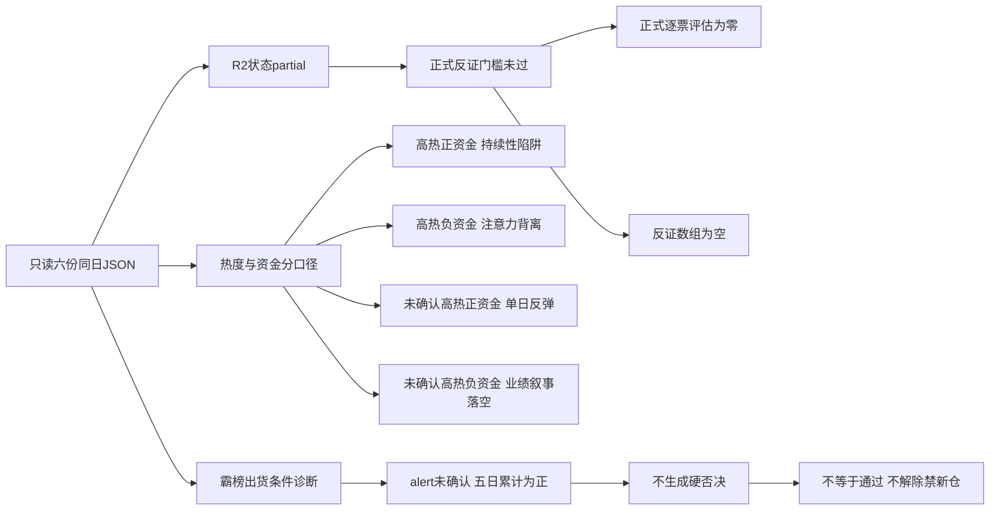

# 2026年10月28日 · 反证 / Devil’s Advocate

> 🟡 数据源新鲜度：partial；降级：true；正式研究置信度：null（未评价，不是零分）。
> 情绪=主跌；空 hard_rejects 不是审核通过，更不能解除禁新仓。

## 🟡 一句话结论
R2未完成正式输入门槛，今日不出正式反证；保留六项诊断与四象限风险，不授予开仓。

## 🧭 详细分析
市场在为局部前排而非普涨付钱。R1记录涨停41家、跌停22家、上涨606项、下跌4922项，炸板率40.58%。因此情绪=主跌，候选预算乘0.5；R2已从每线最多5只降至2只研究对象，执行候选仍为零。本报告不要求持仓一次性清空，不读取或修改交易计划。

研究主线 = 人形机器人/物理AI数采，持续性 = 1日研究复核窗，封板率 = 未知，下一交易时段预期 = 分歧。不能把研究窗口写成已实现持续性，不能用市场封板率替代题材封板率。已确认可交易主线为空，研究分74不等于交易资格。

谁有地位仍未完成逐项证明。襄阳轴承与大洋电机分别只是R2临时龙一、龙二研究排序，两票龙头纪律已验证通过均为0/4（未核验，不代表客观全失败）。R2的 execution_blocked=false 与 execution_eligible=false、filtered_out 容易被误读；R5已明确执行不进。本次沿用不进边界，不把研究排序变成合格龙头。

今天只做反向证据审计，不做新催化发现、不授予新仓、不补位造票。R2.status=partial，依complete-only规则，正式 counter_arguments 为空、candidates_evaluated=0；下列是上下文诊断，不是绕过门槛的正式severity结论。六类模式均记录降级原因，模式四/五没有读取历史库或昨日E1，不能捏造兑现案例。

## 🧩 六类反证覆盖
| 模式 | 正式状态 | 本次处理 |
|---|---|---|
| 1 数据源冲突 | 🟡 degraded | 记录机器人热度与行业净流出、政策订单映射缺口 |
| 2 一致性检查 | 🟡 degraded | 已禁新仓并减半，不捏造R1/R2正在执行冲突；记录四板与首板模板边界 |
| 3 估值×主线临界 | 🟡 degraded | 记录两票估值/盈利及量价事实，非正式强建议 |
| 4 历史类比 | 🟡 degraded | 本次限定输入无历史库，不编案例 |
| 5 昨日预期错误连锁 | 🟡 degraded | 未读取昨日R6及E1，不能宣布兑现或失效 |
| 6 霸榜出货硬约束 | 🟡 degraded | 条件诊断未触发；正式合格执行对象0，不等于审核通过 |

## 🔎 上下文负面诊断（非正式反证）

### D01 · 人形机器人/物理AI数采 · 观察

R2研究分74与R3热榜/观点、R4政策相互支持，但R7机器人行业昨日净流出3.46490608亿元，电机Ⅱ净流入7.25130352亿元不能替代全概念净额。

- **大资金意图**: 上游只能支持条件假设；不从热榜、单日净额或机构席位推定持续建仓。
- **为什么走强**: 仅承认上游记录的局部热度或价格行为；本项反面事实限制其延伸，不认定板块全面走强。
- **逻辑够不够硬**: 不够支持开仓；R2未complete，正式反证未完成，事实来源见下，不用多份artifact冒充多个独立底层源。
- 证据路径：`R2.main_lines[0]`；`R3.resonance_top_themes[0]`；`R4.top_events[E20261028_001]`；`R7.main_force.sector_flows.机器人`。

### D02 · 首板隔日模板与襄阳轴承4板 · 不进

R1情绪=主跌、炸板率40.579710%，R2已减半至2只研究样本且不授权开仓；并无已执行的风格冲突。若把4板研究排序改成首板隔日执行，将构成模板及权限越界。

- **大资金意图**: 上游只能支持条件假设；不从热榜、单日净额或机构席位推定持续建仓。
- **为什么走强**: 仅承认上游记录的局部热度或价格行为；本项反面事实限制其延伸，不认定板块全面走强。
- **逻辑够不够硬**: 不够支持开仓；R2未complete，正式反证未完成，事实来源见下，不用多份artifact冒充多个独立底层源。
- 证据路径：`R1.conclusion`；`R2.main_template`；`R2.candidate_budget`；`R5.profiles[0].flags`。

### D03 · 襄阳轴承估值与筹码 · 降级

R5半年报ROE=-2.6343%，PB=9.465、三年分位93.6552%，PS分位94.4828%；最新主力净流出0.985357亿元、日榜净卖1.3046238591亿元，股东数增加39.8072%。不能将亏损PE解释成便宜；尚无完整财务红旗清查。

- **大资金意图**: 上游只能支持条件假设；不从热榜、单日净额或机构席位推定持续建仓。
- **为什么走强**: 仅承认上游记录的局部热度或价格行为；本项反面事实限制其延伸，不认定板块全面走强。
- **逻辑够不够硬**: 不够支持开仓；R2未complete，正式反证未完成，事实来源见下，不用多份artifact冒充多个独立底层源。
- 证据路径：`R5.profiles[0].dimensions.valuation_safety.evidence`；`R5.profiles[0].dimensions.chip_structure.evidence`。

### D04 · 大洋电机估值与反包量能 · 观察

R5归母净利同比-42.037%，PE_TTM=26.1963、三年分位96.4138%；成交量/前日=0.9020816，7.70元收盘仍低于20日最高7.75元。不将其写成放量创新高，不能凭最新一日资金转正推出连续流入。

- **大资金意图**: 上游只能支持条件假设；不从热榜、单日净额或机构席位推定持续建仓。
- **为什么走强**: 仅承认上游记录的局部热度或价格行为；本项反面事实限制其延伸，不认定板块全面走强。
- **逻辑够不够硬**: 不够支持开仓；R2未complete，正式反证未完成，事实来源见下，不用多份artifact冒充多个独立底层源。
- 证据路径：`R5.profiles[1].dimensions.valuation_safety.evidence`；`R5.profiles[1].technical.metrics`。

### D05 · 上海政策与公司订单映射 · 不进

R4 E001为10月27日盘后公开；R5两票company_order_verified=false。不能解释此前涨停，不能将政策目标变成公司已签订单。

- **大资金意图**: 上游只能支持条件假设；不从热榜、单日净额或机构席位推定持续建仓。
- **为什么走强**: 仅承认上游记录的局部热度或价格行为；本项反面事实限制其延伸，不认定板块全面走强。
- **逻辑够不够硬**: 不够支持开仓；R2未complete，正式反证未完成，事实来源见下，不用多份artifact冒充多个独立底层源。
- 证据路径：`R4.top_events[E20261028_001]`；`R5.profiles[*].dimensions.catalyst.evidence`。

### D06 · 热榜榜首与霸榜出货 · 观察

R3 distribution_alert=[]且R3整体degraded，不构成无出货证明；两票R5五日大单加超大单累计均为正。襄阳单日净流出不等于五日累计净流出，不能触发模式六硬否决。

- **大资金意图**: 上游只能支持条件假设；不从热榜、单日净额或机构席位推定持续建仓。
- **为什么走强**: 仅承认上游记录的局部热度或价格行为；本项反面事实限制其延伸，不认定板块全面走强。
- **逻辑够不够硬**: 不够支持开仓；R2未complete，正式反证未完成，事实来源见下，不用多份artifact冒充多个独立底层源。
- 证据路径：`R3.hotlist_signals.distribution_alert`；`R5.profiles[*].dimensions.chip_structure.evidence.main_force_5d`。

## ⛔ 霸榜出货 hard_reject 条件审计
硬条件必须同时满足：合格执行龙一/龙二所属板块高置信distribution_alert，且R5近五日主力累计净流出。仅alert而缺资金确认只能形成strong_suggest；本次alert本身也未确认，不能制造strong或hard。

| 研究对象 | R2执行资格 | R3高置信alert | 五日主力累计（万元） | 结论 |
|---|---|---|---:|---|
| 襄阳轴承 000678.SZ | false | 未确认；空数组非安全证明 | +39034.20 | 未触发，未审结 |
| 大洋电机 002249.SZ | false | 未确认；空数组非安全证明 | +53111.24 | 未触发，未审结 |

来源：R5两票 dimensions.chip_structure.evidence.main_force_5d，窗口为10月21、22、23、26、27日。用各日net_big_yi合计再换算万元，规范字段main_force_5d_net_wan缺失已在JSON标注。襄阳最新单日约-0.985357亿元不能顶替五日累计；XTick主动成交代理与订单分档不同，也不能拿来冲抵。硬否决清单为空，不意味着无出货，也不是全票审核通过。如后续龙一形成硬否决，只剔除执行资格，不以龙二或低位补涨递补。

## 🧱 四象限负面识别
主轴采用“热度×资金”，与项目文档情绪×资金设计对应。热度为定性注意力，不是全市场情绪52分；未进R3前三只代表未获高热确认，不代表真实低热。资金取同口径10月27日净额，行业与个股分开。所有归类均为降级诊断。

| 象限 | 上游对象 | 负面识别 |
|---|---|---|
| 高热度×正资金 | 大洋电机（个股资金口径）；一般零售（行业口径） | 热度与正资金不保证承接持续；大洋盈利下滑且缩量反包，一般零售分支不能代表商贸母行业，零售高位监管未消除。 |
| 高热度×负资金 | 人形机器人（以机器人行业作代理）；AI短剧/传媒 | 热度与净流出背离；机器人概念映射非精确，传媒热榜包含慈文跌停引发的亏损关注，不能视作积极买盘。 |
| 未获高热度确认×正资金 | 银行 | 当日流入7.69581056亿元但五日累计-26.80674048亿元，R3前三主题未命中；未获热度确认不等于真实低热，不授予进攻主线。 |
| 未获高热度确认×负资金 | 覆铜板/PCB | R4季报仅中性，R3前三未命中；PCB当日-30.15930112亿元、五日-148.65091328亿元，不以季报增长替代资金确认。 |

补充事件×位置识别：襄阳四板后的正面政策存在高位兑现风险，但未形成出货硬证据；上海九百监管事件对应高位负面风险，仅是上游风险案例，不新增为R2候选。正面×低位、负面×低位均不强填，缺逐票位置阈值。不能将“首板”自动解释成低位，也不能把大洋反包当作已核新题材。

## 🧾 两票研究存证（不是推荐）

### 襄阳轴承 · 000678.SZ · 观察／执行不进

板型：未核验（R5技术形态描述不等于门禁识别）；龙头认定：临时研究排序、已验证0/4；盈亏比：null、止损距null；禁止清单命中项：未知，空数组不代表零命中。计划归属：未授权今日核心／主线补涨／计划内试错。

- **买入理由**: 不进。仅复述被挑战的上游研究假设：人形产业链映射与双榜注意力；上海智能制造方案为盘后政策锚，尚无公司订单确认，不构成R6正向买入结论。

- **风险点**: 最新订单桶净流出与主动成交代理冲突；日榜净卖、持有人分散，亏损与高PB/PS分位同时存在，四板样本不符合已核首板隔日执行资格。

- **止损条件**: 当前无开仓，不能编造交易止损价。RR或止损距仍未知即禁止执行；未来若确认RR<2或止损距<5%，继续降级观察。公司产业映射被公告证伪即撤销对应研究假设，不构成现有持仓卖出指令。

- **可验证假设**: 未来1至3交易日由后续授权环节核验：同口径机器人行业连续2日净流入、公司订单确认由false变true、逐票板型/龙头/RR/禁止项全部完成；任一未满足不自动升格。这是待验条件，不承诺R6本轮再抓数。

### 大洋电机 · 002249.SZ · 观察／执行不进

板型：未核验（R5技术形态描述不等于门禁识别）；龙头认定：临时研究排序、已验证0/4；盈亏比：null、止损距null；禁止清单命中项：未知，空数组不代表零命中。计划归属：未授权今日核心／主线补涨／计划内试错。

- **买入理由**: 不进。仅复述被挑战的上游研究假设：人形产业链映射与双榜注意力；上海智能制造方案为盘后政策锚，尚无公司订单确认，不构成R6正向买入结论。

- **风险点**: 盈利同比下滑而PE处高分位；反包成交量缩于前日，尚低于前高7.75元；最新正流入不能证明连续性，不因龙一风险而升位。

- **止损条件**: 当前无开仓，不能编造交易止损价。RR或止损距仍未知即禁止执行；未来若确认RR<2或止损距<5%，继续降级观察。公司产业映射被公告证伪即撤销对应研究假设，不构成现有持仓卖出指令。

- **可验证假设**: 未来1至3交易日由后续授权环节核验：同口径机器人行业连续2日净流入、公司订单确认由false变true、逐票板型/龙头/RR/禁止项全部完成；任一未满足不自动升格。这是待验条件，不承诺R6本轮再抓数。

## 🔗 关键证据
- D01：R2研究分74与R3热榜/观点、R4政策相互支持，但R7机器人行业昨日净流出3.46490608亿元，电机Ⅱ净流入7.25130352亿元不能替代全概念净额。 · 来源：R2.main_lines[0]；R3.resonance_top_themes[0]；R4.top_events[E20261028_001]；R7.main_force.sector_flows.机器人。
- D02：R1情绪=主跌、炸板率40.579710%，R2已减半至2只研究样本且不授权开仓；并无已执行的风格冲突。若把4板研究排序改成首板隔日执行，将构成模板及权限越界。 · 来源：R1.conclusion；R2.main_template；R2.candidate_budget；R5.profiles[0].flags。
- D03：R5半年报ROE=-2.6343%，PB=9.465、三年分位93.6552%，PS分位94.4828%；最新主力净流出0.985357亿元、日榜净卖1.3046238591亿元，股东数增加39.8072%。不能将亏损PE解释成便宜；尚无完整财务红旗清查。 · 来源：R5.profiles[0].dimensions.valuation_safety.evidence；R5.profiles[0].dimensions.chip_structure.evidence。
- D04：R5归母净利同比-42.037%，PE_TTM=26.1963、三年分位96.4138%；成交量/前日=0.9020816，7.70元收盘仍低于20日最高7.75元。不将其写成放量创新高，不能凭最新一日资金转正推出连续流入。 · 来源：R5.profiles[1].dimensions.valuation_safety.evidence；R5.profiles[1].technical.metrics。
- D05：R4 E001为10月27日盘后公开；R5两票company_order_verified=false。不能解释此前涨停，不能将政策目标变成公司已签订单。 · 来源：R4.top_events[E20261028_001]；R5.profiles[*].dimensions.catalyst.evidence。
- D06：R3 distribution_alert=[]且R3整体degraded，不构成无出货证明；两票R5五日大单加超大单累计均为正。襄阳单日净流出不等于五日累计净流出，不能触发模式六硬否决。 · 来源：R3.hotlist_signals.distribution_alert；R5.profiles[*].dimensions.chip_structure.evidence.main_force_5d。

## 数据源审计
| 源 | 日期 | 状态 | 备注 |
|---|---|:--:|---|
| R1 | 2026-10-28 | 🟡 | status=degraded；JSON可读，complete-only不可用；`data/research/20261028/R1_style.json` |
| R2 | 2026-10-28 | 🟡 | status=partial；JSON可读，complete-only不可用；`data/research/20261028/R2_main_sectors.json` |
| R3 | 2026-10-28 | 🟡 | status=degraded；JSON可读，complete-only不可用；`data/research/20261028/R3_sentiment.json` |
| R4 | 2026-10-28 | 🟡 | status=partial；JSON可读，complete-only不可用；`data/research/20261028/R4_news.json` |
| R5 | 2026-10-28 | 🟡 | status=partial；JSON可读，complete-only不可用；`data/research/20261028/R5_stock_profiles.json` |
| R7 | 2026-10-28 | 🟡 | status=partial；JSON可读，complete-only不可用；`data/research/20261028/R7_capital_flow_20261028.json` |

上述日期为artifact命名空间，市场观察值主要为10月27日收盘；两融最新10月26日、财务为各自披露期，均不能冒充10月28日盘中。R7标准文件未发现，实际读取同日带日期后缀文件；不改写其路径。没有调用MCP、网络、shell抓数、子agent，也未读取原始抓取文件或上游markdown。

## 🟡 不确定性 / 反证
正式反面证据不足（0条<5），不硬凑。六项诊断是未完成输入下的风险存证，不进入counter_arguments，不赋予正式severity；不能把“已读六份JSON”写成“全部上游可用”。R3警报空值可能漏检，R5完整财务红旗与审计状态未核验，模式四/五依赖未读。空硬否决不是买入许可证。本次置信度null，因尚未正式评价，不套算置信公式造分数。

## 🔄 与其他 R/D/E 的关系
- 依赖：数据源审计所列R1、R2、R3、R4、R5、R7六份JSON。
- 被消费：D1主决策、E1复盘与research主控；本次不修改research_summary.json。
- D1：先处理研究就绪缺口；保留R1禁新仓与逐票门禁，不以本报告空否决解除约束。正式strong_suggest须接受或显式override，hard_reject无覆盖权；本次均未形成。
- E1：后续区分诊断、正式反证与兑现，不将未评估样本计作审核通过或命中率分母。

## Sub-Agent 元数据
- skill: analyze_devil_advocate_v1
- artifact: data/research/20261028/R6_devil_advocate.json
- method: llm_v1_disk_only_complete_gate
- model: gpt-6.1-sol
- 生成耗时：未独立计时，不填虚构秒数。
- 校验：本次内存Pydantic明文契约，核心字段严格、扩展审计为JSON类型；未发现R6生产模型，不宣称生产集成验收。
