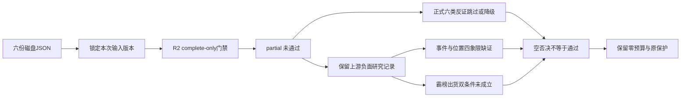

# 2026年10月29日 · 反证 / Devil’s Advocate

> 数据源新鲜度：partial；情绪=震荡；降级=true；置信度=0.12。
> 正式审核未完成。空 hard_rejects 不代表放行；本产物不交易、不撤单、不清池。

## 🔴 一句话结论

R2非complete，正式反证降级；保留负面研究证据，不进执行。

## 🧭 先认市场，再认个股

市场正在为哪些方向付钱，只能描述上一已收盘日与当前上游研究假设：R1风格为主线扩散型，但情绪=震荡，83分不是主升证明。上一观察日涨停72、炸板69，炸板率48.94%；R2研究候选已12→6，不再重复砍半。40%仅研究上限，不解除有效零交易预算。

| R2研究主线 | 来源观察日 | 持续性 | 封板率 | 明日预期 | 执行态度 |
|---|---|---|---|---|---|
| PCB概念 | 2026-10-28 | 1日行业代理；非轮次年龄/未来承诺 | 75.0% | 分歧，指本次生成后的2026-10-29待验假设 | 观察，不进执行 |
| 共封装光学(CPO) | 2026-10-28 | 1日行业代理；非轮次年龄/未来承诺 | 50.0% | 分歧，指本次生成后的2026-10-29待验假设 | 观察，不进执行 |
| 存储芯片 | 2026-10-28 | 1日行业代理；非轮次年龄/未来承诺 | 50.0% | 分歧，指本次生成后的2026-10-29待验假设 | 观察，不进执行 |

R2三条主线属于同一AI硬件风险簇，不能当三个独立组合风险。R2已声明无可交易主线、无执行池，因此不制造“R1震荡却R2强推可交易高波动票”的虚假矛盾。盘前没有当日赚钱效应确认；研究对象不等于可交易候选。

## 🔎 六类反证可用性

| 模式 | 正式状态 | 缺口与限定 |
|---|---|---|
| 1 · 数据源冲突 | skipped | R2 status=partial，complete-only门禁未通过，正式扫描跳过。 |
| 2 · 一致性检查 | skipped | R2 status=partial，complete-only门禁未通过，正式扫描跳过。 |
| 3 · 估值x主线临界 | skipped | R2 status=partial，complete-only门禁未通过，正式扫描跳过。 |
| 4 · 历史类比 | degraded | R2 status=partial，complete-only门禁未通过，正式扫描跳过。 本次仅允许R1-R5/R7输入，未读取历史事件库，不编造历史类比。 |
| 5 · 昨日预期错误连锁 | degraded | R2 status=partial，complete-only门禁未通过，正式扫描跳过。 本次仅允许R1-R5/R7输入，未读取昨日R6/E1兑现，不由severity推历史立场，不判昨日反证兑现。 |
| 6 · 霸榜出货硬约束 | skipped | R2 status=partial，complete-only门禁未通过，正式扫描跳过。 R3/R5亦非complete；无execution_eligible龙一/龙二。仅拥挤代理且confirmed_distribution=false，不能当高置信出货。 |

正式 counter_arguments=0，hard_rejects=0，candidates_evaluated=0。下文检查了6个研究对象，保留9条上游负面研究记录，但它们不计正式R6反证、不冒充审核完成。今日反面证据不足(0条<5)，不硬凑。

## 🟡 研究层负面证据，不冒充正式裁决

### PCB：扩产叙事不等于候选公司获得订单

- **大资金意图**: 上游单日资金回流与三板身位可体现接力讨论，但不证明机构锁筹；印制电路板行业五日净流出120.13550848亿元仍是约束。
- **为什么走强**: R2记录9涨停、3炸板及75%封板率；奥士康项目在昨日收盘后才披露，不能解释昨日已发生上涨。
- **逻辑够不够硬**: 该公告融资、土地、审批和考核条件保留；负面为奥士康个股级，不外推光洋股份或金安国纪融资失败。R2/R4均partial，不产生正式裁决。

### CPO：需求增长不抵消现金回报争议

- **大资金意图**: 单日回流可能是修复而非持续增配；中际旭创五日回流与二十日流出并存，不择优窗口。
- **为什么走强**: 上游云需求事件与价格修复并存，但CPO封板率只有50%，人气排名3→5，不是低分歧主升确认。
- **逻辑够不够硬**: 谷歌净利受投资估值影响，不能全归于云业务衰退；现金流负向仍须并列。MPO/DFAU不等于CPO，A股供货份额未核，不进执行。

### 存储：净利环比不能单独证明行业见顶

- **大资金意图**: 涨价与盈利弹性是上游讨论方向，不由人气推具体机构净买入。
- **为什么走强**: 热度4→3与需求/长单叙事并存，但同主题仅2家涨停，50%封板率不足以证明广泛接力。
- **逻辑够不够硬**: 海力士净利润环比下降受投资收益及特别分红基数扰动，营业利润环比仍增长；独立现货价未核，保留周期风险而不宣布周期见顶。

## 🧩 四象限负面识别：事件×位置

本次采用R4的事件×位置口径，不与情绪×资金口径混用。上游没有本轮起点及明确高低位窗口；不能由板数、单日涨幅或severity反推位置，六票正式象限均为null。缺证本身只意味着未完成，不能断言已经落入陷阱。

| 情景格 | 需识别的负面机制 | 本次结果 |
|---|---|---|
| 高位×正面事件 | 利好兑现、最后一棒；不自动断言出货 | 未完成：高位与本轮窗口未核 |
| 高位×负面事件 | 出货陷阱、估值或筹码承接断裂 | 未完成：高位及逐票敞口未核 |
| 低位×正面事件 | 超跌修复伪装成主升 | R5多票仍在中期均线下；不能据此确认本轮低位 |
| 低位×负面事件 | 基本面恶化继续，不将跌多当错杀 | 财务/现金流风险保留；不能据此确认本轮低位 |

| 研究对象 | R5技术描述 | 象限 |
|---|---|---|
| 光洋股份 002708.SZ | 三板且站上短中期均线；量比不足1，符合封板压量事实而非放量突破。开板承接、分时与四周期视觉缺失，技术强不等于可交易。 | null；不强判 |
| 金安国纪 002636.SZ | 首板涨停仍在MA20/MA60下，量比不足1，20日大跌后修复；不能归为已确认主升回踩。 | null；不强判 |
| 方正科技 600601.SH | 日线空头均线中放量首板，收复MA5而未收复MA20；日内一次开板、终封较晚，分歧接力需要新日承接，而非按已确认趋势买点解释。 | null；不强判 |
| 中际旭创 300308.SZ | 创业板+10.2773%不是20cm涨停；无涨停记录，charts数据模式称涨停是语义错误，已剔除。站回MA5/10但低于MA20/60仍属修复。 | null；不强判 |
| 盈方微 000670.SZ | 涨停放量收复短均线与MA60，但周线仍弱，三次开板；日线修复不能替代中期反转或板块广度。 | null；不强判 |
| 兆易创新 603986.SH | 同日快照有效、日线技术为反弹；收复短均线仍低于MA20/60，不是确认主升。缠论结构未计算，不标双向确认。 | null；不强判 |

## 🚫 霸榜出货 hard_reject 审计

R3仅有“人形机器人886069.TI连续两日第一”的拥挤代理，confirmed_distribution=false，不是高置信出货。它精确对应R2次线，次线leaders为空；不能因为光洋股份有机器人叙事，就把PCB的本次对象按另一概念接上出货alert。

未形成模式六hard_reject，不代表全票审核通过。金安国纪五日两源净流出，但其R2 PCB对象没有对应高置信出货alert；不能跨概念拼接。光洋股份五日两源净入，末日净出不能替代五日净出。

模式六正式输入未完整，且R2 execution_eligible龙一/龙二数量为0。R5也未透传canonical五日主力万元字段；原两源亿元数据保留。禁止用单日净出替代五日净出，禁止用筹码红旗数量或“位置高”代替模式六双条件。

若以后完整证据触发hard_reject，必须剔除execution_pool，可保留研究禁令记录；不能以“等分歧”保留执行资格，不能用龙二/弹性核心/低位补涨替补，不启用已废止的候选不足3只自动降级条款。

## 📋 六票研究风险与原有限定

以下“买入理由”栏目只转述R5保留研究对象的理由，不是R6正向推荐；止损栏目仅为上游研究证伪条件，不是交易卖单。所有票RR/止损距离未核，禁止清单空列表不是已排除风险。

### 光洋股份 · 002708.SZ · 观察，不进执行

板型：三板连板；R2身位：龙头；龙头纪律已过条数：1，非完整通过；RR=null、止损距离=null；禁止清单命中=[]但未运行。

- **大资金意图**: 连续封板后量能收缩；五日两源净入但28日两源均净出，不能把缩量封板自动解释为锁筹。27日机构净卖与营业部净买结构表明接力盘承接机构筹码。
- **为什么走强**: 仅转述上游技术事实：三板且站上短中期均线；量比不足1，符合封板压量事实而非放量突破。开板承接、分时与四周期视觉缺失，技术强不等于可交易。
- **逻辑够不够硬**: TTM PE约101倍，PB/PS处三年高位；扣非占比仅4.379%，盈利与现金流脱节，不适合用高EPS增长线性外推。 财务检查partial；不升级完整审核或交易资格。

- **买入理由**: PCB与机器人交叉叙事使其有接力辨识度，但主营纯度仍是前提；已核三板和板块九家涨停，可作为分歧接力研究样本，不是买入授权
- **风险点**: 三板加速后缩量，次日接力可能面对集中兑现；盈利含金量与现金流弱，机器人贸易敞口未核
- **止损条件**: 若后续收盘跌回MA20下方且当日两源大单净额均负，或公告否认相关业务实质进展，接力研究假设失效；仅记录研究证伪，不是卖单。
- **可验证假设**: 未来两个交易日内，至少一个交易日两源主力净额均转正，且PCB涨停广度保持至少3家；否则不确认身位带动性。

| 上游财务风险编号 | 原始检出与限定 | 原severity（非R6裁决） |
|---|---|---|
| F1 | 货币资金/资产=21.1742%；短借/资产=24.3912% | strong_suggest |
| F9 | 期末应收/本期累计收入=53.1281%；半年与全年不可无调整横比 | soft_suggest |
| F10 | 已知有息负债/归母净资产下限=100.4694%；空字段未补0，完整比例未知 | soft_suggest |
| F6 | 1-扣非净利/净利=95.621% | soft_suggest |
| F8 | 最近两个可计算单季经营现金流均负，而最近累计归母净利为正；单季由累计差分，不混同重复披露 | strong_suggest |

降级/限定：完整开仓资格/禁止清单/RR及日内承接未核，保持R2原门禁；完整F/V/S及审计核验未完成；缠论结构、四色四量和逐票ETF联动未核；完整TAM期限及质量因子缺失；不输出TAM-Adj-PEG点估计；首推持久PNG超写入白名单；快照未命中；live charts data_only已调但不是真正多模态。scratch视觉因未配置环境密钥失败；未读取凭证文件或调用会写越权路径的full render

### 金安国纪 · 002636.SZ · 观察，不进执行

板型：首板；R2身位：龙二；龙头纪律已过条数：0，非完整通过；RR=null、止损距离=null；禁止清单命中=[]但未运行。

- **大资金意图**: 28日主力明显回流且上榜净买，但五日两源仍净流出，股东户数较上期大增；融资余额15个已披露交易日明显下降，尚未恢复持续增配。
- **为什么走强**: 仅转述上游技术事实：首板涨停仍在MA20/MA60下，量比不足1，20日大跌后修复；不能归为已确认主升回踩。
- **逻辑够不够硬**: 三季报收入与扣非增长硬；PE低分位与PB/PS较高分位背离，且现金利润转化偏低，不能把低PE分位直接称便宜。 财务检查partial；不升级完整审核或交易资格。

- **买入理由**: 覆铜板/PCB景气与本公司三季报增长相互印证；09:25首封、PCB龙二及双平台前十提供可追踪辨识度
- **风险点**: 曾多次跌停且20日跌幅大，上方套牢盘厚；融资收缩、股东数大增和现金转化偏低不支持简单机构锁仓叙事
- **止损条件**: 若后续收盘重回MA5下方且PCB封板率低于50%，或后续公告对三季报现金流/盈利作重大更正，财报接力假设证伪；仅为研究条件。
- **可验证假设**: 未来两个交易日中两源主力同日均净入至少一次，PCB涨停至少3家且封板率不低于50%；未满足则维持修复观察。

| 上游财务风险编号 | 原始检出与限定 | 原severity（非R6裁决） |
|---|---|---|
| V4 | ROE=42.4807%；CFO/合并净利润=0.4672 | soft_suggest |

降级/限定：完整开仓资格/禁止清单/RR及日内承接未核，保持R2原门禁；完整F/V/S及审计核验未完成；缠论结构、四色四量和逐票ETF联动未核；完整TAM期限及质量因子缺失；不输出TAM-Adj-PEG点估计；首推持久PNG超写入白名单；快照未命中；live charts data_only已调但不是真正多模态。scratch视觉因未配置环境密钥失败；未读取凭证文件或调用会写越权路径的full render；两融28日未披露；仅最新27日15个已披露交易日；近90日研报未命中；机构关注序数分仅基于实际龙虎榜席位，非研报或当前持仓确认

### 方正科技 · 600601.SH · 观察，不进执行

板型：首板；R2身位：龙头；龙头纪律已过条数：1，非完整通过；RR=null、止损距离=null；禁止清单命中=[]但未运行。

- **大资金意图**: 放量首板、五日资金转正与股东数下降支持筹码收敛假设；同日资金两源尚有差异，融券余额增加但融资未满足同步下跌阈值，不能乱贴short_pressure。
- **为什么走强**: 仅转述上游技术事实：日线空头均线中放量首板，收复MA5而未收复MA20；日内一次开板、终封较晚，分歧接力需要新日承接，而非按已确认趋势买点解释。
- **逻辑够不够硬**: 三季报收入和利润增长、现金利润转化相对较好；经营现金流扣资本开支仍负，募资扩产落地与回报不能省略。 财务检查partial；不升级完整审核或交易资格。

- **买入理由**: PCB主业盈利改善有三季报而非只有概念标签；放量首板和五日净入提供可继续核验的资金锚
- **风险点**: CPO标签与PCB盈利来源可能被混同，板块封板率只有50%；中期空头趋势、资本开支和新募资金使用使估值修复并非无成本
- **止损条件**: 若收盘再次低于MA5且两源主力同时净流出，或本公司披露相关产品/客户映射不成立，则修复假设失效；不输出卖出价格或指令。
- **可验证假设**: 未来两个交易日CPO同主题涨停至少3家且封板率达到60%以上，个股两源至少同日净入一次；否则不确认板块带动。

| 上游财务风险编号 | 原始检出与限定 | 原severity（非R6裁决） |
|---|---|---|
| F9 | 期末应收/本期累计收入=41.5691%；半年与全年不可无调整横比 | soft_suggest |

降级/限定：完整开仓资格/禁止清单/RR及日内承接未核，保持R2原门禁；完整F/V/S及审计核验未完成；缠论结构、四色四量和逐票ETF联动未核；完整TAM期限及质量因子缺失；不输出TAM-Adj-PEG点估计；首推持久PNG超写入白名单；快照未命中；live charts data_only已调但不是真正多模态。scratch视觉因未配置环境密钥失败；未读取凭证文件或调用会写越权路径的full render；两融28日未披露；仅最新27日15个已披露交易日；近90日研报未命中，机构兴趣量化分和综合分为null

### 中际旭创 · 300308.SZ · 观察，不进执行

板型：未核；R2身位：龙三；龙头纪律已过条数：0，非完整通过；RR=null、止损距离=null；禁止清单命中=[]但未运行。

- **大资金意图**: 五日资金两源均净入但20日R7仍大幅净出；15个披露日融资余额下降明显，大宗多日机构卖方且价格区间下移，不等于折价率可算。
- **为什么走强**: 仅转述上游技术事实：创业板+10.2773%不是20cm涨停；无涨停记录，charts数据模式称涨停是语义错误，已剔除。站回MA5/10但低于MA20/60仍属修复。
- **逻辑够不够硬**: 增长较快但上半年现金利润转化低，PB仍高；以同一最新研报的年度EPS构造传统PEG仅可作情景，TAM期限与质量因子不足，不出完整TAM-Adj-PEG。 财务检查partial；不升级完整审核或交易资格。

- **买入理由**: 光模块主营与云需求相关，R4有独立海外财报事件供观察；五日资金由负转正且容量成交充足，适合观察容量核心是否带动板块
- **风险点**: 融资去杠杆和机构卖出大宗持续，多空并存；空头均线、上半年经营现金流弱，云资本回报争议可能压缩估值
- **止损条件**: 若未来两日CPO封板率持续低于50%且本票两源主力均连续两日净出，或公司订单/盈利指引转弱，则容量回流假设证伪；仍不构成交易操作。
- **可验证假设**: 未来两个交易日中至少一个交易日，两源净入均为正且CPO涨停至少3家；未满足则只保留容量观察，不更改候补身份。

| 上游财务风险编号 | 原始检出与限定 | 原severity（非R6裁决） |
|---|---|---|
| V4 | ROE=39.2137%；CFO/合并净利润=0.1221 | soft_suggest |

降级/限定：完整开仓资格/禁止清单/RR及日内承接未核，保持R2原门禁；完整F/V/S及审计核验未完成；缠论结构、四色四量和逐票ETF联动未核；完整TAM期限及质量因子缺失；不输出TAM-Adj-PEG点估计；首推持久PNG超写入白名单；快照未命中；live charts data_only已调但不是真正多模态。scratch视觉因未配置环境密钥失败；未读取凭证文件或调用会写越权路径的full render；两融28日未披露；仅最新27日15个已披露交易日

### 盈方微 · 000670.SZ · 观察，不进执行

板型：首板；R2身位：龙头；龙头纪律已过条数：1，非完整通过；RR=null、止损距离=null；禁止清单命中=[]但未运行。

- **大资金意图**: 五日两源净入且股东户数下降，但缺近月龙虎榜，无法证明机构或知名游资协同；两融接口与资格接口均无行，不伪造融资余额0。
- **为什么走强**: 仅转述上游技术事实：涨停放量收复短均线与MA60，但周线仍弱，三次开板；日线修复不能替代中期反转或板块广度。
- **逻辑够不够硬**: 归母仍亏，PE不适用；PB高且归母净资产薄，商誉相对净资产比例过高，现金流流出和负债压力必须透传R6，R5不自行hard_reject。 财务检查partial；不升级完整审核或交易资格。

- **买入理由**: 存储需求映射与首板弹性使其有研究价值；两源资金同向、股东数下降可作短线承接待验锚
- **风险点**: 归母亏损、PB极高及商誉对薄净资产压力大；存储只有2家涨停，分歧接力的全市场合力不足
- **止损条件**: 若后续披露ST风险预警/审计非标，应立即提交R6独占审核；若两源同时净出且收盘跌回MA20下方，首板承接研究假设证伪。
- **可验证假设**: 未来两个交易日存储同主题涨停至少3家且两源主力同日仍净入一次；否则不确认龙头带动性，即便单票继续冲高也不视为门禁通过。

| 上游财务风险编号 | 原始检出与限定 | 原severity（非R6裁决） |
|---|---|---|
| F2 | 商誉/归母净资产=858.8700%；合并商誉与归母分母口径需附注，不等于审计否决 | strong_suggest |
| F9 | 期末应收/本期累计收入=40.0300%；半年与全年不可无调整横比 | soft_suggest |
| F10 | 已知有息负债/归母净资产下限=3591.8481%；空字段未补0，完整比例未知 | soft_suggest |

降级/限定：完整开仓资格/禁止清单/RR及日内承接未核，保持R2原门禁；完整F/V/S及审计核验未完成；缠论结构、四色四量和逐票ETF联动未核；完整TAM期限及质量因子缺失；不输出TAM-Adj-PEG点估计；首推持久PNG超写入白名单；快照未命中；live charts data_only已调但不是真正多模态。scratch视觉因未配置环境密钥失败；未读取凭证文件或调用会写越权路径的full render；近90日研报未命中，机构兴趣量化分和综合分为null

### 兆易创新 · 603986.SH · 观察，不进执行

板型：未核；R2身位：龙三；龙头纪律已过条数：0，非完整通过；RR=null、止损距离=null；禁止清单命中=[]但未运行。

- **大资金意图**: 五日两源净入、R7十日也为正；28日两源偏差超过5%，不得择一美化。股东数扩散、融资下降说明筹码尚非稳定锁定。
- **为什么走强**: 仅转述上游技术事实：同日快照有效、日线技术为反弹；收复短均线仍低于MA20/60，不是确认主升。缠论结构未计算，不标双向确认。
- **逻辑够不够硬**: TTM PE历史低位伴随利润高增，PB/PS分位没有同幅降低；周期与一次性收益要区分，不能用同比千倍增长计算超低PEG。 财务检查partial；不升级完整审核或交易资格。

- **买入理由**: 存储景气与公司上半年盈利增长提供产业锚；五日和R7十日资金为正，是比单日净入更可持续的观察依据
- **风险点**: 同日资金双源偏差超过阈值，筹码判断需降置信；周期盈利外推、股东数上升与中期空头均线仍是反证
- **止损条件**: 若本公司后续订单/ASP或扣非盈利指引下修，或两源主力连续两日均净出，则修复假设证伪；仅研究记录，不给价格与交易指令。
- **可验证假设**: 未来两个交易日中资金两源同日偏差降到5%以内且均净入至少一次，同时存储涨停至少3家；否则不升级容量核心确认。

| 上游财务风险编号 | 原始检出与限定 | 原severity（非R6裁决） |
|---|---|---|
| 未检出已透传条目 | 不表示完整checklist通过，未核清单保留在JSON | 无 |

降级/限定：完整开仓资格/禁止清单/RR及日内承接未核，保持R2原门禁；完整F/V/S及审计核验未完成；缠论结构、四色四量和逐票ETF联动未核；完整TAM期限及质量因子缺失；不输出TAM-Adj-PEG点估计；首推持久PNG超写入白名单；两融28日未披露；仅最新27日15个已披露交易日

## 📰 全量上游负面事件保留

| 事件 | 杀伤面 | 限定条件与态度 |
|---|---|---|
| E20261029_003 · 谷歌利润及现金回报承压 | 行业级；AI算力、光模块、AI服务器、数据中心液冷 | FCF连续两季负值；不把投资损益与主营恶化混为一谈；降级 |
| E20261029_005 · 美国机器人进口谈判增加贸易不确定性 | 行业级；人形机器人、工业机器人、工业母机 | 启动谈判并留出180日；没有立即新增税率，逐票核美国敞口；降级 |
| E20261029_011 · ST卓然停牌及交易类退市风险 | 个股级；ST及退市风险股 | 标的是*ST卓然688121.SH；不将负面泛化至全体石化装备股；拦截 |
| E20261029_009 · 海力士净利润环比下降与周期警报 | 行业级；存储芯片、HBM | 净利润-58%但营业利润+38%；仅作为财报极性风控，不宣称全行业已见顶；降级 |
| E20261029_002 · 微软Windows及设备收入下降 | 板块级；消费电子、PC产业链 | Windows OEM和设备收入同比-22%；不可外推为全部云硬件利空；降级 |
| E20261029_007 · 奥士康投资融资及履约约束 | 个股级；高端PCB | 融资、土地竞得、审批和税收考核均有条件；只是已披露风险，不声称融资已经失败；降级 |

完整原文摘要、来源、事件极性、earnings_breakdown、原建议及限制均在JSON的upstream_negative_events_preserved中保存。*ST卓然不在本次R2六票内，不将其退市风险扩散到候选；微软PC收入下降不外推成全部云硬件利空。

## 🔗 对象、轮次与有效窗口

| 精确R2对象 | sector_id | round_id | valid_from / valid_until |
|---|---|---|
| PCB概念 | 885959.TI | null | 沿用R2本次生成后至当日收盘研究TTL；机器字段原值见JSON |
| 共封装光学(CPO) | 886033.TI | null | 沿用R2本次生成后至当日收盘研究TTL；机器字段原值见JSON |
| 存储芯片 | 886042.TI | null | 沿用R2本次生成后至当日收盘研究TTL；机器字段原值见JSON |

每个研究记录显式含sector_id / round_id / event_at / valid_from / valid_until。只在精确关联本次R2嵌套对象时继承sector和研究TTL；R4负面first_known_at仅是可追溯披露时点，不是行情起点。无单一事件则event_at=null；无法关联的事件不创建sector/round，不按股票概念或业务日期补轮次。

研究TTL不是R6历史立场的起止，severity也不是过去看多/看空证据。R2全部round_id=null原样保留。本次不是实际回放，不冒充事前预测或已兑现结论。

## 关键证据

- R2 status=partial，无tradable_main_lines、无execution_pool，研究候选12→6。
- R1上一已收盘日炸板率48.94%，情绪=震荡，不把83分当主升。
- R3出货alert是confirmed_distribution=false的拥挤代理，只有次线精确匹配。
- R5金安国纪五日两源净出，但PCB无匹配出货alert；光洋五日两源净入，最后一日转负不能替换窗口。
- R7盘前主力资金可读但ETF一级申购缺失，融资/海外观察较早；源被成功请求不等于完整覆盖。

## 数据源审计

| 源 | 日期 | 状态 | 文件 / 备注 |
|---|---|:--:|---|
| R1 | 2026-10-29 | 🟡 | data/research/20261029/R1_style.json；degraded，formal_usable=false |
| R2 | 2026-10-29 | 🟡 | data/research/20261029/R2_main_sectors.json；partial，formal_usable=false |
| R3 | 2026-10-29 | 🟡 | data/research/20261029/R3_sentiment.json；degraded，formal_usable=false |
| R4 | 2026-10-29 | 🟡 | data/research/20261029/R4_news.json；partial，formal_usable=false |
| R5 | 2026-10-29 | 🟡 | data/research/20261029/R5_stock_profiles.json；partial，formal_usable=false |
| R7 | 2026-10-29 | 🟡 | data/research/20261029/R7_capital_flow_20261029.json；partial，formal_usable=false |

🟢表示完整可用，本次无；🟡表示partial/degraded；🔴表示缺失/错误，本次六份文件均可读，不伪称读取错误。R7标准文件名未落盘，消费已有带日期文件，未复制、改名或改写R7。前置审计时间与原JSON内容状态均原样存证；文件当日生成不等于行情已发生。

## 不确定性 / 反证

本报告最重要的不确定性是正式审核未完成，而不是“没有风险”。四/五模式没有允许范围内的历史兑现证据；六票位置未按本轮窗口定标，四象限不硬归类；R5多项财务口径存在合并/归母、累计/单季差别，完整原有限定必须保留。R7与R2/R3引用同一底层资金数据不增加独立源数量。

置信度按0.80×0.30×0.50=0.12计算，只描述降级研究记录；零个正式可用来源不冒充一个独立完整来源。生成时间使用真实时钟；冻结仅指本次读取字节及其hash用于复核，不是历史冻结回放。08:30为observe-only目标，非强杀；努力目标非硬限、非每日新额度，usage未知不作0，不保证低于目标。

## 与其他 R/D/E 的关系

- 依赖：磁盘R1、R2、R3、R4、R5及带日期R7 JSON；未读raw、历史R6、E1或抓新数据。
- 被消费：D1主决策、E1复盘；必须看到formal_review_completed=false。
- 约束：既有零预算、不交易决定、逐票门禁与保护不变；空否决不能解除禁新仓。

## Sub-Agent 元数据

- skill: analyze_devil_advocate_v1
- artifact: data/research/20261029/R6_devil_advocate.json
- method: llm_v1_disk_only_complete_gate_with_non_adjudicated_research_appendix
- model: gpt-6.1-sol
- 正式完成状态：degraded，非complete
- 耗时：未覆盖整个会话的工具级计量，不伪造完整运行耗时
