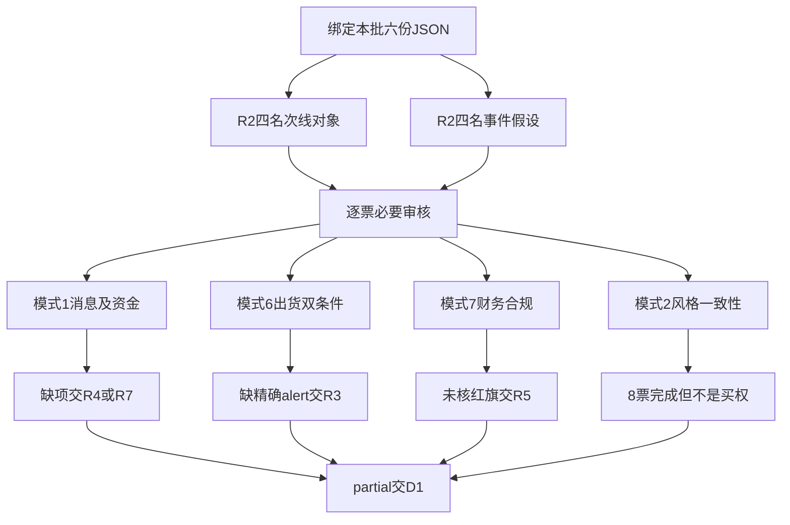

# 2026年10月30日 · 反证 / Devil’s Advocate

> 数据源新鲜度：partial ｜ 降级：true ｜ 反证证据置信度：0.315
> 情绪=主跌；全市场炸板率39.0625%。有效零交易预算、不交易决定及原保护不变。

## 一句话结论
观察/降级：8票局部已审、17条反证、无硬否决；必要审核未完成，绝不等于全票通过。

## 🔎 详细分析

本次不是“所有上游partial就跳过”。R2的4个次线龙头研究对象与4个R4研究假设均有精确代码；R5完成8票画像，因此逐票保留。R2核心主线为空、全部execution_eligible=false，与R1主跌/禁新并无逻辑矛盾。不能为了制造反证把研究观察误写成进攻开仓。

主线=未确认；次线研究为商业航天和短剧游戏。两者持续性=null、板块封板率=null、下一交易时段预期=分歧（上游研究假设，非已兑现事实）。大概念商业航天资金流出与窄行业航天装备流入不是同一成分集合，不互相替代、不累加成“全板块吸筹”。R6审核覆盖不随候选减半而减半。

六类模式均已检查适用性；模式4缺历史样本、模式5缺历史立场与E1兑现链，分别降级。模式1/2/6/7逐票输出机器可读覆盖：模式2完成8票，模式1/6/7仍各有8票必要项未完成。财务已检F2/F6/F8/F9/F12不覆盖其他红旗及完整合规；F8的重叠累计期限定不能删除。

霸榜警报只有襄阳轴承，R3明确confirmed_distribution=false且两资金口径反向；它是本次R2剔除对象，不能把这个个股警报外推为商业航天、短剧游戏或8票出货。模式6所需高置信精确板块alert与有效近5日净流出未同时成立，故无硬否决；这不是已排除全部风险。

## 🧭 审核路径

## ⚖️ 六类反证与扩展覆盖

| 模式 | 实际结果 | 局部降级与完成语义 |
|---|---|---|
| 1 资金消息交叉 | 8条soft反证，逐票检查已有事实 | 4个次线对象缺R4精确催化核验；除中国卫星外缺R7同票分支；未给确认不冒充冲突 |
| 2 风格一致性 | 8票已审，无新增矛盾反证 | R2只是研究观察，禁新与R1一致；完成不等于通过买权 |
| 3 估值临界 | 3条soft反证 | 原极贵/偏贵等级及完整10陷阱未核，不发明阈值 |
| 4 历史类比 | degraded | 许可输入无真实失败样本；不伪造历史 |
| 5 昨日兑现 | degraded | 没有许可的原R6立场与E1兑现链；不从severity反推看空 |
| 6 霸榜出货 | 0 hard_reject；8票必要项仍未完成 | 个股未确认警报不外推；缺本票/精确板块显式alert覆盖 |
| 7 财务合规 | 4条发现，其中2条strong | F8原限定保留，其他财务与合规未完成 |
| 8 解套盘假繁荣 | degraded | 无封板量/套牢区；本批39涨停不是100+，high_suspicion未知 |
| 9 晋级/触板尾部 | 2条strong | 高度本身不hard_reject，不代表绝对高位已核 |
| 10 跨资产背离 | degraded | 无精确商品映射与同窗口可比数据 |

## 🟥 四象限负面识别

主轴按项目既有“情绪×资金”表达。市场情绪沿用R1主跌，资金仅按R5同日大单+超大单净额符号，不把“净入”冒充“资金强/主升”。若将四象限理解为“位置×消息”，本批绝对高低位与轮次不足，8票该投影均null，不猜高位利好出货或低位利空洗盘。

| 对象 | 市场情绪×同日资金 | 净额（亿元） | 负面识别 |
|---|---|---:|---|
| 上海沪工 603131.SH | 情绪弱×资金净入 | 0.833552 | 零开板和二板身位不证明产业纯度或全板块资金转正。 |
| 中国卫星 600118.SH | 情绪弱×资金净入 | 6.446159 | 正净额与8次开板可同时存在，不能把容量净入洗成筹码一致。 |
| 文投控股 600715.SH | 情绪弱×资金净出 | -0.27557 | 此前五日大单累计为正不抹去当日兑现；本次只是兑现疑点，尚未证明霸榜出货。 |
| 传智教育 003032.SZ | 情绪弱×资金净入 | 0.754024 | 业绩修复与短剧题材要拆开；MA60未收复，不是已确认主升浪低吸。 |
| 普冉股份 688766.SH | 情绪弱×资金净出 | -0.633497 | 强财报不能替代同票当日资金和右侧承接；不得把并表当全部内生增长。 |
| 三花智控 002050.SZ | 情绪弱×资金净出 | -2.275403 | 传统制冷业务比例不是液冷收入比例；产业地位不能替代本项目供应商归属。 |
| 博盈特焊 301468.SZ | 未知：最后资金窗口过旧 | null | 旧价28.14元不是今日可成交价，零资金不证明无抛压；复牌一字也不证明可买。 |
| 上海洗霸 603200.SH | 情绪弱×资金净入 | 0.05012 | 材料收入多口径不能混算；政策不是合同，微正五日资金不抵消盈利与回款风险。 |

情绪强×净入、情绪强×净出本批不适用；情绪弱×净入4票、情绪弱×净出3票、窗口不足1票。窗口不足是博盈特焊，不用停牌零值改写成资金净出或净入。跨源当日量级冲突另保留，并非符号一致就已独立确认。

## 🧾 全部反证、建议与限定条件

### R6_M1_01 · 上海沪工 603131.SH · soft_suggest

挑战假设：二板突破若被升级为全板块资金与主业共同确认。这是对潜在升级的反证，不声称上游已作该正面决定。

- 本次R2真实研究观察对象，不是交易候选；本条挑战的是潜在升级假设而非声称R2已给买权。 来源：R2 `/secondary_lines/0/leaders/0`。
- 商业航天大概念当日净流出18.988992亿元、5日净流出123.45112064亿元；窄行业航天装备流入不是同一股票集合。 来源：R5 `/profiles/2`。
- 零开板和二板身位不证明产业纯度或全板块资金转正。 来源：R2 `/secondary_lines/0/capital_scope_audit`。

处置：观察；不升级执行。零开板和二板身位不证明产业纯度或全板块资金转正。

限定：保留上游原研究结论及限制；不是捏造已发生的Agent矛盾。；R7缺同票确认或R4缺同题材硬催化均是未完成项，不当作已经证实不确认。

范围：sector_id=886078.TI；round_id=null；event_at=null；valid_from/valid_until沿用R2本次已声明前向研究窗口，精确值见同版JSON；不作为事件首知或R6回填历史。

### R6_M1_02 · 中国卫星 600118.SH · soft_suggest

挑战假设：容量首板若被升级为持续机构建仓。这是对潜在升级的反证，不声称上游已作该正面决定。

- 本次R2真实研究观察对象，不是交易候选；本条挑战的是潜在升级假设而非声称R2已给买权。 来源：R2 `/secondary_lines/0/leaders/1`。
- R7本票当日+6.640085亿元、五日+6.403682亿元，但R5五日仅2天东财流入、融资回落且首板8次开板。 来源：R5 `/profiles/1`。
- 正净额与8次开板可同时存在，不能把容量净入洗成筹码一致。 来源：R2 `/secondary_lines/0/capital_scope_audit`。
- 本票当日和五日净额为正只作对照，不构成反面证据被删除的理由。 来源：R7 `/main_force/stock_top10/0`。

处置：观察；不升级执行。正净额与8次开板可同时存在，不能把容量净入洗成筹码一致。

限定：保留上游原研究结论及限制；不是捏造已发生的Agent矛盾。；R7缺同票确认或R4缺同题材硬催化均是未完成项，不当作已经证实不确认。

范围：sector_id=886078.TI；round_id=null；event_at=null；valid_from/valid_until沿用R2本次已声明前向研究窗口，精确值见同版JSON；不作为事件首知或R6回填历史。

### R6_M1_03 · 文投控股 600715.SH · soft_suggest

挑战假设：三板加速若被升级为短剧稳定兑现。这是对潜在升级的反证，不声称上游已作该正面决定。

- 本次R2真实研究观察对象，不是交易候选；本条挑战的是潜在升级假设而非声称R2已给买权。 来源：R2 `/secondary_lines/1/leaders/0`。
- R5当日龙虎榜净卖约1.05亿元、东财大单净额负，股东户数增加4.4711%；六次开板削弱封板质量。 来源：R5 `/profiles/6`。
- 此前五日大单累计为正不抹去当日兑现；本次只是兑现疑点，尚未证明霸榜出货。 来源：R2 `/secondary_lines/1/capital_scope_audit`。

处置：观察；不升级执行。此前五日大单累计为正不抹去当日兑现；本次只是兑现疑点，尚未证明霸榜出货。

限定：保留上游原研究结论及限制；不是捏造已发生的Agent矛盾。；R7缺同票确认或R4缺同题材硬催化均是未完成项，不当作已经证实不确认。

范围：sector_id=886060.TI；round_id=null；event_at=null；valid_from/valid_until沿用R2本次已声明前向研究窗口，精确值见同版JSON；不作为事件首知或R6回填历史。

### R6_M1_04 · 传智教育 003032.SZ · soft_suggest

挑战假设：早封首板若被解释为短剧收入兑现及筹码锁定。这是对潜在升级的反证，不声称上游已作该正面决定。

- 本次R2真实研究观察对象，不是交易候选；本条挑战的是潜在升级假设而非声称R2已给买权。 来源：R2 `/secondary_lines/1/leaders/1`。
- R5股东户数增加75.0311%，中报主体是短期培训与学历教育；主题标签不证明短剧收入。 来源：R5 `/profiles/0`。
- 业绩修复与短剧题材要拆开；MA60未收复，不是已确认主升浪低吸。 来源：R2 `/secondary_lines/1/capital_scope_audit`。

处置：观察；不升级执行。业绩修复与短剧题材要拆开；MA60未收复，不是已确认主升浪低吸。

限定：保留上游原研究结论及限制；不是捏造已发生的Agent矛盾。；R7缺同票确认或R4缺同题材硬催化均是未完成项，不当作已经证实不确认。

范围：sector_id=886060.TI；round_id=null；event_at=null；valid_from/valid_until沿用R2本次已声明前向研究窗口，精确值见同版JSON；不作为事件首知或R6回填历史。

### R6_M1_05 · 普冉股份 688766.SH · soft_suggest

挑战假设：财报利好若被直接升级为右侧反转。这是对潜在升级的反证，不声称上游已作该正面决定。

- 本次R2真实研究观察对象，不是交易候选；本条挑战的是潜在升级假设而非声称R2已给买权。 来源：R2 `/r4_research_hypotheses/0`。
- R4已核Q3环比及扣非改善，但并表基数须剥离；R5股东户数增70.4521%，昨日资金负、收盘低于MA5/20/60。 来源：R5 `/profiles/4`。
- 强财报不能替代同票当日资金和右侧承接；不得把并表当全部内生增长。 来源：R4 `/top_events/2`。

处置：观察；不升级执行。强财报不能替代同票当日资金和右侧承接；不得把并表当全部内生增长。

限定：保留上游原研究结论及限制；不是捏造已发生的Agent矛盾。；R7缺同票确认或R4缺同题材硬催化均是未完成项，不当作已经证实不确认。

范围：sector_id=null；round_id=null；event_at=null；valid_from=null；valid_until=null（该R2假设对象无精确声明窗口）。

### R6_M1_06 · 三花智控 002050.SZ · soft_suggest

挑战假设：武汉液冷项目若被直接映射为三花新增订单。这是对潜在升级的反证，不声称上游已作该正面决定。

- 本次R2真实研究观察对象，不是交易候选；本条挑战的是潜在升级假设而非声称R2已给买权。 来源：R2 `/r4_research_hypotheses/1`。
- R4仅确认IR中CDU零部件批量供货，未确认武汉项目客户身份；R5昨日资金出、融资回落。 来源：R5 `/profiles/3`。
- 传统制冷业务比例不是液冷收入比例；产业地位不能替代本项目供应商归属。 来源：R4 `/top_events/5`。

处置：观察；不升级执行。传统制冷业务比例不是液冷收入比例；产业地位不能替代本项目供应商归属。

限定：保留上游原研究结论及限制；不是捏造已发生的Agent矛盾。；R7缺同票确认或R4缺同题材硬催化均是未完成项，不当作已经证实不确认。

范围：sector_id=null；round_id=null；event_at=null；valid_from=null；valid_until=null（该R2假设对象无精确声明窗口）。

### R6_M1_07 · 博盈特焊 301468.SZ · soft_suggest

挑战假设：收购预案与复牌若被解释为可按旧价格成交的确定溢价。这是对潜在升级的反证，不声称上游已作该正面决定。

- 本次R2真实研究观察对象，不是交易候选；本条挑战的是潜在升级假设而非声称R2已给买权。 来源：R2 `/r4_research_hypotheses/2`。
- R4为收购55%股权预案；R5最后成交为10月16日，停牌零资金是占位，审批、审计与摊薄未落定。 来源：R5 `/profiles/5`。
- 旧价28.14元不是今日可成交价，零资金不证明无抛压；复牌一字也不证明可买。 来源：R4 `/top_events/3`。

处置：观察；不升级执行。旧价28.14元不是今日可成交价，零资金不证明无抛压；复牌一字也不证明可买。

限定：保留上游原研究结论及限制；不是捏造已发生的Agent矛盾。；R7缺同票确认或R4缺同题材硬催化均是未完成项，不当作已经证实不确认。

范围：sector_id=null；round_id=null；event_at=null；valid_from=null；valid_until=null（该R2假设对象无精确声明窗口）。

### R6_M1_08 · 上海洗霸 603200.SH · soft_suggest

挑战假设：北京政策若被升级为上海洗霸订单盈利兑现。这是对潜在升级的反证，不声称上游已作该正面决定。

- 本次R2真实研究观察对象，不是交易候选；本条挑战的是潜在升级假设而非声称R2已给买权。 来源：R2 `/r4_research_hypotheses/3`。
- R4仅为研发规划、公司项目仍属计划；R5归母/扣非亏损、经营现金流负，应收比高且股东扩散。 来源：R5 `/profiles/7`。
- 材料收入多口径不能混算；政策不是合同，微正五日资金不抵消盈利与回款风险。 来源：R4 `/top_events/7`。

处置：观察；不升级执行。材料收入多口径不能混算；政策不是合同，微正五日资金不抵消盈利与回款风险。

限定：保留上游原研究结论及限制；不是捏造已发生的Agent矛盾。；R7缺同票确认或R4缺同题材硬催化均是未完成项，不当作已经证实不确认。

范围：sector_id=null；round_id=null；event_at=null；valid_from=null；valid_until=null（该R2假设对象无精确声明窗口）。

### R6_M3_01 · 中国卫星 600118.SH · soft_suggest

挑战假设：若用低历史PE分位、低股价或事件热度证明便宜。这是对潜在升级的反证，不声称上游已作该正面决定。

- 截至20260930营收同比27.5178%，归母同比473.4035%；PEttm=625.5171、PB=10.2585，不以低PE分位证明低估。；历史分位={'pe_ttm_pct': 37.3473, 'pb_pct': 73.7276, 'ps_ttm_pct': 73.0399} 来源：R5 `/profiles/1/dimensions/valuation_safety`。
- 角色仅为研究观察，绝非已确认核心主线。 来源：R2 `/secondary_lines/0/leaders/1`。

处置：降级为描述性估值；不按历史分位单独授予安全边际，不新增价格目标或仓位。

限定：R5未给极贵/偏贵原等级；不自造阈值。；文投亏损时PE为空；博盈PE分位93.0362%基于停牌旧价，不是复牌估值。；尚未核完10个估值陷阱；高估值本身不hard_reject。

范围：sector_id=886078.TI；round_id=null；event_at=null；valid_from/valid_until沿用R2本次已声明前向研究窗口，精确值见同版JSON；不作为事件首知或R6回填历史。

### R6_M3_02 · 文投控股 600715.SH · soft_suggest

挑战假设：若用低历史PE分位、低股价或事件热度证明便宜。这是对潜在升级的反证，不声称上游已作该正面决定。

- 截至20260930营收同比-29.5095%，归母同比-1120.9024%；PEttm=None、PB=8.6318，不以低PE分位证明低估。；历史分位={'pe_ttm_pct': None, 'pb_pct': 81.8548, 'ps_ttm_pct': 99.8619} 来源：R5 `/profiles/6/dimensions/valuation_safety`。
- 角色仅为研究观察，绝非已确认核心主线。 来源：R2 `/secondary_lines/1/leaders/0`。

处置：降级为描述性估值；不按历史分位单独授予安全边际，不新增价格目标或仓位。

限定：R5未给极贵/偏贵原等级；不自造阈值。；文投亏损时PE为空；博盈PE分位93.0362%基于停牌旧价，不是复牌估值。；尚未核完10个估值陷阱；高估值本身不hard_reject。

范围：sector_id=886060.TI；round_id=null；event_at=null；valid_from/valid_until沿用R2本次已声明前向研究窗口，精确值见同版JSON；不作为事件首知或R6回填历史。

### R6_M3_03 · 博盈特焊 301468.SZ · soft_suggest

挑战假设：若用低历史PE分位、低股价或事件热度证明便宜。这是对潜在升级的反证，不声称上游已作该正面决定。

- 截至20260930营收同比-15.8534%，归母同比-61.8736%；PEttm=193.0158、PB=2.0953，不以低PE分位证明低估。；历史分位={'pe_ttm_pct': 93.0362, 'pb_pct': 69.2201, 'ps_ttm_pct': 72.2841} 来源：R5 `/profiles/5/dimensions/valuation_safety`。
- 角色仅为研究观察，绝非已确认核心主线。 来源：R2 `/r4_research_hypotheses/2`。

处置：降级为描述性估值；不按历史分位单独授予安全边际，不新增价格目标或仓位。

限定：R5未给极贵/偏贵原等级；不自造阈值。；文投亏损时PE为空；博盈PE分位93.0362%基于停牌旧价，不是复牌估值。；尚未核完10个估值陷阱；高估值本身不hard_reject。

范围：sector_id=null；round_id=null；event_at=null；valid_from=null；valid_until=null（该R2假设对象无精确声明窗口）。

### R6_M7_01 · 中国卫星 600118.SH · strong_suggest

挑战假设：若将同比增长、正归母或项目政策作为财务安全结论。这是对潜在升级的反证，不声称上游已作该正面决定。

- 原始红旗逐项保留：F9 期末应收/前三季收入=83.85%；跨存量/累计流量比，非周转天数；F8 最近半年度及前三季度累计经营现金流均负、最新累计归母正；累计期重叠，不代表连续单季负 来源：R5 `/profiles/1/dimensions/valuation_safety/fundamental_flags`。
- 已检查F2/F6/F8/F9/F12；其他财务与合规分支未核，空项不能视安全。 来源：R5 `/profiles/1/dimensions/valuation_safety/fundamental_check_coverage`。

处置：降级；D1必须显式处理F8/P0及多项红旗或记录覆盖理由。财务合规必要审核仍未完成。

限定：F8沿用R5原strong发现；半年度与前三季是重叠累计期，不冒充连续两个独立单季，保留定义歧义。；F9是期末应收/前三季累计收入，不冒充周转天数或全年可比值。；不把两条红旗扩成四条，不把亏损直接当退市临近；F12非标及合规硬否决若有有效证据仍必须执行。

范围：sector_id=886078.TI；round_id=null；event_at=null；valid_from/valid_until沿用R2本次已声明前向研究窗口，精确值见同版JSON；不作为事件首知或R6回填历史。

### R6_M7_02 · 上海沪工 603131.SH · strong_suggest

挑战假设：若将同比增长、正归母或项目政策作为财务安全结论。这是对潜在升级的反证，不声称上游已作该正面决定。

- 原始红旗逐项保留：F6 累计归母0.1159亿元，扣非-0.1584亿元，非经常占归母236.62%；F8 最近半年度及前三季度累计经营现金流均负、最新累计归母正；累计期重叠，不代表连续单季负 来源：R5 `/profiles/2/dimensions/valuation_safety/fundamental_flags`。
- 已检查F2/F6/F8/F9/F12；其他财务与合规分支未核，空项不能视安全。 来源：R5 `/profiles/2/dimensions/valuation_safety/fundamental_check_coverage`。

处置：降级；D1必须显式处理F8/P0及多项红旗或记录覆盖理由。财务合规必要审核仍未完成。

限定：F8沿用R5原strong发现；半年度与前三季是重叠累计期，不冒充连续两个独立单季，保留定义歧义。；F9是期末应收/前三季累计收入，不冒充周转天数或全年可比值。；不把两条红旗扩成四条，不把亏损直接当退市临近；F12非标及合规硬否决若有有效证据仍必须执行。

范围：sector_id=886078.TI；round_id=null；event_at=null；valid_from/valid_until沿用R2本次已声明前向研究窗口，精确值见同版JSON；不作为事件首知或R6回填历史。

### R6_M7_03 · 博盈特焊 301468.SZ · soft_suggest

挑战假设：若将同比增长、正归母或项目政策作为财务安全结论。这是对潜在升级的反证，不声称上游已作该正面决定。

- 原始红旗逐项保留：F6 累计归母0.1587亿元，扣非0.0208亿元，非经常占归母86.91% 来源：R5 `/profiles/5/dimensions/valuation_safety/fundamental_flags`。
- 已检查F2/F6/F8/F9/F12；其他财务与合规分支未核，空项不能视安全。 来源：R5 `/profiles/5/dimensions/valuation_safety/fundamental_check_coverage`。

处置：降级；记入r6_soft_notes，继续原owner补齐检查。财务合规必要审核仍未完成。

限定：F8沿用R5原strong发现；半年度与前三季是重叠累计期，不冒充连续两个独立单季，保留定义歧义。；F9是期末应收/前三季累计收入，不冒充周转天数或全年可比值。；不把两条红旗扩成四条，不把亏损直接当退市临近；F12非标及合规硬否决若有有效证据仍必须执行。

范围：sector_id=null；round_id=null；event_at=null；valid_from=null；valid_until=null（该R2假设对象无精确声明窗口）。

### R6_M7_04 · 上海洗霸 603200.SH · soft_suggest

挑战假设：若将同比增长、正归母或项目政策作为财务安全结论。这是对潜在升级的反证，不声称上游已作该正面决定。

- 原始红旗逐项保留：F9 期末应收/前三季收入=91.97%；跨存量/累计流量比，非周转天数 来源：R5 `/profiles/7/dimensions/valuation_safety/fundamental_flags`。
- 已检查F2/F6/F8/F9/F12；其他财务与合规分支未核，空项不能视安全。 来源：R5 `/profiles/7/dimensions/valuation_safety/fundamental_check_coverage`。

处置：降级；记入r6_soft_notes，继续原owner补齐检查。财务合规必要审核仍未完成。

限定：F8沿用R5原strong发现；半年度与前三季是重叠累计期，不冒充连续两个独立单季，保留定义歧义。；F9是期末应收/前三季累计收入，不冒充周转天数或全年可比值。；不把两条红旗扩成四条，不把亏损直接当退市临近；F12非标及合规硬否决若有有效证据仍必须执行。

范围：sector_id=null；round_id=null；event_at=null；valid_from=null；valid_until=null（该R2假设对象无精确声明窗口）。

### R6_M9_01 · 上海沪工 603131.SH · strong_suggest

挑战假设：若因组内最高身位而豁免主跌接力风险。这是对潜在升级的反证，不声称上游已作该正面决定。

- 板型={"type": "2连板", "first_time": "95029", "last_time": "95029", "open_times": 0, "observation_date": "20261029", "position_confirmed": false} 来源：R2 `/secondary_lines/0/leaders/0`。
- 炸板率39.0625%、41跌停，情绪=主跌；高度标签不能替代确认。 来源：R1 `/market_metrics`。

处置：观察/降级；D1显式处理晋级尾部风险，不因高度本身形成硬否决，不以补涨替换龙头。

限定：二进三/三进四只是触板事实与后续待验情景，未声称今日已经晋级。；轮次和绝对高低位未核，round_id及历史立场保持null。

范围：sector_id=886078.TI；round_id=null；event_at=null；valid_from/valid_until沿用R2本次已声明前向研究窗口，精确值见同版JSON；不作为事件首知或R6回填历史。

### R6_M9_02 · 文投控股 600715.SH · strong_suggest

挑战假设：若因组内最高身位而豁免主跌接力风险。这是对潜在升级的反证，不声称上游已作该正面决定。

- 板型={"type": "3连板", "first_time": "93011", "last_time": "110826", "open_times": 6, "observation_date": "20261029", "position_confirmed": false} 来源：R2 `/secondary_lines/1/leaders/0`。
- 炸板率39.0625%、41跌停，情绪=主跌；高度标签不能替代确认。 来源：R1 `/market_metrics`。

处置：观察/降级；D1显式处理晋级尾部风险，不因高度本身形成硬否决，不以补涨替换龙头。

限定：二进三/三进四只是触板事实与后续待验情景，未声称今日已经晋级。；轮次和绝对高低位未核，round_id及历史立场保持null。

范围：sector_id=886060.TI；round_id=null；event_at=null；valid_from/valid_until沿用R2本次已声明前向研究窗口，精确值见同版JSON；不作为事件首知或R6回填历史。

## 🧠 逐票推理与原始研究限制

以下“买入理由”只复述R2/R5待证研究假设，不是R6正向结论或下单建议。没有首推票，8票都不获开仓权限。

### 上海沪工 603131.SH · 观察/降级

- **大资金意图**: 近5个有效交易日大单+超大单自算1.698344亿元；最新股东户数变化-0.8698%；资金同日跨源冲突=True。超大单驱动的局部题材试探较可信，但大概念净流出，三日异动榜的营业部与股通对手盘不能说成机构一致吸筹。
- **为什么走强**: 日线两板突破短期箱体并收复MA60，但周线仍在长期回撤修复；不是已确认主升低吸标的。 前复权MA5/20/60=14.106/13.570/14.278，有效日K=81。 以上只描述既有走势，非今日已走强。
- **逻辑够不够硬**: 10月28日三季报与两连板同处窗口，但扣非亏损；蓝箭/中科宇航中标候选新闻不能变成沪工卫星订单。 财务合规只完成部分检测，硬度不足以豁免门禁。

- **买入理由**: 原上游研究假设，非R6推荐。研究理由一：2板且零开板，组内高度领先。理由二：概念11只涨停给局部联动样本；产业纯度仍不足，不是买入许可。

- **风险点**: 二进三在主跌环境有中位接力风险；正归母与负扣非背离，航天敞口不能以主题标签替代。

- **止损条件**: 原研究失效条件，非委托。若后续收盘重新跌回本轮突破前箱体且同口径概念资金仍负，撤销突破研究假设；不是卖出委托。

- **可验证假设**: 未来1—3个交易日商业航天同口径主力净额转正且至少2只首二板封住，并保持本票身位；任一不满足不升级。 原限定条件保留，不视为未来已实现。

板型：2连板；龙头认定：龙头；纪律条数：1（原研究认定，非通过全部门禁）；RR=null、止损距=null，不补造目标价。禁止清单/约束：有效零交易预算；无确认可交易主线；RR/禁止清单未完整核验。

### 中国卫星 600118.SH · 观察/降级

- **大资金意图**: 近5个有效交易日大单+超大单自算6.208868亿元；最新股东户数变化-14.0631%；资金同日跨源冲突=True。放量和大单净额方向偏正说明容量承接，但5日仅2天东财净流入、两融融资余额下降，不能称持续机构建仓。
- **为什么走强**: 涨停收复MA20但仍在MA60下方；日线放量反弹、周线空头，不裁决为趋势反转。 前复权MA5/20/60=51.548/52.745/58.295，有效日K=81。 以上只描述既有走势，非今日已走强。
- **逻辑够不够硬**: 10月29日三季报收入和扣非改善可核；不能用盘后财报反向证明当天盘中涨停是由报告驱动。 财务合规只完成部分检测，硬度不足以豁免门禁。

- **买入理由**: 原上游研究假设，非R6推荐。研究理由一：卫星业务直接且容量辨识度较高。理由二：单日大单/超大单净流入与放量首板一致；8次开板仅保留观察。

- **风险点**: 八次开板，先手筹码兑现显著；PE高、ROE低，经营现金流和应收压力不能被同比增速掩盖。

- **止损条件**: 原研究失效条件，非委托。若后续收盘失守日线MA20且宽概念净额仍负，撤销修复升级假设；财报应收和回款未改善则不升估值档。

- **可验证假设**: 未来1—3个交易日宽概念资金至少一日转正，本票收盘维持MA20上方且开板次数较8次下降到不超过2次，才重审承接。 原限定条件保留，不视为未来已实现。

板型：首板；龙头认定：龙二；纪律条数：0（原研究认定，非通过全部门禁）；RR=null、止损距=null，不补造目标价。禁止清单/约束：有效零交易预算；无确认可交易主线；RR/禁止清单未完整核验。

### 文投控股 600715.SH · 观察/降级

- **大资金意图**: 近5个有效交易日大单+超大单自算1.540358亿元；最新股东户数变化4.4711%；资金同日跨源冲突=True。当日龙虎榜净卖约1.05亿元、东财大单净额负；这是封板下的兑现疑点，不因前一日净买反向洗白。
- **为什么走强**: 日线三板加速且高于各均线，离MA20显著偏离；强K线不抵消分歧弱和主跌中位风险。 前复权MA5/20/60=1.926/1.781/1.695，有效日K=81。 以上只描述既有走势，非今日已走强。
- **逻辑够不够硬**: 10月30日风险提示和三季报在本轮实时数据中可见；即梦工作室10月26日上线是旧传播背景，内测不能等同文投新增收入。 财务合规只完成部分检测，硬度不足以豁免门禁。

- **买入理由**: 原上游研究假设，非R6推荐。研究理由一：短剧组3板最高，必须解释而不是因禁新仓删掉。理由二：游戏业务真实存在；没有新增变现证据，不进执行。

- **风险点**: 主跌环境三进四中位加速、开板6次；亏损且PS偏高；榜单净卖与股东增多削弱筹码稳定性。

- **止损条件**: 原研究失效条件，非委托。短剧变现若未出现公司正式证据且开板后不能维持前排，取消题材核心研究资格；禁止把低价当安全。

- **可验证假设**: 未来1—3个交易日若同口径题材资金仍负，或本票再次开板不少于4次，维持降级；需正式业务披露才能升级催化。 原限定条件保留，不视为未来已实现。

板型：3连板；龙头认定：龙头；纪律条数：1（原研究认定，非通过全部门禁）；RR=null、止损距=null，不补造目标价。禁止清单/约束：有效零交易预算；无确认可交易主线；RR/禁止清单未完整核验。

### 传智教育 003032.SZ · 观察/降级

- **大资金意图**: 近5个有效交易日大单+超大单自算1.159056亿元；最新股东户数变化75.0311%；资金同日跨源冲突=True。首封早、零开板和大单方向偏正支持短线资金试探，但最新股东户数显著增加，不能简单推断机构集中。
- **为什么走强**: 缩量首板收复MA20，尚未收复MA60；属于超跌修复而不是已确认主升浪回踩。 前复权MA5/20/60=8.180/8.464/9.818，有效日K=81。 以上只描述既有走势，非今日已走强。
- **逻辑够不够硬**: 三季报收入与扣非修复可核；问财概念归属与教育主业并不证明短剧收入，研报标题的AI课程属于另一条业绩解释。 财务合规只完成部分检测，硬度不足以豁免门禁。

- **买入理由**: 原上游研究假设，非R6推荐。研究理由一：低位首板且早封零开板符合模板的验证对象。理由二：收入、扣非、现金流修复，不靠短剧口号；未认定合规龙头。

- **风险点**: 股东户数增加约75%，筹码扩散而非锁仓；短剧收入未确认，MA60未收复且首板缩量。

- **止损条件**: 原研究失效条件，非委托。若后续收盘再度跌回MA20下方，或公司证伪短剧关联，撤销题材升级假设；不临时切换为教育长线故事。

- **可验证假设**: 未来1—3个交易日维持MA20以上且短剧板块至少2只首二板封住，若概念资金不转正仍只观察；公司短剧收入须有原始披露。 原限定条件保留，不视为未来已实现。

板型：首板；龙头认定：龙二；纪律条数：0（原研究认定，非通过全部门禁）；RR=null、止损距=null，不补造目标价。禁止清单/约束：有效零交易预算；无确认可交易主线；RR/禁止清单未完整核验。

### 普冉股份 688766.SH · 观察/降级

- **大资金意图**: 近5个有效交易日大单+超大单自算4.728731亿元；最新股东户数变化70.4521%；资金同日跨源冲突=False。5日净额可正而最新一日为负，融资余额下降、股东户数增加；资金未把强财报兑现为右侧趋势。
- **为什么走强**: 收盘在MA5/20/60下方，20日回撤大，昨日冲高回落；没有止跌右侧确认，不做左侧抄底。 前复权MA5/20/60=278.938/308.393/369.819，有效日K=81。 以上只描述既有走势，非今日已走强。
- **逻辑够不够硬**: R4原始季报已核Q3归母7.2816亿元、扣非7.2004亿元，环比约26.50%；SHM并表贡献不可当全内生增长。 财务合规只完成部分检测，硬度不足以豁免门禁。

- **买入理由**: 原上游研究假设，非R6推荐。研究理由一：Q3扣非利润真实而非一次性收益。理由二：价格周期和产品组合改善有公告依据；只有右侧确认后才重审，当前不进。

- **风险点**: 并表及周期高利润不可线性外推；均线空头、股东扩散，利好不等于资金接力。

- **止损条件**: 原研究失效条件，非委托。后续1—3个交易日不能收复MA5且净额仍负则维持降级；后续产品价/扣非回落证伪基本面改善。

- **可验证假设**: 未来1—3个交易日收盘收复MA5且日线量能不低于此前5日均量、同口径资金转正，才把事件观察升级为右侧复核；不是买点。 原限定条件保留，不视为未来已实现。

板型：未知；R4不做位置/竞价判定；龙头认定：未认定；纪律条数：0（原研究认定，非通过全部门禁）；RR=null、止损距=null，不补造目标价。禁止清单/约束：产品现货独立核验缺失；一致预期缺失；板型及龙头门禁未审；有效零交易预算；无确认可交易主线；RR/禁止清单未完整核验。

### 三花智控 002050.SZ · 观察/降级

- **大资金意图**: 近5个有效交易日大单+超大单自算2.69963亿元；最新股东户数变化-6.7758%；资金同日跨源冲突=False。近5日净额偏正但昨日大单净流出，融资回落而融券余额上升；未同时满足short_pressure的两条件，不滥打硬标签。
- **为什么走强**: 短均线修复但收盘低于MA5和MA60，仍未建立持续主升结构；昨日回落不能被称强势低吸机会。 前复权MA5/20/60=34.738/33.686/35.646，有效日K=81。 以上只描述既有走势，非今日已走强。
- **逻辑够不够硬**: R4原始IR确认一次侧/CDU零部件批量供货，但没有确认武汉项目客户；国产超节点上线不能直接变为三花定点收入。 财务合规只完成部分检测，硬度不足以豁免门禁。

- **买入理由**: 原上游研究假设，非R6推荐。研究理由一：CDU零部件供货经IR核验。理由二：传统主业和现金流提供产业底座；项目归属与主线地位未核，不进。

- **风险点**: 武汉具体项目供应商归属没有证据；昨日资金出、融资下降，液冷叙事可能被过度外推。

- **止损条件**: 原研究失效条件，非委托。若公司明确否认相关供货或股价收盘再失MA20，撤销右侧修复假设；不以机器人故事自动替换液冷逻辑。

- **可验证假设**: 未来1—3个交易日需公司或项目方确认具体供应商归属、且收盘重回MA5以上与净额转正，才重新评估本项目映射。 原限定条件保留，不视为未来已实现。

板型：未知；R4不做位置/竞价判定；龙头认定：未认定；纪律条数：0（原研究认定，非通过全部门禁）；RR=null、止损距=null，不补造目标价。禁止清单/约束：具体项目供应商归属未核；R7资金确认缺失；主线资格未确认；有效零交易预算；无确认可交易主线；RR/禁止清单未完整核验。

### 博盈特焊 301468.SZ · 观察/降级

- **大资金意图**: 近5个有效交易日大单+超大单自算0.270687亿元；最新股东户数变化-2.2332%；资金同日跨源冲突=True。停牌期间资金接口连续为0只是无交易占位；融资余额继续下降只说明偿还，不能冒充新买盘或无抛压。
- **为什么走强**: 72根历史K足够描述停牌前下降结构，但最后成交为10月16日；复牌跳空会改变结构，旧均线不得直接作今日买点。 前复权MA5/20/60=27.634/30.198/31.293，有效日K=72。 以上只描述既有走势，非今日已走强。
- **逻辑够不够硬**: R4原文核验拟购罗克莱55%股权、暂估4.95亿元并于今日开市复牌；审计评估、审批、摊薄仍有不确定性。 财务合规只完成部分检测，硬度不足以豁免门禁。

- **买入理由**: 原上游研究假设，非R6推荐。研究理由一：同源技术并购有原始预案，不是群聊造题材。理由二：复牌时间确定，适合事后验证事件溢价；当前没有可交易承接证据。

- **风险点**: 停牌前价格过旧，复牌跳空不可测；审批、未经审计标的及新增股本摊薄风险。

- **止损条件**: 原研究失效条件，非委托。预案取消、审计结果显著低于预案或审批未获通过即撤销协同假设；价格条件须由复牌真实数据重新推导。

- **可验证假设**: 今日复牌后只记录实际成交、换手和公告进展；若无真实成交或存在一字无法换手，不升级；未来1—3日审批细节须复核。 原限定条件保留，不视为未来已实现。

板型：未知；R4不做位置/竞价判定；龙头认定：未认定；纪律条数：0（原研究认定，非通过全部门禁）；RR=null、止损距=null，不补造目标价。禁止清单/约束：停牌前价过旧；复牌跳空风险；审批与摊薄风险；RR未验证；有效零交易预算；无确认可交易主线；RR/禁止清单未完整核验。

### 上海洗霸 603200.SH · 观察/降级

- **大资金意图**: 近5个有效交易日大单+超大单自算0.624049亿元；最新股东户数变化33.879%；资金同日跨源冲突=True。5日微正净额掩盖每日反复，股东增加及历史跌停榜净卖说明筹码分歧；不能把政策热度当机构锁仓。
- **为什么走强**: 短线回落低于MA5/20但中期均线未完全破坏，属于高波动回撤而非确认低吸；10月21日跌停是重要反证。 前复权MA5/20/60=48.356/48.212/42.072，有效日K=81。 以上只描述既有走势，非今日已走强。
- **逻辑够不够硬**: 北京能源规划为研发方向支持而非公司订单；R4原文项目0.5GWh与500吨是规划产能，尚不是收入兑现。 财务合规只完成部分检测，硬度不足以豁免门禁。

- **买入理由**: 原上游研究假设，非R6推荐。研究理由一：新材料与储能项目真实存在可持续核验。理由二：前期有板块注意力；本次不满足低位前排和业绩兑现，不进。

- **风险点**: 归母/扣非亏损与经营现金流为负；股东扩散、应收高及项目投产风险，政策不是合同。

- **止损条件**: 原研究失效条件，非委托。项目取消、延期或后续无公司订单/回款证据即降级事件映射；股价失守中期均线仅作为研究结构失效，不输出卖价。

- **可验证假设**: 未来1—3个交易日若仍无公司订单或投产原始披露且收盘不能回MA20以上，保持降级；未来财报需扣非和经营现金流转正。 原限定条件保留，不视为未来已实现。

板型：未知；R4不做位置/竞价判定；龙头认定：未认定；纪律条数：0（原研究认定，非通过全部门禁）；RR=null、止损距=null，不补造目标价。禁止清单/约束：Q3扣非亏损；经营现金流为负；低业务敞口；龙头与RR门禁未审；有效零交易预算；无确认可交易主线；RR/禁止清单未完整核验。

## 📌 关键证据与负面事件保留

- E20261030_001：隔夜美股科技收跌确认海外AI链风险再定价。谷歌收跌12.34%且纳指跌1.38%。原处置=拦截；原有效期=1-3日；审批与项目事件以公告进展为准。来源：R4 `/top_events/0`。
- E20261030_002：新易盛Q3环比下滑与订单需求不可混为利好。新易盛Q3净利环比下降19.07%。原处置=拦截；原有效期=1-3日；审批与项目事件以公告进展为准。来源：R4 `/top_events/1`。
- E20261030_007：湖北广电终止光谷智算中心合作削弱转型预期。湖北广电终止与华鑫信共同建设智算中心。原处置=拦截；原有效期=1-3日；审批与项目事件以公告进展为准。来源：R4 `/top_events/4`。
- E20261030_008：商务部回应欧方拟议限制中欧贸易存在条件风险。中方反对欧方拟议歧视性贸易限制。原处置=拦截；原有效期=1-3日；审批与项目事件以公告进展为准。来源：R4 `/top_events/6`。

所有负面事件原文证据、bearish_scope、notes、原决策及限定，完整保留在JSON的preserved_negative_events；未映射本次R2对象的新闻不凭股票概念强行关联sector/round。R2原对象、R5风险、假设、红旗与未核列表逐票保留于preserved_upstream_risks。

## 🧱 逐票必要项缺口回送

| 对象 | 模式1 | 模式2 | 模式6 | 模式7 | 回送owner |
|---|---|---|---|---|---|
| 上海沪工 | 未完成 | 完成（非买权） | 未完成 | 未完成 | R4/R7消息资金；R3精确alert；R5未核财务合规 |
| 中国卫星 | 未完成 | 完成（非买权） | 未完成 | 未完成 | R4/R7消息资金；R3精确alert；R5未核财务合规 |
| 文投控股 | 未完成 | 完成（非买权） | 未完成 | 未完成 | R4/R7消息资金；R3精确alert；R5未核财务合规 |
| 传智教育 | 未完成 | 完成（非买权） | 未完成 | 未完成 | R4/R7消息资金；R3精确alert；R5未核财务合规 |
| 普冉股份 | 未完成 | 完成（非买权） | 未完成 | 未完成 | R4/R7消息资金；R3精确alert；R5未核财务合规 |
| 三花智控 | 未完成 | 完成（非买权） | 未完成 | 未完成 | R4/R7消息资金；R3精确alert；R5未核财务合规 |
| 博盈特焊 | 未完成 | 完成（非买权） | 未完成 | 未完成 | R4/R7消息资金；R3精确alert；R5未核财务合规 |
| 上海洗霸 | 未完成 | 完成（非买权） | 未完成 | 未完成 | R4/R7消息资金；R3精确alert；R5未核财务合规 |

中国卫星R7同票分支已核，但R4同题材催化仍缺；其余7票缺R7同票分支。4个R4事件假设的消息已核，仅资金分支未齐。博盈另缺当前有效五日出货确认资金窗口。完整逐票指针与missing_evidence见patterns_status，不以这张摘要表替代机器明细。

## 数据源审计

| 源 | 日期 | 状态 | 备注 |
|---|---|:--:|---|
| R1 | 2026-10-30 | 🟡 | 文件可读、哈希已绑定；内容质量=degraded，不把partial整体判无效 |
| R2 | 2026-10-30 | 🟡 | 文件可读、哈希已绑定；内容质量=partial，不把partial整体判无效 |
| R3 | 2026-10-30 | 🟡 | 文件可读、哈希已绑定；内容质量=partial，不把partial整体判无效 |
| R4 | 2026-10-30 | 🟡 | 文件可读、哈希已绑定；内容质量=partial，不把partial整体判无效 |
| R5 | 2026-10-30 | 🟡 | 文件可读、哈希已绑定；内容质量=partial，不把partial整体判无效 |
| R7 | 2026-10-30 | 🟡 | 文件可读、哈希已绑定；内容质量=partial，不把partial整体判无效 |

R7仅日期后缀文件存在；其内容SHA256与本次R2/R5记录的标准R7路径哈希一致，采用已有文件，不写别名。所有行情、财务、新闻证据均来自上述六份JSON；未读上游md、未抓新数据、未启动其他模型。🟢表示完整可用、🟡表示局部缺证、🔴表示来源失败；本批六源均为局部缺证，不虚标全绿。

## ⚠️ 不确定性 / 反证

反证不是预测已经兑现。模式1存在的是可复核的潜在升级漏洞，不是因“未提供消息/资金”而编造冲突。模式2未发现该范围的风格矛盾，不扩大成全票无重大反面证据。R5空flags、2025年标准审计与未匹配R3警报都不能证明当前安全。F8半年度和前三季累计口径重叠，其原strong提示保留但连续单季含义仍有缺口，交R5补证而非自作硬否决。

正式完成数为0，不删除17条真实反面发现。只读输入的字节哈希已锁定，未独立核交付回执和run/attempt身份，已披露审计缺口。仅继承本次R2精确对象所属次线的sector_id及其前向窗口，round/event未声明则null；4个事件假设scope全为null。事件观察日期、公告名义披露日、真实生成时间相互分离。

## 🔗 与其他 R/D/E 的关系

- 依赖：本批R1_style、R2_main_sectors、R3_sentiment、R4_news、R5_stock_profiles及R7日期后缀JSON。
- 被消费：D1/canghai-plan、E1/canghai-review。strong必须接受或在d1_override记录理由；soft进入r6_soft_notes；有效hard_reject不得覆盖。本次未形成硬否决，不等于解除其他阻塞。
- 龙头被有效hard_reject时只剔除execution资格，可保留研究；禁止以龙二/弹性/低位补涨递补，不为数量造票。现有零预算、禁新、不交易决定与保护不变。

## Sub-Agent 元数据

- skill: analyze_devil_advocate_v1
- artifact: data/research/20261030/R6_devil_advocate.json
- model: gpt-6.1-sol
- method: llm_v1_file_only
- 生成时间：真实生成时点写frontmatter及JSON；不是历史回放，不按业务日伪造事前预测。
- 资源：usage_unknown不作0，5000万仅努力目标，非硬限/非新额度；08:30仅观察性交付目标，无强杀/撤单/清池语义。
