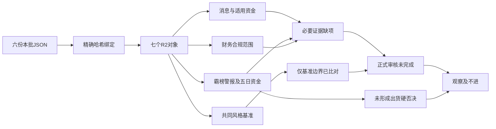

# 2026年11月2日 · 反证 / Devil's Advocate

> 数据源新鲜度：partial；降级：true；置信度：0.336（方法性评分，非风险概率）。

## 🛑 一句话结论

7票局部已审、必要审核0票；18条反证、0条硬否决不代表通过，观察/不进。

## 🧭 详细分析

情绪=主跌，依据是10月30日炸板39.74%、82家跌停及接力负反馈，不是11月2日盘中情绪重测。R2已按14减至7保留研究对象；本次没有新增或递补对象。市场此前为风险收缩中的局部防御付钱，不能把两只白酒封板及证券首板直接推成全市场修复。

主线=白酒概念，持续性=1日（仅可核涨停潮，不是已确认轮次），封板率=100%（10月30日当前成分交集口径），明日预期=分歧。今日完整触板/炸板分母未知，因此今日封板率保持未知。84分和启动期敏感性不是交易许可，主模板仍为首板隔日，不焊接五套打法。

本轮7票均为研究观察，板型与研究地位保留，龙头认定仅0—2条，均未过3/4；RR与止损几何均未知，计划外命中保留。今日做负面识别和缺口回送，不做正向买入结论、不修改池身份、持仓或计划。有效零交易预算、禁止新仓及既有保护完全不变。

这是实际盘中读取既有磁盘JSON后的迟到研究，不是冻结盘前输入回放，不冒充事前预测。源行情分别覆盖10月23日、10月30日和11月2日；最新R5报价截止10:16，上游知识截止10:32，准确时点与输入哈希见JSON。08:30仅交付目标，迟交不触发撤单/清池；本阶段用量未计量不作0，不保证低于连续任务努力目标。

## 📋 六类反证与必要财务审计

| 模式 | 结果 | 限定与回送 |

|---|---|---|

| mode1_数据源冲突 | partial | 局部证据保留，必要逐票证据仍缺；回送R4/R7、R3或R5 |

| mode2_风格一致性 | executed | 7票完成共同T-1基准及零预算边界比较；不确认T0全市场阶段 |

| mode3_估值×主线 | executed | 现有估值事实已审；缺预测不造估值 |

| mode4_历史类比 | degraded | 本次读取边界限R1-R5/R7，无可核历史类比样本；R2历史审计unreplayable，不用其经验倒填预测 |

| mode5_昨日兑现 | degraded | 未读取昨日R6/E1原时点兑现证据；R2内既有反馈明确unknown，不能称昨日反证兑现 |

| mode6_霸榜出货 | partial | 局部证据保留，必要逐票证据仍缺；回送R4/R7、R3或R5 |

| mode7_财务合规 | partial | 局部证据保留，必要逐票证据仍缺；回送R4/R7、R3或R5 |

| mode8_解套盘假繁荣 | degraded | 缺封板量与历史套牢区有效匹配，不估解套盘比例 |

| mode9_高位触板 | executed | 仅核上海沪工实际高度及冲板回落，不以高度新增hard_reject |

| mode10_跨资产背离 | degraded | 缺候选对应商品的精确业务关联与同期窗口；R1铜/油/金不可凭概念外推 |

## 🧩 四象限负面识别

采用事件极性×同窗口价格高低位。正面×高位识别利好兑现，负面×高位识别双杀，负面×低位识别下跌中继，正面×低位仍须交易门禁。这里识别的是风险框架，不是买入排序。

7票均缺本轮明确高低位置与冻结预测窗口，象限全部为null。不能将首板当低位、三板当高位，更不能把strong_suggest回填为历史看空。益方与高争虽有明确正面事件，位置缺证仍不归象限；其余主题间接映射、未核催化与混合信号分开记录。

R4其余负面完整保留：奥精医疗涉嫌财务虚假被立案；海洋王概念澄清；近岸蛋白AI收入不足2%；ST合纵立案；赛力斯销量下降51.57%；PMI49.3%；美方检测限制的回应。均非本批R2精确对象或直接行业映射未核，sector/round/事件窗口不造填，不转为本批候选硬否决。

## 🚦 霸榜出货裁定

东方海洋周末两自然日榜首只是拥挤代理，R3明确未确认出货；R5五日资金为+2.263786亿元，东财口径+2.198689亿元。单日主力/机构净卖不能替代五日净额；本票原execution_eligible=false。保留强风险提示和R3拦截/正向信用0，不写模式六hard_reject。

襄阳轴承是R2已剔除对象，商业航天不对应本次7票，不能凭概念关联到上海沪工。其他票未列警报不等于已核false。财务审计现有标准无保留意见亦不等于全项合规安全；F9、F10、F6、S1及未完成项并存。

## 🔎 逐票研究对象：仅负面复核

| 对象 | 板型 | 原研究地位/认定 | RR | 禁止清单 |

|---|---|---|---|

| 皇台酒业 000995.SZ | 换手二板（盘中） | 龙头 / 2条 | 未知，不能执行 | plan_outside_scan；完整14项未核 |

| 水井坊 600779.SH | 换手首板（盘中） | 龙二 / 2条 | 未知，不能执行 | plan_outside_scan；完整14项未核 |

| 益方生物 688382.SH | 非涨停；临床事件冲高回落 | 未确认 / 0条 | 未知，不能执行 | plan_outside_scan；完整14项未核 |

| 东方海洋 002086.SZ | T-1二板，今日触板（未确认三板） | 龙头 / 1条 | 未知，不能执行 | plan_outside_scan；完整14项未核 |

| 上海沪工 603131.SH | T-1三板；T0冲板回落 | 龙头 / 1条 | 未知，不能执行 | plan_outside_scan；完整14项未核 |

| 国金证券 600109.SH | 换手首板（盘中） | 龙头 / 2条 | 未知，不能执行 | plan_outside_scan；完整14项未核 |

| 高争民爆 002827.SZ | 复牌一字首板（盘中） | 未确认 / 0条 | 未知，不能执行 | plan_outside_scan, one_word_unreachable；完整14项未核 |

### 皇台酒业：观察/不进

- **大资金意图**: 假设资金从科技风险中切向小盘白酒身位，交易的是次日接力而非季度盈利；最新榜机构净买为正向旁证，而更早榜净卖与持有人增加是反证，需分时点看待。

- **为什么走强**: 同板块两前排与盘中二板同向，但股价走强与财务走弱背离；小盘筹码和短线合力可能主导，非已证实因果。

- **逻辑够不够硬**: 价格、资金、公告三个证据面可核，却没有盈利拐点；完整龙头四条仅过2条，不能拿早封重复计数。

**买入理由**: 本段只复述原研究入池理由，不授买权。当前白酒已返回封板样本最高2板、09:30首封早于水井09:38；不沿用周五迎驾首封名次；没有已核个股新增订单或盈利催化；白酒防御轮动是资金假设。三季报营收下降17.76%、归母亏损，不支持把二板解释为经营反转。

**风险点**: 盘中高开接近涨停，隔夜跳空风险不能由盘中止损覆盖；三季报亏损、户数增加与高估值，题材退潮时缺基本面托底。控股股东逐人质押率未核；pledge_stat空不视为0；关联交易占比、研发资本化及完整监管事项须R6再核；无可核下一季指引、TAM规模及一致预期修订，未计算GF-DMA全指数或TAM-PEG数值；两融接口成功空返回；非两融资格尚未独立验证，不伪造0余额

**止损条件**: 仅原研究失效条件，不生成交易指令：收盘跌回上一完成日MA5且白酒前排同时失去正反馈，撤销强势接力研究；公告出现经营/合规证伪立即送R6，不生成卖单。

**可验证假设**: 下一交易日核验皇台保持白酒前排且至少新增1只独立首板；若核心开板并板块净额转负，延续假设减弱。。本次不承诺补抓，不把待核条件写成已验证。

### 水井坊：观察/不进

- **大资金意图**: 可能是白酒低位容量修复及对高度票的助攻；五日资金负值使连续配置解释尚弱。

- **为什么走强**: 低位位置叠加板块联动形成盘中首板，近期回款改善提供解释线索；不能忽略收入和利润同比下降。

- **逻辑够不够硬**: 公告业绩和首板报价真实，但消费需求转强没有独立证明；2/4纪律条款只够研究。

**买入理由**: 本段只复述原研究入池理由，不授买权。白酒返回涨停样本另一首板，09:38首封；高度低于皇台，暂列研究龙二不替代龙一；白酒轮动而非独立硬订单。三季报与三季度经营公告在10月31日发布，利润同比下降34.30%但经营现金流回正，改善与下滑须同时列。

**风险点**: 周线/日线原下降趋势可能只反抽一天；TTM PE高分位但盈利下滑，估值修复依赖后续经营兑现。控股股东逐人质押率未核；pledge_stat空不视为0；关联交易占比、研发资本化及完整监管事项须R6再核；无可核下一季指引、TAM规模及一致预期修订，未计算GF-DMA全指数或TAM-PEG数值

**止损条件**: 仅原研究失效条件，不生成交易指令：首板失败且白酒资金转负，或后续经营公告否定回款改善，撤销低位助攻假设。

**可验证假设**: 下一交易日核首板正溢价与白酒净额同时为正；若只有皇台独涨且水井失去承接，助攻假设失效。。本次不承诺补抓，不把待核条件写成已验证。

### 益方生物：观察/不进

- **大资金意图**: 假设事件资金交易研发成功率重估，但长线抛压与短线冲高回落并存；没有资金持续买入证明。

- **为什么走强**: 临床终点达标解释高开，随后回落说明利好未形成一致右侧；公告与价格不是同一层证据。

- **逻辑够不够硬**: 研发里程碑够硬，收入增量不够硬；申报、获批、定价和商业化均未兑现，不能缩成一个利好标签。

**买入理由**: 本段只复述原研究入池理由，不授买权。R4三期主要终点原公告支持真实事件研究，当前12.25低于昨收12.39，不授予行业龙头名号；D-2570注册性三期391例、PASI90均超70%、PGA0/1均超80%，R4已核公司原公告；公司明示结果不会对业绩产生重大影响，不能把终点成功写成销售落地。

**风险点**: 临床成功不等于获批或收入，同靶点竞争仍在；持续亏损和现金流消耗叠加下降通道，抄底容易变隔夜接盘。控股股东逐人质押率未核；pledge_stat空不视为0；关联交易占比、研发资本化及完整监管事项须R6再核；无可核下一季指引、TAM规模及一致预期修订，未计算GF-DMA全指数或TAM-PEG数值

**止损条件**: 仅原研究失效条件，不生成交易指令：原公告主要终点被更正或价格再创新低且资金继续负向，撤销短线修复假设；临床逻辑与短线逻辑分别复核。

**可验证假设**: 未来24-72小时核有无冲突/更正公告，且价格重新站回完成日MA5并出现至少2只同方向前排助攻；缺一只保留事件观察。。本次不承诺补抓，不把待核条件写成已验证。

### 东方海洋：观察/不进

- **大资金意图**: 可能为低价身位和多题材交易而非纯CRO配置；次线资金走弱时单票分离更依赖短线接力。

- **为什么走强**: 前期箱体突破叠加连板带来热度，但真主营与市场标签错配；没有独立数据支持CRO订单暴增。

- **逻辑够不够硬**: 高度与价格可核，产业传导偏软；仅过1条龙头纪律，不能因三板潜力补齐其余条款。

**买入理由**: 本段只复述原研究入池理由，不授买权。当前成分表映射CRO且T-1该样本最高2板；业务主业归农产品，R5须复核题材纯度；R3周末霸榜警报仅作风险；10月子公司医疗器械注册证是已公开旧事件，R4临床消息主体是益方而非东方。10月30日股东提议换届与异常波动公告是治理/交易风险背景，不是已证实订单增长。

**风险点**: PB高分位与亏损并存，低绝对价不代表安全；CRO行业负资金、机构席位净卖和热榜拥挤可能放大兑现。控股股东逐人质押率未核；pledge_stat空不视为0；关联交易占比、研发资本化及完整监管事项须R6再核；无可核下一季指引、TAM规模及一致预期修订，未计算GF-DMA全指数或TAM-PEG数值；两融接口成功空返回；非两融资格尚未独立验证，不伪造0余额

**止损条件**: 仅原研究失效条件，不生成交易指令：高位开板且同方向没有扩散，或业务公告否定题材映射，撤销板块龙头假设。

**可验证假设**: 下一交易日核CRO净额转正且至少2只独立相关前排跟随；若仅本票触板，不升级板块合力结论。。本次不承诺补抓，不把待核条件写成已验证。

### 上海沪工：观察/不进

- **大资金意图**: 假设短线资金兑现前期一字利润，盘中高点回落支持兑现风险但不直接证明特定席位出货。

- **为什么走强**: 先前三板来自题材/身位，今日弱来自开板供给释放；产业端机器人收入太小，难用经营增长为估值背书。

- **逻辑够不够硬**: 连续板和财报可核，但机器人需求传导没有硬订单；归母为正而扣非亏损是明确质量反证。

**买入理由**: 本段只复述原研究入池理由，不授买权。T-1机器人候选最高3板且09:25封板；当前18元已低于19.31盘中高点，旧高度不转换成今日买权；未取得已核机器人增量订单，三季报净利同比高增主要不能代表扣非质量；机器人集成半年收入仅64.49万元，与叙事规模不匹配。

**风险点**: 连续一字后集中换手，T+1接力可能承受较大回撤；非经常损益支撑归母利润，主题业务收入极小。控股股东逐人质押率未核；pledge_stat空不视为0；关联交易占比、研发资本化及完整监管事项须R6再核；无可核下一季指引、TAM规模及一致预期修订，未计算GF-DMA全指数或TAM-PEG数值；两融接口成功空返回；非两融资格尚未独立验证，不伪造0余额

**止损条件**: 仅原研究失效条件，不生成交易指令：收盘不能恢复封板且板块资金继续负向，撤销三板延续假设；扣非进一步恶化则维持估值降档。

**可验证假设**: 下一交易日核能否重新回封且机器人封板率较36.84%改善、板块资金转正；三项缺任一则不升级。。本次不承诺补抓，不把待核条件写成已验证。

### 国金证券：观察/不进

- **大资金意图**: 可能为风险偏好转移时的金融工具预期和低估值修复，五日负资金说明新生方向尚待持续性确认。

- **为什么走强**: 政策预期、低位估值与盘中两首板同向；与其他题材不同，利润为正且增长，但不意味着政策增量已到账。

- **逻辑够不够硬**: 财报正增长与真实价格硬，政策效果和新方向持续性软；只有2/4纪律通过，不给执行资格。

**买入理由**: 本段只复述原研究入池理由，不授买权。证券两个返回封板样本同为首板，国金09:34早于太平洋09:50；不是以盘中净流入大小取代首封；拟召开资本市场支持工具座谈会与意向额度是政策预期，不是资金已实投。三季报收入、利润同比正增长，基本面独立于政策传闻。

**风险点**: 会议预期若不及预期可能兑现，额度不等于实投；原下降趋势及五日净流出未完全逆转，孤立首板易回落。控股股东逐人质押率未核；pledge_stat空不视为0；关联交易占比、研发资本化及完整监管事项须R6再核；无可核下一季指引、TAM规模及一致预期修订，未计算GF-DMA全指数或TAM-PEG数值

**止损条件**: 仅原研究失效条件，不生成交易指令：政策原文弱于预期且证券资金转负，或首板跌回原均线带且无助攻，撤销新生方向假设。

**可验证假设**: 下一交易日核国金/太平洋首板产生正溢价且证券净额维持正；如两票同时开板且行业转负，启动假设失效。。本次不承诺补抓，不把待核条件写成已验证。

### 高争民爆：观察/不进

- **大资金意图**: 假设资金交易矿业注入期权，极低成交和一字封板说明未完成市场化换手，真实可买性仍缺。

- **为什么走强**: 从筹划停牌到具体预案、复牌时间给出新增事实，涨停解释是资产结构预期而非已增厚利润。

- **逻辑够不够硬**: 预案与复牌够硬，作价、审批、利润贡献及稀释不够硬；0/4龙头纪律与一字不可达同时保留。

**买入理由**: 本段只复述原研究入池理由，不授买权。R4重组公告已核；rt_k O=H=L=C=56.98一字，无成交买点分支；非板块龙头已确认；拟购紫源铜业51%、晟源矿业100%并配套融资，审计评估与作价未定。11月2日复牌是明确时间锚，不把拟注入矿业当现有收入。

**风险点**: 重组审计、交易作价、监管审批和股本摊薄均未知；旧估值高、应收占收入较高且有息负债较重，一字开板后可能集中兑现。控股股东逐人质押率未核；pledge_stat空不视为0；关联交易占比、研发资本化及完整监管事项须R6再核；无可核下一季指引、TAM规模及一致预期修订，未计算GF-DMA全指数或TAM-PEG数值；两融接口成功空返回；非两融资格尚未独立验证，不伪造0余额

**止损条件**: 仅原研究失效条件，不生成交易指令：核心标的比例/作价恶化、审批失败，或开板后无承接且无板块扩散，撤销资产注入短线假设。

**可验证假设**: 未来24-72小时核是否有重组问询或方案更正，且至少2只独立民爆助攻出现；交易定价未明前不升级内在价值。。本次不承诺补抓，不把待核条件写成已验证。

## ⚠️ 完整反证条目

### R6_M1_01 · 皇台酒业 · soft_suggest

若把白酒局部强势外推为皇台经营反转，证据不足；R2原文并未作此确认。

- R5九个月归母亏损、营收同比下降17.7562%；资金正向不等于经营转折。 · 来源 R5 /profiles/0/dimensions/valuation_safety

- R2白酒84分仅为研究主线；催化是配置假设，不是业绩反转。 · 来源 R2 /main_lines/0/reason

- 处置：观察；保留原研究限定，拦截从主题涨停推导盈利反转或买入资格。

- 限定：不把缺个股催化描述成已证实利空；R7缺本票同窗口资金分支，模式1未完成。

- 作用域：sector_id=885525.TI；round_id=null；事件锚=null；有效期沿用R2当日研究复核窗口，精确值见JSON；不是原风险发生时刻。

### R6_M1_02 · 水井坊 · soft_suggest

水井坊当日首板若被解释为此前连续吸筹，与已核五日净额不一致。

- R5近五日大单净额-0.046576亿，东财-0.055312亿，两源方向均负。 · 来源 R5 /profiles/1/dimensions/chip_structure

- R2只给盘中首板及研究龙二，主力五日原为未知。 · 来源 R2 /research_candidates/1

- 处置：观察；区分盘中新流入与此前五日净流出，不把首板当作连续吸筹确认。

- 限定：跨窗口方向变化不是同窗口数据矛盾；R7本票分支仍缺。

- 作用域：sector_id=885525.TI；round_id=null；事件锚=null；有效期沿用R2当日研究复核窗口，精确值见JSON；不是原风险发生时刻。

### R6_M1_03 · 益方生物 · strong_suggest

临床主要终点成功不等于获批、利润或行业趋势，硬事件可能被兑现。

- R4 E004仅确认临床主要终点，不证明获批商业化。 · 来源 R4 /top_events/3

- R5近5日净额-0.832114亿；持续亏损与价格下降未被融资增加扭转。 · 来源 R5 /profiles/2/dimensions/chip_structure

- R2已记录13.32回落至12.25，行业主线地位未核。 · 来源 R2 /research_candidates/2/risk_points

- 处置：降级事件观察，不进；不能由事件正面直接外推行业买权。

- 限定：不把科创未盈利直接等同ST或临近退市；R7缺本票有效适用分支。

- 作用域：sector_id=886015.TI；round_id=null；事件锚=2026-11-01；有效期沿用R2当日研究复核窗口，精确值见JSON；不是原风险发生时刻。

### R6_M1_04 · 东方海洋 · strong_suggest

东方海洋CRO标签与当日接力外推存在纯度和资金反证。

- R2 CRO今日-2.0069%、净额-6.526099亿；不能沿用T-1流入。 · 来源 R2 /secondary_lines/3/intraday_evidence

- R7同票列上涨主力净卖及单日龙虎榜净卖风险，五日仍为正。 · 来源 R7 /upstream_candidate_capital_constraints/4

- R5说明亏损、CRO业务纯度冲突及机构席位净卖。 · 来源 R5 /profiles/3

- 处置：降级观察；不得把水产/检测业务标签当作已核CRO收入增长，不进。

- 限定：T0概念与T-1个股金额不混加，不把单日净卖替代近5日净额。；消息的精确对象及适用窗口未齐，模式1仍未完成。

- 作用域：sector_id=885927.TI；round_id=null；事件锚=null；有效期沿用R2当日研究复核窗口，精确值见JSON；不是原风险发生时刻。

### R6_M1_05 · 上海沪工 · strong_suggest

上海沪工旧三板不能证明机器人新产业叙事已兑现。

- R2机器人T-1封板率36.84%，7涨停对12炸板，资金负向；R3注意力并非价格强势。 · 来源 R2 /secondary_lines/1

- R5机器人主题收入极低、扣非亏损，今日放量回落不能当健康承接。 · 来源 R5 /profiles/4

- 处置：降级观察；不进，不用旧高度抵消真实业务纯度和冲板回落。

- 限定：不因高位、三板或晋级标签单独hard_reject；周末模型/机器人宣称未被R4核为公司硬催化。

- 作用域：sector_id=885517.TI；round_id=null；事件锚=null；有效期沿用R2当日研究复核窗口，精确值见JSON；不是原风险发生时刻。

### R6_M1_06 · 国金证券 · soft_suggest

证券盘中两首板不证明政策额度已成为实投，或此前五日已转为吸筹。

- R4 E005为拟开会，E006未公布银行名称及实际放款。 · 来源 R4 /top_events/5

- R5国金五日净额-0.7067亿，东财-0.712537亿；R2当日行业正额属于新窗口。 · 来源 R5 /profiles/5/dimensions/chip_structure

- 处置：观察；不进；只保留盘中研究事实，等待政策与持续接力的独立核验，不倒填旧资金。

- 限定：不静态排斥证券攻势；但行业流入不等于逐票净买，R7精确分支缺失。

- 作用域：sector_id=881157.TI；round_id=null；事件锚=2026-11-01；有效期沿用R2当日研究复核窗口，精确值见JSON；不是原风险发生时刻。

### R6_M1_07 · 高争民爆 · strong_suggest

重组预案和复牌一字不能等同资产价值确定或可成交机会。

- R4 E003审计评估未完成、交易作价未定。 · 来源 R4 /top_events/2

- R2一字不可成交，one_word_unreachable与计划外命中。 · 来源 R2 /research_candidates/6/forbidden_list_hits

- R5五个有效交易日资金窗口为10月19—23日，不是停牌的26—30日；净额负。 · 来源 R5 /profiles/6/dimensions/chip_structure

- 处置：不进；保留单票重组研究，不用低位同概念票替补，不生成可成交买点。

- 限定：未完成审计评估不等于已发现非标审计或财务造假，不据此硬否决。；旧资金不得冒充复牌日即时抛售。

- 作用域：sector_id=885960.TI；round_id=null；事件锚=2026-11-01；有效期沿用R2当日研究复核窗口，精确值见JSON；不是原风险发生时刻。

### R6_M3_08 · 皇台酒业 · strong_suggest

皇台研究龙一的身位不消除亏损与高估值承接风险。

- R5 PE_TTM748.9028倍、正值样本分位91.17%，PB16.3986；九个月归母亏损，不适用稳态PE/PEG推价。 · 来源 R5 /profiles/0/dimensions/valuation_safety

- 处置：降级观察；不进，不将高估值当必跌预测，也不把涨停当基本面托底。

- 限定：分位截至10月30日；非今日估值，非命中4条财务红旗。

- 作用域：sector_id=885525.TI；round_id=null；事件锚=null；有效期沿用R2当日研究复核窗口，精确值见JSON；不是原风险发生时刻。

### R6_M3_09 · 水井坊 · soft_suggest

水井坊低PB历史分位不等于全面低估。

- R5 PE42.3347倍、95.04%分位；PB2.4996、2.34%分位；盈利收缩导致双锚背离。 · 来源 R5 /profiles/1/dimensions/valuation_safety

- 处置：观察；不进，不用低PB单一口径推定安全边际。

- 限定：缺DCF可核预测，不造内在价或RR。

- 作用域：sector_id=885525.TI；round_id=null；事件锚=null；有效期沿用R2当日研究复核窗口，精确值见JSON；不是原风险发生时刻。

### R6_M3_10 · 东方海洋 · strong_suggest

东方海洋低绝对股价不代表便宜，亏损叠加PB高分位。

- R5 PB4.5347、分位98.02%，PE不适用；PS分位82.18%，不能用价格低解释低估。 · 来源 R5 /profiles/3/dimensions/valuation_safety

- 处置：降级观察；不进，题材退潮的估值承接不作安全假设。

- 限定：高分位本身不是hard_reject；未凭严重度回填历史看空立场。

- 作用域：sector_id=885927.TI；round_id=null；事件锚=null；有效期沿用R2当日研究复核窗口，精确值见JSON；不是原风险发生时刻。

### R6_M3_11 · 上海沪工 · strong_suggest

上海沪工净利高增可能被一次性收益误读为可持续产业利润。

- R5 F6由归母减扣非测得非经常损益占236.62%；归母1159.11万元、扣非-1583.55万元。 · 来源 R5 /profiles/4/dimensions/valuation_safety/fundamental_checks/F6

- R5归母同比+687.4258%而扣非同比-14.6451%，符合V6一次性收益陷阱的经济含义；未宣称已独立核EPS调整。 · 来源 R5 /profiles/4/dimensions/valuation_safety/financial_indicator_latest

- 处置：降级观察；不进，不用归母高增长制造PEG或主题收入兑现。

- 限定：V6为利润口径交叉提示，F6仅算一条财务红旗，不重复计数升级硬否决。

- 作用域：sector_id=885517.TI；round_id=null；事件锚=null；有效期沿用R2当日研究复核窗口，精确值见JSON；不是原风险发生时刻。

### R6_M3_12 · 高争民爆 · soft_suggest

高争停牌前高估值与未知交易定价不支持SOTP加总。

- R5旧PE93.593倍、PB14.8309；估值窗口截止10月23日，交易作价、净债及稀释未知。 · 来源 R5 /profiles/6/dimensions/valuation_safety

- 处置：观察；不进，不拿旧估值当复牌日实时指标，不加总未定资产价值。

- 限定：SOTP缺资料不是已证实V10倍数陷阱，不扩硬否决。

- 作用域：sector_id=885960.TI；round_id=null；事件锚=2026-11-01；有效期沿用R2当日研究复核窗口，精确值见JSON；不是原风险发生时刻。

### R6_M6_13 · 东方海洋 · strong_suggest

东方海洋周末连续榜首增加拥挤兑现风险，但未满足出货硬否决双条件。

- R3周末两自然日榜首警报，confirmed_distribution=false，只是拥挤代理。 · 来源 R3 /hotlist_signals/distribution_alert/2

- R5近五日净额+2.263786亿，东财+2.198689亿；均非负数。 · 来源 R5 /profiles/3/dimensions/chip_structure

- R2本票execution_eligible=false，不属于模式6执行龙一/龙二触发集。 · 来源 R2 /research_candidates/3/execution_eligible

- 处置：降级观察；保留R3拦截/正向信用0，不进；本次不写出货hard_reject。

- 限定：此strong_suggest为拥挤与兑现风险提示，非把confirmed_distribution=false改成true。；无其他候选逐票显式已核alert阴性；不因未列警报就判出货风险已排除。

- 作用域：sector_id=885927.TI；round_id=null；事件锚=null；有效期沿用R2当日研究复核窗口，精确值见JSON；不是原风险发生时刻。

### R6_M7_14 · 益方生物 · strong_suggest

已检出财务风险不能被主题地位或空合规清单掩盖。

- F9：应收/九个月营收125.92%；S1：两年亏损及低收入研究财务轴，非科创ST事实。 · 来源 R5 /profiles/2/dimensions/valuation_safety/fundamental_flags

- R5明确保留质押逐人、关联交易、研发资本化及完整监管事项缺口；最新可用年度审计标准无保留不等于全面合规通过。 · 来源 R5 /profiles/2/data_gaps

- 处置：降级观察，不进；保留红旗原口径及限定，交R5补必要财务合规证据。

- 限定：F9为九个月累计营收分母，非年度或年化；不机械套ST门槛。；未检出F12非标/合规轴/临近轴确证；缺项不填无红旗。；不重复计S1为多条F红旗；尚无≥4条或imminent硬否决证据。

- 作用域：sector_id=886015.TI；round_id=null；事件锚=2026-11-01；有效期沿用R2当日研究复核窗口，精确值见JSON；不是原风险发生时刻。

### R6_M7_15 · 东方海洋 · strong_suggest

已检出财务风险不能被主题地位或空合规清单掩盖。

- S1：2024/2025年归母均亏损；不等于已披露ST预警或合规违法。 · 来源 R5 /profiles/3/dimensions/valuation_safety/fundamental_flags

- R5明确保留质押逐人、关联交易、研发资本化及完整监管事项缺口；最新可用年度审计标准无保留不等于全面合规通过。 · 来源 R5 /profiles/3/data_gaps

- 处置：降级观察，不进；保留红旗原口径及限定，交R5补必要财务合规证据。

- 限定：F9为九个月累计营收分母，非年度或年化；不机械套ST门槛。；未检出F12非标/合规轴/临近轴确证；缺项不填无红旗。；不重复计S1为多条F红旗；尚无≥4条或imminent硬否决证据。

- 作用域：sector_id=885927.TI；round_id=null；事件锚=null；有效期沿用R2当日研究复核窗口，精确值见JSON；不是原风险发生时刻。

### R6_M7_16 · 上海沪工 · soft_suggest

已检出财务风险不能被主题地位或空合规清单掩盖。

- F6：非经常损益由归母减扣非估计，占归母236.62%；不是逐项审计。 · 来源 R5 /profiles/4/dimensions/valuation_safety/fundamental_flags

- R5明确保留质押逐人、关联交易、研发资本化及完整监管事项缺口；最新可用年度审计标准无保留不等于全面合规通过。 · 来源 R5 /profiles/4/data_gaps

- 处置：降级观察，不进；保留红旗原口径及限定，交R5补必要财务合规证据。

- 限定：F9为九个月累计营收分母，非年度或年化；不机械套ST门槛。；未检出F12非标/合规轴/临近轴确证；缺项不填无红旗。；不重复计S1为多条F红旗；尚无≥4条或imminent硬否决证据。

- 作用域：sector_id=885517.TI；round_id=null；事件锚=null；有效期沿用R2当日研究复核窗口，精确值见JSON；不是原风险发生时刻。

### R6_M7_17 · 高争民爆 · strong_suggest

已检出财务风险不能被主题地位或空合规清单掩盖。

- F9：应收/九个月营收104.27%；F10：借款/债券/一年到期部分合计对归母权益下界160.80%，成分及总权益口径仍需核。 · 来源 R5 /profiles/6/dimensions/valuation_safety/fundamental_flags

- R5明确保留质押逐人、关联交易、研发资本化及完整监管事项缺口；最新可用年度审计标准无保留不等于全面合规通过。 · 来源 R5 /profiles/6/data_gaps

- 处置：降级观察，不进；保留红旗原口径及限定，交R5补必要财务合规证据。

- 限定：F9为九个月累计营收分母，非年度或年化；不机械套ST门槛。；高争F10为部分成分下界及归母权益口径，strong为两项风险联合提示，尚非完整F10排雷结论。；不重复计S1为多条F红旗；尚无≥4条或imminent硬否决证据。

- 作用域：sector_id=885960.TI；round_id=null；事件锚=2026-11-01；有效期沿用R2当日研究复核窗口，精确值见JSON；不是原风险发生时刻。

### R6_M9_18 · 上海沪工 · strong_suggest

三板后的冲板回落提示接力尾部风险，不是高度即否决。

- R2 T-1三板、T0冲板回落，参考价18低于盘中高点19.31；昨日一字成交性不能外推。 · 来源 R2 /research_candidates/4

- 处置：降级观察，不进；仅记录extreme_tail_risk风险，不新增高度硬否决。

- 限定：T0未收盘，不认定已经最终炸板或收盘晋级失败；不按高度推历史轮次。

- 作用域：sector_id=885517.TI；round_id=null；事件锚=null；有效期沿用R2当日研究复核窗口，精确值见JSON；不是原风险发生时刻。

## 🔗 关键证据

- R2 7票全部无执行资格，14→7减半已在上游落实；不以审核再次砍半真实研究对象。

- R3霸榜列表明确区分拥挤与出货；东方海洋五日净额为正，不满足出货硬否决双条件。

- R5益方F9/S1、东方S1、沪工F6、高争F9/F10原口径保留；unknown不当not_hit。

- 全部必要模式有RFC 6901逐票证据指针；输入内容哈希绑定R2/R5消费链；非所有项目完成。

## 数据源审计

| 源 | 日期 | 状态 | 记录数/备注 |

|---|---|:--:|---|

| R1 | 2026-11-02 | 🟡 | 1份/对象；质量degraded；内容哈希已绑定，输入读取成功不等于研究complete |

| R2 | 2026-11-02 | 🟡 | 7份/对象；质量partial；内容哈希已绑定，输入读取成功不等于研究complete |

| R3 | 2026-11-02 | 🟡 | 1份/对象；质量partial；内容哈希已绑定，输入读取成功不等于研究complete |

| R4 | 2026-11-02 | 🟡 | 1份/对象；质量partial；内容哈希已绑定，输入读取成功不等于研究complete |

| R5 | 2026-11-02 | 🟡 | 7份/对象；质量partial；内容哈希已绑定，输入读取成功不等于研究complete |

| R7 | 2026-11-02 | 🟡 | 1份/对象；质量partial；内容哈希已绑定，输入读取成功不等于研究complete |

## ❓ 不确定性 / 反证

必要审核模式1、6、7逐票仍未完成；mode2只完成共同T-1基准与边界比较，不宣称今日阶段已核。历史类比、昨日兑现、套牢盘估算和候选对应商品分支局部降级；R2包内经验为unknown，不推旧立场、旧轮次或已兑现。高位、缺资料、迟交都不单独新增硬否决。

所有sector_id只来自精确R2对象，round_id全部null。event_at沿用精确对应R2线条的已声明事件锚；缺锚保持null；valid_from/valid_until沿用R2当日研究复核窗口，未改写为风险发生或历史预测区间。R6新风险事件准确发生时刻未知则单列null，避免制造精度。

## 🔄 与其他 R/D/E 的关系

- 依赖：R1_style、R2_main_sectors、R3_sentiment、R4_news、R5_stock_profiles、R7_capital_flow 六份JSON；本次无MCP及网络抓数。

- 回送：R4/R7补逐票消息与适用资金；R3补明确alert核验及窗口；R5补财务合规检出范围。

- 被消费：D1与E1；hard_reject不可覆盖；strong_suggest须显式接受或记录覆盖理由；soft_suggest进入反证备注。空硬否决清单不解除零预算/禁新仓，不递补杂毛。

## Sub-Agent 元数据

- skill: analyze_devil_advocate_v1

- artifact: data/research/20261102/R6_devil_advocate.json

- model: gpt-6.1-sol

- 生成耗时：未单独可靠计量，不伪造秒数；实际生成时点见frontmatter。
