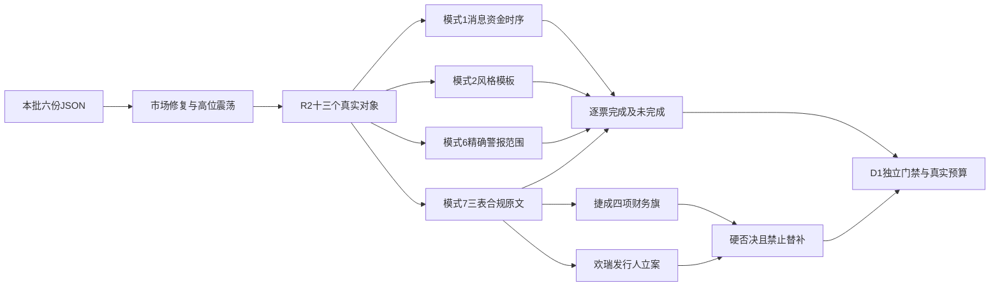

# 2026年11月3日 · 反证 / Devil's Advocate

> 数据源新鲜度：partial · 降级：true · 置信度：0.64125

## 🧭 一句话结论

**13票局部已审；捷成、欢瑞硬否决。必要审核未全完，不是全票通过。**

## 🌊 详细分析：先认市场，再审个股

市场在为广谱修复与少数前排付钱。基准是11月2日收盘：4681涨、818跌，非ST涨停125、跌停8；炸板率18.30%，未触发35%候选减半。前一涨停池开盘至收盘均值仅约+0.13%，因此不能把广度反弹写成任意追涨都有隔日溢价。情绪=震荡，阶段=高位震荡；旧主跌零仓意见不无限继承。

主线=传媒/AI内容，持续性=1日，封板率=未知，明日预期=分歧；主线=证券/金融科技，持续性=1日，封板率=未知，明日预期=分歧。这里的“明日”沿用R2从11月2日观察指向11月3日的下一时段假设，不延伸到11月4日。板块封板分母未核，不能拿全市场81.70%代填。传媒五日行业净额仍为-2.939679亿元，非银为-25.044260亿元；单日回流不能叫持续主升。

唯一主模板沿用“首板隔日”。R2排名是研究地位，不是开仓资格；13票RR与止损距离均未知。模式2保留13票实质比较完成，模式1以同版R5真实资金/价格与R4消息交叉完成10票，白酒3票缺消息实际检查范围继续未完成。金融消息在盘后，不能倒推是昨日早封的原因；完成这个反证审查不等于政策后已有T0资金确认。

模式6只在本R2精确板块白酒概念的已查窗口完成3票阴性分支；传媒母板块、非银母板块没有足够已核alert结果，10票保持未知。新华个股的局部阴性不能抹掉板块未查。模式7逐票核三表、实际计算及合规原文，19项F旗重算成立，但13票S3仍缺关键依据；捷成、国金、东财、皇台的S2还需原生产者补齐。单票缺证不生成全局禁买。

## ⛔ 两项硬否决

| 对象 | 真实依据 | 原规则 | 处置与限定 |
|---|---|---|---|
| 捷成股份 `300182.SZ` | F2商誉／净资产34.7662%；F3按原增速不等式成立；F9应收／收入110.9414%；F11控制人质押81.5667% | 同票至少4项F红旗 | **拦截**，禁止执行；会计责令整改本身没有硬升级为造假 |
| 欢瑞世纪 `000892.SZ` | 三季报原文明确发行人涉嫌信披违法违规被立案，至报告出具日未收到结论 | S2合规轴 | **拦截**，不是已认定财务造假；价格涨停与正流入不解除调查风险 |

捷成F3特别限定：应收同比实际下降9.0674%，收入下降23.7316%，原判据为应收增速大于收入增速的1.5倍。它在负增长基数下命中，不能换成“应收绝对暴增”；本轮不擅改已批准阈值。该票原R5汇总未作四旗硬否决，R6依据四项实算独立聚合。欢瑞F11的98.9247%只属于控制主体之一欢瑞联合，不冒充全集团质押率。

硬否决只能留研究观察，不能以“等分歧”保留执行资格；不得用龙二、弹性核心或龙三补数量。S3必要审核缺口仍保留，但不删除已成立硬否决。声明的R2研究窗口结束，不等于原财务或调查风险消失，必须有新事实并经R6复核。

## 🧪 必要审核覆盖

| 模式 | 已实质审查对象 | 必要项完成 | 未完成与归属 |
|---|---:|---|
| 1 消息×资金／价格 | 13 | 10 | 白酒3票缺R4消息已查范围；不是R7缺票导致 |
| 2 风格一致性 | 13 | 13 | 高位震荡×首板隔日观察；完成≠放行 |
| 6 出货预警 | 13 | 3 | 白酒已查窗口未命中；其余R2精确母板块缺R3结果 |
| 7 财务合规 | 13 | 0 | S3关键证据13票未齐；部分另缺S2闭环 |

四类必要项全部完成的个股为0；已评估对象为13，两者不能混同。没有形成模式6硬否决，不等于出货风险已全部排除。

## 🔬 逐票实质判断与依据

### 1. 芒果超媒 `300413.SZ` · 观察

板型：低位首板观察（仅当日板数，绝对位置未判）；R2地位：龙头，纪律§2通过数仍为未知（不能由研究排名补齐）。RR=未知，止损距离=未知。禁止清单：保留R5 `partial`，完整命中及未知项见JSON原样留存；空命中不当全过。

- **大资金意图**: 大单超大单5日净入1.5271亿，末日+3.0942亿；但当日龙虎榜净卖0.5306亿，不能宣称全席位一致吸筹。 这是已核流量的限制，不推测不可见机构动机。
- **为什么走强**: 板块扩散与20cm封板形成容量辨识度，不等于销量新闻给芒果带来分成；日线已收复主要均线但未越10月前高。
- **逻辑够不够硬**: 市场地位和价格是硬事实，AI降本增利尚为假设；Q3利润同比-79.01%、PE三年99.86%分位构成真实反证。

- **买入理由**: 仅复述受挑战的上游研究假设，不作R6正向推荐。①今日核心／龙头：传媒最新成分内连板1板并列最高，20cm首板未开板，东财末榜第3，封单1.2952亿元；相较龙版早封与捷成净买更大，选择芒果作本轮人气/容量锚，不声称最早首封或全市场总龙。 ②传媒沿用R2已核市场反馈；影之刃零销量不映射为本池各票分成，也不将AI内容主题强势偷换为公司硬盈利。白酒本轮无明确R4硬催化。
- **风险点**: ①Q3归母同比下降79.01%，应收/营收42.74%；②股东户数扩散、榜单净卖与交易性估值压力。
- **止损条件**: R6不下订单、不新增止损价；研究失效条件沿用上游：未来1—3个交易日传媒前排继续出现正溢价且芒果保持主要均线上方；若冲高回落并丢失MA5，修复延续假设被否证。 真实持仓退出仍由既有执行保护及D1独立规则约束。
- **可验证假设**: 未来1—3个交易日复核上游上述假设及主线前排的承接；新增公司立案／非标审计即交R6复核。现有硬否决票仅在风险解除原文经核实后重评，不由涨幅解除。

| 必要模式 | 完成状态 | 实质判断 |
|---|---|---|
| 1 | 已完成 | 传媒/AI内容价格扩散不等于公司分成。R4销量新闻在11月2日盘中已公开，且发行方非芒果；同日股价20%与大单超大单+3.094190亿同向，榜单却净卖0.530632亿。只能核到主题修复买盘，不能认证新闻给公司带来增利或全席位吸筹。 |
| 2 | 已完成 | R1高位震荡中的广谱修复，不是全市场主升。芒果虽20cm首板且R2人气容量龙一，但仍未越前高；R2仅观察首板隔日而未授权，与R1谨慎修复口径一致，反对因龙一标签追一致。 |
| 6 | 未完成 | 本R2板块未有足够精确已查阴性；无alert命中不当false，不用邻板块/襄阳轴承预警迁移。 同版R5五日主力+1.527083亿元；正资金不替代alert核验，现有资料未形成原双条件出货硬否决。 |
| 7 | 未完成 | 已核F项=F7,F9；形成strong_suggest，不等于全票审核通过。 F12为FY2025标准无保留，不冒充Q3已审计；S3仍缺必要证据，模式7全项未完成。 S2阴性仅限R5已查H1/Q3/公告范围，非未来保证。 |

依据：`R2#/main_lines/0/leaders/0`；`R5#/profiles/0/dimensions/chip_structure`；`R5#/profiles/0/dimensions/valuation_safety/fundamental_checks`。模式1另交叉本批R4事件及R7行业行，精确RFC 6901指针和实际source见同版JSON。

### 2. 龙版传媒 `605577.SH` · 降级

板型：低位首板观察（仅当日板数，绝对位置未判）；R2地位：龙二，纪律§2通过数仍为未知（不能由研究排名补齐）。RR=未知，止损距离=未知。禁止清单：保留R5 `partial`，完整命中及未知项见JSON原样留存；空命中不当全过。

- **大资金意图**: 5日主力+0.6099亿，但部分同日双源偏差超过5%，且R2问财11月2日方向另有冲突；不挑正值定合力。 这是已核流量的限制，不推测不可见机构动机。
- **为什么走强**: 早封首板与传媒联动支持当日反抽，不足推翻20日-12.58%、30日-30.37%的弱趋势。
- **逻辑够不够硬**: 出版业务现金和盈利存在；H1研发资本化81.46%触发F5，但金额仅281.71万元，应与绝对体量共同披露，非硬否决。

- **买入理由**: 仅复述受挑战的上游研究假设，不作R6正向推荐。①今日核心／龙二：本题材心智锚第2（84.4），首封09:44早于芒果且未开板；以早封+锚定优先于捷成单日净买，非按资金硬换票。资金口径存在冲突，保留研究不授权。 ②传媒沿用R2已核市场反馈；影之刃零销量不映射为本池各票分成，也不将AI内容主题强势偷换为公司硬盈利。白酒本轮无明确R4硬催化。
- **风险点**: ①下降结构中的反抽，不自动授予右侧主升资格；②H1资本化率高及资金口径分歧。
- **止损条件**: R6不下订单、不新增止损价；研究失效条件沿用上游：后续收复并守住MA60后仍需检验MA20与板块共振；若很快回吐首板实体，反抽延续假设不成立。 真实持仓退出仍由既有执行保护及D1独立规则约束。
- **可验证假设**: 未来1—3个交易日复核上游上述假设及主线前排的承接；新增公司立案／非标审计即交R6复核。现有硬否决票仅在风险解除原文经核实后重评，不由涨幅解除。

| 必要模式 | 完成状态 | 实质判断 |
|---|---|---|
| 1 | 已完成 | 早封与涨停是真反馈，但不能将出版主体写成游戏销量分成方。同日Tushare大单超大单+0.730428亿、东财+0.730541亿基本同向；R2另保留问财-0.012715亿，分类不可互换。5日+0.609915亿并不能证明下降结构已反转。 |
| 2 | 已完成 | R2龙二仅研究，和R1震荡期聚焦前排不构成已执行冲突；但13元低于MA20/MA60，不能把早封反抽称强势主升低吸，模板适配须降级。 |
| 6 | 未完成 | 本R2板块未有足够精确已查阴性；无alert命中不当false，不用邻板块/襄阳轴承预警迁移。 同版R5五日主力+0.609915亿元；正资金不替代alert核验，现有资料未形成原双条件出货硬否决。 |
| 7 | 未完成 | 已核F项=F5；形成soft_suggest，不等于全票审核通过。 F12为FY2025标准无保留，不冒充Q3已审计；S3仍缺必要证据，模式7全项未完成。 S2阴性仅限R5已查H1/Q3/公告范围，非未来保证。 |

依据：`R2#/main_lines/0/leaders/1`；`R5#/profiles/1/dimensions/chip_structure`；`R5#/profiles/1/dimensions/valuation_safety/fundamental_checks`。模式1另交叉本批R4事件及R7行业行，精确RFC 6901指针和实际source见同版JSON。

### 3. 捷成股份 `300182.SZ` · 拦截

板型：低位首板观察（仅当日板数，绝对位置未判）；R2地位：龙三，纪律§2通过数仍为未知（不能由研究排名补齐）。RR=未知，止损距离=未知。禁止清单：保留R5 `partial`，完整命中及未知项见JSON原样留存；四旗财务硬否决。

- **大资金意图**: 末日主力+4.2783亿、5日+1.5105亿，榜单净买3.3079亿；真实买盘不能消除控制人81.57%质押。 这是已核流量的限制，不推测不可见机构动机。
- **为什么走强**: 放量收复日均线并承接内容主题，但首封偏晚且3次开板，不能仅因净买较大将候补升龙一。
- **逻辑够不够硬**: 商誉/净资产34.77%、应收/收入110.94%；H1原文披露收入确认/债务重组核算被责令改正，重大性及后续状态须R6独立审查。

- **买入理由**: 仅复述受挑战的上游研究假设，不作R6正向推荐。①主线补涨／龙三：20cm首板、龙虎榜单日净买3.3079亿元具有真合力；但首封13:46且开板3次，身位/封板时序弱于早封核心。资金更强不自动挤占龙一龙二。 ②传媒沿用R2已核市场反馈；影之刃零销量不映射为本池各票分成，也不将AI内容主题强势偷换为公司硬盈利。白酒本轮无明确R4硬催化。
- **风险点**: ①F2与F11为strong_suggest，F9显著；②会计监管措施不是已认定财务造假，但不可静默抹掉。
- **止损条件**: R6不下订单、不新增止损价；研究失效条件沿用上游：后续有放量承接仍须见会计整改与高质押无恶化；任何资金转弱不能用AI叙事或历史榜单托底。 真实持仓退出仍由既有执行保护及D1独立规则约束。
- **可验证假设**: 未来1—3个交易日复核上游上述假设及主线前排的承接；新增公司立案／非标审计即交R6复核。现有硬否决票仅在风险解除原文经核实后重评，不由涨幅解除。

| 必要模式 | 完成状态 | 实质判断 |
|---|---|---|
| 1 | 已完成 | R4单机销量无法证明本票版权收入兑现。11月2日20%涨幅与主力+4.278297亿、榜单+3.307885亿仅证实交易买盘，不能抵销商誉、应收、控股质押与会计整改反证。 |
| 2 | 已完成 | R2为龙三候补并未因净买放大晋级，符合R1仅少数核心接力的约束；晚封且多次开板不应由20cm标签取得执行席位，财务硬否决另立不受风格抵消。 |
| 6 | 未完成 | 本R2板块未有足够精确已查阴性；无alert命中不当false，不用邻板块/襄阳轴承预警迁移。 同版R5五日主力+1.510492亿元；正资金不替代alert核验，现有资料未形成原双条件出货硬否决。 |
| 7 | 未完成 | 已核F项=F2,F3,F9,F11；命中原模式7硬否决，不因研究候补/其他项目缺证删除。 F12为FY2025标准无保留，不冒充Q3已审计；S3仍缺必要证据，模式7全项未完成。 S2：H1原文会计核算/收入确认责令改正事实已核；是否属S2重大违规及后续结论未闭环，不把整改忽略或硬升级成造假 |

依据：`R2#/main_lines/0/leaders/2`；`R5#/profiles/2/dimensions/chip_structure`；`R5#/profiles/2/dimensions/valuation_safety/fundamental_checks`。模式1另交叉本批R4事件及R7行业行，精确RFC 6901指针和实际source见同版JSON。

### 4. 欢瑞世纪 `000892.SZ` · 拦截

板型：低位首板观察（仅当日板数，绝对位置未判）；R2地位：龙三，纪律§2通过数仍为未知（不能由研究排名补齐）。RR=未知，止损距离=未知。禁止清单：保留R5 `partial`，完整命中及未知项见JSON原样留存；S2已命中硬否决。

- **大资金意图**: 5日主力+0.9902亿为交易买盘；股东户数由53591增至81407，不能据资金正值宣布筹码加速集中。 这是已核流量的限制，不推测不可见机构动机。
- **为什么走强**: 跟随内容板块反抽、4次开板，仍低于MA20/MA60；历史股性66.2不是本轮市场龙头认证。
- **逻辑够不够硬**: Q3原文明确公司涉嫌信披违法违规被立案且未收到结论，S2命中；交R6独立hard_reject，不由R5生成正式hard_reject。

- **买入理由**: 仅复述受挑战的上游研究假设，不作R6正向推荐。①主线补涨／龙三：心智锚第3（83.1）默认进入研究比较，首板首封11:25且开板4次；同为首板时封板稳定性与人气证据不及前二，20—50亿流通盘风险单列。 ②传媒沿用R2已核市场反馈；影之刃零销量不映射为本池各票分成，也不将AI内容主题强势偷换为公司硬盈利。白酒本轮无明确R4硬催化。
- **风险点**: ①公司立案未结案与历史财务差错；②控制主体之一欢瑞联合质押率约98.92%，连续年度亏损。
- **止损条件**: R6不下订单、不新增止损价；研究失效条件沿用上游：只有真实合规结论与关键风险解除才有重评基础；价格上涨、首板或其他票被否决都不构成自动升位。 真实持仓退出仍由既有执行保护及D1独立规则约束。
- **可验证假设**: 未来1—3个交易日复核上游上述假设及主线前排的承接；新增公司立案／非标审计即交R6复核。现有硬否决票仅在风险解除原文经核实后重评，不由涨幅解除。

| 必要模式 | 完成状态 | 实质判断 |
|---|---|---|
| 1 | 已完成 | 内容板块共振使本票首板上涨，但销量新闻无本票分成依据；同日主力+1.373553亿不解除发行人调查。把交易正流入提升为基本面安全属于数据语义冲突。 |
| 2 | 已完成 | R2龙三候补、4次开板与R1高位震荡须压缩中后排风险一致；板块修复不应复活弱趋势旧妖性，调查硬否决独立于本模式。 |
| 6 | 未完成 | 本R2板块未有足够精确已查阴性；无alert命中不当false，不用邻板块/襄阳轴承预警迁移。 同版R5五日主力+0.990224亿元；正资金不替代alert核验，现有资料未形成原双条件出货硬否决。 |
| 7 | 未完成 | 已核F项=F3,F9,F11；命中原模式7硬否决，不因研究候补/其他项目缺证删除。 F12为FY2025标准无保留，不冒充Q3已审计；S3仍缺必要证据，模式7全项未完成。 S2：Q3原文仍披露上市公司因涉嫌信披违法违规被立案且尚无结论；不是已认定财务造假 |

依据：`R2#/main_lines/0/leaders/3`；`R5#/profiles/3/dimensions/chip_structure`；`R5#/profiles/3/dimensions/valuation_safety/fundamental_checks`。模式1另交叉本批R4事件及R7行业行，精确RFC 6901指针和实际source见同版JSON。

### 5. 新华传媒 `600825.SH` · 不进

板型：未涨停/旧锚分离对照；R2地位：龙三，纪律§2通过数仍为未知（不能由研究排名补齐）。RR=未知，止损距离=未知。禁止清单：保留R5 `partial`，完整命中及未知项见JSON原样留存；空命中不当全过。

- **大资金意图**: 5日主力-4.4839亿，末日Tushare分档仍负而东财为正，保留冲突，不用单日正源遮蔽5日抛压。 这是已核流量的限制，不推测不可见机构动机。
- **为什么走强**: 本票没有随传媒普涨走强，11月2日-6.66%；20日累计仍+94.24%是高位余温，不是当日相对强势。
- **逻辑够不够硬**: F3、F6触发；旧锚72.8历史股性和11板最高纪录并非当前11连板。

- **买入理由**: 仅复述受挑战的上游研究假设，不作R6正向推荐。①主线补涨／龙三：心智锚第1（85.0）必须比较并保留研究；昨日-6.6617%，当日主力正值不能抹去旧高位与新首板赚钱效应分离。没有高位一票否决，更未用低位票替补其旧龙头身份。 ②传媒沿用R2已核市场反馈；影之刃零销量不映射为本池各票分成，也不将AI内容主题强势偷换为公司硬盈利。白酒本轮无明确R4硬催化。
- **风险点**: ①高位破位与连续主力净流出；②PE约278倍，扣非差异占净利32.46%。
- **止损条件**: R6不下订单、不新增止损价；研究失效条件沿用上游：仅在后续重新建立均线承接且可比资金止流出时重评，不因板块指数继续涨自动恢复核心。 真实持仓退出仍由既有执行保护及D1独立规则约束。
- **可验证假设**: 未来1—3个交易日复核上游上述假设及主线前排的承接；新增公司立案／非标审计即交R6复核。现有硬否决票仅在风险解除原文经核实后重评，不由涨幅解除。

| 必要模式 | 完成状态 | 实质判断 |
|---|---|---|
| 1 | 已完成 | R2已声明旧锚与新载体分离，本票-6.6617%而传媒行业+8.49%；Tushare主力-0.333941亿、东财+0.613903亿方向冲突，5日TS-4.483877亿。不能因板块新闻利好和选取单一正源恢复旧核心。 |
| 2 | 已完成 | R1明确市场奖励修复和少数核心；新华逆板块下跌且失守短中均线，R2保留负面对照而不接老龙是研究分层，不因其存在于研究池判全局风格冲突。 |
| 6 | 未完成 | 本R2板块未有足够精确已查阴性；无alert命中不当false，不用邻板块/襄阳轴承预警迁移。 同版R5五日主力-4.483877亿元；即使资金为负，未证alert仍不能模式6硬否决。 |
| 7 | 未完成 | 已核F项=F3,F6；形成strong_suggest，不等于全票审核通过。 F12为FY2025标准无保留，不冒充Q3已审计；S3仍缺必要证据，模式7全项未完成。 S2阴性仅限R5已查H1/Q3/公告范围，非未来保证。 |

依据：`R2#/main_lines/0/leaders/4`；`R5#/profiles/4/dimensions/chip_structure`；`R5#/profiles/4/dimensions/valuation_safety/fundamental_checks`。模式1另交叉本批R4事件及R7行业行，精确RFC 6901指针和实际source见同版JSON。

### 6. 国金证券 `600109.SH` · 观察

板型：低位首板观察（仅当日板数，绝对位置未判）；R2地位：龙头，纪律§2通过数仍为未知（不能由研究排名补齐）。RR=未知，止损距离=未知。禁止清单：保留R5 `partial`，完整命中及未知项见JSON原样留存；空命中不当全过。

- **大资金意图**: 末日主力+1.6483亿、5日+1.1732亿；早封并未开板，双源微弱日存在>5%偏差，置信度按窗口披露。 这是已核流量的限制，不推测不可见机构动机。
- **为什么走强**: 09:34早封体现证券先手，末日量为此前5日3.41倍；当前资金认可金融进攻，不按“老登”静态排除。
- **逻辑够不够硬**: 政策会后利率与制度安排是硬催化，Q3归母+18.01%、PB0.8427；H1保荐业务监管警示是反证，不冒充公司立案或重大违法认定。

- **买入理由**: 仅复述受挑战的上游研究假设，不作R6正向推荐。①今日核心／龙头：证券Ⅱ全日涨停国金与太平洋均1板、国金09:34最先封且未开板；政策作用于非银流动性，不能把额度当实流。比东方财富未板更具首板隔日的先手地位。 ②传媒沿用R2已核市场反馈；影之刃零销量不映射为本池各票分成，也不将AI内容主题强势偷换为公司硬盈利。白酒本轮无明确R4硬催化。
- **风险点**: ①政策申请额度不等于已投放、已买入；②保荐监管警示与证券经营现金流波动需分开看。
- **止损条件**: R6不下订单、不新增止损价；研究失效条件沿用上游：后续1—3日证券早封核心有正溢价、行业可比净额延续且本票守住已收复均线；若只是消息高开兑现则政策交易延续失败。 真实持仓退出仍由既有执行保护及D1独立规则约束。
- **可验证假设**: 未来1—3个交易日复核上游上述假设及主线前排的承接；新增公司立案／非标审计即交R6复核。现有硬否决票仅在风险解除原文经核实后重评，不由涨幅解除。

| 必要模式 | 完成状态 | 实质判断 |
|---|---|---|
| 1 | 已完成 | 国金早封、涨10.026%、主力+1.648270亿发生于11月2日交易时段；R4再贷款降息与SFISF新报道为盘后，不能倒因果解释早封。5日+1.173202亿仅是政策前可比买盘；申请额度非已投放，更非11月3日已买入。 |
| 2 | 已完成 | R1按当前资金而非传统行业名称定进攻，R2以早封国金作为证券研究龙一并保持观察，没有预设金融只能防守；日线收复均线尚非长期主升完成。 |
| 6 | 未完成 | 本R2板块未有足够精确已查阴性；无alert命中不当false，不用邻板块/襄阳轴承预警迁移。 同版R5五日主力+1.173202亿元；正资金不替代alert核验，现有资料未形成原双条件出货硬否决。 |
| 7 | 未完成 | 已核F项=本次未命中；空flags仅此已查范围未检出，不能认财务全安全。 F12为FY2025标准无保留，不冒充Q3已审计；S3仍缺必要证据，模式7全项未完成。 S2：H1保荐业务监管警示已核，尚不等于发行人立案/重大违规；无后续完整合规结论不默判全过 |

依据：`R2#/main_lines/1/leaders/0`；`R5#/profiles/5/dimensions/chip_structure`；`R5#/profiles/5/dimensions/valuation_safety/fundamental_checks`。模式1另交叉本批R4事件及R7行业行，精确RFC 6901指针和实际source见同版JSON。

### 7. 银之杰 `300085.SZ` · 降级

板型：低位首板观察（仅当日板数，绝对位置未判）；R2地位：龙二，纪律§2通过数仍为未知（不能由研究排名补齐）。RR=未知，止损距离=未知。禁止清单：保留R5 `partial`，完整命中及未知项见JSON原样留存；空命中不当全过。

- **大资金意图**: 末日主力+4.4523亿、5日+2.5978亿，龙虎榜净买2.4537亿，与股东户数近两次上升并列，不虚称筹码集中。 这是已核流量的限制，不推测不可见机构动机。
- **为什么走强**: 20cm金融科技弹性与政策联动是真实交易反馈；股价仍低于MA20/MA60，非确定性主升。
- **逻辑够不够硬**: 连续年度亏损触发S1，Q3仍亏0.492亿、PB46.14；公司H1明确无控股股东及实控人，F11不适用而非未知或0质押。

- **买入理由**: 仅复述受挑战的上游研究假设，不作R6正向推荐。①今日核心／龙二：金融科技弹性前排20cm首板，首封10:09早于赢时胜13:33，龙虎榜单日净买2.4537亿元；作为同一非银/金融科技母方向内综合龙二，不宣称是证券行业成分。 ②传媒沿用R2已核市场反馈；影之刃零销量不映射为本池各票分成，也不将AI内容主题强势偷换为公司硬盈利。白酒本轮无明确R4硬催化。
- **风险点**: ①S1与F4；估值须看PS/PB而非盈利PE；②板块热度向未来盈利传导未闭环。
- **止损条件**: R6不下订单、不新增止损价；研究失效条件沿用上游：后续能否收复MA20并维持主题内前排地位可证伪；若反包次日失去承接，不因20cm标签追后排。 真实持仓退出仍由既有执行保护及D1独立规则约束。
- **可验证假设**: 未来1—3个交易日复核上游上述假设及主线前排的承接；新增公司立案／非标审计即交R6复核。现有硬否决票仅在风险解除原文经核实后重评，不由涨幅解除。

| 必要模式 | 完成状态 | 实质判断 |
|---|---|---|
| 1 | 已完成 | 银之杰20.018%及主力+4.452286亿、榜单+2.453700亿体现金融科技弹性，不代表直接获得再贷款或ETF定向配置。R4政策新报道晚于当日交易，次日接力与公司扭亏均未被这些流量证明。 |
| 2 | 已完成 | R1连板情绪修复与银之杰弹性前排存在同窗口对应，但R2龙二不代表右侧主升已确立，MA20/MA60下的反包不能用强趋势低吸模板解释。 |
| 6 | 未完成 | 本R2板块未有足够精确已查阴性；无alert命中不当false，不用邻板块/襄阳轴承预警迁移。 同版R5五日主力+2.597817亿元；正资金不替代alert核验，现有资料未形成原双条件出货硬否决。 |
| 7 | 未完成 | 已核F项=F4；形成strong_suggest，不等于全票审核通过。 F12为FY2025标准无保留，不冒充Q3已审计；S3仍缺必要证据，模式7全项未完成。 S2阴性仅限R5已查H1/Q3/公告范围，非未来保证。 |

依据：`R2#/main_lines/1/leaders/1`；`R5#/profiles/6/dimensions/chip_structure`；`R5#/profiles/6/dimensions/valuation_safety/fundamental_checks`。模式1另交叉本批R4事件及R7行业行，精确RFC 6901指针和实际source见同版JSON。

### 8. 太平洋 `601099.SH` · 观察

板型：低位首板观察（仅当日板数，绝对位置未判）；R2地位：龙三，纪律§2通过数仍为未知（不能由研究排名补齐）。RR=未知，止损距离=未知。禁止清单：保留R5 `partial`，完整命中及未知项见JSON原样留存；空命中不当全过。

- **大资金意图**: 5日主力+3.4486亿、末日+3.8288亿，但当日两源偏差>5%；未上榜不代表没有机构。 这是已核流量的限制，不推测不可见机构动机。
- **为什么走强**: 首板与券商扩散支持修复，但R2候补身份不因净买规模变成龙一。
- **逻辑够不够硬**: Q3净利同比-35.54%、PE约196；北京嘉裕78.06%质押及全持股冻结是第一大股东事实，尚未核其控股身份，不能伪造F11控股结论。

- **买入理由**: 仅复述受挑战的上游研究假设，不作R6正向推荐。①主线补涨／龙三：证券首板且未开板，09:50晚于国金；可作为板块扩散对照，但不与龙一并列占主位，亦不因龙一被R6否决而自动替补。 ②传媒沿用R2已核市场反馈；影之刃零销量不映射为本池各票分成，也不将AI内容主题强势偷换为公司硬盈利。白酒本轮无明确R4硬催化。
- **风险点**: ①第一大股东高质押及冻结，控制身份待核；②利润下滑与资金口径差异。
- **止损条件**: R6不下订单、不新增止损价；研究失效条件沿用上游：国金先手继续带队并出现同行正反馈才保留助攻；若证券仅独股脉冲，不因本票低价晋级。 真实持仓退出仍由既有执行保护及D1独立规则约束。
- **可验证假设**: 未来1—3个交易日复核上游上述假设及主线前排的承接；新增公司立案／非标审计即交R6复核。现有硬否决票仅在风险解除原文经核实后重评，不由涨幅解除。

| 必要模式 | 完成状态 | 实质判断 |
|---|---|---|
| 1 | 已完成 | 证券共振下本票涨9.9379%、主力TS+3.828828亿/东财+4.032824亿，数额偏差但同向，不误报方向矛盾；盘后政策不能解释早盘全部涨幅。候补助攻并不因净买规模大于国金而自动升位。 |
| 2 | 已完成 | R2仅券商候补、不得自动替补龙一，与R1核心优先一致；风险在将3.448626亿五日净买误作地位评分而追随中后排，不能由容量/低价取代首封。 |
| 6 | 未完成 | 本R2板块未有足够精确已查阴性；无alert命中不当false，不用邻板块/襄阳轴承预警迁移。 同版R5五日主力+3.448626亿元；正资金不替代alert核验，现有资料未形成原双条件出货硬否决。 |
| 7 | 未完成 | 已核F项=本次未命中；空flags仅此已查范围未检出，不能认财务全安全。 F12为FY2025标准无保留，不冒充Q3已审计；S3仍缺必要证据，模式7全项未完成。 S2阴性仅限R5已查H1/Q3/公告范围，非未来保证。 |

依据：`R2#/main_lines/1/leaders/2`；`R5#/profiles/7/dimensions/chip_structure`；`R5#/profiles/7/dimensions/valuation_safety/fundamental_checks`。模式1另交叉本批R4事件及R7行业行，精确RFC 6901指针和实际source见同版JSON。

### 9. 东方财富 `300059.SZ` · 观察

板型：未涨停/旧锚分离对照；R2地位：龙三，纪律§2通过数仍为未知（不能由研究排名补齐）。RR=未知，止损距离=未知。禁止清单：保留R5 `partial`，完整命中及未知项见JSON原样留存；空命中不当全过。

- **大资金意图**: 当日主力+12.3216亿，但前四日负流几乎抵消，5日仅+0.0651亿；不能把单日大流入写成持续吸筹。 这是已核流量的限制，不推测不可见机构动机。
- **为什么走强**: 政策与证券风险偏好修复支撑+6.31%，3年PE低分位和Q3利润增长有基本面；本模板仍不取代国金首封地位。
- **逻辑够不够硬**: Q3归母+30.89%、营业总收入155.60亿；工业PS所用revenue仅金融电商分部，不能按67倍直接判集团PS。F8的单季信号触发，但金融客户资金等扰动尚未拆完。

- **买入理由**: 仅复述受挑战的上游研究假设，不作R6正向推荐。①主线补涨／龙三：东财人气第2、同花顺19，+6.3068%及2527.64亿流通盘构成容量对照；未涨停，不凭当日/近段净流入替代国金的首板身位。 ②传媒沿用R2已核市场反馈；影之刃零销量不映射为本池各票分成，也不将AI内容主题强势偷换为公司硬盈利。白酒本轮无明确R4硬催化。
- **风险点**: ①F8单季Q2/Q3为负须披露，金融经营现金流不能机械解释成回款恶化；②子公司74万元反洗钱罚款及投资咨询整改不是发行人立案。
- **止损条件**: R6不下订单、不新增止损价；研究失效条件沿用上游：后续证券成交与风险偏好连续性若不成立，容量流入即可能回吐；不以低PE单独获得交易资格。 真实持仓退出仍由既有执行保护及D1独立规则约束。
- **可验证假设**: 未来1—3个交易日复核上游上述假设及主线前排的承接；新增公司立案／非标审计即交R6复核。现有硬否决票仅在风险解除原文经核实后重评，不由涨幅解除。

| 必要模式 | 完成状态 | 实质判断 |
|---|---|---|
| 1 | 已完成 | 本票与R7旧池有精确重合，R7与R5均显示11月2日主力约+12.321606亿，而5日仅+0.065146亿；政策消息盘后且无今日实买，不能从一日大流入推出持续吸筹或ETF必配。未板容量也不能替代先手身位。 |
| 2 | 已完成 | R1非满仓主升判断与R2未板容量对照相容；东方财富未收复MA60，不能用容量、低PE与日净流入绕过首板隔日模板的前排地位。 |
| 6 | 未完成 | 本R2板块未有足够精确已查阴性；无alert命中不当false，不用邻板块/襄阳轴承预警迁移。 同版R5五日主力+0.065146亿元；正资金不替代alert核验，现有资料未形成原双条件出货硬否决。 |
| 7 | 未完成 | 已核F项=F8；形成strong_suggest，不等于全票审核通过。 F12为FY2025标准无保留，不冒充Q3已审计；S3仍缺必要证据，模式7全项未完成。 S2：H1子公司反洗钱74万元处罚及投资咨询监管整改已核，未证发行人立案/重大违法，后续全量结论未闭环 |

依据：`R2#/main_lines/1/leaders/3`；`R5#/profiles/8/dimensions/chip_structure`；`R5#/profiles/8/dimensions/valuation_safety/fundamental_checks`。模式1另交叉本批R4事件及R7行业行，精确RFC 6901指针和实际source见同版JSON。

### 10. 恒生电子 `600570.SH` · 观察

板型：低位首板观察（仅当日板数，绝对位置未判）；R2地位：龙三，纪律§2通过数仍为未知（不能由研究排名补齐）。RR=未知，止损距离=未知。禁止清单：保留R5 `partial`，完整命中及未知项见JSON原样留存；空命中不当全过。

- **大资金意图**: 末日主力+1.7821亿，5日仍-0.5419亿；资金回流一天不是持续共识。 这是已核流量的限制，不推测不可见机构动机。
- **为什么走强**: 首板收复MA5/MA20，尚在MA60下；金融IT与政策相关，但公司收入兑现不直接等于再贷款资金流入。
- **逻辑够不够硬**: Q3净利+26.49%但营收-5.66%，F4存货/周转背离；累计CFO三期负不满足连续两单季负，F8已实际转单季判未命中。

- **买入理由**: 仅复述受挑战的上游研究假设，不作R6正向推荐。①主线补涨／龙三：金融IT首板10:06，市场认可真实；与银之杰相比弹性/热榜确认较弱，且问财与Tushare开板次数有1与2之差；不把金融IT业务逻辑等同今日前二。 ②传媒沿用R2已核市场反馈；影之刃零销量不映射为本池各票分成，也不将AI内容主题强势偷换为公司硬盈利。白酒本轮无明确R4硬催化。
- **风险点**: ①收入增长与利润增长分化；②累计负CFO有季节性，不能把未命中F8当现金全面健康。
- **止损条件**: R6不下订单、不新增止损价；研究失效条件沿用上游：后续资金净额持续改善、主营收入兑现和核心股承接同时成立才重评，单日金融共振不足。 真实持仓退出仍由既有执行保护及D1独立规则约束。
- **可验证假设**: 未来1—3个交易日复核上游上述假设及主线前排的承接；新增公司立案／非标审计即交R6复核。现有硬否决票仅在风险解除原文经核实后重评，不由涨幅解除。

| 必要模式 | 完成状态 | 实质判断 |
|---|---|---|
| 1 | 已完成 | 金融IT政策传导是间接需求假设，R4没有给公司已成交订单。11月2日涨10.0159%、主力+1.782070亿而5日-0.541947亿，不能把单日共振升级为持续共识；盘后规则研究不等于当日主营兑现。 |
| 2 | 已完成 | R2金融IT龙三只观察，未给开仓资格，与R1震荡修复吻合；MA60下且五日流出说明不能把板块进攻同义为本票主升。 |
| 6 | 未完成 | 本R2板块未有足够精确已查阴性；无alert命中不当false，不用邻板块/襄阳轴承预警迁移。 同版R5五日主力-0.541947亿元；即使资金为负，未证alert仍不能模式6硬否决。 |
| 7 | 未完成 | 已核F项=F4；形成soft_suggest，不等于全票审核通过。 F12为FY2025标准无保留，不冒充Q3已审计；S3仍缺必要证据，模式7全项未完成。 S2阴性仅限R5已查H1/Q3/公告范围，非未来保证。 |

依据：`R2#/main_lines/1/leaders/4`；`R5#/profiles/9/dimensions/chip_structure`；`R5#/profiles/9/dimensions/valuation_safety/fundamental_checks`。模式1另交叉本批R4事件及R7行业行，精确RFC 6901指针和实际source见同版JSON。

### 11. 皇台酒业 `000995.SZ` · 降级

板型：2连板观察；R2地位：龙头，纪律§2通过数仍为未知（不能由研究排名补齐）。RR=未知，止损距离=未知。禁止清单：保留R5 `partial`，完整命中及未知项见JSON原样留存；空命中不当全过。

- **大资金意图**: 5日主力+2.2323亿，但末日量为此前5日0.27倍，锁筹/缩量不等于真实可成交承接。 这是已核流量的限制，不推测不可见机构动机。
- **为什么走强**: 2板且早封显示消费局部先手，白酒行业净流仍负，不扩写成全行业主升。
- **逻辑够不够硬**: 前三季收入0.7162亿且亏损；控制人立案原文明确非公司事项，不能硬套公司立案。控股及一致行动组质押与冻结分别披露。

- **买入理由**: 仅复述受挑战的上游研究假设，不作R6正向推荐。①计划内试错／龙头观察：白酒概念内皇台与泉阳泉均2板，皇台09:30先封且未开板；27.68亿流通盘谨慎，板块当日净额负，研究不构成交易确认。 ②传媒沿用R2已核市场反馈；影之刃零销量不映射为本池各票分成，也不将AI内容主题强势偷换为公司硬盈利。白酒本轮无明确R4硬催化。
- **风险点**: ①财务轴S1、F3/F4以及高估值；②控制人调查与一致行动组部分高比例质押冻结。
- **止损条件**: R6不下订单、不新增止损价；研究失效条件沿用上游：只有白酒板块新增助攻且控制人事项无新增公司风险时重评；若二板独强而行业仍流出，不追高度。 真实持仓退出仍由既有执行保护及D1独立规则约束。
- **可验证假设**: 未来1—3个交易日复核上游上述假设及主线前排的承接；新增公司立案／非标审计即交R6复核。现有硬否决票仅在风险解除原文经核实后重评，不由涨幅解除。

| 必要模式 | 完成状态 | 实质判断 |
|---|---|---|
| 1 | 未完成 | R2白酒次线没有本轮明确R4硬催化。皇台2板、主力+0.666665亿/5日+2.232251亿，行业当日却-2.453512亿；不能将个股锁筹当全行业合力。R4白酒消息检查范围及个股消息依据不足，消息交叉必要项未完成。 |
| 2 | 已完成 | R2把白酒列次线、皇台2板仅观察，符合R1高位震荡谨慎接力；二板是梯队事实非绝对低位，不能凭先手推断全板块进攻。 |
| 6 | 已完成 | 本板块885525.TI两期已查未满足连续第一，模式6此已查窗口未触发；不等于不存在其他派发 同版R5五日主力+2.232251亿元；正资金不替代alert核验，现有资料未形成原双条件出货硬否决。 |
| 7 | 未完成 | 已核F项=F3,F4；形成strong_suggest，不等于全票审核通过。 F12为FY2025标准无保留，不冒充Q3已审计；S3仍缺必要证据，模式7全项未完成。 S2：实控人因非公司事项被立案已核，发行人与控制人分开；后续调查状态未闭环，不将非公司事项伪写公司被立案 |

依据：`R2#/secondary_lines/0/leaders/0`；`R5#/profiles/10/dimensions/chip_structure`；`R5#/profiles/10/dimensions/valuation_safety/fundamental_checks`。模式1另交叉本批R4事件及R7行业行，精确RFC 6901指针和实际source见同版JSON。

### 12. 水井坊 `600779.SH` · 观察

板型：低位首板观察（仅当日板数，绝对位置未判）；R2地位：龙二，纪律§2通过数仍为未知（不能由研究排名补齐）。RR=未知，止损距离=未知。禁止清单：保留R5 `partial`，完整命中及未知项见JSON原样留存；空命中不当全过。

- **大资金意图**: 末日主力+1.0477亿、5日+1.0034亿，早期小额日双源冲突保留；不能上升为白酒全板块净买。 这是已核流量的限制，不推测不可见机构动机。
- **为什么走强**: 末日量为此前5日3.68倍、收复日均线，说明弱历史股性可被当前资金重估。
- **逻辑够不够硬**: Q3净利同比-34.30%、收入-16.75%，存货增且周转降触F4；PE三年99.72%分位，不是盈利确定性恢复。

- **买入理由**: 仅复述受挑战的上游研究假设，不作R6正向推荐。①计划内试错／龙二观察：水井坊09:38首封未开板，优于金种子更晚且反复封；首板仍低于皇台高度，非取代龙一。 ②传媒沿用R2已核市场反馈；影之刃零销量不映射为本池各票分成，也不将AI内容主题强势偷换为公司硬盈利。白酒本轮无明确R4硬催化。
- **风险点**: ①库存与需求修复尚未验证；②次线、非主线核心，不能因涨停获计划内资格。
- **止损条件**: R6不下订单、不新增止损价；研究失效条件沿用上游：后续存货/终端动销及板块资金若未改善，涨停只按估值修复处理，不把成本降幅当行业复苏。 真实持仓退出仍由既有执行保护及D1独立规则约束。
- **可验证假设**: 未来1—3个交易日复核上游上述假设及主线前排的承接；新增公司立案／非标审计即交R6复核。现有硬否决票仅在风险解除原文经核实后重评，不由涨幅解除。

| 必要模式 | 完成状态 | 实质判断 |
|---|---|---|
| 1 | 未完成 | 水井坊首板、主力+1.047654亿/5日+1.003394亿是真实个股回流，白酒行业同日净流出。R4未给本轮白酒硬事件及该票消息覆盖，不把无条目当全量无负面，消息交叉待R4补证。 |
| 2 | 已完成 | R2白酒龙二观察与R1修复不冲突，弱历史股性不可静态排除当前首板，也不能由首板忽视行业流出及利润库存反证。 |
| 6 | 已完成 | 本板块885525.TI两期已查未满足连续第一，模式6此已查窗口未触发；不等于不存在其他派发 同版R5五日主力+1.003394亿元；正资金不替代alert核验，现有资料未形成原双条件出货硬否决。 |
| 7 | 未完成 | 已核F项=F4；形成soft_suggest，不等于全票审核通过。 F12为FY2025标准无保留，不冒充Q3已审计；S3仍缺必要证据，模式7全项未完成。 S2阴性仅限R5已查H1/Q3/公告范围，非未来保证。 |

依据：`R2#/secondary_lines/0/leaders/1`；`R5#/profiles/11/dimensions/chip_structure`；`R5#/profiles/11/dimensions/valuation_safety/fundamental_checks`。模式1另交叉本批R4事件及R7行业行，精确RFC 6901指针和实际source见同版JSON。

### 13. 泉阳泉 `600189.SH` · 降级

板型：2连板观察；R2地位：龙三，纪律§2通过数仍为未知（不能由研究排名补齐）。RR=未知，止损距离=未知。禁止清单：保留R5 `partial`，完整命中及未知项见JSON原样留存；空命中不当全过。

- **大资金意图**: 末日主力-0.3795亿，东财亦负且偏差>5%；龙虎榜多日区间净卖不可当单日流入，5日+0.4460亿不掩盖末日背离。 这是已核流量的限制，不推测不可见机构动机。
- **为什么走强**: 2板与饮料消费联动，但4次开板、首封晚于皇台；泉阳泉不是主营白酒，不移植白酒经营逻辑。
- **逻辑够不够硬**: Q3利润增长有依据，但有息债务/净资产115.94%；5%以上股东减持计划处于10月26日至次年1月24日窗口，不把计划当已成交。

- **买入理由**: 仅复述受挑战的上游研究假设，不作R6正向推荐。①计划内试错／龙三观察：同为白酒概念2板但泉阳泉09:38首封并4次开板，作为消费联动对照；行业实为饮料乳品，不伪造主营白酒。 ②传媒沿用R2已核市场反馈；影之刃零销量不映射为本池各票分成，也不将AI内容主题强势偷换为公司硬盈利。白酒本轮无明确R4硬催化。
- **风险点**: ①F10高杠杆与有效减持窗口；②开板4次、涨价资金背离；控股股东解除质押不是战略增持成交。
- **止损条件**: R6不下订单、不新增止损价；研究失效条件沿用上游：后续若继续涨价却主力持续负流，背离假设强化；只在可比资金/价格重新同向时重评消费联动。 真实持仓退出仍由既有执行保护及D1独立规则约束。
- **可验证假设**: 未来1—3个交易日复核上游上述假设及主线前排的承接；新增公司立案／非标审计即交R6复核。现有硬否决票仅在风险解除原文经核实后重评，不由涨幅解除。

| 必要模式 | 完成状态 | 实质判断 |
|---|---|---|
| 1 | 未完成 | 泉阳泉属饮料消费联动而非主营白酒，2板与主力TS-0.379464亿/东财-0.435189亿形成同日价涨资出；5日正额不能抹掉末日背离。R4缺本票消息覆盖，R5已核减持计划仍在窗口但不是已成交，消息交叉必要项未齐。 |
| 2 | 已完成 | R2消费候补、泉阳泉不是白酒主营，符合仅研究联动的分层；4次开板及资金背离使其不应借二板高度升为前排，高度本身不硬否决。 |
| 6 | 已完成 | 本板块885525.TI两期已查未满足连续第一，模式6此已查窗口未触发；不等于不存在其他派发 同版R5五日主力+0.445969亿元；正资金不替代alert核验，现有资料未形成原双条件出货硬否决。 |
| 7 | 未完成 | 已核F项=F10；形成soft_suggest，不等于全票审核通过。 F12为FY2025标准无保留，不冒充Q3已审计；S3仍缺必要证据，模式7全项未完成。 S2阴性仅限R5已查H1/Q3/公告范围，非未来保证。 |

依据：`R2#/secondary_lines/0/leaders/2`；`R5#/profiles/12/dimensions/chip_structure`；`R5#/profiles/12/dimensions/valuation_safety/fundamental_checks`。模式1另交叉本批R4事件及R7行业行，精确RFC 6901指针和实际source见同版JSON。

## 🧩 四象限负面识别

本轮使用“价格位置高／低×消息／财务驱动利好／利空”作为展示口径，不自创新阈值与买权。唯一有上游明确旧高位及价格证据的是新华传媒，列入高位负面／破位；其余12票绝对位置不足，归属保持未知。首板／二板、PE历史分位不是绝对低／高位。此前看多／看空历史立场没有本次允许的原时点证据，13票均保留未知，不由severity反推。

| 象限 | 本轮负面识别 | 限定 |
|---|---|---|
| 高位利好兑现 | 未能确证归类 | 不把高PE当价格高位 |
| 高位利空／破位 | 新华传媒 | 旧锚逆板块下跌、均线破位与五日流出；非模式6硬否决 |
| 低位利好修复失效 | 未能确证归类 | 不把首板当绝对低位 |
| 低位利空不言底 | 未能确证归类 | 不以跌多就安全 |

## 🧾 全部反证与原限定

| 编号 | 对象 | 模式／级别 | 处置与限定 |
|---|---|---|
| R6_M7_001 | 芒果超媒 | 7／strong_suggest | 降级：strong_suggest；D1对强提示须接受或显式记录覆盖理由；已核F项=F7,F9；形成strong_suggest，不等于全票审核通过。 F12为FY2025标准无保留，不冒充Q3已审计；S3仍缺必要证据，模式7全项未完成。 S2阴性仅限R5已查H1/Q3/公告范围，非未来保证。 |
| R6_M1_002 | 芒果超媒 | 1／soft_suggest | 不进：不能将主题正反馈、单日资金或盘后新闻当公司盈利/持续合力认证；保留观察与原口径矛盾。 |
| R6_M7_003 | 龙版传媒 | 7／soft_suggest | 降级：soft_suggest；D1对强提示须接受或显式记录覆盖理由；已核F项=F5；形成soft_suggest，不等于全票审核通过。 F12为FY2025标准无保留，不冒充Q3已审计；S3仍缺必要证据，模式7全项未完成。 S2阴性仅限R5已查H1/Q3/公告范围，非未来保证。 |
| R6_M1_004 | 龙版传媒 | 1／soft_suggest | 不进：不能将主题正反馈、单日资金或盘后新闻当公司盈利/持续合力认证；保留观察与原口径矛盾。 |
| R6_M2_005 | 龙版传媒 | 2／strong_suggest | 降级：不以反抽冒充主升；不授予强趋势低吸资格；本条非硬否决。 |
| R6_M7_006 | 捷成股份 | 7／hard_reject | 拦截：hard_reject — 禁止纳入execution_pool；可保留研究观察，禁止低位/龙二/龙三替补；四项F红旗F2/F3/F9/F11同时核实；F3按原不等式成立，应收实际同比下降9.07%而收入下降23.73%，不是应收绝对暴增，不改阈值也不夸大措辞。责令整改不是本条硬否决的依据。 |
| R6_M1_007 | 捷成股份 | 1／soft_suggest | 不进：不能将主题正反馈、单日资金或盘后新闻当公司盈利/持续合力认证；保留观察与原口径矛盾。 |
| R6_M7_008 | 欢瑞世纪 | 7／hard_reject | 拦截：hard_reject — 禁止纳入execution_pool；可保留研究观察，禁止低位/龙二/龙三替补；S2发行人立案且至三季报出具日未结论；并非财务造假既判。F11仅控制主体之一约98.92%，不是全集团质押率。 |
| R6_M1_009 | 欢瑞世纪 | 1／soft_suggest | 不进：不能将主题正反馈、单日资金或盘后新闻当公司盈利/持续合力认证；保留观察与原口径矛盾。 |
| R6_M7_010 | 新华传媒 | 7／strong_suggest | 降级：strong_suggest；D1对强提示须接受或显式记录覆盖理由；已核F项=F3,F6；形成strong_suggest，不等于全票审核通过。 F12为FY2025标准无保留，不冒充Q3已审计；S3仍缺必要证据，模式7全项未完成。 S2阴性仅限R5已查H1/Q3/公告范围，非未来保证。 |
| R6_M1_011 | 新华传媒 | 1／strong_suggest | 不进：不能将主题正反馈、单日资金或盘后新闻当公司盈利/持续合力认证；保留观察与原口径矛盾。 |
| R6_M2_012 | 新华传媒 | 2／strong_suggest | 降级：不以反抽冒充主升；不授予强趋势低吸资格；本条非硬否决。 |
| R6_M1_013 | 国金证券 | 1／soft_suggest | 不进：不能将主题正反馈、单日资金或盘后新闻当公司盈利/持续合力认证；保留观察与原口径矛盾。 |
| R6_M7_014 | 银之杰 | 7／strong_suggest | 降级：strong_suggest；D1对强提示须接受或显式记录覆盖理由；已核F项=F4；形成strong_suggest，不等于全票审核通过。 F12为FY2025标准无保留，不冒充Q3已审计；S3仍缺必要证据，模式7全项未完成。 S2阴性仅限R5已查H1/Q3/公告范围，非未来保证。 |
| R6_M1_015 | 银之杰 | 1／soft_suggest | 不进：不能将主题正反馈、单日资金或盘后新闻当公司盈利/持续合力认证；保留观察与原口径矛盾。 |
| R6_M2_016 | 银之杰 | 2／strong_suggest | 降级：不以反抽冒充主升；不授予强趋势低吸资格；本条非硬否决。 |
| R6_M1_017 | 太平洋 | 1／soft_suggest | 不进：不能将主题正反馈、单日资金或盘后新闻当公司盈利/持续合力认证；保留观察与原口径矛盾。 |
| R6_M7_018 | 东方财富 | 7／strong_suggest | 降级：strong_suggest；D1对强提示须接受或显式记录覆盖理由；已核F项=F8；形成strong_suggest，不等于全票审核通过。 F12为FY2025标准无保留，不冒充Q3已审计；S3仍缺必要证据，模式7全项未完成。 S2：H1子公司反洗钱74万元处罚及投资咨询监管整改已核，未证发行人立案/重大违法，后续全量结论未闭环 |
| R6_M1_019 | 东方财富 | 1／soft_suggest | 不进：不能将主题正反馈、单日资金或盘后新闻当公司盈利/持续合力认证；保留观察与原口径矛盾。 |
| R6_M7_020 | 恒生电子 | 7／soft_suggest | 降级：soft_suggest；D1对强提示须接受或显式记录覆盖理由；已核F项=F4；形成soft_suggest，不等于全票审核通过。 F12为FY2025标准无保留，不冒充Q3已审计；S3仍缺必要证据，模式7全项未完成。 S2阴性仅限R5已查H1/Q3/公告范围，非未来保证。 |
| R6_M1_021 | 恒生电子 | 1／soft_suggest | 不进：不能将主题正反馈、单日资金或盘后新闻当公司盈利/持续合力认证；保留观察与原口径矛盾。 |
| R6_M2_022 | 恒生电子 | 2／strong_suggest | 降级：不以反抽冒充主升；不授予强趋势低吸资格；本条非硬否决。 |
| R6_M7_023 | 皇台酒业 | 7／strong_suggest | 降级：strong_suggest；D1对强提示须接受或显式记录覆盖理由；已核F项=F3,F4；形成strong_suggest，不等于全票审核通过。 F12为FY2025标准无保留，不冒充Q3已审计；S3仍缺必要证据，模式7全项未完成。 S2：实控人因非公司事项被立案已核，发行人与控制人分开；后续调查状态未闭环，不将非公司事项伪写公司被立案 |
| R6_M7_024 | 水井坊 | 7／soft_suggest | 降级：soft_suggest；D1对强提示须接受或显式记录覆盖理由；已核F项=F4；形成soft_suggest，不等于全票审核通过。 F12为FY2025标准无保留，不冒充Q3已审计；S3仍缺必要证据，模式7全项未完成。 S2阴性仅限R5已查H1/Q3/公告范围，非未来保证。 |
| R6_M7_025 | 泉阳泉 | 7／soft_suggest | 降级：soft_suggest；D1对强提示须接受或显式记录覆盖理由；已核F项=F10；形成soft_suggest，不等于全票审核通过。 F12为FY2025标准无保留，不冒充Q3已审计；S3仍缺必要证据，模式7全项未完成。 S2阴性仅限R5已查H1/Q3/公告范围，非未来保证。 |
| R6_M1_026 | 泉阳泉 | 1／strong_suggest | 不进：不能将主题正反馈、单日资金或盘后新闻当公司盈利/持续合力认证；保留观察与原口径矛盾。 |
| R6_M3_027 | 芒果超媒 | 3／strong_suggest | 降级：盈利与交易层分别审；高分位非单独硬否决，亏损不用PEG，不造目标价/RR。 |
| R6_M3_028 | 新华传媒 | 3／strong_suggest | 降级：盈利与交易层分别审；高分位非单独硬否决，亏损不用PEG，不造目标价/RR。 |
| R6_M3_029 | 银之杰 | 3／strong_suggest | 降级：盈利与交易层分别审；高分位非单独硬否决，亏损不用PEG，不造目标价/RR。 |
| R6_M3_030 | 皇台酒业 | 3／strong_suggest | 降级：盈利与交易层分别审；高分位非单独硬否决，亏损不用PEG，不造目标价/RR。 |
| R6_M3_031 | 水井坊 | 3／soft_suggest | 降级：盈利与交易层分别审；高分位非单独硬否决，亏损不用PEG，不造目标价/RR。 |

共31条：强提示15、软提示14、硬否决2。强提示须由D1接受或写覆盖理由，软提示可记入软备注；缺证本身不包装成“已证冲突”。全部反证保留sector_id、round_id、event_at、valid_from、valid_until；仅精确R2归属继承。三条对象方向的round_id均为null，风险首次披露时刻与主题锚分开。

## 🧱 辅助分支与专题采用边界

估值与盈利质量已逐票审，芒果、新华、银之杰、皇台、水井坊形成辅助反证；金融企业不能套工业PS，东方财富分部收入所得PS不当集团估值。F8从累计转单季，东财命中，但金融客户资金扰动未拆完，不机械写成应收恶化。龙版H1资本化率高须连同281.71万元体量披露。

历史类比缺获准可比样本，昨日兑现缺昨日R6与E1，两者降级；125涨停不能推断解套盘占比超过70%，模式8保持未知，不启动0.6置信上限。模式9保留板数、开板和均线事实，不因高度硬拒。模式10没有本13票直接商品暴露与走势配对，不把油价或海外CPO负面跨票移植。

调用方告知本轮专题prepare失败，R6自身专题传递／读取／采用仍为unknown。只保存R2／R4／R5内嵌有限投影、来源索引、原hash、时点和截断范围，未另读专题MD或源文件；逐来源处置为deferred或not_applicable，不为交付造adopted。历史股性、旧日历、成长名单不能代替财报、立案原文及本批R3检查。不同版本成长池hash不合并。

## 🔑 关键证据

- R1市场奖励限制：旧涨停池开盘至收盘均值约+0.13%，不是满场追涨收益。来源 `R1#/money_making_feedback`。
- 芒果正主力与榜单净卖并存；龙版TS／东财当日基本同向但R2另存问财分类冲突。不能抹平来源。来源各票R5资金观察及R2原风险。
- 捷成四项F旗按原式复算，控制人身份与质押股数同票绑定。来源 `R5#/profiles/2/dimensions/valuation_safety/fundamental_checks`。
- 欢瑞三季报原文：“公司涉嫌信息披露违法违规……决定对公司立案……尚未收到……结论性意见或决定。”原文hash在JSON反证中保留；这是发行人而非仅股东事项。来源 `R5#/profiles/3/dimensions/valuation_safety/fundamental_checks/S2/original_evidence`。
- 白酒概念两期热榜规则阴性，不能迁移到其他板块；AI视频及互联网金融前次榜未覆盖为unknown。来源 `R3#/hotlist_signals/distribution_alert_checks`。

## 数据源审计

| 源 | 日期 | 状态 | 备注 |
|---|---|:--:|---|
| R1 R1_style.json | 2026-11-03 | 🟡 | 本批JSON可读、hash绑定；上游degraded；按实际字段逐票使用，生成时点不是行情观察时点 |
| R2 R2_main_sectors.json | 2026-11-03 | 🟡 | 本批JSON可读、hash绑定；上游partial；按实际字段逐票使用，生成时点不是行情观察时点 |
| R3 R3_sentiment.json | 2026-11-03 | 🟡 | 本批JSON可读、hash绑定；上游partial；按实际字段逐票使用，生成时点不是行情观察时点 |
| R4 R4_news.json | 2026-11-03 | 🟡 | 本批JSON可读、hash绑定；上游partial；按实际字段逐票使用，生成时点不是行情观察时点 |
| R5 R5_stock_profiles.json | 2026-11-03 | 🟡 | 本批JSON可读、hash绑定；上游partial；按实际字段逐票使用，生成时点不是行情观察时点 |
| R7 R7_capital_flow.json | 2026-11-03 | 🟡 | 本批JSON可读、hash绑定；上游partial；按实际字段逐票使用，生成时点不是行情观察时点 |
| R6独立专题prepare | 2026-11-03 | 🔴 | 调用方报失败；传递／读取／采用unknown，不阻主研究 |
| 原财报及公告内嵌摘录 | 2026-11-03 | 🟢 | 仅R5已经核取并内嵌的事实／计算／原文；不重新取数，不宣称阅读外链全文 |

## ❓ 不确定性 / 反证

最大不确定性在出货alert精确覆盖及最新合规S3；它们影响对应对象完成状态，不能凭其他财务盈利或现名无ST默认阴性。已核S2有限阴性仅限R5检查范围，原披露日不改成本次生成日。若R4补齐白酒消息或R3给出精确母板块已查结果，应局部补审、保留已完成模式2与真实硬否决。辅助资料缺失不牵连撤销已核结果。

主题event_at沿用R2：传媒及白酒为11月2日收盘锚，金融为盘后报道锚；这不是公司立案、财报或风险首次发生时刻。研究有效窗沿用R2至11月3日开盘前重评，轮次未核一律null。不得按股票概念或日期补轮次；声明窗口也不自动抹掉真实持续合规风险。

本轮按实际盘前时钟执行，不是回放；冻结六份上游JSON版本。没有取得今日竞价、盘中反馈或账户真实硬预算，不将unknown当0、更不提高为正额度。旧市场零仓是有时点与失效条件的研究意见，不冒充账户禁令。50,000,000 token为观察性努力目标，usage未完整计量；交付目标不改变任何执行保护。

## 🔗 与其他 R/D/E 的关系

- 依赖：本日R1／R2／R3／R4／R5／R7六份JSON，不读取KG研究正文及额外业务来源。
- 回送：R4补白酒消息实际检查范围；R3补精确板块警报；R5／R4补对应S2／S3关键原文。
- 被消费：D1独立决策、E1复盘。R6完成标记不是买权，必要未完不得写全票通过。
- 不改计划、候选身份、买卖点、退出规则、账户预算、T+1及人工确认；真实账户停买、零预算、仓位上限、硬否决仍有效。

## Sub-Agent 元数据

- skill: analyze_devil_advocate_v1
- artifact: data/research/20261103/R6_devil_advocate.json
- model: gpt-6.1-sol
- method: llm_v1；数值复算与版本／结构校验由同会话确定性Python完成
- 生成耗时：完整会话耗时未单独计量；没有将流水线启动时间当来源观察时间。
- 外部流水线接收与验收：由调用方普通程序负责，本报告不冒称已接收。
