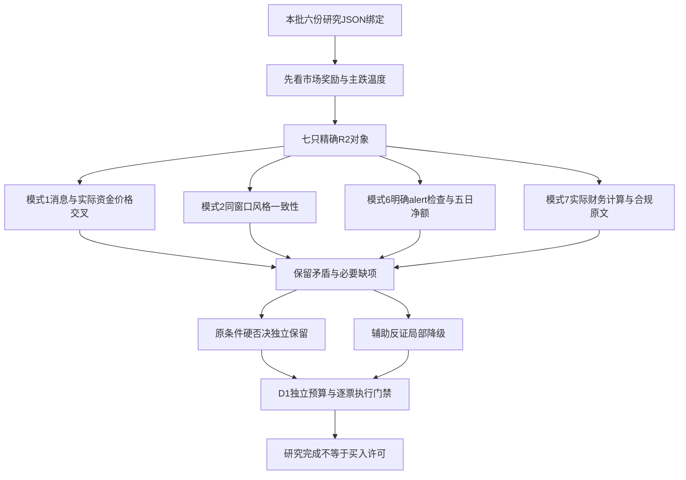

# 2026年11月4日 · 反证 / Devil’s Advocate

> 数据源新鲜度：partial｜降级状态：true｜置信度：0.78

## 一句话结论

降级：七票已审，三票必要范围完成；高标价强资金弱，空硬否决不代表全票通过。

## 详细分析

市场先于个股。11月3日全市场炸板率41.4634%，情绪=震荡/主跌。电池行业局部资金回流、服装低位封板与高标幸存者，并不能证明全面主升。R1的25%是竞价前市场研究上限，不是账户预算或调仓指令；原有效停买、零预算、T+1及人工确认不改变。

主线 = 电池（局部研究），持续性 = 1日（前瞻假设，不是已核年龄），封板率 = 87.5%，明日预期 = 分歧。行业回流不等于固态概念主升：固态本身资金为负。R4具名龙蟠履约负面不能复制到紫竹、圣阳、宁德，也不能被行业净入掩盖。

主线 = 服装家纺（局部研究），持续性 = 1日（前瞻假设），封板率 = 100%（仅3个封板样本），明日预期 = 分歧。行业五日仍净出；七匹狼二板领先，九牧王股性77.3分不能颠倒当期身位。没有独立消息覆盖时，只保留资金价格和经营原文的局部已审。

两只四板只作负面对照。东方海洋五日小净入掩盖近三日净卖；阳光照明昨日净卖的两个口径量级不同但方向同负。二者的一字概率不是已命中，开板3次/5次不能被称全天无量锁仓。没有命中原双条件，不凭高度新增硬否决。

本次完成28条逐票必要模式明细，模式1/2/6/7各完成4/7、7/7、6/7、6/7；三票同时完成四项必要范围，仍各自保留反面发现。模式4/5/8/10辅助缺口不阻其他必要项目；单票必要缺证不升级全市场no_trade。

## 必要审核逐票覆盖

| 对象 | 模式1 | 模式2 | 模式6 | 模式7 | 态度与缺口 |

|---|---|---|---|---|---|

| 紫竹高科 002058.SZ | 已完成原范围 | 已完成原范围 | 已完成原范围 | 已完成原范围 | 观察/降级；必要范围完成不是审核通过或买权 |

| 圣阳股份 002580.SZ | 已完成原范围 | 已完成原范围 | 已完成原范围 | 已完成原范围 | 观察/降级；必要范围完成不是审核通过或买权 |

| 宁德时代 300750.SZ | 已完成原范围 | 已完成原范围 | 已完成原范围 | 已完成原范围 | 观察/降级；必要范围完成不是审核通过或买权 |

| 七匹狼 002029.SZ | 未完成 | 已完成原范围 | 已完成原范围 | 已完成原范围 | 降级；R4未提供本票或服装同窗口的独立消息事实/检查覆盖；R5单源经营/公告事实已审，不冒充R4已核。 |

| 九牧王 601566.SH | 未完成 | 已完成原范围 | 未完成 | 已完成原范围 | 降级；R4未提供本票或服装同窗口的独立消息事实/检查覆盖；R5单源经营/公告事实已审，不冒充R4已核。；R3九牧王alert结果unknown；前日同源名次缺失，服装行业无覆盖，不能判false。 |

| 东方海洋 002086.SZ | 已完成原范围 | 已完成原范围 | 已完成原范围 | 未完成 | 降级；S2历史证券虚假陈述责任纠纷及预计损失当前仍披露；历史处罚决定/适用期限未闭环，不能核为当前硬否决或阴性；回送R5/R4。 |

| 阳光照明 600261.SH | 未完成 | 已完成原范围 | 已完成原范围 | 已完成原范围 | 降级；R4未提供阳光照明同窗口精确消息事实/检查覆盖；R5已读原文保留，独立交叉未闭环。 |

## 每票实质比较与反面判断

### 紫竹高科 002058.SZ

板型：盘中上板；原角色：龙头；龙头认定：{"passed_count": 2, "verified_items": ["行业连板高度第一", "8.6994%换手，可成交"], "unverified_items": ["本日持续带动性", "产业逻辑强度不由名字梗或股性评分认证"], "status": "地位待核，仅研究", "global_dragon": false}。盈亏比：unknown（无结构性入场/止损价，不伪造RR≥2）；禁止清单：原为null，未完整核完，不等于无命中。

**大资金意图**：只能辨认资金/价格行为，不推断账户身份或锁仓动机。5日自算大单净额与东财口径同向温和净入，最新两日支持修复，但10月28/29日两源相对差异超过5%，筹码维度置信度局部降级。最近龙虎榜是连续三日窗口，机构双边交易与营业部买入并存，不能重复加买卖榜相同席位，也不能称单日全机构锁仓。

**为什么走强**：只按R2当期身位、封板与局部资金解释；不把谐音传播、旧回购、历史股性或一字预测冒充经营催化。11月4日异动公告原文确认经营环境无重大变化、无未披露重大事项；不能把连板或更名当新订单。6月撤销退市风险警示公告已取原文，6月15日起撤销，旧*ST不得延续到本轮。电池/铝塑膜是既有业务关联，本轮未核新增产能兑现。

**逻辑够不够硬**：Q3归母净利2052.08万元、同比-89.46%，但扣非1999.51万元，表观大降含上期非经常性比较基数。货币资金不足以覆盖已知债务，F9应收/累计收入41.68%、F10已知有息债务下界/并表净资产226.15%均命中。PB39.69倍与薄归母净资产匹配，不能只看PS较低分位当便宜；正PE样本仅282，分位非完整无偏估值。

**买入理由（被挑战的上游研究假设，不是本报告推荐）**：电池行业唯一二板；108只当前成分中5日净额第8而非资金冠军；板高与首封/容量分工不混同。

**风险点**：R2主张电池唯一二板而非经营反转。R4 E009是同行龙蟠履约负面，不可归罪紫竹；对照R5异动原文“经营环境无重大变化”，五日大单+0.85165亿/东财+0.834393亿及昨日封板，仅支持局部价格修复，不支持新订单或总龙。R4行业负面与该票价格资金独立交叉已执行，直接新催化仍未知。 R1：11/3炸板率41.4634%、情绪=震荡/主跌，市场研究仓位上限25%，窗口至11/4竞价；R2电池局部回流、7封板1炸板与R1主跌温度可并存；R2已保持观察、未知RR和未确认主升，不能把假设age=1/4的辅助情景当真实主升。本轮没有R6旧报告可保留的已完成项；本次所有模式2逐票有据保留，不因R4/R5局部缺证删除。

**止损条件**：仅撤销研究假设：同组领先/跟随赚钱效应消失、消息或资金逻辑被新证据推翻即重评；本报告不修改现有持仓退出规则、不编价格止损。

**可验证假设**：精确R2电池行业881281.TI命中R3检查62：同源相邻最终快照14→2，alert=false，仅该行业/窗口连续第一规则阴性；固态886032.TI检查50为unknown，不能扩称固态或整日出货全面排除。紫竹个股未在R3逐票检查，个股全面警报未知；本次模式6按原所属电池行业分支完成，不伪造个股阴性。 完成本分支不等于排除一切出货；新alert或新原文到达须重评。

模式1｜completed：R2主张电池唯一二板而非经营反转。R4 E009是同行龙蟠履约负面，不可归罪紫竹；对照R5异动原文“经营环境无重大变化”，五日大单+0.85165亿/东财+0.834393亿及昨日封板，仅支持局部价格修复，不支持新订单或总龙。R4行业负面与该票价格资金独立交叉已执行，直接新催化仍未知。

模式2｜completed：R1：11/3炸板率41.4634%、情绪=震荡/主跌，市场研究仓位上限25%，窗口至11/4竞价；R2电池局部回流、7封板1炸板与R1主跌温度可并存；R2已保持观察、未知RR和未确认主升，不能把假设age=1/4的辅助情景当真实主升。本轮没有R6旧报告可保留的已完成项；本次所有模式2逐票有据保留，不因R4/R5局部缺证删除。

模式6｜completed：精确R2电池行业881281.TI命中R3检查62：同源相邻最终快照14→2，alert=false，仅该行业/窗口连续第一规则阴性；固态886032.TI检查50为unknown，不能扩称固态或整日出货全面排除。紫竹个股未在R3逐票检查，个股全面警报未知；本次模式6按原所属电池行业分支完成，不伪造个股阴性。 完成本分支不等于排除一切出货；新alert或新原文到达须重评。

模式7｜completed：逐项核实际三表计算及原文：Q3归母净利2052.08万元、同比-89.46%，但扣非1999.51万元，表观大降含上期非经常性比较基数。货币资金不足以覆盖已知债务，F9应收/累计收入41.68%、F10已知有息债务下界/并表净资产226.15%均命中。PB39.69倍与薄归母净资产匹配，不能只看PS较低分位当便宜；正PE样本仅282，分位非完整无偏估值。 最新已披露FY2025审计标准无保留，不将Q3未经审计当审计阴性。 必要财务合规已在原检查范围完成；F5最新流量/F7及未实质检出的辅助F10/F11未知保留，不因辅助缺口抹掉已审结果。

证据定位：R2 /main_lines/0/leaders/0；R5 /profiles/0/dimensions 及 /profiles/0/embedded_evidence；源版本指纹完整见同版JSON。

### 圣阳股份 002580.SZ

板型：盘中上板；原角色：龙二；龙头认定：{"passed_count": 3, "verified_items": ["热榜辨识度上升", "行业7只封板局部扩散", "8.7737%真实换手"], "unverified_items": ["本日持续带动性", "产业逻辑强度不由名字梗或股性评分认证"], "status": "局部龙头研究认定", "global_dragon": false}。盈亏比：unknown（无结构性入场/止损价，不伪造RR≥2）；禁止清单：原为null，未完整核完，不等于无命中。

**大资金意图**：只能辨认资金/价格行为，不推断账户身份或锁仓动机。昨日双口径主力净入接近3.97亿元，但前日净卖约0.70亿元，净买高度集中于单日，持续性不足。历史小额日源差超过5%单列，不抹掉最新同向信号；最近龙虎榜为10月8日旧窗口，不拿来冒充11月3日机构接力。

**为什么走强**：只按R2当期身位、封板与局部资金解释；不把谐音传播、旧回购、历史股性或一字预测冒充经营催化。本轮R4没有精确圣阳新增硬催化，已读Q3原文显示收入增长同时并表深圳达人高科影响资产结构；不能把全部同比增长认定纯内生。储能产业映射是研究背景，不是本批新订单。

**逻辑够不够硬**：Q3累计营收增长23.77%、归母利润下降13.61%；存货同比增51.51%超过收入增速1.5倍且周转率3.7445降至3.3118，F4命中；应收/收入49.62%，F9命中。Q1现金流负但Q2/Q3单季均正，F8阴性，不能把H1累计负值当两季负。PE51.63倍、正PE三年分位约89.81%，增长兑现与营运资金比情绪更慢。

**买入理由（被挑战的上游研究假设，不是本报告推荐）**：首板09:35早于同业二板；同花顺热榜61→8；行业5日净额第2，昨日3.962487亿元。身位仍低于紫竹，不以资金反夺龙一。

**风险点**：R4 E009显示电池材料合同兑现风险，但对象龙蟠不是圣阳，不横推行业硬否决。R5显示收入增长含并表影响，昨日双口径约+3.97亿、前日约-0.70亿，五日合计正但买盘集中单日；R2低位助攻假设尚非持续主升或纯内生增长。 R1：11/3炸板率41.4634%、情绪=震荡/主跌，市场研究仓位上限25%，窗口至11/4竞价；R2电池局部回流、7封板1炸板与R1主跌温度可并存；R2已保持观察、未知RR和未确认主升，不能把假设age=1/4的辅助情景当真实主升。本轮没有R6旧报告可保留的已完成项；本次所有模式2逐票有据保留，不因R4/R5局部缺证删除。

**止损条件**：仅撤销研究假设：同组领先/跟随赚钱效应消失、消息或资金逻辑被新证据推翻即重评；本报告不修改现有持仓退出规则、不编价格止损。

**可验证假设**：精确R2电池行业881281.TI命中R3检查62：同源相邻最终快照14→2，alert=false，仅该行业/窗口连续第一规则阴性；固态886032.TI检查50为unknown，不能扩称固态或整日出货全面排除。圣阳同花顺61→8阴性，东财前日缺名次仍unknown；不把两平台整体写成false。 完成本分支不等于排除一切出货；新alert或新原文到达须重评。

模式1｜completed：R4 E009显示电池材料合同兑现风险，但对象龙蟠不是圣阳，不横推行业硬否决。R5显示收入增长含并表影响，昨日双口径约+3.97亿、前日约-0.70亿，五日合计正但买盘集中单日；R2低位助攻假设尚非持续主升或纯内生增长。

模式2｜completed：R1：11/3炸板率41.4634%、情绪=震荡/主跌，市场研究仓位上限25%，窗口至11/4竞价；R2电池局部回流、7封板1炸板与R1主跌温度可并存；R2已保持观察、未知RR和未确认主升，不能把假设age=1/4的辅助情景当真实主升。本轮没有R6旧报告可保留的已完成项；本次所有模式2逐票有据保留，不因R4/R5局部缺证删除。

模式6｜completed：精确R2电池行业881281.TI命中R3检查62：同源相邻最终快照14→2，alert=false，仅该行业/窗口连续第一规则阴性；固态886032.TI检查50为unknown，不能扩称固态或整日出货全面排除。圣阳同花顺61→8阴性，东财前日缺名次仍unknown；不把两平台整体写成false。 完成本分支不等于排除一切出货；新alert或新原文到达须重评。

模式7｜completed：逐项核实际三表计算及原文：Q3累计营收增长23.77%、归母利润下降13.61%；存货同比增51.51%超过收入增速1.5倍且周转率3.7445降至3.3118，F4命中；应收/收入49.62%，F9命中。Q1现金流负但Q2/Q3单季均正，F8阴性，不能把H1累计负值当两季负。PE51.63倍、正PE三年分位约89.81%，增长兑现与营运资金比情绪更慢。 最新已披露FY2025审计标准无保留，不将Q3未经审计当审计阴性。 必要财务合规已在原检查范围完成；F5最新流量/F7及未实质检出的辅助F10/F11未知保留，不因辅助缺口抹掉已审结果。

证据定位：R2 /main_lines/0/leaders/1；R5 /profiles/1/dimensions 及 /profiles/1/embedded_evidence；源版本指纹完整见同版JSON。

### 宁德时代 300750.SZ

板型：非涨停，容量趋势观察；原角色：龙三；龙头认定：{"passed_count": 2, "verified_items": ["资金容量辨识度", "实际成交容量"], "unverified_items": ["本日持续带动性", "产业逻辑强度不由名字梗或股性评分认证"], "status": "地位待核，仅研究", "global_dragon": false}。盈亏比：unknown（无结构性入场/止损价，不伪造RR≥2）；禁止清单：原为null，未完整核完，不等于无命中。

**大资金意图**：只能辨认资金/价格行为，不推断账户身份或锁仓动机。5日自算净入18.86亿元，东财18.07亿元；最近3日同向大额净入，容量认可强于小票，但10月29日小净额偏差超过5%必须保留。融资数据截至11月2日滞后，不能填11月3日。35笔大宗按笔数金额价格区间记录，接口无premium，不判折价。

**为什么走强**：只按R2当期身位、封板与局部资金解释；不把谐音传播、旧回购、历史股性或一字预测冒充经营催化。Q3原文有实际经营利润和股份回购历史进展；截至9月30日回购33.03亿元不等于11月4日新增流入。11月2日回购进展、11月3日员工持股预留份额只按标题列新事件，本轮未将标题金额猜成实买。凝聚态等产品披露是既有进度，不等于本批固态量产突破。

**逻辑够不够硬**：Q3累计归母645.30亿元、同比31.60%，收入同比56.19%，PE13.16与PB2.98均处三年正值样本约1.24%分位，基本面和估值对照强。但Q3单季经营现金净额仅14.09亿元而并表净利224.68亿元，现金转化边际下降，不能因累计现金为正忽视；F8严格两季负条件不命中。有息负债完整性质与控制人质押列仍局部unknown，不以低PE直接声明全项安全。

**买入理由（被挑战的上游研究假设，不是本报告推荐）**：行业5日主力净额18.070534亿元居首，昨日涨3.8012%；容量中军，作为行业回流验证，不冒充10cm妖股或接力龙一。

**风险点**：R4电池履约风险只归具名龙蟠，不能转成宁德订单取消。宁德五日自算+18.858265亿/东财+18.070534亿，价格+3.8012%而非涨停；R5披露9月底回购历史不能充当11/4新增买盘。行业回流与容量地位可比，不支持将其替代10cm接力龙头。 R1：11/3炸板率41.4634%、情绪=震荡/主跌，市场研究仓位上限25%，窗口至11/4竞价；R2电池局部回流、7封板1炸板与R1主跌温度可并存；R2已保持观察、未知RR和未确认主升，不能把假设age=1/4的辅助情景当真实主升。本轮没有R6旧报告可保留的已完成项；本次所有模式2逐票有据保留，不因R4/R5局部缺证删除。

**止损条件**：仅撤销研究假设：同组领先/跟随赚钱效应消失、消息或资金逻辑被新证据推翻即重评；本报告不修改现有持仓退出规则、不编价格止损。

**可验证假设**：精确R2电池行业881281.TI命中R3检查62：同源相邻最终快照14→2，alert=false，仅该行业/窗口连续第一规则阴性；固态886032.TI检查50为unknown，不能扩称固态或整日出货全面排除。 完成本分支不等于排除一切出货；新alert或新原文到达须重评。

模式1｜completed：R4电池履约风险只归具名龙蟠，不能转成宁德订单取消。宁德五日自算+18.858265亿/东财+18.070534亿，价格+3.8012%而非涨停；R5披露9月底回购历史不能充当11/4新增买盘。行业回流与容量地位可比，不支持将其替代10cm接力龙头。

模式2｜completed：R1：11/3炸板率41.4634%、情绪=震荡/主跌，市场研究仓位上限25%，窗口至11/4竞价；R2电池局部回流、7封板1炸板与R1主跌温度可并存；R2已保持观察、未知RR和未确认主升，不能把假设age=1/4的辅助情景当真实主升。本轮没有R6旧报告可保留的已完成项；本次所有模式2逐票有据保留，不因R4/R5局部缺证删除。

模式6｜completed：精确R2电池行业881281.TI命中R3检查62：同源相邻最终快照14→2，alert=false，仅该行业/窗口连续第一规则阴性；固态886032.TI检查50为unknown，不能扩称固态或整日出货全面排除。 完成本分支不等于排除一切出货；新alert或新原文到达须重评。

模式7｜completed：逐项核实际三表计算及原文：Q3累计归母645.30亿元、同比31.60%，收入同比56.19%，PE13.16与PB2.98均处三年正值样本约1.24%分位，基本面和估值对照强。但Q3单季经营现金净额仅14.09亿元而并表净利224.68亿元，现金转化边际下降，不能因累计现金为正忽视；F8严格两季负条件不命中。有息负债完整性质与控制人质押列仍局部unknown，不以低PE直接声明全项安全。 最新已披露FY2025审计标准无保留，不将Q3未经审计当审计阴性。 必要财务合规已在原检查范围完成；F5最新流量/F7及未实质检出的辅助F10/F11未知保留，不因辅助缺口抹掉已审结果。

证据定位：R2 /main_lines/0/leaders/2；R5 /profiles/2/dimensions 及 /profiles/2/embedded_evidence；源版本指纹完整见同版JSON。

### 七匹狼 002029.SZ

板型：盘中上板；原角色：龙头；龙头认定：{"passed_count": 3, "verified_items": ["行业高度和5日资金均第一", "同日两只服装后续封板（只认时序，不证明因果）", "5.2777%换手承接"], "unverified_items": ["本日持续带动性", "产业逻辑强度不由名字梗或股性评分认证"], "status": "局部龙头研究认定", "global_dragon": false}。盈亏比：unknown（无结构性入场/止损价，不伪造RR≥2）；禁止清单：原为null，未完整核完，不等于无命中。

**大资金意图**：只能辨认资金/价格行为，不推断账户身份或锁仓动机。5日两口径逐日均为正，净额约1.30/1.27亿元，资金持续性好于只靠单日点火。10月30日微小净额两源差异较大，故不美化为精确一致。11月2日榜为三日窗口，营业部较活跃、机构专用净卖，不能把营业部买入叫机构一致。

**为什么走强**：只按R2当期身位、封板与局部资金解释；不把谐音传播、旧回购、历史股性或一字预测冒充经营催化。11月3日异动公告原文称经营和内外环境无重大变化，无未披露重大事项。所谓狼羊关系只保留用户线索，不当独立传播或新业务催化；当前上涨只能先按价格传播解释。

**逻辑够不够硬**：Q3累计归母-5055.33万元、扣非8193.40万元，累计扣非为正不等于Q3单季扣非为正；Q3原文单季扣非-6130.86万元。公允价值波动等非经常损失拖累表观，F6原正利润依赖度比例不适用而不是阴性。控制人质押13125万/25913.67万=约50.65%，未达70%但不称无质押；PB1.10三年分位89.26%，低绝对PB也非自动便宜。

**买入理由（被挑战的上游研究假设，不是本报告推荐）**：七匹狼是75只服装家纺成分唯一二板；09:32:24封板早于九牧王11:01和龙头股份11:17；5日净额1.274832亿元居首，当前成分有3封板。

**风险点**：R5自算/东财五日均正与二板身位同向，原异动公告无经营环境重大变化；狼吃羊仅线索，未证实独立传播。R4没有本票或服装同窗口消息核验，不能把R5单源异动与R2同源转述冒充已完成R4独立消息交叉；本项仅资金价格及经营原文局部已审。 R1：11/3炸板率41.4634%、情绪=震荡/主跌，市场研究仓位上限25%，窗口至11/4竞价；R2只留服装低位局部前排且五日行业仍净出，不是确认多条可交易主线；与R1退潮中降维研究一致。不能把三只封板100%外推全市场修复。本轮没有R6旧报告可保留的已完成项；本次所有模式2逐票有据保留，不因R4/R5局部缺证删除。

**止损条件**：仅撤销研究假设：同组领先/跟随赚钱效应消失、消息或资金逻辑被新证据推翻即重评；本报告不修改现有持仓退出规则、不编价格止损。

**可验证假设**：R3检查13及29精确七匹狼同花顺40→14、东财40→10均checked false，仅该个股两日最终快照分支完成；服装行业本身未查，行业完整派发仍未知。 完成本分支不等于排除一切出货；新alert或新原文到达须重评。

模式1｜incomplete：R5自算/东财五日均正与二板身位同向，原异动公告无经营环境重大变化；狼吃羊仅线索，未证实独立传播。R4没有本票或服装同窗口消息核验，不能把R5单源异动与R2同源转述冒充已完成R4独立消息交叉；本项仅资金价格及经营原文局部已审。

模式2｜completed：R1：11/3炸板率41.4634%、情绪=震荡/主跌，市场研究仓位上限25%，窗口至11/4竞价；R2只留服装低位局部前排且五日行业仍净出，不是确认多条可交易主线；与R1退潮中降维研究一致。不能把三只封板100%外推全市场修复。本轮没有R6旧报告可保留的已完成项；本次所有模式2逐票有据保留，不因R4/R5局部缺证删除。

模式6｜completed：R3检查13及29精确七匹狼同花顺40→14、东财40→10均checked false，仅该个股两日最终快照分支完成；服装行业本身未查，行业完整派发仍未知。 完成本分支不等于排除一切出货；新alert或新原文到达须重评。

模式7｜completed：逐项核实际三表计算及原文：Q3累计归母-5055.33万元、扣非8193.40万元，累计扣非为正不等于Q3单季扣非为正；Q3原文单季扣非-6130.86万元。公允价值波动等非经常损失拖累表观，F6原正利润依赖度比例不适用而不是阴性。控制人质押13125万/25913.67万=约50.65%，未达70%但不称无质押；PB1.10三年分位89.26%，低绝对PB也非自动便宜。 最新已披露FY2025审计标准无保留，不将Q3未经审计当审计阴性。 必要财务合规已在原检查范围完成；F5最新流量/F7及未实质检出的辅助F10/F11未知保留，不因辅助缺口抹掉已审结果。

证据定位：R2 /main_lines/1/leaders/0；R5 /profiles/3/dimensions 及 /profiles/3/embedded_evidence；源版本指纹完整见同版JSON。

### 九牧王 601566.SH

板型：盘中上板；原角色：龙二；龙头认定：{"passed_count": 2, "verified_items": ["行业5日资金第二", "10.1408%换手容量"], "unverified_items": ["本日持续带动性", "产业逻辑强度不由名字梗或股性评分认证"], "status": "地位待核，仅研究", "global_dragon": false}。盈亏比：unknown（无结构性入场/止损价，不伪造RR≥2）；禁止清单：原为null，未完整核完，不等于无命中。

**大资金意图**：只能辨认资金/价格行为，不推断账户身份或锁仓动机。5日自算净入0.887亿元、东财0.909亿元，最新涨停日同向支持，但历史多日差异超过5%，不能称精确同源一致。近30日仅1个龙虎榜日且在10月22日，旧席位不证明11月3日新机构承接；昨日实际换手10.14%明显，不把封板分钟线当全天无量。

**为什么走强**：只按R2当期身位、封板与局部资金解释；不把谐音传播、旧回购、历史股性或一字预测冒充经营催化。已读Q3主营品牌和渠道原文：九牧王品牌收入增长、FUN线下关闭转线上；这属于经营结构验证，不是今日新催化。R4未覆盖本票硬事件，不能将没有事件命中写为无经营变化。

**逻辑够不够硬**：Q3累计归母-3514.40万元、扣非1.308459亿元；投资公允价值损失与主营改善分开，Q3单季扣非仍亏2610.25万元，不能只挑累计数。F6对负利润原比例不适用；净负债上界安全、控制人原表无质押，但PB1.8101分位93.80%、PS分位87.05%，不能因历史股性和股息标签称低估安全。

**买入理由（被挑战的上游研究假设，不是本报告推荐）**：同板块首板，5日主力净额0.909129亿元居第2；历史30次涨停/最高7板、近期极佳，强于拿旧股性低分直接否七匹狼；但11:01封板晚于七匹狼。

**风险点**：R5五日自算+0.886993亿/东财约+0.909亿与首板同向，但近月唯一旧龙虎榜不能证明昨日机构接力。R4未覆盖本票或服装具名事件，R5主营原文不是独立R4核验；消息分支未知，不能把历史股性77.3分当今日催化或龙一。 R1：11/3炸板率41.4634%、情绪=震荡/主跌，市场研究仓位上限25%，窗口至11/4竞价；R2只留服装低位局部前排且五日行业仍净出，不是确认多条可交易主线；与R1退潮中降维研究一致。不能把三只封板100%外推全市场修复。本轮没有R6旧报告可保留的已完成项；本次所有模式2逐票有据保留，不因R4/R5局部缺证删除。

**止损条件**：仅撤销研究假设：同组领先/跟随赚钱效应消失、消息或资金逻辑被新证据推翻即重评；本报告不修改现有持仓退出规则、不编价格止损。

**可验证假设**：R3检查34：东财前日名次null、当前15，check_status=unknown、alert=null；服装881136.TI亦无明确检查。不因空alerts写false，必要分支未完成，回送R3；五日净入不能替代alert取证。 完成本分支不等于排除一切出货；新alert或新原文到达须重评。

模式1｜incomplete：R5五日自算+0.886993亿/东财约+0.909亿与首板同向，但近月唯一旧龙虎榜不能证明昨日机构接力。R4未覆盖本票或服装具名事件，R5主营原文不是独立R4核验；消息分支未知，不能把历史股性77.3分当今日催化或龙一。

模式2｜completed：R1：11/3炸板率41.4634%、情绪=震荡/主跌，市场研究仓位上限25%，窗口至11/4竞价；R2只留服装低位局部前排且五日行业仍净出，不是确认多条可交易主线；与R1退潮中降维研究一致。不能把三只封板100%外推全市场修复。本轮没有R6旧报告可保留的已完成项；本次所有模式2逐票有据保留，不因R4/R5局部缺证删除。

模式6｜incomplete：R3检查34：东财前日名次null、当前15，check_status=unknown、alert=null；服装881136.TI亦无明确检查。不因空alerts写false，必要分支未完成，回送R3；五日净入不能替代alert取证。 完成本分支不等于排除一切出货；新alert或新原文到达须重评。

模式7｜completed：逐项核实际三表计算及原文：Q3累计归母-3514.40万元、扣非1.308459亿元；投资公允价值损失与主营改善分开，Q3单季扣非仍亏2610.25万元，不能只挑累计数。F6对负利润原比例不适用；净负债上界安全、控制人原表无质押，但PB1.8101分位93.80%、PS分位87.05%，不能因历史股性和股息标签称低估安全。 最新已披露FY2025审计标准无保留，不将Q3未经审计当审计阴性。 必要财务合规已在原检查范围完成；F5最新流量/F7及未实质检出的辅助F10/F11未知保留，不因辅助缺口抹掉已审结果。

证据定位：R2 /main_lines/1/leaders/1；R5 /profiles/4/dimensions 及 /profiles/4/embedded_evidence；源版本指纹完整见同版JSON。

### 东方海洋 002086.SZ

板型：开盘涨停后开板回封；原角色：龙三；龙头认定：{"passed_count": 2, "verified_items": ["并列最高板辨识度", "14.5825%换手"], "unverified_items": ["本日持续带动性", "产业逻辑强度不由名字梗或股性评分认证"], "status": "地位待核，仅研究", "global_dragon": false}。盈亏比：unknown（无结构性入场/止损价，不伪造RR≥2）；禁止清单：原为null，未完整核完，不等于无命中。

**大资金意图**：只能辨认资金/价格行为，不推断账户身份或锁仓动机。四板价强，但最近三交易日两口径主力均净卖，5日小净入来自更早10月29日，不能用5日合计掩盖最近出货压力。龙虎榜日榜与三日榜分别存在，二者席位窗口重叠不能合计净流入；无机构专用不等于无任何机构持有。

**为什么走强**：只按R2当期身位、封板与局部资金解释；不把谐音传播、旧回购、历史股性或一字预测冒充经营催化。11月4日原公告明确海洋和大健康两板块均亏损、加工盈利不足以覆盖全板块亏损；10月21日起累计上涨57.60%而基本面无重大变化。宏观海洋经济规模不能映射成养殖/检测企业已经受益订单。治理换届进程保留原事实，不臆测控制权确定变化。

**逻辑够不够硬**：2024、2025归母连续亏损命中S1；Q3仍亏6793.11万元，PB5.48、PS18.77与薄收入规模不相称。2026中报原文显示仍有历史证券虚假陈述责任纠纷和已确认预计损失，当前处罚适用窗口未闭环，S2保留unknown及必要回送，不写全项排雷通过。无控股股东已由最新风险公告明示，旧控股方质押记录不可代当前控制人比率。

**买入理由（被挑战的上游研究假设，不是本报告推荐）**：全市场非ST并列4板，低价3.42元，原一字预测目标日匹配；已核实际盘中3次开板，不是已经预测命中次日一字。

**风险点**：R4 ann_2082明确两大板块亏损、10/21以来涨57.60%、基本面无重大变化；R5最近三日双口径净卖与四板价强相反，五日小净入来自更早10/29。风险公告在本次盘前已取得，昨日资金不能被冒称对盘后公告的反应；只能判经营偏离与既有价格资金背离并存。 R1：11/3炸板率41.4634%、情绪=震荡/主跌，市场研究仓位上限25%，窗口至11/4竞价；R2本票仅四板高标温度/风险对照，非执行候选；与R1主跌不接高位老龙的风险判断没有未处理的开仓冲突。若D1改成追高，须重新处理强风险，不得将本次一致性已审等同同意买入。本轮没有R6旧报告可保留的已完成项；本次所有模式2逐票有据保留，不因R4/R5局部缺证删除。

**止损条件**：仅撤销研究假设：同组领先/跟随赚钱效应消失、消息或资金逻辑被新证据推翻即重评；本报告不修改现有持仓退出规则、不编价格止损。

**可验证假设**：R3检查1/23精确同花顺6→2、东财4→4均checked false；本票无统一sector_id，不按名字拼所属板块警报。五日自算+0.186341亿并非负额，最近三日净卖须报告，但不能用三日窗口替代五日条件。原模式6双条件未成立。 完成本分支不等于排除一切出货；新alert或新原文到达须重评。

模式1｜completed：R4 ann_2082明确两大板块亏损、10/21以来涨57.60%、基本面无重大变化；R5最近三日双口径净卖与四板价强相反，五日小净入来自更早10/29。风险公告在本次盘前已取得，昨日资金不能被冒称对盘后公告的反应；只能判经营偏离与既有价格资金背离并存。

模式2｜completed：R1：11/3炸板率41.4634%、情绪=震荡/主跌，市场研究仓位上限25%，窗口至11/4竞价；R2本票仅四板高标温度/风险对照，非执行候选；与R1主跌不接高位老龙的风险判断没有未处理的开仓冲突。若D1改成追高，须重新处理强风险，不得将本次一致性已审等同同意买入。本轮没有R6旧报告可保留的已完成项；本次所有模式2逐票有据保留，不因R4/R5局部缺证删除。

模式6｜completed：R3检查1/23精确同花顺6→2、东财4→4均checked false；本票无统一sector_id，不按名字拼所属板块警报。五日自算+0.186341亿并非负额，最近三日净卖须报告，但不能用三日窗口替代五日条件。原模式6双条件未成立。 完成本分支不等于排除一切出货；新alert或新原文到达须重评。

模式7｜incomplete：逐项核实际三表计算及原文：2024、2025归母连续亏损命中S1；Q3仍亏6793.11万元，PB5.48、PS18.77与薄收入规模不相称。2026中报原文显示仍有历史证券虚假陈述责任纠纷和已确认预计损失，当前处罚适用窗口未闭环，S2保留unknown及必要回送，不写全项排雷通过。无控股股东已由最新风险公告明示，旧控股方质押记录不可代当前控制人比率。 最新已披露FY2025审计标准无保留，不将Q3未经审计当审计阴性。 S1真红旗保留strong_suggest；S2必要项未完成，不能据空hard_rejects或旧“报告期无处罚”写全票通过。

证据定位：R2 /secondary_lines/0/leaders/0；R5 /profiles/5/dimensions 及 /profiles/5/embedded_evidence；源版本指纹完整见同版JSON。

### 阳光照明 600261.SH

板型：开盘涨停后开板回封；原角色：龙三；龙头认定：{"passed_count": 2, "verified_items": ["并列最高板热度", "真实大幅换手"], "unverified_items": ["本日持续带动性", "产业逻辑强度不由名字梗或股性评分认证"], "status": "地位待核，仅研究", "global_dragon": false}。盈亏比：unknown（无结构性入场/止损价，不伪造RR≥2）；禁止清单：原为null，未完整核完，不等于无命中。

**大资金意图**：只能辨认资金/价格行为，不推断账户身份或锁仓动机。昨日自算主力净卖4.7682亿元、东财净卖5.94369亿元，双口径方向一致但量级差19.78%须保留冲突，不能二选一。换手25.5208%、日量5均量3.24倍与5次开板支持高位分歧换手，最近三日榜营业部净卖方向另列，不称主力锁仓。

**为什么走强**：只按R2当期身位、封板与局部资金解释；不把谐音传播、旧回购、历史股性或一字预测冒充经营催化。11月4日原公告确认前三季利润同比下降77.07%，材料成本、汇率及金融资产公允价值影响并存，生产经营无重大变化；一字预测与阳字情绪不构成新增产业催化。异动公告不是停牌决定，不任意制造停买硬禁。

**逻辑够不够硬**：Q3累计归母2952.24万元、同比-77.07%，单季归母已亏；F3应收同比31.22%而收入-1.05%，F9应收/收入44.42%命中。存货虽涨7.95%，周转率同比提升，所以F4 AND条件不命中。PE73.98与PB/PS均接近三年最高分位，不能用PB不足2就称低估。

**买入理由（被挑战的上游研究假设，不是本报告推荐）**：并列4板，同花顺热度21→5；25.52%换手、5次开板，名字阳字与情绪通道有线索，但昨日主力净卖5.94369亿元。

**风险点**：R5原文前三季利润-77.07%、经营无重大变化；昨日涨停但自算净卖4.768202亿/东财净卖5.94369亿，差异19.78%保留而方向同负。消息与资金背离有据，但R4无本票精确消息覆盖，独立R4交叉尚未闭环，不能用一字预测或图像快照的锁仓表述盖过实数。 R1：11/3炸板率41.4634%、情绪=震荡/主跌，市场研究仓位上限25%，窗口至11/4竞价；R2本票仅四板高标温度/风险对照，非执行候选；与R1主跌不接高位老龙的风险判断没有未处理的开仓冲突。若D1改成追高，须重新处理强风险，不得将本次一致性已审等同同意买入。本轮没有R6旧报告可保留的已完成项；本次所有模式2逐票有据保留，不因R4/R5局部缺证删除。

**止损条件**：仅撤销研究假设：同组领先/跟随赚钱效应消失、消息或资金逻辑被新证据推翻即重评；本报告不修改现有持仓退出规则、不编价格止损。

**可验证假设**：R3检查4/25同花顺21→5、东财9→6均checked false；五日自算-2.673288亿/东财-3.843737亿是真负额，但alert未命中，且R2仅龙三观察、execution_eligible=false。不得只因四板/净卖新增mode6硬否决。 完成本分支不等于排除一切出货；新alert或新原文到达须重评。

模式1｜incomplete：R5原文前三季利润-77.07%、经营无重大变化；昨日涨停但自算净卖4.768202亿/东财净卖5.94369亿，差异19.78%保留而方向同负。消息与资金背离有据，但R4无本票精确消息覆盖，独立R4交叉尚未闭环，不能用一字预测或图像快照的锁仓表述盖过实数。

模式2｜completed：R1：11/3炸板率41.4634%、情绪=震荡/主跌，市场研究仓位上限25%，窗口至11/4竞价；R2本票仅四板高标温度/风险对照，非执行候选；与R1主跌不接高位老龙的风险判断没有未处理的开仓冲突。若D1改成追高，须重新处理强风险，不得将本次一致性已审等同同意买入。本轮没有R6旧报告可保留的已完成项；本次所有模式2逐票有据保留，不因R4/R5局部缺证删除。

模式6｜completed：R3检查4/25同花顺21→5、东财9→6均checked false；五日自算-2.673288亿/东财-3.843737亿是真负额，但alert未命中，且R2仅龙三观察、execution_eligible=false。不得只因四板/净卖新增mode6硬否决。 完成本分支不等于排除一切出货；新alert或新原文到达须重评。

模式7｜completed：逐项核实际三表计算及原文：Q3累计归母2952.24万元、同比-77.07%，单季归母已亏；F3应收同比31.22%而收入-1.05%，F9应收/收入44.42%命中。存货虽涨7.95%，周转率同比提升，所以F4 AND条件不命中。PE73.98与PB/PS均接近三年最高分位，不能用PB不足2就称低估。 最新已披露FY2025审计标准无保留，不将Q3未经审计当审计阴性。 必要财务合规已在原检查范围完成；F5最新流量/F7及未实质检出的辅助F10/F11未知保留，不因辅助缺口抹掉已审结果。

证据定位：R2 /secondary_lines/0/leaders/1；R5 /profiles/6/dimensions 及 /profiles/6/embedded_evidence；源版本指纹完整见同版JSON。

## 真实反面发现与处理条件

### R6_M7_01 · 紫竹高科 · strong_suggest

被挑战主张：情绪身位或封板不能抵销已检出的财务风险。

- F9：沿原YTD收入规则，不擅自改年化阈值。; actual result=0.41681458288598494；来源 R5

- F10：已知借款下界过线即检出；全部负债上界不过线即可阴性；其余情况因债券/票据/其他计息性质不全为unknown，null未补0。; actual result={"verified_debt_lower_bound_yuan": 692115165.52, "lower_bound_ratio": 2.261487358282629, "all_liabilities_upper_bound_ratio": 3.0125626459413892}；来源 R5

处理：降级；D1必须显式接受或记录覆盖理由。未命中四条/F12/当前已证S2/S3的原硬条件，不新增hard_reject；不因龙一降级自动用龙二/补涨替补。

时空限定：sector_id=881281.TI；round_id=null；event_at=null。有效期沿本次R2盘前生成至竞价前，新事实立即重评；不是历史轮次立场或公告最早公开时间。

### R6_M7_02 · 圣阳股份 · strong_suggest

被挑战主张：情绪身位或封板不能抵销已检出的财务风险。

- F4：周转率用同年内累计期间比较，不把Q3与H1直接比较。; actual result={"inventory_yoy": 0.5150681581874832, "revenue_yoy": 0.23773534232336657}；来源 R5

- F9：沿原YTD收入规则，不擅自改年化阈值。; actual result=0.49617938256167876；来源 R5

处理：降级；D1必须显式接受或记录覆盖理由。未命中四条/F12/当前已证S2/S3的原硬条件，不新增hard_reject；不因龙一降级自动用龙二/补涨替补。

时空限定：sector_id=881281.TI；round_id=null；event_at=null。有效期沿本次R2盘前生成至竞价前，新事实立即重评；不是历史轮次立场或公告最早公开时间。

### R6_M3_03 · 宁德时代 · soft_suggest

被挑战主张：累计盈利、低绝对PB/PE或历史股性可被误作短线安全垫。

- 事实：Q3累计归母645.30亿元、同比31.60%，收入同比56.19%，PE13.16与PB2.98均处三年正值样本约1.24%分位，基本面和估值对照强。但Q3单季经营现金净额仅14.09亿元而并表净利224.68亿元，现金转化边际下降，不能因累计现金为正忽视；F8严格两季负条件不命中。有息负债完整性质与控制人质押列仍局部unknown，不以低PE直接声明全项安全。；来源 R5

处理：观察；保留单季现金/扣非亏损与历史分位风险；不是以位置或估值新增硬禁，不调整原评分。

时空限定：sector_id=881281.TI；round_id=null；event_at=null。有效期沿本次R2盘前生成至竞价前，新事实立即重评；不是历史轮次立场或公告最早公开时间。

### R6_M3_04 · 七匹狼 · soft_suggest

被挑战主张：累计盈利、低绝对PB/PE或历史股性可被误作短线安全垫。

- 事实：Q3累计归母-5055.33万元、扣非8193.40万元，累计扣非为正不等于Q3单季扣非为正；Q3原文单季扣非-6130.86万元。公允价值波动等非经常损失拖累表观，F6原正利润依赖度比例不适用而不是阴性。控制人质押13125万/25913.67万=约50.65%，未达70%但不称无质押；PB1.10三年分位89.26%，低绝对PB也非自动便宜。；来源 R5

处理：观察；保留单季现金/扣非亏损与历史分位风险；不是以位置或估值新增硬禁，不调整原评分。

时空限定：sector_id=881136.TI；round_id=null；event_at=null。有效期沿本次R2盘前生成至竞价前，新事实立即重评；不是历史轮次立场或公告最早公开时间。

### R6_M3_05 · 九牧王 · soft_suggest

被挑战主张：累计盈利、低绝对PB/PE或历史股性可被误作短线安全垫。

- 事实：Q3累计归母-3514.40万元、扣非1.308459亿元；投资公允价值损失与主营改善分开，Q3单季扣非仍亏2610.25万元，不能只挑累计数。F6对负利润原比例不适用；净负债上界安全、控制人原表无质押，但PB1.8101分位93.80%、PS分位87.05%，不能因历史股性和股息标签称低估安全。；来源 R5

处理：观察；保留单季现金/扣非亏损与历史分位风险；不是以位置或估值新增硬禁，不调整原评分。

时空限定：sector_id=881136.TI；round_id=null；event_at=null。有效期沿本次R2盘前生成至竞价前，新事实立即重评；不是历史轮次立场或公告最早公开时间。

### R6_M7_06 · 东方海洋 · strong_suggest

被挑战主张：情绪身位或封板不能抵销已检出的财务风险。

- S1：原财务轴，仅研究strong_suggest，不把短期亏损单独创造新hard_reject。; actual result=true；来源 R5

处理：降级；D1必须显式接受或记录覆盖理由。未命中四条/F12/当前已证S2/S3的原硬条件，不新增hard_reject；不因龙一降级自动用龙二/补涨替补。

时空限定：sector_id=None；round_id=null；event_at=null。有效期沿本次R2盘前生成至竞价前，新事实立即重评；不是历史轮次立场或公告最早公开时间。

### R6_M7_07 · 东方海洋 · strong_suggest

被挑战主张：半年报“报告期无处罚”可被误读为当前完全无合规风险。

- 事实：中报原文仍披露两阶段证券虚假陈述责任纠纷、已确认预计损失及重整投资人兜底；这是真实历史合规后果，不因报告期无新处罚消失。当前处罚决定及适用窗口未核，S2未知。；来源 R5

处理：降级；回送R5/R4补历史处罚决定、性质和当前适用窗口；不将历史事实删掉，也不凭历史纠纷直接虚构2026新立案或无时限hard_reject。

时空限定：sector_id=None；round_id=null；event_at=null。有效期沿本次R2盘前生成至竞价前，新事实立即重评；不是历史轮次立场或公告最早公开时间。

### R6_M7_08 · 阳光照明 · strong_suggest

被挑战主张：情绪身位或封板不能抵销已检出的财务风险。

- F3：同累计季度同比；收入负增速时仍沿原阈值，另提示负增长基准会放大相对判据。; actual result={"AR_yoy": 0.3122279390015037, "revenue_yoy": -0.010511543724458283}；来源 R5

- F9：沿原YTD收入规则，不擅自改年化阈值。; actual result=0.44419480271993766；来源 R5

处理：降级；D1必须显式接受或记录覆盖理由。未命中四条/F12/当前已证S2/S3的原硬条件，不新增hard_reject；不因龙一降级自动用龙二/补涨替补。

时空限定：sector_id=None；round_id=null；event_at=null。有效期沿本次R2盘前生成至竞价前，新事实立即重评；不是历史轮次立场或公告最早公开时间。

### R6_M1_09 · 东方海洋 · strong_suggest

被挑战主张：一字预测、价格封板或五日汇总可以证明先手锁仓。

- 事实：四板价强，但最近三交易日两口径主力均净卖，5日小净入来自更早10月29日，不能用5日合计掩盖最近出货压力。龙虎榜日榜与三日榜分别存在，二者席位窗口重叠不能合计净流入；无机构专用不等于无任何机构持有。；来源 R5

- 事实：11月4日原公告明确海洋和大健康两板块均亏损、加工盈利不足以覆盖全板块亏损；10月21日起累计上涨57.60%而基本面无重大变化。宏观海洋经济规模不能映射成养殖/检测企业已经受益订单。治理换届进程保留原事实，不臆测控制权确定变化。；来源 R5

处理：降级高标风险对照；不得将预测当命中、将净卖当锁仓、用日榜与三日榜重叠净额累加。R3已查窗口无alert，不扩大为mode6硬否决。

时空限定：sector_id=None；round_id=null；event_at=null。有效期沿本次R2盘前生成至竞价前，新事实立即重评；不是历史轮次立场或公告最早公开时间。

### R6_M1_10 · 阳光照明 · strong_suggest

被挑战主张：一字预测、价格封板或五日汇总可以证明先手锁仓。

- 事实：昨日自算主力净卖4.7682亿元、东财净卖5.94369亿元，双口径方向一致但量级差19.78%须保留冲突，不能二选一。换手25.5208%、日量5均量3.24倍与5次开板支持高位分歧换手，最近三日榜营业部净卖方向另列，不称主力锁仓。；来源 R5

- 事实：11月4日原公告确认前三季利润同比下降77.07%，材料成本、汇率及金融资产公允价值影响并存，生产经营无重大变化；一字预测与阳字情绪不构成新增产业催化。异动公告不是停牌决定，不任意制造停买硬禁。；来源 R5

处理：降级高标风险对照；不得将预测当命中、将净卖当锁仓、用日榜与三日榜重叠净额累加。R3已查窗口无alert，不扩大为mode6硬否决。

时空限定：sector_id=None；round_id=null；event_at=null。有效期沿本次R2盘前生成至竞价前，新事实立即重评；不是历史轮次立场或公告最早公开时间。

### R6_M2_11 · 紫竹高科 · strong_suggest

被挑战主张：把局部修复/历史属性升级为可交易主升。

- 事实：电池行业回流不能证明更名后新增经营催化或全市场总龙；5日行业资金第8，龙头带动性仍未核。；来源 R2

- 事实：炸板率41.4634%，情绪=震荡/主跌，竞价前25%仅市场研究建议。；来源 R1

处理：观察/降级；维持市场先行与候选减半；D1如拟执行须处理该反面发现并独立过其余门禁，不从本报告推新仓授权。

时空限定：sector_id=881281.TI；round_id=null；event_at=null。有效期沿本次R2盘前生成至竞价前，新事实立即重评；不是历史轮次立场或公告最早公开时间。

### R6_M2_12 · 圣阳股份 · strong_suggest

被挑战主张：把局部修复/历史属性升级为可交易主升。

- 事实：净买集中单日，前日净卖，新增并表与经营性周转压力不支持纯内生持续主升叙述。；来源 R2

- 事实：炸板率41.4634%，情绪=震荡/主跌，竞价前25%仅市场研究建议。；来源 R1

处理：观察/降级；维持市场先行与候选减半；D1如拟执行须处理该反面发现并独立过其余门禁，不从本报告推新仓授权。

时空限定：sector_id=881281.TI；round_id=null；event_at=null。有效期沿本次R2盘前生成至竞价前，新事实立即重评；不是历史轮次立场或公告最早公开时间。

### R6_M2_13 · 七匹狼 · strong_suggest

被挑战主张：把局部修复/历史属性升级为可交易主升。

- 事实：狼吃羊是用户线索而非已核独立传播；服装5日行业净出，不能从二板与热榜涨序推出强产业催化。；来源 R2

- 事实：炸板率41.4634%，情绪=震荡/主跌，竞价前25%仅市场研究建议。；来源 R1

处理：观察/降级；维持市场先行与候选减半；D1如拟执行须处理该反面发现并独立过其余门禁，不从本报告推新仓授权。

时空限定：sector_id=881136.TI；round_id=null；event_at=null。有效期沿本次R2盘前生成至竞价前，新事实立即重评；不是历史轮次立场或公告最早公开时间。

### R6_M2_14 · 九牧王 · strong_suggest

被挑战主张：把局部修复/历史属性升级为可交易主升。

- 事实：首板跟随身位低于七匹狼；股性77.3分和更高历史连板不改变当期前后排，禁止因龙一被否递补。；来源 R2

- 事实：炸板率41.4634%，情绪=震荡/主跌，竞价前25%仅市场研究建议。；来源 R1

处理：观察/降级；维持市场先行与候选减半；D1如拟执行须处理该反面发现并独立过其余门禁，不从本报告推新仓授权。

时空限定：sector_id=881136.TI；round_id=null；event_at=null。有效期沿本次R2盘前生成至竞价前，新事实立即重评；不是历史轮次立场或公告最早公开时间。

## 四象限负面识别

| 象限 | 本批裁决 | 不能偷换的条件 |

|---|---|---|

| 正消息×正资金 | 本批未知 | 没有可证明的新硬催化与消息后资金确认；不把旧回购补成新催化 |

| 正消息×负资金 | 云南订单仅对照，不新增对象 | 消息收盘后公开，不能拿此前净卖证明利好后不涨 |

| 负消息×正资金 | 电池行业回流与龙蟠履约负面并存 | 具名负面不横推紫竹/圣阳/宁德违约，原同票新催化仍未知 |

| 负消息×负资金 | 东方/阳光经营负面与近期净卖并存 | 两者时点不同，不说已验证公告后反应；东方五日并非负额，阳光R4独立消息尚缺 |

| 未知/混合 | 七匹狼、九牧王 | 缺独立消息不当0、不塞入正面象限 |

R4其余行业真负面仍保留：光通信订单的许可/退款条件与成本、境外算力限制风险并存；光伏反弹不抹除停产/信披风险；流动性工具额度不等于入市净额；航道、成本及能源风险异向。不把非本批股票概念套入七票，不扩展本批硬否决对象。

## 为什么不选对照对象

R6不重新选股。九牧王历史股性强于七匹狼，但首板与二板地位不同，不颠倒顺位；宁德资金与估值对照更强，但不是10cm情绪接力的替代票。东方/阳光没有因四板或一字预测获得执行资格。历史科森/通鼎等宽固态锚没有本次精确行业龙头或必要风险闭环；扩池、红利和增减持投影中的公司与本轮七票无精确交集，不能为了填池递补，更不能说它们因此不合格。

## 专题知识裁决

本次context_sha256：78b479b236c67975871c5f8fc17fa9fae86c5fce6c6aaa9be05973408bc1a914。该身份原样复制，不声称重新算过调用方运输包。九个distinct source_id均逐源裁决；底层同源沿多Agent运输只算一份，不自动采纳上游adopted。

| 来源种类与版本 | R6裁决 | 具体用途与保留限制 |

|---|---|---|

| theme_anchors:c83488391cfd8596845d99792839ada63ea1f0e443e322c85cd27545e5ae0817 | deferred | 历史锚只有截取；R2比较不能替代R6对本批必要风险审查。宽固态历史锚不等于本轮电池行业核心，不另选科森/通鼎等对照票或赋新权重。 |

| stock_character:656397480b1e398ed295c90854a59723790e98ebb28948d9877aa5c8d514335f | adopted | 仅使用R5精确六行历史股性对照：九牧王77.3分不能取代七匹狼二板身位；紫竹旧名威尔泰按同代码关联；阳光历史平均封单不证明昨日锁仓。宁德无投影行，历史股性unknown；不加分、不赋买权。 |

| growth_pool:928cd9feab1a49dcdc7681a5f055c0d4ac866169ff83b9e6f3f369e909bd9faa | not_applicable | 可见精确代码投影与本批七票无直接交集，仅比较适用性，不新选资料中的公司。扩池完整条件未闭环、红利partial/现金覆盖缺口及公开增减持历史回填均原样保留；不是判这些公司不合格，更不是已读底层全文。 |

| dividend_pool:6ebb53d45475950391da23caad3a6ce8e5c7cc75c23f4a5dfe868917360a88d4 | not_applicable | 可见精确代码投影与本批七票无直接交集，仅比较适用性，不新选资料中的公司。扩池完整条件未闭环、红利partial/现金覆盖缺口及公开增减持历史回填均原样保留；不是判这些公司不合格，更不是已读底层全文。 |

| yizi_prediction:c832ab813ca6a818ff2a959252e76bb162ce227b4849568a194985f8d5c05a98 | adopted | 11/4目标日匹配，原28.8%/26.2%只作为待检一字假设；昨日各开板3/5次且主力净卖，不能从预测推出全天一字、锁仓或已命中。皇台/高争/大晟不在本批R2七票，不递补、不新授资格。 |

| review_feedback:6099feb685c421b06ece88b94d7a535a7ef45c710114596d2c0eb55eda186738 | unknown | 内嵌显式专题反馈为空，既无具体原文也无效果样本；路径存在和R2运输不证明复盘全文已读、反证已兑现或经验已采用。 |

| catalyst_calendar:05d08987183e2044b5ef7b20c162a484e3826fc8a9536697373a81941a84e8fd | adopted | 仅采纳可见原文“申请额度不是最终操作额，更不是当日净流入”“拟不等于规则已生效”的反面约束。R4已更新11/3操作事实，不能沿旧日历当待发生；未来会期与目录未逐条重核，不据此新增任何候选或买权。 |

| growth_pool:357b340e14fa18287b3457524f6e4dfe1904461e9bc240ef102cf8e84e6117aa | not_applicable | 可见精确代码投影与本批七票无直接交集，仅比较适用性，不新选资料中的公司。扩池完整条件未闭环、红利partial/现金覆盖缺口及公开增减持历史回填均原样保留；不是判这些公司不合格，更不是已读底层全文。 |

| holder_trade:705335f9aeb3b666c2336c6cf9efb559d9d510a0362dbde676c9d32436846524 | not_applicable | 可见精确代码投影与本批七票无直接交集，仅比较适用性，不新选资料中的公司。扩池完整条件未闭环、红利partial/现金覆盖缺口及公开增减持历史回填均原样保留；不是判这些公司不合格，更不是已读底层全文。 |

## 关键证据

- R1 /evidence/1：48家封板、34家未封，炸板率41.4634%，事实日为11月3日。

- R2 /main_lines/0/market_statistics：电池108成员，7封板1炸板；服装75成员3封板，样本范围不能混加。

- R3 /hotlist_signals/distribution_alert_checks：电池行业14→2已查阴性；九牧王前日名次缺失，alert未知。

- R4 /evidence_registry/ann_2082：东方海洋两大板块亏损、股价累计大涨，基本面未重大变化。

- R5各票 /embedded_evidence：三表、原文页、FY2025审计和公告索引支持模式7；东方S2当前适用窗口缺口仍在。

## 数据源审计

| 源 | 状态 | 研究生成日期 | 记录/对象范围 | 备注 |

|---|---|---|---|---|

| R1 | 🟡可用但范围局部 | 2026-11-04 | 原JSON已声明范围 | 本批版本哈希绑定，不因状态complete/partial自动判断证据通过 |

| R2 | 🟡可用但范围局部 | 2026-11-04 | 7只精确对象 | 本批版本哈希绑定，不因状态complete/partial自动判断证据通过 |

| R3 | 🟡可用但范围局部 | 2026-11-04 | 原JSON已声明范围 | 本批版本哈希绑定，不因状态complete/partial自动判断证据通过 |

| R4 | 🟡可用但范围局部 | 2026-11-04 | 原JSON已声明范围 | 本批版本哈希绑定，不因状态complete/partial自动判断证据通过 |

| R5 | 🟡可用但范围局部 | 2026-11-04 | 7只精确对象 | 本批版本哈希绑定，不因状态complete/partial自动判断证据通过 |

| R7 | 🟡可用但范围局部 | 2026-11-04 | 原JSON已声明范围 | 本批版本哈希绑定，不因状态complete/partial自动判断证据通过 |

🟢：版本与指针已核；🟡：逐项范围/时点限制仍在；🔴：不得声称缺证分支已完成。抓取时点保留在JSON，表格只展示日期，不以生成时刻替代事实日。

## 不确定性 / 反证

没有11月4日竞价或开盘反馈，不能将T-1结论延伸全天；电池行业alert阴性不覆盖固态概念unknown或全天派发，个股某平台阴性不抹掉另一平台未知。R5必要财务范围已完成的六票也不是全F/V/S全项认证；关联交易、最新研发资本化流量、部分债务/质押细节仍保留局部unknown。

R6只读本批研究JSON，不读任何专题MD，不重核底层公告网址，不抓新数。昨日R6/E1与历史事件库未读，不能声称昨天反证兑现；套牢盘比例与商品背离无可比数据，模式8/10不造结论。原hard_reject触发条件本批未成立；若新证据证实F12/S2/S3或出货双条件，应按原规则硬否决，不受其他局部完成结果影响。

## 与其他 R/D/E 的关系

- 依赖：本批R1/R2/R3/R4/R5/R7 JSON及其内嵌事实，精确版本见机读件。

- 被消费：canghai-plan/D1、canghai-review/E1及外部普通程序。

- 仅东方海洋S2未完成交R5/R4；R4逐票消息缺口、R3九牧王alert缺口分别交原owner；不由R6另开模型或联网。

- 硬否决无覆盖权；strong_suggest必须显式处理，非自动通过。研究对象不等于执行池，不改账户、预算、买点或退出规则。

## Sub-Agent 元数据

- skill：analyze_devil_advocate_v1

- artifact：data/research/20261104/R6_devil_advocate.json

- model：gpt-6.1-sol

- 生成耗时：全会话耗时未计量，不伪造秒数。

- 校验：会话内Pydantic契约、28条覆盖、188条证据引用解析、9个来源身份逐源裁决；外部启动器交付验收未由R6代跑。
