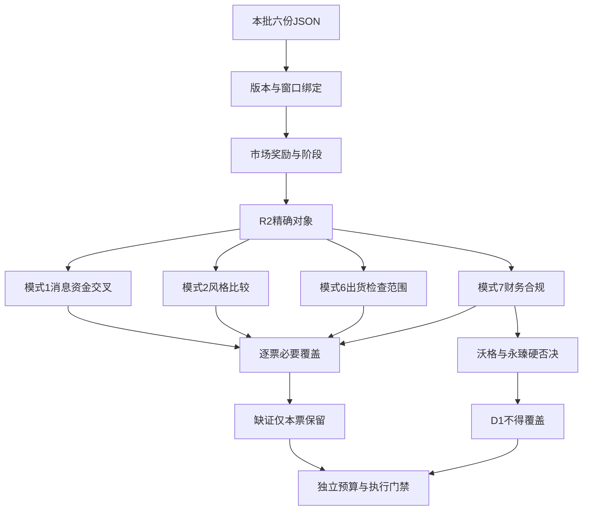

# 2026年11月5日 · 反证 / Devil's Advocate

> 数据源新鲜度：partial；情绪：震荡；降级状态：true；置信度：0.78。

## 一句话结论

拦截沃格、永臻；22票局部已审，仅1票必要覆盖齐全，不授任何买权。

## 详细分析

### 先认市场，不把广谱修复写成新主升

市场正在为科技容量与低位修复付钱。R1的118家涨停、非ST最高3板和昨日涨停组收盘负反馈并存，说明指数强不等于接力收益同步转强。情绪=震荡，阶段为高位震荡中的广谱修复；不从旧市场停买意见无限继承零仓，也不把未知账户预算改成正额度。

R2采用“三格”主模板。本次维持其主线/次线研究身份，只检查反证，不替D1选执行票。主线字段以下均是对下一交易日的研究假设，不是已经实现的持续轮次：

| 主线 | 持续性 | 封板率 | 下一日预期 |
|---|---|---|---|
| 先进封装/半导体修复 | 1日 | 95.0000% | 分歧 |
| 光通信/磷化铟事件链 | 1日 | 85.7143% | 分歧 |
| 光伏/储能修复 | 1日 | 78.5714% | 分歧 |

### 必要覆盖不等于“通过”

逐票完成模式1/2/6/7实质扫描，机器明细共88行。模式1完成8、未完成14；模式2完成22；模式6完成11、未完成11；模式7完成4、未完成18。只有新易盛四类必要项覆盖齐全，但仍有现金转换、存货和下降结构的反面发现，且RR、当日门禁与账户授权独立，不能理解为可买。

模式1先核R7实际覆盖，没有覆盖时读取同版R5分档资金与价格，保留实际source与指针，不因旧票池漏票全盘停买。完成的8票只完成既有修复/事件主张的同窗比较，不认证公司新增订单或新闻因果；盘后消息缺后续交易窗的票继续未完成。模式6只接受精确对象/板块已核结果，空alert数组不是阴性。模式7未知只限制对应票，不能把财务红旗或合规事实抹掉。

### 硬否决与历史个人案必须分清

沃格光电命中F3/F4/F9/F10四条；永臻股份命中F3/F6/F8/F9/F10五条，按原≥4条规则拦截。两票均不得入execution_pool，可保留研究观察；不以龙二、低位补涨或弹性核心替补。永臻R5没有预先宣布hard_reject，不妨碍R6按已证五条作独立否决。

沃格的控股股东个人信披案确有处罚且已结案，保留治理强反证，但不能写成当前公司财务造假或当前未结立案。其硬否决有独立财报依据。收入负增长时，F3公式机械命中可能表示应收收缩慢于收入，不等于应收绝对暴增；原阈值未改，经济解释和局限同时保留。

## 逐票总表

| 对象 | 原α／险 | 模式1 | 模式2 | 模式6 | 模式7 | 本轮态度 |
|---|---|---|---|---|---|---|
| 通富微电 002156.SZ | B+／B- | 已审 | 已审 | 未完 | 已审 | 降级 |
| 长电科技 600584.SH | B+／B- | 已审 | 已审 | 未完 | 未完 | 降级 |
| 北方华创 002371.SZ | B+／B | 已审 | 已审 | 未完 | 已审 | 观察 |
| 博杰股份 002975.SZ | B／B- | 未完 | 已审 | 未完 | 未完 | 降级 |
| 沃格光电 603773.SH | B-／C | 未完 | 已审 | 未完 | 未完 | 拦截 |
| 云南锗业 002428.SZ | A-／B- | 已审 | 已审 | 已审 | 未完 | 降级 |
| 新易盛 300502.SZ | B／B- | 已审 | 已审 | 已审 | 已审 | 降级 |
| 中际旭创 300308.SZ | B／B- | 已审 | 已审 | 已审 | 未完 | 降级 |
| 华盛昌 002980.SZ | B-／C | 未完 | 已审 | 已审 | 未完 | 降级 |
| 闽发铝业 002578.SZ | B+／C | 未完 | 已审 | 未完 | 未完 | 降级 |
| 永臻股份 603381.SH | B／C | 未完 | 已审 | 未完 | 未完 | 拦截 |
| 阳光电源 300274.SZ | B+／B- | 已审 | 已审 | 未完 | 已审 | 降级 |
| 龙版传媒 605577.SH | B／C | 未完 | 已审 | 已审 | 未完 | 降级 |
| 浙文影业 601599.SH | B／C | 未完 | 已审 | 已审 | 未完 | 降级 |
| 福莱新材 605488.SH | B／C | 未完 | 已审 | 已审 | 未完 | 降级 |
| 兆威机电 003021.SZ | B+／B- | 未完 | 已审 | 已审 | 未完 | 降级 |
| 武汉天源 301127.SZ | B／B- | 未完 | 已审 | 未完 | 未完 | 降级 |
| 翰宇药业 300199.SZ | B／B- | 未完 | 已审 | 已审 | 未完 | 降级 |
| 四川黄金 001337.SZ | B+／B | 已审 | 已审 | 未完 | 未完 | 降级 |
| 七匹狼 002029.SZ | B-／C | 未完 | 已审 | 已审 | 未完 | 降级 |
| 九牧王 601566.SH | B-／C | 未完 | 已审 | 已审 | 未完 | 降级 |
| 深中华A 000017.SZ | B-／C | 未完 | 已审 | 未完 | 未完 | 降级 |

## 逐票实质判断与对照对象不选理由

以下“买入理由”只列被挑战的上游研究假设，不是R6正向结论；止损条件仅逻辑失效，不生成入场、目标或退出价。R2所有round_id/event_at缺证保持null；每条反证的sector与有效窗精确沿用R2，见同版JSON，不能由概念/日期猜轮次。

### 1．通富微电 002156.SZ — 降级

板型：首板收封；开板0次，日换手6.76%；无分钟横盘证据，不认证经典换手板。龙头认定：原R2 龙头；纪律§2原认定通过3条，不自动升级严格龙头确认。盈亏比：unknown，止损距unknown，R6不编价格。禁止清单：partial，未完成项不等于未命中。

**大资金意图**：只能观察行为，不能读心。近五日分档净额+1.0532亿元，东财同窗+1.0089亿元；同日偏差未超R5声明口径，但不当独立第三来源。

**为什么走强**：被挑战的是本批R2修复/事件/身位研究假设；直接封测先封且5日两口径均正，修复资金愿意为低位前排付钱；但收盘仍低于MA20/30，不能把首板当主升低吸。Q3归母利润中54.98%为非经常收益、有息负债超过归母净资产，利润高增不能直接等同封装主业爆发。涨价与事件因果不能倒写。

**逻辑够不够硬**：相较长电封板更早且不开板、5日净额由负正分化，保留封测研究第一位；北方华创是设备而非同业务封测，不能凭金额抢位。必要覆盖仍未完成；单项已审结果完整保留。

**买入理由（受挑战）**：直接封测先封且5日两口径均正，修复资金愿意为低位前排付钱；但收盘仍低于MA20/30，不能把首板当主升低吸。Q3归母利润中54.98%为非经常收益、有息负债超过归母净资产，利润高增不能直接等同封装主业爆发。；本轮直接封测双核心中先封，13:47首封、零开板；东财热榜第7，先进封装19家封板。与长电相比优先身位/封板时序，不以历史锚分低否决。广义封装成分还有更早新洁能/托伦斯，非同类封测，不称全成分绝对首封。。R6不采纳为开仓授权。

**风险点**：截至2026Q3，归母净利30.606亿元，经营现金流55.466亿元；已核红旗：F4,F6,F10。3项未知逐项列示。已证财报红旗：F4、F6、F10。风险强弱及处理条件见下述各项，不由缺证扩大为硬否决。

**止损条件（仅逻辑失效）**：对应公司级合同/业务假设被正式公告证伪，研究逻辑失效；不是R5设置卖出价。；未来1—3交易日同线核心资金继续流出、价格修复不能持续，则前排接力假设降级；D1另行确定交易退出规则。 不在此设置交易退出价。

**可验证假设**：未来1—3交易日观察本票大单+超大单净额符号、同线封板家数和MA20相对位置；只按实际新事实回填。；事件票核许可、采购执行、收入及回款公告；无新披露仍为未知，不以热度代替兑现。 仅原owner后续有效新证据可改变未知，不回填事前预测。

- 模式1／数据源冲突（已审）：R4同窗口只确认半导体/CPO与全市场修复，不确认新增封测订单。R5同票11月4日收涨停、五日两口径净入约1.05/1.01亿，与R2低位修复主张相容；但MA20/60未收复，单日回补不能证明主升或AMD业绩直接转化。本项只完成既有修复主张的交叉，不认证公司新增催化。
- 模式2／风格一致性（已审）：R1主线扩散型/高位震荡，与R2将先进封装/半导体修复作为1日修复观察而非已确认主升基本一致；收盘低于MA20和MA60：中期下降结构中的修复，尚非已确认主升。因此不得把R2观察改成趋势低吸许可。
- 模式6／霸榜出货（未完成）：精确对象/板块未获得已核alert阴性：仅有unknown检查记录。空distribution_alert不等于false；五日净流出本身不能满足模式6双条件。
  缺项：R3：本票或R2已声明精确板块、有效观察窗口的distribution_alert已核结果
- 模式7／财务合规（已审）：已逐项核R5财务计算/原文检查范围：实证财报红旗=F4,F6,F10。按原阈值strong_suggest，D1须显式处理，非自动通过。声明必要范围实际已核，辅助未知另列；完成不等于安全或买入。审计字段只代表最新已披露年度意见，H1法定段仅其披露窗口，未给全时安全保证。

证据定位：R2#/main_lines/0/leaders/0；R5#/profiles/0/dimensions；R3检查范围见JSON patterns_status.6；R4/R7实际对象指针见patterns_status.1。四象限：Q2_相对硬α_已现风险；原α／险=B+／B-。

### 2．长电科技 600584.SH — 降级

板型：首板收封；开板4次，日换手5.79%；无分钟横盘证据，不认证经典换手板。龙头认定：原R2 龙二；纪律§2原认定通过3条，不自动升级严格龙头确认。盈亏比：unknown，止损距unknown，R6不编价格。禁止清单：partial，未完成项不等于未命中。

**大资金意图**：只能观察行为，不能读心。近五日分档净额-1.4498亿元，东财同窗-1.2344亿元；同日偏差未超R5声明口径，但不当独立第三来源。

**为什么走强**：被挑战的是本批R2修复/事件/身位研究假设；封测容量核心的单日修复真实，但近5日两源仍净流出，14点后首封且开板4次。收入同比仅约8%，存货增速与周转反证提示备货压力，尚不足确认资金从游资接力转为机构持续加仓。涨价与事件因果不能倒写。

**逻辑够不够硬**：不选为封测首位，因为通富在封板时序与5日续航上占先；不是因历史股性弱否认当日合力。必要覆盖仍未完成；单项已审结果完整保留。

**买入理由（受挑战）**：封测容量核心的单日修复真实，但近5日两源仍净流出，14点后首封且开板4次。收入同比仅约8%，存货增速与周转反证提示备货压力，尚不足确认资金从游资接力转为机构持续加仓。；直接封测容量核心，14:07首封、4次开板后收封，单日东财资金10.81935亿高于通富；封板晚且承接反复多于通富所以龙二，不仅按资金金额换龙。。R6不采纳为开仓授权。

**风险点**：截至2026Q3，归母净利16.173亿元，经营现金流42.999亿元；已核红旗：F4。3项未知逐项列示。已证财报红旗：F4。风险强弱及处理条件见下述各项，不由缺证扩大为硬否决。

**止损条件（仅逻辑失效）**：对应公司级合同/业务假设被正式公告证伪，研究逻辑失效；不是R5设置卖出价。；未来1—3交易日同线核心资金继续流出、价格修复不能持续，则前排接力假设降级；D1另行确定交易退出规则。 不在此设置交易退出价。

**可验证假设**：未来1—3交易日观察本票大单+超大单净额符号、同线封板家数和MA20相对位置；只按实际新事实回填。；事件票核许可、采购执行、收入及回款公告；无新披露仍为未知，不以热度代替兑现。 仅原owner后续有效新证据可改变未知，不回填事前预测。

- 模式1／数据源冲突（已审）：R4半导体修复背景与长电11月4日收封同窗，但R5五日两口径净流出约1.45/1.23亿、4次开板，反驳“单日容量净入等于持续机构加仓”；不因R4未报道新订单断言无催化。通富先封且五日正净额，长电不能因当日金额较大自动换龙。
- 模式2／风格一致性（已审）：R1主线扩散型/高位震荡，与R2将先进封装/半导体修复作为1日修复观察而非已确认主升基本一致；收盘低于MA20和MA60：中期下降结构中的修复，尚非已确认主升。因此不得把R2观察改成趋势低吸许可。
- 模式6／霸榜出货（未完成）：精确对象/板块未获得已核alert阴性：仅有unknown检查记录。空distribution_alert不等于false；五日净流出本身不能满足模式6双条件。
  缺项：R3：本票或R2已声明精确板块、有效观察窗口的distribution_alert已核结果
- 模式7／财务合规（未完成）：已逐项核R5财务计算/原文检查范围：实证财报红旗=F4。单条非P0按soft_suggest，不凭该条扩成硬否决。必要缺项=S3，仅本票未完成。审计字段只代表最新已披露年度意见，H1法定段仅其披露窗口，未给全时安全保证。
  缺项：R5：S3：600584.SH已有年度标准审计意见，但本轮未完成可直接证明临近预警状态的原文闭环；名称非ST/盈利不替代S3。仅本票必要风险待R5/R4补核。

证据定位：R2#/main_lines/0/leaders/1；R5#/profiles/1/dimensions；R3检查范围见JSON patterns_status.6；R4/R7实际对象指针见patterns_status.1。四象限：Q2_相对硬α_已现风险；原α／险=B+／B-。

### 3．北方华创 002371.SZ — 观察

板型：首板收封；开板0次，日换手1.68%；无分钟横盘证据，不认证经典换手板。龙头认定：原R2 龙三；纪律§2原认定通过未知条，不自动升级严格龙头确认。盈亏比：unknown，止损距unknown，R6不编价格。禁止清单：partial，未完成项不等于未命中。

**大资金意图**：只能观察行为，不能读心。近五日分档净额+16.6229亿元，东财同窗+16.2729亿元；存在单日口径差异，原冲突完整保留。

**为什么走强**：被挑战的是本批R2修复/事件/身位研究假设；设备容量核心近5日净入更连续，Q3经营现金流和利润均为正，具备独立经营质量；单日涨停仍未收复MA20和MA60，不能以大市值净入推断总龙。涨价与事件因果不能倒写。

**逻辑够不够硬**：保留设备对照，不替换封测龙一；与通富并非同业务的金额排名赛。股性差只解释历史连板习惯，不作硬排除。必要覆盖仍未完成；单项已审结果完整保留。

**买入理由（受挑战）**：设备容量核心近5日净入更连续，Q3经营现金流和利润均为正，具备独立经营质量；单日涨停仍未收复MA20和MA60，不能以大市值净入推断总龙。；半导体设备容量核心，5日净入16.272944亿；设备与封测业务分开，只作本线第三研究对象，不因金额第一抢封测龙一。。R6不采纳为开仓授权。

**风险点**：截至2026Q3，归母净利53.920亿元，经营现金流55.908亿元；已核红旗：本轮适用计算未检出，但不代表全项阴性。2项未知逐项列示。已证财报红旗：本已核范围未检出，不代表未知范围安全。风险强弱及处理条件见下述各项，不由缺证扩大为硬否决。

**止损条件（仅逻辑失效）**：对应公司级合同/业务假设被正式公告证伪，研究逻辑失效；不是R5设置卖出价。；未来1—3交易日同线核心资金继续流出、价格修复不能持续，则前排接力假设降级；D1另行确定交易退出规则。 不在此设置交易退出价。

**可验证假设**：未来1—3交易日观察本票大单+超大单净额符号、同线封板家数和MA20相对位置；只按实际新事实回填。；事件票核许可、采购执行、收入及回款公告；无新披露仍为未知，不以热度代替兑现。 仅原owner后续有效新证据可改变未知，不回填事前预测。

- 模式1／数据源冲突（已审）：R4科技容量修复与北方当日零开板收封、五日两源正净额相容；设备不是封测，不能把修复市场消息扩写成公司新增订单或总龙。部分单日资金口径冲突保留，五日符号一致不消除其误差。
- 模式2／风格一致性（已审）：R1主线扩散型/高位震荡，与R2将先进封装/半导体修复作为1日修复观察而非已确认主升基本一致；收盘低于MA20和MA60：中期下降结构中的修复，尚非已确认主升。因此不得把R2观察改成趋势低吸许可。
- 模式6／霸榜出货（未完成）：精确对象/板块未获得已核alert阴性：仅有unknown检查记录。空distribution_alert不等于false；五日净流出本身不能满足模式6双条件。
  缺项：R3：本票或R2已声明精确板块、有效观察窗口的distribution_alert已核结果
- 模式7／财务合规（已审）：已逐项核R5财务计算/原文检查范围：实证财报红旗=未在已核F项检出。声明必要范围实际已核，辅助未知另列；完成不等于安全或买入。审计字段只代表最新已披露年度意见，H1法定段仅其披露窗口，未给全时安全保证。

证据定位：R2#/main_lines/0/leaders/2；R5#/profiles/2/dimensions；R3检查范围见JSON patterns_status.6；R4/R7实际对象指针见patterns_status.1。四象限：Q1_相对硬α_尚无已证重大财报风险；原α／险=B+／B。

### 4．博杰股份 002975.SZ — 降级

板型：首板收封；开板0次，日换手9.29%；无分钟横盘证据，不认证经典换手板。龙头认定：原R2 龙三；纪律§2原认定通过未知条，不自动升级严格龙头确认。盈亏比：unknown，止损距unknown，R6不编价格。禁止清单：partial，未完成项不等于未命中。

**大资金意图**：只能观察行为，不能读心。近五日分档净额-0.0698亿元，东财同窗-0.0920亿元；存在单日口径差异，原冲突完整保留。

**为什么走强**：被挑战的是本批R2修复/事件/身位研究假设；首板与历史锚有研究价值，但半导体、InP、机器人等热词的利润贡献被公司风险公告明确限制：2025划片机子公司收入占比2.78%，参股InP企业连续亏损，光模块耦合设备尚未实现收入。不能拿主题映射代替主营兑现。涨价与事件因果不能倒写。

**逻辑够不够硬**：不取代通富或云南锗业：前者有直接封测身位，后者有具名AOI合同，博杰当前受益份额与五日资金均更弱。旧8月公告只作仍待新披露更新的业务反证。必要覆盖仍未完成；单项已审结果完整保留。

**买入理由（受挑战）**：首板与历史锚有研究价值，但半导体、InP、机器人等热词的利润贡献被公司风险公告明确限制：2025划片机子公司收入占比2.78%，参股InP企业连续亏损，光模块耦合设备尚未实现收入。不能拿主题映射代替主营兑现。；主题历史锚TOP3之一且本轮首板，保留研究；封板晚于直接封测双核心，业务受益份额与人气地位未充分核实，不递补龙一。。R6不采纳为开仓授权。

**风险点**：截至2026Q3，归母净利3.489亿元，经营现金流1.358亿元；已核红旗：F9。4项未知逐项列示。已证财报红旗：F9。风险强弱及处理条件见下述各项，不由缺证扩大为硬否决。

**止损条件（仅逻辑失效）**：对应公司级合同/业务假设被正式公告证伪，研究逻辑失效；不是R5设置卖出价。；未来1—3交易日同线核心资金继续流出、价格修复不能持续，则前排接力假设降级；D1另行确定交易退出规则。 不在此设置交易退出价。

**可验证假设**：未来1—3交易日观察本票大单+超大单净额符号、同线封板家数和MA20相对位置；只按实际新事实回填。；事件票核许可、采购执行、收入及回款公告；无新披露仍为未知，不以热度代替兑现。 仅原owner后续有效新证据可改变未知，不回填事前预测。

- 模式1／数据源冲突（未完成）：R4未形成博杰同票经营消息覆盖；R5原风险披露对划片机份额、参股InP亏损及耦合设备未收入提出具体反证，五日资金仍负。R2锚候补身份不能证明合同受益份额；已审价格/资金及业务反证，消息交叉仍缺本票有效窗口核验。
  缺项：R4本票/明确对象关联消息与可比观察窗口的交叉证据；缺失不代表消息被资金否定
- 模式2／风格一致性（已审）：R1主线扩散型/高位震荡，与R2将先进封装/半导体修复作为1日修复观察而非已确认主升基本一致；收盘低于MA20和MA60：中期下降结构中的修复，尚非已确认主升。因此不得把R2观察改成趋势低吸许可。
- 模式6／霸榜出货（未完成）：精确对象/板块未获得已核alert阴性：仅有unknown检查记录。空distribution_alert不等于false；五日净流出本身不能满足模式6双条件。
  缺项：R3：本票或R2已声明精确板块、有效观察窗口的distribution_alert已核结果
- 模式7／财务合规（未完成）：已逐项核R5财务计算/原文检查范围：实证财报红旗=F9。单条非P0按soft_suggest，不凭该条扩成硬否决。必要缺项=S3，仅本票未完成。审计字段只代表最新已披露年度意见，H1法定段仅其披露窗口，未给全时安全保证。
  缺项：R5：S3：002975.SZ已有年度标准审计意见，但本轮未完成可直接证明临近预警状态的原文闭环；名称非ST/盈利不替代S3。仅本票必要风险待R5/R4补核。

证据定位：R2#/main_lines/0/leaders/3；R5#/profiles/3/dimensions；R3检查范围见JSON patterns_status.6；R4/R7实际对象指针见patterns_status.1。四象限：Q4_α待证_已现风险；原α／险=B／B-。

### 5．沃格光电 603773.SH — 拦截

板型：首板收封；开板2次，日换手8.25%；无分钟横盘证据，不认证经典换手板。龙头认定：原R2 龙三；纪律§2原认定通过未知条，不自动升级严格龙头确认。盈亏比：unknown，止损距unknown，R6不编价格。禁止清单：partial，未完成项不等于未命中。

**大资金意图**：只能观察行为，不能读心。近五日分档净额-1.0003亿元，东财同窗-1.0203亿元；存在单日口径差异，原冲突完整保留。

**为什么走强**：被挑战的是本批R2修复/事件/身位研究假设；首板反包不抵消财务和治理：Q3仍亏损、有息负债/净资产高，应收及存货与收入背离；控股股东个人信披案已于8月行政处罚并办结，不能冒充当前公司财务造假或未结案。原始处罚事实完整交R6判断有效范围。涨价与事件因果不能倒写。

**逻辑够不够硬**：不选为封测核心：业务收入兑现、5日资金和趋势均不及通富，另有真实治理反证；不是因图像缺口或历史锚排序封禁。必要覆盖仍未完成；单项已审结果完整保留。

**买入理由（受挑战）**：首板反包不抵消财务和治理：Q3仍亏损、有息负债/净资产高，应收及存货与收入背离；控股股东个人信披案已于8月行政处罚并办结，不能冒充当前公司财务造假或未结案。原始处罚事实完整交R6判断有效范围。；历史锚与首板共振可研究，但首封14:34偏晚、近120日炸板率43.5%为月度旧统计而非当日市场率，不能凭股性标签提级。。R6不采纳为开仓授权。

**风险点**：截至2026Q3，归母净利-1.872亿元，经营现金流0.338亿元；已核红旗：F3,F4,F9,F10,S1,S2。5项未知逐项列示。已证财报红旗：F3、F4、F9、F10。按≥4条原规则hard_reject，禁止执行。

**止损条件（仅逻辑失效）**：对应公司级合同/业务假设被正式公告证伪，研究逻辑失效；不是R5设置卖出价。；未来1—3交易日同线核心资金继续流出、价格修复不能持续，则前排接力假设降级；D1另行确定交易退出规则。 不在此设置交易退出价。

**可验证假设**：未来1—3交易日观察本票大单+超大单净额符号、同线封板家数和MA20相对位置；只按实际新事实回填。；事件票核许可、采购执行、收入及回款公告；无新披露仍为未知，不以热度代替兑现。 仅原owner后续有效新证据可改变未知，不回填事前预测。

- 模式1／数据源冲突（未完成）：R4没有沃格同票当前消息交叉，R5已嵌个人信披处罚结案事实与四项财务红旗；股价首板、五日净流出不能证明治理风险解除。不能将已结个人案写成当前公司财务造假。必要消息交叉未闭环，但真实财务否决不等待补齐。
  缺项：R4本票/明确对象关联消息与可比观察窗口的交叉证据；缺失不代表消息被资金否定
- 模式2／风格一致性（已审）：R1主线扩散型/高位震荡，与R2将先进封装/半导体修复作为1日修复观察而非已确认主升基本一致；收盘低于MA20和MA60：中期下降结构中的修复，尚非已确认主升。因此不得把R2观察改成趋势低吸许可。
- 模式6／霸榜出货（未完成）：精确对象/板块未获得已核alert阴性：仅有unknown检查记录。空distribution_alert不等于false；五日净流出本身不能满足模式6双条件。
  缺项：R3：本票或R2已声明精确板块、有效观察窗口的distribution_alert已核结果
- 模式7／财务合规（未完成）：已逐项核R5财务计算/原文检查范围：实证财报红旗=F3,F4,F9,F10。达到原≥4项规则，hard_reject保留；未完成其他项不撤销。S2是个人历史信披处罚且已结案，保留治理strong_suggest；不虚构公司当前立案硬否决，本票硬否决独立来自F3/F4/F9/F10。必要缺项=S3，仅本票未完成。审计字段只代表最新已披露年度意见，H1法定段仅其披露窗口，未给全时安全保证。
  缺项：R5：S3：603773.SH已有年度标准审计意见，但本轮未完成可直接证明临近预警状态的原文闭环；名称非ST/盈利不替代S3。仅本票必要风险待R5/R4补核。

证据定位：R2#/main_lines/0/leaders/4；R5#/profiles/4/dimensions；R3检查范围见JSON patterns_status.6；R4/R7实际对象指针见patterns_status.1。四象限：Q4_α待证_已现风险；原α／险=B-／C。

### 6．云南锗业 002428.SZ — 降级

板型：首板收封；开板3次，日换手13.15%；无分钟横盘证据，不认证经典换手板。龙头认定：原R2 龙头；纪律§2原认定通过3条，不自动升级严格龙头确认。盈亏比：unknown，止损距unknown，R6不编价格。禁止清单：partial，未完成项不等于未命中。

**大资金意图**：只能观察行为，不能读心。近五日分档净额+10.9985亿元，东财同窗+10.9274亿元；同日偏差未超R5声明口径，但不当独立第三来源。

**为什么走强**：被挑战的是本批R2修复/事件/身位研究假设；年度InP合同提供本批最清晰的公司级事件锚，首板、双平台辨识度和5日正资金共振；但出口许可、采购执行及取消条款未兑现，PE约277倍且仍在MA20下方。做事件兑现研究，不把合同总额当净利润或即时现金。涨价与事件因果不能倒写。

**逻辑够不够硬**：优于新易盛/中际作为本批事件链第一研究对象：有直接合同主体与早盘封板；后两者虽业绩强，当前价格仍深跌，不能把容量反弹称为右侧主升。必要覆盖仍未完成；单项已审结果完整保留。

**买入理由（受挑战）**：年度InP合同提供本批最清晰的公司级事件锚，首板、双平台辨识度和5日正资金共振；但出口许可、采购执行及取消条款未兑现，PE约277倍且仍在MA20下方。做事件兑现研究，不把合同总额当净利润或即时现金。；具名AOI年度合同、早盘首板、THS第9/DC第2，材料支路辨识度与容量换手成立；R4同时保留出口许可及取消条款，不把订单当确定利润。。R6不采纳为开仓授权。

**风险点**：截至2026Q3，归母净利1.760亿元，经营现金流1.837亿元；已核红旗：F9。2项未知逐项列示。已证财报红旗：F9。风险强弱及处理条件见下述各项，不由缺证扩大为硬否决。

**止损条件（仅逻辑失效）**：对应公司级合同/业务假设被正式公告证伪，研究逻辑失效；不是R5设置卖出价。；未来1—3交易日同线核心资金继续流出、价格修复不能持续，则前排接力假设降级；D1另行确定交易退出规则。 不在此设置交易退出价。

**可验证假设**：未来1—3交易日观察本票大单+超大单净额符号、同线封板家数和MA20相对位置；只按实际新事实回填。；事件票核许可、采购执行、收入及回款公告；无新披露仍为未知，不以热度代替兑现。 仅原owner后续有效新证据可改变未知，不回填事前预测。

- 模式1／数据源冲突（已审）：R4 AOI年度合同及同一公告的出口许可/取消条款，与R5同票11月4日首板、五日两口径正净额同窗，可完成实质交叉：资金认可已披露订单预期，但不是执行许可、即时回款或确定利润。公告只有日期级公众可知线索，不补精确首发分钟。
- 模式2／风格一致性（已审）：R1主线扩散型/高位震荡，与R2将光通信/磷化铟事件链作为1日修复观察而非已确认主升基本一致；收盘低于MA20和MA60：中期下降结构中的修复，尚非已确认主升。因此不得把R2观察改成趋势低吸许可。
- 模式6／霸榜出货（已审）：本票/精确关联板块已查末榜两日top1规则，未命中；只排除此定义下的霸榜alert，不排除普通兑现、盘中派发或未来出货。
- 模式7／财务合规（未完成）：已逐项核R5财务计算/原文检查范围：实证财报红旗=F9。单条非P0按soft_suggest，不凭该条扩成硬否决。必要缺项=F2，仅本票未完成。审计字段只代表最新已披露年度意见，H1法定段仅其披露窗口，未给全时安全保证。
  缺项：R5：F2：商誉null不是0；未从其他资产倒挤商誉。

证据定位：R2#/main_lines/1/leaders/0；R5#/profiles/5/dimensions；R3检查范围见JSON patterns_status.6；R4/R7实际对象指针见patterns_status.1。四象限：Q2_相对硬α_已现风险；原α／险=A-／B-。

### 7．新易盛 300502.SZ — 降级

板型：非涨停修复大阳；不认证主升趋势。龙头认定：原R2 龙二；纪律§2原认定通过未知条，不自动升级严格龙头确认。盈亏比：unknown，止损距unknown，R6不编价格。禁止清单：partial，未完成项不等于未命中。

**大资金意图**：只能观察行为，不能读心。近五日分档净额+5.2285亿元，东财同窗+4.4780亿元；存在单日口径差异，原冲突完整保留。

**为什么走强**：被挑战的是本批R2修复/事件/身位研究假设；收入与净利增长是真经营证据，但5日净额跨源有偏差，CFO/归母净利很低、存货快速增加；30交易日价格跌幅约一半且未站稳MA5。强业绩不等于当前强趋势，单日大阳不足证明抛压已清。涨价与事件因果不能倒写。

**逻辑够不够硬**：与云南锗业相比缺本轮新增的直接合同催化与封板身位；与中际相比5日资金稍强但跌势更深。不因历史股性低一票否决。必要覆盖已完成，但有反面发现且不授买权。

**买入理由（受挑战）**：收入与净利增长是真经营证据，但5日净额跨源有偏差，CFO/归母净利很低、存货快速增加；30交易日价格跌幅约一半且未站稳MA5。强业绩不等于当前强趋势，单日大阳不足证明抛压已清。；光模块人气容量修复，THS新进前20；5日资金4.477992亿正但5日价格仍约-23.48%，只作龙二研究，不认证主升趋势恢复。。R6不采纳为开仓授权。

**风险点**：截至2026Q3，归母净利113.723亿元，经营现金流14.644亿元；已核红旗：F4,V4。3项未知逐项列示。已证财报红旗：F4。风险强弱及处理条件见下述各项，不由缺证扩大为硬否决。

**止损条件（仅逻辑失效）**：对应公司级合同/业务假设被正式公告证伪，研究逻辑失效；不是R5设置卖出价。；未来1—3交易日同线核心资金继续流出、价格修复不能持续，则前排接力假设降级；D1另行确定交易退出规则。 不在此设置交易退出价。

**可验证假设**：未来1—3交易日观察本票大单+超大单净额符号、同线封板家数和MA20相对位置；只按实际新事实回填。；事件票核许可、采购执行、收入及回款公告；无新披露仍为未知，不以热度代替兑现。 仅原owner后续有效新证据可改变未知，不回填事前预测。

- 模式1／数据源冲突（已审）：R4确认CPO修复背景，未确认新易盛获得AOI材料合同；R5五日资金虽较中际强，30日深跌与极低CFO/净利反驳“好业绩等于已转主升”。同窗价格资金可审既有容量修复主张，不能把云南合同受益资格横移给新易盛。
- 模式2／风格一致性（已审）：R1主线扩散型/高位震荡，与R2将光通信/磷化铟事件链作为1日修复观察而非已确认主升基本一致；收盘低于MA20和MA60：中期下降结构中的修复，尚非已确认主升。因此不得把R2观察改成趋势低吸许可。
- 模式6／霸榜出货（已审）：本票/精确关联板块已查末榜两日top1规则，未命中；只排除此定义下的霸榜alert，不排除普通兑现、盘中派发或未来出货。
- 模式7／财务合规（已审）：已逐项核R5财务计算/原文检查范围：实证财报红旗=F4。单条非P0按soft_suggest，不凭该条扩成硬否决。声明必要范围实际已核，辅助未知另列；完成不等于安全或买入。审计字段只代表最新已披露年度意见，H1法定段仅其披露窗口，未给全时安全保证。

证据定位：R2#/main_lines/1/leaders/1；R5#/profiles/6/dimensions；R3检查范围见JSON patterns_status.6；R4/R7实际对象指针见patterns_status.1。四象限：Q2_相对硬α_已现风险；原α／险=B／B-。

### 8．中际旭创 300308.SZ — 降级

板型：非涨停修复大阳；不认证主升趋势。龙头认定：原R2 龙三；纪律§2原认定通过未知条，不自动升级严格龙头确认。盈亏比：unknown，止损距unknown，R6不编价格。禁止清单：partial，未完成项不等于未命中。

**大资金意图**：只能观察行为，不能读心。近五日分档净额-17.6963亿元，东财同窗-18.1442亿元；同日偏差未超R5声明口径，但不当独立第三来源。

**为什么走强**：被挑战的是本批R2修复/事件/身位研究假设；高收入高利润与价格、资金构成显著背离：前三季利润兑现较强，近5日净额仍大幅为负，股价远在MA20和MA60下。CFO/净利偏低需核备货与回款，不由低PE宣告估值底。涨价与事件因果不能倒写。

**逻辑够不够硬**：不选为本轮事件链首位，因为云南是直接材料合同主体，且当前资金方向相反；中际保留容量对照，不能自动继承昔日龙头买权。必要覆盖仍未完成；单项已审结果完整保留。

**买入理由（受挑战）**：高收入高利润与价格、资金构成显著背离：前三季利润兑现较强，近5日净额仍大幅为负，股价远在MA20和MA60下。CFO/净利偏低需核备货与回款，不由低PE宣告估值底。；全市场辨识度和容量高，但5日资金与价格仍弱，保留为容量对照，不以单日净入和11%涨幅替代新主升确认。。R6不采纳为开仓授权。

**风险点**：截至2026Q3，归母净利222.379亿元，经营现金流80.084亿元；已核红旗：V4。4项未知逐项列示。已证财报红旗：本已核范围未检出，不代表未知范围安全。风险强弱及处理条件见下述各项，不由缺证扩大为硬否决。

**止损条件（仅逻辑失效）**：对应公司级合同/业务假设被正式公告证伪，研究逻辑失效；不是R5设置卖出价。；未来1—3交易日同线核心资金继续流出、价格修复不能持续，则前排接力假设降级；D1另行确定交易退出规则。 不在此设置交易退出价。

**可验证假设**：未来1—3交易日观察本票大单+超大单净额符号、同线封板家数和MA20相对位置；只按实际新事实回填。；事件票核许可、采购执行、收入及回款公告；无新披露仍为未知，不以热度代替兑现。 仅原owner后续有效新证据可改变未知，不回填事前预测。

- 模式1／数据源冲突（已审）：R4 CPO修复消息与中际当日上涨相容，但R5近五日净流出和远低于MA20/60明确不支持持续主升。云南是具名材料合同主体，中际不是；当前容量反弹不能自动继承历史龙头的开仓权。
- 模式2／风格一致性（已审）：R1主线扩散型/高位震荡，与R2将光通信/磷化铟事件链作为1日修复观察而非已确认主升基本一致；收盘低于MA20和MA60：中期下降结构中的修复，尚非已确认主升。因此不得把R2观察改成趋势低吸许可。
- 模式6／霸榜出货（已审）：本票/精确关联板块已查末榜两日top1规则，未命中；只排除此定义下的霸榜alert，不排除普通兑现、盘中派发或未来出货。
- 模式7／财务合规（未完成）：已逐项核R5财务计算/原文检查范围：实证财报红旗=未在已核F项检出。必要缺项=S3，仅本票未完成。审计字段只代表最新已披露年度意见，H1法定段仅其披露窗口，未给全时安全保证。
  缺项：R5：S3：300308.SZ已有年度标准审计意见，但本轮未完成可直接证明临近预警状态的原文闭环；名称非ST/盈利不替代S3。仅本票必要风险待R5/R4补核。

证据定位：R2#/main_lines/1/leaders/2；R5#/profiles/7/dimensions；R3检查范围见JSON patterns_status.6；R4/R7实际对象指针见patterns_status.1。四象限：Q2_相对硬α_已现风险；原α／险=B／B-。

### 9．华盛昌 002980.SZ — 降级

板型：首板收封；开板0次，日换手11.70%；无分钟横盘证据，不认证经典换手板。龙头认定：原R2 龙三；纪律§2原认定通过未知条，不自动升级严格龙头确认。盈亏比：unknown，止损距unknown，R6不编价格。禁止清单：partial，未完成项不等于未命中。

**大资金意图**：只能观察行为，不能读心。近五日分档净额-0.6560亿元，东财同窗-0.6736亿元；同日偏差未超R5声明口径，但不当独立第三来源。

**为什么走强**：被挑战的是本批R2修复/事件/身位研究假设；首板不能解决并购口径与现金质量问题：应收同比远快于收入，应收/收入高，前三季CFO为负。市场给了反抽，但主营与事件链受益份额、核心带动性均未证实。涨价与事件因果不能倒写。

**逻辑够不够硬**：不选为云南锗业替代：历史锚和涨停次数不是订单主体证明；同样首板，云南有早盘辨识度与正向五日合力。必要覆盖仍未完成；单项已审结果完整保留。

**买入理由（受挑战）**：首板不能解决并购口径与现金质量问题：应收同比远快于收入，应收/收入高，前三季CFO为负。市场给了反抽，但主营与事件链受益份额、核心带动性均未证实。；CPO历史锚TOP3且本轮首板，纳入研究；不是本次具名材料合同直接受益主体，广概念标签不等于业绩映射。。R6不采纳为开仓授权。

**风险点**：截至2026Q3，归母净利2.354亿元，经营现金流-0.250亿元；已核红旗：F3,F9。4项未知逐项列示。已证财报红旗：F3、F9。风险强弱及处理条件见下述各项，不由缺证扩大为硬否决。

**止损条件（仅逻辑失效）**：对应公司级合同/业务假设被正式公告证伪，研究逻辑失效；不是R5设置卖出价。；未来1—3交易日同线核心资金继续流出、价格修复不能持续，则前排接力假设降级；D1另行确定交易退出规则。 不在此设置交易退出价。

**可验证假设**：未来1—3交易日观察本票大单+超大单净额符号、同线封板家数和MA20相对位置；只按实际新事实回填。；事件票核许可、采购执行、收入及回款公告；无新披露仍为未知，不以热度代替兑现。 仅原owner后续有效新证据可改变未知，不回填事前预测。

- 模式1／数据源冲突（未完成）：R4未核华盛昌同票事件链收入或客户关系；R5首板但应收与收入背离、五日净流出。历史锚和首板不证明是AOI受益公司，现有资料不能完成消息—资金的对象级交叉。
  缺项：R4本票/明确对象关联消息与可比观察窗口的交叉证据；缺失不代表消息被资金否定
- 模式2／风格一致性（已审）：R1主线扩散型/高位震荡，与R2将光通信/磷化铟事件链作为1日修复观察而非已确认主升基本一致；收盘低于MA20和MA60：中期下降结构中的修复，尚非已确认主升。因此不得把R2观察改成趋势低吸许可。
- 模式6／霸榜出货（已审）：本票/精确关联板块已查末榜两日top1规则，未命中；只排除此定义下的霸榜alert，不排除普通兑现、盘中派发或未来出货。
- 模式7／财务合规（未完成）：已逐项核R5财务计算/原文检查范围：实证财报红旗=F3,F9。按原阈值strong_suggest，D1须显式处理，非自动通过。必要缺项=S3，仅本票未完成。审计字段只代表最新已披露年度意见，H1法定段仅其披露窗口，未给全时安全保证。
  缺项：R5：S3：002980.SZ已有年度标准审计意见，但本轮未完成可直接证明临近预警状态的原文闭环；名称非ST/盈利不替代S3。仅本票必要风险待R5/R4补核。

证据定位：R2#/main_lines/1/leaders/3；R5#/profiles/8/dimensions；R3检查范围见JSON patterns_status.6；R4/R7实际对象指针见patterns_status.1。四象限：Q4_α待证_已现风险；原α／险=B-／C。

### 10．闽发铝业 002578.SZ — 降级

板型：3连板收封；开板0次，日换手12.50%；无分钟横盘证据，不认证经典换手板。龙头认定：原R2 龙头；纪律§2原认定通过3条，不自动升级严格龙头确认。盈亏比：unknown，止损距unknown，R6不编价格。禁止清单：partial，未完成项不等于未命中。

**大资金意图**：只能观察行为，不能读心。近五日分档净额+1.1850亿元，东财同窗+1.1791亿元；同日偏差未超R5声明口径，但不当独立第三来源。

**为什么走强**：被挑战的是本批R2修复/事件/身位研究假设；三板高度、零开板和正五日资金是当日身位证据；但下午首封、从低位三日连续加速，产业与利润锚偏弱。前三季微利主要由非经常项目覆盖，CFO为负，不能把铝加工情绪代理写成光伏行业盈利反转。涨价与事件因果不能倒写。

**逻辑够不够硬**：保留相对永臻的高度前排；不以三板取代通富/云南的直接业务核心。与永臻相比筹码身位占先，但不是风险更小。必要覆盖仍未完成；单项已审结果完整保留。

**买入理由（受挑战）**：三板高度、零开板和正五日资金是当日身位证据；但下午首封、从低位三日连续加速，产业与利润锚偏弱。前三季微利主要由非经常项目覆盖，CFO为负，不能把铝加工情绪代理写成光伏行业盈利反转。；光伏成分当前最高3板，非情绪全市场唯一总龙；本轮业务查询有光伏支架/边框，12.50%换手能交易，身位先于永臻但首封晚于永臻，不隐去相反证据。。R6不采纳为开仓授权。

**风险点**：截至2026Q3，归母净利0.027亿元，经营现金流-0.955亿元；已核红旗：F6。4项未知逐项列示。已证财报红旗：F6。风险强弱及处理条件见下述各项，不由缺证扩大为硬否决。

**止损条件（仅逻辑失效）**：对应公司级合同/业务假设被正式公告证伪，研究逻辑失效；不是R5设置卖出价。；未来1—3交易日同线核心资金继续流出、价格修复不能持续，则前排接力假设降级；D1另行确定交易退出规则。 不在此设置交易退出价。

**可验证假设**：未来1—3交易日观察本票大单+超大单净额符号、同线封板家数和MA20相对位置；只按实际新事实回填。；事件票核许可、采购执行、收入及回款公告；无新披露仍为未知，不以热度代替兑现。 仅原owner后续有效新证据可改变未知，不回填事前预测。

- 模式1／数据源冲突（未完成）：闽发三板与五日正资金已审，但R4未核铝加工代理本轮光伏/储能盈利兑现的直接事件。三板身位不等于公司新增订单，F6显示微利受非经常项目主导；仅本票消息关联未完成，不否认实际接力价格。
  缺项：R4本票/明确对象关联消息与可比观察窗口的交叉证据；缺失不代表消息被资金否定
- 模式2／风格一致性（已审）：R1主线扩散型/高位震荡，与R2将光伏/储能修复作为1日修复观察而非已确认主升基本一致；收盘高于MA20/60，短线相对强；仍须检查高位兑现和本线合力，不因均线翻多授予买权。因此不得把R2观察改成趋势低吸许可。
- 模式6／霸榜出货（未完成）：精确对象/板块未获得已核alert阴性：仅有unknown检查记录。空distribution_alert不等于false；五日净流出本身不能满足模式6双条件。
  缺项：R3：本票或R2已声明精确板块、有效观察窗口的distribution_alert已核结果
- 模式7／财务合规（未完成）：已逐项核R5财务计算/原文检查范围：实证财报红旗=F6。单条非P0按soft_suggest，不凭该条扩成硬否决。必要缺项=F2，仅本票未完成。审计字段只代表最新已披露年度意见，H1法定段仅其披露窗口，未给全时安全保证。
  缺项：R5：F2：商誉null不是0；未从其他资产倒挤商誉。

证据定位：R2#/main_lines/2/leaders/0；R5#/profiles/9/dimensions；R3检查范围见JSON patterns_status.6；R4/R7实际对象指针见patterns_status.1。四象限：Q4_α待证_已现风险；原α／险=B+／C。

### 11．永臻股份 603381.SH — 拦截

板型：2连板收封；开板0次，日换手13.11%；无分钟横盘证据，不认证经典换手板。龙头认定：原R2 龙二；纪律§2原认定通过未知条，不自动升级严格龙头确认。盈亏比：unknown，止损距unknown，R6不编价格。禁止清单：partial，未完成项不等于未命中。

**大资金意图**：只能观察行为，不能读心。近五日分档净额+0.6464亿元，东财同窗+0.6417亿元；存在单日口径差异，原冲突完整保留。

**为什么走强**：被挑战的是本批R2修复/事件/身位研究假设；二板突破与近30日上涨较强，市场愿为光伏修复的低位连板付钱；但Q3累计CFO大幅负且连续两个单季负、归母净利为正，有息负债/净资产高，利润近乎由非经常项目解释。量价强不能消除现金风险。涨价与事件因果不能倒写。

**逻辑够不够硬**：不提为本线首位：闽发身位更高且五日资金更强；与阳光电源相比财务现金与负债压力更大。保留真实低位研究，不因缺额清池。必要覆盖仍未完成；单项已审结果完整保留。

**买入理由（受挑战）**：二板突破与近30日上涨较强，市场愿为光伏修复的低位连板付钱；但Q3累计CFO大幅负且连续两个单季负、归母净利为正，有息负债/净资产高，利润近乎由非经常项目解释。量价强不能消除现金风险。；主营光伏边框、二板早封，板内龙二；不能因闽发高一板就改称它为低位唯一主推，双方资金口径冲突及历史样本弱须R5核。。R6不采纳为开仓授权。

**风险点**：截至2026Q3，归母净利0.529亿元，经营现金流-11.942亿元；已核红旗：F3,F6,F8,F9,F10。4项未知逐项列示。已证财报红旗：F3、F6、F8、F9、F10。按≥4条原规则hard_reject，禁止执行。

**止损条件（仅逻辑失效）**：对应公司级合同/业务假设被正式公告证伪，研究逻辑失效；不是R5设置卖出价。；未来1—3交易日同线核心资金继续流出、价格修复不能持续，则前排接力假设降级；D1另行确定交易退出规则。 不在此设置交易退出价。

**可验证假设**：未来1—3交易日观察本票大单+超大单净额符号、同线封板家数和MA20相对位置；只按实际新事实回填。；事件票核许可、采购执行、收入及回款公告；无新披露仍为未知，不以热度代替兑现。 仅原owner后续有效新证据可改变未知，不回填事前预测。

- 模式1／数据源冲突（未完成）：永臻二板及五日资金已审，但R4储能工程/材料风险不能无主体证据转成永臻消息。财务五红旗构成原规则硬否决；消息交叉缺口不是否决依据，也不抵消已证风险。
  缺项：R4本票/明确对象关联消息与可比观察窗口的交叉证据；缺失不代表消息被资金否定
- 模式2／风格一致性（已审）：R1主线扩散型/高位震荡，与R2将光伏/储能修复作为1日修复观察而非已确认主升基本一致；收盘高于MA20/60，短线相对强；仍须检查高位兑现和本线合力，不因均线翻多授予买权。因此不得把R2观察改成趋势低吸许可。
- 模式6／霸榜出货（未完成）：精确对象/板块未获得已核alert阴性：仅有unknown检查记录。空distribution_alert不等于false；五日净流出本身不能满足模式6双条件。
  缺项：R3：本票或R2已声明精确板块、有效观察窗口的distribution_alert已核结果
- 模式7／财务合规（未完成）：已逐项核R5财务计算/原文检查范围：实证财报红旗=F3,F6,F8,F9,F10。达到原≥4项规则，hard_reject保留；未完成其他项不撤销。必要缺项=S3，仅本票未完成。审计字段只代表最新已披露年度意见，H1法定段仅其披露窗口，未给全时安全保证。
  缺项：R5：S3：603381.SH已有年度标准审计意见，但本轮未完成可直接证明临近预警状态的原文闭环；名称非ST/盈利不替代S3。仅本票必要风险待R5/R4补核。

证据定位：R2#/main_lines/2/leaders/1；R5#/profiles/10/dimensions；R3检查范围见JSON patterns_status.6；R4/R7实际对象指针见patterns_status.1。四象限：Q4_α待证_已现风险；原α／险=B／C。

### 12．阳光电源 300274.SZ — 降级

板型：非涨停修复大阳；不认证主升趋势。龙头认定：原R2 龙三；纪律§2原认定通过未知条，不自动升级严格龙头确认。盈亏比：unknown，止损距unknown，R6不编价格。禁止清单：partial，未完成项不等于未命中。

**大资金意图**：只能观察行为，不能读心。近五日分档净额+12.8145亿元，东财同窗+12.6809亿元；同日偏差未超R5声明口径，但不当独立第三来源。

**为什么走强**：被挑战的是本批R2修复/事件/身位研究假设；储能逆变器容量修复近5日资金为正，已收复MA20，强于多数超跌容量票；但MA60仍在上方，前三季收入、利润同比均下滑，存货和应收反证仍需解释，不提前认证新主升。涨价与事件因果不能倒写。

**逻辑够不够硬**：不以资金最大替代闽发连板身位；相比永臻现金与容量证据较强，作为本线经营/容量对照，不自动递补执行。必要覆盖仍未完成；单项已审结果完整保留。

**买入理由（受挑战）**：储能逆变器容量修复近5日资金为正，已收复MA20，强于多数超跌容量票；但MA60仍在上方，前三季收入、利润同比均下滑，存货和应收反证仍需解释，不提前认证新主升。；容量趋势观察，近5日资金连续回流可核，但未涨停、非当前高度龙；不拿大容量修复票替代普通10cm妖股通道。。R6不采纳为开仓授权。

**风险点**：截至2026Q3，归母净利65.990亿元，经营现金流36.476亿元；已核红旗：F3,F4,F9。3项未知逐项列示。已证财报红旗：F3、F4、F9。风险强弱及处理条件见下述各项，不由缺证扩大为硬否决。

**止损条件（仅逻辑失效）**：对应公司级合同/业务假设被正式公告证伪，研究逻辑失效；不是R5设置卖出价。；未来1—3交易日同线核心资金继续流出、价格修复不能持续，则前排接力假设降级；D1另行确定交易退出规则。 不在此设置交易退出价。

**可验证假设**：未来1—3交易日观察本票大单+超大单净额符号、同线封板家数和MA20相对位置；只按实际新事实回填。；事件票核许可、采购执行、收入及回款公告；无新披露仍为未知，不以热度代替兑现。 仅原owner后续有效新证据可改变未知，不回填事前预测。

- 模式1／数据源冲突（已审）：R4市场与流动性消息只有广谱修复而非阳光新增合同；R5五日正净额与收复MA20支持有限容量修复，MA60未回收及收入下降、库存/应收问题反驳直接认证新主升。对照闽发的高度与永臻财务风险，不按金额自动升位。
- 模式2／风格一致性（已审）：R1主线扩散型/高位震荡，与R2将光伏/储能修复作为1日修复观察而非已确认主升基本一致；收复MA20但尚未收复MA60，短线修复与中期结构分层。因此不得把R2观察改成趋势低吸许可。
- 模式6／霸榜出货（未完成）：精确对象/板块未获得已核alert阴性：仅有unknown检查记录。空distribution_alert不等于false；五日净流出本身不能满足模式6双条件。
  缺项：R3：本票或R2已声明精确板块、有效观察窗口的distribution_alert已核结果
- 模式7／财务合规（已审）：已逐项核R5财务计算/原文检查范围：实证财报红旗=F3,F4,F9。按原阈值strong_suggest，D1须显式处理，非自动通过。声明必要范围实际已核，辅助未知另列；完成不等于安全或买入。审计字段只代表最新已披露年度意见，H1法定段仅其披露窗口，未给全时安全保证。

证据定位：R2#/main_lines/2/leaders/2；R5#/profiles/11/dimensions；R3检查范围见JSON patterns_status.6；R4/R7实际对象指针见patterns_status.1。四象限：Q2_相对硬α_已现风险；原α／险=B+／B-。

### 13．龙版传媒 605577.SH — 降级

板型：连板收封，见limit_times。龙头认定：原R2 龙三；纪律§2原认定通过未知条，不自动升级严格龙头确认。盈亏比：unknown，止损距unknown，R6不编价格。禁止清单：partial，未完成项不等于未命中。

**大资金意图**：只能观察行为，不能读心。近五日分档净额+0.9528亿元，东财同窗+0.8461亿元；存在单日口径差异，原冲突完整保留。

**为什么走强**：被挑战的是本批R2修复/事件/身位研究假设；三板早封有情绪辨识度，但开板4次，最新公告提示主营未变、前三季利润下降。H1研发资本化率超过50%触发F5，但绝对金额较小，应防止把会计红旗夸大成造假结论。涨价与事件因果不能倒写。

**逻辑够不够硬**：与浙文相比开板反复、板块合力和新业务收入仍弱；不因近期股性极佳或一字预测而主推，更不把AI视频概念当新增营收。必要覆盖仍未完成；单项已审结果完整保留。

**买入理由（受挑战）**：三板早封有情绪辨识度，但开板4次，最新公告提示主营未变、前三季利润下降。H1研发资本化率超过50%触发F5，但绝对金额较小，应防止把会计红旗夸大成造假结论。；实际比较三板浙文、大晟、龙版。R3短剧4→9，成分4封板/3炸板；传媒单日净入7.649331亿但5日-2.155441亿，弱于芯片修复。大晟负净资产/退市风险交R6，非全传媒财务雷；浙文经营无新重大变化不等于永远无业务。龙版不在所取短剧99成分内，按出版关联单列，不能借其三板美化短剧统计。保留其真实承接观察，不用新名字补旧线。。R6不采纳为开仓授权。

**风险点**：截至2026Q3，归母净利2.654亿元，经营现金流1.891亿元；已核红旗：F5。5项未知逐项列示。已证财报红旗：F5。风险强弱及处理条件见下述各项，不由缺证扩大为硬否决。

**止损条件（仅逻辑失效）**：对应公司级合同/业务假设被正式公告证伪，研究逻辑失效；不是R5设置卖出价。；未来1—3交易日同线核心资金继续流出、价格修复不能持续，则前排接力假设降级；D1另行确定交易退出规则。 不在此设置交易退出价。

**可验证假设**：未来1—3交易日观察本票大单+超大单净额符号、同线封板家数和MA20相对位置；只按实际新事实回填。；事件票核许可、采购执行、收入及回款公告；无新披露仍为未知，不以热度代替兑现。 仅原owner后续有效新证据可改变未知，不回填事前预测。

- 模式1／数据源冲突（未完成）：R4明确Seedance媒体收入说法不能映射影视公司订单；龙版自身风险公告由R5嵌入，三板4次开板不等于主营改善。本轮缺龙版对应消息后可比交易窗口，保留新闻外推风险而非假称已见利好兑现。
  缺项：消息披露后有效窗口的本票可比价格/资金，不能用11月4日收盘解释盘后消息
- 模式2／风格一致性（已审）：R2将短剧/影视/出版情绪列次线观察，与R1三主线扩散而高位震荡的限温意见并不直接冲突；与浙文相比开板反复、板块合力和新业务收入仍弱；不因近期股性极佳或一字预测而主推，更不把AI视频概念当新增营收。若升级执行，原风格比较不等于已确认该线合力。
- 模式6／霸榜出货（已审）：本票/精确关联板块已查末榜两日top1规则，未命中；只排除此定义下的霸榜alert，不排除普通兑现、盘中派发或未来出货。
- 模式7／财务合规（未完成）：已逐项核R5财务计算/原文检查范围：实证财报红旗=F5。单条非P0按soft_suggest，不凭该条扩成硬否决。必要缺项=F1,F2,S3，仅本票未完成。审计字段只代表最新已披露年度意见，H1法定段仅其披露窗口，未给全时安全保证。
  缺项：R5：F1：核同口径数据按原阈值计算；并非财务安全认证；R5：F2：商誉null不是0；未从其他资产倒挤商誉。；R5：S3：605577.SH已有年度标准审计意见，但本轮未完成可直接证明临近预警状态的原文闭环；名称非ST/盈利不替代S3。仅本票必要风险待R5/R4补核。

证据定位：R2#/secondary_lines/0/leaders/0；R5#/profiles/12/dimensions；R3检查范围见JSON patterns_status.6；R4/R7实际对象指针见patterns_status.1。四象限：Q4_α待证_已现风险；原α／险=B／C。

### 14．浙文影业 601599.SH — 降级

板型：连板收封，见limit_times。龙头认定：原R2 龙三；纪律§2原认定通过未知条，不自动升级严格龙头确认。盈亏比：unknown，止损距unknown，R6不编价格。禁止清单：partial，未完成项不等于未命中。

**大资金意图**：只能观察行为，不能读心。近五日分档净额+0.5625亿元，东财同窗+0.4184亿元；存在单日口径差异，原冲突完整保留。

**为什么走强**：被挑战的是本批R2修复/事件/身位研究假设；三板早盘封板和突破箱体表明情绪资金参与，主营未重大变化与高乖离同时提示兑现风险；前三季CFO仍负。不是有影视名称就有短剧订单，更不是一字概率提供胜率。涨价与事件因果不能倒写。

**逻辑够不够硬**：相较龙版开板少但没有新增业务兑现，仍属次线情绪对照；不为凑执行池从次线自动升位。必要覆盖仍未完成；单项已审结果完整保留。

**买入理由（受挑战）**：三板早盘封板和突破箱体表明情绪资金参与，主营未重大变化与高乖离同时提示兑现风险；前三季CFO仍负。不是有影视名称就有短剧订单，更不是一字概率提供胜率。；实际比较三板浙文、大晟、龙版。R3短剧4→9，成分4封板/3炸板；传媒单日净入7.649331亿但5日-2.155441亿，弱于芯片修复。大晟负净资产/退市风险交R6，非全传媒财务雷；浙文经营无新重大变化不等于永远无业务。龙版不在所取短剧99成分内，按出版关联单列，不能借其三板美化短剧统计。保留其真实承接观察，不用新名字补旧线。。R6不采纳为开仓授权。

**风险点**：截至2026Q3，归母净利1.426亿元，经营现金流-1.357亿元；已核红旗：本轮适用计算未检出，但不代表全项阴性。6项未知逐项列示。已证财报红旗：本已核范围未检出，不代表未知范围安全。风险强弱及处理条件见下述各项，不由缺证扩大为硬否决。

**止损条件（仅逻辑失效）**：对应公司级合同/业务假设被正式公告证伪，研究逻辑失效；不是R5设置卖出价。；未来1—3交易日同线核心资金继续流出、价格修复不能持续，则前排接力假设降级；D1另行确定交易退出规则。 不在此设置交易退出价。

**可验证假设**：未来1—3交易日观察本票大单+超大单净额符号、同线封板家数和MA20相对位置；只按实际新事实回填。；事件票核许可、采购执行、收入及回款公告；无新披露仍为未知，不以热度代替兑现。 仅原owner后续有效新证据可改变未知，不回填事前预测。

- 模式1／数据源冲突（未完成）：R4已核浙文11月5日风险提示：主营无重大变化、换手提升；R5上一日三板不可能证明对该提示的资金反应。新消息后A股尚无已交付交易窗口，必要交叉未完成；“Seedance增长=浙文收入”已被原证据否定。
  缺项：消息披露后有效窗口的本票可比价格/资金，不能用11月4日收盘解释盘后消息
- 模式2／风格一致性（已审）：R2将短剧/影视/出版情绪列次线观察，与R1三主线扩散而高位震荡的限温意见并不直接冲突；相较龙版开板少但没有新增业务兑现，仍属次线情绪对照；不为凑执行池从次线自动升位。若升级执行，原风格比较不等于已确认该线合力。
- 模式6／霸榜出货（已审）：本票/精确关联板块已查末榜两日top1规则，未命中；只排除此定义下的霸榜alert，不排除普通兑现、盘中派发或未来出货。
- 模式7／财务合规（未完成）：已逐项核R5财务计算/原文检查范围：实证财报红旗=未在已核F项检出。必要缺项=F2,S3，仅本票未完成。审计字段只代表最新已披露年度意见，H1法定段仅其披露窗口，未给全时安全保证。
  缺项：R5：F2：Q3 API null保留；H1商誉已全额减值净额0另列有据历史阴性，不能移花为Q3数值0。；R5：S3：601599.SH已有年度标准审计意见，但本轮未完成可直接证明临近预警状态的原文闭环；名称非ST/盈利不替代S3。仅本票必要风险待R5/R4补核。

证据定位：R2#/secondary_lines/0/leaders/1；R5#/profiles/13/dimensions；R3检查范围见JSON patterns_status.6；R4/R7实际对象指针见patterns_status.1。四象限：Q4_α待证_已现风险；原α／险=B／C。

### 15．福莱新材 605488.SH — 降级

板型：连板收封，见limit_times。龙头认定：原R2 龙三；纪律§2原认定通过未知条，不自动升级严格龙头确认。盈亏比：unknown，止损距unknown，R6不编价格。禁止清单：partial，未完成项不等于未命中。

**大资金意图**：只能观察行为，不能读心。近五日分档净额-2.5606亿元，东财同窗-2.6839亿元；存在单日口径差异，原冲突完整保留。

**为什么走强**：被挑战的是本批R2修复/事件/身位研究假设；日线相对强但近30日涨幅大、五日资金净流出，前日跌停后再涨停说明高位波动而非低位确认。公司明确柔性传感器收入占比极低，PE接近200倍，不能把机器人热度当利润锚。涨价与事件因果不能倒写。

**逻辑够不够硬**：与兆威相比题材收入贡献更难确认且当前资金更弱，不凭高历史股性升级为本轮机器人龙头；保留趋势波动对照。必要覆盖仍未完成；单项已审结果完整保留。

**买入理由（受挑战）**：日线相对强但近30日涨幅大、五日资金净流出，前日跌停后再涨停说明高位波动而非低位确认。公司明确柔性传感器收入占比极低，PE接近200倍，不能把机器人热度当利润锚。；R3 L1+L2与概念第2；机器人概念22封板/10炸板、东财净入81.389839亿但5日-326.247414亿，人形5日-194.757704亿。福莱、兆威是真实10cm首板研究；小米整班作业/供应链说法尚未官方认证，江苏雷利个人立案不外推整个板块。旧days16→1不证明新轮次。。R6不采纳为开仓授权。

**风险点**：截至2026Q3，归母净利0.561亿元，经营现金流0.695亿元；已核红旗：本轮适用计算未检出，但不代表全项阴性。4项未知逐项列示。已证财报红旗：本已核范围未检出，不代表未知范围安全。风险强弱及处理条件见下述各项，不由缺证扩大为硬否决。

**止损条件（仅逻辑失效）**：对应公司级合同/业务假设被正式公告证伪，研究逻辑失效；不是R5设置卖出价。；未来1—3交易日同线核心资金继续流出、价格修复不能持续，则前排接力假设降级；D1另行确定交易退出规则。 不在此设置交易退出价。

**可验证假设**：未来1—3交易日观察本票大单+超大单净额符号、同线封板家数和MA20相对位置；只按实际新事实回填。；事件票核许可、采购执行、收入及回款公告；无新披露仍为未知，不以热度代替兑现。 仅原owner后续有效新证据可改变未知，不回填事前预测。

- 模式1／数据源冲突（未完成）：R4机器人治理负面对象是江苏雷利/鼎智的苏达，不是福莱，不能移植硬否决。R5自身柔性传感器收入极低与五日净流出是实质反证；本票新消息/同窗口对应缺口仍在。
  缺项：R4本票/明确对象关联消息与可比观察窗口的交叉证据；缺失不代表消息被资金否定
- 模式2／风格一致性（已审）：R2将人形机器人/物理AI列次线观察，与R1三主线扩散而高位震荡的限温意见并不直接冲突；与兆威相比题材收入贡献更难确认且当前资金更弱，不凭高历史股性升级为本轮机器人龙头；保留趋势波动对照。若升级执行，原风格比较不等于已确认该线合力。
- 模式6／霸榜出货（已审）：本票/精确关联板块已查末榜两日top1规则，未命中；只排除此定义下的霸榜alert，不排除普通兑现、盘中派发或未来出货。
- 模式7／财务合规（未完成）：已逐项核R5财务计算/原文检查范围：实证财报红旗=未在已核F项检出。必要缺项=F2,S3，仅本票未完成。审计字段只代表最新已披露年度意见，H1法定段仅其披露窗口，未给全时安全保证。
  缺项：R5：F2：商誉null不是0；未从其他资产倒挤商誉。；R5：S3：605488.SH已有年度标准审计意见，但本轮未完成可直接证明临近预警状态的原文闭环；名称非ST/盈利不替代S3。仅本票必要风险待R5/R4补核。

证据定位：R2#/secondary_lines/1/leaders/0；R5#/profiles/14/dimensions；R3检查范围见JSON patterns_status.6；R4/R7实际对象指针见patterns_status.1。四象限：Q4_α待证_已现风险；原α／险=B／C。

### 16．兆威机电 003021.SZ — 降级

板型：连板收封，见limit_times。龙头认定：原R2 龙三；纪律§2原认定通过未知条，不自动升级严格龙头确认。盈亏比：unknown，止损距unknown，R6不编价格。禁止清单：partial，未完成项不等于未命中。

**大资金意图**：只能观察行为，不能读心。近五日分档净额-2.1428亿元，东财同窗-2.1686亿元；同日偏差未超R5声明口径，但不当独立第三来源。

**为什么走强**：被挑战的是本批R2修复/事件/身位研究假设；微型传动具业务基础，日线MA20/30/60上方反包提供结构证据；但5日净流出、利润同比下降和高PE削弱兑现能力，缩量涨停也不是新增资金充分承接。涨价与事件因果不能倒写。

**逻辑够不够硬**：相对福莱主营映射更直接，但同处次线且暂无本轮资金回流确认；不越过R2角色门禁或借图像自动提级。必要覆盖仍未完成；单项已审结果完整保留。

**买入理由（受挑战）**：微型传动具业务基础，日线MA20/30/60上方反包提供结构证据；但5日净流出、利润同比下降和高PE削弱兑现能力，缩量涨停也不是新增资金充分承接。；R3 L1+L2与概念第2；机器人概念22封板/10炸板、东财净入81.389839亿但5日-326.247414亿，人形5日-194.757704亿。福莱、兆威是真实10cm首板研究；小米整班作业/供应链说法尚未官方认证，江苏雷利个人立案不外推整个板块。旧days16→1不证明新轮次。。R6不采纳为开仓授权。

**风险点**：截至2026Q3，归母净利1.226亿元，经营现金流1.581亿元；已核红旗：F3,F4,F9。3项未知逐项列示。已证财报红旗：F3、F4、F9。风险强弱及处理条件见下述各项，不由缺证扩大为硬否决。

**止损条件（仅逻辑失效）**：对应公司级合同/业务假设被正式公告证伪，研究逻辑失效；不是R5设置卖出价。；未来1—3交易日同线核心资金继续流出、价格修复不能持续，则前排接力假设降级；D1另行确定交易退出规则。 不在此设置交易退出价。

**可验证假设**：未来1—3交易日观察本票大单+超大单净额符号、同线封板家数和MA20相对位置；只按实际新事实回填。；事件票核许可、采购执行、收入及回款公告；无新披露仍为未知，不以热度代替兑现。 仅原owner后续有效新证据可改变未知，不回填事前预测。

- 模式1／数据源冲突（未完成）：R4苏达个人立案不能移植给兆威；R5微传动业务基础与均线相对强不抹去五日净流出、应收库存反证。未取得同票同窗口新增催化交叉，保留局部未完成，不借板块热度推定通过。
  缺项：R4本票/明确对象关联消息与可比观察窗口的交叉证据；缺失不代表消息被资金否定
- 模式2／风格一致性（已审）：R2将人形机器人/物理AI列次线观察，与R1三主线扩散而高位震荡的限温意见并不直接冲突；相对福莱主营映射更直接，但同处次线且暂无本轮资金回流确认；不越过R2角色门禁或借图像自动提级。若升级执行，原风格比较不等于已确认该线合力。
- 模式6／霸榜出货（已审）：本票/精确关联板块已查末榜两日top1规则，未命中；只排除此定义下的霸榜alert，不排除普通兑现、盘中派发或未来出货。
- 模式7／财务合规（未完成）：已逐项核R5财务计算/原文检查范围：实证财报红旗=F3,F4,F9。按原阈值strong_suggest，D1须显式处理，非自动通过。必要缺项=F2，仅本票未完成。审计字段只代表最新已披露年度意见，H1法定段仅其披露窗口，未给全时安全保证。
  缺项：R5：F2：商誉null不是0；未从其他资产倒挤商誉。

证据定位：R2#/secondary_lines/1/leaders/1；R5#/profiles/15/dimensions；R3检查范围见JSON patterns_status.6；R4/R7实际对象指针见patterns_status.1。四象限：Q4_α待证_已现风险；原α／险=B+／B-。

### 17．武汉天源 301127.SZ — 降级

板型：非涨停，未核具体分钟板型。龙头认定：原R2 龙三；纪律§2原认定通过未知条，不自动升级严格龙头确认。盈亏比：unknown，止损距unknown，R6不编价格。禁止清单：partial，未完成项不等于未命中。

**大资金意图**：只能观察行为，不能读心。近五日分档净额-0.5252亿元，东财同窗-0.5252亿元；同日偏差未超R5声明口径，但不当独立第三来源。

**为什么走强**：被挑战的是本批R2修复/事件/身位研究假设；储能工程从中标进入正式合同是硬进展，但工程合同金额不是当期收入，更不是即时回款。五日资金仍负、价格低于MA20，杠杆和应收占比高，需核合同履约、建设节奏与回款。涨价与事件因果不能倒写。

**逻辑够不够硬**：不选为主线首推：虽比纯概念更有事件硬度，但板块扩散、股价及资金承接未形成相同强度；对照阳光电源经营现金与容量后继续研究。必要覆盖仍未完成；单项已审结果完整保留。

**买入理由（受挑战）**：储能工程从中标进入正式合同是硬进展，但工程合同金额不是当期收入，更不是即时回款。五日资金仍负、价格低于MA20，杠杆和应收占比高，需核合同履约、建设节奏与回款。；武汉天源为R4正式合同直接映射，36.4亿系联合体总额，份额/垫资/回款待核；11月4日+7.50%但东财净出0.088179亿，消息发布后当日价格未有。保留真实研究，不因资金单项负数硬禁；不以合同金额授核心。。R6不采纳为开仓授权。

**风险点**：截至2026Q3，归母净利1.512亿元，经营现金流1.267亿元；已核红旗：F9,F10。4项未知逐项列示。已证财报红旗：F9、F10。风险强弱及处理条件见下述各项，不由缺证扩大为硬否决。

**止损条件（仅逻辑失效）**：对应公司级合同/业务假设被正式公告证伪，研究逻辑失效；不是R5设置卖出价。；未来1—3交易日同线核心资金继续流出、价格修复不能持续，则前排接力假设降级；D1另行确定交易退出规则。 不在此设置交易退出价。

**可验证假设**：未来1—3交易日观察本票大单+超大单净额符号、同线封板家数和MA20相对位置；只按实际新事实回填。；事件票核许可、采购执行、收入及回款公告；无新披露仍为未知，不以热度代替兑现。 仅原owner后续有效新证据可改变未知，不回填事前预测。

- 模式1／数据源冲突（未完成）：R4正式工程合同最早已核线索在11月4日收盘后；R5截至收盘的上涨与五日负资金都在该线索之前，不能写为合同公布后的承接或拒绝。36.4亿是联合体总额，不等于武汉收入或利润；缺消息后同票价格资金，局部未完成。
  缺项：消息披露后有效窗口的本票可比价格/资金，不能用11月4日收盘解释盘后消息
- 模式2／风格一致性（已审）：R2将共享储能工程事件列次线观察，与R1三主线扩散而高位震荡的限温意见并不直接冲突；不选为主线首推：虽比纯概念更有事件硬度，但板块扩散、股价及资金承接未形成相同强度；对照阳光电源经营现金与容量后继续研究。若升级执行，原风格比较不等于已确认该线合力。
- 模式6／霸榜出货（未完成）：精确对象/板块未获得已核alert阴性：R3未覆盖此关联范围。空distribution_alert不等于false；五日净流出本身不能满足模式6双条件。
  缺项：R3：本票或R2已声明精确板块、有效观察窗口的distribution_alert已核结果
- 模式7／财务合规（未完成）：已逐项核R5财务计算/原文检查范围：实证财报红旗=F9,F10。按原阈值strong_suggest，D1须显式处理，非自动通过。必要缺项=S3，仅本票未完成。审计字段只代表最新已披露年度意见，H1法定段仅其披露窗口，未给全时安全保证。
  缺项：R5：S3：301127.SZ已有年度标准审计意见，但本轮未完成可直接证明临近预警状态的原文闭环；名称非ST/盈利不替代S3。仅本票必要风险待R5/R4补核。

证据定位：R2#/secondary_lines/2/leaders/0；R5#/profiles/16/dimensions；R3检查范围见JSON patterns_status.6；R4/R7实际对象指针见patterns_status.1。四象限：Q2_相对硬α_已现风险；原α／险=B／B-。

### 18．翰宇药业 300199.SZ — 降级

板型：非涨停，未核具体分钟板型。龙头认定：原R2 龙三；纪律§2原认定通过未知条，不自动升级严格龙头确认。盈亏比：unknown，止损距unknown，R6不编价格。禁止清单：partial，未完成项不等于未命中。

**大资金意图**：只能观察行为，不能读心。近五日分档净额-1.1323亿元，东财同窗-1.1503亿元；存在单日口径差异，原冲突完整保留。

**为什么走强**：被挑战的是本批R2修复/事件/身位研究假设；FDA许可是临床准入，不是药品获批上市或收入确认；前三季增长与CFO改善保留，但应收加速、有息负债较高，控制人曾少贵单体质押超过70%不能用一致行动人合计比例掩盖。涨价与事件因果不能倒写。

**逻辑够不够硬**：与四川黄金的经营增长对照，两者都不是本轮科技核心；不因成长池总市值出界判业绩恶化，也不因临床许可临时跨线追涨。必要覆盖仍未完成；单项已审结果完整保留。

**买入理由（受挑战）**：FDA许可是临床准入，不是药品获批上市或收入确认；前三季增长与CFO改善保留，但应收加速、有息负债较高，控制人曾少贵单体质押超过70%不能用一致行动人合计比例掩盖。；翰宇HY3003为首次临床许可，非上市批准；创新药概念单日9.013647亿、5日-14.976914亿。翰宇+7.07%但东财净出0.225781亿，不把未反应盘后消息说成价格否定；核心地位尚未确认。。R6不采纳为开仓授权。

**风险点**：截至2026Q3，归母净利4.366亿元，经营现金流3.784亿元；已核红旗：F3,F10,F11。4项未知逐项列示。已证财报红旗：F3、F10、F11。风险强弱及处理条件见下述各项，不由缺证扩大为硬否决。

**止损条件（仅逻辑失效）**：对应公司级合同/业务假设被正式公告证伪，研究逻辑失效；不是R5设置卖出价。；未来1—3交易日同线核心资金继续流出、价格修复不能持续，则前排接力假设降级；D1另行确定交易退出规则。 不在此设置交易退出价。

**可验证假设**：未来1—3交易日观察本票大单+超大单净额符号、同线封板家数和MA20相对位置；只按实际新事实回填。；事件票核许可、采购执行、收入及回款公告；无新披露仍为未知，不以热度代替兑现。 仅原owner后续有效新证据可改变未知，不回填事前预测。

- 模式1／数据源冲突（未完成）：R4 HY3003 IND许可最早已核快讯在11月4日收盘后；R5此前股价与五日净流出不能用于确认消息后态度。仅周制剂临床准入不是上市，更不是月制剂/口服许可，消息后交易窗口尚缺。
  缺项：消息披露后有效窗口的本票可比价格/资金，不能用11月4日收盘解释盘后消息
- 模式2／风格一致性（已审）：R2将创新药/GLP-1事件列次线观察，与R1三主线扩散而高位震荡的限温意见并不直接冲突；与四川黄金的经营增长对照，两者都不是本轮科技核心；不因成长池总市值出界判业绩恶化，也不因临床许可临时跨线追涨。若升级执行，原风格比较不等于已确认该线合力。
- 模式6／霸榜出货（已审）：本票/精确关联板块已查末榜两日top1规则，未命中；只排除此定义下的霸榜alert，不排除普通兑现、盘中派发或未来出货。
- 模式7／财务合规（未完成）：已逐项核R5财务计算/原文检查范围：实证财报红旗=F3,F10,F11。按原阈值strong_suggest，D1须显式处理，非自动通过。必要缺项=F2,S3，仅本票未完成。审计字段只代表最新已披露年度意见，H1法定段仅其披露窗口，未给全时安全保证。
  缺项：R5：F2：Q3 API null保留；H1商誉已全额减值净额0另列有据历史阴性，不能移花为Q3数值0。；R5：S3：300199.SZ已有年度标准审计意见，但本轮未完成可直接证明临近预警状态的原文闭环；名称非ST/盈利不替代S3。仅本票必要风险待R5/R4补核。

证据定位：R2#/secondary_lines/3/leaders/0；R5#/profiles/17/dimensions；R3检查范围见JSON patterns_status.6；R4/R7实际对象指针见patterns_status.1。四象限：Q2_相对硬α_已现风险；原α／险=B／B-。

### 19．四川黄金 001337.SZ — 降级

板型：连板收封，见limit_times。龙头认定：原R2 龙三；纪律§2原认定通过未知条，不自动升级严格龙头确认。盈亏比：unknown，止损距unknown，R6不编价格。禁止清单：partial，未完成项不等于未命中。

**大资金意图**：只能观察行为，不能读心。近五日分档净额+0.3548亿元，东财同窗+0.3471亿元；同日偏差未超R5声明口径，但不当独立第三来源。

**为什么走强**：被挑战的是本批R2修复/事件/身位研究假设；金价与采选利润共同作用下盈利和现金较好，股性是历史弹性属性；但存货同比与周转恶化、日线仍空头，单日涨停不能证明稳定内生成长。黄金是市场动态资金对照，不是永久防守标签。涨价与事件因果不能倒写。

**逻辑够不够硬**：不取代科技主线的直接前排：本轮黄金板块合力与接力位置证据尚不足；比深中华有更直接金矿经营映射，但仍无本轮开仓许可。必要覆盖仍未完成；单项已审结果完整保留。

**买入理由（受挑战）**：金价与采选利润共同作用下盈利和现金较好，股性是历史弹性属性；但存货同比与周转恶化、日线仍空头，单日涨停不能证明稳定内生成长。黄金是市场动态资金对照，不是永久防守标签。；成长池四川黄金已实际首板、单日净入0.855906亿，贵金属行业+10.45%、净入23.489549亿，有真实合力而非死水防守。作为科技修复之外的竞争方向保留；未完成全黄金成分梯队和题材热度核验，不将一只旧成长候选晋为已审龙头。。R6不采纳为开仓授权。

**风险点**：截至2026Q3，归母净利5.533亿元，经营现金流6.905亿元；已核红旗：F4,F7。2项未知逐项列示。已证财报红旗：F4、F7。风险强弱及处理条件见下述各项，不由缺证扩大为硬否决。

**止损条件（仅逻辑失效）**：对应公司级合同/业务假设被正式公告证伪，研究逻辑失效；不是R5设置卖出价。；未来1—3交易日同线核心资金继续流出、价格修复不能持续，则前排接力假设降级；D1另行确定交易退出规则。 不在此设置交易退出价。

**可验证假设**：未来1—3交易日观察本票大单+超大单净额符号、同线封板家数和MA20相对位置；只按实际新事实回填。；事件票核许可、采购执行、收入及回款公告；无新披露仍为未知，不以热度代替兑现。 仅原owner后续有效新证据可改变未知，不回填事前预测。

- 模式1／数据源冲突（已审）：R4当日市场背景明确贵金属同步修复，R5四川黄金收封与五日小幅正资金同窗；但仍在MA20/60下，成长专题的金价/产量拆分反证保留。已核的是金矿经营与当日价格，不是稳定内生成长或黄金板块接力已成。
- 模式2／风格一致性（已审）：R2将黄金/资源弹性对照列次线观察，与R1三主线扩散而高位震荡的限温意见并不直接冲突；不取代科技主线的直接前排：本轮黄金板块合力与接力位置证据尚不足；比深中华有更直接金矿经营映射，但仍无本轮开仓许可。若升级执行，原风格比较不等于已确认该线合力。
- 模式6／霸榜出货（未完成）：精确对象/板块未获得已核alert阴性：仅有unknown检查记录。空distribution_alert不等于false；五日净流出本身不能满足模式6双条件。
  缺项：R3：本票或R2已声明精确板块、有效观察窗口的distribution_alert已核结果
- 模式7／财务合规（未完成）：已逐项核R5财务计算/原文检查范围：实证财报红旗=F4,F7。按原阈值strong_suggest，D1须显式处理，非自动通过。必要缺项=F1，仅本票未完成。审计字段只代表最新已披露年度意见，H1法定段仅其披露窗口，未给全时安全保证。
  缺项：R5：F1：核同口径数据按原阈值计算；并非财务安全认证

证据定位：R2#/secondary_lines/4/leaders/0；R5#/profiles/18/dimensions；R3检查范围见JSON patterns_status.6；R4/R7实际对象指针见patterns_status.1。四象限：Q2_相对硬α_已现风险；原α／险=B+／B。

### 20．七匹狼 002029.SZ — 降级

板型：非涨停，未核具体分钟板型。龙头认定：原R2 龙三；纪律§2原认定通过未知条，不自动升级严格龙头确认。盈亏比：unknown，止损距unknown，R6不编价格。禁止清单：partial，未完成项不等于未命中。

**大资金意图**：只能观察行为，不能读心。近五日分档净额-2.9266亿元，东财同窗-2.9697亿元；存在单日口径差异，原冲突完整保留。

**为什么走强**：被挑战的是本批R2修复/事件/身位研究假设；名字梗传播不等于产业合力；当日接近跌停、主力资金和龙虎榜席位兑现，前三季亏损。历史股性近期极佳不能消除当前亏钱效应。涨价与事件因果不能倒写。

**逻辑够不够硬**：不因羊/狼联想选择七匹狼，也不把监管后资金切名当已发生事实；与九牧王一起保留反例，与深中华非同轮次不互相递补。必要覆盖仍未完成；单项已审结果完整保留。

**买入理由（受挑战）**：名字梗传播不等于产业合力；当日接近跌停、主力资金和龙虎榜席位兑现，前三季亏损。历史股性近期极佳不能消除当前亏钱效应。；按2026马年交易2027羊年预期研究，不因当前年份排除。七匹狼用户线索和模型羊/狼联想分开；本批未找到独立传播原文认证羊年市场共识或监管后资金换名字。七匹狼-9.971%、净出4.200172亿，九牧王-5.1948%、净出1.684639亿，热榜不能掩盖旧核心兑现。深中华A首板与历史股性是真线索，但无证据属于羊狼同轮次，不递补为新龙；监管对象和交易限制逐票交R5/R6。。R6不采纳为开仓授权。

**风险点**：截至2026Q3，归母净利-0.506亿元，经营现金流0.873亿元；已核红旗：本轮适用计算未检出，但不代表全项阴性。5项未知逐项列示。已证财报红旗：本已核范围未检出，不代表未知范围安全。风险强弱及处理条件见下述各项，不由缺证扩大为硬否决。

**止损条件（仅逻辑失效）**：对应公司级合同/业务假设被正式公告证伪，研究逻辑失效；不是R5设置卖出价。；未来1—3交易日同线核心资金继续流出、价格修复不能持续，则前排接力假设降级；D1另行确定交易退出规则。 不在此设置交易退出价。

**可验证假设**：未来1—3交易日观察本票大单+超大单净额符号、同线封板家数和MA20相对位置；只按实际新事实回填。；事件票核许可、采购执行、收入及回款公告；无新披露仍为未知，不以热度代替兑现。 仅原owner后续有效新证据可改变未知，不回填事前预测。

- 模式1／数据源冲突（未完成）：R4没有名字梗同票独立经营催化；R5七匹狼大幅下跌、负资金及席位兑现与历史近期股性极佳相反。真实当前兑现风险成立，但不是R3霸榜硬否决；本票消息交叉仍缺，不以题材谐音补足。
  缺项：R4本票/明确对象关联消息与可比观察窗口的交叉证据；缺失不代表消息被资金否定
- 模式2／风格一致性（已审）：R1奖励科技容量和低位修复，不是旧高位名字接力。R2将本票置于次线反例/观察而非新仓主推，未与R1研究意见形成直接冲突；若D1把名字联想作为进攻主线，需独立新证据，当前不能继承。
- 模式6／霸榜出货（已审）：本票/精确关联板块已查末榜两日top1规则，未命中；只排除此定义下的霸榜alert，不排除普通兑现、盘中派发或未来出货。R5当日席位/价格负反馈仍报告strong_suggest，不因本窄规则阴性抹掉。
- 模式7／财务合规（未完成）：已逐项核R5财务计算/原文检查范围：实证财报红旗=未在已核F项检出。必要缺项=F2，仅本票未完成。审计字段只代表最新已披露年度意见，H1法定段仅其披露窗口，未给全时安全保证。
  缺项：R5：F2：商誉null不是0；未从其他资产倒挤商誉。

证据定位：R2#/secondary_lines/5/leaders/0；R5#/profiles/19/dimensions；R3检查范围见JSON patterns_status.6；R4/R7实际对象指针见patterns_status.1。四象限：Q4_α待证_已现风险；原α／险=B-／C。

### 21．九牧王 601566.SH — 降级

板型：非涨停，未核具体分钟板型。龙头认定：原R2 龙三；纪律§2原认定通过未知条，不自动升级严格龙头确认。盈亏比：unknown，止损距unknown，R6不编价格。禁止清单：partial，未完成项不等于未命中。

**大资金意图**：只能观察行为，不能读心。近五日分档净额-0.4026亿元，东财同窗-0.5531亿元；存在单日口径差异，原冲突完整保留。

**为什么走强**：被挑战的是本批R2修复/事件/身位研究假设；盘中冲高大幅回落与净流出说明先手兑现，前三季亏损；价格仍在部分均线上方不等于还可接力。历史股性第一只证明往日活跃，不证明今天地位。涨价与事件因果不能倒写。

**逻辑够不够硬**：不因77.3股性分优于科技而选它；与七匹狼相同，缺独立的新催化、板块赚钱效应与当下承接，不拿低价当低位。必要覆盖仍未完成；单项已审结果完整保留。

**买入理由（受挑战）**：盘中冲高大幅回落与净流出说明先手兑现，前三季亏损；价格仍在部分均线上方不等于还可接力。历史股性第一只证明往日活跃，不证明今天地位。；按2026马年交易2027羊年预期研究，不因当前年份排除。七匹狼用户线索和模型羊/狼联想分开；本批未找到独立传播原文认证羊年市场共识或监管后资金换名字。七匹狼-9.971%、净出4.200172亿，九牧王-5.1948%、净出1.684639亿，热榜不能掩盖旧核心兑现。深中华A首板与历史股性是真线索，但无证据属于羊狼同轮次，不递补为新龙；监管对象和交易限制逐票交R5/R6。。R6不采纳为开仓授权。

**风险点**：截至2026Q3，归母净利-0.351亿元，经营现金流1.700亿元；已核红旗：本轮适用计算未检出，但不代表全项阴性。6项未知逐项列示。已证财报红旗：本已核范围未检出，不代表未知范围安全。风险强弱及处理条件见下述各项，不由缺证扩大为硬否决。

**止损条件（仅逻辑失效）**：对应公司级合同/业务假设被正式公告证伪，研究逻辑失效；不是R5设置卖出价。；未来1—3交易日同线核心资金继续流出、价格修复不能持续，则前排接力假设降级；D1另行确定交易退出规则。 不在此设置交易退出价。

**可验证假设**：未来1—3交易日观察本票大单+超大单净额符号、同线封板家数和MA20相对位置；只按实际新事实回填。；事件票核许可、采购执行、收入及回款公告；无新披露仍为未知，不以热度代替兑现。 仅原owner后续有效新证据可改变未知，不回填事前预测。

- 模式1／数据源冲突（未完成）：R4未核九牧王新增公司催化；R5冲高回落与负资金否定凭77.3历史股性抄底的推理。缺独立新消息及同轮次关联，不能把旧名字核心买权转给它或深中华。
  缺项：R4本票/明确对象关联消息与可比观察窗口的交叉证据；缺失不代表消息被资金否定
- 模式2／风格一致性（已审）：R1奖励科技容量和低位修复，不是旧高位名字接力。R2将本票置于次线反例/观察而非新仓主推，未与R1研究意见形成直接冲突；若D1把名字联想作为进攻主线，需独立新证据，当前不能继承。
- 模式6／霸榜出货（已审）：本票/精确关联板块已查末榜两日top1规则，未命中；只排除此定义下的霸榜alert，不排除普通兑现、盘中派发或未来出货。R5当日席位/价格负反馈仍报告strong_suggest，不因本窄规则阴性抹掉。
- 模式7／财务合规（未完成）：已逐项核R5财务计算/原文检查范围：实证财报红旗=未在已核F项检出。必要缺项=F2,S3，仅本票未完成。审计字段只代表最新已披露年度意见，H1法定段仅其披露窗口，未给全时安全保证。
  缺项：R5：F2：Q3 API null保留；H1商誉已全额减值净额0另列有据历史阴性，不能移花为Q3数值0。；R5：S3：601566.SH已有年度标准审计意见，但本轮未完成可直接证明临近预警状态的原文闭环；名称非ST/盈利不替代S3。仅本票必要风险待R5/R4补核。

证据定位：R2#/secondary_lines/5/leaders/1；R5#/profiles/20/dimensions；R3检查范围见JSON patterns_status.6；R4/R7实际对象指针见patterns_status.1。四象限：Q4_α待证_已现风险；原α／险=B-／C。

### 22．深中华A 000017.SZ — 降级

板型：连板收封，见limit_times。龙头认定：原R2 龙三；纪律§2原认定通过未知条，不自动升级严格龙头确认。盈亏比：unknown，止损距unknown，R6不编价格。禁止清单：partial，未完成项不等于未命中。

**大资金意图**：只能观察行为，不能读心。近五日分档净额+0.3267亿元，东财同窗+0.3227亿元；存在单日口径差异，原冲突完整保留。

**为什么走强**：被挑战的是本批R2修复/事件/身位研究假设；首板和历史股性强是真线索，但不存在已核羊狼同轮次归属；公司此前澄清智数公司未开展实质业务，金银设计加工也不等于金矿利润弹性。前三季收入、利润下降，不能用AI经营范围造新故事。涨价与事件因果不能倒写。

**逻辑够不够硬**：不替代旧名字核心，也不替代四川黄金的金矿经营映射；100%质押的是非控股股东国晟，控制股东万胜自身质押应独立计算。必要覆盖仍未完成；单项已审结果完整保留。

**买入理由（受挑战）**：首板和历史股性强是真线索，但不存在已核羊狼同轮次归属；公司此前澄清智数公司未开展实质业务，金银设计加工也不等于金矿利润弹性。前三季收入、利润下降，不能用AI经营范围造新故事。；按2026马年交易2027羊年预期研究，不因当前年份排除。七匹狼用户线索和模型羊/狼联想分开；本批未找到独立传播原文认证羊年市场共识或监管后资金换名字。七匹狼-9.971%、净出4.200172亿，九牧王-5.1948%、净出1.684639亿，热榜不能掩盖旧核心兑现。深中华A首板与历史股性是真线索，但无证据属于羊狼同轮次，不递补为新龙；监管对象和交易限制逐票交R5/R6。。R6不采纳为开仓授权。

**风险点**：截至2026Q3，归母净利0.110亿元，经营现金流-0.080亿元；已核红旗：F3,F4,F9。3项未知逐项列示。已证财报红旗：F3、F4、F9。风险强弱及处理条件见下述各项，不由缺证扩大为硬否决。

**止损条件（仅逻辑失效）**：对应公司级合同/业务假设被正式公告证伪，研究逻辑失效；不是R5设置卖出价。；未来1—3交易日同线核心资金继续流出、价格修复不能持续，则前排接力假设降级；D1另行确定交易退出规则。 不在此设置交易退出价。

**可验证假设**：未来1—3交易日观察本票大单+超大单净额符号、同线封板家数和MA20相对位置；只按实际新事实回填。；事件票核许可、采购执行、收入及回款公告；无新披露仍为未知，不以热度代替兑现。 仅原owner后续有效新证据可改变未知，不回填事前预测。

- 模式1／数据源冲突（未完成）：R4没有深中华本票新经营催化；R5旧澄清指智数未实质经营，金银加工不等于金矿，当前五日正净额不能补足AI业务收入和羊狼同轮次。保留首板事实，不以概念关联自动通过消息交叉。
  缺项：R4本票/明确对象关联消息与可比观察窗口的交叉证据；缺失不代表消息被资金否定
- 模式2／风格一致性（已审）：R1奖励科技容量和低位修复，不是旧高位名字接力。R2将本票置于次线反例/观察而非新仓主推，未与R1研究意见形成直接冲突；若D1把名字联想作为进攻主线，需独立新证据，当前不能继承。
- 模式6／霸榜出货（未完成）：精确对象/板块未获得已核alert阴性：R3未覆盖此关联范围。空distribution_alert不等于false；五日净流出本身不能满足模式6双条件。
  缺项：R3：本票或R2已声明精确板块、有效观察窗口的distribution_alert已核结果
- 模式7／财务合规（未完成）：已逐项核R5财务计算/原文检查范围：实证财报红旗=F3,F4,F9。按原阈值strong_suggest，D1须显式处理，非自动通过。必要缺项=F2，仅本票未完成。审计字段只代表最新已披露年度意见，H1法定段仅其披露窗口，未给全时安全保证。
  缺项：R5：F2：商誉null不是0；未从其他资产倒挤商誉。

证据定位：R2#/secondary_lines/5/leaders/2；R5#/profiles/21/dimensions；R3检查范围见JSON patterns_status.6；R4/R7实际对象指针见patterns_status.1。四象限：Q4_α待证_已现风险；原α／险=B-／C。

## 四象限负面识别

这是模型定性比较，不加权、不改评分/门槛，也不是四格选票器。原R5的α／险等级逐票保留，不能把“未检出重大财报风险”写成低风险通过。

- Q1_相对硬α_尚无已证重大财报风险：北方华创。
- Q2_相对硬α_已现风险：通富微电、长电科技、云南锗业、新易盛、中际旭创、阳光电源、武汉天源、翰宇药业、四川黄金。
- Q3_α待证_尚无已证重大风险：空；不为凑格造票。
- Q4_α待证_已现风险：博杰股份、沃格光电、华盛昌、闽发铝业、永臻股份、龙版传媒、浙文影业、福莱新材、兆威机电、七匹狼、九牧王、深中华A。

## 关键证据

- 沃格四条红旗：应收/收入57.27%、有息债/净资产222.39%，同时F3/F4成立；个人旧案不得冒充当前公司立案。来源：R5#/profiles/4/dimensions/valuation_safety/fundamental_checks。
- 永臻五条红旗：F8两个连续单季经营现金流负而归母盈利，F6非经常贡献99.87%、有息债/净资产252.41%，另有F3/F9。来源：R5#/profiles/10/dimensions/valuation_safety/fundamental_checks。
- 云南合同的正面金额和出口许可/取消条款是同一底层公告，不是两份独立支持；武汉/翰宇盘后消息不能解释此前收盘。来源：R4#/evidence/0、/evidence/14、/evidence/16。
- 七匹狼/九牧王窄定义alert阴性不抵消实际价格与资金兑现反证。来源：R3#/hotlist_signals/distribution_alert_checks；R5#/profiles/19和/20。

## 专题逐源裁决

本次context_sha256：020ed15dab84e7110bffa81a303de193146b1a2056c018be1d75b68c6633571e。只读上游JSON内嵌，来源MD/XLSX及完整源池未打开；同源不重复计支持。

| 专题 | 裁决 | 用途、边界及不选理由 |
|---|---|---|
| theme_anchors | deferred | 只消费R2/R5内嵌有限锚投影及对象比较；未复读完整597主题或源文件，不能继承上游adopted。博杰业务份额弱、沃格四财报红旗、华盛昌应收/资金反证，不因历史锚升位。 |
| stock_character | adopted | 仅采用R5 JSON精确22行历史属性与当下反证比较：九牧王77.3/深中华76不能压过当前资金及业务，北方26.5不等于永久不可做。未读XLSX全表；与题材锚同源，不独立重复加权。 |
| growth_pool | deferred | 11月4日旧版hash与11月5日版不同。保留旧投影及原缺口，不把旧市值/估值当本轮事实，不与新版重复加权；未读旧MD全文。 |
| dividend_pool | not_applicable | R5运输精确匹配本批R2代码为空，仅保留来源及partial/历史补档/真实时点。未从池外提及代码扩名单，未逐票复审源池；不选对照对象因为本轮无精确关联和已核前排合力，而不是因传统行业或增持概念静态排斥。 |
| yizi_prediction | adopted | 目标日匹配20261105；仅将高度、封单及可成交性风险与当期R5原证据比较。三板浙文/龙版/闽发未据此升级；明确拒绝投影中隔夜单措辞及prob_up/prob_yizi当胜率/指令。同底层涨停记录不另计独立支持，不改阈值或门禁。 |
| review_feedback | unknown | 显式专题反馈文本为空且原复盘partial；没有可采纳的专题效果或兑现证据。不得用存在的文件名声称已读MD、预测兑现或规则已验证。 |
| catalyst_calendar | adopted | 仅采用内嵌旧日历的时点/工具分层反证：AMD旧结果不是今日新订单，SFISF/国库定存不等于股票净买入，研究锚不等于合格候选。实际公司合同/临床事实依R4原公告，日历不计第二独立主证；日历提及池外三代码无核心证据不选，未读MD全文。 |
| growth_pool | adopted | 仅采用内嵌related_evidence：四川金价/产量需拆、单日涨停不等于内生成长；翰宇因市值超过200亿退出不是业绩恶化。比较后两票均非当前科技主线替代；未阅读全文或重核全市场12公司，严格TOP5空不等于市场无机会。 |
| holder_trade | not_applicable | R5运输精确匹配本批R2代码为空，仅保留来源及partial/历史补档/真实时点。未从池外提及代码扩名单，未逐票复审源池；不选对照对象因为本轮无精确关联和已核前排合力，而不是因传统行业或增持概念静态排斥。 |

## 数据源审计

🟢 表示该JSON已读取且版本固定，不代表其全部业务核验完成；🟡 表示局部缺证；🔴 仅用于已证硬否决，不是取数失败。没有将生成日伪装成抓取日。

| 源 | 状态 | 生成日 | 核验范围 | 备注 |
|---|---|---|---|---|
| R1 | 🟢文件／🟡业务 | 2026-11-05 | 本批JSON与相应对象 | 原status=degraded；SHA见JSON input_bindings，captured_at未知 |
| R2 | 🟢文件／🟡业务 | 2026-11-05 | 本批JSON与相应对象 | 原status=partial；SHA见JSON input_bindings，captured_at未知 |
| R3 | 🟢文件／🟡业务 | 2026-11-05 | 本批JSON与相应对象 | 原status=partial；SHA见JSON input_bindings，captured_at未知 |
| R4 | 🟢文件／🟡业务 | 2026-11-05 | 本批JSON与相应对象 | 原status=complete；SHA见JSON input_bindings，captured_at未知 |
| R5 | 🟢文件／🟡业务 | 2026-11-05 | 本批JSON与相应对象 | 原status=partial；SHA见JSON input_bindings，captured_at未知 |
| R7 | 🟢文件／🟡业务 | 2026-11-05 | 本批JSON与相应对象 | 原status=partial；SHA见JSON input_bindings，captured_at未知 |

## 不确定性 / 反证

本报告有39条实际反面发现，不以条数证明研究完整。36项已命中F红旗以R5嵌入输入重算一致，423个证据指针存在性核验通过；这不是对所有原文全文、未披露事件或未知财务项的安全认证。必要审核完成数1，覆盖不足的21票仍按具体模式补证，不能写全绿。

历史类比无允许样本、昨日兑现无本批R6/E1包、套牢盘缺分母与历史区、商品背离缺同窗逐票对应，均只辅助局部degraded。模式9只提示三板/可成交性，不单凭高度hard_reject。MD的Mermaid仅完成文件级结构检查，未调用浏览器/图形渲染器，不冒充SVG渲染验收。

R5关键F1/F2/S3缺证回R5/R4；模式6范围缺证回R3；盘后消息缺可比后窗回有权限R4/R5/R7生产者。R6不补抓、不另开模型。真实账户停买、有效零预算、仓位上限、T+1、人工确认及逐票硬否决原样有效；旧市场零仓仅原时点与窗口研究意见，不作为无限期账户事实。

## 与其他 R/D/E 的关系

- 依赖：本批R1/R2/R3/R4/R5/R7 JSON；版本哈希见机读产物。
- 被消费：research_orchestrator_v1、D1 main_decision_v1、E1 daily_review_v1。
- D1：hard_reject无覆盖权；strong_suggest必须显式接受或记录meta.d1_override；完成研究审核不改变预算或资格。
- 不写计划、池身份、买点/退出、预算与执行确认。

## Sub-Agent 元数据

- skill: analyze_devil_advocate_v1
- artifact: data/research/20261105/R6_devil_advocate.json
- model: gpt-6.1-sol
- 生成耗时: unknown（没有本阶段完整起止计时，不用局部工具耗时冒充）
- 实际生成与知识截止分别见frontmatter及机读runtime_context；非回放，未冒充事前冻结历史快照。
- 校验：Pydantic技能派生结构模型、22个精确对象、88行必要项、423个有效证据指针、9个专题来源逐源裁决；完整性缺口保留partial。
