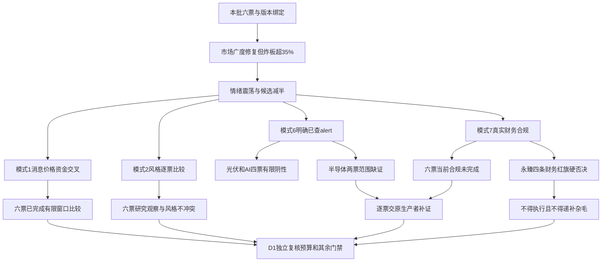

# 2026年11月6日 · 反证 / Devil’s Advocate

> 数据源新鲜度：partial　降级：true　置信度：0.78
> 情绪=震荡；仅做本批六票反证，不授予买权、不改预算或任何执行保护。

## 一句话结论
永臻财务硬否决；六票必要审核未齐，不全绿、不全盘禁买、不递补杂毛。

## 详细分析

市场先于个股。11月5日广度与接力反馈修复，但炸板率36.36%，R2已将正常12票减为6票。市场奖励的是光伏、AI内容与半导体的前排辨识度及短线接力，不等于盈利全面上修。R1主线扩散型、情绪震荡与R2仅保留研究对象并不矛盾，模式2六票完成；不能凭三条研究主线制造风格冲突。主模板沿用树干，不把五套打法合并。

消息与资金必须比较实际窗口。R7先于R2成池，未覆盖四票，但本版R5已给六票同窗价格资金，足以完成模式1比较；缺某provider或owner不是全盘no_trade。其资金分类不是实际机构身份，R5 SDK与R7 MCP的同一底层数据不算两个独立支持。R4隔夜科技冲击晚于A股上次收盘，不能拿昨日净流入说今天已消化；同业短剧收入占比也不能移植为浙文或利欧的财务数字。

必要风险不与辅助研究混为一谈。光伏与AI应用所属板块已核两日同源第一规则为false，仅在该范围完成模式6；半导体板块885756.TI未覆盖，两票继续未完成。有研个股false不替代板块检查，利欧个股unknown完整保留。六票当前重大合规及新预警仍未闭环，模式7均未完成；FY2025标准审计只能覆盖其自身窗口，空flags不是安全。

永臻已核F6、F8、F9、F10四条，即使不计F3也满足原模式7硬否决。当前合规缺口不删除这项真风险。其余票只给反面发现和逐项缺口，不由高度新增硬否决，也不以旧市场性零仓建议无期限停买。账户停买、有效预算含0、T+1和执行授权全部保持；本次未读账户，预算未知不抬成正数。

## 主线与有效窗口

| 主线 | 持续性研究跨度 | 封板率 | 明日预期 | 限定 |
|---|---:|---:|---|---|
| 光伏/光储修复 | 3日 | unknown | 分歧 | 未来验证跨度，非已证存续天数；缺本板块炸板分母 |
| AI内容应用/短剧 | 1日 | unknown | 分歧 | 未来验证跨度，非已证存续天数；缺本板块炸板分母 |
| 半导体自主可控 | 1日 | unknown | 分歧 | 未来验证跨度，非已证存续天数；缺本板块炸板分母 |

板块与轮次仅沿用R2精确对象关联：光伏885531.TI、AI应用886108.TI、半导体885756.TI。三条round_id与event_at原为null，不按概念或日期猜测。本批研究窗口沿用R2至当日收盘；这不是财务红旗到时自动解除。R1市场建议基于11月5日，最迟当日竞价后重评，不等于账户预算。

## 必要审核覆盖

| 模式 | 完成对象数 | 未完成对象数 | 实质边界 |
|---|---:|---:|---|
| 1 消息/资金/价格 | 6 | 0 | 既有窗口比较完成，不冒认新消息后已成交反应 |
| 2 风格一致性 | 6 | 0 | 已完成保留，研究观察不授买权 |
| 6 霸榜出货 | 4 | 2 | 所属半导体板块缺证；未知不等于false |
| 7 财务合规 | 0 | 6 | 已核财务结果保留，但当前S2/S3等未齐 |

研究对象6、至少一模式已审6、必要四项完整0、硬否决1，四种数量不得混用。formal_review_completed=false，review_passed=false。

## 逐票实质反证

### 闽发铝业 002578.SZ · 观察

板型：缩量一字四板；沪深10cm同权，流通39.18亿属20—50亿风险带。；地位：龙一/龙头，纪律认定2条，完整认证=False。盈亏比：unknown，止损距离unknown，降级watch；禁止清单命中：unknown，完整清单未过，不能当空数组。

**大资金意图**：只核资金分类与价格，不读心。近5日大单与超大单净额及DC代理同向；一字日成交少，净流入强度不代表可成交量，股东户数最新一期反增。

**为什么走强**：R2以龙一身份记录身位和板块扩散，这是历史市场奖励，不是今天已经承接；11月4日异动公告确认经营环境未重大变化、无应披露未披露事项；Q3扭亏主要并不等于主营利润修复，不能将液冷/机器人标签当新订单。

**逻辑够不够硬**：F6非经常收益/归母=411.44%命中，单条soft_suggest；F1/F8/F9/F10/F11及FY2025审计已核未触发各自阈值。当前S2/S3及重大合规缺证，本票必要审核未完成。

**买入理由**：R6不给正向买入结论；只审今日核心研究假设。已完成模式2不改变R2 execution_eligible=false。

**风险点**：价格/净流入与光伏修复身位一致，但R4本轮无光伏正面硬催化；异动自查的经营未变与四板定价存在盈利兑现落差，不是已证实资金撤离。

**止损条件**：不生成新价位或退出指令；若原研究逻辑被证伪交D1按原门禁处理。已有hard_reject禁止入执行，不以“等分歧”维持执行资格；不影响既有持仓保护。

**可验证假设**：原生产者补本票缺失必要证据后，按绑定版本逐项复审；新消息后的资金/价格必须使用新窗口，不能将此前涨停回填为消息反应。

- 模式1：completed。价格/净流入与光伏修复身位一致，但R4本轮无光伏正面硬催化；异动自查的经营未变与四板定价存在盈利兑现落差，不是已证实资金撤离。 依据：比较范围为11/5收盘资金价格与截至本轮R4事件；11/6新增消息后的成交反应尚未知，不作事件因果确认。实际资金源=tushare_pro_live_sdk.moneyflow/moneyflow_dc，价格=daily，万元÷10000为亿元、千元÷100000为亿元；5个交易日逐日重算通过。R7缺四票由同版R5补足，不伪称R7。
- 模式2：completed。R1主线扩散型/情绪震荡与光伏/光储修复龙一研究观察不冲突：R2已经12减至6、全票execution_eligible=false；不能据三条研究主线声称R1风格冲突或放行。 依据：同窗口R1事实=11/5收盘，市场建议最迟11/6竞价后重评；R2三线均为研究假设，未确认可交易主线。四板/二板高度本身不是否决依据；模式2已完成结果保留。
- 模式6：completed。所属板块已查两日同源第一规则为false，原模式6该窗口未触发；个股已查/未查分别保留，不把利欧个股unknown或缺覆盖升级阴性。近5日大单净额为正；不声称已排除真实派发，不以execution_eligible=false跳过研究。 依据：仅11/4至11/5两日榜单，同源第一阈值不变；全L4诊断unknown保留。无阳性alert且五日净额非负，不形成模式6硬否决；未查不是false，R5正净额也不补造alert。
- 模式7：incomplete。F6非经常收益/归母=411.44%命中，单条soft_suggest；F1/F8/F9/F10/F11及FY2025审计已核未触发各自阈值。当前S2/S3及重大合规缺证，本票必要审核未完成。 依据：按原F1—F12、ST轴核实际输入/期间/适用性。R6重算五日资金及CFO累计差分；阈值不改。FY2025原文/审计、2026Q3财务和当前公告检查范围分别保留；未读PDF/MD原件，不把R5读过等同本会话全文阅读。
  缺项：R5/R4：current_material_compliance：本票必要合规完整性未闭环；R5/R4补证，R6仅消费本JSON，不能要求R6联网或补抓。；R5/R4：S2.current_event_status：年度阴性不外推为当前监管/预警全部已核；R5/R4：S3.current_event_status：年度阴性不外推为当前监管/预警全部已核

证据定位：R2#/research_candidates/0；R5#/profiles/0；必要项的完整RFC 6901指针及源哈希见同版JSON。

### 永臻股份 603381.SH · 拦截

板型：缩量一字三板；历史股性仅5个有效封单样本且近期评级差，不把三板升级成长妖。；地位：龙二/龙二，纪律认定2条，完整认证=False。盈亏比：unknown，止损距离unknown，降级watch；禁止清单命中：unknown，完整清单未过，不能当空数组。

**大资金意图**：只核资金分类与价格，不读心。近5日资金分类小幅净入、融资余额上行；10月30日两源流出金额偏差25.45%，故近5日仍标fund_source_conflict并降低筹码置信度。11月5日金额接近不抹掉旧日冲突；一字板0.64亿元成交不足以验证开板承接，龙虎榜是窗口净买而非持续机构配置。

**为什么走强**：R2以龙二身份记录身位和板块扩散，这是历史市场奖励，不是今天已经承接；11月5日异动公告称经营环境未重大变化、无未披露重大事项；储能投资、员工持股计划属于不同事项，不将其当新增锁定利润订单。

**逻辑够不够硬**：F6=99.87%、F8两连续单季CFO负而净利正、F9=41.16%、F10=252.41%四条已核，独立于F3/V6足以模式7 hard_reject；F3机械阈值也命中但应收实为下降12.61%不得写暴增。当前合规缺口不删除已成立否决。

**买入理由**：R6不给正向买入结论；只审今日核心研究假设。已完成模式2不改变R2 execution_eligible=false。

**风险点**：一字三板与5日两口径净入只能支持短线接力行为，R4没有光伏新订单；R5异动公告及非经常收益/负经营现金流否定把价格强势等同主营修复。

**止损条件**：不生成新价位或退出指令；若原研究逻辑被证伪交D1按原门禁处理。已有hard_reject禁止入执行，不以“等分歧”维持执行资格；不影响既有持仓保护。

**可验证假设**：原生产者补本票缺失必要证据后，按绑定版本逐项复审；新消息后的资金/价格必须使用新窗口，不能将此前涨停回填为消息反应。

- 模式1：completed。一字三板与5日两口径净入只能支持短线接力行为，R4没有光伏新订单；R5异动公告及非经常收益/负经营现金流否定把价格强势等同主营修复。 依据：比较范围为11/5收盘资金价格与截至本轮R4事件；11/6新增消息后的成交反应尚未知，不作事件因果确认。实际资金源=tushare_pro_live_sdk.moneyflow/moneyflow_dc，价格=daily，万元÷10000为亿元、千元÷100000为亿元；5个交易日逐日重算通过。R7缺四票由同版R5补足，不伪称R7。
- 模式2：completed。R1主线扩散型/情绪震荡与光伏/光储修复龙二研究观察不冲突：R2已经12减至6、全票execution_eligible=false；不能据三条研究主线声称R1风格冲突或放行。 依据：同窗口R1事实=11/5收盘，市场建议最迟11/6竞价后重评；R2三线均为研究假设，未确认可交易主线。四板/二板高度本身不是否决依据；模式2已完成结果保留。
- 模式6：completed。所属板块已查两日同源第一规则为false，原模式6该窗口未触发；个股已查/未查分别保留，不把利欧个股unknown或缺覆盖升级阴性。近5日大单净额为正；不声称已排除真实派发，不以execution_eligible=false跳过研究。 依据：仅11/4至11/5两日榜单，同源第一阈值不变；全L4诊断unknown保留。无阳性alert且五日净额非负，不形成模式6硬否决；未查不是false，R5正净额也不补造alert。
- 模式7：incomplete。F6=99.87%、F8两连续单季CFO负而净利正、F9=41.16%、F10=252.41%四条已核，独立于F3/V6足以模式7 hard_reject；F3机械阈值也命中但应收实为下降12.61%不得写暴增。当前合规缺口不删除已成立否决。 依据：按原F1—F12、ST轴核实际输入/期间/适用性。R6重算五日资金及CFO累计差分；阈值不改。FY2025原文/审计、2026Q3财务和当前公告检查范围分别保留；未读PDF/MD原件，不把R5读过等同本会话全文阅读。
  缺项：R5/R4：current_material_compliance：本票必要合规完整性未闭环；R5/R4补证，R6仅消费本JSON，不能要求R6联网或补抓。；R5/R4：S2.current_event_status：年度阴性不外推为当前监管/预警全部已核；R5/R4：S3.current_event_status：年度阴性不外推为当前监管/预警全部已核

证据定位：R2#/research_candidates/1；R5#/profiles/1；必要项的完整RFC 6901指针及源哈希见同版JSON。

### 浙文影业 601599.SH · 观察

板型：缩量一字四板；当日换手2.74%，此前股性月表近期弱；高位本身不是替换龙一理由。；地位：龙一/龙头，纪律认定2条，完整认证=False。盈亏比：unknown，止损距离unknown，降级watch；禁止清单命中：unknown，完整清单未过，不能当空数组。

**大资金意图**：只核资金分类与价格，不读心。近5日两源累计均为净入，但11月4日分档自算净入0.034657亿、DC净出0.207069亿，方向相反；11月5日金额偏差约42%，均保留双方，不择优。Q2和Q3单季CFO均已转正，不能把累计负值写连续两季恶化。

**为什么走强**：R2以龙一身份记录身位和板块扩散，这是历史市场奖励，不是今天已经承接；11月4—6日连续异动/风险提示，11月6日原文称四日累计涨幅46.67%、经营未重大变化；没有新增AI短剧收入业绩认证。

**逻辑够不够硬**：F6=6.11%未触发；Q2/Q3单季CFO均正，不把累计CFO负误作F8；空flags不能推出安全，当前S2/S3与重大合规仍未知。

**买入理由**：R6不给正向买入结论；只审今日核心研究假设。已完成模式2不改变R2 execution_eligible=false。

**风险点**：四板与5日净入并存，但R4引力AI短剧收入不足0.1%只能质疑板块变现外推，不是浙文同等收入占比；浙文本身经营未变风险提示和11/4两口径反向削弱资金一致叙事。

**止损条件**：不生成新价位或退出指令；若原研究逻辑被证伪交D1按原门禁处理。已有hard_reject禁止入执行，不以“等分歧”维持执行资格；不影响既有持仓保护。

**可验证假设**：原生产者补本票缺失必要证据后，按绑定版本逐项复审；新消息后的资金/价格必须使用新窗口，不能将此前涨停回填为消息反应。

- 模式1：completed。四板与5日净入并存，但R4引力AI短剧收入不足0.1%只能质疑板块变现外推，不是浙文同等收入占比；浙文本身经营未变风险提示和11/4两口径反向削弱资金一致叙事。 依据：比较范围为11/5收盘资金价格与截至本轮R4事件；11/6新增消息后的成交反应尚未知，不作事件因果确认。实际资金源=tushare_pro_live_sdk.moneyflow/moneyflow_dc，价格=daily，万元÷10000为亿元、千元÷100000为亿元；5个交易日逐日重算通过。R7缺四票由同版R5补足，不伪称R7。
- 模式2：completed。R1主线扩散型/情绪震荡与AI内容应用/短剧龙一研究观察不冲突：R2已经12减至6、全票execution_eligible=false；不能据三条研究主线声称R1风格冲突或放行。 依据：同窗口R1事实=11/5收盘，市场建议最迟11/6竞价后重评；R2三线均为研究假设，未确认可交易主线。四板/二板高度本身不是否决依据；模式2已完成结果保留。
- 模式6：completed。所属板块已查两日同源第一规则为false，原模式6该窗口未触发；个股已查/未查分别保留，不把利欧个股unknown或缺覆盖升级阴性。近5日大单净额为正；不声称已排除真实派发，不以execution_eligible=false跳过研究。 依据：仅11/4至11/5两日榜单，同源第一阈值不变；全L4诊断unknown保留。无阳性alert且五日净额非负，不形成模式6硬否决；未查不是false，R5正净额也不补造alert。
- 模式7：incomplete。F6=6.11%未触发；Q2/Q3单季CFO均正，不把累计CFO负误作F8；空flags不能推出安全，当前S2/S3与重大合规仍未知。 依据：按原F1—F12、ST轴核实际输入/期间/适用性。R6重算五日资金及CFO累计差分；阈值不改。FY2025原文/审计、2026Q3财务和当前公告检查范围分别保留；未读PDF/MD原件，不把R5读过等同本会话全文阅读。
  缺项：R5/R4：current_material_compliance：本票必要合规完整性未闭环；R5/R4补证，R6仅消费本JSON，不能要求R6联网或补抓。；R5/R4：S2.current_event_status：年度阴性不外推为当前监管/预警全部已核；R5/R4：S3.current_event_status：年度阴性不外推为当前监管/预警全部已核

证据定位：R2#/research_candidates/2；R5#/profiles/2；必要项的完整RFC 6901指针及源哈希见同版JSON。

### 利欧股份 002131.SZ · 观察

板型：首板回封，Tushare开板1次；流通257.03亿、换手8.48%；历史月表近期差。；地位：龙二/龙二，纪律认定3条，完整认证=False。盈亏比：unknown，止损距离unknown，降级watch；禁止清单命中：unknown，完整清单未过，不能当空数组。

**大资金意图**：只核资金分类与价格，不读心。11月5日大单自算与DC约9.14亿元同向，龙虎榜净买约3.30亿元，但机构专用席位合计偏卖，不能写机构游资双买。股东户数增加也不支持无条件锁筹。

**为什么走强**：R2以龙二身份记录身位和板块扩散，这是历史市场奖励，不是今天已经承接；数字营销/AI应用来自R2业务与题材归因；Q3亏损和减值原公告为反证。11月6日期权注销完成不是新增订单、回购或经营改善。

**逻辑够不够硬**：归母及扣非亏损真实，正利润占比F6不适用；Q2单季CFO正、Q3亏损，F8原条件未满足；FY2025标准审计不覆盖当前合规，本票未完成。

**买入理由**：R6不给正向买入结论；只审今日核心研究假设。已完成模式2不改变R2 execution_eligible=false。

**风险点**：R7/R5均覆盖11/5资金与价格，首板大额净入可核；R4内容应用风险不直接证明利欧利空或出货，R5归母扣非双亏及机构席位偏卖反驳机构游资双买/盈利兑现叙事。

**止损条件**：不生成新价位或退出指令；若原研究逻辑被证伪交D1按原门禁处理。已有hard_reject禁止入执行，不以“等分歧”维持执行资格；不影响既有持仓保护。

**可验证假设**：原生产者补本票缺失必要证据后，按绑定版本逐项复审；新消息后的资金/价格必须使用新窗口，不能将此前涨停回填为消息反应。

- 模式1：completed。R7/R5均覆盖11/5资金与价格，首板大额净入可核；R4内容应用风险不直接证明利欧利空或出货，R5归母扣非双亏及机构席位偏卖反驳机构游资双买/盈利兑现叙事。 依据：比较范围为11/5收盘资金价格与截至本轮R4事件；11/6新增消息后的成交反应尚未知，不作事件因果确认。实际资金源=tushare_pro_live_sdk.moneyflow/moneyflow_dc，价格=daily，万元÷10000为亿元、千元÷100000为亿元；5个交易日逐日重算通过。R7缺四票由同版R5补足，不伪称R7。
- 模式2：completed。R1主线扩散型/情绪震荡与AI内容应用/短剧龙二研究观察不冲突：R2已经12减至6、全票execution_eligible=false；不能据三条研究主线声称R1风格冲突或放行。 依据：同窗口R1事实=11/5收盘，市场建议最迟11/6竞价后重评；R2三线均为研究假设，未确认可交易主线。四板/二板高度本身不是否决依据；模式2已完成结果保留。
- 模式6：completed。所属板块已查两日同源第一规则为false，原模式6该窗口未触发；个股已查/未查分别保留，不把利欧个股unknown或缺覆盖升级阴性。近5日大单净额为正；不声称已排除真实派发，不以execution_eligible=false跳过研究。 依据：仅11/4至11/5两日榜单，同源第一阈值不变；全L4诊断unknown保留。无阳性alert且五日净额非负，不形成模式6硬否决；未查不是false，R5正净额也不补造alert。
- 模式7：incomplete。归母及扣非亏损真实，正利润占比F6不适用；Q2单季CFO正、Q3亏损，F8原条件未满足；FY2025标准审计不覆盖当前合规，本票未完成。 依据：按原F1—F12、ST轴核实际输入/期间/适用性。R6重算五日资金及CFO累计差分；阈值不改。FY2025原文/审计、2026Q3财务和当前公告检查范围分别保留；未读PDF/MD原件，不把R5读过等同本会话全文阅读。
  缺项：R5/R4：current_material_compliance：本票必要合规完整性未闭环；R5/R4补证，R6仅消费本JSON，不能要求R6联网或补抓。；R5/R4：S2.current_event_status：年度阴性不外推为当前监管/预警全部已核；R5/R4：S3.current_event_status：年度阴性不外推为当前监管/预警全部已核

证据定位：R2#/research_candidates/3；R5#/profiles/3；必要项的完整RFC 6901指针及源哈希见同版JSON。

### 先导基电 600641.SH · 观察

板型：二板快速封板非一字；换手2.32%；问财业务沿用旧称万业时期资料，现名与业务归属待R5核。；地位：龙一/龙头，纪律认定3条，完整认证=False。盈亏比：unknown，止损距离unknown，降级watch；禁止清单命中：unknown，完整清单未过，不能当空数组。

**大资金意图**：只核资金分类与价格，不读心。R5补到近5日同窗口资金价格，不能因R7未覆盖写全票停买；融资余额降约30%且融券余额亦降，不满足short_pressure双条件。

**为什么走强**：R2以龙一身份记录身位和板块扩散，这是历史市场奖励，不是今天已经承接；11月4日原公告确认4名增持主体合计1619.2999万元计划完成，10月24日三人600.6197万元是子集而非另笔加总。关联资产交易未完成条件、控股股东质押50.47%及旧警示函并列。

**逻辑够不够硬**：F6=7753.09%及FY2025关联交易/同年营收68.55%命中F7，两条strong_suggest，跨期不相加冒充同季；董事历史警示已知但性质未核，不自动hard_reject也不判合规阴性。

**买入理由**：R6不给正向买入结论；只审今日核心研究假设。已完成模式2不改变R2 execution_eligible=false。

**风险点**：R7无本票不构成资金未确认：R5同窗口日线与5日净额可交叉；增持完成是已实施但非今日新增买盘，R4隔夜半导体冲击晚于11/5上涨，不能说A股已经消化。

**止损条件**：不生成新价位或退出指令；若原研究逻辑被证伪交D1按原门禁处理。已有hard_reject禁止入执行，不以“等分歧”维持执行资格；不影响既有持仓保护。

**可验证假设**：原生产者补本票缺失必要证据后，按绑定版本逐项复审；新消息后的资金/价格必须使用新窗口，不能将此前涨停回填为消息反应。

- 模式1：completed。R7无本票不构成资金未确认：R5同窗口日线与5日净额可交叉；增持完成是已实施但非今日新增买盘，R4隔夜半导体冲击晚于11/5上涨，不能说A股已经消化。 依据：比较范围为11/5收盘资金价格与截至本轮R4事件；11/6新增消息后的成交反应尚未知，不作事件因果确认。实际资金源=tushare_pro_live_sdk.moneyflow/moneyflow_dc，价格=daily，万元÷10000为亿元、千元÷100000为亿元；5个交易日逐日重算通过。R7缺四票由同版R5补足，不伪称R7。
- 模式2：completed。R1主线扩散型/情绪震荡与半导体自主可控龙一研究观察不冲突：R2已经12减至6、全票execution_eligible=false；不能据三条研究主线声称R1风格冲突或放行。 依据：同窗口R1事实=11/5收盘，市场建议最迟11/6竞价后重评；R2三线均为研究假设，未确认可交易主线。四板/二板高度本身不是否决依据；模式2已完成结果保留。
- 模式6：incomplete。所属半导体885756.TI未在R3板块检查范围，alert未知，模式6未完成；先导个股亦未覆盖。近5日大单净额为正；不声称已排除真实派发，不以execution_eligible=false跳过研究。 依据：仅11/4至11/5两日榜单，同源第一阈值不变；全L4诊断unknown保留。无阳性alert且五日净额非负，不形成模式6硬否决；未查不是false，R5正净额也不补造alert。
  缺项：R3：885756.TI所属板块两日同源霸榜已查结果及有效窗口（本批未覆盖）
- 模式7：incomplete。F6=7753.09%及FY2025关联交易/同年营收68.55%命中F7，两条strong_suggest，跨期不相加冒充同季；董事历史警示已知但性质未核，不自动hard_reject也不判合规阴性。 依据：按原F1—F12、ST轴核实际输入/期间/适用性。R6重算五日资金及CFO累计差分；阈值不改。FY2025原文/审计、2026Q3财务和当前公告检查范围分别保留；未读PDF/MD原件，不把R5读过等同本会话全文阅读。
  缺项：R5/R4：S2：先导存在真实监管警示，事由及重大违法/财务造假属性需R5/R4取得原决定，不能自动hard_reject也不能证明阴性。；R5/R4：current_material_compliance：本票必要合规完整性未闭环；R5/R4补证，R6仅消费本JSON，不能要求R6联网或补抓。；R5/R4：S3.current_event_status：年度阴性不外推为当前监管/预警全部已核

证据定位：R2#/research_candidates/4；R5#/profiles/4；必要项的完整RFC 6901指针及源哈希见同版JSON。

### 有研新材 600206.SH · 观察

板型：二板多次回封；Tushare开板6次、问财3次，保留差异不择优；收盘回封不等于全日稳定。；地位：龙二/龙二，纪律认定3条，完整认证=False。盈亏比：unknown，止损距离unknown，降级watch；禁止清单命中：unknown，完整清单未过，不能当空数组。

**大资金意图**：只核资金分类与价格，不读心。R5补到近5日价格资金；11月5日自算7.11亿、DC7.87亿偏差约9.6%，同向不能消除金额冲突。股东户数最新下降是历史持有人统计，不证明11月6日买盘。

**为什么走强**：R2以龙二身份记录身位和板块扩散，这是历史市场奖励，不是今天已经承接；自主可控材料业务与R2/R3人气证据并列；本轮没有新硬订单公告。Q3利润/扣非及减值公告均已取得，外盘科技冲击仅作为R4隔夜风险背景。

**逻辑够不够硬**：F6=17.60%、F9=10.41%、F10=5.71%未触发；两单季CFO均正，累计负值不构成F8。必要当前合规未闭环；商誉/关联交易局部unknown不抹掉已核计算。

**买入理由**：R6不给正向买入结论；只审今日核心研究假设。已完成模式2不改变R2 execution_eligible=false。

**风险点**：R7/R5均有11/5价格资金且方向同正，金额差异保留；R4隔夜科技冲击在A股上个交易日收盘后，二板及11/5净流入不能认证11/6抗跌，六次开板反映承接分歧。

**止损条件**：不生成新价位或退出指令；若原研究逻辑被证伪交D1按原门禁处理。已有hard_reject禁止入执行，不以“等分歧”维持执行资格；不影响既有持仓保护。

**可验证假设**：原生产者补本票缺失必要证据后，按绑定版本逐项复审；新消息后的资金/价格必须使用新窗口，不能将此前涨停回填为消息反应。

- 模式1：completed。R7/R5均有11/5价格资金且方向同正，金额差异保留；R4隔夜科技冲击在A股上个交易日收盘后，二板及11/5净流入不能认证11/6抗跌，六次开板反映承接分歧。 依据：比较范围为11/5收盘资金价格与截至本轮R4事件；11/6新增消息后的成交反应尚未知，不作事件因果确认。实际资金源=tushare_pro_live_sdk.moneyflow/moneyflow_dc，价格=daily，万元÷10000为亿元、千元÷100000为亿元；5个交易日逐日重算通过。R7缺四票由同版R5补足，不伪称R7。
- 模式2：completed。R1主线扩散型/情绪震荡与半导体自主可控龙二研究观察不冲突：R2已经12减至6、全票execution_eligible=false；不能据三条研究主线声称R1风格冲突或放行。 依据：同窗口R1事实=11/5收盘，市场建议最迟11/6竞价后重评；R2三线均为研究假设，未确认可交易主线。四板/二板高度本身不是否决依据；模式2已完成结果保留。
- 模式6：incomplete。所属半导体885756.TI未在R3板块检查范围，alert未知，模式6未完成；有研个股两源false只限个股不能冒充所属板块检查。近5日大单净额为正；不声称已排除真实派发，不以execution_eligible=false跳过研究。 依据：仅11/4至11/5两日榜单，同源第一阈值不变；全L4诊断unknown保留。无阳性alert且五日净额非负，不形成模式6硬否决；未查不是false，R5正净额也不补造alert。
  缺项：R3：885756.TI所属板块两日同源霸榜已查结果及有效窗口（本批未覆盖）
- 模式7：incomplete。F6=17.60%、F9=10.41%、F10=5.71%未触发；两单季CFO均正，累计负值不构成F8。必要当前合规未闭环；商誉/关联交易局部unknown不抹掉已核计算。 依据：按原F1—F12、ST轴核实际输入/期间/适用性。R6重算五日资金及CFO累计差分；阈值不改。FY2025原文/审计、2026Q3财务和当前公告检查范围分别保留；未读PDF/MD原件，不把R5读过等同本会话全文阅读。
  缺项：R5/R4：current_material_compliance：本票必要合规完整性未闭环；R5/R4补证，R6仅消费本JSON，不能要求R6联网或补抓。；R5/R4：S2.current_event_status：年度阴性不外推为当前监管/预警全部已核；R5/R4：S3.current_event_status：年度阴性不外推为当前监管/预警全部已核

证据定位：R2#/research_candidates/5；R5#/profiles/5；必要项的完整RFC 6901指针及源哈希见同版JSON。

## 硬否决与完整反证清单

永臻财务期为2026年前三季度（F8用Q2/Q3累计差分），不是把全年、累计与单季混算。F6=99.87%，单季CFO约-4.93亿/-2.87亿元且单季净利润均正，F9=41.16%，F10=252.41%。F3原不等式命中但应收同比下降，不能写“应收暴增”；V6不混入四条财务计数。

### R6_M1_01 · 002578.SZ 闽发铝业 · soft_suggest

反驳：四板不能当主营利润修复或可成交承接。

- 近5日大单与超大单净额及DC代理同向；一字日成交少，净流入强度不代表可成交量，股东户数最新一期反增。 · 来源 R5#/profiles/0/dimensions/chip_structure
- 11月4日异动公告确认经营环境未重大变化、无应披露未披露事项；Q3扭亏主要并不等于主营利润修复，不能将液冷/机器人标签当新订单。 · 来源 R5#/profiles/0/dimensions/catalyst

处置：观察；D1须按本票真实消息、资金口径与新窗口承接处理；不能由本条新增全局no_trade，不将同业风险当本票硬禁。

限定：仅本批研究反证，不改变账户预算、执行保护或其他候选身份；窗口到期须重评，已核财务风险不能仅因时钟到期自动视为解除。

### R6_M7_02 · 002578.SZ 闽发铝业 · soft_suggest

反驳：归母微利可直接视作持续主营成长与合规安全。

- F6原计算、输入和期间完整保留于同版JSON及R5#/profiles/0/dimensions/valuation_safety/fundamental_checks/F6 · 来源 R5#/profiles/0/dimensions/valuation_safety/fundamental_checks/F6

处置：降级；保留盈利质量反证；当前合规补证交R5/R4。单条F6不升级硬否决。

限定：仅本批研究反证，不改变账户预算、执行保护或其他候选身份；窗口到期须重评，已核财务风险不能仅因时钟到期自动视为解除。

### R6_M9_03 · 002578.SZ 闽发铝业 · strong_suggest

反驳：封板/高身位即确认下一日可得性与承接。

- {"type": "缩量一字四板；沪深10cm同权，流通39.18亿属20—50亿风险带。", "limit_times": 4, "first_time": "92500", "open_times": 0, "source": "R2#evidence_registry.live_limits", "pattern_engine_called": false} · 来源 R5#/profiles/0/board_pattern
- {"height": 4, "first_board_time": "92500", "open_times": 0, "days_since_first_board": null, "first_seen_note": "当轮真正主题启动日未知，10月窗口首次涨停不冒充主题首日", "sector_breadth": 22, "verdict": "龙头", "data_date": "20261105", "source": "tushare_pro_live_sdk.limit_list_d + bound R2 live concept breadth", "discipline_pass_count": 2, "full_dragon_qualification": false, "reason": "结构龙头信号不替代业务因果/必要风险/交易资格；有研按开板>=4判分歧弱"} · 来源 R5#/profiles/0/dragon_judgement

处置：观察；三只一字与有研六次开板分别核可得性/分歧承接；extreme_tail_risk只作风险提示，高度/晋级本身不得hard_reject。

限定：仅本批研究反证，不改变账户预算、执行保护或其他候选身份；窗口到期须重评，已核财务风险不能仅因时钟到期自动视为解除。

### R6_M1_04 · 603381.SH 永臻股份 · soft_suggest

反驳：三板与净流入不能覆盖现金流和偿债红旗。

- 近5日资金分类小幅净入、融资余额上行；10月30日两源流出金额偏差25.45%，故近5日仍标fund_source_conflict并降低筹码置信度。11月5日金额接近不抹掉旧日冲突；一字板0.64亿元成交不足以验证开板承接，龙虎榜是窗口净买而非持续机构配置。 · 来源 R5#/profiles/1/dimensions/chip_structure
- 11月5日异动公告称经营环境未重大变化、无未披露重大事项；储能投资、员工持股计划属于不同事项，不将其当新增锁定利润订单。 · 来源 R5#/profiles/1/dimensions/catalyst

处置：观察；D1须按本票真实消息、资金口径与新窗口承接处理；不能由本条新增全局no_trade，不将同业风险当本票硬禁。

限定：仅本批研究反证，不改变账户预算、执行保护或其他候选身份；窗口到期须重评，已核财务风险不能仅因时钟到期自动视为解除。

### R6_M7_05 · 603381.SH 永臻股份 · hard_reject

反驳：价格/题材强势可以覆盖已确认的多项财务红旗。

- F3原计算、输入和期间完整保留于同版JSON及R5#/profiles/1/dimensions/valuation_safety/fundamental_checks/F3 · 来源 R5#/profiles/1/dimensions/valuation_safety/fundamental_checks/F3
- F6原计算、输入和期间完整保留于同版JSON及R5#/profiles/1/dimensions/valuation_safety/fundamental_checks/F6 · 来源 R5#/profiles/1/dimensions/valuation_safety/fundamental_checks/F6
- F8原计算、输入和期间完整保留于同版JSON及R5#/profiles/1/dimensions/valuation_safety/fundamental_checks/F8 · 来源 R5#/profiles/1/dimensions/valuation_safety/fundamental_checks/F8
- F9原计算、输入和期间完整保留于同版JSON及R5#/profiles/1/dimensions/valuation_safety/fundamental_checks/F9 · 来源 R5#/profiles/1/dimensions/valuation_safety/fundamental_checks/F9
- F10原计算、输入和期间完整保留于同版JSON及R5#/profiles/1/dimensions/valuation_safety/fundamental_checks/F10 · 来源 R5#/profiles/1/dimensions/valuation_safety/fundamental_checks/F10

处置：hard_reject — 禁止纳入execution_pool；仅可保留研究观察。不得因空池/partial自动降级，不得把龙二、弹性或低位票递补；解除需原财务证据纠错或后续有效实证重审，D1无覆盖权。

限定：仅本批研究反证，不改变账户预算、执行保护或其他候选身份；窗口到期须重评，已核财务风险不能仅因时钟到期自动视为解除。；F3按原不等式命中但应收绝对与同比均下降，不称暴增；即使不计F3，F6/F8/F9/F10已有4条。V6只属估值陷阱，不计财务红旗凑4条。；本票当前execution_eligible=false不隐匿已核硬否决；合规缺证仍标未完成，不把否决误写正式审核全部完成。

### R6_M9_06 · 603381.SH 永臻股份 · strong_suggest

反驳：封板/高身位即确认下一日可得性与承接。

- {"type": "缩量一字三板；历史股性仅5个有效封单样本且近期评级差，不把三板升级成长妖。", "limit_times": 3, "first_time": "92502", "open_times": 0, "source": "R2#evidence_registry.live_limits", "pattern_engine_called": false} · 来源 R5#/profiles/1/board_pattern
- {"height": 3, "first_board_time": "92502", "open_times": 0, "days_since_first_board": null, "first_seen_note": "当轮真正主题启动日未知，10月窗口首次涨停不冒充主题首日", "sector_breadth": 22, "verdict": "龙头", "data_date": "20261105", "source": "tushare_pro_live_sdk.limit_list_d + bound R2 live concept breadth", "discipline_pass_count": 2, "full_dragon_qualification": false, "reason": "结构龙头信号不替代业务因果/必要风险/交易资格；有研按开板>=4判分歧弱"} · 来源 R5#/profiles/1/dragon_judgement

处置：观察；三只一字与有研六次开板分别核可得性/分歧承接；extreme_tail_risk只作风险提示，高度/晋级本身不得hard_reject。

限定：仅本批研究反证，不改变账户预算、执行保护或其他候选身份；窗口到期须重评，已核财务风险不能仅因时钟到期自动视为解除。

### R6_M1_07 · 601599.SH 浙文影业 · strong_suggest

反驳：AI主题强不等于本票AI收入已兑现或资金口径一致。

- 近5日两源累计均为净入，但11月4日分档自算净入0.034657亿、DC净出0.207069亿，方向相反；11月5日金额偏差约42%，均保留双方，不择优。Q2和Q3单季CFO均已转正，不能把累计负值写连续两季恶化。 · 来源 R5#/profiles/2/dimensions/chip_structure
- 11月4—6日连续异动/风险提示，11月6日原文称四日累计涨幅46.67%、经营未重大变化；没有新增AI短剧收入业绩认证。 · 来源 R5#/profiles/2/dimensions/catalyst
- 引力短剧占比不足0.1%是引力主体事实，只作同族叙事盈利外推反证，不移植给浙文/利欧。 · 来源 R4#/top_events/3

处置：观察；D1须按本票真实消息、资金口径与新窗口承接处理；不能由本条新增全局no_trade，不将同业风险当本票硬禁。

限定：仅本批研究反证，不改变账户预算、执行保护或其他候选身份；窗口到期须重评，已核财务风险不能仅因时钟到期自动视为解除。

### R6_M9_08 · 601599.SH 浙文影业 · strong_suggest

反驳：封板/高身位即确认下一日可得性与承接。

- {"type": "缩量一字四板；当日换手2.74%，此前股性月表近期弱；高位本身不是替换龙一理由。", "limit_times": 4, "first_time": "92502", "open_times": 0, "source": "R2#evidence_registry.live_limits", "pattern_engine_called": false} · 来源 R5#/profiles/2/board_pattern
- {"height": 4, "first_board_time": "92502", "open_times": 0, "days_since_first_board": null, "first_seen_note": "当轮真正主题启动日未知，10月窗口首次涨停不冒充主题首日", "sector_breadth": 17, "verdict": "龙头", "data_date": "20261105", "source": "tushare_pro_live_sdk.limit_list_d + bound R2 live concept breadth", "discipline_pass_count": 2, "full_dragon_qualification": false, "reason": "结构龙头信号不替代业务因果/必要风险/交易资格；有研按开板>=4判分歧弱"} · 来源 R5#/profiles/2/dragon_judgement

处置：观察；三只一字与有研六次开板分别核可得性/分歧承接；extreme_tail_risk只作风险提示，高度/晋级本身不得hard_reject。

限定：仅本批研究反证，不改变账户预算、执行保护或其他候选身份；窗口到期须重评，已核财务风险不能仅因时钟到期自动视为解除。

### R6_M1_09 · 002131.SZ 利欧股份 · soft_suggest

反驳：首板净入不等于机构游资一致或盈利兑现。

- 11月5日大单自算与DC约9.14亿元同向，龙虎榜净买约3.30亿元，但机构专用席位合计偏卖，不能写机构游资双买。股东户数增加也不支持无条件锁筹。 · 来源 R5#/profiles/3/dimensions/chip_structure
- 数字营销/AI应用来自R2业务与题材归因；Q3亏损和减值原公告为反证。11月6日期权注销完成不是新增订单、回购或经营改善。 · 来源 R5#/profiles/3/dimensions/catalyst
- 引力短剧占比不足0.1%是引力主体事实，只作同族叙事盈利外推反证，不移植给浙文/利欧。 · 来源 R4#/top_events/3

处置：观察；D1须按本票真实消息、资金口径与新窗口承接处理；不能由本条新增全局no_trade，不将同业风险当本票硬禁。

限定：仅本批研究反证，不改变账户预算、执行保护或其他候选身份；窗口到期须重评，已核财务风险不能仅因时钟到期自动视为解除。

### R6_M1_10 · 600641.SH 先导基电 · strong_suggest

反驳：增持完成不能抵消隔夜冲击及当前监管性质缺证。

- R5补到近5日同窗口资金价格，不能因R7未覆盖写全票停买；融资余额降约30%且融券余额亦降，不满足short_pressure双条件。 · 来源 R5#/profiles/4/dimensions/chip_structure
- 11月4日原公告确认4名增持主体合计1619.2999万元计划完成，10月24日三人600.6197万元是子集而非另笔加总。关联资产交易未完成条件、控股股东质押50.47%及旧警示函并列。 · 来源 R5#/profiles/4/dimensions/catalyst
- 隔夜跌幅为已报道事实；A股11/6成交反应未发生，不能拿11/5资金确认其被消化。 · 来源 R4#/top_events/17

处置：观察；D1须按本票真实消息、资金口径与新窗口承接处理；不能由本条新增全局no_trade，不将同业风险当本票硬禁。

限定：仅本批研究反证，不改变账户预算、执行保护或其他候选身份；窗口到期须重评，已核财务风险不能仅因时钟到期自动视为解除。

### R6_M7_11 · 600641.SH 先导基电 · strong_suggest

反驳：归母微利可直接视作持续主营成长与合规安全。

- F6原计算、输入和期间完整保留于同版JSON及R5#/profiles/4/dimensions/valuation_safety/fundamental_checks/F6 · 来源 R5#/profiles/4/dimensions/valuation_safety/fundamental_checks/F6
- F7原计算、输入和期间完整保留于同版JSON及R5#/profiles/4/dimensions/valuation_safety/fundamental_checks/F7 · 来源 R5#/profiles/4/dimensions/valuation_safety/fundamental_checks/F7
- S2原计算、输入和期间完整保留于同版JSON及R5#/profiles/4/dimensions/valuation_safety/fundamental_checks/S2 · 来源 R5#/profiles/4/dimensions/valuation_safety/fundamental_checks/S2

处置：降级；保留盈利质量反证；当前合规补证交R5/R4。两条红旗须D1显式接受或覆盖理由；不把警示函自动升级硬否决。

限定：仅本批研究反证，不改变账户预算、执行保护或其他候选身份；窗口到期须重评，已核财务风险不能仅因时钟到期自动视为解除。

### R6_M1_12 · 600206.SH 有研新材 · strong_suggest

反驳：自主可控不是隔夜科技下跌免疫证明，回封并非无分歧。

- R5补到近5日价格资金；11月5日自算7.11亿、DC7.87亿偏差约9.6%，同向不能消除金额冲突。股东户数最新下降是历史持有人统计，不证明11月6日买盘。 · 来源 R5#/profiles/5/dimensions/chip_structure
- 自主可控材料业务与R2/R3人气证据并列；本轮没有新硬订单公告。Q3利润/扣非及减值公告均已取得，外盘科技冲击仅作为R4隔夜风险背景。 · 来源 R5#/profiles/5/dimensions/catalyst
- 隔夜跌幅为已报道事实；A股11/6成交反应未发生，不能拿11/5资金确认其被消化。 · 来源 R4#/top_events/17

处置：观察；D1须按本票真实消息、资金口径与新窗口承接处理；不能由本条新增全局no_trade，不将同业风险当本票硬禁。

限定：仅本批研究反证，不改变账户预算、执行保护或其他候选身份；窗口到期须重评，已核财务风险不能仅因时钟到期自动视为解除。

### R6_M9_13 · 600206.SH 有研新材 · strong_suggest

反驳：封板/高身位即确认下一日可得性与承接。

- {"type": "二板多次回封；Tushare开板6次、问财3次，保留差异不择优；收盘回封不等于全日稳定。", "limit_times": 2, "first_time": "93959", "open_times": 6, "source": "R2#evidence_registry.live_limits", "pattern_engine_called": false} · 来源 R5#/profiles/5/board_pattern
- {"height": 2, "first_board_time": "93959", "open_times": 6, "days_since_first_board": null, "first_seen_note": "当轮真正主题启动日未知，10月窗口首次涨停不冒充主题首日", "sector_breadth": 13, "verdict": "分歧弱", "data_date": "20261105", "source": "tushare_pro_live_sdk.limit_list_d + bound R2 live concept breadth", "discipline_pass_count": 3, "full_dragon_qualification": false, "reason": "结构龙头信号不替代业务因果/必要风险/交易资格；有研按开板>=4判分歧弱"} · 来源 R5#/profiles/5/dragon_judgement

处置：观察；三只一字与有研六次开板分别核可得性/分歧承接；extreme_tail_risk只作风险提示，高度/晋级本身不得hard_reject。

限定：仅本批研究反证，不改变账户预算、执行保护或其他候选身份；窗口到期须重评，已核财务风险不能仅因时钟到期自动视为解除。

### R6_M3_14 · 002131.SZ 利欧股份 · strong_suggest

反驳：主题/增长可以直接证明低估。

- 数字营销成长业务采用PS与扣非/现金兑现交叉；TTM PE缺失，年度静态PE不当成长估值锚。Q3归母与扣非双亏，不能套用正利润F6比值制造通过。 · 来源 R5#/profiles/3/dimensions/valuation_safety

处置：降级；利欧正盈利PE/PEG分母不适用，有研约115倍TTM及高分位不等于便宜；不编目标价、RR或新评分阈值。

限定：仅本批研究反证，不改变账户预算、执行保护或其他候选身份；窗口到期须重评，已核财务风险不能仅因时钟到期自动视为解除。

### R6_M3_15 · 600206.SH 有研新材 · strong_suggest

反驳：主题/增长可以直接证明低估。

- 材料成长PS/PE与扣非增长交叉；PE TTM约115倍、三年高分位，不能因Q3正增长就说低估。Q2/Q3单季CFO均为正，累计负值不构成F8。 · 来源 R5#/profiles/5/dimensions/valuation_safety

处置：降级；利欧正盈利PE/PEG分母不适用，有研约115倍TTM及高分位不等于便宜；不编目标价、RR或新评分阈值。

限定：仅本批研究反证，不改变账户预算、执行保护或其他候选身份；窗口到期须重评，已核财务风险不能仅因时钟到期自动视为解除。

## 四象限负面识别

四象限采用“利好涨、利好不涨、利空跌、利空不跌”，不是新评分或交易门禁。六票本轮消息后实际成交反应均为unknown，暂不填入任何格，不把“隔夜利空+昨日涨停”伪写成利空不跌；也不拿板块资金代替逐票反应。金刚合同与涨停时序、先导旧增持与新成交窗口分开。已知盈利与合规反面证据不因象限未定而消失。

## 专题来源裁决与未选对照

仅消费当前R2/R4/R5 JSON内嵌节选；没有打开专题MD、XLSX或锚原文件，更没有联网。来源同sha只算一份；传递或上游adopted不代表本阶段采纳。完整索引、时点、限制及原文节选在knowledge_context，上游版本与本次context_sha256原样保留。

- theme_anchors:c83488391cfd8596845d99792839ada63ea1f0e443e322c85cd27545e5ae0817：not_applicable。R6不重新发现候选；目录/历史锚不能提升六票资格。R2已比较欢瑞/天娱等未涨停且前排证据不足，不因永臻被否递补。仅内嵌索引，不读原锚。
- stock_character:656397480b1e398ed295c90854a59723790e98ebb28948d9877aa5c8d514335f：adopted。只采用R5六代码精确投影作反面限定：利欧近期差、浙文近期弱、永臻仅5封单样本且差。历史评分/板高不是当前排名，不读全表，不重复加R2同源权重。
- growth_pool:37c7ec1e34620a4430053b47957f1206b9372d44be30e5f5ccc9c97711993053：not_applicable。运输成长名单与六票无精确对应。路维/中微半导/四川黄金虽有各自线索，R2已记录缺本轮核心/身位核验；R6不扩池、不替补。旧/新版本分别保留partial、时点和省略范围。
- dividend_pool:6ebb53d45475950391da23caad3a6ce8e5c7cc75c23f4a5dfe868917360a88d4：not_applicable。炬华/中远非本批六票；R2内嵌比较缺当前领涨/波动合力，不能因股息率替换。10/30估值、月报partial、现金覆盖缺口保留；不是静态禁止红利。
- yizi_prediction:f5b3512e220afb39f12f5be700631fa1d384123e13dc11109c15801dcc7506ae：adopted。只采用目标日11/6匹配的内嵌一字可得性线索，与本批板型交叉；不采用概率、回测命中率及隔夜下单措辞，不由预测取得买权。
- review_feedback:0c6428db0780081a1686a4bbdeeecdcb27ced7d3bb2913018f68d69979a024de：unknown。内嵌显式专题feedback_evidence为空，复盘partial；不知道采用效果，不猜昨日R6立场，不读MD补齐。
- catalyst_calendar:9d8fae6eb7f18bf0f629b3614c0671e4f381343bbdaf5f96c60d078ebf722aa1：not_applicable。原文亚玛顿/海外会期等未精确关联六票；001280仅提及不成资格，不移植停牌风险到闽发/永臻。宏观申请非实买区分可保留为来源边界，但不作本批新增反证权重。
- growth_pool:838ae9d9d819fd9531b0c3ea89311168193d5d4b41cf47cf285167fe09c589f3：not_applicable。运输成长名单与六票无精确对应。路维/中微半导/四川黄金虽有各自线索，R2已记录缺本轮核心/身位核验；R6不扩池、不替补。旧/新版本分别保留partial、时点和省略范围。
- holder_trade:705335f9aeb3b666c2336c6cf9efb559d9d510a0362dbde676c9d32436846524：adopted。只采用R5转交的旧增持/质押线索的历史限定；10/23三人600.6197万包含于11/4四人1619.2999万，不相加。已完成增持不是11/6新增资金，partial与旧窗口保留。原MD未读。

不选对照不等于否定其未来机会：路维/中微半导缺本轮最高身位或核心证据；炬华/中远的旧红利估值不能替代当下进攻合力；金刚合同不是光伏订单且融资/批次可解除风险未闭环；欢瑞/天娱等历史锚不自动取得当前排名。对照只保留R2原比较，不新增正式审核对象，更不得因永臻被否而递补。本批全部对照原理由保留在JSON。

## 关键证据与数据源审计

| 源 | 状态 | 生成日期 | 对象/范围 | 备注 |
|---|---|---|---|---|
| R1 | 🟡 degraded | 11月6日 | 11月5日市场事实 | 震荡，炸板36.36%，非全局停买 |
| R2 | 🟡 partial | 11月6日 | 六票、三线 | 哈希与运输一致，未授权交易 |
| R3 | 🟡 degraded | 11月6日 | 逐源榜单检查 | 阴性限规则窗口，半导体未覆盖 |
| R4 | 🟡 partial | 11月6日 | 18项事件 | 时间/对象与当前反应分开 |
| R5 | 🟡 partial | 11月6日 | 六票画像 | 原计算已核、当前合规未齐 |
| R7 | 🟡 partial | 11月6日 | 旧成池前统计范围 | 四票缺覆盖由同版R5支持模式1，不全盘禁买 |

六票五日大单金额及单位重算、单季CFO累计差分通过；144条必要项引用均已解析到绑定JSON实际路径。R2/R4/R5实际sha与运输一致，R5绑定R2/R3/R4亦一致；回执结构通过不替代本轮语义审查。原公告PDF仅由上游声明读取，本会话未读原件或图像。

## 不确定性 / 反证

财务硬否决依赖上游同票同版真实输入；若原数据、更正报表或期间映射被有效证伪须明确纠错复审，不能仅凭涨停、净入或辅助缺口撤销。六票当前合规缺证使正式必要审核不完整；先导警示函事实不能从标题直接推重大违法，也不能略去。模式3估值扩展、模式4历史类比、模式5昨日兑现、模式8套牢区、模式10商品联动均局部降级；不编样本，不猜历史立场。Mermaid只完成嵌入与结构检查，本轮未联网或浏览器渲染，不冒称实际SVG验收。

## 与其他 R/D/E 的关系

- 依赖：本批R1/R2/R3/R4/R5及日期后缀R7资金JSON；只读同批验证回执，不读上游MD。
- 回送：R3补半导体所属板块alert；R5/R4补逐票当前重大合规与预警，以及先导警示原决定性质。
- 被消费：research_summary、D1、E1。D1无权覆盖硬否决；strong_suggest须接受或明确理由；预算与其他门禁独立。
- 不做：不改计划、候选身份、评分权重、预算、下单或任何执行授权，不自动递补。

## Sub-Agent 元数据

- skill：analyze_devil_advocate_v1
- artifact：data/research/20261106/R6_devil_advocate.json
- model：gpt-6.1-sol
- method：llm_v1；当前会话唯一阶段执行者，无再次派生
- 资源：usage_unknown，不当0、不保证低于努力目标；交付目标仅observe_only
- 实际审查生成耗时：约374秒（从首次输入版本检查计）；非上游抓取耗时

## R6 局部补审 · r6-after-external-r5-20261106

## 2026-11-06 R6模式7局部补审

本轮只审request.targets指定的002131.SZ、002578.SZ、601599.SH模式7，不重审模式1/2/6，不重写既有反证或硬否决。仅读取绑定R5及原R6中的相关内容；没有调用MCP、shell、其他模型，没有写正式JSON、MD或logs。版本哈希沿调用方绑定，本会话未运行哈希校验程序；接收前仍由普通程序验证绑定及指针。

### 证据窗口与判断边界
本次R5为r5-external-owner-20261106，生成时间为2026-11-06T19:44:48.647812+08:00；合规有限范围回执截止为2026-11-06T19:28:02.510791+08:00。闽发当前窗口起于2026-04-27，利欧起于2026-04-29，浙文起于2026-03-31；历史已知事项按真实原时点保留。本次包含盘后证据，不能倒填成07:55已知信息，也不反向改写原盘前判断。completed只表示本轮该票模式7的必要检查已经有据完成，可以有明确反面发现及披露过的剩余不确定性，不代表风险为零。

### 002131.SZ 利欧股份：模式7 completed，保留新增披露治理及商业损益反证
财务核查不是照抄空flags：Q3货币资金、短借占总资产分别约6.05%、12.12%，不满足F1双高；有息负债/净资产约23.68%，未触发F10；已披露控制人及一致行动人质押约43.55%，未触发F11。FY2025审计记录为标准无保留意见，半年报无上年非标相关事项作为交叉证据，未据半年报未经审计误判F12。Q2单季经营现金流为正，Q3单季现金流及净利润同负，不满足F8连续两期现金流负且利润正的组合；Q3归母亏损，F6正利润占比检验有据不适用，不能写成盈利质量安全。F7完整勾稽仍unknown，按已声明辅助缺口保留。

S2按实际性质独立裁决。2017监管原文中的合并收入、成本、利润虚增及提前确认收入是已证历史财务错报，不能因文件名为警示函而忽略；但其原文归因为会计核算不规范、收入确认及披露问题，不能在没有进一步依据时增写故意造假定性或当前仍被立案。2022原文为一般内控缺陷及披露不准确；2024自然人短线交易原文明确调查、审理终结，不能转写成当前公司立案。2026公开谴责则是当前年度实质不利事实，重大预告偏差及责任主体明确，整改效果未获验证。本轮以strong_suggest保留，不用是否达到强制退市标准取代S2，也不把处分名称直接等同重大违规硬条件。当前有限来源覆盖及命中原文已经足以完成这些事项的性质审核，而不是取得合规阴性结论。

TBCA及迹象案分别审商业影响。TBCA一案终局、另案未结，以2026-08-04公告为已披露事实；期后损益未知，不证明当前重大损失已经发生。迹象信息破产清算、补偿未履行及抵债后补偿义务继续存在，以半年报第30至31页为依据，是不能删除的回收风险。两类案件均不因未取得最新法院原裁判就自动变成当前S2未查；也不把公司对损益影响的判断当法院结论。最新执行结果、期后最终损益及历史整改效果仍为剩余不确定性，已明确纳入反证，不据此要求查遍法院。有限范围必要审核因此记completed，而非机械沿用R5的screen_complete=false。

### 002578.SZ 闽发铝业：模式7 completed，原F6反证保持
F1货币资金占比约15.09%，虽短借占比约29.35%，仍不满足双高；F8核对单季后，Q2利润为负、Q3现金流为正，不满足原组合；F10约48.11%、控股股东质押约50%，均未触发对应原阈值。最新年度审计为标准无保留意见，2024及2025年度利润并非连续两年为负，S1未触发。F6已命中且原R6已有反证，本轮不重复新增、不删除。

合规不靠空数组推阴性：绑定R5包含发行人及控制主体关联、巨潮51条唯一公告的完整分页回执、福建局及指定中央目录的窗口覆盖、深交所处罚处分/监管措施/问询的实际查询参数与明确返回；半年报第22至23页原文说明无违规担保、无重大诉讼仲裁、无处罚整改、无上年度非标相关事项。结合既有年度、Q3及异动原文证据，可以在已声明主体、来源及截止内完成必要S2/S3核查；不扩展为全球或全历史保证。旧necessary_review_status仍写pending，与新增证据状态不一致，本轮按具体证据裁决，不机械继承旧摘要。F2商誉空值、F7勾稽及V1历史分位仍局部unknown，不补零、不造安全结论，也不阻塞已经完成的必要检查。本轮无该票新增反面条目。

### 601599.SH 浙文影业：模式7 incomplete，缺口不归因于所有民事案件
F1短借占比约5.48%，未满足双高；Q2及Q3单季现金流均正，F8不触发；F10约15.73%，控股股东披露无质押，最新年度标准无保留审计，相关必要财务分支有据保留。F2、F5及F7的辅助unknown不升级成必要审核阻断。

中广争议应采用较晚半年报第32页的发行人披露：报告期后法院组织调解结案；不再照抄较早回复的尚未和解，也不声称已读法院原调解书。其余历史民事案件最新状态未知，应局部保留，不因缺法院新裁判永久当作S2未知。独立治理反证来自2021官方警示及2026关联交易追认与实际资金流向，不是来自民事标签；原文已归还的关联借款不能说成当前仍未归还。

真正尚缺的必要证据是当前上交所工作函实质事项及有效交易所覆盖：11月6日18:50公布事项的下载文本只有标题、证券代码等元数据，无法判断是否涉及财务披露或其他实质风险；查询回执另有适配器错误及问询零返回与已知回复不一致。标题为股价波动工作函本身既不证明处罚，也不足以排除实质问题。因此本票继续incomplete，交R5/R4补上述有限范围证据；不额外要求获取全部历史法院文书或一切问询的终结证明。

### 局部接收限制
本轮hard_rejects为空仅表示没有形成新增硬否决，不删除原R6任何有效硬否决、已完成模式2结果或其他反面发现。上述新增条目与逐票完成明细由普通程序校验后合并双件；本输出不授予开仓权限，不调整候选身份、预算、买卖点或执行保护，也不输出全局完成结论。

R6 JSON SHA256: 893c1f74ef837ec9be0d5ea4c27bbfd5c7cd61a561159eadb81def845dab7de6
