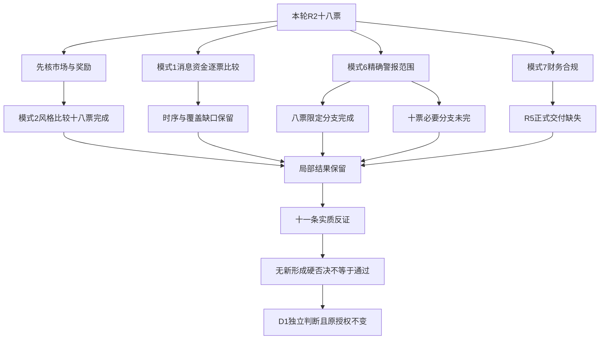

# 2026年11月9日 · 反证 / Devil's Advocate

> 数据源新鲜度：partial｜降级：true｜置信度：0.48（不是安全概率）

## 一句话结论

18票局部已审，必要审核未完成；11条反证、0条有据硬否决，绝非全票通过。

## 详细分析

市场在为什么付钱？上一交易日奖励的是少数连板接力与容量核心的相对抗跌，不是广谱赚钱效应。R1记载上涨758家、下跌4741家，昨日涨停池收盘反馈中位数为负。情绪=震荡偏弱；高位震荡是历史收盘温度，不预判今日已经修复或主跌。上一交易日炸板率30.43%，未触发≥35%的候选砍半条件，本阶段不另选票。

主线（研究）=光伏概念，持续性=5日活跃下限，封板率=60%，明日预期=分歧。半导体设备资金持续性=3日，封板率=未知（涨停/炸板分母为0），明日预期=分歧。二者均不是已确认可交易主线。闽发/永臻是光伏研究身位，中微/北方是容量研究核心，不能焊成一套策略，也不能凭资金排名认证龙头全部条件。

18票模式2均已实质比较：R2全部保留研究观察而未授买权，与R1震荡偏弱并不天然矛盾。模式6只有8票的限定板块霸榜代理分支已完成；日出东方个股代理警报仍需单列，其余范围外保持未知。空警报数组、个股false和板块false不互换，周末末次快照也不等于交易日全天连续霸榜。

模式1对各票均进行了实际语义和时间比较，但必要交叉仍未完成：R7明确覆盖中微、北方、拓荆，其余可见R2已列资金只作部分证据；本轮R5正式画像不存在。收盘后公告不能用此前盘中下跌或流出来证明利好被拒，公开钟点未知也不能猜。缺可比窗口是局部审核缺口，不新增T0必买/必禁门槛，不因R7旧池漏覆盖全盘停买。

R5正式交付缺失使18票模式7无法完成。不能以盈利为正、空flags、股价涨停或工作函媒体摘要认定财务合规安全；也不能用缺席伪造F红旗。真实账户停买、有效零预算、仓位硬上限、T+1、人工确认及既有硬否决不变。R1市场研究cap为有时限建议，不是账户预算；R6不抬额度、不改计划。

## 必要审核覆盖

| 模式 | 完成 | 未完成 | 实质范围 |
|---|---:|---:|---|
| 1 消息与资金 | 0 | 18 | 已核语义、资金背景与时序；同窗口交叉仍有缺项 |
| 2 风格一致性 | 18 | 0 | 逐票研究身份与震荡偏弱市场比较，不替代买权 |
| 6 出货风险 | 8 | 10 | 仅精确已查板块代理阴性分支；不是完整L4阴性 |
| 7 财务合规 | 0 | 18 | R5正式画像缺失；flags、审计与有限合规覆盖未知 |

已审对象18只，必要审核完成对象0只。0条hard_reject仅表示本次未形成有据硬否决；未宣称其他批次硬否决已撤销。

## 实质反面发现

| 编号 | 对象 | 级别 | 裁决与限定 |
|---|---|---|---|
| R6_M1_01 | 002578.SZ 闽发铝业 | strong_suggest | 降级：D1须处理单日卖压与加工费风险，不用5板或封单覆盖风险；不因核心被否递补后排。 晚间消息与盘中净额不是因果反应；未计算F红旗，不构成模式7硬否决 |
| R6_M1_02 | 601599.SH 浙文影业 | strong_suggest | 降级：D1须显式处理资金口径分歧和工作函风险；不得凭5板略过合规未完成，也不得把工作函自动硬否。 同一窗口不同算法不独立确认净派发；S2硬否决未获事实支持，模式7仍未完成 |
| R6_M1_03 | 688012.SH 中微公司 | soft_suggest | 观察：保留容量核心/龙三原身份，但不以净额或排名替代事件后承接、RR与正式画像，不自动递补。 R4精智达经营公告不是这三家的新订单；未推定T0失败或派发 |
| R6_M1_04 | 002371.SZ 北方华创 | soft_suggest | 观察：保留容量核心/龙三原身份，但不以净额或排名替代事件后承接、RR与正式画像，不自动递补。 R4精智达经营公告不是这三家的新订单；未推定T0失败或派发 |
| R6_M1_05 | 688072.SH 拓荆科技 | soft_suggest | 观察：保留容量核心/龙三原身份，但不以净额或排名替代事件后承接、RR与正式画像，不自动递补。 R4精智达经营公告不是这三家的新订单；未推定T0失败或派发 |
| R6_M1_06 | 688627.SH 精智达 | soft_suggest | 观察：不选为中微/北方的自动替补；先分清旧订单与新增产品，不将时间错配包装成利好出尽或强确认。 保留5日正净额与真实经营交付，反证不等于业绩证伪 |
| R6_M1_07 | 688585.SH 上纬新材 | strong_suggest | 降级：只保留事件观察，不把10000台下线算10000台销售；D1须显式处理收入与需求转化的不确定性。 生产进展真实不被抹掉；同一公告正反两面只算一个原始来源，不等于已滞销 |
| R6_M1_08 | 301248.SZ 杰创智能 | strong_suggest | 降级：D1须处理长周期回款与前置投入错配；不据合同总额授买权，不编F10比率或已违约。 已签合同真实性保留；未核融资最终落实，不宣称无法履约 |
| R6_M1_09 | 300489.SZ 光智科技 | strong_suggest | 降级：D1须明确意向、出口许可、后续订单三个条件，未获证据不将金额直接计入本期利润。 不把待许可误写出口禁令或违规实锤；11/6公开时分未知，5日流入不构成事件后确认 |
| R6_M6_01 | 603366.SH 日出东方 | strong_suggest | 观察（保留强风险提示）：不能宣称已证出货，也不能因板块false忽略个股警报；D1须显式处理，非hard_reject。 原模式6要求精确触发对象、板块高置信alert与R5负净额；本票不满足；不新增硬否决范围，必要模式6未完成 |
| R6_M9_01 | 603381.SH 永臻股份 | strong_suggest | 观察：把不可成交与开板兑现风险明确交D1，不用虚构胜率或为成交递补杂毛；不因高度本身hard_reject。 未设新阈值、未推断将炸板；极端尾部提示不等于硬否决 |

## 逐票必要判断与受质疑主张

以下“买入理由”仅为R2研究假设的受审对象，不是R6买入推荐；每票板型、龙头认定、RR及禁止清单均按原版保留。

### 闽发铝业 002578.SZ｜光伏概念｜观察

板型：开板后收盘回封；龙头认定：龙头，通过2项（原要求3项，未完整认证）；盈亏比：未知，止损距：未知；禁止清单命中：未知，14项未完整核验。

买入理由（受质疑主张，非推荐）：同花顺光伏成分内5板最高，与浙文影业并列市场最高；涨停换手12.50%。但DC单日净卖出0.7024亿，THS净卖出1.6478亿，加工费风险公告已见，不能把封单当净买盘。 大资金意图：净额只能描述估算交易，不读心、不把同源金额当机构意图。为什么走强：R2的身位/资金/事件是待验证解释，当前价格反馈与消息时间必须分开。

风险点／逻辑够不够硬：模式1=incomplete。5板涨停不等于净买入：R2东财单日-0.702405亿元、5日仍+1.304943亿元；R4加工费竞争风险为收盘后媒体引公告，无原公告全文。不能以11/6盘中流出证明对晚间风险的反应，也不能用5日流入抹掉单日派发嫌疑。 模式2=completed。R1为震荡偏弱/高位震荡、研究cap20%且最迟09:30重评；R2将光伏概念的闽发铝业列为龙头研究观察，execution_eligible=false，未宣称已确认可交易主线。研究保留本身不构成风格冲突。 高标延续与多数亏钱并存，追求晋级不能替代承接；不是仅凭高度否决。

止损条件（非价格指令）：R6不编买卖价或改退出规则；受审假设被后续证据推翻交D1处理，RR与止损距未核保持未知。模式6=completed。R3已核精确板块两日末次榜单，霸榜代理为false；个股已查记录亦为false。 模式6该限定警报分支未触发，不要求凭空追加R5负净额；不表示完整L4派发风险已排除。

可验证假设：模式7=incomplete。闽发铝业本批R5正式JSON缺失，F1—F12/S轴实际计算、适用性、年度及当前有限合规范围回执均未交付；fundamental_flags未知，不补空数组判安全。加工费及毛利风险为媒体转引，不是已计算F项，不能补为重大违规。 缺项交原生产者，不以补资料义务生成禁买。模式1缺项：R7本批未覆盖该票，且R5正式画像缺失，尚无获准替代的同版R5可比资金/价格；R2资金仅保留已知部分证据；本批消息公开与11/6日线/资金的可比反应窗口未建立；收盘后/公开钟点未知消息不能用此前价格证明响应。模式6缺项：无（仅已声明范围）。

证据定位：R2#/main_lines/0/leaders/0；R4事件索引[23]；R3匹配及R7实际来源见同版JSON patterns_status。sector_id=885531.TI，round_id=null；事件/有效窗口仅复制R2声明，未按概念或日期编轮次。

### 永臻股份 603381.SH｜光伏概念｜观察

板型：一字涨停；龙头认定：龙二，通过1项（原要求3项，未完整认证）；盈亏比：未知，止损距：未知；禁止清单命中：未知，14项未完整核验。

买入理由（受质疑主张，非推荐）：4板、首封与末封均为竞价时段且日线一字；DC5日+1.5940亿，20—50亿流通盘风险。地位次于闽发，排不到不以低位杂毛替代。 大资金意图：净额只能描述估算交易，不读心、不把同源金额当机构意图。为什么走强：R2的身位/资金/事件是待验证解释，当前价格反馈与消息时间必须分开。

风险点／逻辑够不够硬：模式1=incomplete。4板一字与东财单日+0.477927亿元、5日+1.594046亿元并存，支持的是T-1封板而非次日可成交。R4本批无直接新增公司催化，未核消息后价格/资金；一字预测仅为场景。 模式2=completed。R1为震荡偏弱/高位震荡、研究cap20%且最迟09:30重评；R2将光伏概念的永臻股份列为龙二研究观察，execution_eligible=false，未宣称已确认可交易主线。研究保留本身不构成风格冲突。 高标延续与多数亏钱并存，追求晋级不能替代承接；不是仅凭高度否决。

止损条件（非价格指令）：R6不编买卖价或改退出规则；受审假设被后续证据推翻交D1处理，RR与止损距未核保持未知。模式6=completed。R3已核精确板块两日末次榜单，霸榜代理为false；个股已查记录亦为false。 模式6该限定警报分支未触发，不要求凭空追加R5负净额；不表示完整L4派发风险已排除。

可验证假设：模式7=incomplete。永臻股份本批R5正式JSON缺失，F1—F12/S轴实际计算、适用性、年度及当前有限合规范围回执均未交付；fundamental_flags未知，不补空数组判安全。R2股价、净额与股性不能替代三表计算及审计/监管原文。 缺项交原生产者，不以补资料义务生成禁买。模式1缺项：R4本批缺该公司可独立核对的消息；未将无事件等同负面；R7本批未覆盖该票，且R5正式画像缺失，尚无获准替代的同版R5可比资金/价格；R2资金仅保留已知部分证据。模式6缺项：无（仅已声明范围）。

证据定位：R2#/main_lines/0/leaders/1；R4事件索引无同票独立事件；R3匹配及R7实际来源见同版JSON patterns_status。sector_id=885531.TI，round_id=null；事件/有效窗口仅复制R2声明，未按概念或日期编轮次。

### 日出东方 603366.SH｜光伏概念｜观察

板型：未开板涨停（是否一字另核）；龙头认定：龙三，通过0项（原要求3项，未完整认证）；盈亏比：未知，止损距：未知；禁止清单命中：未知，14项未完整核验。

买入理由（受质疑主张，非推荐）：人气靠前、52次历史涨停与首板封板；DC当日+1.5560亿，但本轮高度非龙一，霸榜只为警报不证明出货。保留人气对照，不越过龙一/龙二。 大资金意图：净额只能描述估算交易，不读心、不把同源金额当机构意图。为什么走强：R2的身位/资金/事件是待验证解释，当前价格反馈与消息时间必须分开。

风险点／逻辑够不够硬：模式1=incomplete。首板、人气与东财单日+1.556025亿元/5日+1.478109亿元并存；R4本批无直接公司催化。东财霸榜代理不能和同花顺非霸榜结果相互抵消，更不能从涨停推定已证出货。 模式2=completed。R1为震荡偏弱/高位震荡、研究cap20%且最迟09:30重评；R2将光伏概念的日出东方列为龙三研究观察，execution_eligible=false，未宣称已确认可交易主线。研究保留本身不构成风格冲突。

止损条件（非价格指令）：R6不编买卖价或改退出规则；受审假设被后续证据推翻交D1处理，RR与止损距未核保持未知。模式6=incomplete。日出东方同花顺热股false、东财人气true来自不同榜单，不能平均。光伏板块false但不能抹掉个股警报；本票为龙三且非execution_eligible，不满足原模式6正式触发对象。保留strong_suggest风险提示，未证实高置信派发及R5负净额，不形成hard_reject。

可验证假设：模式7=incomplete。日出东方本批R5正式JSON缺失，F1—F12/S轴实际计算、适用性、年度及当前有限合规范围回执均未交付；fundamental_flags未知，不补空数组判安全。R2股价、净额与股性不能替代三表计算及审计/监管原文。 缺项交原生产者，不以补资料义务生成禁买。模式1缺项：R4本批缺该公司可独立核对的消息；未将无事件等同负面；R7本批未覆盖该票，且R5正式画像缺失，尚无获准替代的同版R5可比资金/价格；R2资金仅保留已知部分证据。模式6缺项：R3日出东方东财个股霸榜为true但非高置信已证出货，完整L4未核；R5同票近5日主力净额缺失；不得用R2或R7替代模式6约定口径。

证据定位：R2#/main_lines/0/leaders/2；R4事件索引无同票独立事件；R3匹配及R7实际来源见同版JSON patterns_status。sector_id=885531.TI，round_id=null；事件/有效窗口仅复制R2声明，未按概念或日期编轮次。

### 新亚制程 002388.SZ｜光伏概念｜观察

板型：未开板涨停（是否一字另核）；龙头认定：龙三，通过1项（原要求3项，未完整认证）；盈亏比：未知，止损距：未知；禁止清单命中：未知，14项未完整核验。

买入理由（受质疑主张，非推荐）：3板且新亚制程在氟化工主题TOP3历史锚中，DC5日+1.1838亿；光伏成分重叠不是纯度证明，不能凭氟化工一只涨停认证独立主线。 大资金意图：净额只能描述估算交易，不读心、不把同源金额当机构意图。为什么走强：R2的身位/资金/事件是待验证解释，当前价格反馈与消息时间必须分开。

风险点／逻辑够不够硬：模式1=incomplete。3板与5日东财+1.183845亿元只是当前光伏成分内观察；R2同时提及氟化工历史锚，不能由成分重叠证明主营纯度或单股带动。R4无同票独立消息交叉，R5正式交付缺失。 模式2=completed。R1为震荡偏弱/高位震荡、研究cap20%且最迟09:30重评；R2将光伏概念的新亚制程列为龙三研究观察，execution_eligible=false，未宣称已确认可交易主线。研究保留本身不构成风格冲突。

止损条件（非价格指令）：R6不编买卖价或改退出规则；受审假设被后续证据推翻交D1处理，RR与止损距未核保持未知。模式6=completed。R3已核精确板块两日末次榜单，霸榜代理为false；个股未单列，不冒称全市场个股派发阴性。 模式6该限定警报分支未触发，不要求凭空追加R5负净额；不表示完整L4派发风险已排除。

可验证假设：模式7=incomplete。新亚制程本批R5正式JSON缺失，F1—F12/S轴实际计算、适用性、年度及当前有限合规范围回执均未交付；fundamental_flags未知，不补空数组判安全。R2股价、净额与股性不能替代三表计算及审计/监管原文。 缺项交原生产者，不以补资料义务生成禁买。模式1缺项：R4本批缺该公司可独立核对的消息；未将无事件等同负面；R7本批未覆盖该票，且R5正式画像缺失，尚无获准替代的同版R5可比资金/价格；R2资金仅保留已知部分证据。模式6缺项：无（仅已声明范围）。

证据定位：R2#/main_lines/0/leaders/3；R4事件索引无同票独立事件；R3匹配及R7实际来源见同版JSON patterns_status。sector_id=885531.TI，round_id=null；事件/有效窗口仅复制R2声明，未按概念或日期编轮次。

### 安彩高科 600207.SH｜光伏概念｜观察

板型：开板后收盘回封；龙头认定：龙三，通过1项（原要求3项，未完整认证）；盈亏比：未知，止损距：未知；禁止清单命中：未知，14项未完整核验。

买入理由（受质疑主张，非推荐）：光伏设备首板且DC单日+0.7543亿；作为低位扩散实证，不因资金流入较强替代高辨识度龙一。 大资金意图：净额只能描述估算交易，不读心、不把同源金额当机构意图。为什么走强：R2的身位/资金/事件是待验证解释，当前价格反馈与消息时间必须分开。

风险点／逻辑够不够硬：模式1=incomplete。光伏首板、单日东财+0.754258亿元与板块整体净流出不同向；这说明个股分化，不足证明板块回流或取代闽发/永臻。R4缺该票独立事件与同窗口反应。 模式2=completed。R1为震荡偏弱/高位震荡、研究cap20%且最迟09:30重评；R2将光伏概念的安彩高科列为龙三研究观察，execution_eligible=false，未宣称已确认可交易主线。研究保留本身不构成风格冲突。

止损条件（非价格指令）：R6不编买卖价或改退出规则；受审假设被后续证据推翻交D1处理，RR与止损距未核保持未知。模式6=completed。R3已核精确板块两日末次榜单，霸榜代理为false；个股未单列，不冒称全市场个股派发阴性。 模式6该限定警报分支未触发，不要求凭空追加R5负净额；不表示完整L4派发风险已排除。

可验证假设：模式7=incomplete。安彩高科本批R5正式JSON缺失，F1—F12/S轴实际计算、适用性、年度及当前有限合规范围回执均未交付；fundamental_flags未知，不补空数组判安全。R2股价、净额与股性不能替代三表计算及审计/监管原文。 缺项交原生产者，不以补资料义务生成禁买。模式1缺项：R4本批缺该公司可独立核对的消息；未将无事件等同负面；R7本批未覆盖该票，且R5正式画像缺失，尚无获准替代的同版R5可比资金/价格；R2资金仅保留已知部分证据。模式6缺项：无（仅已声明范围）。

证据定位：R2#/main_lines/0/leaders/4；R4事件索引无同票独立事件；R3匹配及R7实际来源见同版JSON patterns_status。sector_id=885531.TI，round_id=null；事件/有效窗口仅复制R2声明，未按概念或日期编轮次。

### 中微公司 688012.SH｜半导体设备｜观察

板型：非涨停/未认证板型；龙头认定：龙头，通过0项（原要求3项，未完整认证）；盈亏比：未知，止损距：未知；禁止清单命中：未知，14项未完整核验。

买入理由（受质疑主张，非推荐）：实际已取27只半导体设备成分中，5/5有效日DC净流入累计32.9811亿排名第1；T-1平收。是容量资金核心，不冒充10cm情绪妖股，也不由资金第一自动认证可买。 大资金意图：净额只能描述估算交易，不读心、不把同源金额当机构意图。为什么走强：R2的身位/资金/事件是待验证解释，当前价格反馈与消息时间必须分开。

风险点／逻辑够不够硬：模式1=incomplete。R7精确覆盖：11/2—6东财5日+32.981064亿元，11/6+1.817927亿元而股价0%；半导体设备板块仍跌2.33%。R4精智达晚间经营公告不是中微直接订单，也不能解释此前价格；不认证资金与新消息共振。 模式2=completed。R1为震荡偏弱/高位震荡、研究cap20%且最迟09:30重评；R2将半导体设备的中微公司列为龙头研究观察，execution_eligible=false，未宣称已确认可交易主线。研究保留本身不构成风格冲突。 容量资金核心不是连板情绪龙，不能混用板型与模板。

止损条件（非价格指令）：R6不编买卖价或改退出规则；受审假设被后续证据推翻交D1处理，RR与止损距未核保持未知。模式6=incomplete。R3没有本票或该精确板块的已核警报结果；缺席仅表示该分支无完整意见，不构成禁买或安全结论。

可验证假设：模式7=incomplete。中微公司本批R5正式JSON缺失，F1—F12/S轴实际计算、适用性、年度及当前有限合规范围回执均未交付；fundamental_flags未知，不补空数组判安全。R2股价、净额与股性不能替代三表计算及审计/监管原文。 缺项交原生产者，不以补资料义务生成禁买。模式1缺项：本批消息公开与11/6日线/资金的可比反应窗口未建立；收盘后/公开钟点未知消息不能用此前价格证明响应。模式6缺项：R3未覆盖本批精确板块的可核distribution_alert结果，范围外不是false。

证据定位：R2#/main_lines/1/leaders/0；R4事件索引[15]；R3匹配及R7实际来源见同版JSON patterns_status。sector_id=884229.TI，round_id=null；事件/有效窗口仅复制R2声明，未按概念或日期编轮次。

### 北方华创 002371.SZ｜半导体设备｜观察

板型：非涨停/未认证板型；龙头认定：龙二，通过0项（原要求3项，未完整认证）；盈亏比：未知，止损距：未知；禁止清单命中：未知，14项未完整核验。

买入理由（受质疑主张，非推荐）：同口径成分5日净流入23.7954亿第2，单日+6.1048亿，跌0.18%相对板块抗跌；仅研究容量龙二，不以当日资金替代T0买点。 大资金意图：净额只能描述估算交易，不读心、不把同源金额当机构意图。为什么走强：R2的身位/资金/事件是待验证解释，当前价格反馈与消息时间必须分开。

风险点／逻辑够不够硬：模式1=incomplete。R7精确覆盖：5日东财+23.795447亿元，11/6+6.104843亿元但股价-0.18%；xTick单日同向而口径不同，不能加总。R4行业消息发生在该日收盘后且主体为精智达，未核北方消息后的价格反应。 模式2=completed。R1为震荡偏弱/高位震荡、研究cap20%且最迟09:30重评；R2将半导体设备的北方华创列为龙二研究观察，execution_eligible=false，未宣称已确认可交易主线。研究保留本身不构成风格冲突。 容量资金核心不是连板情绪龙，不能混用板型与模板。

止损条件（非价格指令）：R6不编买卖价或改退出规则；受审假设被后续证据推翻交D1处理，RR与止损距未核保持未知。模式6=incomplete。R3没有本票或该精确板块的已核警报结果；缺席仅表示该分支无完整意见，不构成禁买或安全结论。

可验证假设：模式7=incomplete。北方华创本批R5正式JSON缺失，F1—F12/S轴实际计算、适用性、年度及当前有限合规范围回执均未交付；fundamental_flags未知，不补空数组判安全。R2股价、净额与股性不能替代三表计算及审计/监管原文。 缺项交原生产者，不以补资料义务生成禁买。模式1缺项：本批消息公开与11/6日线/资金的可比反应窗口未建立；收盘后/公开钟点未知消息不能用此前价格证明响应。模式6缺项：R3未覆盖本批精确板块的可核distribution_alert结果，范围外不是false。

证据定位：R2#/main_lines/1/leaders/1；R4事件索引[15]；R3匹配及R7实际来源见同版JSON patterns_status。sector_id=884229.TI，round_id=null；事件/有效窗口仅复制R2声明，未按概念或日期编轮次。

### 拓荆科技 688072.SH｜半导体设备｜观察

板型：非涨停/未认证板型；龙头认定：龙三，通过0项（原要求3项，未完整认证）；盈亏比：未知，止损距：未知；禁止清单命中：未知，14项未完整核验。

买入理由（受质疑主张，非推荐）：5日DC+12.5146亿排名第3；当日-0.3550亿，保持龙三研究身份，不因688前缀排除亦不自动递补。 大资金意图：净额只能描述估算交易，不读心、不把同源金额当机构意图。为什么走强：R2的身位/资金/事件是待验证解释，当前价格反馈与消息时间必须分开。

风险点／逻辑够不够硬：模式1=incomplete。R7精确覆盖：5日东财+12.514559亿元，单日转-0.354973亿元、股价-1.1614%。5日容量排名第三不等于当日承接；内嵌日历称回购完成，不能把完成额度继续计为待买盘，且该日历非本轮原公告复核。 模式2=completed。R1为震荡偏弱/高位震荡、研究cap20%且最迟09:30重评；R2将半导体设备的拓荆科技列为龙三研究观察，execution_eligible=false，未宣称已确认可交易主线。研究保留本身不构成风格冲突。 容量资金核心不是连板情绪龙，不能混用板型与模板。

止损条件（非价格指令）：R6不编买卖价或改退出规则；受审假设被后续证据推翻交D1处理，RR与止损距未核保持未知。模式6=incomplete。R3没有本票或该精确板块的已核警报结果；缺席仅表示该分支无完整意见，不构成禁买或安全结论。

可验证假设：模式7=incomplete。拓荆科技本批R5正式JSON缺失，F1—F12/S轴实际计算、适用性、年度及当前有限合规范围回执均未交付；fundamental_flags未知，不补空数组判安全。R2股价、净额与股性不能替代三表计算及审计/监管原文。 缺项交原生产者，不以补资料义务生成禁买。模式1缺项：本批消息公开与11/6日线/资金的可比反应窗口未建立；收盘后/公开钟点未知消息不能用此前价格证明响应。模式6缺项：R3未覆盖本批精确板块的可核distribution_alert结果，范围外不是false。

证据定位：R2#/main_lines/1/leaders/2；R4事件索引[15]；R3匹配及R7实际来源见同版JSON patterns_status。sector_id=884229.TI，round_id=null；事件/有效窗口仅复制R2声明，未按概念或日期编轮次。

### 精智达 688627.SH｜半导体设备｜观察

板型：非涨停/未认证板型；龙头认定：龙三，通过0项（原要求3项，未完整认证）；盈亏比：未知，止损距：未知；禁止清单命中：未知，14项未完整核验。

买入理由（受质疑主张，非推荐）：R4直接事件映射：旧存储测试合同按节奏交付与SoC ATE产品推出；不是新签大单。股价-7.4762%、当日DC-1.8980亿，事件真实性与资金选择冲突，降为研究对照。 大资金意图：净额只能描述估算交易，不读心、不把同源金额当机构意图。为什么走强：R2的身位/资金/事件是待验证解释，当前价格反馈与消息时间必须分开。

风险点／逻辑够不够硬：模式1=incomplete。R4原文是1月/9月旧合同按节奏交付与SoC ATE推出，不是11月新签订单。R2的11/6跌7.4762%、单日东财-1.897959亿元早于晚间公告，不能说市场已否定该公告；5日+2.368964亿元亦不构成公告后资金确认。 模式2=completed。R1为震荡偏弱/高位震荡、研究cap20%且最迟09:30重评；R2将半导体设备的精智达列为龙三研究观察，execution_eligible=false，未宣称已确认可交易主线。研究保留本身不构成风格冲突。 容量资金核心不是连板情绪龙，不能混用板型与模板。

止损条件（非价格指令）：R6不编买卖价或改退出规则；受审假设被后续证据推翻交D1处理，RR与止损距未核保持未知。模式6=incomplete。R3没有本票或该精确板块的已核警报结果；缺席仅表示该分支无完整意见，不构成禁买或安全结论。

可验证假设：模式7=incomplete。精智达本批R5正式JSON缺失，F1—F12/S轴实际计算、适用性、年度及当前有限合规范围回执均未交付；fundamental_flags未知，不补空数组判安全。未审经营累计数与旧合同并非审计意见/完整财务合规筛查。 缺项交原生产者，不以补资料义务生成禁买。模式1缺项：R7本批未覆盖该票，且R5正式画像缺失，尚无获准替代的同版R5可比资金/价格；R2资金仅保留已知部分证据；本批消息公开与11/6日线/资金的可比反应窗口未建立；收盘后/公开钟点未知消息不能用此前价格证明响应。模式6缺项：R3未覆盖本批精确板块的可核distribution_alert结果，范围外不是false。

证据定位：R2#/main_lines/1/leaders/3；R4事件索引[15]；R3匹配及R7实际来源见同版JSON patterns_status。sector_id=884229.TI，round_id=null；事件/有效窗口仅复制R2声明，未按概念或日期编轮次。

### 新能股份 000595.SZ｜电力/绿色电力｜观察

板型：开板后收盘回封；龙头认定：龙三，通过1项（原要求3项，未完整认证）；盈亏比：未知，止损距：未知；禁止清单命中：未知，14项未完整核验。

买入理由（受质疑主张，非推荐）：电力原始涨停首封最早，新能首板、DC当日+0.4699亿；历史锚TOP1不等于当下总龙，旧股性名称为宝塔实业，代码精确映射而非新发明名字梗。 大资金意图：净额只能描述估算交易，不读心、不把同源金额当机构意图。为什么走强：R2的身位/资金/事件是待验证解释，当前价格反馈与消息时间必须分开。

风险点／逻辑够不够硬：模式1=incomplete。R2首板单日东财+0.469886亿元、5日+0.252708亿元；电力行业单日转入但5日仍净流出。R4六张网是收盘后方向性政策不是本公司订单；旧宝塔实业股性名/新能股份当前名按同代码关联，不能重复当两票。 模式2=completed。R1为震荡偏弱/高位震荡、研究cap20%且最迟09:30重评；R2将电力/绿色电力的新能股份列为龙三研究观察，execution_eligible=false，未宣称已确认可交易主线。研究保留本身不构成风格冲突。 单日防守修复须与5日行业流出并列，不自动升主升。

止损条件（非价格指令）：R6不编买卖价或改退出规则；受审假设被后续证据推翻交D1处理，RR与止损距未核保持未知。模式6=incomplete。已查本票个股榜单代理false，但所属板块未获同范围检查，不能外推板块阴性；缺席仅表示该分支无完整意见，不构成禁买或安全结论。

可验证假设：模式7=incomplete。新能股份本批R5正式JSON缺失，F1—F12/S轴实际计算、适用性、年度及当前有限合规范围回执均未交付；fundamental_flags未知，不补空数组判安全。R2股价、净额与股性不能替代三表计算及审计/监管原文。 缺项交原生产者，不以补资料义务生成禁买。模式1缺项：R7本批未覆盖该票，且R5正式画像缺失，尚无获准替代的同版R5可比资金/价格；R2资金仅保留已知部分证据；本批消息公开与11/6日线/资金的可比反应窗口未建立；收盘后/公开钟点未知消息不能用此前价格证明响应。模式6缺项：R3未覆盖本批精确板块的可核distribution_alert结果，范围外不是false。

证据定位：R2#/secondary_lines/0/leaders/0；R4事件索引[4]；R3匹配及R7实际来源见同版JSON patterns_status。sector_id=885936.TI，round_id=null；事件/有效窗口仅复制R2声明，未按概念或日期编轮次。

### 立新能源 001258.SZ｜电力/绿色电力｜观察

板型：开板后收盘回封；龙头认定：龙三，通过1项（原要求3项，未完整认证）；盈亏比：未知，止损距：未知；禁止清单命中：未知，14项未完整核验。

买入理由（受质疑主张，非推荐）：电力首板、DC当日+1.2924亿，绿色电力历史锚TOP2；缺足够持续性与主线地位，不能用净流入升级龙一。 大资金意图：净额只能描述估算交易，不读心、不把同源金额当机构意图。为什么走强：R2的身位/资金/事件是待验证解释，当前价格反馈与消息时间必须分开。

风险点／逻辑够不够硬：模式1=incomplete。首板单日东财+1.292365亿元、5日+1.300689亿元，但行业5日-23.244948亿元；公司历史13连板不能覆盖本轮首板地位。六张网政策没有明确该公司订单，消息后反应未核。 模式2=completed。R1为震荡偏弱/高位震荡、研究cap20%且最迟09:30重评；R2将电力/绿色电力的立新能源列为龙三研究观察，execution_eligible=false，未宣称已确认可交易主线。研究保留本身不构成风格冲突。 单日防守修复须与5日行业流出并列，不自动升主升。

止损条件（非价格指令）：R6不编买卖价或改退出规则；受审假设被后续证据推翻交D1处理，RR与止损距未核保持未知。模式6=incomplete。已查本票个股榜单代理false，但所属板块未获同范围检查，不能外推板块阴性；缺席仅表示该分支无完整意见，不构成禁买或安全结论。

可验证假设：模式7=incomplete。立新能源本批R5正式JSON缺失，F1—F12/S轴实际计算、适用性、年度及当前有限合规范围回执均未交付；fundamental_flags未知，不补空数组判安全。R2股价、净额与股性不能替代三表计算及审计/监管原文。 缺项交原生产者，不以补资料义务生成禁买。模式1缺项：R7本批未覆盖该票，且R5正式画像缺失，尚无获准替代的同版R5可比资金/价格；R2资金仅保留已知部分证据；本批消息公开与11/6日线/资金的可比反应窗口未建立；收盘后/公开钟点未知消息不能用此前价格证明响应。模式6缺项：R3未覆盖本批精确板块的可核distribution_alert结果，范围外不是false。

证据定位：R2#/secondary_lines/0/leaders/1；R4事件索引[4]；R3匹配及R7实际来源见同版JSON patterns_status。sector_id=885936.TI，round_id=null；事件/有效窗口仅复制R2声明，未按概念或日期编轮次。

### 东方新能 002310.SZ｜电力/绿色电力｜观察

板型：未开板涨停（是否一字另核）；龙头认定：龙三，通过0项（原要求3项，未完整认证）；盈亏比：未知，止损距：未知；禁止清单命中：未知，14项未完整核验。

买入理由（受质疑主张，非推荐）：电力首板、DC当日+1.3216亿且周末热榜靠前；名称历史变化和当前资产纯度须R5核，单字共现不证明名字主线。 大资金意图：净额只能描述估算交易，不读心、不把同源金额当机构意图。为什么走强：R2的身位/资金/事件是待验证解释，当前价格反馈与消息时间必须分开。

风险点／逻辑够不够硬：模式1=incomplete。首板东财单日+1.321624亿元、5日+1.299987亿元与周末热度并存；历史名称/资产纯度仍待画像。既无该公司六张网订单，也不能把名字共现当新主线；不足支持消息资金交叉完成。 模式2=completed。R1为震荡偏弱/高位震荡、研究cap20%且最迟09:30重评；R2将电力/绿色电力的东方新能列为龙三研究观察，execution_eligible=false，未宣称已确认可交易主线。研究保留本身不构成风格冲突。 单日防守修复须与5日行业流出并列，不自动升主升。

止损条件（非价格指令）：R6不编买卖价或改退出规则；受审假设被后续证据推翻交D1处理，RR与止损距未核保持未知。模式6=incomplete。已查本票个股榜单代理false，但所属板块未获同范围检查，不能外推板块阴性；缺席仅表示该分支无完整意见，不构成禁买或安全结论。

可验证假设：模式7=incomplete。东方新能本批R5正式JSON缺失，F1—F12/S轴实际计算、适用性、年度及当前有限合规范围回执均未交付；fundamental_flags未知，不补空数组判安全。R2股价、净额与股性不能替代三表计算及审计/监管原文。 缺项交原生产者，不以补资料义务生成禁买。模式1缺项：R7本批未覆盖该票，且R5正式画像缺失，尚无获准替代的同版R5可比资金/价格；R2资金仅保留已知部分证据；本批消息公开与11/6日线/资金的可比反应窗口未建立；收盘后/公开钟点未知消息不能用此前价格证明响应。模式6缺项：R3未覆盖本批精确板块的可核distribution_alert结果，范围外不是false。

证据定位：R2#/secondary_lines/0/leaders/2；R4事件索引[4]；R3匹配及R7实际来源见同版JSON patterns_status。sector_id=885936.TI，round_id=null；事件/有效窗口仅复制R2声明，未按概念或日期编轮次。

### 浙文影业 601599.SH｜短剧游戏/传媒情绪｜观察

板型：开板后收盘回封；龙头认定：龙头，通过2项（原要求3项，未完整认证）；盈亏比：未知，止损距：未知；禁止清单命中：未知，14项未完整核验。

买入理由（受质疑主张，非推荐）：5板最高与已披露监管工作函并存；DC单日+1.0898亿而THS-7.6126亿，跨源冲突显著，不抹平。 大资金意图：净额只能描述估算交易，不读心、不把同源金额当机构意图。为什么走强：R2的身位/资金/事件是待验证解释，当前价格反馈与消息时间必须分开。

风险点／逻辑够不够硬：模式1=incomplete。5板东财单日+1.089824亿元，而R2明列同花顺单日-7.6126亿元，跨口径符号冲突不能平均或只挑正数。R4监管工作函仅媒体引用非处罚原文；晚间发布不能倒因解释日间价格。 模式2=completed。R1为震荡偏弱/高位震荡、研究cap20%且最迟09:30重评；R2将短剧游戏/传媒情绪的浙文影业列为龙头研究观察，execution_eligible=false，未宣称已确认可交易主线。研究保留本身不构成风格冲突。 高标延续与多数亏钱并存，追求晋级不能替代承接；不是仅凭高度否决。

止损条件（非价格指令）：R6不编买卖价或改退出规则；受审假设被后续证据推翻交D1处理，RR与止损距未核保持未知。模式6=completed。R3已核精确板块两日末次榜单，霸榜代理为false；个股已查记录亦为false。 模式6该限定警报分支未触发，不要求凭空追加R5负净额；不表示完整L4派发风险已排除。

可验证假设：模式7=incomplete。浙文影业本批R5正式JSON缺失，F1—F12/S轴实际计算、适用性、年度及当前有限合规范围回执均未交付；fundamental_flags未知，不补空数组判安全。监管工作函不是立案调查/造假实锤，未触发S2硬否决；官方正文缺口仍在。 缺项交原生产者，不以补资料义务生成禁买。模式1缺项：R7本批未覆盖该票，且R5正式画像缺失，尚无获准替代的同版R5可比资金/价格；R2资金仅保留已知部分证据；本批消息公开与11/6日线/资金的可比反应窗口未建立；收盘后/公开钟点未知消息不能用此前价格证明响应。模式6缺项：无（仅已声明范围）。

证据定位：R2#/secondary_lines/1/leaders/0；R4事件索引[6, 25, 27]；R3匹配及R7实际来源见同版JSON patterns_status。sector_id=886060.TI，round_id=null；事件/有效窗口仅复制R2声明，未按概念或日期编轮次。

### 思美传媒 002712.SZ｜短剧游戏/传媒情绪｜观察

板型：未开板涨停（是否一字另核）；龙头认定：龙三，通过0项（原要求3项，未完整认证）；盈亏比：未知，止损距：未知；禁止清单命中：未知，14项未完整核验。

买入理由（受质疑主张，非推荐）：短剧首板、DC当日+0.5476亿；是扩散对照，不因龙头有监管线索自动转正。 大资金意图：净额只能描述估算交易，不读心、不把同源金额当机构意图。为什么走强：R2的身位/资金/事件是待验证解释，当前价格反馈与消息时间必须分开。

风险点／逻辑够不够硬：模式1=incomplete。短剧首板东财+0.547596亿元，但传媒行业当日-24.415306亿元；广电同一文件治理与扶持并存，未指定思美为受益或违法主体。政策晚于收盘，单日资金不能充当政策后确认。 模式2=completed。R1为震荡偏弱/高位震荡、研究cap20%且最迟09:30重评；R2将短剧游戏/传媒情绪的思美传媒列为龙三研究观察，execution_eligible=false，未宣称已确认可交易主线。研究保留本身不构成风格冲突。

止损条件（非价格指令）：R6不编买卖价或改退出规则；受审假设被后续证据推翻交D1处理，RR与止损距未核保持未知。模式6=completed。R3已核精确板块两日末次榜单，霸榜代理为false；个股已查记录亦为false。 模式6该限定警报分支未触发，不要求凭空追加R5负净额；不表示完整L4派发风险已排除。

可验证假设：模式7=incomplete。思美传媒本批R5正式JSON缺失，F1—F12/S轴实际计算、适用性、年度及当前有限合规范围回执均未交付；fundamental_flags未知，不补空数组判安全。R2股价、净额与股性不能替代三表计算及审计/监管原文。 缺项交原生产者，不以补资料义务生成禁买。模式1缺项：R7本批未覆盖该票，且R5正式画像缺失，尚无获准替代的同版R5可比资金/价格；R2资金仅保留已知部分证据；本批消息公开与11/6日线/资金的可比反应窗口未建立；收盘后/公开钟点未知消息不能用此前价格证明响应。模式6缺项：无（仅已声明范围）。

证据定位：R2#/secondary_lines/1/leaders/1；R4事件索引[6, 27]；R3匹配及R7实际来源见同版JSON patterns_status。sector_id=886060.TI，round_id=null；事件/有效窗口仅复制R2声明，未按概念或日期编轮次。

### 城市传媒 600229.SH｜短剧游戏/传媒情绪｜观察

板型：未开板涨停（是否一字另核）；龙头认定：龙三，通过0项（原要求3项，未完整认证）；盈亏比：未知，止损距：未知；禁止清单命中：未知，14项未完整核验。

买入理由（受质疑主张，非推荐）：短剧首板但成交与地位证据有限；早封仅为相对时序，不构成主线龙二认证。 大资金意图：净额只能描述估算交易，不读心、不把同源金额当机构意图。为什么走强：R2的身位/资金/事件是待验证解释，当前价格反馈与消息时间必须分开。

风险点／逻辑够不够硬：模式1=incomplete。首板东财+0.30255亿元、5日+0.473277亿元，不足从早封推出龙二地位。R4治理/精品扶持是同一原文且无公司名单，不能用政策两面重复算利好或推定城市传媒违规。 模式2=completed。R1为震荡偏弱/高位震荡、研究cap20%且最迟09:30重评；R2将短剧游戏/传媒情绪的城市传媒列为龙三研究观察，execution_eligible=false，未宣称已确认可交易主线。研究保留本身不构成风格冲突。

止损条件（非价格指令）：R6不编买卖价或改退出规则；受审假设被后续证据推翻交D1处理，RR与止损距未核保持未知。模式6=completed。R3已核精确板块两日末次榜单，霸榜代理为false；个股未单列，不冒称全市场个股派发阴性。 模式6该限定警报分支未触发，不要求凭空追加R5负净额；不表示完整L4派发风险已排除。

可验证假设：模式7=incomplete。城市传媒本批R5正式JSON缺失，F1—F12/S轴实际计算、适用性、年度及当前有限合规范围回执均未交付；fundamental_flags未知，不补空数组判安全。R2股价、净额与股性不能替代三表计算及审计/监管原文。 缺项交原生产者，不以补资料义务生成禁买。模式1缺项：R7本批未覆盖该票，且R5正式画像缺失，尚无获准替代的同版R5可比资金/价格；R2资金仅保留已知部分证据；本批消息公开与11/6日线/资金的可比反应窗口未建立；收盘后/公开钟点未知消息不能用此前价格证明响应。模式6缺项：无（仅已声明范围）。

证据定位：R2#/secondary_lines/1/leaders/2；R4事件索引[6, 27]；R3匹配及R7实际来源见同版JSON patterns_status。sector_id=886060.TI，round_id=null；事件/有效窗口仅复制R2声明，未按概念或日期编轮次。

### 上纬新材 688585.SH｜机器人/消费级具身智能｜观察

板型：非涨停/未认证板型；龙头认定：龙三，通过0项（原要求3项，未完整认证）；盈亏比：未知，止损距：未知；禁止清单命中：未知，14项未完整核验。

买入理由（受质疑主张，非推荐）：R4直接公告映射且当日DC+0.4637亿；公告后T0反应尚未知，历史-1.65%不能否定周末事件。保留事件试错研究，不冒充产业龙。 大资金意图：净额只能描述估算交易，不读心、不把同源金额当机构意图。为什么走强：R2的身位/资金/事件是待验证解释，当前价格反馈与消息时间必须分开。

风险点／逻辑够不够硬：模式1=incomplete。R4公告核的是下线10000台而非售出或付费交付，机器人收入占比低、年度盈利无法预测。11/6单日东财+0.463671亿元及-1.65%都早于11/8最早已知线索，不能证明周末事件已获市场认可或被否。 模式2=completed。R1为震荡偏弱/高位震荡、研究cap20%且最迟09:30重评；R2将机器人/消费级具身智能的上纬新材列为龙三研究观察，execution_eligible=false，未宣称已确认可交易主线。研究保留本身不构成风格冲突。

止损条件（非价格指令）：R6不编买卖价或改退出规则；受审假设被后续证据推翻交D1处理，RR与止损距未核保持未知。模式6=completed。R3已核精确板块两日末次榜单，霸榜代理为false；个股未单列，不冒称全市场个股派发阴性。 模式6该限定警报分支未触发，不要求凭空追加R5负净额；不表示完整L4派发风险已排除。

可验证假设：模式7=incomplete。上纬新材本批R5正式JSON缺失，F1—F12/S轴实际计算、适用性、年度及当前有限合规范围回执均未交付；fundamental_flags未知，不补空数组判安全。新业务营收比例低不是ST风险检出结论。 缺项交原生产者，不以补资料义务生成禁买。模式1缺项：R7本批未覆盖该票，且R5正式画像缺失，尚无获准替代的同版R5可比资金/价格；R2资金仅保留已知部分证据；本批消息公开与11/6日线/资金的可比反应窗口未建立；收盘后/公开钟点未知消息不能用此前价格证明响应。模式6缺项：无（仅已声明范围）。

证据定位：R2#/secondary_lines/3/leaders/0；R4事件索引[5, 13]；R3匹配及R7实际来源见同版JSON patterns_status。sector_id=885517.TI，round_id=null；事件/有效窗口仅复制R2声明，未按概念或日期编轮次。

### 杰创智能 301248.SZ｜算力服务/磷化铟事件对照｜观察

板型：非涨停/未认证板型；龙头认定：龙三，通过0项（原要求3项，未完整认证）；盈亏比：未知，止损距：未知；禁止清单命中：未知，14项未完整核验。

买入理由（受质疑主张，非推荐）：签订暂定含税49.152亿算力服务合同，订单量价浮动、分批60个月、融资与验收风险；DC5日-0.4236亿。不是将合同总额作为利润。 大资金意图：净额只能描述估算交易，不读心、不把同源金额当机构意图。为什么走强：R2的身位/资金/事件是待验证解释，当前价格反馈与消息时间必须分开。

风险点／逻辑够不够硬：模式1=incomplete。R4原文暂定含税49.152亿元、分批每批60个月且浮动定价；融资/采购/验收风险与合同同源，不相互抵消。11/6单日东财-0.079849亿元、5日-0.423582亿元是收盘前背景，晚间合同之后反应未知，不能据此说利好兑现失败。 模式2=completed。R1为震荡偏弱/高位震荡、研究cap20%且最迟09:30重评；R2将算力服务/磷化铟事件对照的杰创智能列为龙三研究观察，execution_eligible=false，未宣称已确认可交易主线。研究保留本身不构成风格冲突。

止损条件（非价格指令）：R6不编买卖价或改退出规则；受审假设被后续证据推翻交D1处理，RR与止损距未核保持未知。模式6=incomplete。R3没有本票或该精确板块的已核警报结果；缺席仅表示该分支无完整意见，不构成禁买或安全结论。

可验证假设：模式7=incomplete。杰创智能本批R5正式JSON缺失，F1—F12/S轴实际计算、适用性、年度及当前有限合规范围回执均未交付；fundamental_flags未知，不补空数组判安全。长合同融资压力是实际风险，但没有有息负债率等三表计算，不能伪造F10命中。 缺项交原生产者，不以补资料义务生成禁买。模式1缺项：R7本批未覆盖该票，且R5正式画像缺失，尚无获准替代的同版R5可比资金/价格；R2资金仅保留已知部分证据；本批消息公开与11/6日线/资金的可比反应窗口未建立；收盘后/公开钟点未知消息不能用此前价格证明响应。模式6缺项：R3未覆盖本批精确板块的可核distribution_alert结果，范围外不是false。

证据定位：R2#/secondary_lines/4/leaders/0；R4事件索引[2, 7]；R3匹配及R7实际来源见同版JSON patterns_status。sector_id=null，round_id=null；事件/有效窗口仅复制R2声明，未按概念或日期编轮次。

### 光智科技 300489.SZ｜算力服务/磷化铟事件对照｜观察

板型：非涨停/未认证板型；龙头认定：龙三，通过0项（原要求3项，未完整认证）；盈亏比：未知，止损距：未知；禁止清单命中：未知，14项未完整核验。

买入理由（受质疑主张，非推荐）：2027—2029磷化铟供货意向预计不低于6.01亿美元，最终协议与出口许可未完成；5日DC+4.0666亿不能代替必要许可。 大资金意图：净额只能描述估算交易，不读心、不把同源金额当机构意图。为什么走强：R2的身位/资金/事件是待验证解释，当前价格反馈与消息时间必须分开。

风险点／逻辑够不够硬：模式1=incomplete。R4为2027—2029年不低于6.01亿美元意向，最终协议与出口许可均未完成；这是条件性供货，不是本期已确认收入或已遭出口禁令。11/6公告仅知日期而无公开钟点，不能把该日资金+0.283049亿元归因为公告，5日+4.066575亿元也非订单后验证。 模式2=completed。R1为震荡偏弱/高位震荡、研究cap20%且最迟09:30重评；R2将算力服务/磷化铟事件对照的光智科技列为龙三研究观察，execution_eligible=false，未宣称已确认可交易主线。研究保留本身不构成风格冲突。

止损条件（非价格指令）：R6不编买卖价或改退出规则；受审假设被后续证据推翻交D1处理，RR与止损距未核保持未知。模式6=incomplete。R3没有本票或该精确板块的已核警报结果；缺席仅表示该分支无完整意见，不构成禁买或安全结论。

可验证假设：模式7=incomplete。光智科技本批R5正式JSON缺失，F1—F12/S轴实际计算、适用性、年度及当前有限合规范围回执均未交付；fundamental_flags未知，不补空数组判安全。出口许可待批不是违规已发生，不能伪造S2。 缺项交原生产者，不以补资料义务生成禁买。模式1缺项：R7本批未覆盖该票，且R5正式画像缺失，尚无获准替代的同版R5可比资金/价格；R2资金仅保留已知部分证据；本批消息公开与11/6日线/资金的可比反应窗口未建立；收盘后/公开钟点未知消息不能用此前价格证明响应。模式6缺项：R3未覆盖本批精确板块的可核distribution_alert结果，范围外不是false。

证据定位：R2#/secondary_lines/4/leaders/1；R4事件索引[8, 11]；R3匹配及R7实际来源见同版JSON patterns_status。sector_id=null，round_id=null；事件/有效窗口仅复制R2声明，未按概念或日期编轮次。

## 四象限负面识别

| 象限 | 本轮裁决 |
|---|---|
| 行业正面 | 稳市/六张网与精品扶持存在，但无逐票新增订单、到账、扶持名单；不能覆盖负面治理，更不能当交易授权。 |
| 行业负面 | 短剧治理为真实行业约束；海外旧代租赁为媒体层级；两企制裁敞口名单未核。不可把负面泛化为全科技/全市场禁买，具体违法公司未获证不填。 |
| 个股正面 | 已签长合同、机器人下线、供货意向、旧合同交付各有真实事实，但不是同一确认层级；只列被反证的正面主张，不作正向买入结论。 |
| 个股负面 | 前期资金/验收、许可、收入低占比、加工费、监管函分别留存；不被同公告正面抵销，不升级ST/造假/处罚已成立。 |

ANN:1225662738正反一源、OFF:jczn正反一源、OFF:gzkj正反一源、OFF:nrta治理与扶持一源；日历/转载/快照不重复计独立支持。

## 为什么不选专题对照对象

成长池12家只是研究观察且完整技能确认仍为0，不能因质量叙事替代本批核心；月度红利估值截止更早，partial和银行FCF例外不等于当日买盘或工业企业现金流认证。一字预测中的贝特利、春光不在本批受审池，不能因永臻难成交自动顶替。芳纶、回购、亿晶及退市整理对象不在本批18票；其消息或风险不向本批股票机械迁移。不是对其公司质量作全面否定，也不是宣布全市场没有其他机会。

主题锚、历史股性只用于拆穿“历史辨识度=本轮龙头”的跳跃；同代码旧新名称不算两票，历史最高板与本周高度可因截止不同而不一致。专题反馈原文为空，采用与效果unknown。催化日历只读本轮JSON内嵌投影，未另读MD，原有截断和事实时点完整留在JSON。59个上游source_id逐源裁决，无凭运输造adopted；原文未给hash等字段维持未知。

## 关键证据

- 普跌、32只涨停、炸板率30.43%、昨日涨停池多数负反馈：R1 /evidence/0、/evidence/1、/evidence/2。
- 光伏5板/4板与容量排名是不同奖励路径，全部execution_eligible=false：R2 /main_lines、/secondary_lines。
- 日出东方东财true、同花顺false均保留；光伏板块false：R3 /hotlist_signals/distribution_alert_checks/20、/1、/41。
- 长合同、机器人收入占比、供货许可、旧订单交付等正反事实同源不相抵：R4 /top_events/2、/7、/5、/13、/8、/11、/15。
- 中微/北方/拓荆精确资金价格覆盖，行业资金正而价格仍负：R7 /stock_constraints/11、/2、/13及/main_force/sector_flows/BK1326.DC。

## 辅助反证与不确定性

模式3缺R5估值陷阱检出，未判极贵。模式4无已核可比样本，模式5未绑定昨日R6/E1，不编历史胜率与兑现。模式8缺封板量/套牢区且仅32涨停，不造假繁荣比例或上限。模式9保留5/5/4/3板事实和单日资金、流动性风险，但高度本身不硬否。模式10没有铝型材加工费与股价同口径序列，不能拿铜价代替铝加工费。所有辅助缺口都不抹掉已完成模式2与模式6局部结果。

本研究可能低估开盘后资金反转，也可能低估长合同、政策治理的后续执行风险。当前反证只绑定已读取版本；未来R5交付不是自动回填本报告。R1、R3、R7无显式run_id/attempt回执，按同日内容hash及实际窗口绑定，未谎称外部批次回执已验。后续新证据应逐对象补审，不把旧市场性意见无限延长。

## 数据源审计

| 源 | 状态 | 生成日期 | 覆盖与备注 |
|---|---|---|---|
| R1 | 🟡 局部可用 | 2026-11-09 | 市场证据已用；状态degraded非事实全失效 |
| R2 | 🟡 局部可用 | 2026-11-09 | 18只精确对象，研究与交易分层 |
| R3 | 🟡 局部可用 | 2026-11-09 | 周末榜单范围有限，无alert不作false |
| R4 | 🟡 局部可用 | 2026-11-09 | 政策/公告原文及媒体层级逐项分开 |
| R5 | 🔴 缺失 | 未知 | 正式目标JSON未交付，必要财务合规未完成 |
| R7 | 🟡 局部可用 | 2026-11-09 | 精确覆盖3票，其余不由资金榜缺席否决 |

以上日期为报告生成日，不是统一行情事实日。源内容hash与大小见JSON input_versions；未外读原文文件或联网。

## 与其他 R/D/E 的关系

- 依赖：本批R1、R2、R3、R4、R7正式JSON；R5正式JSON未交付。
- 回送：R5补逐票财务计算/适用性及有限合规原文回执；R3补精确缺项警报结果；R4/R5/R7按票补真实可比交叉。
- 消费：D1独立计划、E1复盘。strong_suggest必须接受或显式覆盖，hard_reject若真实形成则无覆盖权；本次未新增硬否决。
- 禁止：不为数量递补杂毛、不改变授权/预算/计划身份；研究完成也不是买权。

## Sub-Agent 元数据

- skill：analyze_devil_advocate_v1
- artifact：data/research/20261109/R6_devil_advocate.json
- model：gpt-6.1-sol
- 生成耗时：本会话工具计时未完整计量，unknown；不编秒数。
- 校验：本轮按技能契约构建的Pydantic模型及RFC 6901指针校验；非调用未读取的仓库生产接收器，不冒充外部交付成功。
- 资源：usage_unknown，不记0；努力目标与交付时点为observe_only。
