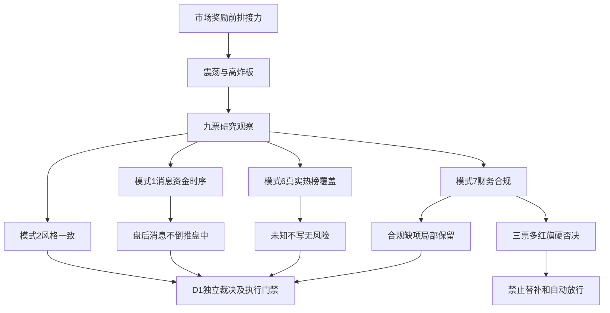

# 2026年11月10日 · 反证 / Devil’s Advocate

> 数据源新鲜度：partial　｜　降级：是　｜　置信度：0.392

## 一句话结论

拦截西部材料、东方嘉盛、冰山冷热；9票局部已审，必要审核完整0票，缺席不投否决票。

## 详细分析

市场先于个股。情绪=震荡，炸板率44.90%；上涨家数少于下跌、成交缩量，前涨停反馈转正但开盘至收盘反馈有限。市场付钱给前排隔夜接力，不等于普涨追价。R2已将18只研究对象减半至9只，本轮不再次机械砍半，也不因硬否决递补票。R1研究总仓上限35%只是市场意见、竞价和新证据后必须重评，最迟开盘失效；它不是账户硬预算，更不是R6开仓授权。

主线 = 人形机器人，持续性 = 1日，封板率 = 50%，明日预期 = 分歧。主线 = 商业航天/太空算力，持续性 = 1日，封板率 = 56%，明日预期 = 分歧。这里的1日是R2已核截面，不是已认证轮次年龄。冰雪只是次线对照，不能将历史股性和制冷业务标签变成完整消息确认。

23项财务红旗已用本版R5真实输入重算。西部命中4条，东方嘉盛和冰山冷热各5条，沿用既有“至少4条即hard_reject”，不新增阈值。西部F3只说明应收增速超过负营收增速乘1.5的机械判据，应收并非暴增；东方的应收和库存绝对规模下降，也不能写成绝对暴增。冰山关联购销为半年报，其他主要为三季报，期间分别保留，不拼成同一期间比率。

必要审核覆盖与否决分开。模式2九票全部完成；模式1六票完成时间轴/主题映射比较，冰雪三票仍缺R4消息；模式6只有宇树、顺灏、冰山在声明的双端点窗口完整未命中，另六票未知；模式7九票当前合规都未完成，宇树原审计另缺可读文本。未完成不是禁买，也不是通过；已证硬否决不因其他分支缺证被抹掉。

R7只精确覆盖雪人和冰山；其余使用同版R5已核资金价格，而不是要求某个provider或owner标签。分档计算和东财统计并列，不相加；R5和R7重复的东财记录只算同一底层观察。盘后星云发布及上纬警告不能由前一交易日盘中价量证明事后反应，更不能从净流入推定已排除出货。

## 审核覆盖与关键证据

| 必要模式 | 已完成 | 未完成 | 边界 |
|---|---:|---:|---|
| 1 消息×资金价格 | 6 | 3 | 完成表示已做时序/映射比较，不代表盘后消息后的资金确认 |
| 2 风格一致性 | 9 | 0 | 震荡、减半、观察资格一致；不发买权 |
| 6 出货风险 | 3 | 6 | 阴性只限声明谓词/端点；未知不是false |
| 7 财务合规 | 0 | 9 | 财务已算；S2/S3实际覆盖未闭环，宇树F12另缺原文 |

| 对象 | 财务红旗 | 财务规则结论 | 态度 |
|---|---|---|---|
| 上纬新材 688585.SH | F4 | soft_suggest | 观察 |
| 宇树科技 688836.SH | F4 | soft_suggest | 观察 |
| 锋龙股份 002931.SZ | F6 | soft_suggest | 观察 |
| 西部材料 002149.SZ | F3,F4,F6,F9 | hard_reject | 拦截 |
| 顺灏股份 002565.SZ | F3,F4 | strong_suggest | 降级 |
| 中科星图 688568.SH | F3,F4,F9 | strong_suggest | 降级 |
| 东方嘉盛 002889.SZ | F1,F3,F4,F6,F9 | hard_reject | 拦截 |
| 冰山冷热 000530.SZ | F3,F4,F6,F7,F9 | hard_reject | 拦截 |
| 雪人集团 002639.SZ | F9 | soft_suggest | 观察 |

硬否决出口：仅禁止进入execution_pool，可保留研究观察。龙一被否后不得升位龙二、弹性核心或低位票；空池是合法结果。研究窗口到期开盘不自动解除已成立的财务硬否决，须原证据纠错/更新及正式重评。R6不更改现有池身份、预算、买卖点、T+1、人工确认或执行权限。

### 原文证据与方法

- 上纬原公告：“终端市场需求是否具备可持续性尚待验证”；“消费级具身智能机器人实现营业收入占公司总营业收入比例较低”。来源：R4#/evidence_registry/D_ann_447。其全文已嵌入本版JSON，仅代表所见两页，原PDF未另行打开。
- 冰山原监管决定：“2022年至2024年……下半年取得客户验收单，但在年中不定期部分确认收入”。来源：R5#/profiles/7/embedded_evidence/statutory_documents_selected_pages/3。责令改正/监管谈话有实质负面，但所见材料不自动等于立案、重大违法或财务造假终局认定。
- 东方原公告：“前期未及时履行关联交易审议程序及信息披露义务，现予以正式补充审议”。来源：R5#/profiles/6/embedded_evidence/statutory_documents_selected_pages/3。补审不是从未违规，不把获批额度当实际交易。
- 西部原自查披露天力复合监管措施，并称“上述事项属于行政监管措施与自律监管措施范畴，不属于行政处罚，不构成重大违法违规行为”。来源：R5#/profiles/3/embedded_evidence/statutory_documents_selected_pages/3。该主体声明边界与监管事实一并保留，不升级为全域合规阴性。

## 风险传导图

## 逐票实质审查

以下“买入理由”仅复述被审主张，不是R6买入意见；没有推荐票。实质判断按四类必要模式分别给出，不将覆盖数量当安全数量。

### 上纬新材 688585.SH · 观察

**买入理由（受审主张）**：R2将其列为人形机器人的龙头，依据是T-1机器人弹性、人气核心；20cm首板、33.25亿元成交，R3产业叙事及R4万台下线均有对应；不将下线当交付。早盘已有多票封板，不能把本票当全板唯一启动者。 本轮仅研究观察，不授予执行资格。

**大资金意图 / 为什么走强 / 逻辑够不够硬**：万台下线与需求警告同时存在；T-1首板涨19.9978%、当日两口径净流入，支持已交易热度，不支持销量或盈利兑现。19:48风险警告晚于收盘，不能把收盘资金写成该警告后的承接；此项完成的是消息、价格与资金时间轴比较，不是T0反应确认。 净流入为已核统计事实，不足以断言资金主观意图；生产公告和经营风险公告均为硬披露，独立于行情但属于同一公司信息面；下线并非交付，机器人收入占比仍低。

**风险点**：量产与收入脱节且PB/PS位于已返历史样本高端；公告1767.36倍PE截至11月6日，与R5当前亏损口径PE为空不是同日同口径，不将其均值化或择优使用。 前三季归母亏损4.22亿、扣非亏损4.25亿；存货同比上升114.46%且周转下降，扩产需求兑现风险实质存在。 资金方面：近5日分档自算2.8644亿，东财2.7910亿；同日偏差超过5%，两口径并列，筹码置信度降低，不能择优使用。

**止损条件 / 可验证假设**：R6不新设价位；RR=None、止损距=None，均为未知。验证依靠后续真实订单/交付/回款、承接与原owner补证；财务硬否决不得以低吸或分歧买点覆盖。禁止清单尚未完整核查，不称无命中；完整龙头认定仅2条有据。

模式1：完成。万台下线与需求警告同时存在；T-1首板涨19.9978%、当日两口径净流入，支持已交易热度，不支持销量或盈利兑现。19:48风险警告晚于收盘，不能把收盘资金写成该警告后的承接；此项完成的是消息、价格与资金时间轴比较，不是T0反应确认。

依据：R2#/main_lines/0/leaders/0；R5#/profiles/0/dimensions/chip_structure/fund_series；R5#/profiles/0/dimensions/chip_structure/price_observations；R4#/top_events/2；R4#/top_events/9；R4#/top_events/16

模式2：完成。R1震荡分化型、炸板44.90%要求候选减半；R2本票为龙头、execution_eligible=false且RR未知，仅观察。R2已18减至9，未把两条进攻研究主线写成开仓许可；两者不存在已证实的防御/进攻授权冲突。人形机器人仍只认证1日截面，不冒充主升。

依据：R1#/market_assessment；R1#/summary；R2#/main_lines/0/leaders/0；R2#/candidate_reduction

模式6：未完成。R3明确unknown，已知平台局部阴性予以保留，不能合并成完整false；未形成高置信板块出货alert，不能凭热度或5日净流入排除出货。当前不形成模式6硬否决。

依据：R2#/main_lines/0/leaders/0；R3#/hotlist_signals/distribution_alert_checks/30

缺项及回送：R3：本票缺至少一个榜端点，distribution_alert为null；需原owner补范围内真实检查结果。

模式7：未完成。已按R5真实输入逐项重算，确认F4；沿用模式7原阈值为soft_suggest。前三季归母亏损4.22亿、扣非亏损4.25亿；存货同比上升114.46%且周转下降，扩产需求兑现风险实质存在。 S2/S3尚缺有限监管来源实际覆盖回执与风险原文闭环，不能以空flags/盈利/年度无保留冒充当前合规安全。FY2025原审计的已核结果不扩大到未来/全部监管范围。

依据：R2#/main_lines/0/leaders/0；R5#/profiles/0/dimensions/valuation_safety/fundamental_checks；R5#/profiles/0/dimensions/valuation_safety/compliance_scope；R5#/profiles/0/embedded_evidence/statutory_documents_selected_pages

缺项及回送：R5/R4：S2/S3有限来源、当前窗口覆盖回执及命中原文核验仍未完成。

本票反证处理：

- R6_M7_01 / soft_suggest：观察 — 记入r6_soft_notes，不把本项当买权或全局停买。限定：采用已签原阈值：1条soft，2—3条或单P0 strong，至少4条hard；F12与S2/S3实锤另独立判断；负收入增长下F3/F4按原比例规则保留；机械触发不改写为应收/存货绝对暴增；关键合规缺口仍为未完成；不抹去已经成立的财务硬否决
- R6_M1_01 / strong_suggest：降级 — 明确处理需求/收入风险；不得把分歧买点当商业化证伪的豁免。限定：T-1资金不是19:48风险警告后的反应；本项不是已证出货；后续订单/交付/回款原文可改变产业假设；不由R6补抓
- R6_M3_01 / soft_suggest：观察 — 披露估值和增长假设缺口，不造PEG、目标价或三年分位；不能仅因价格高新增hard_reject。限定：10大估值陷阱未全核，不以贵替代既有陷阱检出条件；上纬原公告PE与当前R5 PE时点/统计源不同，不互相覆盖

### 宇树科技 688836.SH · 观察

**买入理由（受审主张）**：R2将其列为人形机器人的龙二，依据是R3热股35→2；T-1上涨9.0433%，是本体人气对照，不因688前缀拒绝；未涨停，不冒充高度龙。 本轮仅研究观察，不授予执行资格。

**大资金意图 / 为什么走强 / 逻辑够不够硬**：T-1涨9.0433%但高点759.99回至716、未封板；5日两口径净额为正但每日有反向。R4物理AI工具发布仅是板块叙事，未直接认证宇树新增订单。人气跃升不等同独立公司催化，未将上纬公告迁移为宇树订单。 净流入为已核统计事实，不足以断言资金主观意图；前三季收入18.17亿、同比约55.66%是报表事实，但PE约516.63倍对持续增长要求极高；不能用总主题叙事证明本票订单。

**风险点**：PE516.6347倍、PS123.2604倍使延续增长要求很高，但无一致预期不能造PEG；上市仅53个正样本不认证三年估值分位。 存货同比上升266.63%、周转下降；扣非占比未触F6，现金转化与资本化仍须分期核实。 资金方面：近5日分档自算1.1595亿，东财1.2558亿；同日偏差超过5%，两口径并列，筹码置信度降低，不能择优使用。

**止损条件 / 可验证假设**：R6不新设价位；RR=None、止损距=None，均为未知。验证依靠后续真实订单/交付/回款、承接与原owner补证；财务硬否决不得以低吸或分歧买点覆盖。禁止清单尚未完整核查，不称无命中；完整龙头认定仅2条有据。

模式1：完成。T-1涨9.0433%但高点759.99回至716、未封板；5日两口径净额为正但每日有反向。R4物理AI工具发布仅是板块叙事，未直接认证宇树新增订单。人气跃升不等同独立公司催化，未将上纬公告迁移为宇树订单。

依据：R2#/main_lines/0/leaders/1；R5#/profiles/1/dimensions/chip_structure/fund_series；R5#/profiles/1/dimensions/chip_structure/price_observations；R4#/top_events/6

模式2：完成。R1震荡分化型、炸板44.90%要求候选减半；R2本票为龙二、execution_eligible=false且RR未知，仅观察。R2已18减至9，未把两条进攻研究主线写成开仓许可；两者不存在已证实的防御/进攻授权冲突。人形机器人仍只认证1日截面，不冒充主升。

依据：R1#/market_assessment；R1#/summary；R2#/main_lines/0/leaders/1；R2#/candidate_reduction

模式6：完成。R3两平台精确代码、11月6日与9日末次榜端点已查，未命中连续top1。完成仅限该谓词和窗口；不是无任何出货风险，也没有板块级全域阴性。R2未授执行资格；模式6硬条件未形成。

依据：R2#/main_lines/0/leaders/1；R3#/hotlist_signals/distribution_alert_checks/32

模式7：未完成。已按R5真实输入逐项重算，确认F4；沿用模式7原阈值为soft_suggest。存货同比上升266.63%、周转下降；扣非占比未触F6，现金转化与资本化仍须分期核实。 S2/S3尚缺有限监管来源实际覆盖回执与风险原文闭环，不能以空flags/盈利/年度无保留冒充当前合规安全。宇树F12扫描原文不可读也未完成。

依据：R2#/main_lines/0/leaders/1；R5#/profiles/1/dimensions/valuation_safety/fundamental_checks；R5#/profiles/1/dimensions/valuation_safety/compliance_scope；R5#/profiles/1/embedded_evidence/statutory_documents_selected_pages

缺项及回送：R5/R4：S2/S3有限来源、当前窗口覆盖回执及命中原文核验仍未完成；R5：FY2025审计原文含强调事项的可读证据未完成（仅结构化意见不能替代）。

本票反证处理：

- R6_M7_02 / soft_suggest：观察 — 记入r6_soft_notes，不把本项当买权或全局停买。限定：采用已签原阈值：1条soft，2—3条或单P0 strong，至少4条hard；F12与S2/S3实锤另独立判断；负收入增长下F3/F4按原比例规则保留；机械触发不改写为应收/存货绝对暴增；关键合规缺口仍为未完成；不抹去已经成立的财务硬否决
- R6_M3_02 / soft_suggest：观察 — 披露估值和增长假设缺口，不造PEG、目标价或三年分位；不能仅因价格高新增hard_reject。限定：10大估值陷阱未全核，不以贵替代既有陷阱检出条件；上纬原公告PE与当前R5 PE时点/统计源不同，不互相覆盖

### 锋龙股份 002931.SZ · 观察

**买入理由（受审主张）**：R2将其列为人形机器人的龙三，依据是原锚定分86.3；T-1普通10cm涨停，10.77%换手，沪深同权；作为情绪通道比较对象，锚定分不代替最新地位。 本轮仅研究观察，不授予执行资格。

**大资金意图 / 为什么走强 / 逻辑够不够硬**：T-1涨停、5日两口径净流入与机器人主题修复方向并不矛盾；R4基地/产能消息不直接点名本票，不可将历史优必选股权锚变成今日订单。当前为龙三对照，历史12板不构成本轮总龙或替补资格。 净流入为已核统计事实，不足以断言资金主观意图；历史涨停58次、最高12板只说明股性；前三季扣非为负，原龙头认定2条不构成充分认证。

**风险点**：归母盈利主要靠非经常项，扣非亏损；历史高股性不能纠正本轮龙三与逻辑兑现缺口。 前三季归母约1852.51万元、扣非约-528.55万元，非经常损益/净利润约128.53%，F6命中。 资金方面：近5日分档自算1.9738亿，东财1.9547亿；同日偏差超过5%，两口径并列，筹码置信度降低，不能择优使用。

**止损条件 / 可验证假设**：R6不新设价位；RR=None、止损距=None，均为未知。验证依靠后续真实订单/交付/回款、承接与原owner补证；财务硬否决不得以低吸或分歧买点覆盖。禁止清单尚未完整核查，不称无命中；完整龙头认定仅2条有据。

模式1：完成。T-1涨停、5日两口径净流入与机器人主题修复方向并不矛盾；R4基地/产能消息不直接点名本票，不可将历史优必选股权锚变成今日订单。当前为龙三对照，历史12板不构成本轮总龙或替补资格。

依据：R2#/main_lines/0/leaders/2；R5#/profiles/2/dimensions/chip_structure/fund_series；R5#/profiles/2/dimensions/chip_structure/price_observations；R4#/top_events/6

模式2：完成。R1震荡分化型、炸板44.90%要求候选减半；R2本票为龙三、execution_eligible=false且RR未知，仅观察。R2已18减至9，未把两条进攻研究主线写成开仓许可；两者不存在已证实的防御/进攻授权冲突。人形机器人仍只认证1日截面，不冒充主升。

依据：R1#/market_assessment；R1#/summary；R2#/main_lines/0/leaders/2；R2#/candidate_reduction

模式6：未完成。R3显式已查对象无本票，不能从未列alert推断false；002086.SZ的单票警报无sector_id，不得移植本票/本板块。R2研究资格不因缺席被否，但模式6必要项未完成。

依据：R2#/main_lines/0/leaders/2；R3#/hotlist_signals/distribution_alert_checks

缺项及回送：R3：本票不在显式distribution_alert_checks范围内；空alert命中列表不是false。

模式7：未完成。已按R5真实输入逐项重算，确认F6；沿用模式7原阈值为soft_suggest。前三季归母约1852.51万元、扣非约-528.55万元，非经常损益/净利润约128.53%，F6命中。 S2/S3尚缺有限监管来源实际覆盖回执与风险原文闭环，不能以空flags/盈利/年度无保留冒充当前合规安全。FY2025原审计的已核结果不扩大到未来/全部监管范围。

依据：R2#/main_lines/0/leaders/2；R5#/profiles/2/dimensions/valuation_safety/fundamental_checks；R5#/profiles/2/dimensions/valuation_safety/compliance_scope；R5#/profiles/2/embedded_evidence/statutory_documents_selected_pages

缺项及回送：R5/R4：S2/S3有限来源、当前窗口覆盖回执及命中原文核验仍未完成。

本票反证处理：

- R6_M7_03 / soft_suggest：观察 — 记入r6_soft_notes，不把本项当买权或全局停买。限定：采用已签原阈值：1条soft，2—3条或单P0 strong，至少4条hard；F12与S2/S3实锤另独立判断；负收入增长下F3/F4按原比例规则保留；机械触发不改写为应收/存货绝对暴增；关键合规缺口仍为未完成；不抹去已经成立的财务硬否决

### 西部材料 002149.SZ · 拦截

**买入理由（受审主张）**：R2将其列为商业航天/太空算力的龙头，依据是太空算力钛材细分T-1最早封板09:30、无开板、流通202.63亿；比只沾大概念的2板润贝映射更直接，龙一限定该细分而非整张511成分高度榜。 本轮仅研究观察，不授予执行资格。

**大资金意图 / 为什么走强 / 逻辑够不够硬**：T-1开盘即封、5日两口径连续净流入属真实交易事实；R4星云发布记录在16:14，晚于收盘，不能因本票早封倒推该新闻的先验因果。钛材受益仍是R2主题映射而非R4核实订单，资金强不抵消4条财务红旗。 净流入为已核统计事实，不足以断言资金主观意图；细分映射与最早封板可核；星云新闻16:14晚于昨日收盘，不能倒推该新闻驱动早盘。订单、利润弹性仍是假设。

**风险点**：早封低换手限制可成交性；不是高度本身否决，硬否决来自经重算的F3/F4/F6/F9。F3应收只增0.1684%而非暴增，负营收基数机械触发须完整披露，原阈值不改。 应收/营收73.22%、非经常损益占比40.13%，存货增长且周转下降；F3负收入增长基数的机械触发需保留解释。 资金方面：近5日分档自算6.5239亿，东财6.4749亿；同日偏差超过5%，两口径并列，筹码置信度降低，不能择优使用。

**止损条件 / 可验证假设**：R6不新设价位；RR=None、止损距=None，均为未知。验证依靠后续真实订单/交付/回款、承接与原owner补证；财务硬否决不得以低吸或分歧买点覆盖。禁止清单尚未完整核查，不称无命中；完整龙头认定仅2条有据。

模式1：完成。T-1开盘即封、5日两口径连续净流入属真实交易事实；R4星云发布记录在16:14，晚于收盘，不能因本票早封倒推该新闻的先验因果。钛材受益仍是R2主题映射而非R4核实订单，资金强不抵消4条财务红旗。

依据：R2#/main_lines/1/leaders/0；R5#/profiles/3/dimensions/chip_structure/fund_series；R5#/profiles/3/dimensions/chip_structure/price_observations；R4#/top_events/3

模式2：完成。R1震荡分化型、炸板44.90%要求候选减半；R2本票为龙头、execution_eligible=false且RR未知，仅观察。R2已18减至9，未把两条进攻研究主线写成开仓许可；两者不存在已证实的防御/进攻授权冲突。商业航天/太空算力仍只认证1日截面，不冒充主升。

依据：R1#/market_assessment；R1#/summary；R2#/main_lines/1/leaders/0；R2#/candidate_reduction

模式6：未完成。R3明确unknown，已知平台局部阴性予以保留，不能合并成完整false；未形成高置信板块出货alert，不能凭热度或5日净流入排除出货。当前不形成模式6硬否决。

依据：R2#/main_lines/1/leaders/0；R3#/hotlist_signals/distribution_alert_checks/5

缺项及回送：R3：本票缺至少一个榜端点，distribution_alert为null；需原owner补范围内真实检查结果。

模式7：未完成。已按R5真实输入逐项重算，确认F3,F4,F6,F9；沿用模式7原阈值为hard_reject。应收/营收73.22%、非经常损益占比40.13%，存货增长且周转下降；F3负收入增长基数的机械触发需保留解释。 S2/S3尚缺有限监管来源实际覆盖回执与风险原文闭环，不能以空flags/盈利/年度无保留冒充当前合规安全。FY2025原审计的已核结果不扩大到未来/全部监管范围。

依据：R2#/main_lines/1/leaders/0；R5#/profiles/3/dimensions/valuation_safety/fundamental_checks；R5#/profiles/3/dimensions/valuation_safety/compliance_scope；R5#/profiles/3/embedded_evidence/statutory_documents_selected_pages

缺项及回送：R5/R4：S2/S3有限来源、当前窗口覆盖回执及命中原文核验仍未完成。

本票反证处理：

- R6_M7_04 / hard_reject：hard_reject — 禁止纳入execution_pool；可留研究观察，禁止龙二/弹性/低位递补。限定：采用已签原阈值：1条soft，2—3条或单P0 strong，至少4条hard；F12与S2/S3实锤另独立判断；负收入增长下F3/F4按原比例规则保留；机械触发不改写为应收/存货绝对暴增；关键合规缺口仍为未完成；不抹去已经成立的财务硬否决
- R6_M1_02 / soft_suggest：观察 — 分离早盘资金事实与盘后消息，等待D1用新承接重评；不按本条扩大硬否决。限定：不是证明消息无效或资金出货；仅否定倒置因果及收入等同；西部既有模式7硬否决独立有效，不能靠新热点覆盖
- R6_M7_10 / strong_suggest：降级 — 保留具体违规和整改未闭环；不据监管措施/补审自动认定立案、重大违法或财务造假。限定：所读是本版R5内嵌的原文页，不联网也未打开原PDF；此条不另造S2硬否决；已成立的多财务红旗hard_reject完整保留

### 顺灏股份 002565.SZ · 降级

**买入理由（受审主张）**：R2将其列为商业航天/太空算力的龙二，依据是R3热度同花顺83→38、东财99→10；T-1首封09:30:06、零开板、4/8强势，太空算力题材辨识优于泛成分。 本轮仅研究观察，不授予执行资格。

**大资金意图 / 为什么走强 / 逻辑够不够硬**：T-1早封与5日两口径正净额证明已有先手交易；R4星云发布晚于收盘且未直接认证本票合同或持股比例，不能把太空云注册资本换算本票收入。资金净流入与前三季亏损可同时成立。 净流入为已核统计事实，不足以断言资金主观意图；主题关系与交易强度可追溯，前三季净亏损、扣非亦负，订单与收入转化未证实。

**风险点**：营收下滑而应收和库存增加、周转下降；不能由资金正额推成报表改善。西部被硬否后本龙二不得升位递补。 前三季营收同比下降约11.06%，归母与扣非亏损；应收、库存与收入增速比较均触发原软红旗。 资金方面：近5日分档自算6.9662亿，东财6.9239亿；同日差异未超5%，同通道不同统计口径不重复加权。

**止损条件 / 可验证假设**：R6不新设价位；RR=None、止损距=None，均为未知。验证依靠后续真实订单/交付/回款、承接与原owner补证；财务硬否决不得以低吸或分歧买点覆盖。禁止清单尚未完整核查，不称无命中；完整龙头认定仅2条有据。

模式1：完成。T-1早封与5日两口径正净额证明已有先手交易；R4星云发布晚于收盘且未直接认证本票合同或持股比例，不能把太空云注册资本换算本票收入。资金净流入与前三季亏损可同时成立。

依据：R2#/main_lines/1/leaders/1；R5#/profiles/4/dimensions/chip_structure/fund_series；R5#/profiles/4/dimensions/chip_structure/price_observations；R4#/top_events/3

模式2：完成。R1震荡分化型、炸板44.90%要求候选减半；R2本票为龙二、execution_eligible=false且RR未知，仅观察。R2已18减至9，未把两条进攻研究主线写成开仓许可；两者不存在已证实的防御/进攻授权冲突。商业航天/太空算力仍只认证1日截面，不冒充主升。

依据：R1#/market_assessment；R1#/summary；R2#/main_lines/1/leaders/1；R2#/candidate_reduction

模式6：完成。R3两平台精确代码、11月6日与9日末次榜端点已查，未命中连续top1。完成仅限该谓词和窗口；不是无任何出货风险，也没有板块级全域阴性。R2未授执行资格；模式6硬条件未形成。

依据：R2#/main_lines/1/leaders/1；R3#/hotlist_signals/distribution_alert_checks/10

模式7：未完成。已按R5真实输入逐项重算，确认F3,F4；沿用模式7原阈值为strong_suggest。前三季营收同比下降约11.06%，归母与扣非亏损；应收、库存与收入增速比较均触发原软红旗。 S2/S3尚缺有限监管来源实际覆盖回执与风险原文闭环，不能以空flags/盈利/年度无保留冒充当前合规安全。FY2025原审计的已核结果不扩大到未来/全部监管范围。

依据：R2#/main_lines/1/leaders/1；R5#/profiles/4/dimensions/valuation_safety/fundamental_checks；R5#/profiles/4/dimensions/valuation_safety/compliance_scope；R5#/profiles/4/embedded_evidence/statutory_documents_selected_pages

缺项及回送：R5/R4：S2/S3有限来源、当前窗口覆盖回执及命中原文核验仍未完成。

本票反证处理：

- R6_M7_05 / strong_suggest：降级 — D1须明确接受或在meta.d1_override记录覆盖理由；不得因龙一风险而递补本票。限定：采用已签原阈值：1条soft，2—3条或单P0 strong，至少4条hard；F12与S2/S3实锤另独立判断；负收入增长下F3/F4按原比例规则保留；机械触发不改写为应收/存货绝对暴增；关键合规缺口仍为未完成；不抹去已经成立的财务硬否决
- R6_M1_03 / soft_suggest：观察 — 分离早盘资金事实与盘后消息，等待D1用新承接重评；不按本条扩大硬否决。限定：不是证明消息无效或资金出货；仅否定倒置因果及收入等同；西部既有模式7硬否决独立有效，不能靠新热点覆盖

### 中科星图 688568.SH · 降级

**买入理由（受审主张）**：R2将其列为商业航天/太空算力的龙三，依据是R4 E001直接列星云产业发起主体；T-1+2.5345%，新事件映射与市场核心并行比较。非因为旧名单缺席而排除。 本轮仅研究观察，不授予执行资格。

**大资金意图 / 为什么走强 / 逻辑够不够硬**：R4直接列为星云产业发起主体，但注册资本15亿元不等于实缴或订单。T-1仅涨2.5345%、收盘31.96低于开盘32.4，5日净额约0.15亿；发布在16:14，既不能倒推盘中已确认，也不能用盘中较弱表现宣称发布后失败。 净流入为已核统计事实，不足以断言资金主观意图；中科星云发起主体为直接报道事实；15亿注册资本不等于实缴、合同或收入，事件在T-1收盘后发布。

**风险点**：直接事件关系优于泛概念，但营收骤降、亏损与应收/收入230.72%形成落地约束；不能因直接主体身份替补被否龙一。 前三季收入同比降64.66%、归母亏损4.91亿、CFO-7.10亿，应收/收入230.72%，现金回笼与订单兑现是主要反证。 资金方面：近5日分档自算0.1564亿，东财0.1488亿；同日偏差超过5%，两口径并列，筹码置信度降低，不能择优使用。

**止损条件 / 可验证假设**：R6不新设价位；RR=None、止损距=None，均为未知。验证依靠后续真实订单/交付/回款、承接与原owner补证；财务硬否决不得以低吸或分歧买点覆盖。禁止清单尚未完整核查，不称无命中；完整龙头认定仅1条有据。

模式1：完成。R4直接列为星云产业发起主体，但注册资本15亿元不等于实缴或订单。T-1仅涨2.5345%、收盘31.96低于开盘32.4，5日净额约0.15亿；发布在16:14，既不能倒推盘中已确认，也不能用盘中较弱表现宣称发布后失败。

依据：R2#/main_lines/1/leaders/2；R5#/profiles/5/dimensions/chip_structure/fund_series；R5#/profiles/5/dimensions/chip_structure/price_observations；R4#/top_events/3

模式2：完成。R1震荡分化型、炸板44.90%要求候选减半；R2本票为龙三、execution_eligible=false且RR未知，仅观察。R2已18减至9，未把两条进攻研究主线写成开仓许可；两者不存在已证实的防御/进攻授权冲突。商业航天/太空算力仍只认证1日截面，不冒充主升。

依据：R1#/market_assessment；R1#/summary；R2#/main_lines/1/leaders/2；R2#/candidate_reduction

模式6：未完成。R3显式已查对象无本票，不能从未列alert推断false；002086.SZ的单票警报无sector_id，不得移植本票/本板块。R2研究资格不因缺席被否，但模式6必要项未完成。

依据：R2#/main_lines/1/leaders/2；R3#/hotlist_signals/distribution_alert_checks

缺项及回送：R3：本票不在显式distribution_alert_checks范围内；空alert命中列表不是false。

模式7：未完成。已按R5真实输入逐项重算，确认F3,F4,F9；沿用模式7原阈值为strong_suggest。前三季收入同比降64.66%、归母亏损4.91亿、CFO-7.10亿，应收/收入230.72%，现金回笼与订单兑现是主要反证。 S2/S3尚缺有限监管来源实际覆盖回执与风险原文闭环，不能以空flags/盈利/年度无保留冒充当前合规安全。FY2025原审计的已核结果不扩大到未来/全部监管范围。

依据：R2#/main_lines/1/leaders/2；R5#/profiles/5/dimensions/valuation_safety/fundamental_checks；R5#/profiles/5/dimensions/valuation_safety/compliance_scope；R5#/profiles/5/embedded_evidence/statutory_documents_selected_pages

缺项及回送：R5/R4：S2/S3有限来源、当前窗口覆盖回执及命中原文核验仍未完成。

本票反证处理：

- R6_M7_06 / strong_suggest：降级 — D1须明确接受或在meta.d1_override记录覆盖理由；不得因龙一风险而递补本票。限定：采用已签原阈值：1条soft，2—3条或单P0 strong，至少4条hard；F12与S2/S3实锤另独立判断；负收入增长下F3/F4按原比例规则保留；机械触发不改写为应收/存货绝对暴增；关键合规缺口仍为未完成；不抹去已经成立的财务硬否决
- R6_M1_04 / soft_suggest：观察 — 分离早盘资金事实与盘后消息，等待D1用新承接重评；不按本条扩大硬否决。限定：不是证明消息无效或资金出货；仅否定倒置因果及收入等同；西部既有模式7硬否决独立有效，不能靠新热点覆盖

### 东方嘉盛 002889.SZ · 拦截

**买入理由（受审主张）**：R2将其列为冰雪产业的龙头，依据是本轮冰雪成分最高2板并列，首封09:30早于龙江09:30:04，零开板，原锚TOP3；只是62成分身位研究排序，不认证全市场总龙。 本轮仅研究观察，不授予执行资格。

**大资金意图 / 为什么走强 / 逻辑够不够硬**：R7未覆盖，R5已核两板与5日净额为正；但R4本批没有冰雪/本票可核消息分支，冷链物流标签不能自行补出冰雪订单。价格资金审查保留，资金与消息交叉仍未完成，交R4补对象关联和原文。 净流入为已核统计事实，不足以断言资金主观意图；两板高度和板块扩散是交易事实，冰雪直接收入尚未核；归母利润主要来自非经常损益。

**风险点**：两板身位无法抵消存贷双高及利润非经常化；冰雪收入尚未认证。收入下滑时应收和库存其实下降，F3/F4为原比例规则触发，不写资产规模暴增。 F1存贷双高：货币资金/资产25.72%、短借/资产28.81%；F6非经常占比82.28%；同窗收入下滑与应收占比高。 2026-027原公告承认关联交易未及时履行审议与披露义务；补审不等于从未违规。 资金方面：近5日分档自算2.2277亿，东财2.1979亿；同日偏差超过5%，两口径并列，筹码置信度降低，不能择优使用。

**止损条件 / 可验证假设**：R6不新设价位；RR=None、止损距=None，均为未知。验证依靠后续真实订单/交付/回款、承接与原owner补证；财务硬否决不得以低吸或分歧买点覆盖。禁止清单尚未完整核查，不称无命中；完整龙头认定仅2条有据。

模式1：未完成。R7未覆盖，R5已核两板与5日净额为正；但R4本批没有冰雪/本票可核消息分支，冷链物流标签不能自行补出冰雪订单。价格资金审查保留，资金与消息交叉仍未完成，交R4补对象关联和原文。

依据：R2#/secondary_lines/0/leaders/0；R5#/profiles/6/dimensions/chip_structure/fund_series；R5#/profiles/6/dimensions/chip_structure/price_observations

缺项及回送：R4：本票/本板块可核消息、对象关联及原文；已有资金价格不等于消息审查已完成。

模式2：完成。R1震荡分化型、炸板44.90%要求候选减半；R2本票为龙头、execution_eligible=false且RR未知，仅观察。R2已18减至9，未把两条进攻研究主线写成开仓许可；两者不存在已证实的防御/进攻授权冲突。冰雪产业仍只认证1日截面，不冒充主升。

依据：R1#/market_assessment；R1#/summary；R2#/secondary_lines/0/leaders/0；R2#/candidate_reduction

模式6：未完成。R3显式已查对象无本票，不能从未列alert推断false；002086.SZ的单票警报无sector_id，不得移植本票/本板块。R2研究资格不因缺席被否，但模式6必要项未完成。

依据：R2#/secondary_lines/0/leaders/0；R3#/hotlist_signals/distribution_alert_checks

缺项及回送：R3：本票不在显式distribution_alert_checks范围内；空alert命中列表不是false。

模式7：未完成。已按R5真实输入逐项重算，确认F1,F3,F4,F6,F9；沿用模式7原阈值为hard_reject。F1存贷双高：货币资金/资产25.72%、短借/资产28.81%；F6非经常占比82.28%；同窗收入下滑与应收占比高。 2026-027原公告承认关联交易未及时履行审议与披露义务；补审不等于从未违规。 S2/S3尚缺有限监管来源实际覆盖回执与风险原文闭环，不能以空flags/盈利/年度无保留冒充当前合规安全。FY2025原审计的已核结果不扩大到未来/全部监管范围。

依据：R2#/secondary_lines/0/leaders/0；R5#/profiles/6/dimensions/valuation_safety/fundamental_checks；R5#/profiles/6/dimensions/valuation_safety/compliance_scope；R5#/profiles/6/embedded_evidence/statutory_documents_selected_pages

缺项及回送：R5/R4：S2/S3有限来源、当前窗口覆盖回执及命中原文核验仍未完成。

本票反证处理：

- R6_M7_07 / hard_reject：hard_reject — 禁止纳入execution_pool；可留研究观察，禁止龙二/弹性/低位递补。限定：采用已签原阈值：1条soft，2—3条或单P0 strong，至少4条hard；F12与S2/S3实锤另独立判断；负收入增长下F3/F4按原比例规则保留；机械触发不改写为应收/存货绝对暴增；关键合规缺口仍为未完成；不抹去已经成立的财务硬否决
- R6_M7_11 / strong_suggest：降级 — 保留具体违规和整改未闭环；不据监管措施/补审自动认定立案、重大违法或财务造假。限定：所读是本版R5内嵌的原文页，不联网也未打开原PDF；此条不另造S2硬否决；已成立的多财务红旗hard_reject完整保留

### 冰山冷热 000530.SZ · 拦截

**买入理由（受审主张）**：R2将其列为冰雪产业的龙二，依据是冰雪原锚TOP1，T-1首板09:32:21零开板、14.8%换手，五日四个上榜日提供交易活跃证据；优先于未涨停的旧锚冰轮。 本轮仅研究观察，不授予执行资格。

**大资金意图 / 为什么走强 / 逻辑够不够硬**：R7精确本票东财5日+4.343184亿元，与R5同口径一致；xTick逐日另列不可相加。业务映射较物流直接，但R4本批没有冰雪消息核验；不能据资金榜认定新增需求。模式1消息分支未完成，不撤销已证财务硬否决。 净流入为已核统计事实，不足以断言资金主观意图；制冷业务映射比物流标签直接，但收入净利下滑、应收偏高；没有独立新增大订单认证。

**风险点**：历史冰雪锚与T-1强势不能抵消5项财务红旗；F7来自2026H1，其他主要为Q3，均为已披露不同检查窗口，不能拼成同一期间比率。 前三季净利同比降32.38%，非经常占比36.70%、应收/营收55.40%；PE/PB/PS均处样本高位。 新核H1关联购销/收入下界20.94%命中F7；2026年3月监管决定涉及收入确认和治理，整改闭环未核。 资金方面：近5日分档自算4.4483亿，东财4.3432亿；同日差异未超5%，同通道不同统计口径不重复加权。

**止损条件 / 可验证假设**：R6不新设价位；RR=None、止损距=None，均为未知。验证依靠后续真实订单/交付/回款、承接与原owner补证；财务硬否决不得以低吸或分歧买点覆盖。禁止清单尚未完整核查，不称无命中；完整龙头认定仅2条有据。

模式1：未完成。R7精确本票东财5日+4.343184亿元，与R5同口径一致；xTick逐日另列不可相加。业务映射较物流直接，但R4本批没有冰雪消息核验；不能据资金榜认定新增需求。模式1消息分支未完成，不撤销已证财务硬否决。

依据：R2#/secondary_lines/0/leaders/1；R5#/profiles/7/dimensions/chip_structure/fund_series；R5#/profiles/7/dimensions/chip_structure/price_observations；R7#/stock_flows/9

缺项及回送：R4：本票/本板块可核消息、对象关联及原文；已有资金价格不等于消息审查已完成。

模式2：完成。R1震荡分化型、炸板44.90%要求候选减半；R2本票为龙二、execution_eligible=false且RR未知，仅观察。R2已18减至9，未把两条进攻研究主线写成开仓许可；两者不存在已证实的防御/进攻授权冲突。冰雪产业仍只认证1日截面，不冒充主升。

依据：R1#/market_assessment；R1#/summary；R2#/secondary_lines/0/leaders/1；R2#/candidate_reduction

模式6：完成。R3两平台精确代码、11月6日与9日末次榜端点已查，未命中连续top1。完成仅限该谓词和窗口；不是无任何出货风险，也没有板块级全域阴性。R2未授执行资格；模式6硬条件未形成。

依据：R2#/secondary_lines/0/leaders/1；R3#/hotlist_signals/distribution_alert_checks/1

模式7：未完成。已按R5真实输入逐项重算，确认F3,F4,F6,F7,F9；沿用模式7原阈值为hard_reject。前三季净利同比降32.38%，非经常占比36.70%、应收/营收55.40%；PE/PB/PS均处样本高位。 新核H1关联购销/收入下界20.94%命中F7；2026年3月监管决定涉及收入确认和治理，整改闭环未核。 S2/S3尚缺有限监管来源实际覆盖回执与风险原文闭环，不能以空flags/盈利/年度无保留冒充当前合规安全。FY2025原审计的已核结果不扩大到未来/全部监管范围。

依据：R2#/secondary_lines/0/leaders/1；R5#/profiles/7/dimensions/valuation_safety/fundamental_checks；R5#/profiles/7/dimensions/valuation_safety/compliance_scope；R5#/profiles/7/embedded_evidence/statutory_documents_selected_pages

缺项及回送：R5/R4：S2/S3有限来源、当前窗口覆盖回执及命中原文核验仍未完成。

本票反证处理：

- R6_M7_08 / hard_reject：hard_reject — 禁止纳入execution_pool；可留研究观察，禁止龙二/弹性/低位递补。限定：采用已签原阈值：1条soft，2—3条或单P0 strong，至少4条hard；F12与S2/S3实锤另独立判断；负收入增长下F3/F4按原比例规则保留；机械触发不改写为应收/存货绝对暴增；关键合规缺口仍为未完成；不抹去已经成立的财务硬否决
- R6_M7_12 / strong_suggest：降级 — 保留具体违规和整改未闭环；不据监管措施/补审自动认定立案、重大违法或财务造假。限定：所读是本版R5内嵌的原文页，不联网也未打开原PDF；此条不另造S2硬否决；已成立的多财务红旗hard_reject完整保留

### 雪人集团 002639.SZ · 观察

**买入理由（受审主张）**：R2将其列为冰雪产业的龙三，依据是R3冰雪热度跃升、R7东财单日资金榜第4；T-1成交27.45亿、换手26.76%，是人气容量观察对象，不靠净流入挤占2板身位。 本轮仅研究观察，不授予执行资格。

**大资金意图 / 为什么走强 / 逻辑够不够硬**：R7东财5日+7.018264亿元与R5一致，绝大部分来自T-1；此前多个交易日流出，不能写连续5日合力。R4本批缺冰雪/本票消息关联；资金成立不替代消息审查，也不把缺消息改写利空。 净流入为已核统计事实，不足以断言资金主观意图；制冷题材与交易数据真实，前三季归母及扣非亏损且CFO为负；营收增长没有转成利润改善。

**风险点**：前三季收入增长但净利亏损、经营现金为负，且应收/收入55.92%；亏损条件下不误触“盈利未变现”F8。冰雪前排被否不能把龙三升成执行核心。 收入同比增18.63%但净利同比降160.24%，应收/收入55.92%；现金流为负与亏损并列，不误命中盈利未变现F8。 资金方面：近5日分档自算7.0885亿，东财7.0183亿；同日偏差超过5%，两口径并列，筹码置信度降低，不能择优使用。

**止损条件 / 可验证假设**：R6不新设价位；RR=None、止损距=None，均为未知。验证依靠后续真实订单/交付/回款、承接与原owner补证；财务硬否决不得以低吸或分歧买点覆盖。禁止清单尚未完整核查，不称无命中；完整龙头认定仅2条有据。

模式1：未完成。R7东财5日+7.018264亿元与R5一致，绝大部分来自T-1；此前多个交易日流出，不能写连续5日合力。R4本批缺冰雪/本票消息关联；资金成立不替代消息审查，也不把缺消息改写利空。

依据：R2#/secondary_lines/0/leaders/2；R5#/profiles/8/dimensions/chip_structure/fund_series；R5#/profiles/8/dimensions/chip_structure/price_observations；R7#/stock_flows/3

缺项及回送：R4：本票/本板块可核消息、对象关联及原文；已有资金价格不等于消息审查已完成。

模式2：完成。R1震荡分化型、炸板44.90%要求候选减半；R2本票为龙三、execution_eligible=false且RR未知，仅观察。R2已18减至9，未把两条进攻研究主线写成开仓许可；两者不存在已证实的防御/进攻授权冲突。冰雪产业仍只认证1日截面，不冒充主升。

依据：R1#/market_assessment；R1#/summary；R2#/secondary_lines/0/leaders/2；R2#/candidate_reduction

模式6：未完成。R3明确unknown，已知平台局部阴性予以保留，不能合并成完整false；未形成高置信板块出货alert，不能凭热度或5日净流入排除出货。当前不形成模式6硬否决。

依据：R2#/secondary_lines/0/leaders/2；R3#/hotlist_signals/distribution_alert_checks/12

缺项及回送：R3：本票缺至少一个榜端点，distribution_alert为null；需原owner补范围内真实检查结果。

模式7：未完成。已按R5真实输入逐项重算，确认F9；沿用模式7原阈值为soft_suggest。收入同比增18.63%但净利同比降160.24%，应收/收入55.92%；现金流为负与亏损并列，不误命中盈利未变现F8。 S2/S3尚缺有限监管来源实际覆盖回执与风险原文闭环，不能以空flags/盈利/年度无保留冒充当前合规安全。FY2025原审计的已核结果不扩大到未来/全部监管范围。

依据：R2#/secondary_lines/0/leaders/2；R5#/profiles/8/dimensions/valuation_safety/fundamental_checks；R5#/profiles/8/dimensions/valuation_safety/compliance_scope；R5#/profiles/8/embedded_evidence/statutory_documents_selected_pages

缺项及回送：R5/R4：S2/S3有限来源、当前窗口覆盖回执及命中原文核验仍未完成。

本票反证处理：

- R6_M7_09 / soft_suggest：观察 — 记入r6_soft_notes，不把本项当买权或全局停买。限定：采用已签原阈值：1条soft，2—3条或单P0 strong，至少4条hard；F12与S2/S3实锤另独立判断；负收入增长下F3/F4按原比例规则保留；机械触发不改写为应收/存货绝对暴增；关键合规缺口仍为未完成；不抹去已经成立的财务硬否决

## 四象限负面识别

轴定义：R4板块正负催化 × R4/R5精确公司正负事件/经营事实；不是新增打分或买权，允许同一对象正负并存。

| 象限 | 本轮对象/状态 | 负面辨析 |
|---|---|---|
| 板块正 × 公司正 | 上纬、宇树、中科星图 | 下线不是销量；增长不是订单；发起不是实缴。正正不消除反证。 |
| 板块正 × 公司负 | 两条主线六票 | 库存、应收、扣非与亏损风险不与利好条数相抵。西部原规则硬否决保留。 |
| 板块负 × 公司正 | unknown，不造名单 | 英伟达调查尚缺对本批精确暴露，不能贴全板块利空或逆向套利标签。 |
| 板块负 × 公司负 | unknown，不造名单 | 上纬个股警告不扩成所有机器人利空；冰雪消息轴未知不硬填负。 |

冰雪三票是“板块消息未知 × 公司财务负面”。两票硬否决来自财务，不来自未知消息。所有盘后事件的市场事后反应均未使用实时数据核验，不写成“利好不涨/利空不跌”已发生因果。

## 辅助反证与未完成范围

- 模式3 / partial：上纬、宇树估值及兑现风险已列真实软反证；原陷阱只核V1/V4/V7，V2/V3/V5/V6/V8/V9/V10未全核，不造新增阈值/目标价。
- 模式4 / degraded：本批没有许可且已载入的真实历史类比样本，不编相似行情或胜率。
- 模式5 / degraded：本轮只读指定当批研究JSON；未载入昨日R6及E1兑现证据，不能宣称昨日反证已兑现。专题feedback为空也不能替代E1。
- 模式8 / partial：R1已核54只涨停，未达到100+前提；封板量/套牢区未核，不造解套盘占比>70%，high_suspicion保留null，不施加0.6上限。
- 模式9 / executed：本批昨日板型首板/两板与未封板已比较；历史12板/6板不当当前高度。早封不可得性与冲高回落保留，不因高度或晋级本身新增hard_reject。
- 模式10 / degraded：西部钛材未提供对应钛价同窗序列，不能用R4油价下跌替代钛价或外推制冷/机器人全板背离。其余无本轮直接商品暴露认证。

## 专题知识裁决与为什么不选对照对象

context_sha256：ed65f47a270e9774cce2886a674d34f59a8ef6a888c944bf6602669266296a5f
run_id：20261110T061040-9647-8009

R6只消费本轮研究JSON内嵌。来源索引、hash、真实时点、限制及相关原文完整保留在JSON；本轮未打开任何专题MD或工作簿，同源多投影不重复加权。

| 来源 | 裁决 | 用途与对照取舍 |
|---|---|---|
| theme_anchors:c83488391cfd8596845d99792839ada63ea1f0e443e322c85cd27545e5ae0817 | adopted | 仅将R2内嵌历史锚用于反驳“旧锚即当前安全/资格”：锋龙仍龙三；冰山与东方历史锚不能覆盖本轮财务hard_reject。KP与TI成分不一致，不将主题目录当597题材全文。 |
| stock_character:656397480b1e398ed295c90854a59723790e98ebb28948d9877aa5c8d514335f | adopted | 使用R5精确6码投影比较历史股性，不据锋龙74.7高于西部45.7更换R2地位，也不因科创三票缺行补0。桂发祥/九牧王/合富/胜通的旧高板数不推翻R2同版对照理由；4508全表未读。 |
| growth_pool:5eede4dc8c3040fbec84b964feda3e547e946bc025d26e0786726762f4e0cb71 | adopted | R5内嵌L54只证明西部退出另一成长筛选行情准入，原因未逐票给出，不能当财务不合格证据。西部本轮硬否决独立来自R5重算四旗而非这条名单。赛诺/天德/路维/中微/兴齐不在本批9码；不扩审、不替补，R2缺当前合力的比较声明仅作范围说明。 |
| dividend_pool:b71b40752ddc54d79e53f313622334f45565ff98cdb992dffa742930eac73277 | not_applicable | 本批9码无精确命中。月报partial、估值止于10月30且4银行未完整可持续性认证；不能给任何本票财务安全背书。保留R2银行对照而不把月度TOP20换入本批，不据老登标签排除市场可能风格切换。 |
| yizi_prediction:60e5def6052374a99ea981c16275278b8b777a0141cd6c0170032eb6ab4c901d | not_applicable | 目标日20261110匹配但4个预测对象与本批9码无交集，不把预测概率施加候选；T-1封单/6板不是今晨成交或命中。闽发、日出、东方新能、保利联合不因预测入本轮或替补被否核心。 |
| review_feedback:5ce5a2ac9c73e3b7f1b9b8593b86c805ee1e588770fb15023356c4c21b99585f | unknown | 反馈原文feedback_evidence为空，无evidence_id和可重放效果；没有采用经验、不另读昨日复盘，不将未运输等同经验失效。 |
| holder_trade:85e42075984a82c56f3d41b9de18da4327d961745c6b2bb088f46d08b2ccd41c | not_applicable | R5转交的11月6日旧专题精确匹配为空。全市场交易穷尽及晚间更新未完成、跨窗仍有待核，缺席不能证明本批无增减持。未打开MD、不追加扫描，也不将增持TOP10替换本批。 |
| catalyst_calendar:f50d2d1bfc84ffa9077e57ce64b266c71f747d7a3b13abf9dce065226122b09e | deferred | 仅保留R4实际内嵌的有限旧日历，区分下线/销量和计划/实缴。已在本版R4事件核到的同一事实不再投第二票；未来试飞监管许可/排期未更新，不外推成功或盈利。未打开原MD。 |

本轮不另选票。R2中金固机器人收入利润极低、润贝宽概念高度不等于太空计算细分核心、龙江资金口径冲突、旧锚冰轮未涨停，均为已披露对照理由，不由R6新增逐票资格认定。成长12家没有完整质量认证，红利月报也不是今日主线认证。西部被否不抬顺灏/星图；东方/冰山被否不抬雪人，也不从对照里补票。

## 数据源审计

| 源 | 状态 | 聚合日期 | 相关范围 | 备注 |
|---|---|---|---|
| R1 | 🟡 degraded | 2026-11-10 | 本轮相关字段 | 哈希已绑定；独立交付收据未另认证 |
| R2 | 🟡 partial | 2026-11-10 | 本轮相关字段 | 哈希已绑定；独立交付收据未另认证 |
| R3 | 🟡 partial | 2026-11-10 | 本轮相关字段 | 哈希已绑定；独立交付收据未另认证 |
| R4 | 🟡 partial | 2026-11-10 | 本轮相关字段 | 哈希已绑定；独立交付收据未另认证 |
| R5 | 🟡 partial | 2026-11-10 | 9票画像 | 哈希已绑定；独立交付收据未另认证 |
| R7 | 🟡 partial | 2026-11-10 | 本轮相关字段 | 哈希已绑定；独立交付收据未另认证 |

来源状态表示内容质量，不把文件哈希核对当事实安全认证。R4用户运输条目invalid原样保留；本地原JSON的run和hash由R2/R5绑定，可用其真实片段做局部比较，但不声称运输回执已修复。R1/R3/R7原run_id缺失不补造，借R2绑定hash和R5对应绑定约束版本。未查源、超范围和unknown不改false。

## 不确定性 / 反证

本报告既不保证候选安全，也不证明未审对象危险。模式7必要合规缺口是真缺口，但不妨碍已有23项财务计算与3票硬否决；模式6局部阴性只限双日末次榜连续第一谓词，不排除其他出货方式。F3在收入负增长时敏感，已保留原比例、实际增减值及原阈值，不通过重写标签取消既有硬规则。真实风险可由原证据纠错或新合法事实改变，不能由角色缺席、到期或“凑够候选数”改变。

## 与其他 R/D/E 的关系

- 依赖：本批R1/R2/R3/R4/R5/R7主JSON，版本hash见机读input_versions；不读上游MD、不抓新数、不派生模型。
- 回送：R3补6票真实热榜检查；R4补冰雪三票消息关联；R5/R4补S2/S3有限来源覆盖与命中原文，宇树另补可读原审计。
- 被消费：D1独立计划与E1复盘。hard_reject无覆盖权；strong_suggest必须接受或明确记录d1_override；soft_suggest记r6_soft_notes。必要项缺席仅无意见，不自动授买权或全局禁买。

## Sub-Agent 元数据

- skill: analyze_devil_advocate_v1
- artifact: data/research/20261110/R6_devil_advocate.json
- method: llm_v1
- model: gpt-6.1-sol
- 独立模型/联网/主动取数：均未调用；Python仅文件读取、计算复核、格式化与校验。
- 生成耗时：未从任务启动处可靠计量，不补0。
- token usage: usage_unknown；5000万为连续任务努力目标而非硬限，不保证计量不足时低于目标。
- 校验：Pydantic交付模型、36个逐票必要明细、182个证据指针、23项财务重算及同版范围核对通过；Mermaid仅结构与节点数量核对，未冒称SVG渲染或外部流水线已验收。
