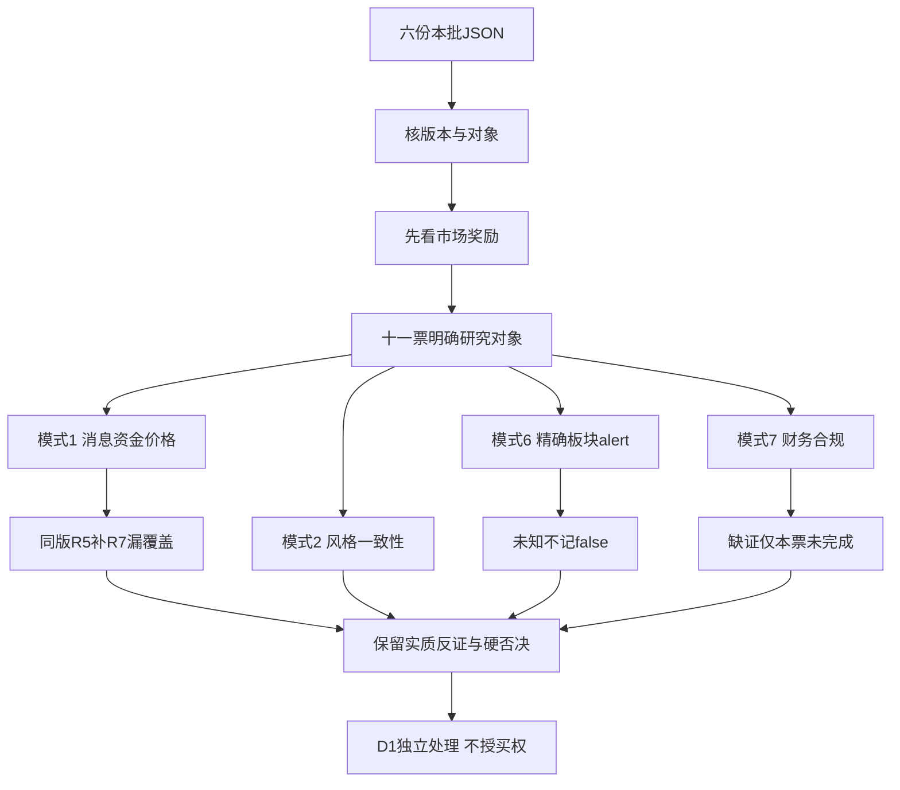

# 2026年11月11日 · 反证 / Devil's Advocate

> 新鲜度：partial；降级：true；置信度：0.70（反证可追溯性，不是安全概率）。

## 一句话结论

11票局部已审，23条反证；零硬否决不等于通过，缺证不构成全局禁买。

## 详细分析

市场奖励前收盘的广度和接力修复、内容与端侧弹性、机器人辨识度，不是所有题材普涨都能接力。R1定位连板情绪型、前收盘主升温度；R2沿三格模板列三条研究主线。今日尚未开盘，前收盘主升不等于今日承接已确认。炸板率16.9643%，不能把11月9日44.8979%错贴今日并机械减半。

行业资金、个股资金与公司兑现不是同一证据。R7先查其实际覆盖；旧池未覆盖本票时，本次用同版R5已核分档资金、价格与R4消息独立交叉，没有因字段名、owner或provider缺失制造全局no_trade。消息热度、AI降本、控制权与模型发布均不能自动写成本票订单及利润。

R4 CPI报道的美元/利率压力发生在A股前收盘之后，不能拿当日A股资金净入证明已吸收隔夜风险。BLS原站与归档403限制保留，CME概率只限当晚快照。三条AI相关主线有共同折现因子，三个标签不是充分分散。

| 研究主线 | 持续性 | 封板率 | 下一窗口预期 | 反证重点 |
|---|---|---|---|---|
| AI内容/短剧游戏 | 未核；3日为验证窗非已持续3日 | 分母未核 | 分歧 | 投流、亏损与降制作成本并存 |
| 具身智能/人形机器人 | 起点未核，不造轮次 | 分母未核 | 分歧 | 模型非独享订单；触觉收入体量小 |
| 端侧AI/AI眼镜 | 未核；5天3板非3连板 | 分母未核 | 分歧 | 应收、库存、现金转换与alert覆盖未知 |

主线预期沿用R2，不宣称今日分歧已发生。sector_id分别为886060.TI、886069.TI、886085.TI，round_id和event_at均为null。意见窗口仅精确关联时沿R2，不把日期或severity当轮次、历史立场或事件首次公开时点。

### 必要审核覆盖

| 对象 | 模式1 消息/资金 | 模式2 风格 | 模式6 出货 | 模式7 财务合规 | 态度 |
|---|---|---|---|---|---|
| 文投控股 600715.SH | 完成 | 完成 | 完成 | 未完成 | 降级（实质反证） |
| 掌阅科技 603533.SH | 完成 | 完成 | 完成 | 未完成 | 降级（实质反证） |
| 慈文传媒 002343.SZ | 完成 | 完成 | 完成 | 未完成 | 降级（实质反证） |
| 宇树科技 688836.SH | 完成 | 完成 | 完成 | 未完成 | 降级（实质反证） |
| 锋龙股份 002931.SZ | 完成 | 完成 | 完成 | 未完成 | 降级（实质反证） |
| 福莱新材 605488.SH | 完成 | 完成 | 完成 | 未完成 | 降级（实质反证） |
| 富瀚微 300613.SZ | 完成 | 完成 | 未完成 | 未完成 | 降级（实质反证） |
| 瑞芯微 603893.SH | 完成 | 完成 | 未完成 | 未完成 | 观察（未完整审核） |
| 创维数字 000810.SZ | 完成 | 完成 | 未完成 | 未完成 | 降级（实质反证） |
| 奥比中光 688322.SH | 未完成 | 完成 | 完成 | 未完成 | 观察（未完整审核） |
| 永贵电器 300351.SZ | 未完成 | 完成 | 未完成 | 未完成 | 观察（未完整审核） |

模式1/2/6/7完成数分别9/11/7/0。所有11票至少完成风格比较，所以candidates_evaluated=11；正式必要审核完成数仍为0。九只主线都有S2/S3关键覆盖缺口，两只次线没有R5画像。模式2已完成结果保留，不因其他缺口撤销。51个R2比较对象不冒充51个已入本批画像候选；额外六票已有实质负面单列保留，不伪称四项必要全审。

## 逐票实质审查

“买入理由”只描述受审主张，不是R6正向结论。逻辑失效条件不是新价格指令。

### 文投控股（600715.SH）｜龙头

板型：普通10cm二板，0次开板；不是缩量一字认证。龙头认定沿R2的龙头：三项研究支持不等于完整准入通过。RR、止损距未知；禁止清单已证项[]，核验状态partial，完整未知项原样保留。

**大资金意图**：内容高度与低价稀缺性被交易，并非盈利反转确认。
**为什么走强**：二板强封与五日主力净入并存，但负利润及库存上升反驳AI降本即利润兑现。
**逻辑够不够硬**：连亏两年、应收增42.33%而收入降29.51%；库存增624.69%、周转13.36低于59.54；F3/F4两项及S1财务轴构成strong_suggest。

**买入理由（受审主张）**：R2以AI内容/短剧游戏内龙头列研究观察；R6不授予执行资格，不用D1首次成案前未知的计划身份排除。

**风险点**：日线加速上行且显著远离MA20；量缩早封，承接要待下一交易日验证，不把锁价低量当今日买点。 本票S2/S3关键覆盖未闭环，不能由年度无保留意见推监管阴性。

**止损条件（逻辑证伪）**：若核心地位、资金承接或利润兑现被新证据否定，交D1依原计划处理；本阶段不定新止损价、不改原退出。

**可验证假设**：在有效交易窗口核真实承接、公司新增收入或现金回收；只有热榜与旧题材时反证不自动消失。被否龙一不由低位票递补。

模式1｜完成：二板强封与五日主力净入并存，但负利润及库存上升反驳AI降本即利润兑现。
依据：R2 龙头主张逐项比较；R5资金源tushare_pro.moneyflow大单+超大单净额，20261104/05/06/09/10合计22067.92万元；11月10日净额6491.29万元、涨幅10.0386%。R7先核实际覆盖未覆盖本票，采用同版R5独立与R4交叉，不产生全局no_trade。 R4复盘/旧催化与既有资金比较已做；隔夜新消息的盘中反应仍未知，未将收盘前后倒置为因果确认。
证据：R2#/main_lines/0/leaders/0；R5#/profiles/0/dimensions/chip_structure/fund_observations；R5#/profiles/0/dimensions/chip_structure/price_observations；R4#/evidence_registry/rss:1；R4#/evidence_registry/rss:2；R5#/profiles/0/dimensions/catalyst；R4#/evidence_registry/rss:37

模式2｜完成：已比较风格；未发现防御/退潮判断与本票进攻研究的硬性方向冲突，仍不允许把前收盘主升温度外推为今日买权。
依据：R1连板情绪型/main_up，事实时点11月10日收盘、意见至11月11日开盘前；R2AI内容/短剧游戏，龙头仅观察。二板/首板/人气核心与该风格研究不矛盾，非全面高敞口授权。市场炸板率16.9643%非11月9日44.8979%，不能误贴历史高炸板强制当日减半。
证据：R2#/main_lines/0/leaders/0；R2#/main_lines/0；R1#/style；R1#/emotion_cycle_phase；R1#/market_assessment；R2#/market_metrics

模式6｜完成：本票精确R2所属板块的双期末榜规则已查且未触发；只完成此有限霸榜出货分支，不等于排除一切出货。
依据：R3 [('短剧游戏', 7, 3, '2026-11-09T22:30:00+08:00', '2026-11-10T22:30:00+08:00')]；R5五日净额为正，不能制造净流出。
证据：R2#/main_lines/0/leaders/0；R3#/hotlist_signals/distribution_alert_checks/102；R3#/hotlist_signals/distribution_alert_checks/20；R3#/hotlist_signals/distribution_alert_checks/122

模式7｜未完成：连亏两年、应收增42.33%而收入降29.51%；库存增624.69%、周转13.36低于59.54；F3/F4两项及S1财务轴构成strong_suggest。
依据：已核计算输入、同累计同比/单季差分和已嵌入原文；F12仅所列年度审计正文标准无保留，关键审计事项不等于强调事项。S2/S3实际回执显示监管源not_queried、公告分页未知且相关主体未完整覆盖，未达到有限范围合规阴性；此必要缺口只限本票，不新增硬否决。
缺项：S2：年度审计F12已完成；已核法定披露选定页，不将公司自查无未披露事项或无风险标题当作监管阴性；缺来源与相关主体覆盖交R5/R4，不交禁MCP的R6；S3：年度审计F12已完成；已核法定披露选定页，不将公司自查无未披露事项或无风险标题当作监管阴性；缺来源与相关主体覆盖交R5/R4，不交禁MCP的R6；回送R5,R4
证据：R2#/main_lines/0/leaders/0；R5#/profiles/0/dimensions/valuation_safety/fundamental_checks；R5#/profiles/0/dimensions/valuation_safety/financial_statements_bound；R5#/profiles/0/dimensions/catalyst/risk_disclosures_bound

### 掌阅科技（603533.SH）｜龙二

板型：普通10cm首板回封，1次开板。龙头认定沿R2的龙二：三项研究支持不等于完整准入通过。RR、止损距未知；禁止清单已证项[]，核验状态partial，完整未知项原样保留。

**大资金意图**：IP、投流与内容容量核心预期被交易，不是稳定盈利承诺。
**为什么走强**：R4明确泡漫AI和短剧衍生业务；同期资金价格确实转强，但R4 rss:37披露前三季仍亏及销售费率64.20%，不能把降制作成本当降低获客成本。
**逻辑够不够硬**：F7按2025实际关联营业交易12.703029亿元/收入32.427353亿元=39.17%，不是14.5亿元预计额度。单项soft_suggest，不能指称违规关联或当前季度同占比。

**买入理由（受审主张）**：R2以AI内容/短剧游戏内龙二列研究观察；R6不授予执行资格，不用D1首次成案前未知的计划身份排除。

**风险点**：日线修复至前20日高点附近，收盘仍低于此前32.91元高点；不是已确认越过历史压力。 本票S2/S3关键覆盖未闭环，不能由年度无保留意见推监管阴性。

**止损条件（逻辑证伪）**：若核心地位、资金承接或利润兑现被新证据否定，交D1依原计划处理；本阶段不定新止损价、不改原退出。

**可验证假设**：在有效交易窗口核真实承接、公司新增收入或现金回收；只有热榜与旧题材时反证不自动消失。被否龙一不由低位票递补。

模式1｜完成：R4明确泡漫AI和短剧衍生业务；同期资金价格确实转强，但R4 rss:37披露前三季仍亏及销售费率64.20%，不能把降制作成本当降低获客成本。
依据：R2 龙二主张逐项比较；R5资金源tushare_pro.moneyflow大单+超大单净额，20261104/05/06/09/10合计52739.79万元；11月10日净额66758.71万元、涨幅9.9933%。R7先核实际覆盖并保留Eastmoney同窗值；非要求特定字段或provider。 R4复盘/旧催化与既有资金比较已做；隔夜新消息的盘中反应仍未知，未将收盘前后倒置为因果确认。
证据：R2#/main_lines/0/leaders/1；R5#/profiles/1/dimensions/chip_structure/fund_observations；R5#/profiles/1/dimensions/chip_structure/price_observations；R4#/evidence_registry/rss:1；R4#/evidence_registry/rss:2；R7#/stock_5d_tracking/2/series_5d；R5#/profiles/1/dimensions/catalyst；R4#/evidence_registry/rss:37

模式2｜完成：已比较风格；未发现防御/退潮判断与本票进攻研究的硬性方向冲突，仍不允许把前收盘主升温度外推为今日买权。
依据：R1连板情绪型/main_up，事实时点11月10日收盘、意见至11月11日开盘前；R2AI内容/短剧游戏，龙二仅观察。二板/首板/人气核心与该风格研究不矛盾，非全面高敞口授权。市场炸板率16.9643%非11月9日44.8979%，不能误贴历史高炸板强制当日减半。
证据：R2#/main_lines/0/leaders/1；R2#/main_lines/0；R1#/style；R1#/emotion_cycle_phase；R1#/market_assessment；R2#/market_metrics

模式6｜完成：本票精确R2所属板块的双期末榜规则已查且未触发；只完成此有限霸榜出货分支，不等于排除一切出货。
依据：R3 [('短剧游戏', 7, 3, '2026-11-09T22:30:00+08:00', '2026-11-10T22:30:00+08:00')]；R5五日净额为正，不能制造净流出。
证据：R2#/main_lines/0/leaders/1；R3#/hotlist_signals/distribution_alert_checks/102；R3#/hotlist_signals/distribution_alert_checks/14；R3#/hotlist_signals/distribution_alert_checks/138

模式7｜未完成：F7按2025实际关联营业交易12.703029亿元/收入32.427353亿元=39.17%，不是14.5亿元预计额度。单项soft_suggest，不能指称违规关联或当前季度同占比。
依据：已核计算输入、同累计同比/单季差分和已嵌入原文；F12仅所列年度审计正文标准无保留，关键审计事项不等于强调事项。S2/S3实际回执显示监管源not_queried、公告分页未知且相关主体未完整覆盖，未达到有限范围合规阴性；此必要缺口只限本票，不新增硬否决。
缺项：S2：年度审计F12已完成；已核法定披露选定页，不将公司自查无未披露事项或无风险标题当作监管阴性；缺来源与相关主体覆盖交R5/R4，不交禁MCP的R6；S3：年度审计F12已完成；已核法定披露选定页，不将公司自查无未披露事项或无风险标题当作监管阴性；缺来源与相关主体覆盖交R5/R4，不交禁MCP的R6；回送R5,R4
证据：R2#/main_lines/0/leaders/1；R5#/profiles/1/dimensions/valuation_safety/fundamental_checks；R5#/profiles/1/dimensions/valuation_safety/financial_statements_bound；R5#/profiles/1/dimensions/catalyst/risk_disclosures_bound

### 慈文传媒（002343.SZ）｜龙三

板型：普通10cm首板，0次开板。龙头认定沿R2的龙三：三项研究支持不等于完整准入通过。RR、止损距未知；禁止清单已证项[]，核验状态partial，完整未知项原样保留。

**大资金意图**：资金交易内容补涨和IP预期，非当前收入增长。
**为什么走强**：旧公司原文明确短剧规模小、AIGC尚无收入；五日资金净入与涨停并不证伪这些经营限制。
**逻辑够不够硬**：F3按原比例命中但应收同比实际下降7.95%，不能称绝对暴增；F4库存降19.42%但收入降89.67%、周转0.02755低于0.23224；F9应收/当期累计收入17.9139倍。三项按既有规则strong_suggest，影视收入季节性不抹去回款风险。

**买入理由（受审主张）**：R2以AI内容/短剧游戏内龙三列研究观察；R6不授予执行资格，不用D1首次成案前未知的计划身份排除。

**风险点**：收复MA20但远低于前20日10.89元高点，更像高位回撤后的强反抽，不是低位首启动。 本票S2/S3关键覆盖未闭环，不能由年度无保留意见推监管阴性。

**止损条件（逻辑证伪）**：若核心地位、资金承接或利润兑现被新证据否定，交D1依原计划处理；本阶段不定新止损价、不改原退出。

**可验证假设**：在有效交易窗口核真实承接、公司新增收入或现金回收；只有热榜与旧题材时反证不自动消失。被否龙一不由低位票递补。

模式1｜完成：旧公司原文明确短剧规模小、AIGC尚无收入；五日资金净入与涨停并不证伪这些经营限制。
依据：R2 龙三主张逐项比较；R5资金源tushare_pro.moneyflow大单+超大单净额，20261104/05/06/09/10合计46479.06万元；11月10日净额44270.25万元、涨幅10.0236%。R7先核实际覆盖并保留Eastmoney同窗值；非要求特定字段或provider。 R4复盘/旧催化与既有资金比较已做；隔夜新消息的盘中反应仍未知，未将收盘前后倒置为因果确认。
证据：R2#/main_lines/0/leaders/2；R5#/profiles/2/dimensions/chip_structure/fund_observations；R5#/profiles/2/dimensions/chip_structure/price_observations；R4#/evidence_registry/rss:1；R4#/evidence_registry/rss:2；R7#/stock_5d_tracking/6/series_5d；R5#/profiles/2/dimensions/catalyst；R4#/evidence_registry/rss:37

模式2｜完成：已比较风格；未发现防御/退潮判断与本票进攻研究的硬性方向冲突，仍不允许把前收盘主升温度外推为今日买权。
依据：R1连板情绪型/main_up，事实时点11月10日收盘、意见至11月11日开盘前；R2AI内容/短剧游戏，龙三仅观察。二板/首板/人气核心与该风格研究不矛盾，非全面高敞口授权。市场炸板率16.9643%非11月9日44.8979%，不能误贴历史高炸板强制当日减半。
证据：R2#/main_lines/0/leaders/2；R2#/main_lines/0；R1#/style；R1#/emotion_cycle_phase；R1#/market_assessment；R2#/market_metrics

模式6｜完成：本票精确R2所属板块的双期末榜规则已查且未触发；只完成此有限霸榜出货分支，不等于排除一切出货。
依据：R3 [('短剧游戏', 7, 3, '2026-11-09T22:30:00+08:00', '2026-11-10T22:30:00+08:00')]；R5五日净额为正，不能制造净流出。
证据：R2#/main_lines/0/leaders/2；R3#/hotlist_signals/distribution_alert_checks/102；R3#/hotlist_signals/distribution_alert_checks/13；R3#/hotlist_signals/distribution_alert_checks/135

模式7｜未完成：F3按原比例命中但应收同比实际下降7.95%，不能称绝对暴增；F4库存降19.42%但收入降89.67%、周转0.02755低于0.23224；F9应收/当期累计收入17.9139倍。三项按既有规则strong_suggest，影视收入季节性不抹去回款风险。
依据：已核计算输入、同累计同比/单季差分和已嵌入原文；F12仅所列年度审计正文标准无保留，关键审计事项不等于强调事项。S2/S3实际回执显示监管源not_queried、公告分页未知且相关主体未完整覆盖，未达到有限范围合规阴性；此必要缺口只限本票，不新增硬否决。
缺项：S2：年度审计F12已完成；已核法定披露选定页，不将公司自查无未披露事项或无风险标题当作监管阴性；缺来源与相关主体覆盖交R5/R4，不交禁MCP的R6；S3：年度审计F12已完成；已核法定披露选定页，不将公司自查无未披露事项或无风险标题当作监管阴性；缺来源与相关主体覆盖交R5/R4，不交禁MCP的R6；回送R5,R4
证据：R2#/main_lines/0/leaders/2；R5#/profiles/2/dimensions/valuation_safety/fundamental_checks；R5#/profiles/2/dimensions/valuation_safety/financial_statements_bound；R5#/profiles/2/dimensions/catalyst/risk_disclosures_bound

### 宇树科技（688836.SH）｜龙头

板型：未涨停的趋势/抱团本体核心；不能认证板上接力。龙头认定沿R2的龙头：三项研究支持不等于完整准入通过。RR、止损距未知；禁止清单已证项[]，核验状态partial，完整未知项原样保留。

**大资金意图**：本体人气与物理AI远期份额预期被交易，不是Touch独享订单。
**为什么走强**：R4旧物理AI报道与前收盘上涨可比较；Touch晚间材料不能反向解释已结束交易。双榜第一也不能取消高换手上影与估值风险。
**逻辑够不够硬**：F4库存增266.63%超过收入增55.66%的1.5倍，周转1.20476低于2.23686；PE549.112、PB34.5437且旧公告已提示商业化不确定，估值不构成单独硬否决。

**买入理由（受审主张）**：R2以具身智能/人形机器人内龙头列研究观察；R6不授予执行资格，不用D1首次成案前未知的计划身份排除。

**风险点**：收盘略越前20日高点但809元日内高点回落至761.01，长上影与量能增加并存；高位换手非干净突破。 本票S2/S3关键覆盖未闭环，不能由年度无保留意见推监管阴性。

**止损条件（逻辑证伪）**：若核心地位、资金承接或利润兑现被新证据否定，交D1依原计划处理；本阶段不定新止损价、不改原退出。

**可验证假设**：在有效交易窗口核真实承接、公司新增收入或现金回收；只有热榜与旧题材时反证不自动消失。被否龙一不由低位票递补。

模式1｜完成：R4旧物理AI报道与前收盘上涨可比较；Touch晚间材料不能反向解释已结束交易。双榜第一也不能取消高换手上影与估值风险。
依据：R2 龙头主张逐项比较；R5资金源tushare_pro.moneyflow大单+超大单净额，20261104/05/06/09/10合计31326.28万元；11月10日净额5244.35万元、涨幅6.2863%。R7先核实际覆盖未覆盖本票，采用同版R5独立与R4交叉，不产生全局no_trade。 R4复盘/旧催化与既有资金比较已做；隔夜新消息的盘中反应仍未知，未将收盘前后倒置为因果确认。
证据：R2#/main_lines/1/leaders/0；R5#/profiles/3/dimensions/chip_structure/fund_observations；R5#/profiles/3/dimensions/chip_structure/price_observations；R4#/evidence_registry/rss:1；R4#/evidence_registry/rss:2；R5#/profiles/3/dimensions/catalyst

模式2｜完成：已比较风格；未发现防御/退潮判断与本票进攻研究的硬性方向冲突，仍不允许把前收盘主升温度外推为今日买权。
依据：R1连板情绪型/main_up，事实时点11月10日收盘、意见至11月11日开盘前；R2具身智能/人形机器人，龙头仅观察。二板/首板/人气核心与该风格研究不矛盾，非全面高敞口授权。市场炸板率16.9643%非11月9日44.8979%，不能误贴历史高炸板强制当日减半。
证据：R2#/main_lines/1/leaders/0；R2#/main_lines/1；R1#/style；R1#/emotion_cycle_phase；R1#/market_assessment；R2#/market_metrics

模式6｜完成：本票精确R2所属板块的双期末榜规则已查且未触发；只完成此有限霸榜出货分支，不等于排除一切出货。
依据：R3 [('人形机器人', 2, 2, '2026-11-09T22:30:00+08:00', '2026-11-10T22:30:00+08:00')]；R5五日净额为正，不能制造净流出。
证据：R2#/main_lines/1/leaders/0；R3#/hotlist_signals/distribution_alert_checks/101；R3#/hotlist_signals/distribution_alert_checks/0；R3#/hotlist_signals/distribution_alert_checks/120

模式7｜未完成：F4库存增266.63%超过收入增55.66%的1.5倍，周转1.20476低于2.23686；PE549.112、PB34.5437且旧公告已提示商业化不确定，估值不构成单独硬否决。
依据：已核计算输入、同累计同比/单季差分和已嵌入原文；F12仅所列年度审计正文标准无保留，关键审计事项不等于强调事项。S2/S3实际回执显示监管源not_queried、公告分页未知且相关主体未完整覆盖，未达到有限范围合规阴性；此必要缺口只限本票，不新增硬否决。
缺项：S2：年度审计F12已完成；已核法定披露选定页，不将公司自查无未披露事项或无风险标题当作监管阴性；缺来源与相关主体覆盖交R5/R4，不交禁MCP的R6；S3：年度审计F12已完成；已核法定披露选定页，不将公司自查无未披露事项或无风险标题当作监管阴性；缺来源与相关主体覆盖交R5/R4，不交禁MCP的R6；回送R5,R4
证据：R2#/main_lines/1/leaders/0；R5#/profiles/3/dimensions/valuation_safety/fundamental_checks；R5#/profiles/3/dimensions/valuation_safety/financial_statements_bound；R5#/profiles/3/dimensions/catalyst/risk_disclosures_bound

### 锋龙股份（002931.SZ）｜龙二

板型：普通10cm二板，0次开板。龙头认定沿R2的龙二：三项研究支持不等于完整准入通过。RR、止损距未知；禁止清单已证项[]，核验状态partial，完整未知项原样保留。

**大资金意图**：控制权与人形高度锚的情绪溢价，不是已经注资或批量供货。
**为什么走强**：二板及同窗资金净入可比较；7月原文无收入/送样只能按当时事实保留，不能冒充11月仍无收入，但也没有新证据足以认证已兑现。
**逻辑够不够硬**：F6非经常损益/归母净利128.53%，归母1852.51万元而扣非为-528.55万元；单项soft_suggest。另旧36个月不注入承诺和更新兑现缺口需D1显式处理。

**买入理由（受审主张）**：R2以具身智能/人形机器人内龙二列研究观察；R6不授予执行资格，不用D1首次成案前未知的计划身份排除。

**风险点**：日线越过前20日高点，但缩量二板与更长周期旧高位套牢并存，不能把日线反弹写成全周期反转。 本票S2/S3关键覆盖未闭环，不能由年度无保留意见推监管阴性。

**止损条件（逻辑证伪）**：若核心地位、资金承接或利润兑现被新证据否定，交D1依原计划处理；本阶段不定新止损价、不改原退出。

**可验证假设**：在有效交易窗口核真实承接、公司新增收入或现金回收；只有热榜与旧题材时反证不自动消失。被否龙一不由低位票递补。

模式1｜完成：二板及同窗资金净入可比较；7月原文无收入/送样只能按当时事实保留，不能冒充11月仍无收入，但也没有新证据足以认证已兑现。
依据：R2 龙二主张逐项比较；R5资金源tushare_pro.moneyflow大单+超大单净额，20261104/05/06/09/10合计33151.30万元；11月10日净额15052.26万元、涨幅10.0091%。R7先核实际覆盖未覆盖本票，采用同版R5独立与R4交叉，不产生全局no_trade。 R4复盘/旧催化与既有资金比较已做；隔夜新消息的盘中反应仍未知，未将收盘前后倒置为因果确认。
证据：R2#/main_lines/1/leaders/1；R5#/profiles/4/dimensions/chip_structure/fund_observations；R5#/profiles/4/dimensions/chip_structure/price_observations；R4#/evidence_registry/rss:1；R4#/evidence_registry/rss:2；R5#/profiles/4/dimensions/catalyst

模式2｜完成：已比较风格；未发现防御/退潮判断与本票进攻研究的硬性方向冲突，仍不允许把前收盘主升温度外推为今日买权。
依据：R1连板情绪型/main_up，事实时点11月10日收盘、意见至11月11日开盘前；R2具身智能/人形机器人，龙二仅观察。二板/首板/人气核心与该风格研究不矛盾，非全面高敞口授权。市场炸板率16.9643%非11月9日44.8979%，不能误贴历史高炸板强制当日减半。
证据：R2#/main_lines/1/leaders/1；R2#/main_lines/1；R1#/style；R1#/emotion_cycle_phase；R1#/market_assessment；R2#/market_metrics

模式6｜完成：本票精确R2所属板块的双期末榜规则已查且未触发；只完成此有限霸榜出货分支，不等于排除一切出货。
依据：R3 [('人形机器人', 2, 2, '2026-11-09T22:30:00+08:00', '2026-11-10T22:30:00+08:00')]；R5五日净额为正，不能制造净流出。
证据：R2#/main_lines/1/leaders/1；R3#/hotlist_signals/distribution_alert_checks/101；R3#/hotlist_signals/distribution_alert_checks/91；R3#/hotlist_signals/distribution_alert_checks/156

模式7｜未完成：F6非经常损益/归母净利128.53%，归母1852.51万元而扣非为-528.55万元；单项soft_suggest。另旧36个月不注入承诺和更新兑现缺口需D1显式处理。
依据：已核计算输入、同累计同比/单季差分和已嵌入原文；F12仅所列年度审计正文标准无保留，关键审计事项不等于强调事项。S2/S3实际回执显示监管源not_queried、公告分页未知且相关主体未完整覆盖，未达到有限范围合规阴性；此必要缺口只限本票，不新增硬否决。
缺项：S2：年度审计F12已完成；已核法定披露选定页，不将公司自查无未披露事项或无风险标题当作监管阴性；缺来源与相关主体覆盖交R5/R4，不交禁MCP的R6；S3：年度审计F12已完成；已核法定披露选定页，不将公司自查无未披露事项或无风险标题当作监管阴性；缺来源与相关主体覆盖交R5/R4，不交禁MCP的R6；回送R5,R4
证据：R2#/main_lines/1/leaders/1；R5#/profiles/4/dimensions/valuation_safety/fundamental_checks；R5#/profiles/4/dimensions/valuation_safety/financial_statements_bound；R5#/profiles/4/dimensions/catalyst/risk_disclosures_bound

### 福莱新材（605488.SH）｜龙三

板型：普通10cm首板回封，MCP2次开板/问财1次存在口径冲突。龙头认定沿R2的龙三：三项研究支持不等于完整准入通过。RR、止损距未知；禁止清单已证项[]，核验状态partial，完整未知项原样保留。

**大资金意图**：资金给触觉传感的未来弹性溢价，不是本期收入体量。
**为什么走强**：R4此前触觉讨论与五日净入可交叉；Touch新模型并不确认本公司供货，晚间或今晨风险重申也未有A股后续反应。
**逻辑够不够硬**：F项未见已证命中不等于合规安全；10月原文柔性传感收入466.75万元、占0.18%，最新重申比重极低及利润下降，高估值与业务体量错配构成实质反证。

**买入理由（受审主张）**：R2以具身智能/人形机器人内龙三列研究观察；R6不授予执行资格，不用D1首次成案前未知的计划身份排除。

**风险点**：日线加速续新高，收盘明显远离MA20，前5日量比偏低；高位强势不等于低位试错。 本票S2/S3关键覆盖未闭环，不能由年度无保留意见推监管阴性。

**止损条件（逻辑证伪）**：若核心地位、资金承接或利润兑现被新证据否定，交D1依原计划处理；本阶段不定新止损价、不改原退出。

**可验证假设**：在有效交易窗口核真实承接、公司新增收入或现金回收；只有热榜与旧题材时反证不自动消失。被否龙一不由低位票递补。

模式1｜完成：R4此前触觉讨论与五日净入可交叉；Touch新模型并不确认本公司供货，晚间或今晨风险重申也未有A股后续反应。
依据：R2 龙三主张逐项比较；R5资金源tushare_pro.moneyflow大单+超大单净额，20261104/05/06/09/10合计46494.58万元；11月10日净额25922.39万元、涨幅10.0019%。R7先核实际覆盖未覆盖本票，采用同版R5独立与R4交叉，不产生全局no_trade。 R4复盘/旧催化与既有资金比较已做；隔夜新消息的盘中反应仍未知，未将收盘前后倒置为因果确认。
证据：R2#/main_lines/1/leaders/2；R5#/profiles/5/dimensions/chip_structure/fund_observations；R5#/profiles/5/dimensions/chip_structure/price_observations；R4#/evidence_registry/rss:1；R4#/evidence_registry/rss:2；R5#/profiles/5/dimensions/catalyst

模式2｜完成：已比较风格；未发现防御/退潮判断与本票进攻研究的硬性方向冲突，仍不允许把前收盘主升温度外推为今日买权。
依据：R1连板情绪型/main_up，事实时点11月10日收盘、意见至11月11日开盘前；R2具身智能/人形机器人，龙三仅观察。二板/首板/人气核心与该风格研究不矛盾，非全面高敞口授权。市场炸板率16.9643%非11月9日44.8979%，不能误贴历史高炸板强制当日减半。
证据：R2#/main_lines/1/leaders/2；R2#/main_lines/1；R1#/style；R1#/emotion_cycle_phase；R1#/market_assessment；R2#/market_metrics

模式6｜完成：本票精确R2所属板块的双期末榜规则已查且未触发；只完成此有限霸榜出货分支，不等于排除一切出货。
依据：R3 [('人形机器人', 2, 2, '2026-11-09T22:30:00+08:00', '2026-11-10T22:30:00+08:00')]；R5五日净额为正，不能制造净流出。
证据：R2#/main_lines/1/leaders/2；R3#/hotlist_signals/distribution_alert_checks/101；R3#/hotlist_signals/distribution_alert_checks/29；R3#/hotlist_signals/distribution_alert_checks/143

模式7｜未完成：F项未见已证命中不等于合规安全；10月原文柔性传感收入466.75万元、占0.18%，最新重申比重极低及利润下降，高估值与业务体量错配构成实质反证。
依据：已核计算输入、同累计同比/单季差分和已嵌入原文；F12仅所列年度审计正文标准无保留，关键审计事项不等于强调事项。S2/S3实际回执显示监管源not_queried、公告分页未知且相关主体未完整覆盖，未达到有限范围合规阴性；此必要缺口只限本票，不新增硬否决。
缺项：S2：年度审计F12已完成；已核法定披露选定页，不将公司自查无未披露事项或无风险标题当作监管阴性；缺来源与相关主体覆盖交R5/R4，不交禁MCP的R6；S3：年度审计F12已完成；已核法定披露选定页，不将公司自查无未披露事项或无风险标题当作监管阴性；缺来源与相关主体覆盖交R5/R4，不交禁MCP的R6；回送R5,R4
证据：R2#/main_lines/1/leaders/2；R5#/profiles/5/dimensions/valuation_safety/fundamental_checks；R5#/profiles/5/dimensions/valuation_safety/financial_statements_bound；R5#/profiles/5/dimensions/catalyst/risk_disclosures_bound

### 富瀚微（300613.SZ）｜龙头

板型：创业板20cm首板，0次开板。龙头认定沿R2的龙头：三项研究支持不等于完整准入通过。RR、止损距未知；禁止清单已证项[]，核验状态partial，完整未知项原样保留。

**大资金意图**：视觉芯片端侧弹性与20cm辨识度被交易，不等于新机型份额已落地。
**为什么走强**：R4此前端侧政策报道与前收盘涨停/资金流可比；本期新品独供、客户新增份额未被证实。
**逻辑够不够硬**：F3应收增219.52%高于营收增123.94%的1.5倍；F8二、三季度单季CFO负而归母利润均正，P0单项已足strong_suggest。成长不能消除现金转换风险。

**买入理由（受审主张）**：R2以端侧AI/AI眼镜内龙头列研究观察；R6不授予执行资格，不用D1首次成案前未知的计划身份排除。

**风险点**：20cm长阳收盘越过前20日77.04元高点且量增，30日仍略跌属于箱体修复；周线不同日/复权未核不能认证共振。 本票S2/S3关键覆盖未闭环，不能由年度无保留意见推监管阴性。

**止损条件（逻辑证伪）**：若核心地位、资金承接或利润兑现被新证据否定，交D1依原计划处理；本阶段不定新止损价、不改原退出。

**可验证假设**：在有效交易窗口核真实承接、公司新增收入或现金回收；只有热榜与旧题材时反证不自动消失。被否龙一不由低位票递补。

模式1｜完成：R4此前端侧政策报道与前收盘涨停/资金流可比；本期新品独供、客户新增份额未被证实。
依据：R2 龙头主张逐项比较；R5资金源tushare_pro.moneyflow大单+超大单净额，20261104/05/06/09/10合计25373.80万元；11月10日净额19768.16万元、涨幅20.0060%。R7先核实际覆盖未覆盖本票，采用同版R5独立与R4交叉，不产生全局no_trade。 R4复盘/旧催化与既有资金比较已做；隔夜新消息的盘中反应仍未知，未将收盘前后倒置为因果确认。
证据：R2#/main_lines/2/leaders/0；R5#/profiles/6/dimensions/chip_structure/fund_observations；R5#/profiles/6/dimensions/chip_structure/price_observations；R4#/evidence_registry/rss:1；R4#/evidence_registry/rss:2；R5#/profiles/6/dimensions/catalyst

模式2｜完成：已比较风格；未发现防御/退潮判断与本票进攻研究的硬性方向冲突，仍不允许把前收盘主升温度外推为今日买权。
依据：R1连板情绪型/main_up，事实时点11月10日收盘、意见至11月11日开盘前；R2端侧AI/AI眼镜，龙头仅观察。二板/首板/人气核心与该风格研究不矛盾，非全面高敞口授权。市场炸板率16.9643%非11月9日44.8979%，不能误贴历史高炸板强制当日减半。
证据：R2#/main_lines/2/leaders/0；R2#/main_lines/2；R1#/style；R1#/emotion_cycle_phase；R1#/market_assessment；R2#/market_metrics

模式6｜未完成：所属板块霸榜出货检查未完成，alert未知；未形成模式6硬否决，也不是出货风险已排除。
依据：R2板块关联精确保留；R3现有同票/板块检查结果已逐项核对，单票阴性不代替所属板块结果。R5同版五日主力净额为正；不把未知alert改false。
缺项：R3未给本票精确所属板块的已查有效阴性/阳性结果（AI眼镜双期覆盖未知或无精确板块ID）；不以空alert/单票热榜缺席代替false；回送R3
证据：R2#/main_lines/2/leaders/0；R3#/hotlist_signals/distribution_alert_checks/109；R3#/hotlist_signals/distribution_alert_checks/130

模式7｜未完成：F3应收增219.52%高于营收增123.94%的1.5倍；F8二、三季度单季CFO负而归母利润均正，P0单项已足strong_suggest。成长不能消除现金转换风险。
依据：已核计算输入、同累计同比/单季差分和已嵌入原文；F12仅所列年度审计正文标准无保留，关键审计事项不等于强调事项。S2/S3实际回执显示监管源not_queried、公告分页未知且相关主体未完整覆盖，未达到有限范围合规阴性；此必要缺口只限本票，不新增硬否决。
缺项：S2：年度审计F12已完成；已核法定披露选定页，不将公司自查无未披露事项或无风险标题当作监管阴性；缺来源与相关主体覆盖交R5/R4，不交禁MCP的R6；S3：年度审计F12已完成；已核法定披露选定页，不将公司自查无未披露事项或无风险标题当作监管阴性；缺来源与相关主体覆盖交R5/R4，不交禁MCP的R6；回送R5,R4
证据：R2#/main_lines/2/leaders/0；R5#/profiles/6/dimensions/valuation_safety/fundamental_checks；R5#/profiles/6/dimensions/valuation_safety/financial_statements_bound；R5#/profiles/6/dimensions/catalyst/risk_disclosures_bound

### 瑞芯微（603893.SH）｜龙二

板型：普通10cm首板，5天3板不是3连板。龙头认定沿R2的龙二：三项研究支持不等于完整准入通过。RR、止损距未知；禁止清单已证项[]，核验状态partial，完整未知项原样保留。

**大资金意图**：端侧SoC容量地位与盈利增长预期被交易，不是PICO独供证明。
**为什么走强**：R4先前端侧报道有明确公司映射；R7及R5同日同窗资金、价格一致向上，但五日净额口径不应拼接成两份独立资金。
**逻辑够不够硬**：F4库存增81.23%高于营收增41.64%的1.5倍、周转1.52136低于2.00682；PE61.9952、PB18.0549及连续上涨后的价格风险不能被净流入抹除。

**买入理由（受审主张）**：R2以端侧AI/AI眼镜内龙二列研究观察；R6不授予执行资格，不用D1首次成案前未知的计划身份排除。

**风险点**：日线放量越过前20日221.50元平台，MA5/20之上；周线旧高压力仍须独立验证，不自动授予追高权限。 本票S2/S3关键覆盖未闭环，不能由年度无保留意见推监管阴性。

**止损条件（逻辑证伪）**：若核心地位、资金承接或利润兑现被新证据否定，交D1依原计划处理；本阶段不定新止损价、不改原退出。

**可验证假设**：在有效交易窗口核真实承接、公司新增收入或现金回收；只有热榜与旧题材时反证不自动消失。被否龙一不由低位票递补。

模式1｜完成：R4先前端侧报道有明确公司映射；R7及R5同日同窗资金、价格一致向上，但五日净额口径不应拼接成两份独立资金。
依据：R2 龙二主张逐项比较；R5资金源tushare_pro.moneyflow大单+超大单净额，20261104/05/06/09/10合计134596.67万元；11月10日净额61375.03万元、涨幅10.0000%。R7先核实际覆盖并保留Eastmoney同窗值；非要求特定字段或provider。 R4复盘/旧催化与既有资金比较已做；隔夜新消息的盘中反应仍未知，未将收盘前后倒置为因果确认。
证据：R2#/main_lines/2/leaders/1；R5#/profiles/7/dimensions/chip_structure/fund_observations；R5#/profiles/7/dimensions/chip_structure/price_observations；R4#/evidence_registry/rss:1；R4#/evidence_registry/rss:2；R7#/stock_5d_tracking/4/series_5d；R5#/profiles/7/dimensions/catalyst

模式2｜完成：已比较风格；未发现防御/退潮判断与本票进攻研究的硬性方向冲突，仍不允许把前收盘主升温度外推为今日买权。
依据：R1连板情绪型/main_up，事实时点11月10日收盘、意见至11月11日开盘前；R2端侧AI/AI眼镜，龙二仅观察。二板/首板/人气核心与该风格研究不矛盾，非全面高敞口授权。市场炸板率16.9643%非11月9日44.8979%，不能误贴历史高炸板强制当日减半。
证据：R2#/main_lines/2/leaders/1；R2#/main_lines/2；R1#/style；R1#/emotion_cycle_phase；R1#/market_assessment；R2#/market_metrics

模式6｜未完成：所属板块霸榜出货检查未完成，alert未知；未形成模式6硬否决，也不是出货风险已排除。
依据：R2板块关联精确保留；R3现有同票/板块检查结果已逐项核对，单票阴性不代替所属板块结果。R5同版五日主力净额为正；不把未知alert改false。
缺项：R3未给本票精确所属板块的已查有效阴性/阳性结果（AI眼镜双期覆盖未知或无精确板块ID）；不以空alert/单票热榜缺席代替false；回送R3
证据：R2#/main_lines/2/leaders/1；R3#/hotlist_signals/distribution_alert_checks/109；R3#/hotlist_signals/distribution_alert_checks/73；R3#/hotlist_signals/distribution_alert_checks/139

模式7｜未完成：F4库存增81.23%高于营收增41.64%的1.5倍、周转1.52136低于2.00682；PE61.9952、PB18.0549及连续上涨后的价格风险不能被净流入抹除。
依据：已核计算输入、同累计同比/单季差分和已嵌入原文；F12仅所列年度审计正文标准无保留，关键审计事项不等于强调事项。S2/S3实际回执显示监管源not_queried、公告分页未知且相关主体未完整覆盖，未达到有限范围合规阴性；此必要缺口只限本票，不新增硬否决。
缺项：S2：年度审计F12已完成；已核法定披露选定页，不将公司自查无未披露事项或无风险标题当作监管阴性；缺来源与相关主体覆盖交R5/R4，不交禁MCP的R6；S3：年度审计F12已完成；已核法定披露选定页，不将公司自查无未披露事项或无风险标题当作监管阴性；缺来源与相关主体覆盖交R5/R4，不交禁MCP的R6；回送R5,R4
证据：R2#/main_lines/2/leaders/1；R5#/profiles/7/dimensions/valuation_safety/fundamental_checks；R5#/profiles/7/dimensions/valuation_safety/financial_statements_bound；R5#/profiles/7/dimensions/catalyst/risk_disclosures_bound

### 创维数字（000810.SZ）｜龙三

板型：普通10cm首板，0次开板。龙头认定沿R2的龙三：三项研究支持不等于完整准入通过。RR、止损距未知；禁止清单已证项[]，核验状态partial，完整未知项原样保留。

**大资金意图**：整机与数采的交叉映射获得首板溢价，不是跨三概念三份独立合力。
**为什么走强**：R4端侧政策为行业证据，不是创维新增订单；R5同窗资金与上涨可比较，但经营现金占用已经真实暴露。
**逻辑够不够硬**：F4库存增189.60%而营收增33.15%、周转1.65951低于3.07989；F8二、三季度CFO均负而归母利润正，按P0 strong_suggest。

**买入理由（受审主张）**：R2以端侧AI/AI眼镜内龙三列研究观察；R6不授予执行资格，不用D1首次成案前未知的计划身份排除。

**风险点**：日线回踩后再越前20日11.68元高点，量能接近前5日均量；数字支持修复，但不化解库存/现金流反证。 本票S2/S3关键覆盖未闭环，不能由年度无保留意见推监管阴性。

**止损条件（逻辑证伪）**：若核心地位、资金承接或利润兑现被新证据否定，交D1依原计划处理；本阶段不定新止损价、不改原退出。

**可验证假设**：在有效交易窗口核真实承接、公司新增收入或现金回收；只有热榜与旧题材时反证不自动消失。被否龙一不由低位票递补。

模式1｜完成：R4端侧政策为行业证据，不是创维新增订单；R5同窗资金与上涨可比较，但经营现金占用已经真实暴露。
依据：R2 龙三主张逐项比较；R5资金源tushare_pro.moneyflow大单+超大单净额，20261104/05/06/09/10合计17912.97万元；11月10日净额14258.73万元、涨幅9.9638%。R7先核实际覆盖未覆盖本票，采用同版R5独立与R4交叉，不产生全局no_trade。 R4复盘/旧催化与既有资金比较已做；隔夜新消息的盘中反应仍未知，未将收盘前后倒置为因果确认。
证据：R2#/main_lines/2/leaders/2；R5#/profiles/8/dimensions/chip_structure/fund_observations；R5#/profiles/8/dimensions/chip_structure/price_observations；R4#/evidence_registry/rss:1；R4#/evidence_registry/rss:2；R5#/profiles/8/dimensions/catalyst

模式2｜完成：已比较风格；未发现防御/退潮判断与本票进攻研究的硬性方向冲突，仍不允许把前收盘主升温度外推为今日买权。
依据：R1连板情绪型/main_up，事实时点11月10日收盘、意见至11月11日开盘前；R2端侧AI/AI眼镜，龙三仅观察。二板/首板/人气核心与该风格研究不矛盾，非全面高敞口授权。市场炸板率16.9643%非11月9日44.8979%，不能误贴历史高炸板强制当日减半。
证据：R2#/main_lines/2/leaders/2；R2#/main_lines/2；R1#/style；R1#/emotion_cycle_phase；R1#/market_assessment；R2#/market_metrics

模式6｜未完成：所属板块霸榜出货检查未完成，alert未知；未形成模式6硬否决，也不是出货风险已排除。
依据：R2板块关联精确保留；R3现有同票/板块检查结果已逐项核对，单票阴性不代替所属板块结果。R5同版五日主力净额为正；不把未知alert改false。
缺项：R3未给本票精确所属板块的已查有效阴性/阳性结果（AI眼镜双期覆盖未知或无精确板块ID）；不以空alert/单票热榜缺席代替false；回送R3
证据：R2#/main_lines/2/leaders/2；R3#/hotlist_signals/distribution_alert_checks/109；R3#/hotlist_signals/distribution_alert_checks/151

模式7｜未完成：F4库存增189.60%而营收增33.15%、周转1.65951低于3.07989；F8二、三季度CFO均负而归母利润正，按P0 strong_suggest。
依据：已核计算输入、同累计同比/单季差分和已嵌入原文；F12仅所列年度审计正文标准无保留，关键审计事项不等于强调事项。S2/S3实际回执显示监管源not_queried、公告分页未知且相关主体未完整覆盖，未达到有限范围合规阴性；此必要缺口只限本票，不新增硬否决。
缺项：S2：年度审计F12已完成；已核法定披露选定页，不将公司自查无未披露事项或无风险标题当作监管阴性；缺来源与相关主体覆盖交R5/R4，不交禁MCP的R6；S3：年度审计F12已完成；已核法定披露选定页，不将公司自查无未披露事项或无风险标题当作监管阴性；缺来源与相关主体覆盖交R5/R4，不交禁MCP的R6；回送R5,R4
证据：R2#/main_lines/2/leaders/2；R5#/profiles/8/dimensions/valuation_safety/fundamental_checks；R5#/profiles/8/dimensions/valuation_safety/financial_statements_bound；R5#/profiles/8/dimensions/catalyst/risk_disclosures_bound

### 奥比中光（688322.SH）｜次线观察，未认定龙头

板型、龙头支持条数、RR与完整禁止清单均未知。R2仅次线观察，不授予核心身份。

**大资金意图**：缺同票资金，不从消息反推配置。
**为什么走强**：有前收盘涨幅，但没有事件后的A股反应证明。
**逻辑够不够硬**：事件事实可研究，资金与财务合规未闭环。

**买入理由（受审主张）**：仅原R2/R4事件研究，非已成案核心或试错。

**风险点**：本票资金/画像不足，只记局部未完成，不投全市场否决票。

**止损条件（逻辑证伪）**：业务传导或履约被否定交D1依原计划处理，不新定价格。

**可验证假设**：有权限生产者交付同票同窗事实后补审；R6不联网代取、不以缺证写安全。

模式1｜未完成：消息映射可核，资金与消息交叉未完成；不由缺资料判断资金不认可。
依据：R4 EGORGB-D视觉采集合作线索不等于Touch触觉新增合同；R2涨2.767857%不补资金窗口。
缺项：R5无本票画像及已核同窗个股资金；R7旧池无本票资金覆盖；不能把R2单日涨幅当资金核验；回送R5,R7
证据：R2#/candidate_comparisons/28；R4#/top_events/7

模式2｜完成：已比较风格；未发现防御/退潮判断与本票进攻研究的硬性方向冲突，仍不允许把前收盘主升温度外推为今日买权。
依据：R1连板情绪型/main_up，事实时点11月10日收盘、意见至11月11日开盘前；R2具身视觉事件补充，次线观察，未认定龙头仅观察。非已认证主线核心，事件观察不冒充连板前排。市场炸板率16.9643%非11月9日44.8979%，不能误贴历史高炸板强制当日减半。
证据：R2#/candidate_comparisons/28；R2#/secondary_lines/2；R1#/style；R1#/emotion_cycle_phase；R1#/market_assessment；R2#/market_metrics

模式6｜完成：本票精确R2所属板块的双期末榜规则已查且未触发；只完成此有限霸榜出货分支，不等于排除一切出货。
依据：R3 [('人形机器人', 2, 2, '2026-11-09T22:30:00+08:00', '2026-11-10T22:30:00+08:00')]；无alert触发时不强制补R5五日流出条件，其他财务必要项仍单列未完成。
证据：R2#/candidate_comparisons/28；R3#/hotlist_signals/distribution_alert_checks/101

模式7｜未完成：财务合规必要审核未完成，无权将未画像写成无红旗。
依据：R4所列事件原文只能支持该事件，不构成全票财务、审计及合规检查。
缺项：R5无本票三表计算、F12审计原文和S2/S3有限来源/主体/窗口覆盖回执；回送R5,R4
证据：R2#/candidate_comparisons/28

### 永贵电器（300351.SZ）｜次线观察，未认定龙头

板型、龙头支持条数、RR与完整禁止清单均未知。R2仅次线观察，不授予核心身份。

**大资金意图**：缺同票资金，不从消息反推配置。
**为什么走强**：有前收盘涨幅，但没有事件后的A股反应证明。
**逻辑够不够硬**：事件事实可研究，资金与财务合规未闭环。

**买入理由（受审主张）**：仅原R2/R4事件研究，非已成案核心或试错。

**风险点**：本票资金/画像不足，只记局部未完成，不投全市场否决票。

**止损条件（逻辑证伪）**：业务传导或履约被否定交D1依原计划处理，不新定价格。

**可验证假设**：有权限生产者交付同票同窗事实后补审；R6不联网代取、不以缺证写安全。

模式1｜未完成：消息映射可核，资金与消息交叉未完成；不由缺资料判断资金不认可。
依据：R4生效含税合同真实，但公布线索在前收盘后；前收盘上涨不等于合同后的资金反馈。
缺项：R5无本票画像及已核同窗个股资金；R7旧池无本票资金覆盖；不能把R2单日涨幅当资金核验；回送R5,R7
证据：R2#/candidate_comparisons/33；R4#/top_events/12

模式2｜完成：已比较风格；未发现防御/退潮判断与本票进攻研究的硬性方向冲突，仍不允许把前收盘主升温度外推为今日买权。
依据：R1连板情绪型/main_up，事实时点11月10日收盘、意见至11月11日开盘前；R2轨交合同事件，次线观察，未认定龙头仅观察。非已认证主线核心，事件观察不冒充连板前排。市场炸板率16.9643%非11月9日44.8979%，不能误贴历史高炸板强制当日减半。
证据：R2#/candidate_comparisons/33；R2#/secondary_lines/3；R1#/style；R1#/emotion_cycle_phase；R1#/market_assessment；R2#/market_metrics

模式6｜未完成：所属板块霸榜出货检查未完成，alert未知；未形成模式6硬否决，也不是出货风险已排除。
依据：R2板块关联精确保留；R3现有同票/板块检查结果已逐项核对，单票阴性不代替所属板块结果。本票未取得R5五日资金，不换用R7口径伪作模式6确认。
缺项：R3未给本票精确所属板块的已查有效阴性/阳性结果（AI眼镜双期覆盖未知或无精确板块ID）；不以空alert/单票热榜缺席代替false；回送R3
证据：R2#/candidate_comparisons/33

模式7｜未完成：财务合规必要审核未完成，无权将未画像写成无红旗。
依据：R4所列事件原文只能支持该事件，不构成全票财务、审计及合规检查。
缺项：R5无本票三表计算、F12审计原文和S2/S3有限来源/主体/窗口覆盖回执；回送R5,R4
证据：R2#/candidate_comparisons/33

## 实质反证清单

所有条目sector_id/round_id/event_at/valid_from/valid_until在JSON显式保留。无精确板块关联或窗口缺证则null；不从severity反推历史立场。

### R6_M7_01 · 文投控股 · strong_suggest
受审主张：题材强势可覆盖财务/盈利质量缺陷
反面证据：连亏两年、应收增42.33%而收入降29.51%；库存增624.69%、周转13.36低于59.54；F3/F4两项及S1财务轴构成strong_suggest。
处理：降级：D1对strong_suggest须接受或在meta.d1_override逐项记录覆盖理由；soft_suggest记入r6_soft_notes；不得用净流入、板数或未查合规直接冲销红旗。
限定：红旗计数按已证F项；S1独立财务轴不冒充ST imminent。；S2/S3必要合规覆盖仍未完成，不将空hard_rejects或年度标准无保留写成全票通过。；同比负增长的F3/F4只沿既有有符号公式识别，不称绝对应收或存货增长；季节性与分母局限保留。
来源：R5#/profiles/0/dimensions/valuation_safety/fundamental_checks/F3；R5#/profiles/0/dimensions/valuation_safety/fundamental_checks/F4；R5#/profiles/0/dimensions/valuation_safety/fundamental_checks/S1

### R6_M7_02 · 掌阅科技 · soft_suggest
受审主张：题材强势可覆盖财务/盈利质量缺陷
反面证据：F7按2025实际关联营业交易12.703029亿元/收入32.427353亿元=39.17%，不是14.5亿元预计额度。单项soft_suggest，不能指称违规关联或当前季度同占比。
处理：观察：保留真实财务反证与适用年度，不把单项风险拔高为全票禁买。
限定：红旗计数按已证F项；S1独立财务轴不冒充ST imminent。；S2/S3必要合规覆盖仍未完成，不将空hard_rejects或年度标准无保留写成全票通过。；同比负增长的F3/F4只沿既有有符号公式识别，不称绝对应收或存货增长；季节性与分母局限保留。
来源：R5#/profiles/1/dimensions/valuation_safety/fundamental_checks/F7

### R6_M7_03 · 慈文传媒 · strong_suggest
受审主张：题材强势可覆盖财务/盈利质量缺陷
反面证据：F3按原比例命中但应收同比实际下降7.95%，不能称绝对暴增；F4库存降19.42%但收入降89.67%、周转0.02755低于0.23224；F9应收/当期累计收入17.9139倍。三项按既有规则strong_suggest，影视收入季节性不抹去回款风险。
处理：降级：D1对strong_suggest须接受或在meta.d1_override逐项记录覆盖理由；soft_suggest记入r6_soft_notes；不得用净流入、板数或未查合规直接冲销红旗。
限定：红旗计数按已证F项；S1独立财务轴不冒充ST imminent。；S2/S3必要合规覆盖仍未完成，不将空hard_rejects或年度标准无保留写成全票通过。；同比负增长的F3/F4只沿既有有符号公式识别，不称绝对应收或存货增长；季节性与分母局限保留。
来源：R5#/profiles/2/dimensions/valuation_safety/fundamental_checks/F3；R5#/profiles/2/dimensions/valuation_safety/fundamental_checks/F4；R5#/profiles/2/dimensions/valuation_safety/fundamental_checks/F9

### R6_M7_04 · 宇树科技 · soft_suggest
受审主张：题材强势可覆盖财务/盈利质量缺陷
反面证据：F4库存增266.63%超过收入增55.66%的1.5倍，周转1.20476低于2.23686；PE549.112、PB34.5437且旧公告已提示商业化不确定，估值不构成单独硬否决。
处理：观察：保留真实财务反证与适用年度，不把单项风险拔高为全票禁买。
限定：红旗计数按已证F项；S1独立财务轴不冒充ST imminent。；S2/S3必要合规覆盖仍未完成，不将空hard_rejects或年度标准无保留写成全票通过。；同比负增长的F3/F4只沿既有有符号公式识别，不称绝对应收或存货增长；季节性与分母局限保留。
来源：R5#/profiles/3/dimensions/valuation_safety/fundamental_checks/F4

### R6_M7_05 · 锋龙股份 · soft_suggest
受审主张：题材强势可覆盖财务/盈利质量缺陷
反面证据：F6非经常损益/归母净利128.53%，归母1852.51万元而扣非为-528.55万元；单项soft_suggest。另旧36个月不注入承诺和更新兑现缺口需D1显式处理。
处理：观察：保留真实财务反证与适用年度，不把单项风险拔高为全票禁买。
限定：红旗计数按已证F项；S1独立财务轴不冒充ST imminent。；S2/S3必要合规覆盖仍未完成，不将空hard_rejects或年度标准无保留写成全票通过。；同比负增长的F3/F4只沿既有有符号公式识别，不称绝对应收或存货增长；季节性与分母局限保留。
来源：R5#/profiles/4/dimensions/valuation_safety/fundamental_checks/F6

### R6_M7_06 · 富瀚微 · strong_suggest
受审主张：题材强势可覆盖财务/盈利质量缺陷
反面证据：F3应收增219.52%高于营收增123.94%的1.5倍；F8二、三季度单季CFO负而归母利润均正，P0单项已足strong_suggest。成长不能消除现金转换风险。
处理：降级：D1对strong_suggest须接受或在meta.d1_override逐项记录覆盖理由；soft_suggest记入r6_soft_notes；不得用净流入、板数或未查合规直接冲销红旗。
限定：红旗计数按已证F项；S1独立财务轴不冒充ST imminent。；S2/S3必要合规覆盖仍未完成，不将空hard_rejects或年度标准无保留写成全票通过。；同比负增长的F3/F4只沿既有有符号公式识别，不称绝对应收或存货增长；季节性与分母局限保留。
来源：R5#/profiles/6/dimensions/valuation_safety/fundamental_checks/F3；R5#/profiles/6/dimensions/valuation_safety/fundamental_checks/F8

### R6_M7_07 · 瑞芯微 · soft_suggest
受审主张：题材强势可覆盖财务/盈利质量缺陷
反面证据：F4库存增81.23%高于营收增41.64%的1.5倍、周转1.52136低于2.00682；PE61.9952、PB18.0549及连续上涨后的价格风险不能被净流入抹除。
处理：观察：保留真实财务反证与适用年度，不把单项风险拔高为全票禁买。
限定：红旗计数按已证F项；S1独立财务轴不冒充ST imminent。；S2/S3必要合规覆盖仍未完成，不将空hard_rejects或年度标准无保留写成全票通过。；同比负增长的F3/F4只沿既有有符号公式识别，不称绝对应收或存货增长；季节性与分母局限保留。
来源：R5#/profiles/7/dimensions/valuation_safety/fundamental_checks/F4

### R6_M7_08 · 创维数字 · strong_suggest
受审主张：题材强势可覆盖财务/盈利质量缺陷
反面证据：F4库存增189.60%而营收增33.15%、周转1.65951低于3.07989；F8二、三季度CFO均负而归母利润正，按P0 strong_suggest。
处理：降级：D1对strong_suggest须接受或在meta.d1_override逐项记录覆盖理由；soft_suggest记入r6_soft_notes；不得用净流入、板数或未查合规直接冲销红旗。
限定：红旗计数按已证F项；S1独立财务轴不冒充ST imminent。；S2/S3必要合规覆盖仍未完成，不将空hard_rejects或年度标准无保留写成全票通过。；同比负增长的F3/F4只沿既有有符号公式识别，不称绝对应收或存货增长；季节性与分母局限保留。
来源：R5#/profiles/8/dimensions/valuation_safety/fundamental_checks/F4；R5#/profiles/8/dimensions/valuation_safety/fundamental_checks/F8

### R6_M1_01 · 掌阅科技 · strong_suggest
受审主张：将产业降本/控制权/传感技术直接视作本票当期利润或订单兑现
反面证据：R4 rss:37明确短剧制作降本不等于流量降本；掌阅销售费率64.20%、前三季仍亏6840.91万元。R5资金转强只证明市场交易该预期，不认证稳态盈利。
处理：降级：仅保留原R2研究观察地位；D1如覆盖须具体区分情绪博弈与经营兑现，不因龙头被否递补低位票。
限定：反面研究意见不是买入或调仓权限；新事实须同对象、同窗口重评。
来源：R4#/evidence_registry/rss:37；R5#/profiles/1/dimensions/catalyst/risk_disclosures_bound；R5#/profiles/1/dimensions/chip_structure/fund_observations

### R6_M1_02 · 慈文传媒 · strong_suggest
受审主张：将产业降本/控制权/传感技术直接视作本票当期利润或订单兑现
反面证据：R5内嵌20261020公告原文：单项目归属收入约50万元、海外占比不足1%、AIGC平台尚未形成相关收入，2025短剧业务亏损。消息题材与经济兑现须分开。
处理：降级：仅保留原R2研究观察地位；D1如覆盖须具体区分情绪博弈与经营兑现，不因龙头被否递补低位票。
限定：反面研究意见不是买入或调仓权限；新事实须同对象、同窗口重评。
来源：R5#/profiles/2/dimensions/catalyst/risk_disclosures_bound；R5#/profiles/2/dimensions/chip_structure/fund_observations

### R6_M1_03 · 锋龙股份 · strong_suggest
受审主张：将产业降本/控制权/传感技术直接视作本票当期利润或订单兑现
反面证据：R5内嵌20260707原文：收购完成后36个月无注入所持资产计划，当时未形成关联营业收入、仅送样报价；20260710预计交易获批不是实际收入。旧文只证明当时状态，本轮缺更新兑现证据。
处理：降级：仅保留原R2研究观察地位；D1如覆盖须具体区分情绪博弈与经营兑现，不因龙头被否递补低位票。
限定：反面研究意见不是买入或调仓权限；新事实须同对象、同窗口重评。
来源：R5#/profiles/4/dimensions/catalyst/risk_disclosures_bound；R5#/profiles/4/dimensions/chip_structure/fund_observations

### R6_M1_04 · 福莱新材 · strong_suggest
受审主张：将产业降本/控制权/传感技术直接视作本票当期利润或订单兑现
反面证据：R5内嵌20261029原文：柔性传感项目累计收入466.75万元、占0.18%；20261111转债异常波动公告重申项目比重极低、前三季归母净利同比降13.17%。最新风险披露是转债文，不能错写股票已经异常停牌。
处理：降级：仅保留原R2研究观察地位；D1如覆盖须具体区分情绪博弈与经营兑现，不因龙头被否递补低位票。
限定：反面研究意见不是买入或调仓权限；新事实须同对象、同窗口重评。
来源：R5#/profiles/5/dimensions/catalyst/risk_disclosures_bound；R5#/profiles/5/dimensions/chip_structure/fund_observations

### R6_M3_01 · 宇树科技 · strong_suggest
受审主张：题材远期空间足以抵消现价估值约束
反面证据：本版PE_TTM=549.112、PB=34.5437；收入增长与本体业务成立；模型行业事件不是宇树独享订单，极高估值和现金转换限制叙事强度。。估值高是软/强提示，不是F12/合规红旗，也不能只因位置高hard_reject。
处理：降级：D1显式处理兑现进度与估值回落风险；RR未知不虚造倍数，不自动降仓或输出买点。
限定：没有完整DCF/PEG/历史全周期估值模型；V2/V4—V6/V8—V10未具完整原始前提，不为套十陷阱而补默认值。；PE与公司公告旧静态PE不是相同日期/口径，不强行相除为精确溢价。
来源：R5#/profiles/3/dimensions/valuation_safety；R5#/profiles/3/dimensions/catalyst/risk_disclosures_bound

### R6_M3_02 · 锋龙股份 · strong_suggest
受审主张：题材远期空间足以抵消现价估值约束
反面证据：本版PE_TTM=535.3052、PB=10.2716；20260707原文：优必选承诺收购完成后36个月不注入所持资产；当时机电组件尚未形成关联营业收入，送样报价阶段。20260710只证关联交易预计获批，不证明实际收入；至本轮缺更新兑现原文。。估值高是软/强提示，不是F12/合规红旗，也不能只因位置高hard_reject。
处理：降级：D1显式处理兑现进度与估值回落风险；RR未知不虚造倍数，不自动降仓或输出买点。
限定：没有完整DCF/PEG/历史全周期估值模型；V2/V4—V6/V8—V10未具完整原始前提，不为套十陷阱而补默认值。；PE与公司公告旧静态PE不是相同日期/口径，不强行相除为精确溢价。
来源：R5#/profiles/4/dimensions/valuation_safety；R5#/profiles/4/dimensions/catalyst/risk_disclosures_bound

### R6_M3_03 · 福莱新材 · strong_suggest
受审主张：题材远期空间足以抵消现价估值约束
反面证据：本版PE_TTM=249.9565、PB=7.6043；20261029公司原文：前三季柔性传感器累计收入466.75万元，占总营收0.18%；20261111风险提示重申占比极低且净利下滑。。估值高是软/强提示，不是F12/合规红旗，也不能只因位置高hard_reject。
处理：降级：D1显式处理兑现进度与估值回落风险；RR未知不虚造倍数，不自动降仓或输出买点。
限定：没有完整DCF/PEG/历史全周期估值模型；V2/V4—V6/V8—V10未具完整原始前提，不为套十陷阱而补默认值。；PE与公司公告旧静态PE不是相同日期/口径，不强行相除为精确溢价。
来源：R5#/profiles/5/dimensions/valuation_safety；R5#/profiles/5/dimensions/catalyst/risk_disclosures_bound

### R6_M9_01 · 文投控股 · strong_suggest
受审主张：当前核心地位等同下一交易日承接无风险
反面证据：日线加速上行且显著远离MA20；量缩早封，承接要待下一交易日验证，不把锁价低量当今日买点。 11月11日公司风险原文披露10月27日至11月10日累计上涨67.65%、同期传媒指数8.69%，价格脱离不被二板标签覆盖。
处理：降级：保留极端尾部/先手兑现风险；D1核次日真实承接与RR，不仅因高位或晋级标签作hard_reject。
限定：反面研究意见不是买入或调仓权限；新事实须同对象、同窗口重评。
来源：R5#/profiles/0/dimensions/technical_readiness；R5#/profiles/0/dimensions/catalyst/risk_disclosures_bound；R2#/main_lines/0/leaders/0

### R6_M9_02 · 宇树科技 · strong_suggest
受审主张：当前核心地位等同下一交易日承接无风险
反面证据：收盘略越前20日高点但809元日内高点回落至761.01，长上影与量能增加并存；高位换手非干净突破。 R2记录日内809至收盘761.01，放量上影不能称干净突破；人气与资金并非无条件一致。
处理：降级：保留极端尾部/先手兑现风险；D1核次日真实承接与RR，不仅因高位或晋级标签作hard_reject。
限定：反面研究意见不是买入或调仓权限；新事实须同对象、同窗口重评。
来源：R5#/profiles/3/dimensions/technical_readiness；R5#/profiles/3/dimensions/catalyst/risk_disclosures_bound；R2#/main_lines/1/leaders/0

### R6_M1_05 · 华培动力 · strong_suggest
受审主张：机器人模型发布即本公司产品兑现
反面证据：R4原公告说明机器人相关产品尚未形成收入，原汽车传感延伸不涉及核心技术重大变更；R2二板涨停是真实情绪，不是经营证伪。
处理：降级：完整保留R2观察/降级及原事件限定；不从次线递补核心，不作财务合规全审已完成结论。
限定：反面研究意见不是买入或调仓权限；新事实须同对象、同窗口重评。
来源：R4#/top_events/2；R2#/candidate_comparisons/24

### R6_M1_06 · 顺灏股份 · strong_suggest
受审主张：太空主题火热可以忽略股东供给
反面证据：R4原文控股股东两日大宗减持398万股；R2商业航天次线保留。减持不等于全行业净流出，更不满足模式6双条件。
处理：降级：完整保留R2观察/降级及原事件限定；不从次线递补核心，不作财务合规全审已完成结论。
限定：反面研究意见不是买入或调仓权限；新事实须同对象、同窗口重评。
来源：R4#/top_events/11；R2#/secondary_lines/1

### R6_M1_07 · 大东方 · strong_suggest
受审主张：名字线三板可以替代主营改善
反面证据：R4风险公告主营未变，净利润同比下降84.89%；R2三板仅名字情绪研究，不能将涨停当新业务。
处理：降级：完整保留R2观察/降级及原事件限定；不从次线递补核心，不作财务合规全审已完成结论。
限定：反面研究意见不是买入或调仓权限；新事实须同对象、同窗口重评。
来源：R4#/top_events/10；R2#/candidate_comparisons/40

### R6_M1_08 · 日出东方 · strong_suggest
受审主张：名字线/光伏叙事足以覆盖实际减持
反面证据：R4风险重申及减持仍在实施期，与R2三板名字情绪地位并存；只保留实际供给/经营反证，不硬判所有光伏退潮。
处理：降级：完整保留R2观察/降级及原事件限定；不从次线递补核心，不作财务合规全审已完成结论。
限定：反面研究意见不是买入或调仓权限；新事实须同对象、同窗口重评。
来源：R4#/top_events/9；R2#/candidate_comparisons/43

### R6_M9_03 · 龙江交通 · strong_suggest
受审主张：高度或封板标签可以代替承接核验
反面证据：R2记录3板但11次开板且单日龙虎榜净卖1.111亿元；与强封/一字想象相冲突，席位净卖不等于R5五日主力净流出。
处理：降级：只留原研究对照；高位本身非hard_reject，不自动授予低位替补资格。
限定：反面研究意见不是买入或调仓权限；新事实须同对象、同窗口重评。
来源：R2#/candidate_comparisons/41；R2#/market_metrics

### R6_M9_04 · 闽发铝业 · strong_suggest
受审主张：高度或封板标签可以代替承接核验
反面证据：R2市场梯队7板仅一只、4—6板断层；本票7板孤高存在extreme_tail_risk，不因高度标签本身硬否决。
处理：降级：只留原研究对照；高位本身非hard_reject，不自动授予低位替补资格。
限定：反面研究意见不是买入或调仓权限；新事实须同对象、同窗口重评。
来源：R2#/candidate_comparisons/38；R2#/market_metrics

## 四象限负面识别

四象限为情绪、基本面、资金、微观结构四个独立判断，不是消息利多利空与涨跌的叉乘。逐票明细见同版JSON。

| 维度 | 负面识别 | 禁止误推 |
|---|---|---|
| 情绪 | 修复、梯队断层、隔夜冲击共存 | 前收盘主升不是今日接力已确认 |
| 基本面 | 文投连亏、慈文收入分母、掌阅关联交易、富瀚/创维现金转换、传感收入小 | 经营弱不自动触发硬否决 |
| 资金 | 九票分档五日均净入，仍有口径差与先手兑现 | 全档net_mf负额不当五日主力净流出 |
| 微观结构 | 文投累计大涨、宇树上影、锋龙旧压力、福莱高位、20cm兑现 | 不因高度hard_reject，不虚造RR |

## 辅助模式与既有hard_reject

模式3核实际估值与V1/V3/V7适用性；其他估值模型前提不足局部降级。模式4历史records不可重放，不造类比。模式5缺绑定昨日R6/E1，不反推旧立场。模式8缺封板量与套牢区，不造>70%或confidence上限触发。模式9保留高度、开板与尾部风险，不以身位硬否。模式10缺对应商品序列，不造背离；利率美元宏观风险另列。辅助缺口不取消已完成必要项。

本日R6目标此前不存在；R4根级hard_rejects为空，R2/R5未找到已形成的合格逐票硬否决。模式6没有板块alert与R5五日流出双证；模式7没有已证四项F、F12或合规/imminent触发。因此当前硬否决数0，不是撤销真否决，更不是全票通过。R2桂发祥真实用户市值排除作为既有上游限制保留，不改造成R6新门槛。

用户/账户停买、有效硬预算含0、仓位上限、T+1、人工确认及既有授权保护不变。预算来源仍未知，不抬成正额。R1的55%是本次市场研究建议，有原事实时点、开盘前意见窗口和重评条件，不是账户可用额度，不继承旧市场性零建议。

## 关键证据

- R1连板情绪型与前收盘main_up，适用原窗口；逐票风格比较已完成。
- R3人形/短剧精确板块双期规则为有限阴性；AI眼镜前期覆盖未知不当false。
- R5五日资金用原始大单与超大单买卖额重算；F8用单季差分，不用两个累计负值冒充两季。
- R5年度审计原文与风险选页可追溯；S2/S3回执显示not_queried、分页未知、相关主体未全覆盖。
- R4产业正面与经营、减持、澄清负面同时保留；没有将R7漏覆盖当不认可。

## 数据源审计

| 源 | 读取/业务状态 | 生成日期 | 实际范围 | SHA256 |
|---|---|---|---|---|
| R1 | 🟡 可绑定，原状态degraded | 2026-11-11 | 本JSON所引字段/嵌入原文 | ad3bb8a8faf5deac0426328cdea9218e9966c65278d94a323bee4f5caff886f5 |
| R2 | 🟡 可绑定，原状态partial | 2026-11-11 | 本JSON所引字段/嵌入原文 | 927246b25bf9280bf249ed5b65d6cf99bd1eaee18101c029a4942981761ce0cd |
| R3 | 🟡 可绑定，原状态degraded | 2026-11-11 | 本JSON所引字段/嵌入原文 | 0df42a2557e269cfa1af3d4da8ebff3ebcaadffabb4d8e8b9e2245205d803a21 |
| R4 | 🟡 可绑定，原状态partial | 2026-11-11 | 本JSON所引字段/嵌入原文 | b67d8f23a36faad85377c2e0bee906da6f8420c8b960aa6a134d4c58c1fd5911 |
| R5 | 🟡 可绑定，原状态partial | 2026-11-11 | 本JSON所引字段/嵌入原文 | 892370b16b15313e98936dba2db082089a2d588dd0203869f417c0d4574b86f8 |
| R7 | 🟡 可绑定，原状态partial | 2026-11-11 | 本JSON所引字段/嵌入原文 | 2ded6ac393bd37678fcdd1a802cf29f989201273a30bf4e4c0b4827733675e1f |

frontmatter中status=ok仅指本地文件读取成功，不等于业务证据齐全；主证据缺口故degraded=true。生成时点、事实观察时点、公告日期不互换。六份hash绑定一致，无网络/MCP、无新模型会话、无raw/计划/账户文件读取。

## 专题知识裁决

本阶段prepare失败，专题传递/原库读取/采用均unknown，context_sha256=null。R2内嵌投影hash只在upstream_context_sha256保留，不冒充本次专题成功。主题锚、股性、成长池、红利池、一字预测、复盘反馈六来源逐项unknown，保留索引/hash/时点/投影省略范围。没有独立使用专题原文作反证，不造必要原文、已读或adopted；不影响主研究。

## 不确定性 / 反证

模式1完成是对既有主张、R4旧催化/风险与同窗资金价格的实际比较，不是今晨公告或晚间模型已获开盘后确认。模式6完成只限真实板块检查规则与窗口，不是全部派发诊断。必要合规缺项不可由热榜、图形、净流入替代，也不据此凭缺席投禁买票。

正式必要审核完成数0，不写全票通过。没有另读原PDF/原图或运行外部接收器的主张；Python只做确定性本地解析、核算与验证，实质判断由本会话完成。

## 与其他 R/D/E 的关系

- 依赖：本批R1-R5/R7 JSON；模式2已完成项保留。
- 回送：R5/R4逐票S2/S3有限覆盖；R3端侧及缺关联对象alert；R5/R7两只次线画像与资金。
- 消费：D1独立处理，strong_suggest须接受或显式记录覆盖；真实hard_reject如形成无覆盖权。E1复盘按原事实窗口。
- 不改计划、池身份、买点/退出、资格、预算或执行确认；龙一被否不拿低位递补。

## Sub-Agent 元数据

- skill：analyze_devil_advocate_v1
- artifact：data/research/20261111/R6_devil_advocate.json
- method：llm_v1；唯一阶段研究者直接执行
- run_id：20261111T061041-44945-637
- model：gpt-6.1-sol
- 生成耗时：未独立计量，不虚填
- usage：usage_unknown，不当0；5000万仅连续努力目标，08:30仅observe_only目标
- 本地Pydantic/证据指针/源版本校验通过；外部普通程序交付验收不冒充已完成
