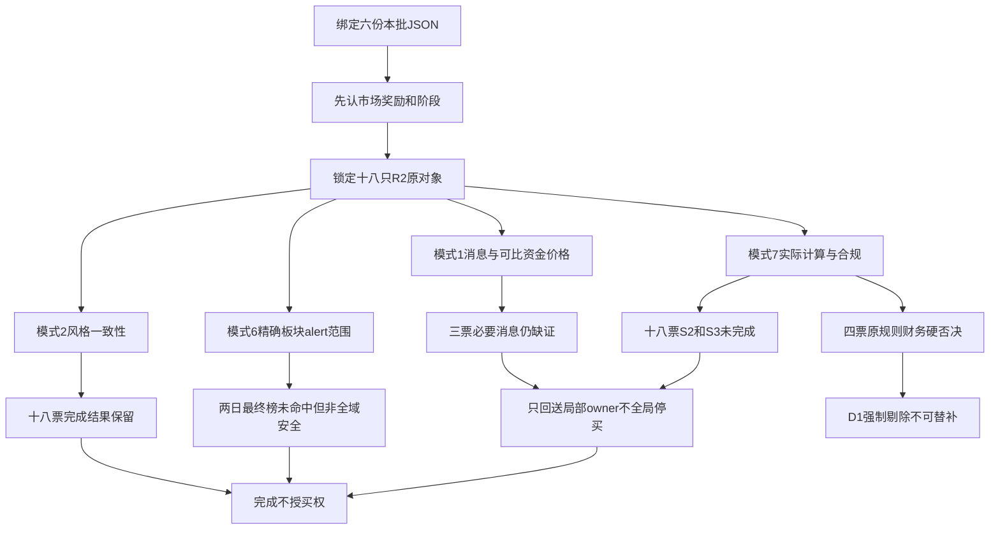

# 2026年11月12日 · 反证 / Devil’s Advocate

> 数据源新鲜度：partial｜降级：true｜置信度：0.65（研究反证可信度，非胜率）

## 一句话结论

18票实审形成4票财务硬否决；必要合规仍缺证，不写全票通过，也不全局停买。

## 详细分析

### 先认市场，再看核心与风险

市场仍在奖励容量科技修复与短线接力，但广度和最高高度收缩，情绪=高位震荡，不是已经确认新的主升。R1的55%是有期限的市场研究上限，不是真实账户预算；本阶段未读取账户额度，保留未知，不从旧计划零额度推全局零仓。炸板率原观察为18.27%，未触发35%纪律线；若后续达到，应由下游重评情绪并按原纪律减半候选，而不是本轮凭空预置触发。

| 本批R2主线 | 证据持续性 | 封板率 | 明日预期 | R6负面边界 |
|---|---|---|---|---|
| 共封装光学(CPO) | 3日 | 100.0% | 分歧 | 同日板块样本不可加总；真实启动轮次未知，不承诺未来持续 |
| PCB概念 | 3日 | 100.0% | 分歧 | 同日板块样本不可加总；真实启动轮次未知，不承诺未来持续 |
| 机器人概念 | 3日 | 83.3333% | 分歧 | 同日板块样本不可加总；真实启动轮次未知，不承诺未来持续 |

R2已把18只去重对象全部分为研究观察，CPO与PCB两只重复对象保留双归属，不伪装两份独立分散。锋龙、光洋等身位核心的资金与公司商业化事实必须拆开；龙三、杂毛不能借龙一被否自动晋级。R6只给反面证据，不另选票，不改计划和交易授权。

### 覆盖不是许可，缺证不是否决

| 必要模式 | 已实审对象 | 完成 | 未完成 | 实质判断 |
|---|---:|---:|---:|---|
| 1 消息×资金/价格 | 18 | 15 | 3 | 先核R7，漏覆盖由同版R5实际序列交叉；文投、凯撒、果麦缺精确受益消息，不把旁票澄清移植 |
| 2 风格一致性 | 18 | 18 | 0 | 高位震荡与研究观察不构成无条件进攻冲突；保留已完成结果 |
| 6 霸榜出货 | 18 | 18 | 0 | 精确R2板块均有真实两日最终榜检查未命中；非日内全市场无出货认证 |
| 7 财务合规 | 18 | 0 | 18 | 161项能由实际输入支持的数值规则复算一致；S2/S3回执仍缺，已证财务风险不删除 |

18只至少有一个模式完成，candidates_evaluated=18；四类必要审核全部完成的对象数=0。formal_review_completed=false，review_passed=false。模式7未完成不表示“四票硬否决也未成立”，同样不表示其余14票被统一禁买。

### 四票硬否决：不能被partial冲掉

| 对象 | 已证F红旗 | 原规则裁决 | 板块/轮次身份 |
|---|---|---|---|
| 603083.SH 剑桥科技 | F3、F4、F8、F9（4项） | 🔴 拦截，hard_reject | 886033.TI；round=null |
| 002579.SZ 中京电子 | F3、F4、F9、F10（4项） | 🔴 拦截，hard_reject | 双归属无唯一sector，保留null；round=null |
| 002708.SZ 光洋股份 | F3、F6、F9、F10（4项） | 🔴 拦截，hard_reject | 885517.TI；round=null |
| 002623.SZ 亚玛顿 | F1、F3、F4、F7、F9、F10（6项） | 🔴 拦截，hard_reject | 885531.TI；round=null |

剑桥为F3/F4/F8/F9：应收与存货增长相对收入过快、连续两单季经营现金净流出而利润为正、应收占前三季收入超过原40%阈值。光洋为F3/F6/F9/F10；中京为F3/F4/F9/F10；亚玛顿至少F1/F3/F4/F7/F9/F10。S1连续年度亏损独立记强风险，不混成“第四条F红旗”。年度研发资本化和关联交易按年度口径列示，不冒充本期数据；营收负增长下F3/F4仅按原相对不等式命中，不能改口叫绝对应收暴增。

D1对hard_reject无覆盖权，不能因空池、少于三只或龙头位置而降级；可留研究观察，但不得留执行席或用龙二/弹性/低位补涨替补。R2观点有效期至竞价重评并不是财务硬否决自动解除时刻。真实反证被合格新证据证伪后才可重新审查，不能到点自动放行。

### 四象限负面识别与时间先后

四象限明示采用“消息正负×资金方向”，不是按severity推历史立场。旧方向新增负面与已交易延续另按R4的underlying_event_id/newness保留，不把日期或概念名编成题材轮次。

| 象限/状态 | 本批实际对象 | 负面识别与限定 |
|---|---|---|
| 负面×既有流入 | 锋龙、福莱 | 公司零收入/极低收入与既有净入并存；公告为盘后，未观察今日“利空不跌” |
| 负面×既有流出 | 光洋 | 昨日主力当日净出与盘后业务未盈利同向，但不能倒因果成公告导致此前流出 |
| 正面叙事×行业流出 | 日出东方所在光伏比较 | 外国HJT合同不能落成本股订单；行业净出与本股净入并列，篮子不同不相加 |
| 正面×流入/其他未知 | 其余对象保留已核范围 | 同现不等于兑现；消息链条未核的不强配象限、不造案例 |

## 逐票必要实审与可证伪条件

以下每票“买入理由”仅转述受挑战的上游研究假设，不是R6正向意见；止损条件只说明逻辑失效，不擅自生成价格或执行指令。所有RR和止损距本轮均unknown；未认证RR≥2和止损距≥5%，空禁止清单不等于14项全绿。

### 603083.SH 剑桥科技｜拦截

| 项目 | 实际范围 |
|---|---|
| 板型与地位 | 首板，开板后回封；共封装光学(CPO) 龙头 |
| 龙头认定 | 纪律研究已核3项；不是7项执行门禁全过 |
| RR/止损距/禁单 | unknown / unknown；命中=[]，完整性=partial：已核名称/市场/流通市值，完整14项及实时限制未穷尽；空数组非全部通过 |
| 必要完成 | 模式1=completed；2=completed；6=completed；7=incomplete |
| 财务红旗 | F3,F4,F8,F9；S2/S3仍unknown |

**买入理由（仅被反证的上游假设）**：CPO现有成分中当日最早09:34封板，1次打开后回封。与光迅13:46、源杰14:08、东方通信14:35比较为10cm先封核心；25.58亿元成交与8.07%换手支持流动性，不认证新增订单。 R6不据此授予执行资格。

**风险点**：首板先封只证明当日时序；此前五日含跌停，20日仍大幅回撤。FCC仍是拟议规则与游说报道，资金回补不证明限制已撤销，更不等于新订单。 价格观察止于20261111，涨幅9.9981%；分档主力当日6.799455亿、五日2.280316亿，对照DC五日2.420257亿。 R7先核：未覆盖本票；本轮采用绑定同版R5分档/日线与DC对照，不把漏覆盖当阴性。 已完成者仅完成已披露消息与可比行情的语义交叉，未知官方事实仍未知；盘后消息未获得今日价格反应。 财务侧：实际核得F3,F4,F8,F9；F类4条，不将S1混作第4条财务红旗。FY2025审计原文意见段在已读范围为标准无保留，责任段条件式非实际非标；S2/S3未知不能写安全。

**止损条件（逻辑证伪，非价位指令）**：原主线合力/核心地位或原受益主张被反证时，由D1按原进出理由核处；本票RR缺证，不编5%价位。已成立财务hard_reject直接拦截执行席，不以等待分歧买点保留买权。

**可验证假设**：共封装光学(CPO)榜位11→1，连续两日top1条件不成立；必要的精确板块分支已查未命中，不触发mode6双条件硬否决。 只对R3明示的11月10日至11月11日同平台最终快照窗口完成。部分个股榜unknown仍保留，未由板块false推全源/日内/未来无派发；空alert数组不是证据。没有板块alert时无需以R5五日流出反推alert。 下一份同对象、同窗新证据若改变消息、资金、原始财务或合规事实，应保留旧版本重新核定；本阶段不补抓。

**大资金意图**：分档主力昨日6.799455亿，近五日2.280316亿；这是分类净额，不是机构意图的直接证明。

**为什么走强**：R1主线扩散型且情绪=高位震荡，与R2将共封装光学(CPO) 龙头保持研究观察/次线并非多线无条件执行，不构成已证风格冲突。但当日强修复不证明20日下降结构已结束。 当日涨幅不是已确认新消息的因果证明。

**逻辑够不够硬**：首板先封只证明当日时序；此前五日含跌停，20日仍大幅回撤。FCC仍是拟议规则与游说报道，资金回补不证明限制已撤销，更不等于新订单。 模式1已完成仅指现有消息与资金/价格的实际比较，未核事实不抬升。 合规缺口交R5；F12只对FY2025已读原文范围阴性。

**本票证据定位**：R2#/main_lines/0/leaders/0；R5#/profiles/0/dimensions/valuation_safety/fundamental_checks；R3#/hotlist_signals/distribution_alert_checks/60。

### 300502.SZ 新易盛｜观察

| 项目 | 实际范围 |
|---|---|
| 板型与地位 | 非涨停；接力板型未确认；共封装光学(CPO) 龙二 |
| 龙头认定 | 纪律研究已核3项；不是7项执行门禁全过 |
| RR/止损距/禁单 | unknown / unknown；命中=[]，完整性=partial：已核名称/市场/流通市值，完整14项及实时限制未穷尽；空数组非全部通过 |
| 必要完成 | 模式1=completed；2=completed；6=completed；7=incomplete |
| 财务红旗 | F4；S2/S3仍unknown |

**买入理由（仅被反证的上游假设）**：CPO可比全成分五日资金排名第1（32.378309亿元），当日+16.975%，双榜前排。容量中军/趋势研究对照，非涨停不当连板；不因300否决。 R6不据此授予执行资格。

**风险点**：单日大涨与五日净入主要为容量修复；20日仍负回报，历史弱涨停股性不能否定容量地位，但也不能把一次修复当主升确认。FCC官方豁免未核。 价格观察止于20261111，涨幅16.9750%；分档主力当日30.585411亿、五日32.859016亿，对照DC五日32.378309亿。 R7先核：已有本票五日跟踪，保留原口径并与R5比较。 已完成者仅完成已披露消息与可比行情的语义交叉，未知官方事实仍未知；盘后消息未获得今日价格反应。 财务侧：实际核得F4；F类1条，不将S1混作第4条财务红旗。FY2025审计原文意见段在已读范围为标准无保留，责任段条件式非实际非标；S2/S3未知不能写安全。

**止损条件（逻辑证伪，非价位指令）**：原主线合力/核心地位或原受益主张被反证时，由D1按原进出理由核处；本票RR缺证，不编5%价位。必要缺证回原owner，不凭缺证自动禁买，也不凭已完成模式自动授买权。

**可验证假设**：共封装光学(CPO)榜位11→1，连续两日top1条件不成立；必要的精确板块分支已查未命中，不触发mode6双条件硬否决。 只对R3明示的11月10日至11月11日同平台最终快照窗口完成。部分个股榜unknown仍保留，未由板块false推全源/日内/未来无派发；空alert数组不是证据。没有板块alert时无需以R5五日流出反推alert。 下一份同对象、同窗新证据若改变消息、资金、原始财务或合规事实，应保留旧版本重新核定；本阶段不补抓。

**大资金意图**：分档主力昨日30.585411亿，近五日32.859016亿；这是分类净额，不是机构意图的直接证明。

**为什么走强**：R1主线扩散型且情绪=高位震荡，与R2将共封装光学(CPO) 龙二保持研究观察/次线并非多线无条件执行，不构成已证风格冲突。但当日强修复不证明20日下降结构已结束。 当日涨幅不是已确认新消息的因果证明。

**逻辑够不够硬**：单日大涨与五日净入主要为容量修复；20日仍负回报，历史弱涨停股性不能否定容量地位，但也不能把一次修复当主升确认。FCC官方豁免未核。 模式1已完成仅指现有消息与资金/价格的实际比较，未核事实不抬升。 合规缺口交R5；F12只对FY2025已读原文范围阴性。

**本票证据定位**：R2#/main_lines/0/leaders/1；R5#/profiles/1/dimensions/valuation_safety/fundamental_checks；R3#/hotlist_signals/distribution_alert_checks/50。

### 002980.SZ 华盛昌｜降级

| 项目 | 实际范围 |
|---|---|
| 板型与地位 | 首板，未打开；共封装光学(CPO) 龙三 |
| 龙头认定 | 纪律研究已核1项；不是7项执行门禁全过 |
| RR/止损距/禁单 | unknown / unknown；命中=[]，完整性=partial：已核名称/市场/流通市值，完整14项及实时限制未穷尽；空数组非全部通过 |
| 必要完成 | 模式1=completed；2=completed；6=completed；7=incomplete |
| 财务红旗 | F3,F9；S2/S3仍unknown |

**买入理由（仅被反证的上游假设）**：CPO历史锚第三，首板但非最早封板，五日资金排名54。保留龙三观察，不用锚分替代地位。 R6不据此授予执行资格。

**风险点**：历史锚与首板不能补足CPO产品/订单绑定，R2五日资金顺位54而非核心；没有因龙一被否自动升位的出口。 价格观察止于20261111，涨幅9.9956%；分档主力当日1.323716亿、五日0.845998亿，对照DC五日0.829984亿。 R7先核：未覆盖本票；本轮采用绑定同版R5分档/日线与DC对照，不把漏覆盖当阴性。 已完成者仅完成已披露消息与可比行情的语义交叉，未知官方事实仍未知；盘后消息未获得今日价格反应。 财务侧：实际核得F3,F9；F类2条，不将S1混作第4条财务红旗。FY2025审计原文意见段在已读范围为标准无保留，责任段条件式非实际非标；S2/S3未知不能写安全。

**止损条件（逻辑证伪，非价位指令）**：原主线合力/核心地位或原受益主张被反证时，由D1按原进出理由核处；本票RR缺证，不编5%价位。必要缺证回原owner，不凭缺证自动禁买，也不凭已完成模式自动授买权。

**可验证假设**：共封装光学(CPO)榜位11→1，连续两日top1条件不成立；必要的精确板块分支已查未命中，不触发mode6双条件硬否决。 只对R3明示的11月10日至11月11日同平台最终快照窗口完成。部分个股榜unknown仍保留，未由板块false推全源/日内/未来无派发；空alert数组不是证据。没有板块alert时无需以R5五日流出反推alert。 下一份同对象、同窗新证据若改变消息、资金、原始财务或合规事实，应保留旧版本重新核定；本阶段不补抓。

**大资金意图**：分档主力昨日1.323716亿，近五日0.845998亿；这是分类净额，不是机构意图的直接证明。

**为什么走强**：R1主线扩散型且情绪=高位震荡，与R2将共封装光学(CPO) 龙三保持研究观察/次线并非多线无条件执行，不构成已证风格冲突。但当日强修复不证明20日下降结构已结束。 当日涨幅不是已确认新消息的因果证明。

**逻辑够不够硬**：历史锚与首板不能补足CPO产品/订单绑定，R2五日资金顺位54而非核心；没有因龙一被否自动升位的出口。 模式1已完成仅指现有消息与资金/价格的实际比较，未核事实不抬升。 合规缺口交R5；F12只对FY2025已读原文范围阴性。

**本票证据定位**：R2#/main_lines/0/leaders/2；R5#/profiles/6/dimensions/valuation_safety/fundamental_checks；R3#/hotlist_signals/distribution_alert_checks/78。

### 002579.SZ 中京电子｜拦截

| 项目 | 实际范围 |
|---|---|
| 板型与地位 | 非涨停；接力板型未确认；共封装光学(CPO) 龙三；PCB概念 龙三 |
| 龙头认定 | 纪律研究已核1项；不是7项执行门禁全过 |
| RR/止损距/禁单 | unknown / unknown；命中=[]，完整性=partial：已核名称/市场/流通市值，完整14项及实时限制未穷尽；空数组非全部通过 |
| 必要完成 | 模式1=completed；2=completed；6=completed；7=incomplete |
| 财务红旗 | F3,F4,F9,F10；S2/S3仍unknown |

**买入理由（仅被反证的上游假设）**：CPO/PCB历史锚第一，今+2.42%未涨停、五日净流出；先入初筛但不占核心执行席，历史49次涨停非今日确定性。 R6不据此授予执行资格。

**风险点**：CPO/PCB双归属不等于两份独立合力，五日两口径均净流出且未封板；历史锚不能覆盖当前后排身份。 价格观察止于20261111，涨幅2.4174%；分档主力当日0.120925亿、五日-0.094122亿，对照DC五日-0.098178亿。 R7先核：未覆盖本票；本轮采用绑定同版R5分档/日线与DC对照，不把漏覆盖当阴性。 已完成者仅完成已披露消息与可比行情的语义交叉，未知官方事实仍未知；盘后消息未获得今日价格反应。 财务侧：实际核得F3,F4,F9,F10；F类4条，不将S1混作第4条财务红旗。FY2025审计原文意见段在已读范围为标准无保留，责任段条件式非实际非标；S2/S3未知不能写安全。

**止损条件（逻辑证伪，非价位指令）**：原主线合力/核心地位或原受益主张被反证时，由D1按原进出理由核处；本票RR缺证，不编5%价位。已成立财务hard_reject直接拦截执行席，不以等待分歧买点保留买权。

**可验证假设**：PCB概念榜位13→7，连续两日top1条件不成立；共封装光学(CPO)榜位11→1，连续两日top1条件不成立；必要的精确板块分支已查未命中，不触发mode6双条件硬否决。 只对R3明示的11月10日至11月11日同平台最终快照窗口完成。部分个股榜unknown仍保留，未由板块false推全源/日内/未来无派发；空alert数组不是证据。没有板块alert时无需以R5五日流出反推alert。 下一份同对象、同窗新证据若改变消息、资金、原始财务或合规事实，应保留旧版本重新核定；本阶段不补抓。

**大资金意图**：分档主力昨日0.120925亿，近五日-0.094122亿；这是分类净额，不是机构意图的直接证明。

**为什么走强**：R1主线扩散型且情绪=高位震荡，与R2将共封装光学(CPO) 龙三；PCB概念 龙三保持研究观察/次线并非多线无条件执行，不构成已证风格冲突。但当日强修复不证明20日下降结构已结束。 当日涨幅不是已确认新消息的因果证明。

**逻辑够不够硬**：CPO/PCB双归属不等于两份独立合力，五日两口径均净流出且未封板；历史锚不能覆盖当前后排身份。 模式1已完成仅指现有消息与资金/价格的实际比较，未核事实不抬升。 合规缺口交R5；F12只对FY2025已读原文范围阴性。

**本票证据定位**：R2#/main_lines/0/leaders/3；R5#/profiles/7/dimensions/valuation_safety/fundamental_checks；R3#/hotlist_signals/distribution_alert_checks/78。

### 603011.SH 合锻智能｜降级

| 项目 | 实际范围 |
|---|---|
| 板型与地位 | 非涨停；接力板型未确认；共封装光学(CPO) 龙三；PCB概念 龙三 |
| 龙头认定 | 纪律研究已核1项；不是7项执行门禁全过 |
| RR/止损距/禁单 | unknown / unknown；命中=[]，完整性=partial：已核名称/市场/流通市值，完整14项及实时限制未穷尽；空数组非全部通过 |
| 必要完成 | 模式1=completed；2=completed；6=completed；7=incomplete |
| 财务红旗 | F3,F4,F9,S1；S2/S3仍unknown |

**买入理由（仅被反证的上游假设）**：CPO/PCB历史锚，今+5.93%未封板、五日净入1.33亿元；缺当前前排时序人气，保留研究不替代龙一。 R6不据此授予执行资格。

**风险点**：两主线历史锚并非当前产品受益认证；未封板，资金流入不能证明电子设计实验已形成公司订单；营收收缩下F3是相对不匹配，不可称应收绝对暴增。 价格观察止于20261111，涨幅5.9341%；分档主力当日0.836162亿、五日1.342260亿，对照DC五日1.330786亿。 R7先核：未覆盖本票；本轮采用绑定同版R5分档/日线与DC对照，不把漏覆盖当阴性。 已完成者仅完成已披露消息与可比行情的语义交叉，未知官方事实仍未知；盘后消息未获得今日价格反应。 财务侧：实际核得F3,F4,F9,S1；F类3条，不将S1混作第4条财务红旗。FY2025审计原文意见段在已读范围为标准无保留，责任段条件式非实际非标；S2/S3未知不能写安全。

**止损条件（逻辑证伪，非价位指令）**：原主线合力/核心地位或原受益主张被反证时，由D1按原进出理由核处；本票RR缺证，不编5%价位。必要缺证回原owner，不凭缺证自动禁买，也不凭已完成模式自动授买权。

**可验证假设**：PCB概念榜位13→7，连续两日top1条件不成立；共封装光学(CPO)榜位11→1，连续两日top1条件不成立；必要的精确板块分支已查未命中，不触发mode6双条件硬否决。 只对R3明示的11月10日至11月11日同平台最终快照窗口完成。部分个股榜unknown仍保留，未由板块false推全源/日内/未来无派发；空alert数组不是证据。没有板块alert时无需以R5五日流出反推alert。 下一份同对象、同窗新证据若改变消息、资金、原始财务或合规事实，应保留旧版本重新核定；本阶段不补抓。

**大资金意图**：分档主力昨日0.836162亿，近五日1.342260亿；这是分类净额，不是机构意图的直接证明。

**为什么走强**：R1主线扩散型且情绪=高位震荡，与R2将共封装光学(CPO) 龙三；PCB概念 龙三保持研究观察/次线并非多线无条件执行，不构成已证风格冲突。但当日强修复不证明20日下降结构已结束。 当日涨幅不是已确认新消息的因果证明。

**逻辑够不够硬**：两主线历史锚并非当前产品受益认证；未封板，资金流入不能证明电子设计实验已形成公司订单；营收收缩下F3是相对不匹配，不可称应收绝对暴增。 模式1已完成仅指现有消息与资金/价格的实际比较，未核事实不抬升。 合规缺口交R5；F12只对FY2025已读原文范围阴性。

**本票证据定位**：R2#/main_lines/0/leaders/4；R5#/profiles/8/dimensions/valuation_safety/fundamental_checks；R3#/hotlist_signals/distribution_alert_checks/78。

### 002384.SZ 东山精密｜观察

| 项目 | 实际范围 |
|---|---|
| 板型与地位 | 首板，未打开；PCB概念 龙头 |
| 龙头认定 | 纪律研究已核3项；不是7项执行门禁全过 |
| RR/止损距/禁单 | unknown / unknown；命中=[]，完整性=partial：已核名称/市场/流通市值，完整14项及实时限制未穷尽；空数组非全部通过 |
| 必要完成 | 模式1=completed；2=completed；6=completed；7=incomplete |
| 财务红旗 | F10；S2/S3仍unknown |

**买入理由（仅被反证的上游假设）**：PCB产品主线13:11先封于沪电13:13、深南13:55，东财人气第1/同花顺7，成交126.54亿元与换手10.32%为容量核心。五日净额-5.609114亿与单日+23.159144亿并列；光洋归广义PCB但当轮叙事为机器人，不挪其3板给PCB高度。 R6不据此授予执行资格。

**风险点**：PCB先封与人气第一并存五日净流出；昨日大额流入只证明当日回补，不能拿单日抹掉前期流出。R4生益和奥士康各自澄清不能移植成本公司订单。 价格观察止于20261111，涨幅10.0012%；分档主力当日23.183295亿、五日-5.481717亿，对照DC五日-5.609114亿。 R7先核：已有本票五日跟踪，保留原口径并与R5比较。 已完成者仅完成已披露消息与可比行情的语义交叉，未知官方事实仍未知；盘后消息未获得今日价格反应。 财务侧：实际核得F10；F类1条，不将S1混作第4条财务红旗。FY2025审计原文意见段在已读范围为标准无保留，责任段条件式非实际非标；S2/S3未知不能写安全。

**止损条件（逻辑证伪，非价位指令）**：原主线合力/核心地位或原受益主张被反证时，由D1按原进出理由核处；本票RR缺证，不编5%价位。必要缺证回原owner，不凭缺证自动禁买，也不凭已完成模式自动授买权。

**可验证假设**：PCB概念榜位13→7，连续两日top1条件不成立；必要的精确板块分支已查未命中，不触发mode6双条件硬否决。 只对R3明示的11月10日至11月11日同平台最终快照窗口完成。部分个股榜unknown仍保留，未由板块false推全源/日内/未来无派发；空alert数组不是证据。没有板块alert时无需以R5五日流出反推alert。 下一份同对象、同窗新证据若改变消息、资金、原始财务或合规事实，应保留旧版本重新核定；本阶段不补抓。

**大资金意图**：分档主力昨日23.183295亿，近五日-5.481717亿；这是分类净额，不是机构意图的直接证明。

**为什么走强**：R1主线扩散型且情绪=高位震荡，与R2将PCB概念 龙头保持研究观察/次线并非多线无条件执行，不构成已证风格冲突。但当日强修复不证明20日下降结构已结束。 当日涨幅不是已确认新消息的因果证明。

**逻辑够不够硬**：PCB先封与人气第一并存五日净流出；昨日大额流入只证明当日回补，不能拿单日抹掉前期流出。R4生益和奥士康各自澄清不能移植成本公司订单。 模式1已完成仅指现有消息与资金/价格的实际比较，未核事实不抬升。 合规缺口交R5；F12只对FY2025已读原文范围阴性。

**本票证据定位**：R2#/main_lines/1/leaders/0；R5#/profiles/2/dimensions/valuation_safety/fundamental_checks；R3#/hotlist_signals/distribution_alert_checks/39。

### 002463.SZ 沪电股份｜观察

| 项目 | 实际范围 |
|---|---|
| 板型与地位 | 首板，开板后回封；PCB概念 龙二 |
| 龙头认定 | 纪律研究已核3项；不是7项执行门禁全过 |
| RR/止损距/禁单 | unknown / unknown；命中=[]，完整性=partial：已核名称/市场/流通市值，完整14项及实时限制未穷尽；空数组非全部通过 |
| 必要完成 | 模式1=completed；2=completed；6=completed；7=incomplete |
| 财务红旗 | F9；S2/S3仍unknown |

**买入理由（仅被反证的上游假设）**：PCB容量龙二研究席，13:13首封、3次开板，成交69.39亿元、五日净入2.8911亿元。是当前两核心比较顺位，不把全成分五日资金排名10说成第2。 R6不据此授予执行资格。

**风险点**：净入与产品同涨不消除三次开板的承接分歧；EDA原型实验和生益订单澄清不能认证沪电新增合同。 价格观察止于20261111，涨幅10.0000%；分档主力当日10.969994亿、五日3.003696亿，对照DC五日2.891100亿。 R7先核：已有本票五日跟踪，保留原口径并与R5比较。 已完成者仅完成已披露消息与可比行情的语义交叉，未知官方事实仍未知；盘后消息未获得今日价格反应。 财务侧：实际核得F9；F类1条，不将S1混作第4条财务红旗。FY2025审计原文意见段在已读范围为标准无保留，责任段条件式非实际非标；S2/S3未知不能写安全。

**止损条件（逻辑证伪，非价位指令）**：原主线合力/核心地位或原受益主张被反证时，由D1按原进出理由核处；本票RR缺证，不编5%价位。必要缺证回原owner，不凭缺证自动禁买，也不凭已完成模式自动授买权。

**可验证假设**：PCB概念榜位13→7，连续两日top1条件不成立；必要的精确板块分支已查未命中，不触发mode6双条件硬否决。 只对R3明示的11月10日至11月11日同平台最终快照窗口完成。部分个股榜unknown仍保留，未由板块false推全源/日内/未来无派发；空alert数组不是证据。没有板块alert时无需以R5五日流出反推alert。 下一份同对象、同窗新证据若改变消息、资金、原始财务或合规事实，应保留旧版本重新核定；本阶段不补抓。

**大资金意图**：分档主力昨日10.969994亿，近五日3.003696亿；这是分类净额，不是机构意图的直接证明。

**为什么走强**：R1主线扩散型且情绪=高位震荡，与R2将PCB概念 龙二保持研究观察/次线并非多线无条件执行，不构成已证风格冲突。但当日强修复不证明20日下降结构已结束。 当日涨幅不是已确认新消息的因果证明。

**逻辑够不够硬**：净入与产品同涨不消除三次开板的承接分歧；EDA原型实验和生益订单澄清不能认证沪电新增合同。 模式1已完成仅指现有消息与资金/价格的实际比较，未核事实不抬升。 合规缺口交R5；F12只对FY2025已读原文范围阴性。

**本票证据定位**：R2#/main_lines/1/leaders/1；R5#/profiles/3/dimensions/valuation_safety/fundamental_checks；R3#/hotlist_signals/distribution_alert_checks/41。

### 002552.SZ 宝鼎科技｜观察

| 项目 | 实际范围 |
|---|---|
| 板型与地位 | 非涨停；接力板型未确认；PCB概念 龙三 |
| 龙头认定 | 纪律研究已核1项；不是7项执行门禁全过 |
| RR/止损距/禁单 | unknown / unknown；命中=[]，完整性=partial：已核名称/市场/流通市值，完整14项及实时限制未穷尽；空数组非全部通过 |
| 必要完成 | 模式1=completed；2=completed；6=completed；7=incomplete |
| 财务红旗 | F10；S2/S3仍unknown |

**买入理由（仅被反证的上游假设）**：PCB历史锚第二但当日+5.54%未封板、五日净出0.4674亿元；历史股性不替代本轮资金选择，龙三不替补执行。 R6不据此授予执行资格。

**风险点**：五日净出与未封板削弱历史锚补涨主张；不能由PCB行业实验与旁票订单推其本票利润，仍为龙三观察。 价格观察止于20261111，涨幅5.5385%；分档主力当日0.134403亿、五日-0.449377亿，对照DC五日-0.467363亿。 R7先核：未覆盖本票；本轮采用绑定同版R5分档/日线与DC对照，不把漏覆盖当阴性。 已完成者仅完成已披露消息与可比行情的语义交叉，未知官方事实仍未知；盘后消息未获得今日价格反应。 财务侧：实际核得F10；F类1条，不将S1混作第4条财务红旗。FY2025审计原文意见段在已读范围为标准无保留，责任段条件式非实际非标；S2/S3未知不能写安全。

**止损条件（逻辑证伪，非价位指令）**：原主线合力/核心地位或原受益主张被反证时，由D1按原进出理由核处；本票RR缺证，不编5%价位。必要缺证回原owner，不凭缺证自动禁买，也不凭已完成模式自动授买权。

**可验证假设**：PCB概念榜位13→7，连续两日top1条件不成立；必要的精确板块分支已查未命中，不触发mode6双条件硬否决。 只对R3明示的11月10日至11月11日同平台最终快照窗口完成。部分个股榜unknown仍保留，未由板块false推全源/日内/未来无派发；空alert数组不是证据。没有板块alert时无需以R5五日流出反推alert。 下一份同对象、同窗新证据若改变消息、资金、原始财务或合规事实，应保留旧版本重新核定；本阶段不补抓。

**大资金意图**：分档主力昨日0.134403亿，近五日-0.449377亿；这是分类净额，不是机构意图的直接证明。

**为什么走强**：R1主线扩散型且情绪=高位震荡，与R2将PCB概念 龙三保持研究观察/次线并非多线无条件执行，不构成已证风格冲突。但当日强修复不证明20日下降结构已结束。 当日涨幅不是已确认新消息的因果证明。

**逻辑够不够硬**：五日净出与未封板削弱历史锚补涨主张；不能由PCB行业实验与旁票订单推其本票利润，仍为龙三观察。 模式1已完成仅指现有消息与资金/价格的实际比较，未核事实不抬升。 合规缺口交R5；F12只对FY2025已读原文范围阴性。

**本票证据定位**：R2#/main_lines/1/leaders/3；R5#/profiles/9/dimensions/valuation_safety/fundamental_checks；R3#/hotlist_signals/distribution_alert_checks/74。

### 002931.SZ 锋龙股份｜降级

| 项目 | 实际范围 |
|---|---|
| 板型与地位 | 3连板，开板后回封；机器人概念 龙头 |
| 龙头认定 | 纪律研究已核3项；不是7项执行门禁全过 |
| RR/止损距/禁单 | unknown / unknown；命中=[]，完整性=partial：已核名称/市场/流通市值，完整14项及实时限制未穷尽；空数组非全部通过 |
| 必要完成 | 模式1=completed；2=completed；6=completed；7=incomplete |
| 财务红旗 | F6；S2/S3仍unknown |

**买入理由（仅被反证的上游假设）**：机器人3板并列高度，09:30:21早于光洋09:43:45，1次打开回封，历史锚第一。R4官方披露前三季机器人零收入、36个月不注资；只保留纯情绪高度龙研究席，不编业绩或注资。 R6不据此授予执行资格。

**风险点**：三板高度和五日净入与机器人零收入、收购后36个月不注资并存。公告在昨日收盘后，不能用它解释早盘封板；必须否定机器人利润或短期注资已兑现的主张。 价格观察止于20261111，涨幅10.0104%；分档主力当日0.640271亿、五日3.922044亿，对照DC五日3.904619亿。 R7先核：未覆盖本票；本轮采用绑定同版R5分档/日线与DC对照，不把漏覆盖当阴性。 已完成者仅完成已披露消息与可比行情的语义交叉，未知官方事实仍未知；盘后消息未获得今日价格反应。 财务侧：实际核得F6；F类1条，不将S1混作第4条财务红旗。FY2025审计原文意见段在已读范围为标准无保留，责任段条件式非实际非标；S2/S3未知不能写安全。

**止损条件（逻辑证伪，非价位指令）**：原主线合力/核心地位或原受益主张被反证时，由D1按原进出理由核处；本票RR缺证，不编5%价位。必要缺证回原owner，不凭缺证自动禁买，也不凭已完成模式自动授买权。

**可验证假设**：机器人概念榜位4→4，连续两日top1条件不成立；必要的精确板块分支已查未命中，不触发mode6双条件硬否决。 只对R3明示的11月10日至11月11日同平台最终快照窗口完成。部分个股榜unknown仍保留，未由板块false推全源/日内/未来无派发；空alert数组不是证据。没有板块alert时无需以R5五日流出反推alert。 下一份同对象、同窗新证据若改变消息、资金、原始财务或合规事实，应保留旧版本重新核定；本阶段不补抓。

**大资金意图**：分档主力昨日0.640271亿，近五日3.922044亿；这是分类净额，不是机构意图的直接证明。

**为什么走强**：R1主线扩散型且情绪=高位震荡，与R2将机器人概念 龙头保持研究观察/次线并非多线无条件执行，不构成已证风格冲突。高涨幅/高度不等于稳定承接；不可把情绪核心当利润兑现核心。 当日涨幅不是已确认新消息的因果证明。

**逻辑够不够硬**：三板高度和五日净入与机器人零收入、收购后36个月不注资并存。公告在昨日收盘后，不能用它解释早盘封板；必须否定机器人利润或短期注资已兑现的主张。 模式1已完成仅指现有消息与资金/价格的实际比较，未核事实不抬升。 合规缺口交R5；F12只对FY2025已读原文范围阴性。

**本票证据定位**：R2#/main_lines/2/leaders/0；R5#/profiles/4/dimensions/valuation_safety/fundamental_checks；R3#/hotlist_signals/distribution_alert_checks/68。

### 002708.SZ 光洋股份｜拦截

| 项目 | 实际范围 |
|---|---|
| 板型与地位 | 3连板，开板后回封；机器人概念 龙二 |
| 龙头认定 | 纪律研究已核3项；不是7项执行门禁全过 |
| RR/止损距/禁单 | unknown / unknown；命中=[]，完整性=partial：已核名称/市场/流通市值，完整14项及实时限制未穷尽；空数组非全部通过 |
| 必要完成 | 模式1=completed；2=completed；6=completed；7=incomplete |
| 财务红旗 | F3,F6,F9,F10；S2/S3仍unknown |

**买入理由（仅被反证的上游假设）**：机器人3板并列高度、后于锋龙封板，换手18.02%，近五日龙虎榜3个交易日。单日主力-1.128624亿、五日+3.257066亿并列；机器人收入低且未盈利，研究龙二不是利润核心认证。 R6不据此授予执行资格。

**风险点**：三板与五日净入不抵消当日主力净出；R4公司公告确认机器人收入低且未盈利，政策不把扣非亏损变机器人业绩。 价格观察止于20261111，涨幅10.0124%；分档主力当日-1.089991亿、五日3.365239亿，对照DC五日3.257066亿。 R7先核：未覆盖本票；本轮采用绑定同版R5分档/日线与DC对照，不把漏覆盖当阴性。 已完成者仅完成已披露消息与可比行情的语义交叉，未知官方事实仍未知；盘后消息未获得今日价格反应。 财务侧：实际核得F3,F6,F9,F10；F类4条，不将S1混作第4条财务红旗。FY2025审计原文意见段在已读范围为标准无保留，责任段条件式非实际非标；S2/S3未知不能写安全。

**止损条件（逻辑证伪，非价位指令）**：原主线合力/核心地位或原受益主张被反证时，由D1按原进出理由核处；本票RR缺证，不编5%价位。已成立财务hard_reject直接拦截执行席，不以等待分歧买点保留买权。

**可验证假设**：机器人概念榜位4→4，连续两日top1条件不成立；必要的精确板块分支已查未命中，不触发mode6双条件硬否决。 只对R3明示的11月10日至11月11日同平台最终快照窗口完成。部分个股榜unknown仍保留，未由板块false推全源/日内/未来无派发；空alert数组不是证据。没有板块alert时无需以R5五日流出反推alert。 下一份同对象、同窗新证据若改变消息、资金、原始财务或合规事实，应保留旧版本重新核定；本阶段不补抓。

**大资金意图**：分档主力昨日-1.089991亿，近五日3.365239亿；这是分类净额，不是机构意图的直接证明。

**为什么走强**：R1主线扩散型且情绪=高位震荡，与R2将机器人概念 龙二保持研究观察/次线并非多线无条件执行，不构成已证风格冲突。高涨幅/高度不等于稳定承接；不可把情绪核心当利润兑现核心。 当日涨幅不是已确认新消息的因果证明。

**逻辑够不够硬**：三板与五日净入不抵消当日主力净出；R4公司公告确认机器人收入低且未盈利，政策不把扣非亏损变机器人业绩。 模式1已完成仅指现有消息与资金/价格的实际比较，未核事实不抬升。 合规缺口交R5；F12只对FY2025已读原文范围阴性。

**本票证据定位**：R2#/main_lines/2/leaders/1；R5#/profiles/5/dimensions/valuation_safety/fundamental_checks；R3#/hotlist_signals/distribution_alert_checks/45。

### 000678.SZ 襄阳轴承｜降级

| 项目 | 实际范围 |
|---|---|
| 板型与地位 | 2连板，开板后回封；机器人概念 龙三 |
| 龙头认定 | 纪律研究已核1项；不是7项执行门禁全过 |
| RR/止损距/禁单 | unknown / unknown；命中=[]，完整性=partial：已核名称/市场/流通市值，完整14项及实时限制未穷尽；空数组非全部通过 |
| 必要完成 | 模式1=completed；2=completed；6=completed；7=incomplete |
| 财务红旗 | F3,F4,F10,S1；S2/S3仍unknown |

**买入理由（仅被反证的上游假设）**：机器人锚第三，2板、同花顺热股第3，换手37.39%与6次开板、五日净出0.135481亿并列；高度落后两只3板，保留龙三不借人气升位。 R6不据此授予执行资格。

**风险点**：二板人气前排但换手37.39%、六次开板；五日分档与DC符号背离，不能挑有利口径认定持续吸筹，也不能据此断言实际出货。 价格观察止于20261111，涨幅10.0208%；分档主力当日-0.929358亿、五日0.013664亿，对照DC五日-0.135527亿。 R7先核：未覆盖本票；本轮采用绑定同版R5分档/日线与DC对照，不把漏覆盖当阴性。 已完成者仅完成已披露消息与可比行情的语义交叉，未知官方事实仍未知；盘后消息未获得今日价格反应。 财务侧：实际核得F3,F4,F10,S1；F类3条，不将S1混作第4条财务红旗。FY2025审计原文意见段在已读范围为标准无保留，责任段条件式非实际非标；S2/S3未知不能写安全。

**止损条件（逻辑证伪，非价位指令）**：原主线合力/核心地位或原受益主张被反证时，由D1按原进出理由核处；本票RR缺证，不编5%价位。必要缺证回原owner，不凭缺证自动禁买，也不凭已完成模式自动授买权。

**可验证假设**：机器人概念榜位4→4，连续两日top1条件不成立；必要的精确板块分支已查未命中，不触发mode6双条件硬否决。 只对R3明示的11月10日至11月11日同平台最终快照窗口完成。部分个股榜unknown仍保留，未由板块false推全源/日内/未来无派发；空alert数组不是证据。没有板块alert时无需以R5五日流出反推alert。 下一份同对象、同窗新证据若改变消息、资金、原始财务或合规事实，应保留旧版本重新核定；本阶段不补抓。

**大资金意图**：分档主力昨日-0.929358亿，近五日0.013664亿；这是分类净额，不是机构意图的直接证明。

**为什么走强**：R1主线扩散型且情绪=高位震荡，与R2将机器人概念 龙三保持研究观察/次线并非多线无条件执行，不构成已证风格冲突。高涨幅/高度不等于稳定承接；不可把情绪核心当利润兑现核心。 当日涨幅不是已确认新消息的因果证明。

**逻辑够不够硬**：二板人气前排但换手37.39%、六次开板；五日分档与DC符号背离，不能挑有利口径认定持续吸筹，也不能据此断言实际出货。 模式1已完成仅指现有消息与资金/价格的实际比较，未核事实不抬升。 合规缺口交R5；F12只对FY2025已读原文范围阴性。

**本票证据定位**：R2#/main_lines/2/leaders/2；R5#/profiles/10/dimensions/valuation_safety/fundamental_checks；R3#/hotlist_signals/distribution_alert_checks/35。

### 603626.SH 科森科技｜降级

| 项目 | 实际范围 |
|---|---|
| 板型与地位 | 非涨停；接力板型未确认；机器人概念 杂毛 |
| 龙头认定 | 纪律研究已核1项；不是7项执行门禁全过 |
| RR/止损距/禁单 | unknown / unknown；命中=[]，完整性=partial：已核名称/市场/流通市值，完整14项及实时限制未穷尽；空数组非全部通过 |
| 必要完成 | 模式1=completed；2=completed；6=completed；7=incomplete |
| 财务红旗 | F3,F6,F9,S1；S2/S3仍unknown |

**买入理由（仅被反证的上游假设）**：机器人历史锚第二；当前0连板、五日资金全成分排名11，命中top3外与0板低于3板龙头-2两项，rank=杂毛仅作原执行过滤，不是公司价值结论。不伪造30日龙虎榜阴性。 R6不据此授予执行资格。

**风险点**：R2已标杂毛，零连板与板块三板身位差不能被正资金或历史股性挽回；政策不是公司机器人收入和新订单。 价格观察止于20261111，涨幅2.8105%；分档主力当日0.406898亿、五日4.936130亿，对照DC五日4.920223亿。 R7先核：未覆盖本票；本轮采用绑定同版R5分档/日线与DC对照，不把漏覆盖当阴性。 已完成者仅完成已披露消息与可比行情的语义交叉，未知官方事实仍未知；盘后消息未获得今日价格反应。 财务侧：实际核得F3,F6,F9,S1；F类3条，不将S1混作第4条财务红旗。FY2025审计原文意见段在已读范围为标准无保留，责任段条件式非实际非标；S2/S3未知不能写安全。

**止损条件（逻辑证伪，非价位指令）**：原主线合力/核心地位或原受益主张被反证时，由D1按原进出理由核处；本票RR缺证，不编5%价位。必要缺证回原owner，不凭缺证自动禁买，也不凭已完成模式自动授买权。

**可验证假设**：机器人概念榜位4→4，连续两日top1条件不成立；必要的精确板块分支已查未命中，不触发mode6双条件硬否决。 只对R3明示的11月10日至11月11日同平台最终快照窗口完成。部分个股榜unknown仍保留，未由板块false推全源/日内/未来无派发；空alert数组不是证据。没有板块alert时无需以R5五日流出反推alert。 下一份同对象、同窗新证据若改变消息、资金、原始财务或合规事实，应保留旧版本重新核定；本阶段不补抓。

**大资金意图**：分档主力昨日0.406898亿，近五日4.936130亿；这是分类净额，不是机构意图的直接证明。

**为什么走强**：R1主线扩散型且情绪=高位震荡，与R2将机器人概念 杂毛保持研究观察/次线并非多线无条件执行，不构成已证风格冲突。高涨幅/高度不等于稳定承接；不可把情绪核心当利润兑现核心。 当日涨幅不是已确认新消息的因果证明。

**逻辑够不够硬**：R2已标杂毛，零连板与板块三板身位差不能被正资金或历史股性挽回；政策不是公司机器人收入和新订单。 模式1已完成仅指现有消息与资金/价格的实际比较，未核事实不抬升。 合规缺口交R5；F12只对FY2025已读原文范围阴性。

**本票证据定位**：R2#/main_lines/2/leaders/3；R5#/profiles/11/dimensions/valuation_safety/fundamental_checks；R3#/hotlist_signals/distribution_alert_checks/68。

### 605488.SH 福莱新材｜降级

| 项目 | 实际范围 |
|---|---|
| 板型与地位 | 2连板，未打开；机器人概念 龙三 |
| 龙头认定 | 纪律研究已核1项；不是7项执行门禁全过 |
| RR/止损距/禁单 | unknown / unknown；命中=[]，完整性=partial：已核名称/市场/流通市值，完整14项及实时限制未穷尽；空数组非全部通过 |
| 必要完成 | 模式1=completed；2=completed；6=completed；7=incomplete |
| 财务红旗 | 暂无已证F/S阈值红旗（非安全）；S2/S3仍unknown |

**买入理由（仅被反证的上游假设）**：电子皮肤叙事2板、换手11.57%，仅龙三观察。R4披露柔性传感收入极低、订单不确定、转债风险，不用转债活跃冒充正股利润与承接。 R6不据此授予执行资格。

**风险点**：二板及资金流入与官方柔性传感极低收入、订单不确定并存；转债极端交易数据不等于正股承接，题材商业化与高估值风险真实。 价格观察止于20261111，涨幅10.0000%；分档主力当日0.443935亿、五日4.168482亿，对照DC五日4.218067亿。 R7先核：未覆盖本票；本轮采用绑定同版R5分档/日线与DC对照，不把漏覆盖当阴性。 已完成者仅完成已披露消息与可比行情的语义交叉，未知官方事实仍未知；盘后消息未获得今日价格反应。 财务侧：实际核得尚无已证阈值红旗；F类0条，不将S1混作第4条财务红旗。FY2025审计原文意见段在已读范围为标准无保留，责任段条件式非实际非标；S2/S3未知不能写安全。

**止损条件（逻辑证伪，非价位指令）**：原主线合力/核心地位或原受益主张被反证时，由D1按原进出理由核处；本票RR缺证，不编5%价位。必要缺证回原owner，不凭缺证自动禁买，也不凭已完成模式自动授买权。

**可验证假设**：机器人概念榜位4→4，连续两日top1条件不成立；必要的精确板块分支已查未命中，不触发mode6双条件硬否决。 只对R3明示的11月10日至11月11日同平台最终快照窗口完成。部分个股榜unknown仍保留，未由板块false推全源/日内/未来无派发；空alert数组不是证据。没有板块alert时无需以R5五日流出反推alert。 下一份同对象、同窗新证据若改变消息、资金、原始财务或合规事实，应保留旧版本重新核定；本阶段不补抓。

**大资金意图**：分档主力昨日0.443935亿，近五日4.168482亿；这是分类净额，不是机构意图的直接证明。

**为什么走强**：R1主线扩散型且情绪=高位震荡，与R2将机器人概念 龙三保持研究观察/次线并非多线无条件执行，不构成已证风格冲突。高涨幅/高度不等于稳定承接；不可把情绪核心当利润兑现核心。 当日涨幅不是已确认新消息的因果证明。

**逻辑够不够硬**：二板及资金流入与官方柔性传感极低收入、订单不确定并存；转债极端交易数据不等于正股承接，题材商业化与高估值风险真实。 模式1已完成仅指现有消息与资金/价格的实际比较，未核事实不抬升。 合规缺口交R5；F12只对FY2025已读原文范围阴性。

**本票证据定位**：R2#/main_lines/2/leaders/4；R5#/profiles/12/dimensions/valuation_safety/fundamental_checks；R3#/hotlist_signals/distribution_alert_checks/66。

### 600715.SH 文投控股｜降级

| 项目 | 实际范围 |
|---|---|
| 板型与地位 | 3连板，开板后回封；短剧游戏 龙头 |
| 龙头认定 | 纪律研究已核2项；不是7项执行门禁全过 |
| RR/止损距/禁单 | unknown / unknown；命中=[]，完整性=partial：已核名称/市场/流通市值，完整14项及实时限制未穷尽；空数组非全部通过 |
| 必要完成 | 模式1=incomplete；2=completed；6=completed；7=incomplete |
| 财务红旗 | F3,F4,S1；S2/S3仍unknown |

**买入理由（仅被反证的上游假设）**：短剧核心观察，双榜1/3，16天9板是区间数、当前3连板；9次开板不支持无分歧加速，比较旧核兑现与新AI游戏分流。 R6不据此授予执行资格。

**风险点**：三板但九次开板，短剧概念资金转弱和本股净入并存；R4上海电影、新炬的AI收入/亏损不转嫁为文投事实，文投商业化消息交叉仍缺证。 价格观察止于20261111，涨幅10.1754%；分档主力当日0.741095亿、五日3.432309亿，对照DC五日3.116704亿。 R7先核：未覆盖本票；本轮采用绑定同版R5分档/日线与DC对照，不把漏覆盖当阴性。 已完成者仅完成已披露消息与可比行情的语义交叉，未知官方事实仍未知；盘后消息未获得今日价格反应。 财务侧：实际核得F3,F4,S1；F类2条，不将S1混作第4条财务红旗。FY2025审计原文意见段在已读范围为标准无保留，责任段条件式非实际非标；S2/S3未知不能写安全。

**止损条件（逻辑证伪，非价位指令）**：原主线合力/核心地位或原受益主张被反证时，由D1按原进出理由核处；本票RR缺证，不编5%价位。必要缺证回原owner，不凭缺证自动禁买，也不凭已完成模式自动授买权。

**可验证假设**：短剧游戏榜位3→5，连续两日top1条件不成立；必要的精确板块分支已查未命中，不触发mode6双条件硬否决。 只对R3明示的11月10日至11月11日同平台最终快照窗口完成。部分个股榜unknown仍保留，未由板块false推全源/日内/未来无派发；空alert数组不是证据。没有板块alert时无需以R5五日流出反推alert。 下一份同对象、同窗新证据若改变消息、资金、原始财务或合规事实，应保留旧版本重新核定；本阶段不补抓。

**大资金意图**：分档主力昨日0.741095亿，近五日3.432309亿；这是分类净额，不是机构意图的直接证明。

**为什么走强**：R1主线扩散型且情绪=高位震荡，与R2将短剧游戏 龙头保持研究观察/次线并非多线无条件执行，不构成已证风格冲突。高涨幅/高度不等于稳定承接；不可把情绪核心当利润兑现核心。 当日涨幅不是已确认新消息的因果证明。

**逻辑够不够硬**：三板但九次开板，短剧概念资金转弱和本股净入并存；R4上海电影、新炬的AI收入/亏损不转嫁为文投事实，文投商业化消息交叉仍缺证。 消息交叉缺口交R4。 合规缺口交R5；F12只对FY2025已读原文范围阴性。

**本票证据定位**：R2#/secondary_lines/0/leaders/0；R5#/profiles/13/dimensions/valuation_safety/fundamental_checks；R3#/hotlist_signals/distribution_alert_checks/56。

### 002425.SZ 凯撒文化｜降级

| 项目 | 实际范围 |
|---|---|
| 板型与地位 | 2连板，开板后回封；短剧游戏 龙二 |
| 龙头认定 | 纪律研究已核2项；不是7项执行门禁全过 |
| RR/止损距/禁单 | unknown / unknown；命中=[]，完整性=partial：已核名称/市场/流通市值，完整14项及实时限制未穷尽；空数组非全部通过 |
| 必要完成 | 模式1=incomplete；2=completed；6=completed；7=incomplete |
| 财务红旗 | F2,F3,F9,S1；S2/S3仍unknown |

**买入理由（仅被反证的上游假设）**：网络游戏2板前排，09:30首封与东财17、换手16.37%支持低位试错研究；流通35.24亿谨慎。AI演示未闭环利润，不自动替补文投。 R6不据此授予执行资格。

**风险点**：二板早封与本股净入不能弥补AI演示到游戏收入的缺环；不把旁票商业化澄清或宽概念热度当凯撒本票事件确认。 价格观察止于20261111，涨幅10.0575%；分档主力当日0.334862亿、五日0.570785亿，对照DC五日0.564734亿。 R7先核：未覆盖本票；本轮采用绑定同版R5分档/日线与DC对照，不把漏覆盖当阴性。 已完成者仅完成已披露消息与可比行情的语义交叉，未知官方事实仍未知；盘后消息未获得今日价格反应。 财务侧：实际核得F2,F3,F9,S1；F类3条，不将S1混作第4条财务红旗。FY2025审计原文意见段在已读范围为标准无保留，责任段条件式非实际非标；S2/S3未知不能写安全。

**止损条件（逻辑证伪，非价位指令）**：原主线合力/核心地位或原受益主张被反证时，由D1按原进出理由核处；本票RR缺证，不编5%价位。必要缺证回原owner，不凭缺证自动禁买，也不凭已完成模式自动授买权。

**可验证假设**：短剧游戏榜位3→5，连续两日top1条件不成立；必要的精确板块分支已查未命中，不触发mode6双条件硬否决。 只对R3明示的11月10日至11月11日同平台最终快照窗口完成。部分个股榜unknown仍保留，未由板块false推全源/日内/未来无派发；空alert数组不是证据。没有板块alert时无需以R5五日流出反推alert。 下一份同对象、同窗新证据若改变消息、资金、原始财务或合规事实，应保留旧版本重新核定；本阶段不补抓。

**大资金意图**：分档主力昨日0.334862亿，近五日0.570785亿；这是分类净额，不是机构意图的直接证明。

**为什么走强**：R1主线扩散型且情绪=高位震荡，与R2将短剧游戏 龙二保持研究观察/次线并非多线无条件执行，不构成已证风格冲突。高涨幅/高度不等于稳定承接；不可把情绪核心当利润兑现核心。 当日涨幅不是已确认新消息的因果证明。

**逻辑够不够硬**：二板早封与本股净入不能弥补AI演示到游戏收入的缺环；不把旁票商业化澄清或宽概念热度当凯撒本票事件确认。 消息交叉缺口交R4。 合规缺口交R5；F12只对FY2025已读原文范围阴性。

**本票证据定位**：R2#/secondary_lines/0/leaders/1；R5#/profiles/14/dimensions/valuation_safety/fundamental_checks；R3#/hotlist_signals/distribution_alert_checks/40。

### 301052.SZ 果麦文化｜降级

| 项目 | 实际范围 |
|---|---|
| 板型与地位 | 首板，开板后回封；短剧游戏 龙三 |
| 龙头认定 | 纪律研究已核1项；不是7项执行门禁全过 |
| RR/止损距/禁单 | unknown / unknown；命中=[]，完整性=partial：已核名称/市场/流通市值，完整14项及实时限制未穷尽；空数组非全部通过 |
| 必要完成 | 模式1=incomplete；2=completed；6=completed；7=incomplete |
| 财务红旗 | F3,F4,F5；S2/S3仍unknown |

**买入理由（仅被反证的上游假设）**：果麦20cm首板、换手52.45%与3次开板，出版/IP扩散非10cm妖股；流通39.29亿谨慎，研究龙三，不因20cm涨幅升位。 R6不据此授予执行资格。

**风险点**：20cm首板伴52.45%换手及三次开板，出版/IP扩散不等于短剧利润；研发资本化FY2025为63.74%，不能用AI下载热度覆盖。 价格观察止于20261111，涨幅20.0000%；分档主力当日1.845809亿、五日1.638443亿，对照DC五日1.519372亿。 R7先核：未覆盖本票；本轮采用绑定同版R5分档/日线与DC对照，不把漏覆盖当阴性。 已完成者仅完成已披露消息与可比行情的语义交叉，未知官方事实仍未知；盘后消息未获得今日价格反应。 财务侧：实际核得F3,F4,F5；F类3条，不将S1混作第4条财务红旗。FY2025审计原文意见段在已读范围为标准无保留，责任段条件式非实际非标；S2/S3未知不能写安全。

**止损条件（逻辑证伪，非价位指令）**：原主线合力/核心地位或原受益主张被反证时，由D1按原进出理由核处；本票RR缺证，不编5%价位。必要缺证回原owner，不凭缺证自动禁买，也不凭已完成模式自动授买权。

**可验证假设**：短剧游戏榜位3→5，连续两日top1条件不成立；必要的精确板块分支已查未命中，不触发mode6双条件硬否决。 只对R3明示的11月10日至11月11日同平台最终快照窗口完成。部分个股榜unknown仍保留，未由板块false推全源/日内/未来无派发；空alert数组不是证据。没有板块alert时无需以R5五日流出反推alert。 下一份同对象、同窗新证据若改变消息、资金、原始财务或合规事实，应保留旧版本重新核定；本阶段不补抓。

**大资金意图**：分档主力昨日1.845809亿，近五日1.638443亿；这是分类净额，不是机构意图的直接证明。

**为什么走强**：R1主线扩散型且情绪=高位震荡，与R2将短剧游戏 龙三保持研究观察/次线并非多线无条件执行，不构成已证风格冲突。高涨幅/高度不等于稳定承接；不可把情绪核心当利润兑现核心。 当日涨幅不是已确认新消息的因果证明。

**逻辑够不够硬**：20cm首板伴52.45%换手及三次开板，出版/IP扩散不等于短剧利润；研发资本化FY2025为63.74%，不能用AI下载热度覆盖。 消息交叉缺口交R4。 合规缺口交R5；F12只对FY2025已读原文范围阴性。

**本票证据定位**：R2#/secondary_lines/0/leaders/2；R5#/profiles/15/dimensions/valuation_safety/fundamental_checks；R3#/hotlist_signals/distribution_alert_checks/52。

### 603366.SH 日出东方｜降级

| 项目 | 实际范围 |
|---|---|
| 板型与地位 | 竞价一字，未打开；光伏概念 龙头 |
| 龙头认定 | 纪律研究已核1项；不是7项执行门禁全过 |
| RR/止损距/禁单 | unknown / unknown；命中=[]，完整性=partial：已核名称/市场/流通市值，完整14项及实时限制未穷尽；空数组非全部通过 |
| 必要完成 | 模式1=completed；2=completed；6=completed；7=incomplete |
| 财务红旗 | F4,F6,F8；S2/S3仍unknown |

**买入理由（仅被反证的上游假设）**：4板与网站总龙称号相符，但竞价一字、换手1.15%，可成交承接未知。光伏资金连出，不因名字东方或4板认定新主线；只保留次线高度观察。 R6不据此授予执行资格。

**风险点**：四板一字换手1.15%，没有可成交承接确认；外国HJT采购与本票收益链条未闭环，光伏行业资金净出而本股流入，不能据单股高度宣布板块资金反转。 价格观察止于20261111，涨幅10.0184%；分档主力当日0.726663亿、五日3.307183亿，对照DC五日3.301112亿。 R7先核：未覆盖本票；本轮采用绑定同版R5分档/日线与DC对照，不把漏覆盖当阴性。 已完成者仅完成已披露消息与可比行情的语义交叉，未知官方事实仍未知；盘后消息未获得今日价格反应。 财务侧：实际核得F4,F6,F8；F类3条，不将S1混作第4条财务红旗。FY2025审计原文意见段在已读范围为标准无保留，责任段条件式非实际非标；S2/S3未知不能写安全。

**止损条件（逻辑证伪，非价位指令）**：原主线合力/核心地位或原受益主张被反证时，由D1按原进出理由核处；本票RR缺证，不编5%价位。必要缺证回原owner，不凭缺证自动禁买，也不凭已完成模式自动授买权。

**可验证假设**：光伏概念榜位6→9，连续两日top1条件不成立；必要的精确板块分支已查未命中，不触发mode6双条件硬否决。 只对R3明示的11月10日至11月11日同平台最终快照窗口完成。部分个股榜unknown仍保留，未由板块false推全源/日内/未来无派发；空alert数组不是证据。没有板块alert时无需以R5五日流出反推alert。 下一份同对象、同窗新证据若改变消息、资金、原始财务或合规事实，应保留旧版本重新核定；本阶段不补抓。

**大资金意图**：分档主力昨日0.726663亿，近五日3.307183亿；这是分类净额，不是机构意图的直接证明。

**为什么走强**：R1主线扩散型且情绪=高位震荡，与R2将光伏概念 龙头保持研究观察/次线并非多线无条件执行，不构成已证风格冲突。高涨幅/高度不等于稳定承接；不可把情绪核心当利润兑现核心。 当日涨幅不是已确认新消息的因果证明。

**逻辑够不够硬**：四板一字换手1.15%，没有可成交承接确认；外国HJT采购与本票收益链条未闭环，光伏行业资金净出而本股流入，不能据单股高度宣布板块资金反转。 模式1已完成仅指现有消息与资金/价格的实际比较，未核事实不抬升。 合规缺口交R5；F12只对FY2025已读原文范围阴性。

**本票证据定位**：R2#/secondary_lines/1/leaders/0；R5#/profiles/16/dimensions/valuation_safety/fundamental_checks；R3#/hotlist_signals/distribution_alert_checks/64。

### 002623.SZ 亚玛顿｜拦截

| 项目 | 实际范围 |
|---|---|
| 板型与地位 | 竞价一字，未打开；光伏概念 杂毛 |
| 龙头认定 | 纪律研究已核1项；不是7项执行门禁全过 |
| RR/止损距/禁单 | unknown / unknown；命中=[]，完整性=partial：已核名称/市场/流通市值，完整14项及实时限制未穷尽；空数组非全部通过 |
| 必要完成 | 模式1=completed；2=completed；6=completed；7=incomplete |
| 财务红旗 | F1,F3,F4,F7,F9,F10,S1；S2/S3仍unknown |

**买入理由（仅被反证的上游假设）**：光伏3板、流通44.94亿，一字换手0.44%；控制权和太空光伏叙事不等于完成过户或国内订单，仅次线高度对照。 R6不据此授予执行资格。

**风险点**：三板一字换手0.44%，R2已标杂毛；股权协议不等于过户、外国订单不等于国内销售。本股流入不抵消原料存贷双高、关联采购与连续年度亏损。 价格观察止于20261111，涨幅9.9953%；分档主力当日0.104565亿、五日0.283683亿，对照DC五日0.283683亿。 R7先核：未覆盖本票；本轮采用绑定同版R5分档/日线与DC对照，不把漏覆盖当阴性。 已完成者仅完成已披露消息与可比行情的语义交叉，未知官方事实仍未知；盘后消息未获得今日价格反应。 财务侧：实际核得F1,F3,F4,F7,F9,F10,S1；F类6条，不将S1混作第4条财务红旗。FY2025审计原文意见段在已读范围为标准无保留，责任段条件式非实际非标；S2/S3未知不能写安全。

**止损条件（逻辑证伪，非价位指令）**：原主线合力/核心地位或原受益主张被反证时，由D1按原进出理由核处；本票RR缺证，不编5%价位。已成立财务hard_reject直接拦截执行席，不以等待分歧买点保留买权。

**可验证假设**：光伏概念榜位6→9，连续两日top1条件不成立；必要的精确板块分支已查未命中，不触发mode6双条件硬否决。 只对R3明示的11月10日至11月11日同平台最终快照窗口完成。部分个股榜unknown仍保留，未由板块false推全源/日内/未来无派发；空alert数组不是证据。没有板块alert时无需以R5五日流出反推alert。 下一份同对象、同窗新证据若改变消息、资金、原始财务或合规事实，应保留旧版本重新核定；本阶段不补抓。

**大资金意图**：分档主力昨日0.104565亿，近五日0.283683亿；这是分类净额，不是机构意图的直接证明。

**为什么走强**：R1主线扩散型且情绪=高位震荡，与R2将光伏概念 杂毛保持研究观察/次线并非多线无条件执行，不构成已证风格冲突。高涨幅/高度不等于稳定承接；不可把情绪核心当利润兑现核心。 当日涨幅不是已确认新消息的因果证明。

**逻辑够不够硬**：三板一字换手0.44%，R2已标杂毛；股权协议不等于过户、外国订单不等于国内销售。本股流入不抵消原料存贷双高、关联采购与连续年度亏损。 模式1已完成仅指现有消息与资金/价格的实际比较，未核事实不抬升。 合规缺口交R5；F12只对FY2025已读原文范围阴性。

**本票证据定位**：R2#/secondary_lines/1/leaders/1；R5#/profiles/17/dimensions/valuation_safety/fundamental_checks；R3#/hotlist_signals/distribution_alert_checks/69。

## 全部反证与限定（与JSON逐条对应）

| ID | 对象 | 级别/态度 | 实质反面与处理 |
|---|---|---|---|
| R6_M7_01 | 603083.SH 剑桥科技 | hard_reject | 已核F3、F4、F8、F9；拦截：hard_reject — 禁止纳入execution_pool，可留研究观察；D1无覆盖权，不因空池或数量不足降级，不用龙二/低位票替补。 实际输入、公式、结果、期间及公告日逐项保留在JSON。 |
| R6_M7_02 | 300502.SZ 新易盛 | soft_suggest | 已核F4；观察：记入r6_soft_notes，披露具体红旗，不自动禁买。 实际输入、公式、结果、期间及公告日逐项保留在JSON。 |
| R6_M7_03 | 002980.SZ 华盛昌 | strong_suggest | 已核F3、F9；降级：D1必须接受或在meta.d1_override逐票给出覆盖理由；不能把合规缺口当风险已经消失。 实际输入、公式、结果、期间及公告日逐项保留在JSON。 |
| R6_M7_04 | 002579.SZ 中京电子 | hard_reject | 已核F3、F4、F9、F10；拦截：hard_reject — 禁止纳入execution_pool，可留研究观察；D1无覆盖权，不因空池或数量不足降级，不用龙二/低位票替补。 实际输入、公式、结果、期间及公告日逐项保留在JSON。 |
| R6_M7_05 | 603011.SH 合锻智能 | strong_suggest | 已核F3、F4、F9、S1；降级：D1必须接受或在meta.d1_override逐票给出覆盖理由；不能把合规缺口当风险已经消失。 实际输入、公式、结果、期间及公告日逐项保留在JSON。 |
| R6_M7_06 | 002384.SZ 东山精密 | soft_suggest | 已核F10；观察：记入r6_soft_notes，披露具体红旗，不自动禁买。 实际输入、公式、结果、期间及公告日逐项保留在JSON。 |
| R6_M7_07 | 002463.SZ 沪电股份 | soft_suggest | 已核F9；观察：记入r6_soft_notes，披露具体红旗，不自动禁买。 实际输入、公式、结果、期间及公告日逐项保留在JSON。 |
| R6_M7_08 | 002552.SZ 宝鼎科技 | soft_suggest | 已核F10；观察：记入r6_soft_notes，披露具体红旗，不自动禁买。 实际输入、公式、结果、期间及公告日逐项保留在JSON。 |
| R6_M7_09 | 002931.SZ 锋龙股份 | soft_suggest | 已核F6；观察：记入r6_soft_notes，披露具体红旗，不自动禁买。 实际输入、公式、结果、期间及公告日逐项保留在JSON。 |
| R6_M7_10 | 002708.SZ 光洋股份 | hard_reject | 已核F3、F6、F9、F10；拦截：hard_reject — 禁止纳入execution_pool，可留研究观察；D1无覆盖权，不因空池或数量不足降级，不用龙二/低位票替补。 实际输入、公式、结果、期间及公告日逐项保留在JSON。 |
| R6_M7_11 | 000678.SZ 襄阳轴承 | strong_suggest | 已核F3、F4、F10、S1；降级：D1必须接受或在meta.d1_override逐票给出覆盖理由；不能把合规缺口当风险已经消失。 实际输入、公式、结果、期间及公告日逐项保留在JSON。 |
| R6_M7_12 | 603626.SH 科森科技 | strong_suggest | 已核F3、F6、F9、S1；降级：D1必须接受或在meta.d1_override逐票给出覆盖理由；不能把合规缺口当风险已经消失。 实际输入、公式、结果、期间及公告日逐项保留在JSON。 |
| R6_M7_13 | 600715.SH 文投控股 | strong_suggest | 已核F3、F4、S1；降级：D1必须接受或在meta.d1_override逐票给出覆盖理由；不能把合规缺口当风险已经消失。 实际输入、公式、结果、期间及公告日逐项保留在JSON。 |
| R6_M7_14 | 002425.SZ 凯撒文化 | strong_suggest | 已核F2、F3、F9、S1；降级：D1必须接受或在meta.d1_override逐票给出覆盖理由；不能把合规缺口当风险已经消失。 实际输入、公式、结果、期间及公告日逐项保留在JSON。 |
| R6_M7_15 | 301052.SZ 果麦文化 | strong_suggest | 已核F3、F4、F5；降级：D1必须接受或在meta.d1_override逐票给出覆盖理由；不能把合规缺口当风险已经消失。 实际输入、公式、结果、期间及公告日逐项保留在JSON。 |
| R6_M7_16 | 603366.SH 日出东方 | strong_suggest | 已核F4、F6、F8；降级：D1必须接受或在meta.d1_override逐票给出覆盖理由；不能把合规缺口当风险已经消失。 实际输入、公式、结果、期间及公告日逐项保留在JSON。 |
| R6_M7_17 | 002623.SZ 亚玛顿 | hard_reject | 已核F1、F3、F4、F7、F9、F10、S1；拦截：hard_reject — 禁止纳入execution_pool，可留研究观察；D1无覆盖权，不因空池或数量不足降级，不用龙二/低位票替补。 实际输入、公式、结果、期间及公告日逐项保留在JSON。 |
| R6_M1_01 | 002931.SZ 锋龙股份 | strong_suggest | 前三季未产生机器人零部件收入；优必选承诺收购完成后36个月不注入所持资产。；三板高度和五日净入与机器人零收入、收购后36个月不注资并存。公告在昨日收盘后，不能用它解释早盘封板；必须否定机器人利润或短期注资已兑现的主张。 三板高度和五日净入与机器人零收入、收购后36个月不注资并存。公告在昨日收盘后，不能用它解释早盘封板；必须否定机器人利润或短期注资已兑现的主张。 价格观察止于20261111，涨幅10.0104%；分档主力当日0.640271亿、五日3.922044亿，对照DC五日3.904619亿。 R7先核：未覆盖本票；本轮采用绑定同版R5分档/日线与DC对照，不把漏覆盖当阴性。 已完成者仅完成已披露消息与可比行情的语义交叉，未知官方事实仍未知；盘后消息未获得今日价格反应。 降级：不能以该业务盈利兑现或注资已落地作为入场理由；仅有资金/高度不能覆盖公司原文反证。D1须显式接受或解释覆盖；如另有hard_reject仍绝对拦截。 |
| R6_M1_02 | 002708.SZ 光洋股份 | strong_suggest | 机器人业务处市场拓展阶段且收入占比较低、尚未盈利；前三季扣非为-3159.30万元属已披露背景。；三板与五日净入不抵消当日主力净出；R4公司公告确认机器人收入低且未盈利，政策不把扣非亏损变机器人业绩。 三板与五日净入不抵消当日主力净出；R4公司公告确认机器人收入低且未盈利，政策不把扣非亏损变机器人业绩。 价格观察止于20261111，涨幅10.0124%；分档主力当日-1.089991亿、五日3.365239亿，对照DC五日3.257066亿。 R7先核：未覆盖本票；本轮采用绑定同版R5分档/日线与DC对照，不把漏覆盖当阴性。 已完成者仅完成已披露消息与可比行情的语义交叉，未知官方事实仍未知；盘后消息未获得今日价格反应。 降级：不能以该业务盈利兑现或注资已落地作为入场理由；仅有资金/高度不能覆盖公司原文反证。D1须显式接受或解释覆盖；如另有hard_reject仍绝对拦截。 |
| R6_M1_03 | 605488.SH 福莱新材 | strong_suggest | 柔性传感项目收入占比极低且研发订单不确定；11月11日福新转债收948.111元、转股溢价67.12%、换手1088.81%见同日转债公告。；二板及资金流入与官方柔性传感极低收入、订单不确定并存；转债极端交易数据不等于正股承接，题材商业化与高估值风险真实。 二板及资金流入与官方柔性传感极低收入、订单不确定并存；转债极端交易数据不等于正股承接，题材商业化与高估值风险真实。 价格观察止于20261111，涨幅10.0000%；分档主力当日0.443935亿、五日4.168482亿，对照DC五日4.218067亿。 R7先核：未覆盖本票；本轮采用绑定同版R5分档/日线与DC对照，不把漏覆盖当阴性。 已完成者仅完成已披露消息与可比行情的语义交叉，未知官方事实仍未知；盘后消息未获得今日价格反应。 降级：不能以该业务盈利兑现或注资已落地作为入场理由；仅有资金/高度不能覆盖公司原文反证。D1须显式接受或解释覆盖；如另有hard_reject仍绝对拦截。 |
| R6_M1_04 | 002384.SZ 东山精密 | soft_suggest | PCB先封与人气第一并存五日净流出；昨日大额流入只证明当日回补，不能拿单日抹掉前期流出。R4生益和奥士康各自澄清不能移植成本公司订单。 分档五日-5.481717亿，DC五日-5.609114亿，观察窗口同为11月5日至11日五交易日。 降级：并列保留单日/五日及两口径，不从涨停或单一有利口径断言吸筹；没有板块alert，不转mode6硬否决。 |
| R6_M1_05 | 000678.SZ 襄阳轴承 | soft_suggest | 二板人气前排但换手37.39%、六次开板；五日分档与DC符号背离，不能挑有利口径认定持续吸筹，也不能据此断言实际出货。 分档五日0.013664亿，DC五日-0.135527亿，观察窗口同为11月5日至11日五交易日。 降级：并列保留单日/五日及两口径，不从涨停或单一有利口径断言吸筹；没有板块alert，不转mode6硬否决。 |
| R6_M1_06 | 603366.SH 日出东方 | strong_suggest | 100GW不得当首线产能或A股订单；不得将12月代码说成已开源；光伏设备当日-9.964838亿但五日+6.035517亿；与R2光伏概念不同篮子，不相加、不直接替代本票主力。行业回流尚不一致。 降级：次线高度不升级已确认主线；D1显式处理国外合同主体和本股受益链条，不能以一字板替代成交与订单证据。 |
| R6_M2_01 | 本批主线结构 | soft_suggest | CPO与PCB存在中京电子、合锻智能重复对象；R3把PCB列作CPO关联扩散，科技共同风险不能当独立β。R1情绪高位震荡与正反馈降温仍有效。 观察：D1不可把重叠题材和同一底层资金源重复计为分散；不变更真实板块/仓位硬上限，不新增全局停买。 |
| R6_M3_01 | 002931.SZ 锋龙股份 | soft_suggest | 11月11日PE_TTM=588.8912，PB=11.2999，PS_TTM=22.1648；模型内在价值未给出。三板高度和五日净入与机器人零收入、收购后36个月不注资并存。公告在昨日收盘后，不能用它解释早盘封板；必须否定机器人利润或短期注资已兑现的主张。 观察：不把高价当高质量，也不把缺DCF/PEG当自动禁买；未给出可复算陷阱V1—V10的全部前提，不冒称命中。 |
| R6_M3_02 | 605488.SH 福莱新材 | soft_suggest | 11月11日PE_TTM=274.9522，PB=8.3647，PS_TTM=5.5699；模型内在价值未给出。二板及资金流入与官方柔性传感极低收入、订单不确定并存；转债极端交易数据不等于正股承接，题材商业化与高估值风险真实。 观察：不把高价当高质量，也不把缺DCF/PEG当自动禁买；未给出可复算陷阱V1—V10的全部前提，不冒称命中。 |
| R6_M3_03 | 600715.SH 文投控股 | soft_suggest | 11月11日PE_TTM=None，PB=12.142，PS_TTM=52.2412；模型内在价值未给出。三板但九次开板，短剧概念资金转弱和本股净入并存；R4上海电影、新炬的AI收入/亏损不转嫁为文投事实，文投商业化消息交叉仍缺证。 观察：不把高价当高质量，也不把缺DCF/PEG当自动禁买；未给出可复算陷阱V1—V10的全部前提，不冒称命中。 |
| R6_M9_01 | 002931.SZ 锋龙股份 | strong_suggest | 当前连板3，板型=3连板，开板后回封，换手=6.1765%、开板=1次，20日回报=50.8383%；三板高度和五日净入与机器人零收入、收购后36个月不注资并存。公告在昨日收盘后，不能用它解释早盘封板；必须否定机器人利润或短期注资已兑现的主张。 降级：D1显式比较T+1先手兑现、开板承接和可成交性，不能把高度或一字概率当买权；本条不是hard_reject，不准以低位杂毛自动替补。 |
| R6_M9_02 | 002708.SZ 光洋股份 | strong_suggest | 当前连板3，板型=3连板，开板后回封，换手=18.0204%、开板=2次，20日回报=80.5160%；三板与五日净入不抵消当日主力净出；R4公司公告确认机器人收入低且未盈利，政策不把扣非亏损变机器人业绩。 降级：D1显式比较T+1先手兑现、开板承接和可成交性，不能把高度或一字概率当买权；本条不是hard_reject，不准以低位杂毛自动替补。 |
| R6_M9_03 | 000678.SZ 襄阳轴承 | strong_suggest | 当前连板2，板型=2连板，开板后回封，换手=37.3948%、开板=6次，20日回报=102.1947%；二板人气前排但换手37.39%、六次开板；五日分档与DC符号背离，不能挑有利口径认定持续吸筹，也不能据此断言实际出货。 降级：D1显式比较T+1先手兑现、开板承接和可成交性，不能把高度或一字概率当买权；本条不是hard_reject，不准以低位杂毛自动替补。 |
| R6_M9_04 | 600715.SH 文投控股 | strong_suggest | 当前连板3，板型=3连板，开板后回封，换手=24.434%、开板=9次，20日回报=67.0213%；三板但九次开板，短剧概念资金转弱和本股净入并存；R4上海电影、新炬的AI收入/亏损不转嫁为文投事实，文投商业化消息交叉仍缺证。 降级：D1显式比较T+1先手兑现、开板承接和可成交性，不能把高度或一字概率当买权；本条不是hard_reject，不准以低位杂毛自动替补。 |
| R6_M9_05 | 301052.SZ 果麦文化 | strong_suggest | 当前连板1，板型=首板，开板后回封，换手=52.4533%、开板=3次，20日回报=43.7463%；20cm首板伴52.45%换手及三次开板，出版/IP扩散不等于短剧利润；研发资本化FY2025为63.74%，不能用AI下载热度覆盖。 降级：D1显式比较T+1先手兑现、开板承接和可成交性，不能把高度或一字概率当买权；本条不是hard_reject，不准以低位杂毛自动替补。 |
| R6_M9_06 | 603366.SH 日出东方 | strong_suggest | 当前连板4，板型=竞价一字，未打开，换手=1.1487%、开板=0次，20日回报=65.5602%；四板一字换手1.15%，没有可成交承接确认；外国HJT采购与本票收益链条未闭环，光伏行业资金净出而本股流入，不能据单股高度宣布板块资金反转。 降级：D1显式比较T+1先手兑现、开板承接和可成交性，不能把高度或一字概率当买权；本条不是hard_reject，不准以低位杂毛自动替补。 |
| R6_M9_07 | 002623.SZ 亚玛顿 | strong_suggest | 当前连板3，板型=竞价一字，未打开，换手=0.4351%、开板=0次，20日回报=29.6832%；三板一字换手0.44%，R2已标杂毛；股权协议不等于过户、外国订单不等于国内销售。本股流入不抵消原料存贷双高、关联采购与连续年度亏损。 降级：D1显式比较T+1先手兑现、开板承接和可成交性，不能把高度或一字概率当买权；本条不是hard_reject，不准以低位杂毛自动替补。 |

每条JSON均显式保留sector_id、round_id、event_at、valid_from、valid_until；中京双板块无法唯一关联，sector_id=null，其两个原R2指针另列；所有round_id未核仍null。只有R4精确对象公告提供的真实时分才填event_at，财报仅公告日不捏造零点。全局相关性反证的板块/轮次和窗口未绑定，均null。

## 关键证据

- 161项财务规则用R5内嵌实际输入复算，未见算术不一致；没有把空flags当无风险，也没有把关键审计事项/责任段条件句当F12非标。
- R3五个精确板块均checked且连续两日top1条件为false；部分个股榜unknown原样保留，false不外推日内、其他源或未来。
- R7只实际覆盖本批其中部分个股；漏覆盖部分按R5五日分档及日线与R4已有事实交叉，不构成全盘no_trade。
- 锋龙机器人零收入与36个月不注资、光洋机器人未盈利、福莱低收入/订单不确定的原文负面不因人气和资金净入消失。
- R4范围外处罚/造假、冻结、停牌、合同风险与技术限制均在JSON的out_of_scope_negative_evidence保留，不扩成本批新候选，不将旁票案件移植到本批。

## 数据源审计

| 源 | 文档/证据状态 | 生成日期 | 对象/范围 | 备注 |
|---|---|---|---|
| R1 | 🟢 本批JSON可用；🟡 degraded | 2026-11-12 | 原文声明范围 | 哈希绑定，不代表所有项目完整 |
| R2 | 🟢 本批JSON可用；🟡 partial | 2026-11-12 | 18只去重对象 | 哈希绑定，不代表所有项目完整 |
| R3 | 🟢 本批JSON可用；🟡 degraded | 2026-11-12 | 原文声明范围 | 哈希绑定，不代表所有项目完整 |
| R4 | 🟢 本批JSON可用；🟡 partial | 2026-11-12 | 原文声明范围 | 哈希绑定，不代表所有项目完整 |
| R5 | 🟢 本批JSON可用；🟡 partial | 2026-11-12 | 18只去重对象 | 哈希绑定，不代表所有项目完整 |
| R7 | 🟢 本批JSON可用；🟡 partial | 2026-11-12 | 原文声明范围 | 哈希绑定，不代表所有项目完整 |
| R6专题 | 🔴 独立prepare失败；传递/读取/采用unknown | 未知 | 只继承上游内嵌来源索引 | context_sha256=null，不冒充已读专题原件 |

### 版本绑定

| 文档 | SHA-256 |
|---|---|
| data/research/20261112/R1_style.json | abd7804c166d0764cd5a5e93f774878ffc43f9d2cd67b24f9f92413afff69ec9 |
| data/research/20261112/R2_main_sectors.json | 0f6c5570f68250ccb1290ead6f520445c69b317a43e8fb81d0756a05f21a4157 |
| data/research/20261112/R3_sentiment.json | 1931a726061e799152c85316f692e95ca55b41248e77f682e6548a4da64f61c7 |
| data/research/20261112/R4_news.json | f4225fcef52b750e880ecfa92043f3ef3c781be90a2ffb1ea6132976ecf65f76 |
| data/research/20261112/R5_stock_profiles.json | d3d5132528462267de817e2c6445025866269c005f1e40f92c51dadfb5a36669 |
| data/research/20261112/R7_capital_flow_20261112.json | 78bf22907932fcb661b1e082bd4233c0ee7081585414f1ddc2f0bda1e879a377 |

本轮只读上述六份上游JSON。R7规范文件名未在当前目录出现，使用实际R7_capital_flow_20261112.json，其内容SHA与R2/R5已绑定R7版本一致。没有打开原始PDF、原网页、昨日R6、E1、专题MD或其它原始取数文件；引用那些路径只表示上游证据出处，不等于R6重读原件。

## 不确定性 / 反证

必要缺口只落到相应对象：文投、凯撒、果麦模式1消息链缺证；18票模式7的S2/S3有限合规来源回执未齐。FY2025审计意见不能证明2026当前没有监管或*ST事件。R3最终榜代理不能排除日内派发，资金分档也非持仓真相。辅助估值陷阱、历史类比、昨日兑现、套牢盘与商品传导缺口保留局部降级，不升级为必要项目全盘失败。

本报告对仍未完成范围不写“未发现重大反面证据”。研究缺席不承担否决或买入授权，四票已证硬否决则完整保留。真实用户/账户停买、有效零预算、T+1、仓位硬限和人工确认从未被本报告改动；未知预算既不填0，也不抬成正额度。

## 专题来源裁决

R6独立专题context缺失保持unknown。已实际使用的仅是R1内嵌qingxu全局摘录（比较降温风险）和R2/R5本批精确股性行（反驳历史锚自动升位）；原始专题未打开、同源不重计。预测源只核目标日期不采纳模型，成长/红利资料无本批可用相关正文不扩池；mainline/锚/催化日历/股东交易只保留来源和有限运输边界，deferred。today及专题复盘没有可用正文仍unknown。每个source_id及版本索引、hash、真实来源时点和投影省略范围、affected_codes/sectors与证据指针详列JSON，不把传递等同采用。

## 与其他 R/D/E 的关系

- 依赖：本批R1/R2/R3/R4/R5/R7六份哈希绑定JSON；不联网、不调MCP、不重开模型。
- 回送：R4补三票精确消息；R5补18票必要合规来源范围与回执；其余辅助项目由主控协调原owner。
- 消费：D1主决策独立核预算、门禁和计划；hard_reject不可覆盖，strong_suggest须显式处理；E1可用于后续真实兑现核对，本轮不称已经兑现。

## Sub-Agent 元数据

- skill：analyze_devil_advocate_v1
- artifact：data/research/20261112/R6_devil_advocate.json
- 同版delivery_id：7503aca43ba71bbdc57c908a2433f6da00794715861513636b4ee69507f339d3
- model：gpt-6.1-sol
- 生成耗时：未计量，不捏造秒数
- 研究输入：行情至上一已完成交易日；真实生成时点见frontmatter，不冒充流水线启动即已完成
- 交付目标：正常盘前08:30，仅观察，不强杀、不清池、不冒充成功
- usage：usage_unknown，未知不当0，5000万token为连续努力目标而非硬限

## 交付自检

18票四类共72条必要candidate_checks均含实质判断、依据、RFC6901指针和缺项；四票硬否决由实际反证筛出。JSON写盘前执行本次Pydantic契约、覆盖/硬否决一致性和所有结构化证据指针解析；人读文与JSON同版。Mermaid已检查节点数量和本文件静态结构，未调用浏览器或额外图像/模型渲染，不冒称外部流水线已经验收。
