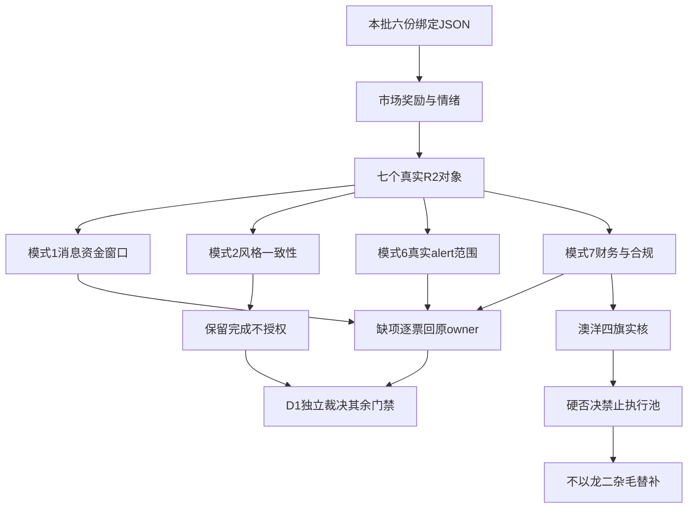

# 2026年11月13日 · 反证 / Devil’s Advocate

> 数据源新鲜度：partial　降级：true　置信度：0.70（覆盖可追溯性，不是胜率）

## 一句话结论
澳洋健康财务四旗硬拦截；七票均有实质审查，但必要审核尚未全项完成，不全局禁买。

## 详细分析

情绪=震荡/主跌风险。市场奖励有限水产首板与容量核心分离，不奖励全面接力：R1炸板率48.61%，前日涨停池收盘反馈中位数为负。R2已将14个比较对象减半至7个研究对象；这不是7个可买对象。主线=水产概念（研究），持续性=1日（仅最新资金窗口），封板率=100%（3封0炸，不能当全市场），明日预期=分歧。

先认市场，再认板块及核心。东方海洋保留水产研究龙一，不因净流出让百洋篡位；芯片、福建、脑机、AI营销只保留原R2次线身份。本轮不从股票概念猜板块，不从日期猜轮次，所有round_id保持原null。首板隔日是唯一主模板，非涨停容量研究不能自动变成首板执行资格。

本轮模式2七票均有据完成，保留这些比较结果；模式1仅澳洋的消息语义与同日日终事实完成有限交叉，其余缺口逐票披露。模式6三个精确板块对象分支完成，其他四票保留同票已查与板块未知的差异。模式7七票财务计算与原文都有实核，但R5自己声明关键S2监管证据未闭合，必要审核仍未完成。缺席不投否决票，完成也不授买权。

澳洋F1/F3/F8/F10四项原规则命中构成独立财务硬否决，不能被标准立项、资金净流入或标准无保留审计覆盖。另查出R5七票F4周转率期初余额错前移一年，已在本批嵌入原件范围内纠正；七票F4布尔方向未变。既保留真实风险，也不照抄错误周转率。R6未联网、未调MCP、未另启模型，未修改任何上游、计划、预算或执行授权。

## 审核覆盖总表

| 对象 | 模式1 资金消息 | 模式2 风格 | 模式6 出货 | 模式7 财务合规 | 必要全项完成 | 态度 |
|---|---|---|---|---|---|---|
| 东方海洋 002086.SZ | 局部已审／未完成 | 已审完成 | 局部已审／未完成 | 局部已审／未完成 | 否 | 降级 |
| 百洋股份 002696.SZ | 局部已审／未完成 | 已审完成 | 局部已审／未完成 | 局部已审／未完成 | 否 | 降级 |
| 寒武纪 688256.SH | 局部已审／未完成 | 已审完成 | 已审完成 | 局部已审／未完成 | 否 | 降级 |
| 通富微电 002156.SZ | 局部已审／未完成 | 已审完成 | 已审完成 | 局部已审／未完成 | 否 | 降级 |
| 日上集团 002593.SZ | 局部已审／未完成 | 已审完成 | 局部已审／未完成 | 局部已审／未完成 | 否 | 降级 |
| 澳洋健康 002172.SZ | 已审完成 | 已审完成 | 局部已审／未完成 | 局部已审／未完成 | 否 | 拦截 |
| 蓝色光标 300058.SZ | 局部已审／未完成 | 已审完成 | 已审完成 | 局部已审／未完成 | 否 | 观察 |

必要全项完成0/7；至少一个模式有据审查7/7。共12条实质反证：9条strong_suggest、2条soft_suggest、1条hard_reject。三类计数不混用。未知alert不当false，空否决列表不代表安全。

## 风险流向图

## 逐票实质审核

### 东方海洋 002086.SZ：降级

板型：反复回封首板（17天9次涨停背景），开板26次。龙头认定：R2原龙头，纪律§2已核3/4，未核不当通过。盈亏比：未知；止损距离未知，不能进执行。禁止清单：仅继承原部分检查，空命中不当排除全部禁项；R6不代替D1/execute完整门禁。

大资金意图：资金可能借最高辨识度完成日内换手而非锁仓，净流出不能称洗盘。 这是统计证据下的反向解释，不声称知道账户真实动机。

为什么走强：水产三票联动和名称辨识度推动，非新增利润拐点。；11/7原公告明确海洋/大健康两大板块均亏损、涨幅偏离基本面，不能以消费主线掩盖。 只解释被审主张，不给正向买入结论。

逻辑够不够硬：仅有限研究依据成立，消息/合规缺口及下列真实反面不能被核心身份豁免。

模式1（局部已审／未完成）：R2将东方海洋列水产辨识度龙一，而同票11/6—11/12大单分档合计-1.2431亿元、东财-1.427766亿元，11/12仍涨停且开板26次，资金与封板承接存在实质反面。R4已查事件范围未有同票水产硬催化；R5内嵌11/7原公告反称两大板块亏损。R7未覆盖本票不解释成无资金，实际使用R5已核同窗价格/资金。但R4同票消息交叉仍缺，必要项未完成；不是因缺R7未完成。

模式2（已审完成）：R1情绪=震荡/主跌风险、炸板48.61%；R2已将14票减半为7票且东方海洋仅观察、execution_eligible=false，主线未授权。故未发现“R1降温而R2已授全面进攻”的事实冲突；26次开板及尾封在本温度下反对无条件首板隔日接力，仍保留原有模式2有据完成。

模式6（局部已审／未完成）：同票检查=checked, alert=False, 排名={'20261111': 6, '20261112': 1}；同票检查=checked, alert=False, 排名={'20261111': 10, '20261112': 1}。检查窗口为11/11—11/12末次快照，单票false只代表该实查分支；不把预制菜等概念或同票false冒充未查水产/脑机板块false。 原硬约束所需精确板块alert仍未知，必要项局部未完成；未知不是出货，不据此签发hard_reject。 R5两口径5日均净流出，但无已证板块alert，不能按模式6硬否决。

模式7（局部已审／未完成）：已按R5实际三表输入复算F1/F2/F3/F4/F6/F8/F9/F10可适用项；已核财务警报=S1。F5只认H1研发流量，F11按真实控股主体核验；年度审计正文有标准无保留意见，关键审计事项不等强调事项。S3有196条当前ST列表精确匹配及已读法定警示范围，不拿利润正值代替检查。 东方海洋原文存在历史虚假陈述赔偿和2022处罚线索；原决定、现行适用窗口未闭合，保留实质风险，不凭旧标签猜历史立场或无限延用hard_reject。 R5明确独立监管记录未取得，S2关键合规证据仍未知，本票必要审核未完成；不能将有限公司自报无处罚当独立监管阴性，也不额外要求全球全历史排查。F7或非实质F2未知只局部降级，不是本票未完成的原因。 F4原周转率的期初余额错前移一年，本轮依内嵌Q3原文修正，两期同口径重算后触发方向不变；见financial_recalculations。

买入理由（被审假设，非R6建议）：水产三票中首封09:25、跨平台人气第一，仍是研究龙一；26次开板、15:00终封、当日净流出0.52637亿及5日-1.427847亿是真实承接反证。只保留观察，不因单项净流出改用资金第一百洋冒充龙一。首板只是当日连板数，9/17涨停记录不等低位新股。 本轮只审其漏洞，不授今日核心、补涨或试错买权；in_today_plan仍未知。

风险点：R6_M7_01 R2研究地位/资金强不能替代财务合规；原旗数量及方法须实核；R6_M1_01 最早封板与最高人气可以解释为先手持续锁筹。

止损条件（研究逻辑证伪，非交易指令）：若次日资金仍流出且无人助攻，主线锚失败；仅人气第一不足以令次日有人接。 R6不生成止损价格、不调整现持仓；真实执行仍遵守T+1与原授权。

可验证假设：由原owner补齐本票缺项，核竞价/开盘后的承接和可比消息反应；财务红旗须由有效新证据逐项证伪，不能仅凭上涨覆盖。辅助缺口不阻其他已完成必要分支，必要未完成也不自动变全局禁买。

证据定位：R2 /main_lines/0/leaders/0；R5 /profiles/0；原始文档SHA见机读upstream_versions。

### 百洋股份 002696.SZ：降级

板型：首板回封。龙头认定：R2原龙二，纪律§2已核3/4，未核不当通过。盈亏比：未知；止损距离未知，不能进执行。禁止清单：仅继承原部分检查，空命中不当排除全部禁项；R6不代替D1/execute完整门禁。

大资金意图：净买与高换手同时发生，买方在博弈水产情绪续强，不等筹码已集中。 这是统计证据下的反向解释，不声称知道账户真实动机。

为什么走强：水产资金回流与首板助攻，历史股性近期极佳仅为辅助。 只解释被审主张，不给正向买入结论。

逻辑够不够硬：仅有限研究依据成立，消息/合规缺口及下列真实反面不能被核心身份豁免。

模式1（局部已审／未完成）：百洋同窗分档5日+5.473939亿、东财+5.427767亿，资金方向一致，不造净流出冲突；11次开板/36.51%换手意味着净流入不是锁筹。R4范围无同票新硬催化，R5旧10/22异动原文只能作旧风险背景，不能冒称本轮新增利空。缺R4对应消息，不以R7榜单旧分类否定本票。

模式2（已审完成）：R1低温与百洋首板高换手风险相关；R2只列水产龙二观察，没有因龙一资金流出让其升位，数量减半已做。二者研究/执行分层一致；不能把首板低连板误解为低位置或买权，模式2完成。

模式6（局部已审／未完成）：R3实际检查范围未覆盖该票或精确板块。检查窗口为11/11—11/12末次快照，单票false只代表该实查分支；不把预制菜等概念或同票false冒充未查水产/脑机板块false。 原硬约束所需精确板块alert仍未知，必要项局部未完成；未知不是出货，不据此签发hard_reject。 本票5日两口径资金均为正，且无已证板块alert，不形成模式6硬否决。

模式7（局部已审／未完成）：已按R5实际三表输入复算F1/F2/F3/F4/F6/F8/F9/F10可适用项；已核财务警报=F3、F4、F10。F5只认H1研发流量，F11按真实控股主体核验；年度审计正文有标准无保留意见，关键审计事项不等强调事项。S3有196条当前ST列表精确匹配及已读法定警示范围，不拿利润正值代替检查。 R5明确独立监管记录未取得，S2关键合规证据仍未知，本票必要审核未完成；不能将有限公司自报无处罚当独立监管阴性，也不额外要求全球全历史排查。F7或非实质F2未知只局部降级，不是本票未完成的原因。 F4原周转率的期初余额错前移一年，本轮依内嵌Q3原文修正，两期同口径重算后触发方向不变；见financial_recalculations。

买入理由（被审假设，非R6建议）：水产同梯队09:30首封，5日5.427832亿为18成分第一，当日4.582947亿；原预制菜月度锚TOP3之一。人气和首封不及东方海洋，列龙二而非以净流入篡位；11次开板、14:30终封与36.51%换手必须核次日承接。20—50亿风险警示。 本轮只审其漏洞，不授今日核心、补涨或试错买权；in_today_plan仍未知。

风险点：R6_M7_02 R2研究地位/资金强不能替代财务合规；原旗数量及方法须实核；R6_M9_01 百洋首板与资金第一意味着低位、筹码锁定。

止损条件（研究逻辑证伪，非交易指令）：核心未失位时研究龙二能否持续助攻，核心失位不自动顶成龙一。 R6不生成止损价格、不调整现持仓；真实执行仍遵守T+1与原授权。

可验证假设：由原owner补齐本票缺项，核竞价/开盘后的承接和可比消息反应；财务红旗须由有效新证据逐项证伪，不能仅凭上涨覆盖。辅助缺口不阻其他已完成必要分支，必要未完成也不自动变全局禁买。

证据定位：R2 /main_lines/0/leaders/1；R5 /profiles/1；原始文档SHA见机读upstream_versions。

### 寒武纪 688256.SH：降级

板型：非涨停容量上涨，趋势完整性待R5。龙头认定：R2原龙头，纪律§2已核3/4，未核不当通过。盈亏比：未知；止损距离未知，不能进执行。禁止清单：仅继承原部分检查，空命中不当排除全部禁项；R6不代替D1/execute完整门禁。

大资金意图：大资金集中国产算力核心而非宽芯片普涨，正现金利润不等订单现金回收。 这是统计证据下的反向解释，不声称知道账户真实动机。

为什么走强：盈利高增长与单票容量分离共振，昨日量能放大并收复MA20。 只解释被审主张，不给正向买入结论。

逻辑够不够硬：仅有限研究依据成立，消息/合规缺口及下列真实反面不能被核心身份豁免。

模式1（局部已审／未完成）：寒武纪11/12+8.1111%且同窗5日分档+33.536174亿、东财+34.208563亿，支持局部容量而非全板块扩散；R4中芯业绩同源正负分面并存，盘后17:35才可知，不能用11/12日线称其已经利好不涨或利空不跌，亦非寒武纪公司订单。可比事后价格/公司消息缺证，必要项未完成；R7同票正流入不抹掉现金流红旗。

模式2（已审完成）：R1广度弱不排除少数容量分离，R2只把寒武纪列芯片次线观察，非确认全科技主升，与R1不构成直接矛盾。但首板隔日主模板不适配非涨停容量票，D1不得把研究地位自动转换为首板通道执行资格。模式2完成不等模板通过。

模式6（已审完成）：板块885756.TI检查=checked, alert=False, 排名={'20261111': 13, '20261112': 14}。检查窗口为11/11—11/12末次快照，单票false只代表该实查分支；不把预制菜等概念或同票false冒充未查水产/脑机板块false。 精确板块已查false，本必要出货分支在该有限窗口完成，不要求补全市场扫描；其余未知单票支路不被声称已排除。 本票5日两口径资金均为正，且无已证板块alert，不形成模式6硬否决。

模式7（局部已审／未完成）：已按R5实际三表输入复算F1/F2/F3/F4/F6/F8/F9/F10可适用项；已核财务警报=F4、F8。F5只认H1研发流量，F11按真实控股主体核验；年度审计正文有标准无保留意见，关键审计事项不等强调事项。S3有196条当前ST列表精确匹配及已读法定警示范围，不拿利润正值代替检查。 R5明确独立监管记录未取得，S2关键合规证据仍未知，本票必要审核未完成；不能将有限公司自报无处罚当独立监管阴性，也不额外要求全球全历史排查。F7或非实质F2未知只局部降级，不是本票未完成的原因。 F4原周转率的期初余额错前移一年，本轮依内嵌Q3原文修正，两期同口径重算后触发方向不变；见financial_recalculations。

买入理由（被审假设，非R6建议）：国产算力容量辨识度，11/12上涨8.11%、成交201.72亿；芯片THS现成分949只中5日净流入34.208563亿第一，窄AI芯片39成分也第一。不是连板妖股替代票，不因688前缀剔除；板块仍跌、资金口径冲突，暂列次线观察。 本轮只审其漏洞，不授今日核心、补涨或试错买权；in_today_plan仍未知。

风险点：R6_M7_03 R2研究地位/资金强不能替代财务合规；原旗数量及方法须实核；R6_M3_01 寒武纪高ROE即可代表盈利高质量、估值安全。

止损条件（研究逻辑证伪，非交易指令）：若科技风险冲击使容量核心转弱，窄强扩散假设证伪；中芯指引双面事件不当同一硬利好。 R6不生成止损价格、不调整现持仓；真实执行仍遵守T+1与原授权。

可验证假设：由原owner补齐本票缺项，核竞价/开盘后的承接和可比消息反应；财务红旗须由有效新证据逐项证伪，不能仅凭上涨覆盖。辅助缺口不阻其他已完成必要分支，必要未完成也不自动变全局禁买。

证据定位：R2 /secondary_lines/0/leaders/0；R5 /profiles/2；原始文档SHA见机读upstream_versions。

### 通富微电 002156.SZ：降级

板型：首板炸板未封。龙头认定：R2原龙二，纪律§2已核3/4，未核不当通过。盈亏比：未知；止损距离未知，不能进执行。禁止清单：仅继承原部分检查，空命中不当排除全部禁项；R6不代替D1/execute完整门禁。

大资金意图：资金在封测核心下注而非全面风险偏好恢复，炸板显示上方筹码仍兑现。 这是统计证据下的反向解释，不声称知道账户真实动机。

为什么走强：当日资金流入与封测叙事支持上涨，但收盘涨幅仅5.36%不是成功封板。 只解释被审主张，不给正向买入结论。

逻辑够不够硬：仅有限研究依据成立，消息/合规缺口及下列真实反面不能被核心身份豁免。

模式1（局部已审／未完成）：通富5日分档+8.761131亿、东财+8.660067亿，11/12上涨5.36%并非封板确认。R4中芯毛利率/资本开支风险只是需求节奏间接证据，不证明通富订单下降；消息盘后与日线不属事后反应窗口。保留间接风险，缺同票/同窗消息反应，必要项未完成。

模式2（已审完成）：R2通富为芯片龙二次线、未封板、仅观察，R1高位震荡不等所有科技禁研；没有已授进攻权限的矛盾。首板主模板下不能将5.36%上涨当封板次日接力资格；保留模式2比较完成。

模式6（已审完成）：同票检查=unknown, alert=None, 排名={'20261111': None, '20261112': 8}；板块885756.TI检查=checked, alert=False, 排名={'20261111': 13, '20261112': 14}。检查窗口为11/11—11/12末次快照，单票false只代表该实查分支；不把预制菜等概念或同票false冒充未查水产/脑机板块false。 精确板块已查false，本必要出货分支在该有限窗口完成，不要求补全市场扫描；其余未知单票支路不被声称已排除。 本票5日两口径资金均为正，且无已证板块alert，不形成模式6硬否决。

模式7（局部已审／未完成）：已按R5实际三表输入复算F1/F2/F3/F4/F6/F8/F9/F10可适用项；已核财务警报=F4、F6、F10。F5只认H1研发流量，F11按真实控股主体核验；年度审计正文有标准无保留意见，关键审计事项不等强调事项。S3有196条当前ST列表精确匹配及已读法定警示范围，不拿利润正值代替检查。 R5明确独立监管记录未取得，S2关键合规证据仍未知，本票必要审核未完成；不能将有限公司自报无处罚当独立监管阴性，也不额外要求全球全历史排查。F7或非实质F2未知只局部降级，不是本票未完成的原因。 F4原周转率的期初余额错前移一年，本轮依内嵌Q3原文修正，两期同口径重算后触发方向不变；见financial_recalculations。

买入理由（被审假设，非R6建议）：封测方向的人气与资金核心对照，当日5.36%、净流入8.622919亿；曾触涨停但收盘炸板，不能写成功首板。与寒武纪作国产芯片容量/封测双核心研究排序第二，不把宽概念4家封板当它自身连板；并不满足全芯片资金前二。 本轮只审其漏洞，不授今日核心、补涨或试错买权；in_today_plan仍未知。

风险点：R6_M7_04 R2研究地位/资金强不能替代财务合规；原旗数量及方法须实核。

止损条件（研究逻辑证伪，非交易指令）：只作封测容量对照，不用临时追高伪装弱转强；须R5核结构。 R6不生成止损价格、不调整现持仓；真实执行仍遵守T+1与原授权。

可验证假设：由原owner补齐本票缺项，核竞价/开盘后的承接和可比消息反应；财务红旗须由有效新证据逐项证伪，不能仅凭上涨覆盖。辅助缺口不阻其他已完成必要分支，必要未完成也不自动变全局禁买。

证据定位：R2 /secondary_lines/0/leaders/1；R5 /profiles/3；原始文档SHA见机读upstream_versions。

### 日上集团 002593.SZ：降级

板型：二板换手回封。龙头认定：R2原龙头，纪律§2已核3/4，未核不当通过。盈亏比：未知；止损距离未知，不能进执行。禁止清单：仅继承原部分检查，空命中不当排除全部禁项；R6不代替D1/execute完整门禁。

大资金意图：大换手争夺区域情绪高度，净流出提示先手兑现，不以高度抹掉资金反证。 这是统计证据下的反向解释，不声称知道账户真实动机。

为什么走强：二板高度和同区域助攻是强点；AI政策至钢加工利润的传导未证。；11/13异动原公告明确主营未重大变化、短涨偏离基本面；本阶段实际取到，不反推06:30前已公开。 只解释被审主张，不给正向买入结论。

逻辑够不够硬：仅有限研究依据成立，消息/合规缺口及下列真实反面不能被核心身份豁免。

模式1（局部已审／未完成）：日上二板及5日分档+0.681826亿、东财+0.659814亿证明个股正流入，R7漏覆盖不构成否认。R2海峡概念下跌1.2129%、流出64.404911亿反对全线进攻；R4未核福建AI政策对钢加工利润映射。R5实际获取11/13异动原文称主营未变，原公开时刻未知，不能回填为11/12已知事件。缺R4映射与可比事后窗口，必要项未完成。

模式2（已审完成）：日上二板相对地位是R2有限区域研究，不是R1所指全市场扩散；R2记录概念资金流出并只观察，符合低温研究分层。板型存在不抵消政策到利润链断点，模式2完成。

模式6（局部已审／未完成）：板块885939.TI检查=unknown, alert=None, 排名={'20261111': None, '20261112': 4}。检查窗口为11/11—11/12末次快照，单票false只代表该实查分支；不把预制菜等概念或同票false冒充未查水产/脑机板块false。 原硬约束所需精确板块alert仍未知，必要项局部未完成；未知不是出货，不据此签发hard_reject。 本票5日两口径资金均为正，且无已证板块alert，不形成模式6硬否决。

模式7（局部已审／未完成）：已按R5实际三表输入复算F1/F2/F3/F4/F6/F8/F9/F10可适用项；已核财务警报=本已查有限范围无已证财务红旗。F5只认H1研发流量，F11按真实控股主体核验；年度审计正文有标准无保留意见，关键审计事项不等强调事项。S3有196条当前ST列表精确匹配及已读法定警示范围，不拿利润正值代替检查。 R5明确独立监管记录未取得，S2关键合规证据仍未知，本票必要审核未完成；不能将有限公司自报无处罚当独立监管阴性，也不额外要求全球全历史排查。F7或非实质F2未知只局部降级，不是本票未完成的原因。 F4原周转率的期初余额错前移一年，本轮依内嵌Q3原文修正，两期同口径重算后触发方向不变；见financial_recalculations。

买入理由（被审假设，非R6建议）：海峡两岸当日2板为已核成分高度第一，09:30首封早于福建水泥和九牧王；流通29.31亿，31.26%换手。净流出0.348989亿不能抹掉地位；5日+0.65983亿、历史近期股性差并列，区域政策传导未核，不称已确认产业受益。 本轮只审其漏洞，不授今日核心、补涨或试错买权；in_today_plan仍未知。

风险点：R6_M1_02 福建AI政策与日上二板足以确认整线合力及公司利润兑现。

止损条件（研究逻辑证伪，非交易指令）：低位2板不保证仍低风险；若次日无区域助攻且龙一断承接，切换失败。 R6不生成止损价格、不调整现持仓；真实执行仍遵守T+1与原授权。

可验证假设：由原owner补齐本票缺项，核竞价/开盘后的承接和可比消息反应；财务红旗须由有效新证据逐项证伪，不能仅凭上涨覆盖。辅助缺口不阻其他已完成必要分支，必要未完成也不自动变全局禁买。

证据定位：R2 /secondary_lines/1/leaders/0；R5 /profiles/4；原始文档SHA见机读upstream_versions。

### 澳洋健康 002172.SZ：拦截

板型：反包首板（4天2板），开板4次。龙头认定：R2原龙头，纪律§2已核2/4，未核不当通过。盈亏比：未知；止损距离未知，不能进执行。禁止清单：仅继承原部分检查，空命中不当排除全部禁项；模式7硬否决已命中。

大资金意图：单票资金集中但板块整体流出，可能是存量资金反包而非新主线建仓。 这是统计证据下的反向解释，不声称知道账户真实动机。

为什么走强：近期股性与康复语义推动反包，标准立项不是公司获认证或订单。 只解释被审主张，不给正向买入结论。

逻辑够不够硬：不够。四项财务红旗已独立达到硬否决阈值。

模式1（已审完成）：R4已核11/12盘中9项脑机接口标准立项，原文并非标准实施或澳洋订单；R5同日涨停及5日分档+6.478056亿、东财+6.449765亿允许在共同交易日窗口做有限独立交叉。个股正流入与R2脑机概念跌1.72%/流出8.404177亿相背，不能推全行业回流。R4 price_reaction模板称尚未新交易时段与其11/12 11:13事件时间不符，本轮保留时点矛盾，不据日终值证明消息因果或盘中先后。完成的是消息含义×同窗日终事实的有限比较，不是标准官方附件或订单受益认证。

模式2（已审完成）：澳洋反包首板在震荡市场只作事件观察，R2未确认脑机主线、纪律龙头仅2/4且无执行资格，与R1低温不冲突。模式2完成不能覆盖本轮模式7真实财务硬否决。

模式6（局部已审／未完成）：同票检查=checked, alert=False, 排名={'20261111': 68, '20261112': 19}。检查窗口为11/11—11/12末次快照，单票false只代表该实查分支；不把预制菜等概念或同票false冒充未查水产/脑机板块false。 原硬约束所需精确板块alert仍未知，必要项局部未完成；未知不是出货，不据此签发hard_reject。 本票5日两口径资金均为正，且无已证板块alert，不形成模式6硬否决。

模式7（局部已审／未完成）：已按R5实际三表输入复算F1/F2/F3/F4/F6/F8/F9/F10可适用项；已核财务警报=F1、F3、F8、F10。F5只认H1研发流量，F11按真实控股主体核验；年度审计正文有标准无保留意见，关键审计事项不等强调事项。S3有196条当前ST列表精确匹配及已读法定警示范围，不拿利润正值代替检查。 澳洋F1/F3/F8/F10四项均按原规则成立，F8是Q2/Q3独立单季负CFO且单季利润均正，触发≥4项原模式7 hard_reject；持续经营关键审计事项不是本次F12硬否决原因。 R5明确独立监管记录未取得，S2关键合规证据仍未知，本票必要审核未完成；不能将有限公司自报无处罚当独立监管阴性，也不额外要求全球全历史排查。F7或非实质F2未知只局部降级，不是本票未完成的原因。 F4原周转率的期初余额错前移一年，本轮依内嵌Q3原文修正，两期同口径重算后触发方向不变；见financial_recalculations。

买入理由（被审假设，非R6建议）：脑机接口78只现成分5日净流入6.449818亿第一，11/12唯一封板、4天2板反包。R4标准立项事件与康复语义匹配仅为间接假设，非公司获认证或订单；概念整体净流出8.404亿，个股强与板块弱并存。 本轮只审其漏洞，不授今日核心、补涨或试错买权；in_today_plan仍未知。

风险点：R6_M7_05 R2研究地位/资金强不能替代财务合规；原旗数量及方法须实核；R6_M1_03 脑机标准立项与澳洋涨停足以证明公司订单及全板块回流。

止损条件（研究逻辑证伪，非交易指令）：若仅一票反包无新增跟随，不能把事件热度升级主线。 R6不生成止损价格、不调整现持仓；真实执行仍遵守T+1与原授权。

可验证假设：由原owner补齐本票缺项，核竞价/开盘后的承接和可比消息反应；财务红旗须由有效新证据逐项证伪，不能仅凭上涨覆盖。辅助缺口不阻其他已完成必要分支，必要未完成也不自动变全局禁买。

证据定位：R2 /secondary_lines/2/leaders/0；R5 /profiles/5；原始文档SHA见机读upstream_versions。

### 蓝色光标 300058.SZ：观察

板型：非涨停容量上涨，趋势完整性待R5。龙头认定：R2原龙头，纪律§2已核3/4，未核不当通过。盈亏比：未知；止损距离未知，不能进执行。禁止清单：仅继承原部分检查，空命中不当排除全部禁项；R6不代替D1/execute完整门禁。

大资金意图：资金高度集中营销核心，对手盘是前期套牢和兑现筹码，净买不能等同长期机构配置。 这是统计证据下的反向解释，不声称知道账户真实动机。

为什么走强：单日10.89%配合量能和资金，但不是20cm封板，也未证全应用普涨。 只解释被审主张，不给正向买入结论。

逻辑够不够硬：仅有限研究依据成立，消息/合规缺口及下列真实反面不能被核心身份豁免。

模式1（局部已审／未完成）：蓝色单日+10.8941%、5日分档+20.343406亿、东财+20.204491亿是真实个股集中，R7营销代理正流入不等AI应用普涨；10.89%不是20cm封板。R4没有同票新增公司硬催化，不能拿华为/海外AI叙事替代公司消息；该必要交叉未完成，不因R7已覆盖就写通过。

模式2（已审完成）：蓝色非涨停容量与R1局部分离可并存，R2列次线观察而非全AI应用已进；风格比较完成。首板隔日模板不能静默改成趋势锁仓，也不能将资金榜第一当全市场共识或执行资格。

模式6（已审完成）：同票检查=unknown, alert=None, 排名={'20261111': None, '20261112': 5}；板块886108.TI检查=checked, alert=False, 排名={'20261111': 8, '20261112': 9}。检查窗口为11/11—11/12末次快照，单票false只代表该实查分支；不把预制菜等概念或同票false冒充未查水产/脑机板块false。 精确板块已查false，本必要出货分支在该有限窗口完成，不要求补全市场扫描；其余未知单票支路不被声称已排除。 本票5日两口径资金均为正，且无已证板块alert，不形成模式6硬否决。

模式7（局部已审／未完成）：已按R5实际三表输入复算F1/F2/F3/F4/F6/F8/F9/F10可适用项；已核财务警报=F3。F5只认H1研发流量，F11按真实控股主体核验；年度审计正文有标准无保留意见，关键审计事项不等强调事项。S3有196条当前ST列表精确匹配及已读法定警示范围，不拿利润正值代替检查。 R5明确独立监管记录未取得，S2关键合规证据仍未知，本票必要审核未完成；不能将有限公司自报无处罚当独立监管阴性，也不额外要求全球全历史排查。F7或非实质F2未知只局部降级，不是本票未完成的原因。 F4原周转率的期初余额错前移一年，本轮依内嵌Q3原文修正，两期同口径重算后触发方向不变；见financial_recalculations。

买入理由（被审假设，非R6建议）：AI应用554只现成分中5日资金20.204491亿第一；当日净流入23.471405亿、涨10.89%但不是20cm封板。R7营销个股集中而非全应用回流，保留容量龙一观察；300前缀不构成剔除理由。 本轮只审其漏洞，不授今日核心、补涨或试错买权；in_today_plan仍未知。

风险点：R6_M7_06 R2研究地位/资金强不能替代财务合规；原旗数量及方法须实核；R6_M1_04 AI营销个股集中流入等于全AI应用主线确认。

止损条件（研究逻辑证伪，非交易指令）：若次日资金与涨幅回吐且无应用跟随，容量分离仅一日；不以人气题材泛化续涨。 R6不生成止损价格、不调整现持仓；真实执行仍遵守T+1与原授权。

可验证假设：由原owner补齐本票缺项，核竞价/开盘后的承接和可比消息反应；财务红旗须由有效新证据逐项证伪，不能仅凭上涨覆盖。辅助缺口不阻其他已完成必要分支，必要未完成也不自动变全局禁买。

证据定位：R2 /secondary_lines/3/leaders/0；R5 /profiles/6；原始文档SHA见机读upstream_versions。

## 实质反证及D1处理

### R6_M7_01 · 东方海洋 · strong_suggest

R2研究地位/资金强不能替代财务合规；原旗数量及方法须实核

- S1：2024/2025年度归母净利均负，原研究财务轴警报；不是现行ST认定 来源：Tushare Pro live SDK; original statement fields。

降级：D1须显式接受或在meta.d1_override记录反证及覆盖理由；不得把研究龙头地位作为红旗豁免。

限定条件：S2关键合规仍未完成；这是已有财务反面发现，不因未完成而抹掉，不把缺证本身升级硬否决。；F3为原1.5倍阈值；收入收缩时可能有比例效应，不能措辞为公司收入正增长或应收绝对暴增。；F4周转率已复算输入，但期初余额报告期标签含疑，交R5核报告期；不把该辅助追溯缺口写成全票无财务证据。

关联：sector_id=BK0967.DC；round_id=null；event_at=null；有效窗口仅沿用本次R2盘前研究至开盘，不冒充事件原公开时间，不自动撤销财务硬否决。

### R6_M7_02 · 百洋股份 · strong_suggest

R2研究地位/资金强不能替代财务合规；原旗数量及方法须实核

- F3：应收同比=20.54%，收入同比=11.01%；收入收缩时警报含比例效应，不等绝对应收暴增 来源：Tushare Pro live SDK; original statement fields。
- F4：存货增速超过收入增速1.5倍；R6按真实期初重算周转率3.594243→2.709632下降。R5原周转率数值因期初错年不采纳，但F4风险结论仍成立。 来源：Tushare Pro live SDK; original statement fields。
- F10：有息负债/归母净资产=130.23% 来源：Tushare Pro live SDK; original statement fields。

降级：D1须显式接受或在meta.d1_override记录反证及覆盖理由；不得把研究龙头地位作为红旗豁免。

限定条件：S2关键合规仍未完成；这是已有财务反面发现，不因未完成而抹掉，不把缺证本身升级硬否决。；F3为原1.5倍阈值；收入收缩时可能有比例效应，不能措辞为公司收入正增长或应收绝对暴增。；F4已发现R5期初余额错年并依本版嵌入原文修正；保留同向触发，不沿用错误周转率数值。

关联：sector_id=BK0967.DC；round_id=null；event_at=null；有效窗口仅沿用本次R2盘前研究至开盘，不冒充事件原公开时间，不自动撤销财务硬否决。

### R6_M7_03 · 寒武纪 · strong_suggest

R2研究地位/资金强不能替代财务合规；原旗数量及方法须实核

- F4：存货增速超过收入增速1.5倍；R6按真实期初重算周转率0.748637→0.498719下降。R5原周转率数值因期初错年不采纳，但F4风险结论仍成立。 来源：Tushare Pro live SDK; original statement fields。
- F8：Q2/Q3单季CFO=[-522653189.64000005, -83677874.95999998]元；两季单季利润均为正，非累计负值重复计期 来源：Tushare Pro live SDK; original statement fields。

降级：D1须显式接受或在meta.d1_override记录反证及覆盖理由；不得把研究龙头地位作为红旗豁免。

限定条件：S2关键合规仍未完成；这是已有财务反面发现，不因未完成而抹掉，不把缺证本身升级硬否决。；F3为原1.5倍阈值；收入收缩时可能有比例效应，不能措辞为公司收入正增长或应收绝对暴增。；F4已发现R5期初余额错年并依本版嵌入原文修正；保留同向触发，不沿用错误周转率数值。

关联：sector_id=885756.TI；round_id=null；event_at=null；有效窗口仅沿用本次R2盘前研究至开盘，不冒充事件原公开时间，不自动撤销财务硬否决。

### R6_M7_04 · 通富微电 · strong_suggest

R2研究地位/资金强不能替代财务合规；原旗数量及方法须实核

- F4：存货增速超过收入增速1.5倍；R6按真实期初重算周转率4.535233→4.133645下降。R5原周转率数值因期初错年不采纳，但F4风险结论仍成立。 来源：Tushare Pro live SDK; original statement fields。
- F6：(归母净利-扣非)/归母净利=54.98% 来源：Tushare Pro live SDK; original statement fields。
- F10：有息负债/归母净资产=100.35% 来源：Tushare Pro live SDK; original statement fields。

降级：D1须显式接受或在meta.d1_override记录反证及覆盖理由；不得把研究龙头地位作为红旗豁免。

限定条件：S2关键合规仍未完成；这是已有财务反面发现，不因未完成而抹掉，不把缺证本身升级硬否决。；F3为原1.5倍阈值；收入收缩时可能有比例效应，不能措辞为公司收入正增长或应收绝对暴增。；F4已发现R5期初余额错年并依本版嵌入原文修正；保留同向触发，不沿用错误周转率数值。

关联：sector_id=885756.TI；round_id=null；event_at=null；有效窗口仅沿用本次R2盘前研究至开盘，不冒充事件原公开时间，不自动撤销财务硬否决。

### R6_M7_05 · 澳洋健康 · hard_reject

R2研究地位/资金强不能替代财务合规；原旗数量及方法须实核

- F1：货币资金/总资产=24.15%，短借/总资产=47.93% 来源：Tushare Pro live SDK; original statement fields。
- F3：应收同比=4.94%，收入同比=-8.22%；收入收缩时警报含比例效应，不等绝对应收暴增 来源：Tushare Pro live SDK; original statement fields。
- F8：Q2/Q3单季CFO=[-81605174.62, -32048390.090000004]元；两季单季利润均为正，非累计负值重复计期 来源：Tushare Pro live SDK; original statement fields。
- F10：有息负债/归母净资产=439.14% 来源：Tushare Pro live SDK; original statement fields。

拦截：hard_reject — 禁止纳入execution_pool，可留研究观察；不因资金正流入或标准立项覆盖。禁止龙二/弹性核心/低位补涨替补，不为数量造票。

限定条件：S2关键合规仍未完成；这是已有财务反面发现，不因未完成而抹掉，不把缺证本身升级硬否决。；F3为原1.5倍阈值；收入收缩时可能有比例效应，不能措辞为公司收入正增长或应收绝对暴增。；F4周转率已复算输入，但期初余额报告期标签含疑，交R5核报告期；不把该辅助追溯缺口写成全票无财务证据。

关联：sector_id=886047.TI；round_id=null；event_at=null；有效窗口仅沿用本次R2盘前研究至开盘，不冒充事件原公开时间，不自动撤销财务硬否决。

### R6_M7_06 · 蓝色光标 · soft_suggest

R2研究地位/资金强不能替代财务合规；原旗数量及方法须实核

- F3：应收同比=31.10%，收入同比=3.92%；收入收缩时警报含比例效应，不等绝对应收暴增 来源：Tushare Pro live SDK; original statement fields。

观察：记录r6_soft_notes；不因单项红旗自动硬否决，继续核真实现金与消息。

限定条件：S2关键合规仍未完成；这是已有财务反面发现，不因未完成而抹掉，不把缺证本身升级硬否决。；F3为原1.5倍阈值；收入收缩时可能有比例效应，不能措辞为公司收入正增长或应收绝对暴增。；F4周转率已复算输入，但期初余额报告期标签含疑，交R5核报告期；不把该辅助追溯缺口写成全票无财务证据。

关联：sector_id=886108.TI；round_id=null；event_at=null；有效窗口仅沿用本次R2盘前研究至开盘，不冒充事件原公开时间，不自动撤销财务硬否决。

### R6_M1_01 · 东方海洋 · strong_suggest

最早封板与最高人气可以解释为先手持续锁筹

- 11/6—11/12分档5日-1.2431亿，东财-1.427766亿；11/12上涨10.0213%，R2记录26次开板与收盘终封，资金流出和反复打开反对锁筹叙事。 来源：R5 Tushare moneyflow + moneyflow_dc + daily。
- 两大业务板块仍亏损、股价偏离基本面；不把加工子业务盈利外推整个海洋板块盈利。 来源：R5内嵌CNINFO11/7公告。

降级：保持研究观察，D1须处理承接及现金流反证；不以人气第一默认首板隔日执行。

限定条件：不能认定实际主力账户出货；R3没有已证板块alert，不满足模式6硬否决。；R4同票消息缺证留模式1未完成；R5原文反面本身仍有效。

关联：sector_id=BK0967.DC；round_id=null；event_at=null；有效窗口仅沿用本次R2盘前研究至开盘，不冒充事件原公开时间，不自动撤销财务硬否决。

### R6_M9_01 · 百洋股份 · strong_suggest

百洋首板与资金第一意味着低位、筹码锁定

- 11次开板、14:30终封、换手36.5142%；R5内嵌10/22原文已有9交易日7涨停背景，首板不等低位置。 来源：R2实际回封/换手事实。

降级：不以资金第一升格替代龙一；D1须显式处理回封承接与隔日先手兑现风险。

限定条件：高度/换手本身不hard_reject；10/22风险为旧背景，不冒称11/13新增事件；未证明解套盘比例。

关联：sector_id=BK0967.DC；round_id=null；event_at=null；有效窗口仅沿用本次R2盘前研究至开盘，不冒充事件原公开时间，不自动撤销财务硬否决。

### R6_M3_01 · 寒武纪 · strong_suggest

寒武纪高ROE即可代表盈利高质量、估值安全

- V4：9M ROE27.556%，CFO227636767.5元/归母3714522759.8元=0.06128291094715397；F8另证Q2/Q3各自利润为正而CFO负。 来源：R5实际三表与ROE。

降级：按原估值陷阱命中规则交D1显式处理，不能以账面高增长掩盖现金转换；不另设PEG、权重或买权。

限定条件：V4仅辅助估值反证，不能计作第3/4条F红旗；PE146.7641不单凭高倍数硬否决。；未来可持续增长与PEG未核，不推定极贵标签；不将同一F8重复加权。

关联：sector_id=885756.TI；round_id=null；event_at=null；有效窗口仅沿用本次R2盘前研究至开盘，不冒充事件原公开时间，不自动撤销财务硬否决。

### R6_M1_02 · 日上集团 · strong_suggest

福建AI政策与日上二板足以确认整线合力及公司利润兑现

- 海峡概念跌1.2129%、净流出64.404911亿，与个股二板/正流入分离。 来源：R2实际概念资金/价格。
- 公司称主营未重大变化、短涨偏离基本面；钢加工至AI政策利润链未证。 来源：R5 CNINFO11/13异动原件。

降级：只保留区域情绪个股研究；不得把板块合力已确认或AI业务受益写入执行依据。

限定条件：R4政策原件/公司映射缺证不是已证政策为假；个股正流入不删除。；11/13公告首次公开时刻未知；不把11/12上涨写成利空不跌。

关联：sector_id=885939.TI；round_id=null；event_at=null；有效窗口仅沿用本次R2盘前研究至开盘，不冒充事件原公开时间，不自动撤销财务硬否决。

### R6_M1_03 · 澳洋健康 · strong_suggest

脑机标准立项与澳洋涨停足以证明公司订单及全板块回流

- 只确认9项行业标准获批立项，未取得工信部原附件；非实施、产品认证或澳洋订单。 来源：R4 top_events/22 + evidence_index/WEB09。
- 脑机概念跌1.72%且净流出8.404177亿，个股+4.49145亿单日正流入是分离不是板块全面主升。 来源：R2 + R5同窗口实际资金价格。

降级产业映射，且本票另有模式7 hard_reject必须拦截；无新正式订单证据不得把标准项目写成收益认证。

限定条件：消息事件在11/12盘中，而R4价格反应模板写尚未新交易时段；保留不一致，不拿模板抹掉真实盘中消息时间。；共同日终窗口只支持有限比较，不能证明资金是消息之后流入；本条strong不覆盖模式7hard。

关联：sector_id=886047.TI；round_id=null；event_at=null；有效窗口仅沿用本次R2盘前研究至开盘，不冒充事件原公开时间，不自动撤销财务硬否决。

### R6_M1_04 · 蓝色光标 · soft_suggest

AI营销个股集中流入等于全AI应用主线确认

- 蓝色单日+23.471405亿，营销代理+19.27954亿为窄映射；R3/R2 AI应用概念仍跌2.44%，传播与行业资金合力并非同义。 来源：R2 + R7 stock tracking。

观察：不进全面AI应用已确认叙事；保持容量分离研究与执行分层，不把10.89%当20cm封板。

限定条件：同票资金正向确认不删除；R4无同票新催化仅模式1缺项，不因缺口全盘禁买。

关联：sector_id=886108.TI；round_id=null；event_at=null；有效窗口仅沿用本次R2盘前研究至开盘，不冒充事件原公开时间，不自动撤销财务硬否决。

## 四象限负面识别

坐标采用“已核消息正负 × 可知之后同对象价格方向”；先核主体与时序，不为凑齐四格伪造样本。旧负面背景下上涨不等新利空即时反应。

| 象限 | 已核结果 | 负面识别 |
|---|---|---|
| 利好上涨 | 澳洋仅行业事件与同日日终分离假设，主体/盘后切片不闭合，不强配 | 立项不等实施或公司订单；财务硬否决不被涨停抹掉 |
| 利好不涨／下跌 | 脑机概念负反馈仅为同日跨层对照；中芯盘后事件不可倒配日线 | 不把时间错配当利好被否定 |
| 利空上涨 | 东方海洋、百洋在已披露旧风险背景下仍上涨 | 情绪收益不能证明基本面风险解除或低位 |
| 利空下跌 | 本批未取得足够同对象、已可知之后的可比证据 | 未填样本不是无风险，更不按severity猜历史立场 |

日上新公告公开时点未知、寒武纪/通富与中芯主体不同、蓝色公司新利好未核，均保留unknown，不硬塞四象限。

## 财务复算与上游错数

F1现金/资产与短借/资产、F3应收增速、F6非经常收益比、F8独立单季CFO、F9应收/收入及F10有息负债/净资产均按内嵌实际输入复算。F3沿用原1.5倍规则；澳洋收入收缩会产生比例效应，明确披露而不自行改阈值。V4不计入12条财务红旗数。

F4期初余额错年修正后：

| 对象 | 同期周转率 | 当前周转率 | F4结论 |
|---|---:|---:|---|
| 东方海洋 | 1.028435 | 0.906618 | 未命中，方向不变 |
| 百洋股份 | 3.594243 | 2.709632 | 命中，方向不变 |
| 寒武纪 | 0.748637 | 0.498719 | 命中，方向不变 |
| 通富微电 | 4.535233 | 4.133645 | 命中，方向不变 |
| 日上集团 | 2.480934 | 2.631175 | 未命中，方向不变 |
| 澳洋健康 | 8.239904 | 8.325317 | 未命中，方向不变 |
| 蓝色光标 | 3529.933074 | 4509.818400 | 未命中，方向不变 |

当前期初取本版内嵌三季报上年末余额，同期期初使用R5已列的上一年期初余额；不联网、未改R5文件。原始/修正数及逐票RFC6901指针全部保留在financial_recalculations。澳洋硬否决来自F1/F3/F8/F10，不依赖F4。

## 关键证据

- 🔴 澳洋F1/F3/F8/F10四条命中：现金与短借双高、应收比例警报、Q2/Q3独立单季CFO负且利润正、有息负债率高。来源：R5 /profiles/5/dimensions/valuation_safety/fundamental_checks。
- 🟠 东方海洋五日资金两口径均负、开板26次，且原文披露两大业务板块亏损。来源：R2主线龙一及R5 /profiles/0。
- 🟠 寒武纪CFO/归母约0.061，F8与V4指向现金兑现风险；高增长不等安全。来源：R5 /profiles/2。
- 🟠 R4脑机立项为盘中事件，与统一“尚无新交易时段”模板矛盾；保留真实时点，不制造消息后因果。来源：R4 /top_events/22、/evidence_index/WEB09。
- 🟢 模式2七票有据完成只表示风格比较完成；真实合规缺口与财务硬否决仍保留。来源：patterns_status逐票明细。

## 数据源审计

| 源 | 原状态 | 文档日期 | 已用范围 | 备注 |
|---|---|---|---|---|
| 🟠 R1 | degraded | 2026-11-13 | 全局温度、广度、炸板 | 原始字节hash已绑定，partial/degraded不抹掉已核事实 |
| 🟠 R2 | degraded | 2026-11-13 | 7对象、身份与原研究窗口 | 原始字节hash已绑定，partial/degraded不抹掉已核事实 |
| 🟠 R3 | degraded | 2026-11-13 | 精确检查对象及alert结果 | 原始字节hash已绑定，partial/degraded不抹掉已核事实 |
| 🟠 R4 | partial | 2026-11-13 | 消息、原文证据索引及原时点 | 原始字节hash已绑定，partial/degraded不抹掉已核事实 |
| 🟠 R5 | partial | 2026-11-13 | 7画像、三表计算、有限审计合规原文 | 原始字节hash已绑定，partial/degraded不抹掉已核事实 |
| 🟠 R7 | partial | 2026-11-13 | 实际覆盖个股/板块统计 | 原始字节hash已绑定，partial/degraded不抹掉已核事实 |

文档生成日期不冒充底层事实日期，逐笔capture与publication时点见JSON源版本和原字段。R2/R5交付回执与本批hash一致；R3/R4/R7按上游精确绑定版本核对，不假称独立交付回执齐全。R7本票池漏覆盖只由同版R5真实资金/价格补核，不新增owner/provider硬门槛。

## 不确定性 / 反证

S2仍未完成，但不新设全球全历史监管阴性要求；未完成不是已证违法，也不等安全。F12核到标准无保留审计，不能抹掉其他红旗；澳洋持续经营相关关键审计事项不是强调事项，本轮不是按F12否决。东方海洋历史虚假陈述赔偿线索保留，但原处罚决定与现行窗口未核，不据旧标签永久硬否决。

模式4缺许可历史库、模式5缺昨日R6/E1兑现、模式8无100+涨停前提且无解套盘比例、模式10无对应商品同窗证据，均局部降级，不连带卡住模式2或其他有据分支。模式3的未来增长/PEG未知也不补造。此次未读取raw、昨日报告、上游MD或原专题文件，不宣称全量排雷。

本阶段直接专题prepare失败：直接传递、读取、采用均unknown，context_sha256=null；上游不同context哈希与16项来源索引原样留痕，逐来源deferred，不将上游adopted改写为本轮完整采用。投影以外原文未读，不改变权重、预算或买权。

## 与其他 R/D/E 的关系

- 依赖：本批R1/R2/R3/R4/R5/R7六份原JSON；R2、R5及R1本批JSON交付回执仅辅助核版本。
- 回送：R4/R5补消息/关键S2和原文范围；R3补指定板块alert实查；R5修正F4期初年份；不由R6接管抓数。
- 消费：D1 / canghai-plan、E1 / canghai-review及研究汇总普通程序。hard_reject必须剔除执行池、无覆盖权；strong_suggest须明确接受或meta.d1_override说明；soft_suggest进入r6_soft_notes。
- 真实用户/账户停买、有效零预算、仓位上限、T+1、人工确认、原有效逐票禁令均不变。账户预算未读仍未知；R1三成研究建议不是账户额度。市场性研究建议只在其声明窗口内按新证据重评，不无限继承旧零仓。
- 不改计划、池身份、买点、退出、预算或执行确认；拦截澳洋不授权其他任何票，不以龙二/低位杂毛补位。

## Sub-Agent 元数据

- skill：analyze_devil_advocate_v1
- artifact：data/research/20261113/R6_devil_advocate.json
- 人读报告：chzl_kg/投研交易/反证/20261113.md
- model：gpt-6.1-sol
- 生成方式：本会话唯一R6研究者，只读绑定JSON，无MCP/联网/其他模型。
- 资源观察：usage_unknown，不把未知使用量当0；努力目标及交付目标均observe_only，不冒充成功或保证低于目标。
- 校验：Pydantic结构、28项必要覆盖、证据指针、源版本、硬否决和F4纠错已实际校验；Mermaid仅结构节点校验，未声称SVG渲染或仓库集成测试通过。
- 生成耗时：403秒（从本轮确定性证据绑定起计，不冒充进程总时长）。
