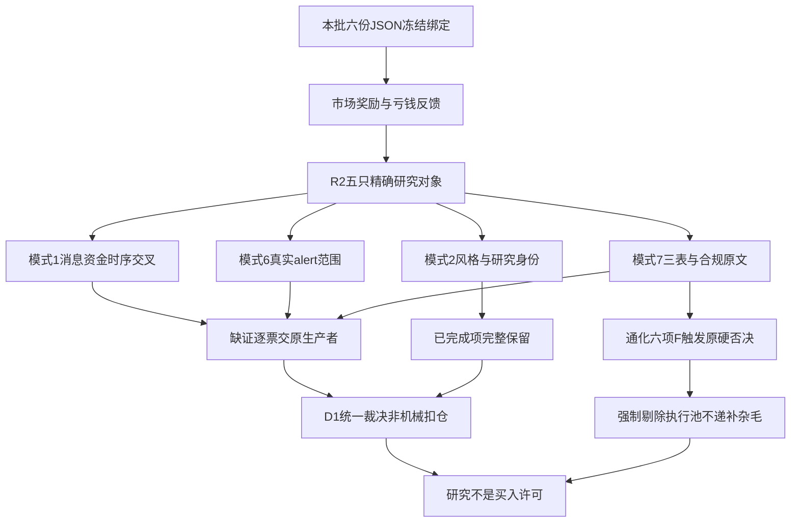

# 2026年11月16日 · **反证 / Devil’s Advocate**

> **数据源新鲜度**：partial　|　**降级状态**：true　|　**置信度**：0.60（审计主观把握，非胜率或仓位系数）

## 一句话结论

拦截通化金马：六项财务红旗触发原硬否决；其余逐票保留反证，必要合规仍未完成。

## 详细分析

情绪=震荡/主跌背景。市场正在奖励的只是影视院线局部强度，不是普遍接力：前收盘上涨占13.73%，昨日涨停池收盘反馈中位数为-4.27%，炸板率36.21%。开盘正溢价最终转为收盘负反馈，因此周末热度和“二冰”不能作为周一修复确认。主线=影视传媒（研究观察），持续性=1日假设，封板率=80%，下一交易时段预期=分歧；不是已确认的本日可交易主线。

R2主模板为92科比三格，仍保持研究观察分层。已按炸板纪律从10只真实比较对象缩至5只；R6不再次折半，不用风险条数叠加扣仓。五票R2均未授execution资格，RR与止损距未知，计划身份未知，不把in_today_plan未知写成false。

模式1先核R7实际覆盖，再使用同版R5五个交易日的真实资金和价格；凯撒、通化的R7漏覆盖不是资金不认可，更不是全盘no_trade。传媒三票缺R4精确消息核查；通化周末政策后尚无可交易反应；华胜已完成主题消息和前收盘资金的有限比较，发现个股集中而整线流出，不能由分离推出全板块主升。

模式6按R3实际窗口分层：传媒及创新药精确板块在最近已完成周末窗口显式false，仅该有限规则分支完成；华胜所属R2精确板块缺检查，不能擅用算力租赁替代。前收盘缺榜和本日空榜仍unknown。模式7逐票核算三表与嵌入原文；五票FY2025标准无保留不等于当前合规阴性，S2/S3所声明有限来源的覆盖回执仍不足。财务计算已完成的结果和通化真实硬否决均保留，不因局部缺项删除。

反证没有仓位预算权。真实用户/账户硬预算、停买、T+1、人工确认和逐票有效硬否决不变；旧市场性零仓只按其事实窗口重评。除有效hard_reject外，缺席是无意见而非自动禁买。strong_suggest交D1显式裁决，同一事实跨模式关联，不机械限至1—3%或乘以0.85/0.7。

## 必要审核逐票覆盖

完成只指声明的实际范围，不代表风险清零或买入许可。模式6完成范围为周末自然日窗口，不包括今日动态未知；不能反向把今日空榜写false。

| 对象 | 模式1 | 模式2 | 模式6 | 模式7 | 正式四项完成 | R6态度 |
|---|---|---|---|---|---|---|
| 600715.SH 文投控股 | 🟡 未完成 | 🟢 完成 | 🟢 完成 | 🟡 未完成 | 否 | 观察 |
| 002425.SZ 凯撒文化 | 🟡 未完成 | 🟢 完成 | 🟢 完成 | 🟡 未完成 | 否 | 观察 |
| 600977.SH 中国电影 | 🟡 未完成 | 🟢 完成 | 🟢 完成 | 🟡 未完成 | 否 | 观察 |
| 600410.SH 华胜天成 | 🟢 完成 | 🟢 完成 | 🟡 未完成 | 🟡 未完成 | 否 | 观察 |
| 000766.SZ 通化金马 | 🟡 未完成 | 🟢 完成 | 🟢 完成 | 🟡 未完成 | 否 | 拦截 |

已实审5只，正式四项全部完成0只；不是0只安全、不是全市场0机会。

## 逐票实质审查

### 文投控股（600715.SH）｜观察

板型：反包首板；地位：龙头；龙头认定已过3条（仅研究比较）；机会归类：今日核心（D1待裁决）。RR=未知，止损距=未知。禁止清单：已核命中为空，但完整14项、当日承接、有效预算与计划等仍未全核，不能写全过。

**大资金意图**：只能从11月9—13日观测描述集中/兑现假设，不知道真实席位动机。R5大单超大单主力五日6.4427亿元、DC同窗5.9024亿元；保留不同口径及日级冲突，不择优。

**为什么走强**：前收盘涨停与板型是已发生价格事实，不能把周末新叙事倒推为周五上涨原因；相对地位不证明本日承接。观察：周末同花顺第2，首封早于凯撒；反包带影视扩散、成交10.45亿、换手10.90%，五日净入5.90亿。文化传媒实取成分内连续高度并列第一（1板），以累计人气、扩散综合优于网站单选凯撒；不把5天4板写成5连板。

**逻辑够不够硬**：11月12日风险提示原件确认：截至第三季度AI漫剧收入占营业收入约2.57%（未经审计），不能用AI故事外推全公司增长。11月7日许可协议为子公司向关联方支付单家卫视不超过2400万元授权费，非公司已收到2400万元订单；董事会已审、股东会批准为生效条件，年底前未落地排播有提前终止条款。

模式1（未完成必要项）：观察：同版资金和前收盘价格已核，但R4本批无该票精确消息交叉；R5所嵌公司原件可揭示题材外推风险，不能假称R4已覆盖。

依据：11月9—13日，R5以Tushare.moneyflow大单+超大单买额减卖额复算为6.442722亿元，DC同窗5.902427亿元；原始金额万元/10000转亿元，daily.amount千元，与元口径成交额核对；非net_mf_amount替代。R7精确覆盖有，先核R7后比同版R5，保留XTick/东财口径差异。R4 stocks_catalyzed未包含本票不是无新闻的阴性认证。

缺口：R4本票直接消息/已查消息范围与可比窗口证据缺失；交R4，不因R7字段或provider缺项设全局禁买。

模式2（已完成声明范围）：观察：R1震荡分化/主跌背景与R2本票龙头、反包首板、research_watch和execution_eligible=false相容；R2无已确认可交易线，10→5已折半。不得把继续研究误判成逆风开仓，更不能把历史主跌固定为今日禁买。

依据：同一批次、行情同为11月13日前收盘；R1有效复评至09:35，R2只作观察，不曾授予买权。RR、止损距均未知留D1；真实账户预算未核为null。

模式6（已完成声明范围）：本批必要分支仅按已完成的周末11月14—15日精确板块检查完成：所属板块显式false；所属票周末两榜亦为false。前收盘缺榜仍unknown；11月15—16日本日窗口全空仍unknown，不外推“无出货”。5日主力两口径均正，不满足已证alert且R5五日净流出硬否决条件。

依据：正式必要范围为盘前最近已完成的周末自然日同源霸榜窗口；不要求未发生的盘中。已核阴性只排除该规则该范围，今日动态状态另留unknown；东方海洋002086.SZ的阳性不关联这5票。

模式7（未完成必要项）：已核F项：F3,F4。FY2025原文标准无保留不能替代当前合规阴性；S2/S3所声明有限来源仍未完成，本票必要审核未完成。

依据：三表同报告期/同比复算，CFO先独立单季化；F5仅FY2025、F7仅H1实际购销；缺非必要F项保留局部unknown，不抹已核财务或硬否决。

缺口：R5 S2/S3所声明有限合规来源覆盖回执及命中原文/后续窗口未完成；交R5/R4，不要求全球全历史阴性。

**买入理由（受挑战）**：R6不提供正向买入结论；受审对象原主张为“观察：周末同花顺第2，首封早于凯撒；反包带影视扩散、成交10.45亿、换手10.90%，五日净入5.90亿。文化传媒实取成分内连续高度并列第一（1板），以累计人气、扩散综合优于网站单选凯撒；不把5天4板写成5连板。”。它仍只是研究观察，不是计划已入池。

**风险点**：前三季收入下滑、归母亏损，AI漫剧占比小且未经审计。；年报涉及2024年既有监管处罚历史；本轮未取得原行政决定及其后续有效窗口，不能升级当前S2硬否决，也不得删除该历史反证。；短期价格加速远强于业绩，反包首板不是全新低位起点。

**止损条件（证伪，不是委托规则）**：题材收入/业务映射被原文证伪或核心承接与板块扩散反向时，由D1依本次计划及真实硬门禁处理；本轮无合法失效价，不编造5%止损或RR。

**可验证假设**：由原生产者交付同对象、同窗口的事件后资金价格及有限合规回执；缺证仍本票未完成。已形成的硬否决只有真实新证据/更正经R6重审可改变，不因开盘复评时间到达自动解除。

财务核验范围：

| 检查 | 上游状态 | 实审判断/时期边界 |
|---|---|---|
| F1 | unknown | 已知一个合取项不满足可判阴性；null短借不按0。 |
| F2 | checked_negative | 按同口径归母净资产；不以股价走强消除商誉风险。 |
| F3 | flagged | 已用嵌入原始三表复核触发算术 |
| F4 | flagged | 已用嵌入原始三表复核触发算术 |
| F5 | checked_negative | 最新已披露完整年度研发投入资本化率已核且不超过50%；不冒充2026Q3资本化流量，当前期间附注缺口仍单列。 |
| F6 | unknown | 亏损分母时原正利润占比判据不可直接认证阴性；保留损益绝对值。 |
| F7 | checked_negative | 已读H1附注购销/劳务实际发生额；本项仅此营业交易口径，租赁/担保/股权转让不混计为营业额。 Q3未披露同细项不伪装已核；阴性只限H1实际购销范围。 |
| F8 | checked_negative | 累计现金流先转同口径独立单季，利润也同步单季化。 |
| F9 | checked_negative | 资产时点/累计收入比按原判据，保留所用财报期间。 |
| F10 | checked_negative | 实际取得同报告期有息负债合计，与已知债务分项下界核对；不是将null负债当0。 |
| F11 | checked_negative | 按年报控股身份与Q3股东质押表配对，非全公司质押率；这是最新已读披露快照，不承诺11月实时余额。 |
| F12 | checked_negative | 年报财务审计意见段与已取fina_audit同向，未见该段非标/强调事项；仅核FY2025意见，不推及全部合规。 |
| S2 | unknown | 只完成公告索引，尚未完成交易所/证监会有限来源回执与命中原文；未查不当安全，也不自动禁买。 年报披露2024年历史行政处罚原决定及后续尚未核，不能改当前硬否决。 |
| S3 | unknown | 只完成公告索引，尚未完成交易所/证监会有限来源回执与命中原文；未查不当安全，也不自动禁买。 年报披露2024年历史行政处罚原决定及后续尚未核，不能改当前硬否决。 |
| S1 | flagged | 原财务轴预警，不自动等于交易所ST判定。 |

必要原文/计算依据位于 data/research/20261116/R5_stock_profiles.json#/profiles/0/dimensions/valuation_safety/fundamental_checks 及同票embedded_evidence；原文来源URL、hash、页码、截止和摘录在JSON保留。

### 凯撒文化（002425.SZ）｜观察

板型：反包首板；地位：龙二；龙头认定已过3条（仅研究比较）；机会归类：今日核心（D1待裁决）。RR=未知，止损距=未知。禁止清单：已核命中为空，但完整14项、当日承接、有效预算与计划等仍未全核，不能写全过。

**大资金意图**：只能从11月9—13日观测描述集中/兑现假设，不知道真实席位动机。R5大单超大单主力五日1.4558亿元、DC同窗1.4417亿元；保留不同口径及日级冲突，不择优。

**为什么走强**：前收盘涨停与板型是已发生价格事实，不能把周末新叙事倒推为周五上涨原因；相对地位不证明本日承接。观察：周末同花顺13→1，4天3板但连续高度1；封单1.50亿、换手13.70%，五日净入1.44亿。接纳网站游戏心智核心但不照抄综合龙一；当前THS短剧游戏成分未列该票，以文化传媒成员与游戏行业映射，不造短剧收入。

**逻辑够不够硬**：10月31日实控人变更公告实际是郑合明向配偶陈玉琴转让控股法人50%股权的家族内部调整，不涉及控股法人所持上市公司股份变动，不代表外部新资本入主或新增经营订单。游戏情绪反包保留研究，不能靠人气第一取代R2综合龙一。

模式1（未完成必要项）：观察：同版资金和前收盘价格已核，但R4本批无该票精确消息交叉；R5所嵌公司原件可揭示题材外推风险，不能假称R4已覆盖。

依据：11月9—13日，R5以Tushare.moneyflow大单+超大单买额减卖额复算为1.455780亿元，DC同窗1.441708亿元；原始金额万元/10000转亿元，daily.amount千元，与元口径成交额核对；非net_mf_amount替代。R7精确覆盖无，采用同版R5真实资金/价格，不将漏覆盖解释为资金不认可。R4 stocks_catalyzed未包含本票不是无新闻的阴性认证。

缺口：R4本票直接消息/已查消息范围与可比窗口证据缺失；交R4，不因R7字段或provider缺项设全局禁买。

模式2（已完成声明范围）：观察：R1震荡分化/主跌背景与R2本票龙二、反包首板、research_watch和execution_eligible=false相容；R2无已确认可交易线，10→5已折半。不得把继续研究误判成逆风开仓，更不能把历史主跌固定为今日禁买。

依据：同一批次、行情同为11月13日前收盘；R1有效复评至09:35，R2只作观察，不曾授予买权。RR、止损距均未知留D1；真实账户预算未核为null。

模式6（已完成声明范围）：本批必要分支仅按已完成的周末11月14—15日精确板块检查完成：所属板块显式false；所属票周末两榜亦为false。前收盘缺榜仍unknown；11月15—16日本日窗口全空仍unknown，不外推“无出货”。5日主力两口径均正，不满足已证alert且R5五日净流出硬否决条件。

依据：正式必要范围为盘前最近已完成的周末自然日同源霸榜窗口；不要求未发生的盘中。已核阴性只排除该规则该范围，今日动态状态另留unknown；东方海洋002086.SZ的阳性不关联这5票。

模式7（未完成必要项）：已核F项：F2,F3,F9。FY2025原文标准无保留不能替代当前合规阴性；S2/S3所声明有限来源仍未完成，本票必要审核未完成。

依据：三表同报告期/同比复算，CFO先独立单季化；F5仅FY2025、F7仅H1实际购销；缺非必要F项保留局部unknown，不抹已核财务或硬否决。

缺口：R5 S2/S3所声明有限合规来源覆盖回执及命中原文/后续窗口未完成；交R5/R4，不要求全球全历史阴性。

**买入理由（受挑战）**：R6不提供正向买入结论；受审对象原主张为“观察：周末同花顺13→1，4天3板但连续高度1；封单1.50亿、换手13.70%，五日净入1.44亿。接纳网站游戏心智核心但不照抄综合龙一；当前THS短剧游戏成分未列该票，以文化传媒成员与游戏行业映射，不造短剧收入。”。它仍只是研究观察，不是计划已入池。

**风险点**：Q3商誉/归母净资产超过50%，明确命中F2；近两年年度亏损命中原财务轴S1。；半年报有证券虚假陈述责任纠纷民事诉讼；不是证监会立案调查的同义词，案件原决定与后续未全核。；月度历史近期炸板率37.5%只作股性反证，不等于今天炸板概率。

**止损条件（证伪，不是委托规则）**：题材收入/业务映射被原文证伪或核心承接与板块扩散反向时，由D1依本次计划及真实硬门禁处理；本轮无合法失效价，不编造5%止损或RR。

**可验证假设**：由原生产者交付同对象、同窗口的事件后资金价格及有限合规回执；缺证仍本票未完成。已形成的硬否决只有真实新证据/更正经R6重审可改变，不因开盘复评时间到达自动解除。

财务核验范围：

| 检查 | 上游状态 | 实审判断/时期边界 |
|---|---|---|
| F1 | checked_negative | 已知一个合取项不满足可判阴性；null短借不按0。 |
| F2 | flagged | 已用嵌入原始三表复核触发算术 |
| F3 | flagged | 已用嵌入原始三表复核触发算术 |
| F4 | unknown | 周转率若指标缺失用累计营业成本/年初年末平均存货复算；合取第一项已阴性不需补0。 |
| F5 | checked_negative | 最新已披露完整年度研发投入资本化率已核且不超过50%；不冒充2026Q3资本化流量，当前期间附注缺口仍单列。 |
| F6 | unknown | 亏损分母时原正利润占比判据不可直接认证阴性；保留损益绝对值。 |
| F7 | checked_negative | 已读H1购销/服务表；两项采购与两项销售逐行相加，预计上限5000万未充当实际发生。 Q3未披露同细项不伪装已核；阴性只限H1实际购销范围。 |
| F8 | checked_negative | 累计现金流先转同口径独立单季，利润也同步单季化。 |
| F9 | flagged | 已用嵌入原始三表复核触发算术 |
| F10 | checked_negative | 实际取得同报告期有息负债合计，与已知债务分项下界核对；不是将null负债当0。 |
| F11 | checked_negative | 按年报控股身份与Q3股东质押表配对，非全公司质押率；这是最新已读披露快照，不承诺11月实时余额。凯撒10月控制人家族调整不改变控股法人及持股数，公告已读。 |
| F12 | checked_negative | 年报财务审计意见段与已取fina_audit同向，未见该段非标/强调事项；仅核FY2025意见，不推及全部合规。 |
| S2 | unknown | 只完成公告索引，尚未完成交易所/证监会有限来源回执与命中原文；未查不当安全，也不自动禁买。 已见证券虚假陈述民事诉讼，不冒充监管立案，旧案决定尚待核。 |
| S3 | unknown | 只完成公告索引，尚未完成交易所/证监会有限来源回执与命中原文；未查不当安全，也不自动禁买。 已见证券虚假陈述民事诉讼，不冒充监管立案，旧案决定尚待核。 |
| S1 | flagged | 原财务轴预警，不自动等于交易所ST判定。 |

必要原文/计算依据位于 data/research/20261116/R5_stock_profiles.json#/profiles/1/dimensions/valuation_safety/fundamental_checks 及同票embedded_evidence；原文来源URL、hash、页码、截止和摘录在JSON保留。

### 中国电影（600977.SH）｜观察

板型：首板；地位：龙三；龙头认定已过1条（仅研究比较）；机会归类：主线补涨（D1待裁决）。RR=未知，止损距=未知。禁止清单：已核命中为空，但完整14项、当日承接、有效预算与计划等仍未全核，不能写全过。

**大资金意图**：只能从11月9—13日观测描述集中/兑现假设，不知道真实席位动机。R5大单超大单主力五日1.1009亿元、DC同窗1.0965亿元；保留不同口径及日级冲突，不择优。

**为什么走强**：前收盘涨停与板型是已发生价格事实，不能把周末新叙事倒推为周五上涨原因；相对地位不证明本日承接。观察：中国电影成交18.99亿、流通318.32亿作院线容量对照；首封晚、回封5次，不因资金流入代替人气核心。仅结构研究，不作龙一被否后的自动替补。

**逻辑够不够硬**：本轮仍是院线容量映射，非已核新增盈利催化。半年报关联采购/销售附注明确单位万元，采购单项相对同期间营收已超过20%，保留F7；第三季度独立单季现金流转正，不能把H1累计负值当连续两期现金恶化。

模式1（未完成必要项）：观察：同版资金和前收盘价格已核，但R4本批无该票精确消息交叉；R5所嵌公司原件可揭示题材外推风险，不能假称R4已覆盖。

依据：11月9—13日，R5以Tushare.moneyflow大单+超大单买额减卖额复算为1.100867亿元，DC同窗1.096460亿元；原始金额万元/10000转亿元，daily.amount千元，与元口径成交额核对；非net_mf_amount替代。R7精确覆盖有，先核R7后比同版R5，保留XTick/东财口径差异。R4 stocks_catalyzed未包含本票不是无新闻的阴性认证。

缺口：R4本票直接消息/已查消息范围与可比窗口证据缺失；交R4，不因R7字段或provider缺项设全局禁买。

模式2（已完成声明范围）：观察：R1震荡分化/主跌背景与R2本票龙三、首板、research_watch和execution_eligible=false相容；R2无已确认可交易线，10→5已折半。不得把继续研究误判成逆风开仓，更不能把历史主跌固定为今日禁买。

依据：同一批次、行情同为11月13日前收盘；R1有效复评至09:35，R2只作观察，不曾授予买权。RR、止损距均未知留D1；真实账户预算未核为null。

模式6（已完成声明范围）：本批必要分支仅按已完成的周末11月14—15日精确板块检查完成：所属板块显式false；所属票周末两榜亦为false。前收盘缺榜仍unknown；11月15—16日本日窗口全空仍unknown，不外推“无出货”。5日主力两口径均正，不满足已证alert且R5五日净流出硬否决条件。

依据：正式必要范围为盘前最近已完成的周末自然日同源霸榜窗口；不要求未发生的盘中。已核阴性只排除该规则该范围，今日动态状态另留unknown；东方海洋002086.SZ的阳性不关联这5票。

模式7（未完成必要项）：已核F项：F3,F7。FY2025原文标准无保留不能替代当前合规阴性；S2/S3所声明有限来源仍未完成，本票必要审核未完成。

依据：三表同报告期/同比复算，CFO先独立单季化；F5仅FY2025、F7仅H1实际购销；缺非必要F项保留局部unknown，不抹已核财务或硬否决。

缺口：R5 S2/S3所声明有限合规来源覆盖回执及命中原文/后续窗口未完成；交R5/R4，不要求全球全历史阴性。

**买入理由（受挑战）**：R6不提供正向买入结论；受审对象原主张为“观察：中国电影成交18.99亿、流通318.32亿作院线容量对照；首封晚、回封5次，不因资金流入代替人气核心。仅结构研究，不作龙一被否后的自动替补。”。它仍只是研究观察，不是计划已入池。

**风险点**：五次开板与晚封说明分歧，容量票不自动替补龙一。；关联经营采购发生额较高，商业独立性和定价依赖须看原交易，不从国企身份推安全。；前三季累计亏损与正单季现金流同时保留，不将两者互相抵销。

**止损条件（证伪，不是委托规则）**：题材收入/业务映射被原文证伪或核心承接与板块扩散反向时，由D1依本次计划及真实硬门禁处理；本轮无合法失效价，不编造5%止损或RR。

**可验证假设**：由原生产者交付同对象、同窗口的事件后资金价格及有限合规回执；缺证仍本票未完成。已形成的硬否决只有真实新证据/更正经R6重审可改变，不因开盘复评时间到达自动解除。

财务核验范围：

| 检查 | 上游状态 | 实审判断/时期边界 |
|---|---|---|
| F1 | checked_negative | 已知一个合取项不满足可判阴性；null短借不按0。 |
| F2 | checked_negative | 按同口径归母净资产；不以股价走强消除商誉风险。 |
| F3 | flagged | 已用嵌入原始三表复核触发算术 |
| F4 | checked_negative | 周转率若指标缺失用累计营业成本/年初年末平均存货复算；合取第一项已阴性不需补0。 |
| F5 | checked_negative | 最新已披露完整年度研发投入资本化率已核且不超过50%；不冒充2026Q3资本化流量，当前期间附注缺口仍单列。 |
| F6 | unknown | 亏损分母时原正利润占比判据不可直接认证阴性；保留损益绝对值。 |
| F7 | flagged | 已用嵌入原始三表复核触发算术 |
| F8 | checked_negative | 累计现金流先转同口径独立单季，利润也同步单季化。 |
| F9 | checked_negative | 资产时点/累计收入比按原判据，保留所用财报期间。 |
| F10 | checked_negative | 实际取得同报告期有息负债合计，与已知债务分项下界核对；不是将null负债当0。 |
| F11 | checked_negative | 按年报控股身份与Q3股东质押表配对，非全公司质押率；这是最新已读披露快照，不承诺11月实时余额。 |
| F12 | checked_negative | 年报财务审计意见段与已取fina_audit同向，未见该段非标/强调事项；仅核FY2025意见，不推及全部合规。 |
| S2 | unknown | 只完成公告索引，尚未完成交易所/证监会有限来源回执与命中原文；未查不当安全，也不自动禁买。 已读定期报告有限章节不见当期处罚表述，只能作范围内公司自报，不能替代未查询监管入口。 |
| S3 | unknown | 只完成公告索引，尚未完成交易所/证监会有限来源回执与命中原文；未查不当安全，也不自动禁买。 已读定期报告有限章节不见当期处罚表述，只能作范围内公司自报，不能替代未查询监管入口。 |
| S1 | checked_negative | 原财务轴预警，不自动等于交易所ST判定。 |

必要原文/计算依据位于 data/research/20261116/R5_stock_profiles.json#/profiles/2/dimensions/valuation_safety/fundamental_checks 及同票embedded_evidence；原文来源URL、hash、页码、截止和摘录在JSON保留。

### 华胜天成（600410.SH）｜观察

板型：首板；地位：龙头；龙头认定已过2条（仅研究比较）；机会归类：计划内试错（D1待裁决）。RR=未知，止损距=未知。禁止清单：已核命中为空，但完整14项、当日承接、有效预算与计划等仍未全核，不能写全过。

**大资金意图**：只能从11月9—13日观测描述集中/兑现假设，不知道真实席位动机。R5大单超大单主力五日9.5379亿元、DC同窗10.0192亿元；保留不同口径及日级冲突，不择优。

**为什么走强**：前收盘涨停与板型是已发生价格事实，不能把周末新叙事倒推为周五上涨原因；相对地位不证明本日承接。观察：算力首板，同花顺周末3、东财1，五日净入10.02亿、周五10.78亿；算力概念当日-95.56亿且连续两日流出，是个股集中分离，不是板块已共振主升。

**逻辑够不够硬**：10月30日减值原件为第三季度合计冲回1375.29万元，增加当季利润总额；不能因标题含计提就写新增同额减值。算力产业受益收入仍待证，海外治理传言不采为事实。年报明确无控股股东、无实控人，王维航大股东高质押不能错贴为控股股东F11。

模式1（已完成声明范围）：观察：12日媒体发布预期可与13日首板资金价格作先后比较；个股流入但概念流出，只是集中分离，不是全线主升或已证出货。

依据：R5五日主力大单超大单口径9.537851亿、DC10.019218亿，原始万元/10000转亿元，价格同窗11月9—13日；R7精确覆盖有。R4主题媒体排期不等同公司订单；未取得官方页正文，不认定发布预期导致价格上涨。

模式2（已完成声明范围）：观察：R1震荡分化/主跌背景与本票龙头、research_watch、execution_eligible=false相容；10→5候选已折半，未向高波动多线授买权。

依据：同窗口市场风险与研究观察身份不冲突；本票RR和止损距未知留D1，真实账户预算未知，不能继承市场性零仓或抬成正预算。

模式6（未完成必要项）：本票周末两榜显式false，精确所属板块缺覆盖，该项未完成。前收盘缺榜及11月15—16日本日空榜仍unknown；5日两口径均净入，不形成mode6硬否决。

依据：本次必要范围采用最近完成的周末自然日11月14—15日；阴性只排除该范围该霸榜规则，不证明无出货或今日安全。

缺口：R3 R2精确板块885957.TI检查结果未提供；算力租赁886050.TI不能擅自替代。

模式7（未完成必要项）：已核F项：无确定命中。FY2025原文标准无保留不能替代当前合规阴性；S2/S3所声明有限来源仍未完成，本票必要审核未完成。

依据：三表同报告期/同比复算，CFO先独立单季化；F5仅FY2025、F7仅H1实际购销；缺非必要F项保留局部unknown，不抹已核财务或硬否决。

缺口：R5 S2/S3所声明有限合规来源覆盖回执及命中原文/后续窗口未完成；交R5/R4，不要求全球全历史阴性。

**买入理由（受挑战）**：R6不提供正向买入结论；受审对象原主张为“观察：算力首板，同花顺周末3、东财1，五日净入10.02亿、周五10.78亿；算力概念当日-95.56亿且连续两日流出，是个股集中分离，不是板块已共振主升。”。它仍只是研究观察，不是计划已入池。

**风险点**：概念板块流出而个股集中净入，分离可能失败。；Q3存货同比翻倍；原简化期初期末平均存货公式与提供商指标的同比方向不同，必须同时保留方法差异，不能静默只选有利数值。；无控股股东不等于没有股东质押风险，第一大股东质押快照仍作为独立反证运输。

**止损条件（证伪，不是委托规则）**：题材收入/业务映射被原文证伪或核心承接与板块扩散反向时，由D1依本次计划及真实硬门禁处理；本轮无合法失效价，不编造5%止损或RR。

**可验证假设**：由原生产者交付同对象、同窗口的事件后资金价格及有限合规回执；缺证仍本票未完成。已形成的硬否决只有真实新证据/更正经R6重审可改变，不因开盘复评时间到达自动解除。

财务核验范围：

| 检查 | 上游状态 | 实审判断/时期边界 |
|---|---|---|
| F1 | checked_negative | 已知一个合取项不满足可判阴性；null短借不按0。 |
| F2 | checked_negative | 按同口径归母净资产；不以股价走强消除商誉风险。 |
| F3 | checked_negative | 沿原比较阈值；收入下降时也保留实际增速及反直觉阈值，不改规则。 |
| F4 | unknown | 存货同比翻倍已核；提供商周转率2.5204>2.3659而简化期初期末均值复算同比下降，分母方法未核一致。保留两组数值与原F4预警，不择优静默删除，暂不确认全项阴性或命中。 |
| F5 | checked_negative | 最新已披露完整年度研发投入资本化率已核且不超过50%；不冒充2026Q3资本化流量，当前期间附注缺口仍单列。 |
| F6 | unknown | 亏损分母时原正利润占比判据不可直接认证阴性；保留损益绝对值。 |
| F7 | unknown | 已读关联交易附注，天津摩卡等实际值可核；其余空白/跨列未逐一归位，不以日常预计31.42万元冒充全部合并关联交易，因此全项仍unknown。 |
| F8 | checked_negative | 累计现金流先转同口径独立单季，利润也同步单季化。 |
| F9 | checked_negative | 资产时点/累计收入比按原判据，保留所用财报期间。 |
| F10 | checked_negative | 实际取得同报告期有息负债合计，与已知债务分项下界核对；不是将null负债当0。 |
| F11 | not_applicable | 年度原文明确无控股股东/实控人，不能把持股3.04%的王维航自动改成控股股东；其高质押作为独立股东风险保留，不消失。 |
| F12 | checked_negative | 年报财务审计意见段与已取fina_audit同向，未见该段非标/强调事项；仅核FY2025意见，不推及全部合规。 |
| S2 | unknown | 只完成公告索引，尚未完成交易所/证监会有限来源回执与命中原文；未查不当安全，也不自动禁买。 已读定期报告有限章节不见当期处罚表述，只能作范围内公司自报，不能替代未查询监管入口。 |
| S3 | unknown | 只完成公告索引，尚未完成交易所/证监会有限来源回执与命中原文；未查不当安全，也不自动禁买。 已读定期报告有限章节不见当期处罚表述，只能作范围内公司自报，不能替代未查询监管入口。 |
| S1 | checked_negative | 原财务轴预警，不自动等于交易所ST判定。 |

必要原文/计算依据位于 data/research/20261116/R5_stock_profiles.json#/profiles/3/dimensions/valuation_safety/fundamental_checks 及同票embedded_evidence；原文来源URL、hash、页码、截止和摘录在JSON保留。

### 通化金马（000766.SZ）｜拦截

板型：首板；地位：龙头；龙头认定已过1条（仅研究比较）；机会归类：计划内试错（D1待裁决）。RR=未知，止损距=未知。禁止清单：已核命中为空，但完整14项、当日承接、有效预算与计划等仍未全核，不能写全过。

**大资金意图**：只能从11月9—13日观测描述集中/兑现假设，不知道真实席位动机。R5大单超大单主力五日2.6641亿元、DC同窗2.6601亿元；保留不同口径及日级冲突，不择优。

**为什么走强**：前收盘涨停与板型是已发生价格事实，不能把周末新叙事倒推为周五上涨原因；相对地位不证明本日承接。观察：创新药成分周五唯一封板，开板6次、五日净入2.66亿；R4医保目录有原件映射但2027年实施，对应产品收入需画像。仅低位前排对照，不由目录直接授核心地位。

**逻辑够不够硬**：公司医保原件确认琥珀酸安维吖啶片用于轻、中度阿尔茨海默病症状治疗，协议有效期2027年1月1日至2028年12月31日；支付标准、挂网及医疗机构配备进度影响销售，不能升级为2026年收入兑现。

模式1（未完成必要项）：观察：公开目录与本票纳入原件真实，但13日行情早于14日政策和15日公司公告，事件后反应未知；不可倒因果。

依据：R5五日主力大单超大单口径2.664115亿、DC2.660131亿，原始万元/10000转亿元，价格同窗11月9—13日；R7精确覆盖无，使用同版R5，不推资金阴性。医保执行期2027—2028年，挂网、支付和医疗机构配备影响销售。

缺口：医保周末新事件公开后的同票可交易资金/价格尚未发生；交R5/R7后续补交，不由R6取数。

模式2（已完成声明范围）：观察：R1震荡分化/主跌背景与本票龙头、research_watch、execution_eligible=false相容；10→5候选已折半，未向高波动多线授买权。

依据：同窗口市场风险与研究观察身份不冲突；本票RR和止损距未知留D1，真实账户预算未知，不能继承市场性零仓或抬成正预算。

模式6（已完成声明范围）：周末已完成范围中本票及精确板块显式false，该分支完成。前收盘缺榜及11月15—16日本日空榜仍unknown；5日两口径均净入，不形成mode6硬否决。

依据：本次必要范围采用最近完成的周末自然日11月14—15日；阴性只排除该范围该霸榜规则，不证明无出货或今日安全。

模式7（未完成必要项）：已核F项：F3,F4,F6,F9,F10,F11。FY2025原文标准无保留不能替代当前合规阴性；S2/S3所声明有限来源仍未完成，本票必要审核未完成。六项F达到原≥4硬否决；不计F3/F4反直觉负增比较，F6/F9/F10/F11仍四项。

依据：三表同报告期/同比复算，CFO先独立单季化；F5仅FY2025、F7仅H1实际购销；缺非必要F项保留局部unknown，不抹已核财务或硬否决。

缺口：R5 S2/S3所声明有限合规来源覆盖回执及命中原文/后续窗口未完成；交R5/R4，不要求全球全历史阴性。

**买入理由（受挑战）**：R6不提供正向买入结论；受审对象原主张为“观察：创新药成分周五唯一封板，开板6次、五日净入2.66亿；R4医保目录有原件映射但2027年实施，对应产品收入需画像。仅低位前排对照，不由目录直接授核心地位。”。它仍只是研究观察，不是计划已入池。

**风险点**：Q3原件：控股股东于兰军持股1.9亿股、质押1.5亿股，比例超过70%，命中F11；不是将全公司质押率替代。；同期间有息负债/归母净资产超过80%且扣非亏损，医保新事件不能抹除F10/F6。；创新药成分仅一只封板、六次开板，按既有规则孤军/分歧弱，不因硬催化直接授龙头资格。

**止损条件（证伪，不是委托规则）**：题材收入/业务映射被原文证伪或核心承接与板块扩散反向时，由D1依本次计划及真实硬门禁处理；本轮无合法失效价，不编造5%止损或RR。本票已形成财务硬否决，不得用等待分歧买点保留执行资格。

**可验证假设**：由原生产者交付同对象、同窗口的事件后资金价格及有限合规回执；缺证仍本票未完成。已形成的硬否决只有真实新证据/更正经R6重审可改变，不因开盘复评时间到达自动解除。

财务核验范围：

| 检查 | 上游状态 | 实审判断/时期边界 |
|---|---|---|
| F1 | checked_negative | 已知一个合取项不满足可判阴性；null短借不按0。 |
| F2 | checked_negative | 按同口径归母净资产；不以股价走强消除商誉风险。 |
| F3 | flagged | 已用嵌入原始三表复核触发算术 |
| F4 | flagged | 已用嵌入原始三表复核触发算术 |
| F5 | checked_negative | 最新已披露完整年度研发投入资本化率已核且不超过50%；不冒充2026Q3资本化流量，当前期间附注缺口仍单列。 |
| F6 | flagged | 已用嵌入原始三表复核触发算术 |
| F7 | unknown | H1实际熊胆汁及技术咨询采购合计7192363.14元；销售表空白不能直接补0，本项只得已核下界，未完整口径仍unknown。 Q3未披露同细项不伪装已核；阴性只限H1实际购销范围。 |
| F8 | checked_negative | 累计现金流先转同口径独立单季，利润也同步单季化。 |
| F9 | flagged | 已用嵌入原始三表复核触发算术 |
| F10 | flagged | 已用嵌入原始三表复核触发算术 |
| F11 | flagged | 已用嵌入原始三表复核触发算术 |
| F12 | checked_negative | 年报财务审计意见段与已取fina_audit同向，未见该段非标/强调事项；仅核FY2025意见，不推及全部合规。 |
| S2 | unknown | 只完成公告索引，尚未完成交易所/证监会有限来源回执与命中原文；未查不当安全，也不自动禁买。 已读定期报告有限章节不见当期处罚表述，只能作范围内公司自报，不能替代未查询监管入口。 |
| S3 | unknown | 只完成公告索引，尚未完成交易所/证监会有限来源回执与命中原文；未查不当安全，也不自动禁买。 已读定期报告有限章节不见当期处罚表述，只能作范围内公司自报，不能替代未查询监管入口。 |
| S1 | checked_negative | 原财务轴预警，不自动等于交易所ST判定。 |

必要原文/计算依据位于 data/research/20261116/R5_stock_profiles.json#/profiles/4/dimensions/valuation_safety/fundamental_checks 及同票embedded_evidence；原文来源URL、hash、页码、截止和摘录在JSON保留。

## 实质反证清单与限定条件

### R6_M1_01｜600410.SH 华胜天成｜strong_suggest

受挑战主张：个股首板证明算力板块资金合力。

- 观察竞争线：5封3炸、华胜集中，但只有74/422上涨、概念连续两日转出。CANN属产业假设，黄仁勋辞职不采为硬催化。
- R5五日主力大单超大单口径9.537851亿、DC10.019218亿，原始万元/10000转亿元，价格同窗11月9—13日；R7精确覆盖有。
- 媒体已披露11月16日14:00发布CloudRoboWM1.2；本次官方持续页HTTP返回无正文。

观察：交D1显式接受或说明覆盖理由及实际影响；不由本条机械限仓。

限定：个股集中分离有失败风险；不把板块流出等同本票出货硬否决。

对象绑定：sector_id=885957.TI，round_id=null；event_at=null（无单一精确事件时点）。研究有效窗口沿用精确R2对象或R1市场复评窗口，精确值见同版JSON；财报原期末/披露日期不改为本轮生成日期。历史立场unknown。事实组：600410.SH:concentration_vs_sector，跨模式不重复扣仓。

证据：R2#/secondary_lines/0/leaders/0；R5#/profiles/3/dimensions/chip_structure/moneyflow_observations；R5#/profiles/3/dimensions/chip_structure/price_observations；R7#/stock_5d_tracking/0；R4#/top_events/2；R2#/secondary_lines/0/reason。

### R6_M1_02｜000766.SZ 通化金马｜soft_suggest

受挑战主张：医保纳入已解释13日涨停并立即兑现2026年利润。

- 公司原件协议有效期2027年1月1日至2028年12月31日；股价资金最新13日，周末新消息反应未发生。

观察：交D1显式接受或说明覆盖理由及实际影响；不由本条机械限仓。

限定：反驳时序和即时利润外推，未否认纳入；消息反应未知不新增硬否决。

对象绑定：sector_id=886015.TI，round_id=null；event_at=null（无单一精确事件时点）。研究有效窗口沿用精确R2对象或R1市场复评窗口，精确值见同版JSON；财报原期末/披露日期不改为本轮生成日期。历史立场unknown。事实组：000766.SZ:medical_timing，跨模式不重复扣仓。

证据：R2#/secondary_lines/1/leaders/0；R5#/profiles/4/dimensions/chip_structure/moneyflow_observations；R5#/profiles/4/dimensions/chip_structure/price_observations；R4#/top_events/0；R4#/evidence_ledger/P23。

### R6_M7_03｜600715.SH 文投控股｜strong_suggest

受挑战主张：强价格/人气/新催化可以覆盖已核财务风险。

- F3：检出方法 AR_yoy > revenue_yoy*1.5；accounts_receiv=44,557,053.470000，base_accounts_receiv=31,305,331.960000，revenue=179,521,055.320000，base_revenue=254,673,956.160000，AR_yoy=0.423306，revenue_yoy=-0.295095。期间 20250930,20260930；来源 R5 original PDF / Tushare statements。
- F4：检出方法 inventory_yoy>revenue_yoy*1.5 AND inventory_turnover falls；inventories=20,081,113.250000，base_inventories=2,770,985.840000，inventory_yoy=6.246920，revenue_yoy=-0.295095，turnover=13.357000，base_turnover=59.540800，oper_cost=155,090,680.740000，base_oper_cost=169,805,129.630000，opening_inventories=3,141,208.470000，base_opening_inventories=2,932,834.190000。期间 20250930,20260930；来源 R5 original PDF / Tushare statements。
- S1：检出方法 two annual losses OR equity<0 OR revenue<100m CNY；equity=1,049,904,178.740000，revenue=179,521,055.320000。期间 20241231,20251231,20260930；来源 R5。

观察：交D1显式接受或说明覆盖理由及实际影响；不由本条机械限仓。

限定：S2/S3缺项不产生否决；真实F红旗按原阈值处理。；负收入增长下F3/F4保留原增速，不将全部资产说成绝对增长。

对象绑定：sector_id=885418.TI，round_id=null；event_at=null（无单一精确事件时点）。研究有效窗口沿用精确R2对象或R1市场复评窗口，精确值见同版JSON；财报原期末/披露日期不改为本轮生成日期。历史立场unknown。事实组：600715.SH:fundamental_flags，跨模式不重复扣仓。

证据：R5#/profiles/0/dimensions/valuation_safety/fundamental_checks；R5#/profiles/0/embedded_evidence/financial_statements；R5#/profiles/0/embedded_evidence/documents；R5#/profiles/0/embedded_evidence/source_receipts。

### R6_M7_04｜002425.SZ 凯撒文化｜strong_suggest

受挑战主张：强价格/人气/新催化可以覆盖已核财务风险。

- F2：检出方法 goodwill/parent_equity>30%；goodwill=1,274,072,290.990000，parent_equity=2,456,288,936.010000，ratio=0.518698。期间 20260930；来源 R5 original PDF / Tushare statements。
- F3：检出方法 AR_yoy > revenue_yoy*1.5；accounts_receiv=368,763,940.140000，base_accounts_receiv=316,177,368.560000，revenue=401,914,734.990000，base_revenue=420,281,131.580000，AR_yoy=0.166320，revenue_yoy=-0.043700。期间 20250930,20260930；来源 R5 original PDF / Tushare statements。
- F9：检出方法 AR/revenue>40%；accounts_receiv=368,763,940.140000，revenue=401,914,734.990000，ratio=0.917518。期间 20260930；来源 R5 original PDF / Tushare statements。
- S1：检出方法 two annual losses OR equity<0 OR revenue<100m CNY；equity=2,456,288,936.010000，revenue=401,914,734.990000。期间 20241231,20251231,20260930；来源 R5。

观察：交D1显式接受或说明覆盖理由及实际影响；不由本条机械限仓。

限定：S2/S3缺项不产生否决；真实F红旗按原阈值处理。；负收入增长下F3/F4保留原增速，不将全部资产说成绝对增长。

对象绑定：sector_id=885418.TI，round_id=null；event_at=null（无单一精确事件时点）。研究有效窗口沿用精确R2对象或R1市场复评窗口，精确值见同版JSON；财报原期末/披露日期不改为本轮生成日期。历史立场unknown。事实组：002425.SZ:fundamental_flags，跨模式不重复扣仓。

证据：R5#/profiles/1/dimensions/valuation_safety/fundamental_checks；R5#/profiles/1/embedded_evidence/financial_statements；R5#/profiles/1/embedded_evidence/documents；R5#/profiles/1/embedded_evidence/source_receipts。

### R6_M7_05｜600977.SH 中国电影｜strong_suggest

受挑战主张：强价格/人气/新催化可以覆盖已核财务风险。

- F3：检出方法 AR_yoy > revenue_yoy*1.5；accounts_receiv=839,407,183.490000，base_accounts_receiv=779,530,359.140000，revenue=2,590,609,200.990000，base_revenue=2,928,363,968.110000，AR_yoy=0.076811，revenue_yoy=-0.115339。期间 20250930,20260930；来源 R5 original PDF / Tushare statements。
- F7：检出方法 H1 actual_related_operating_purchases_plus_sales / H1 revenue >20%；purchases=365,871,400.000000，sales=28,078,400.000000，actual_total_or_lower_bound=393,949,800.000000，ratio_or_lower_bound=0.260559，revenue=1,511,943,452.420000。期间 20260630；来源 R5 original PDF / Tushare statements。

观察：交D1显式接受或说明覆盖理由及实际影响；不由本条机械限仓。

限定：S2/S3缺项不产生否决；真实F红旗按原阈值处理。；负收入增长下F3/F4保留原增速，不将全部资产说成绝对增长。

对象绑定：sector_id=885418.TI，round_id=null；event_at=null（无单一精确事件时点）。研究有效窗口沿用精确R2对象或R1市场复评窗口，精确值见同版JSON；财报原期末/披露日期不改为本轮生成日期。历史立场unknown。事实组：600977.SH:fundamental_flags，跨模式不重复扣仓。

证据：R5#/profiles/2/dimensions/valuation_safety/fundamental_checks；R5#/profiles/2/embedded_evidence/financial_statements；R5#/profiles/2/embedded_evidence/documents；R5#/profiles/2/embedded_evidence/source_receipts。

### R6_M7_06｜000766.SZ 通化金马｜hard_reject

受挑战主张：强价格/人气/新催化可以覆盖已核财务风险。

- F3：检出方法 AR_yoy > revenue_yoy*1.5；accounts_receiv=483,237,218.650000，base_accounts_receiv=493,623,944.110000，revenue=736,581,907.410000，base_revenue=892,251,129.400000，AR_yoy=-0.021042，revenue_yoy=-0.174468。期间 20250930,20260930；来源 R5 original PDF / Tushare statements。
- F4：检出方法 inventory_yoy>revenue_yoy*1.5 AND inventory_turnover falls；inventories=356,519,384.280000，base_inventories=381,173,710.350000，inventory_yoy=-0.064680，revenue_yoy=-0.174468，turnover=0.538700，base_turnover=0.641100，oper_cost=194,397,957.810000，base_oper_cost=244,696,332.110000，opening_inventories=365,202,699.200000，base_opening_inventories=382,193,097.010000。期间 20250930,20260930；来源 R5 original PDF / Tushare statements。
- F6：检出方法 nonrecurring_profit/net_profit>30%；parent_net_profit=1,972,188.970000，profit_dedt=-2,127,217.000000，nonrecurring_profit=4,099,405.970000，ratio=2.078607。期间 20260930；来源 R5 original PDF / Tushare statements。
- F9：检出方法 AR/revenue>40%；accounts_receiv=483,237,218.650000，revenue=736,581,907.410000，ratio=0.656054。期间 20260930；来源 R5 original PDF / Tushare statements。
- F10：检出方法 fina_indicator.interestdebt / parent_equity >80%；interestdebt=2,027,008,977.890000，parent_equity=2,312,502,661.680000，ratio=0.876543，known_component_lower_bound=2,024,535,538.250000。期间 20260930；来源 R5 original PDF / Tushare statements。
- F11：检出方法 controller_pledged_shares / controller_held_shares >70%；held_shares=190,000,000.000000，pledged_shares=150,000,000.000000，ratio=0.789474。期间 20260930；来源 R5 original PDF / Tushare statements。

拦截：禁止纳入execution_pool；可保留研究观察，不得用龙二或低位杂毛递补。

限定：S2/S3缺项不产生否决；真实F红旗按原阈值处理。；负收入增长下F3/F4保留原增速，不将全部资产说成绝对增长。

对象绑定：sector_id=886015.TI，round_id=null；event_at=null（无单一精确事件时点）。研究有效窗口沿用精确R2对象或R1市场复评窗口，精确值见同版JSON；财报原期末/披露日期不改为本轮生成日期。历史立场unknown。事实组：000766.SZ:fundamental_flags，跨模式不重复扣仓。

证据：R5#/profiles/4/dimensions/valuation_safety/fundamental_checks；R5#/profiles/4/embedded_evidence/financial_statements；R5#/profiles/4/embedded_evidence/documents；R5#/profiles/4/embedded_evidence/source_receipts。

### R6_M1_07｜600715.SH 文投控股｜strong_suggest

受挑战主张：AI内容叙事和许可合同等同大额新增收入。

- AI漫剧占前三季营收约2.57%且未经审计；许可协议是子公司向关联方支付授权费、单家卫视不超过2400万元，非公司收到2400万订单；股东会生效及年底排播终止条件仍在。

观察：交D1显式接受或说明覆盖理由及实际影响；不由本条机械限仓。

限定：该分支由R5原件形成实质反证，不冒充R4已完成消息资金交叉。

对象绑定：sector_id=885418.TI，round_id=null；event_at=null（无单一精确事件时点）。研究有效窗口沿用精确R2对象或R1市场复评窗口，精确值见同版JSON；财报原期末/披露日期不改为本轮生成日期。历史立场unknown。事实组：600715.SH:AI_revenue_extrapolation，跨模式不重复扣仓。

证据：R5#/profiles/0/dimensions/catalyst；R5#/profiles/0/embedded_evidence/documents/4；R5#/profiles/0/embedded_evidence/documents/6。

### R6_M1_08｜002425.SZ 凯撒文化｜soft_suggest

受挑战主张：控制权变更代表外部新资本入主或经营订单。

- 实控人变更系夫妻内部控股法人股权调整，不改变控股法人上市公司持股；不构成新增订单或外部入主。

观察：交D1显式接受或说明覆盖理由及实际影响；不由本条机械限仓。

限定：与传媒周末热度分开，不据此否认游戏业务或形成硬否决。

对象绑定：sector_id=885418.TI，round_id=null；event_at=null（无单一精确事件时点）。研究有效窗口沿用精确R2对象或R1市场复评窗口，精确值见同版JSON；财报原期末/披露日期不改为本轮生成日期。历史立场unknown。事实组：002425.SZ:controller_relabel，跨模式不重复扣仓。

证据：R5#/profiles/1/dimensions/catalyst；R5#/profiles/1/embedded_evidence/documents/3。

### R6_M7_09｜600715.SH 文投控股｜strong_suggest

受挑战主张：当前标准无保留审计等于无历史合规风险。

- FY2025修订年报原文保留2024年辽宁证监局行政处罚、上交所纪律处分及北京局整改/警示历史；本轮未取得原行政决定和后续有效窗口，当前S2仍unknown。

观察：交D1显式接受或说明覆盖理由及实际影响；不由本条机械限仓。

限定：历史处罚不能删除；未核性质/后续的旧处罚不自动扩成当前hard_reject，severity不是历史立场。

对象绑定：sector_id=885418.TI，round_id=null；event_at=null（无单一精确事件时点）。研究有效窗口沿用精确R2对象或R1市场复评窗口，精确值见同版JSON；财报原期末/披露日期不改为本轮生成日期。历史立场unknown。事实组：600715.SH:historical_enforcement，跨模式不重复扣仓。

证据：R5#/profiles/0/embedded_evidence/documents/0/selected_excerpts/6/text；R5#/profiles/0/dimensions/valuation_safety/fundamental_checks/S2。

### R6_M7_10｜002425.SZ 凯撒文化｜soft_suggest

受挑战主张：没有当前监管阴性证据可以视同无法律风险。

- R5披露半年报存在证券虚假陈述责任纠纷民事诉讼；民事案不等同证监会立案，原决定和后续有效窗口未全核。

观察：交D1显式接受或说明覆盖理由及实际影响；不由本条机械限仓。

限定：不将民事诉讼自动改写S2财务造假实锤或刑事定罪。

对象绑定：sector_id=885418.TI，round_id=null；event_at=null（无单一精确事件时点）。研究有效窗口沿用精确R2对象或R1市场复评窗口，精确值见同版JSON；财报原期末/披露日期不改为本轮生成日期。历史立场unknown。事实组：002425.SZ:civil_litigation，跨模式不重复扣仓。

证据：R5#/profiles/1/model_adjudication/material_counterevidence；R5#/profiles/1/dimensions/valuation_safety/fundamental_checks/S2。

### R6_M7_11｜600410.SH 华胜天成｜strong_suggest

受挑战主张：F11不适用说明没有股东质押及存货风险。

- 公司年报明确无控股股东、无实控人；第一大股东王维航质押达到80%以上的年报快照仍是风险，不能错贴控股股东F11。Q3存货同比+102.23%；提供商周转2.5204>2.3659，而简化均值复算2.520366<3.314277，保留F4方法冲突。

观察：交D1显式接受或说明覆盖理由及实际影响；不由本条机械限仓。

限定：王维航不是控股股东；旧质押快照不承诺今日余额；F4全项unknown，不强计红旗或新增hard_reject。；减值原件为冲回1375.29万元增加当季利润，不是新增同额减值损失。

对象绑定：sector_id=885957.TI，round_id=null；event_at=null（无单一精确事件时点）。研究有效窗口沿用精确R2对象或R1市场复评窗口，精确值见同版JSON；财报原期末/披露日期不改为本轮生成日期。历史立场unknown。事实组：600410.SH:inventory_and_major_holder，跨模式不重复扣仓。

证据：R5#/profiles/3/embedded_evidence/documents/0/selected_excerpts/5/text；R5#/profiles/3/dimensions/valuation_safety/fundamental_checks/F4；R5#/profiles/3/dimensions/valuation_safety/fundamental_checks/F11。

### R6_M9_12｜600977.SH 中国电影｜strong_suggest

受挑战主张：院线资金净入意味着可自动替补龙一。

- 龙三/容量对照首板开板5次、首封较晚，R2仅过龙头认定1条；不把容量和单日资金流入当情绪核心。

观察：交D1显式接受或说明覆盖理由及实际影响；不由本条机械限仓。

限定：不是因高位标签hard_reject；龙一被否不得用本票自动递补。

对象绑定：sector_id=885418.TI，round_id=null；event_at=null（无单一精确事件时点）。研究有效窗口沿用精确R2对象或R1市场复评窗口，精确值见同版JSON；财报原期末/披露日期不改为本轮生成日期。历史立场unknown。事实组：600977.SH:position_and_reseal，跨模式不重复扣仓。

证据：R2#/main_lines/0/leaders/2/stock_data；R2#/main_lines/0/leaders/2/leader_recognition；R5#/profiles/2/model_adjudication。

### R6_M9_13｜600715.SH 文投控股｜strong_suggest

受挑战主张：反包首板等于低位全新启动。

- R2明确反包首板、连续高度仅1；11月12日高开后收跌且资金流出，13日再封板只证明前收盘反包，不能消除先手兑现和连锁负反馈。

观察：交D1显式接受或说明覆盖理由及实际影响；不由本条机械限仓。

限定：不因高位/一致/累计板数新增硬否决；当日承接未发生。

对象绑定：sector_id=885418.TI，round_id=null；event_at=null（无单一精确事件时点）。研究有效窗口沿用精确R2对象或R1市场复评窗口，精确值见同版JSON；财报原期末/披露日期不改为本轮生成日期。历史立场unknown。事实组：600715.SH:reversal_after_drawdown，跨模式不重复扣仓。

证据：R2#/main_lines/0/leaders/0/board_pattern；R5#/profiles/0/dimensions/chip_structure/price_observations；R5#/profiles/0/dimensions/chip_structure/moneyflow_observations。

### R6_M3_14｜600715.SH 文投控股｜soft_suggest

受挑战主张：主线角色与人气可替代估值和盈利兑现审查。

- 已核估值方法、原始分位及V3/V6/V7/V8范围见对应R5证据；高PE受小利润分母影响，亏损PE不当便宜，不新造极贵阈值。

观察：交D1显式接受或说明覆盖理由及实际影响；不由本条机械限仓。

限定：估值辅助未完整，未判定10大陷阱全清或全触发；与模式7同财报事实关联、不重复扣仓。

对象绑定：sector_id=885418.TI，round_id=null；event_at=null（无单一精确事件时点）。研究有效窗口沿用精确R2对象或R1市场复评窗口，精确值见同版JSON；财报原期末/披露日期不改为本轮生成日期。历史立场unknown。事实组：600715.SH:fundamental_flags，跨模式不重复扣仓。

证据：R5#/profiles/0/dimensions/valuation_safety；R2#/main_lines/0/leaders/0。

### R6_M3_15｜600977.SH 中国电影｜soft_suggest

受挑战主张：主线角色与人气可替代估值和盈利兑现审查。

- 已核估值方法、原始分位及V3/V6/V7/V8范围见对应R5证据；高PE受小利润分母影响，亏损PE不当便宜，不新造极贵阈值。

观察：交D1显式接受或说明覆盖理由及实际影响；不由本条机械限仓。

限定：估值辅助未完整，未判定10大陷阱全清或全触发；与模式7同财报事实关联、不重复扣仓。

对象绑定：sector_id=885418.TI，round_id=null；event_at=null（无单一精确事件时点）。研究有效窗口沿用精确R2对象或R1市场复评窗口，精确值见同版JSON；财报原期末/披露日期不改为本轮生成日期。历史立场unknown。事实组：600977.SH:fundamental_flags，跨模式不重复扣仓。

证据：R5#/profiles/2/dimensions/valuation_safety；R2#/main_lines/0/leaders/2。

### R6_M3_16｜000766.SZ 通化金马｜soft_suggest

受挑战主张：主线角色与人气可替代估值和盈利兑现审查。

- 已核估值方法、原始分位及V3/V6/V7/V8范围见对应R5证据；高PE受小利润分母影响，亏损PE不当便宜，不新造极贵阈值。

观察：交D1显式接受或说明覆盖理由及实际影响；不由本条机械限仓。

限定：估值辅助未完整，未判定10大陷阱全清或全触发；与模式7同财报事实关联、不重复扣仓。

对象绑定：sector_id=886015.TI，round_id=null；event_at=null（无单一精确事件时点）。研究有效窗口沿用精确R2对象或R1市场复评窗口，精确值见同版JSON；财报原期末/披露日期不改为本轮生成日期。历史立场unknown。事实组：000766.SZ:fundamental_flags，跨模式不重复扣仓。

证据：R5#/profiles/4/dimensions/valuation_safety；R2#/secondary_lines/1/leaders/0。

### R6_M2_17｜market｜strong_suggest

受挑战主张：二冰或开盘正溢价即可证明周一修复。

- 上涨765/5571，涨停池收盘中位-4.2705%，炸板36.2069%、跌停33；开盘正溢价转为收盘负反馈，不能仅靠周末人气判断修复。

观察：交D1显式接受或说明覆盖理由及实际影响；不由本条机械限仓。

限定：市场性观察意见，不是用户/账户硬零预算，不无限继承旧市场停买。；炸板≥35%，情绪=震荡/主跌；R2已10→5折半，R6不再次将5→2或叠加扣仓。

对象绑定：sector_id=null，round_id=null；event_at=原市场前收盘观测。研究有效窗口沿用精确R2对象或R1市场复评窗口，精确值见同版JSON；财报原期末/披露日期不改为本轮生成日期。历史立场unknown。事实组：market:close_feedback，跨模式不重复扣仓。

证据：R1#/market_metrics；R1#/market_assessment；R2#/candidate_count_discipline。

## 四象限负面识别

采用“消息/基本面事实正负 × 事件后同票价格正负”作描述索引，不新增评分或交易规则：

| 消息/事实 | 价格上涨 | 价格下跌 |
|---|---|---|
| 正面 | 利好上涨仍需核兑现，不能据热度授买权 | 利好不涨须有事件后价格，不把缺数当失败 |
| 负面 | 利空仍涨，价格不能覆盖实质财务/合规风险 | 利空下跌须辨真实证伪，不机械抄底 |

五票此前已披露财务/存货等风险与13日涨停并存，属于“负面事实与强价格并存”的描述，非认定价格被该负面驱动。通化新医保政策、周末传播后的本日价格均unknown，不能放进“利好上涨”。同一事件的正负分面不净额抵销；不根据本轮severity倒推旧轮次看法。

## 上游行业与对象外负面原样保留

下列只保留R4实质事件及限制，不扩为R2正式候选，不凭行业概念关联五票；sector_id/round_id无法精确绑定均null，窗口缺精确依据亦null。

- 医保目录调出34种药品：官方通稿明确调出34种临床价值有限或有替代等品种；本轮未逐项取调出附件。 限定：取得调出附件后逐主体核相关收入和替代品，不由医药利好覆盖该负面。 来源 R4#/top_events/1；不是本批新增逐票hard_reject。
- 尚品新业务仍在探索且以科研使用为主：数据集免费开源；89.3%应用为研究教育；公司明确商业模式技术路线探索。 限定：如披露可归因付费收入/合同再重评；不是公司不存在研发能力。 来源 R4#/top_events/4；不是本批新增逐票hard_reject。
- 本次助推器未返回且非双级全回收：同一新华社原稿：助推器未按计划返回发射场而在墨西哥湾受控溅落。 限定：待后续任务证明完整复用能力；不能被上面级利好删去。 来源 R4#/top_events/6；不是本批新增逐票hard_reject。
- 天普16日起停牌核查并否认AI注入：16日开市停牌、披露核查公告后复牌；无AI业务计划及中昊芯英注入/借壳计划。 限定：停牌风险在正式复牌公告后重评；AI基本面映射须新公告，不能靠市场称总龙恢复。 来源 R4#/top_events/7；不是本批新增逐票hard_reject。
- 南卫实控人因涉嫌内幕交易被刑拘：公司15日收到家属通知；实控人因2023年减持涉嫌内幕交易被刑拘，案件调查中。 限定：法律程序、控制权和经营后续公告；仅相关对象必要风险交R6裁决。 来源 R4#/top_events/8；不是本批新增逐票hard_reject。
- 金辰澄清SINGULUS事项无关：持股49%的SINGULUS SOLAR 1—10月无收入；相关报道与公司及该主体无关且暂无实质业务往来。 限定：需新合同或正式澄清改变现有事实；价格强弱不是重新确认收入的依据。 来源 R4#/top_events/9；不是本批新增逐票hard_reject。
- 侨银转债到期前资金未全部落实：16日到期及最后转股；17日拟发放兑付款；未转股4196454张且兑付资金尚未全部到位。 限定：只在实际到账与后续偿付披露后重评；16日前不能写已兑付或已违约。 来源 R4#/top_events/10；不是本批新增逐票hard_reject。
- 闻泰安世跨境临时裁定立即生效：荷兰法庭11日追加临时裁定立即可执行；违反多项禁令罚金累计上限3亿欧元；公司将上诉。 限定：司法后续及经营控制权实质变化；公司中方法律立场不等于争议已解决。 来源 R4#/top_events/11；不是本批新增逐票hard_reject。
- 游族订单净额确认且需大量采购资金：公司称预计实际确认收入对当期营收影响非常小；前期采购需大量资金且有库存缺口及财务成本。 限定：取得交付回款和审计后重评；融资/存货风险不因订单生效消失。 来源 R4#/top_events/13；不是本批新增逐票hard_reject。
- 利扬并购审计评估融资交割仍待完成：审计评估未出正式报告；专项融资存在不确定性；将形成商誉且审批交割未完成。 限定：审计评估、贷款、股东会和交割公告；未经审计财务边界不改变。 来源 R4#/top_events/15；不是本批新增逐票hard_reject。
- 新宙邦长协远期量属意向非强制：2029及2030年预测采购量不构成交易对手强制承诺；需求技术路线变化可能影响履行。 限定：实际年度订单和价格验证；13日旧消息不因周末复述重置衰减。 来源 R4#/top_events/17；不是本批新增逐票hard_reject。
- 德明利参股不并表且标的仍亏损：投资及配套协议尚未签署；标的不并表且研发/验证阶段持续亏损、未规模量产。 限定：正式协议和资金安排/量产验证改变后再重评。 来源 R4#/top_events/19；不是本批新增逐票hard_reject。
- 霍尔木兹触雷及化肥运输受阻风险延续：央视转述伊朗15日油轮触雷起火说法；新闻联播称联合国呼吁恢复化肥运输。 限定：船舶身份、独立海事确认、实际运量和保险报价待核；航道协议不等于通航恢复。 来源 R4#/top_events/20；不是本批新增逐票hard_reject。

## 辅助模式与降级

| 模式 | 状态 | 结论与缺口 |
|---|---|---|
| 3 | partial | 实际估值分位与V3/V6/V7/V8逐票核；只保留已核估值风险，未读完整10陷阱，缺口局部degraded。 |
| 4 | degraded | R2嵌入二冰31次次日指数48%仅有限同景，非逐票历史类比库或收益预测；不编造类似行情命中。 |
| 5 | degraded | 只读本批JSON；R2 history_context明确unreplayable、0证据及字节预算超限，无可核昨日R6/E1兑现链，不编造历史立场或撤销未读取的旧否决。 |
| 8 | degraded | 市场实际涨停37，不满足100+前提；封板量相对历史套牢区未核，不能推解套盘>70%或强制confidence上限。 |
| 9 | executed | 五票连续高度均1；文投/凯撒为反包首板，不把X天Y板写成连板；开板、地位与先手兑现风险按原事实提示，无高度硬否决。 |
| 10 | degraded | 本批五对象非已核铜油直接映射；R1铜油本身缺数，不造商品背离，也不跨读或取新数。 |

## 关键证据

- 证据1：原始三表已核5票，通化F6非经常收益/净利207.86%、F9应收/收入65.61%、F10有息负债/归母净资产87.65%、F11控股股东质押78.95%；仅这四项已达到原财务硬否决，不依赖负增长F3/F4。来源 R5#/profiles/4/dimensions/valuation_safety/fundamental_checks。
- 证据2：凯撒F2商誉/归母净资产51.87%、F9应收/收入91.75%；三项F红旗加S1财务轴不混成四项F，保留strong_suggest而不越权硬否决。来源 R5#/profiles/1/dimensions/valuation_safety。
- 证据3：中国电影H1关联经营购销实际合计39394.98万元/同期间收入，原F7触发；Q3独立单季CFO为正，不能把H1累计负值写成连续两期恶化。来源 R5#/profiles/2/dimensions/valuation_safety/fundamental_checks。
- 证据4：R3东方海洋霸榜alert不能关联本批五票；传媒/创新药周末精确板块false不覆盖本日未知。来源 R3#/hotlist_signals/distribution_alert_checks。
- 证据5：R5绑定R2/R4/R7字节hash均匹配；RFC6901证据指针已实际解析，版本不是凭整份partial/complete标签判有效。来源本R6 input_bindings与validation。

## 数据源审计

| 源 | 状态 | 生成/交付日期 | 记录数 | 备注 |
|---|---|---|---|---|
| R1 | 🟡 内容可读，原报告degraded | 2026-11-16 | 不适用 | data/research/20261116/R1_style.json；实际行情/公告/热榜时点按原证据 |
| R2 | 🟡 内容可读，原报告partial | 2026-11-16 | 5 | data/research/20261116/R2_main_sectors.json；实际行情/公告/热榜时点按原证据 |
| R3 | 🟡 内容可读，原报告degraded | 2026-11-16 | 275 | data/research/20261116/R3_sentiment.json；实际行情/公告/热榜时点按原证据 |
| R4 | 🟡 内容可读，原报告partial | 2026-11-16 | 24 | data/research/20261116/R4_news.json；实际行情/公告/热榜时点按原证据 |
| R5 | 🟡 内容可读，原报告partial | 2026-11-16 | 5 | data/research/20261116/R5_stock_profiles.json；实际行情/公告/热榜时点按原证据 |
| R7 | 🟡 内容可读，原报告partial | 2026-11-16 | 10 | data/research/20261116/R7_capital_flow_20261116.json；实际行情/公告/热榜时点按原证据 |

主源必要覆盖有缺口，degraded=true。R7使用实际存在的带日期交付文件；未将不存在的别名记为已读取。未跟随任何文件指针外读或联网。外部交付回执未另读，unknown。

## 专题来源裁决

R6本次可选专题prepare失败，原context_sha256及运输/读取/采用状态unknown；没有将上游哈希冒充本阶段哈希。仅裁决六份本批JSON中已经嵌入的投影，原hash、source_id、真实时点、必要摘录、截断范围和原局限在同版JSON完整保留；不声称读了原全文。

| 嵌入源 | disposition | 具体用途/未采用原因 |
|---|---|---|
| R6:R6_optional_topic_context | unknown | 本次prepare失败，原context_sha256未交付；传递/读取/采用均unknown，不影响其余已读本批研究。 |
| R1:lianban | adopted | 只采用嵌入公开前缀的市场亏钱/分歧与主题收缩背景；不采用次日统计作修复确认，不将同源三页重复加权。 |
| R2:lianban | adopted | 只采用嵌入公开前缀的市场亏钱/分歧与主题收缩背景；不采用次日统计作修复确认，不将同源三页重复加权。 |
| R2:lianban | adopted | 只采用嵌入公开前缀的市场亏钱/分歧与主题收缩背景；不采用次日统计作修复确认，不将同源三页重复加权。 |
| R2:lianban | adopted | 只采用嵌入公开前缀的市场亏钱/分歧与主题收缩背景；不采用次日统计作修复确认，不将同源三页重复加权。 |
| R2:theme_anchors | deferred | 已读嵌入投影作范围核对，未用其形成新的逐票实质结论；不把运输、指针或旧评分变买权。 |
| R2:stock_character | adopted | 只将本批精确对象的既有炸板/反包统计用于模式9局部反面核对；历史频率不是今日炸板概率，不用于定仓。 |
| R2:growth_pool | not_applicable | 嵌入投影无本批精确对象证据，不扩候选；旧精选/0闭环不是本批全市场禁买或逐票安全证据。 |
| R2:dividend_pool | not_applicable | 嵌入投影无本批精确对象证据，不扩候选；旧精选/0闭环不是本批全市场禁买或逐票安全证据。 |
| R2:yizi_prediction | rejected | 预测投影不是已发生竞价/资金事实；不据一字预测赋予执行资格、补造alert或RR。 |
| R2:review_feedback | unknown | 运输反馈正文为空且R2历史证据0，未形成可核昨日反证兑现链。 |
| R4:catalyst_calendar | deferred | 已读嵌入投影作范围核对，未用其形成新的逐票实质结论；不把运输、指针或旧评分变买权。 |
| R5:stock_character | adopted | 只将本批精确对象的既有炸板/反包统计用于模式9局部反面核对；历史频率不是今日炸板概率，不用于定仓。 |
| R5:growth_pool | not_applicable | 嵌入投影无本批精确对象证据，不扩候选；旧精选/0闭环不是本批全市场禁买或逐票安全证据。 |
| R5:dividend_pool | not_applicable | 嵌入投影无本批精确对象证据，不扩候选；旧精选/0闭环不是本批全市场禁买或逐票安全证据。 |
| R5:holder_trade | not_applicable | 嵌入投影无本批精确对象证据，不扩候选；旧精选/0闭环不是本批全市场禁买或逐票安全证据。 |
| R5:yizi_prediction | rejected | 预测投影不是已发生竞价/资金事实；不据一字预测赋予执行资格、补造alert或RR。 |

## 不确定性 / 反证

全批正式必要审核未完成，不能写“全票通过”或“未发现重大风险”。模式2完成与模式7真实硬否决同时保留；通化合规S2/S3缺证也不能抹去已经成立的财务否决。R3有限范围阴性不是无派发认证，当前空榜不是false。历史R6/E1未读，既有有效hard_reject不撤销，未发现结构化记录不等于历史不存在。

本文件只反驳外推、揭示实质风险和披露覆盖；不提供买入建议、价位或执行规则。D1必须对strong_suggest说明取舍和实际影响，同源事实不作为多份独立扣仓。完成标记不是交易准入；真实预算、T+1、人工确认等原保护不改。

## 与其他 R/D/E 的关系

- 依赖：本批R1_style、R2_main_sectors、R3_sentiment、R4_news、R5_stock_profiles及实际R7_capital_flow_20261116 JSON；每份完整路径与hash见JSON input_bindings。
- 回送：R4补精确消息范围，R3补精确板块alert覆盖，R5/R4补所声明有限合规事实与回执；R5/R7在事件后合法窗口补资金价格。R6不取代取数职责，不另启模型。
- 被消费：D1统一裁决；E1后续按真实事实核反证兑现，不凭标签倒推历史立场。

## Sub-Agent 元数据

- skill：analyze_devil_advocate_v1
- artifact：data/research/20261116/R6_devil_advocate.json
- model：gpt-6.1-sol
- 生成耗时：未完整计量；usage_unknown不是0。
- 真实生成时点：见frontmatter；非回放，不冒充未来公告或已发生盘中反馈。
- 校验：内联Pydantic契约、逐票20项覆盖、原始财务算术、来源hash与RFC6901指针。Mermaid仅做静态结构核验，未运行外部渲染，不声明阅读端集成通过。
