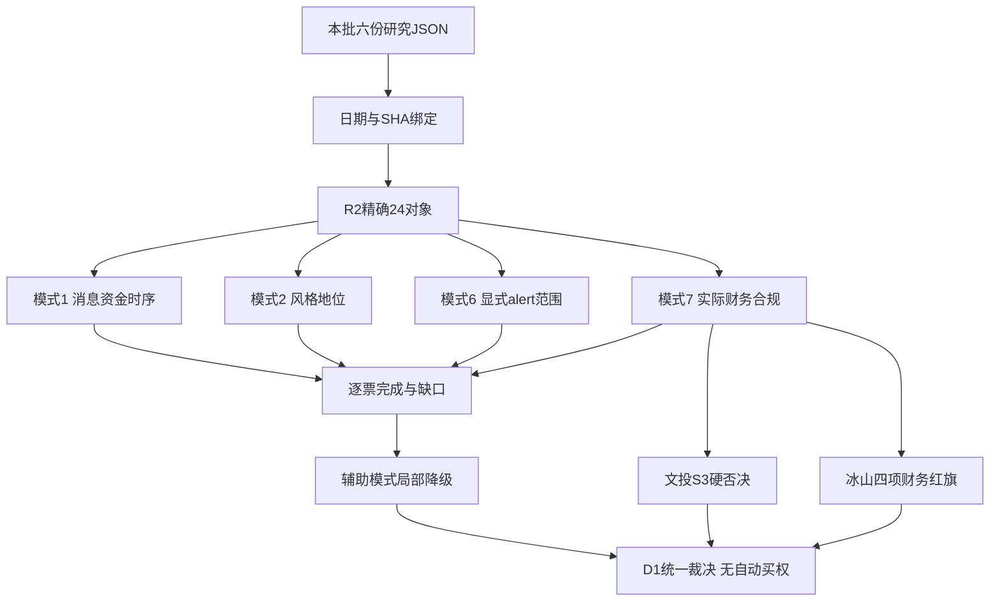

# 2026年11月17日 · 反证 / Devil’s Advocate

> 数据源新鲜度：partial；降级：是；置信度：0.86（仅反证与覆盖披露，不是安全概率）。

## 一句话结论

拦截文投、冰山；24票局部已审，正式完成0票。缺席不投否决票，真实否决不因缺席撤销。

## 详细分析

市场先看奖励而非名单。R1为震荡分化、高位震荡并有主跌风险；R2只认弱广度中的局部消费首板和广电承接。涨停32、跌停60，前涨停股收盘反馈均值为正而中位数为负，不能把几个强票解释成普遍接力恢复。炸板率33.33%未触发35%强制减半条款，也不因此扩大候选或放松门禁。

主线 = 电视广播/AI微短剧局部承接，持续性 = 1日，封板率 = 66.6667%，明日预期 = 分歧。其他两条及所有次线均按R2原证据/角色审查，不另命名新主线。R2三条研究线与R1两个涨停数量代理不是同一口径；逐票模式2已完成，不能因R5缺口重置为未审，也不能把局部研究身份改为买权。主模板沿用三格（龙头/补涨/切换），不拼成超级策略。

资金、消息与时间必须分开。R7实际覆盖本批吉视、龙江两只，其他真实序列来自同版R5，不要求特定owner或provider。R4多数公司新事件盘后公开，16日的价格/净流入只能作背景，不能当事件后确认或拒绝；模式1因此仅领湃的既有政策—后续行情交叉完成，其他已比实质事实照留而必要分支未完成。

两项硬否决来源不同。文投为公司明确披露的条件性*ST预警，非称今天已被*ST；冰山为原财务规则F3/F4/F6/F9四项当期红旗，F7为另列旧年度关联交易提示，既不靠热榜缺席也不靠高度否决。F项计数只是原财务合规规则，不是按反证数扣仓。相同事实在资金、情绪、财务与微观结构中只作关联，不当多份独立负分。

必要覆盖未完成与禁止买入不是同义词。全部票S2仍未知，多数S3未知；F12只有结构化标准审计记录而缺本JSON内嵌审计原文/有限覆盖回执，这些逐票回送R5/R4。本轮不主动补抓、不宣称完整审计通过。D1须统一说明strong_suggest的接受或覆盖与实际影响；R6不赋仓位上限、乘数、账户额度或正向买入结论。

## 逐票必要审核覆盖

完成仅表示该范围实质执行，不表示通过或安全。模式6的完成仅限实际已查的两日末次榜首条件，不代表完整盘中派发已排除。

| 对象 | 模式1 | 模式2 | 模式6 | 模式7 | 本轮态度 |
|---|---|---|---|---|---|
| 601929.SH 吉视传媒 | 未完成 | 完成 | 完成 | 未完成 | 观察 |
| 000156.SZ 华数传媒 | 未完成 | 完成 | 未完成 | 未完成 | 观察 |
| 000521.SZ 长虹美菱 | 未完成 | 完成 | 未完成 | 未完成 | 观察 |
| 002035.SZ 华帝股份 | 未完成 | 完成 | 未完成 | 未完成 | 观察 |
| 002959.SZ 小熊电器 | 未完成 | 完成 | 未完成 | 未完成 | 观察 |
| 300824.SZ 北鼎股份 | 未完成 | 完成 | 未完成 | 未完成 | 观察 |
| 002187.SZ 广百股份 | 未完成 | 完成 | 未完成 | 未完成 | 观察 |
| 002419.SZ 天虹股份 | 未完成 | 完成 | 未完成 | 未完成 | 观察 |
| 002356.SZ 鹏飞绿能 | 未完成 | 完成 | 未完成 | 未完成 | 观察 |
| 002148.SZ 北纬科技 | 未完成 | 完成 | 完成 | 未完成 | 观察 |
| 002425.SZ 凯撒文化 | 未完成 | 完成 | 完成 | 未完成 | 观察 |
| 600715.SH 文投控股 | 未完成 | 完成 | 完成 | 未完成 | 拦截 |
| 002905.SZ 金逸影视 | 未完成 | 完成 | 完成 | 未完成 | 观察 |
| 002058.SZ 紫竹高科 | 未完成 | 完成 | 未完成 | 未完成 | 观察 |
| 300530.SZ 领湃科技 | 完成 | 完成 | 未完成 | 未完成 | 观察 |
| 002748.SZ 世龙实业 | 未完成 | 完成 | 未完成 | 未完成 | 观察 |
| 601188.SH 龙江交通 | 未完成 | 完成 | 完成 | 未完成 | 观察 |
| 000530.SZ 冰山冷热 | 未完成 | 完成 | 完成 | 未完成 | 拦截 |
| 000533.SZ 顺钠股份 | 未完成 | 完成 | 未完成 | 未完成 | 观察 |
| 002625.SZ 光启技术 | 未完成 | 完成 | 未完成 | 未完成 | 观察 |
| 603686.SH 福龙马 | 未完成 | 完成 | 完成 | 未完成 | 观察 |
| 300916.SZ 朗特智能 | 未完成 | 完成 | 完成 | 未完成 | 观察 |
| 002653.SZ 海思科 | 未完成 | 完成 | 完成 | 未完成 | 观察 |
| 002548.SZ 金新农 | 未完成 | 完成 | 完成 | 未完成 | 观察 |

必要项目合计：模式1为1/24，模式2为24/24，模式6为11/24，模式7为0/24；96项均有逐票判断和可解析证据指针。24票均至少完成一个模式，正式必要审核完成0票。

## 四象限负面识别

| 象限 | 实质反面判断 | 边界 |
|---|---|---|
| 情绪 | 普遍接力未恢复，厚亏损尾部与局部强票并存 | 不从R1旧市场建议继承零交易预算 |
| 基本面 | 文投预警、冰山多红旗、北纬现金利润背离、凯撒高商誉 | 未查监管不是无风险；原硬否决保留 |
| 资金 | 北纬/凯撒当日净卖与五日净入分裂；冰山五日净卖 | 订单盘后披露不与盘前历史资金强作因果 |
| 微观结构 | 广百拥挤、北鼎反复开板、家电先锋中期修复、RR全部未知 | 不因高度单独硬否决，也不以资料缺席全局停买 |

四象限不是“利好利空四格”的改名。消息正反分面保留R4原同一事项关联，不简单净分抵销；具体逐票结果见下。

## 逐票实质判断

下文“买入理由”仅指被审查的上游假设，R6没有首推票、买点或止损价。止损条件写逻辑证伪/反证重审条件，不修改现有执行退出规则。

### 601929.SH 吉视传媒 · 观察
**买入理由（被审上游假设）**：细分两只封板中先封（10:12）、东财热榜4、5日大单代理+5.912亿；辨识/扩散/容量三条有研究证据，不称全市场总龙。 **为什么走强**：早封首板与五日大单净流入支持局部回流核心；亏损、应收存货和高负债使其不是盈利反转核心。前高未过，不能把反包叫主升确认。 **大资金意图**：只能观察五日大单分档代理+5.9120亿元、最新+4.0625亿元，不是资金身份/真实持仓认证，更不据此读心；电视广播渠道与内容分发是映射，OTT新增合同和利润尚未证明；资金交易的是局部流量预期，不是已兑现增长。

**风险点**：模式1（incomplete）：已比R2真实主张与R5资金/价格：五日大单=5.912011999999998亿元；电视广播渠道与内容分发是映射，OTT新增合同和利润尚未证明；资金交易的是局部流量预期，不是已兑现增长。。R4没有足以精确核对本票新增消息的证据，不能把消息缺席或R7漏覆盖记作冲突。 R7亦覆盖本票，但东财净额与R5大单分档口径不同，不相加、不当独立资金票。 模式2（completed）：R1震荡分化、涨停反馈中位-1.45%与电视广播/AI微短剧局部承接的龙一研究定位比较：局部承接/消费扩散研究与R1的非普涨判断可并存；R2三条研究线并非R1两个数量代理的违规扩仓，但不能把局部强势升级普遍可交易主线。

**止损条件（逻辑边界）**：不另给价格；地位与同方向扩散假设失效交D1按同版已有退出契约处理。模式6（completed）：R3精确本票或R2已声明板块的两日末次榜首条件已核阴性，完成的只是该显式范围；不是盘中持续霸榜或完整价量派发已排除。 R5五日大单净额=5.912011999999998亿元；未证实alert=true，不成立模式6双条件硬否决。 模式7（incomplete）：逐项核R5三表计算与FY2025年度/2026Q3窗口；命中F4,F9,F10,S1；F12标准无保留只在已披露年度审计口径成立，不代表全部监管阴性。 当前严重度=strong_suggest；只按原规则处理，不给仓位乘数。

**可验证假设**：交R4/R5/R7/R3各原owner补对应必要项，R6不抓新数据；模式1缺项：R4本票或经核主营精确关联行业的消息原文/有效公开窗口不足；交R4，缺席没有意见。财务合规缺项：S2: 未穷尽有限来源回执，不把无风险标题当阴性；未知为本项缺席，不自动停买；S3: 审计标准不替代当前预警核验；公司公告补充按实际原文裁决；F12已核FY2025审计结构化记录为标准无保留；本JSON未内嵌完整审计意见原文/限定范围回执，原文核验未完成，交R5；非新增全历史监管要求。**逻辑够不够硬**：早封首板与五日大单净流入支持局部回流核心；亏损、应收存货和高负债使其不是盈利反转核心。前高未过，不能把反包叫主升确认。；财务实际flags=F4、F9、F10、S1，不靠分数遮盖。

板型：首板；龙头认定：原R2 龙头，原条款通过数=3，不由R6升位。盈亏比：RR未知、止损距未知，不能写≥2/≥5%；禁止清单：原R5未全核，本轮R6硬否决=未形成（非全清）。

证据：R2#/main_lines/0/leaders/0；R5#/profiles/0/dimensions；R1#/conclusion；R3显式检查定位见JSON patterns_status.mode6.candidate_checks。板块=BK1291.DC；round_id=null（未认证）。

### 000156.SZ 华数传媒 · 观察
**买入理由（被审上游假设）**：细分封板与R3内容锚共同支持；大单代理当日+1.732亿，龙虎榜单日净买+1.189634亿，容量大但封板晚于吉视且开板3次。 **为什么走强**：日线收盘超前20日高点，量能较前五日放大；板块二股效应偏窄、首封较晚且三次开板，仍是容量对照。 **大资金意图**：只能观察五日大单分档代理+1.5146亿元、最新+1.7321亿元，不是资金身份/真实持仓认证，更不据此读心；有线网络与数字内容业务相关，但非OTT新订单利润认证；标准审计与盈利不能覆盖应收及监管缺口。

**风险点**：模式1（incomplete）：已比R2真实主张与R5资金/价格：五日大单=1.5145809999999997亿元；有线网络与数字内容业务相关，但非OTT新订单利润认证；标准审计与盈利不能覆盖应收及监管缺口。。R4没有足以精确核对本票新增消息的证据，不能把消息缺席或R7漏覆盖记作冲突。 模式2（completed）：R1震荡分化、涨停反馈中位-1.45%与电视广播/AI微短剧局部承接的龙二研究定位比较：局部承接/消费扩散研究与R1的非普涨判断可并存；R2三条研究线并非R1两个数量代理的违规扩仓，但不能把局部强势升级普遍可交易主线。

**止损条件（逻辑边界）**：不另给价格；地位与同方向扩散假设失效交D1按同版已有退出契约处理。模式6（incomplete）：R3对本票/精确R2板块没有已核阴性结果，空alert数组或unknown不能当false；模式6必要项未完成。 R5五日大单净额=1.5145809999999997亿元；未证实alert=true，不成立模式6双条件硬否决。 模式7（incomplete）：逐项核R5三表计算与FY2025年度/2026Q3窗口；命中F3,F9；F12标准无保留只在已披露年度审计口径成立，不代表全部监管阴性。 当前严重度=strong_suggest；只按原规则处理，不给仓位乘数。

**可验证假设**：交R4/R5/R7/R3各原owner补对应必要项，R6不抓新数据；模式1缺项：R4本票或经核主营精确关联行业的消息原文/有效公开窗口不足；交R4，缺席没有意见。财务合规缺项：S2: 未穷尽有限来源回执，不把无风险标题当阴性；未知为本项缺席，不自动停买；S3: 审计标准不替代当前预警核验；公司公告补充按实际原文裁决；F12已核FY2025审计结构化记录为标准无保留；本JSON未内嵌完整审计意见原文/限定范围回执，原文核验未完成，交R5；非新增全历史监管要求。**逻辑够不够硬**：日线收盘超前20日高点，量能较前五日放大；板块二股效应偏窄、首封较晚且三次开板，仍是容量对照。；财务实际flags=F3、F9，不靠分数遮盖。

板型：首板；龙头认定：原R2 龙二，原条款通过数=2，不由R6升位。盈亏比：RR未知、止损距未知，不能写≥2/≥5%；禁止清单：原R5未全核，本轮R6硬否决=未形成（非全清）。

证据：R2#/main_lines/0/leaders/1；R5#/profiles/1/dimensions；R1#/conclusion；R3显式检查定位见JSON patterns_status.mode6.candidate_checks。板块=BK1291.DC；round_id=null（未认证）。

### 000521.SZ 长虹美菱 · 观察
**买入理由（被审上游假设）**：四只普通家电封板中首封最早09:47:45、开板0次，后续厨电/小家电扩散，容量3.77十亿元可成交；不是因低价或名字选入。 **为什么走强**：家电首封最早且无开板，但日线仍低于MA60，研究为低位首板试错，不是主升回踩低吸。 **大资金意图**：只能观察五日大单分档代理+0.5654亿元、最新+0.5877亿元，不是资金身份/真实持仓认证，更不据此读心；冰箱等家电业务与消费修复相关；后排扩散可证板块效应，但前三季利润接近零，不能用家电全面复苏解释。

**风险点**：模式1（incomplete）：已比R2真实主张与R5资金/价格：五日大单=0.5654449999999999亿元；冰箱等家电业务与消费修复相关；后排扩散可证板块效应，但前三季利润接近零，不能用家电全面复苏解释。。R4没有足以精确核对本票新增消息的证据，不能把消息缺席或R7漏覆盖记作冲突。 模式2（completed）：R1震荡分化、涨停反馈中位-1.45%与家用电器低位首板簇的龙一研究定位比较：低位首板簇符合弱市试错研究，但低于MA60，不能改称强势主升回踩。

**止损条件（逻辑边界）**：不另给价格；地位与同方向扩散假设失效交D1按同版已有退出契约处理。模式6（incomplete）：R3对本票/精确R2板块没有已核阴性结果，空alert数组或unknown不能当false；模式6必要项未完成。 R5五日大单净额=0.5654449999999999亿元；未证实alert=true，不成立模式6双条件硬否决。 模式7（incomplete）：逐项核R5三表计算与FY2025年度/2026Q3窗口；命中F3,F6；F12标准无保留只在已披露年度审计口径成立，不代表全部监管阴性。 当前严重度=strong_suggest；只按原规则处理，不给仓位乘数。

**可验证假设**：交R4/R5/R7/R3各原owner补对应必要项，R6不抓新数据；模式1缺项：R4本票或经核主营精确关联行业的消息原文/有效公开窗口不足；交R4，缺席没有意见。财务合规缺项：S2: 未穷尽有限来源回执，不把无风险标题当阴性；未知为本项缺席，不自动停买；S3: 审计标准不替代当前预警核验；公司公告补充按实际原文裁决；F12已核FY2025审计结构化记录为标准无保留；本JSON未内嵌完整审计意见原文/限定范围回执，原文核验未完成，交R5；非新增全历史监管要求。**逻辑够不够硬**：家电首封最早且无开板，但日线仍低于MA60，研究为低位首板试错，不是主升回踩低吸。；财务实际flags=F3、F6，不靠分数遮盖。

板型：首板；龙头认定：原R2 龙头，原条款通过数=3，不由R6升位。盈亏比：RR未知、止损距未知，不能写≥2/≥5%；禁止清单：原R5未全核，本轮R6硬否决=未形成（非全清）。

证据：R2#/main_lines/1/leaders/0；R5#/profiles/2/dimensions；R1#/conclusion；R3显式检查定位见JSON patterns_status.mode6.candidate_checks。板块=BK0456.DC；round_id=null（未认证）。

### 002035.SZ 华帝股份 · 观察
**买入理由（被审上游假设）**：首封紧随长虹、东财新进热榜16、大单代理+0.746亿优于本批小熊/北鼎；综合位置第二，并非历史红利榜自动上位。 **为什么走强**：厨电龙二是跟随家电先锋而非红利榜自动上位；日线回收均线，周线和现金流风险仍需分开。 **大资金意图**：只能观察五日大单分档代理+0.7209亿元、最新+0.7458亿元，不是资金身份/真实持仓认证，更不据此读心；厨电业务与消费扩散同向；月度7.05%旧口径息率不作收益承诺，Q3现金流警示按当期三表复核。

**风险点**：模式1（incomplete）：已比R2真实主张与R5资金/价格：五日大单=0.7209350000000002亿元；厨电业务与消费扩散同向；月度7.05%旧口径息率不作收益承诺，Q3现金流警示按当期三表复核。。R4没有足以精确核对本票新增消息的证据，不能把消息缺席或R7漏覆盖记作冲突。 模式2（completed）：R1震荡分化、涨停反馈中位-1.45%与家用电器低位首板簇的龙二研究定位比较：局部承接/消费扩散研究与R1的非普涨判断可并存；R2三条研究线并非R1两个数量代理的违规扩仓，但不能把局部强势升级普遍可交易主线。

**止损条件（逻辑边界）**：不另给价格；地位与同方向扩散假设失效交D1按同版已有退出契约处理。模式6（incomplete）：R3对本票/精确R2板块没有已核阴性结果，空alert数组或unknown不能当false；模式6必要项未完成。 R5五日大单净额=0.7209350000000002亿元；未证实alert=true，不成立模式6双条件硬否决。 模式7（incomplete）：逐项核R5三表计算与FY2025年度/2026Q3窗口；命中F3,F4；F12标准无保留只在已披露年度审计口径成立，不代表全部监管阴性。 当前严重度=strong_suggest；只按原规则处理，不给仓位乘数。

**可验证假设**：交R4/R5/R7/R3各原owner补对应必要项，R6不抓新数据；模式1缺项：R4本票或经核主营精确关联行业的消息原文/有效公开窗口不足；交R4，缺席没有意见。财务合规缺项：S2: 未穷尽有限来源回执，不把无风险标题当阴性；未知为本项缺席，不自动停买；S3: 审计标准不替代当前预警核验；公司公告补充按实际原文裁决；F12已核FY2025审计结构化记录为标准无保留；本JSON未内嵌完整审计意见原文/限定范围回执，原文核验未完成，交R5；非新增全历史监管要求。**逻辑够不够硬**：厨电龙二是跟随家电先锋而非红利榜自动上位；日线回收均线，周线和现金流风险仍需分开。；财务实际flags=F3、F4，不靠分数遮盖。

板型：首板；龙头认定：原R2 龙二，原条款通过数=2，不由R6升位。盈亏比：RR未知、止损距未知，不能写≥2/≥5%；禁止清单：原R5未全核，本轮R6硬否决=未形成（非全清）。

证据：R2#/main_lines/1/leaders/1；R5#/profiles/3/dimensions；R1#/conclusion；R3显式检查定位见JSON patterns_status.mode6.candidate_checks。板块=BK0456.DC；round_id=null（未认证）。

### 002959.SZ 小熊电器 · 观察
**买入理由（被审上游假设）**：小家电首板、开板0次、流通50.70亿，证明板块扩散；首封晚，不用较高价格或稳定封板替换已定龙一。 **为什么走强**：无开板首板支持小家电扩散，但不是早封先锋；20日旧高未越，不把局部箱体突破冒充整个观察窗口突破。 **大资金意图**：只能观察五日大单分档代理+0.4195亿元、最新+0.4647亿元，不是资金身份/真实持仓认证，更不据此读心；小家电业务有消费映射；缺公司级新增硬催化，不因分数或股价更高递补龙一。

**风险点**：模式1（incomplete）：已比R2真实主张与R5资金/价格：五日大单=0.41950200000000004亿元；小家电业务有消费映射；缺公司级新增硬催化，不因分数或股价更高递补龙一。。R4没有足以精确核对本票新增消息的证据，不能把消息缺席或R7漏覆盖记作冲突。 模式2（completed）：R1震荡分化、涨停反馈中位-1.45%与家用电器低位首板簇的候补研究定位比较：局部承接/消费扩散研究与R1的非普涨判断可并存；R2三条研究线并非R1两个数量代理的违规扩仓，但不能把局部强势升级普遍可交易主线。

**止损条件（逻辑边界）**：不另给价格；地位与同方向扩散假设失效交D1按同版已有退出契约处理。模式6（incomplete）：R3对本票/精确R2板块没有已核阴性结果，空alert数组或unknown不能当false；模式6必要项未完成。 R5五日大单净额=0.41950200000000004亿元；未证实alert=true，不成立模式6双条件硬否决。 模式7（incomplete）：逐项核R5三表计算与FY2025年度/2026Q3窗口；命中已查数值项没有检出flags，但不据空列表判安全；F12标准无保留只在已披露年度审计口径成立，不代表全部监管阴性。 当前严重度=未形成财务反面发现；只按原规则处理，不给仓位乘数。

**可验证假设**：交R4/R5/R7/R3各原owner补对应必要项，R6不抓新数据；模式1缺项：R4本票或经核主营精确关联行业的消息原文/有效公开窗口不足；交R4，缺席没有意见。财务合规缺项：S2: 未穷尽有限来源回执，不把无风险标题当阴性；未知为本项缺席，不自动停买；S3: 审计标准不替代当前预警核验；公司公告补充按实际原文裁决；F12已核FY2025审计结构化记录为标准无保留；本JSON未内嵌完整审计意见原文/限定范围回执，原文核验未完成，交R5；非新增全历史监管要求。**逻辑够不够硬**：无开板首板支持小家电扩散，但不是早封先锋；20日旧高未越，不把局部箱体突破冒充整个观察窗口突破。；财务实际flags=已算项未列flag；不代表合规阴性，不靠分数遮盖。

板型：首板；龙头认定：原R2 龙三，原条款通过数=2，不由R6升位。盈亏比：RR未知、止损距未知，不能写≥2/≥5%；禁止清单：原R5未全核，本轮R6硬否决=未形成（非全清）。

证据：R2#/main_lines/1/leaders/2；R5#/profiles/4/dimensions；R1#/conclusion；R3显式检查定位见JSON patterns_status.mode6.candidate_checks。板块=BK0456.DC；round_id=null（未认证）。

### 300824.SZ 北鼎股份 · 观察
**买入理由（被审上游假设）**：20cm首板是弹性效应证据；保留研究不是前缀限制。封板晚且8次开板、封单约291万元，不能因涨幅20%取代10cm先锋。 **为什么走强**：20cm首板且放量，但八次开板；尾盘封住不等于全日强承接。跨日后排接力不替代家电核心。 **大资金意图**：只能观察五日大单分档代理+0.5420亿元、最新+0.5536亿元，不是资金身份/真实持仓认证，更不据此读心；小家电有业务联动，创业板弹性不是逻辑硬度；无新增订单或业绩证据，保留20cm一板认知偏差警示。

**风险点**：模式1（incomplete）：已比R2真实主张与R5资金/价格：五日大单=0.541952亿元；小家电有业务联动，创业板弹性不是逻辑硬度；无新增订单或业绩证据，保留20cm一板认知偏差警示。。R4没有足以精确核对本票新增消息的证据，不能把消息缺席或R7漏覆盖记作冲突。 模式2（completed）：R1震荡分化、涨停反馈中位-1.45%与家用电器低位首板簇的候补研究定位比较：局部承接/消费扩散研究与R1的非普涨判断可并存；R2三条研究线并非R1两个数量代理的违规扩仓，但不能把局部强势升级普遍可交易主线。

**止损条件（逻辑边界）**：不另给价格；地位与同方向扩散假设失效交D1按同版已有退出契约处理。模式6（incomplete）：R3对本票/精确R2板块没有已核阴性结果，空alert数组或unknown不能当false；模式6必要项未完成。 R5五日大单净额=0.541952亿元；未证实alert=true，不成立模式6双条件硬否决。 模式7（incomplete）：逐项核R5三表计算与FY2025年度/2026Q3窗口；命中F3；F12标准无保留只在已披露年度审计口径成立，不代表全部监管阴性。 当前严重度=soft_suggest；只按原规则处理，不给仓位乘数。

**可验证假设**：交R4/R5/R7/R3各原owner补对应必要项，R6不抓新数据；模式1缺项：R4本票或经核主营精确关联行业的消息原文/有效公开窗口不足；交R4，缺席没有意见。财务合规缺项：S2: 未穷尽有限来源回执，不把无风险标题当阴性；未知为本项缺席，不自动停买；S3: 审计标准不替代当前预警核验；公司公告补充按实际原文裁决；F12已核FY2025审计结构化记录为标准无保留；本JSON未内嵌完整审计意见原文/限定范围回执，原文核验未完成，交R5；非新增全历史监管要求。**逻辑够不够硬**：20cm首板且放量，但八次开板；尾盘封住不等于全日强承接。跨日后排接力不替代家电核心。；财务实际flags=F3，不靠分数遮盖。

板型：首板；龙头认定：原R2 龙三，原条款通过数=2，不由R6升位。盈亏比：RR未知、止损距未知，不能写≥2/≥5%；禁止清单：原R5未全核，本轮R6硬否决=未形成（非全清）。

证据：R2#/main_lines/1/leaders/3；R5#/profiles/5/dimensions；R1#/conclusion；R3显式检查定位见JSON patterns_status.mode6.candidate_checks。板块=BK0456.DC；round_id=null（未认证）。

### 002187.SZ 广百股份 · 观察
**买入理由（被审上游假设）**：零售当前3连板最高，09:30:03封住后有天虹/鹏飞首板跟随；热榜10与6.14%换手共同支持研究辨识度、扩散、容量。 **为什么走强**：零售三板、早封和后排扩散支持接力核心；缩量加速和一字预测只增加拥挤核验，不增加次日胜率。 **大资金意图**：只能观察五日大单分档代理+1.3310亿元、最新+0.2724亿元，不是资金身份/真实持仓认证，更不据此读心；免税和零售转型有业务落点；市场交易消费切换，2025年度经营下滑仍是反证，不能把三板当业绩验证。

**风险点**：模式1（incomplete）：已比R2真实主张与R5资金/价格：五日大单=1.3309609999999996亿元；免税和零售转型有业务落点；市场交易消费切换，2025年度经营下滑仍是反证，不能把三板当业绩验证。。R4没有足以精确核对本票新增消息的证据，不能把消息缺席或R7漏覆盖记作冲突。 模式2（completed）：R1震荡分化、涨停反馈中位-1.45%与一般零售接力/消费扩散的龙一研究定位比较：局部承接/消费扩散研究与R1的非普涨判断可并存；R2三条研究线并非R1两个数量代理的违规扩仓，但不能把局部强势升级普遍可交易主线。

**止损条件（逻辑边界）**：不另给价格；地位与同方向扩散假设失效交D1按同版已有退出契约处理。模式6（incomplete）：R3对本票/精确R2板块没有已核阴性结果，空alert数组或unknown不能当false；模式6必要项未完成。 R5五日大单净额=1.3309609999999996亿元；未证实alert=true，不成立模式6双条件硬否决。 模式7（incomplete）：逐项核R5三表计算与FY2025年度/2026Q3窗口；命中F3,F4；F12标准无保留只在已披露年度审计口径成立，不代表全部监管阴性。 当前严重度=strong_suggest；只按原规则处理，不给仓位乘数。

**可验证假设**：交R4/R5/R7/R3各原owner补对应必要项，R6不抓新数据；模式1缺项：R4本票或经核主营精确关联行业的消息原文/有效公开窗口不足；交R4，缺席没有意见。财务合规缺项：S2: 未穷尽有限来源回执，不把无风险标题当阴性；未知为本项缺席，不自动停买；S3: 审计标准不替代当前预警核验；公司公告补充按实际原文裁决；F12已核FY2025审计结构化记录为标准无保留；本JSON未内嵌完整审计意见原文/限定范围回执，原文核验未完成，交R5；非新增全历史监管要求。**逻辑够不够硬**：零售三板、早封和后排扩散支持接力核心；缩量加速和一字预测只增加拥挤核验，不增加次日胜率。；财务实际flags=F3、F4，不靠分数遮盖。

板型：3连板；龙头认定：原R2 龙头，原条款通过数=3，不由R6升位。盈亏比：RR未知、止损距未知，不能写≥2/≥5%；禁止清单：原R5未全核，本轮R6硬否决=未形成（非全清）。

证据：R2#/main_lines/2/leaders/0；R5#/profiles/6/dimensions；R1#/conclusion；R3显式检查定位见JSON patterns_status.mode6.candidate_checks。板块=BK0482.DC；round_id=null（未认证）。

### 002419.SZ 天虹股份 · 观察
**买入理由（被审上游假设）**：首封09:32:33仅次广百，流通61.63亿、当日大单代理+0.946亿、东财新进20；身份为零售低位联动，不以储能概念标签归政策核心。 **为什么走强**：零售首板、当日大单改善支持龙二容量观察；突破前高幅度小，租赁债务与一次性收益要从经营复苏中剥离。 **大资金意图**：只能观察五日大单分档代理+0.8836亿元、最新+0.9461亿元，不是资金身份/真实持仓认证，更不据此读心；AI零售/门店数字化是转型叙事，不把跨概念归属机械当储能合力；商业转化仍需业绩验证。

**风险点**：模式1（incomplete）：已比R2真实主张与R5资金/价格：五日大单=0.883608亿元；AI零售/门店数字化是转型叙事，不把跨概念归属机械当储能合力；商业转化仍需业绩验证。。R4没有足以精确核对本票新增消息的证据，不能把消息缺席或R7漏覆盖记作冲突。 模式2（completed）：R1震荡分化、涨停反馈中位-1.45%与一般零售接力/消费扩散的龙二研究定位比较：局部承接/消费扩散研究与R1的非普涨判断可并存；R2三条研究线并非R1两个数量代理的违规扩仓，但不能把局部强势升级普遍可交易主线。

**止损条件（逻辑边界）**：不另给价格；地位与同方向扩散假设失效交D1按同版已有退出契约处理。模式6（incomplete）：R3对本票/精确R2板块没有已核阴性结果，空alert数组或unknown不能当false；模式6必要项未完成。 R5五日大单净额=0.883608亿元；未证实alert=true，不成立模式6双条件硬否决。 模式7（incomplete）：逐项核R5三表计算与FY2025年度/2026Q3窗口；命中F3,F6,F10；F12标准无保留只在已披露年度审计口径成立，不代表全部监管阴性。 当前严重度=strong_suggest；只按原规则处理，不给仓位乘数。

**可验证假设**：交R4/R5/R7/R3各原owner补对应必要项，R6不抓新数据；模式1缺项：R4本票或经核主营精确关联行业的消息原文/有效公开窗口不足；交R4，缺席没有意见。财务合规缺项：S2: 未穷尽有限来源回执，不把无风险标题当阴性；未知为本项缺席，不自动停买；S3: 审计标准不替代当前预警核验；公司公告补充按实际原文裁决；F12已核FY2025审计结构化记录为标准无保留；本JSON未内嵌完整审计意见原文/限定范围回执，原文核验未完成，交R5；非新增全历史监管要求。**逻辑够不够硬**：零售首板、当日大单改善支持龙二容量观察；突破前高幅度小，租赁债务与一次性收益要从经营复苏中剥离。；财务实际flags=F3、F6、F10，不靠分数遮盖。

板型：首板；龙头认定：原R2 龙二，原条款通过数=2，不由R6升位。盈亏比：RR未知、止损距未知，不能写≥2/≥5%；禁止清单：原R5未全核，本轮R6硬否决=未形成（非全清）。

证据：R2#/main_lines/2/leaders/1；R5#/profiles/7/dimensions；R1#/conclusion；R3显式检查定位见JSON patterns_status.mode6.candidate_checks。板块=BK0482.DC；round_id=null（未认证）。

### 002356.SZ 鹏飞绿能 · 观察
**买入理由（被审上游假设）**：零售首板的扩散样本，09:36较晚且3次开板；保留龙三不自动替代。 **为什么走强**：R2保留的零售扩散候补而非龙头；日线仍低于MA60，当前资金原接口缺口不能用其他股票替代。 **大资金意图**：只能观察五日大单分档代理未核/缺序列、最新未知，不是资金身份/真实持仓认证，更不据此读心；R2当前名鹏飞绿能与月度历史赫美名称不同；只按精确代码关联历史，不由旧商业标签证明当前主营资格。

**风险点**：模式1（incomplete）：已比R2真实主张与R5资金/价格：五日大单=unknown亿元；R2当前名鹏飞绿能与月度历史赫美名称不同；只按精确代码关联历史，不由旧商业标签证明当前主营资格。。R4没有足以精确核对本票新增消息的证据，不能把消息缺席或R7漏覆盖记作冲突。 模式2（completed）：R1震荡分化、涨停反馈中位-1.45%与一般零售接力/消费扩散的候补研究定位比较：局部承接/消费扩散研究与R1的非普涨判断可并存；R2三条研究线并非R1两个数量代理的违规扩仓，但不能把局部强势升级普遍可交易主线。

**止损条件（逻辑边界）**：不另给价格；地位与同方向扩散假设失效交D1按同版已有退出契约处理。模式6（incomplete）：R3对本票/精确R2板块没有已核阴性结果，空alert数组或unknown不能当false；模式6必要项未完成。 R5五日大单净额=unknown亿元；未证实alert=true，不成立模式6双条件硬否决。 模式7（incomplete）：逐项核R5三表计算与FY2025年度/2026Q3窗口；命中F4,F7；F12标准无保留只在已披露年度审计口径成立，不代表全部监管阴性。 当前严重度=strong_suggest；只按原规则处理，不给仓位乘数。

**可验证假设**：交R4/R5/R7/R3各原owner补对应必要项，R6不抓新数据；模式1缺项：R4本票或经核主营精确关联行业的消息原文/有效公开窗口不足；交R4，缺席没有意见；R5本票五日大单序列为空；交R5/R7，不拿其他股票资金补值。财务合规缺项：S2: 未穷尽有限来源回执，不把无风险标题当阴性；未知为本项缺席，不自动停买；S3: 审计标准不替代当前预警核验；公司公告补充按实际原文裁决；F12已核FY2025审计结构化记录为标准无保留；本JSON未内嵌完整审计意见原文/限定范围回执，原文核验未完成，交R5；非新增全历史监管要求。**逻辑够不够硬**：R2保留的零售扩散候补而非龙头；日线仍低于MA60，当前资金原接口缺口不能用其他股票替代。；财务实际flags=F4、F7，不靠分数遮盖。

板型：首板；龙头认定：原R2 龙三，原条款通过数=1，不由R6升位。盈亏比：RR未知、止损距未知，不能写≥2/≥5%；禁止清单：原R5未全核，本轮R6硬否决=未形成（非全清）。

证据：R2#/main_lines/2/leaders/2；R5#/profiles/8/dimensions；R1#/conclusion；R3显式检查定位见JSON patterns_status.mode6.candidate_checks。板块=BK0482.DC；round_id=null（未认证）。

### 002148.SZ 北纬科技 · 观察
**买入理由（被审上游假设）**：最高4板为全市场高度温度计；归因多主题，不认定独占短剧龙头；单日开板7次及42.59%换手，席位净卖0.882909亿但5日大单代理仍正。 **为什么走强**：四板高度和早封提供情绪辨识度；F8两单季现金流与利润背离、一次性收益风险仍存在，不因高度删除。 **大资金意图**：只能观察五日大单分档代理+2.1944亿元、最新-1.2144亿元，不是资金身份/真实持仓认证，更不据此读心；游戏/卫星物联网等分支不应强行唯一归短剧；四板交易结构不是短剧新增营收证明。

**风险点**：模式1（incomplete）：已比R2真实主张与R5资金/价格：五日大单=2.1943840000000012亿元；游戏/卫星物联网等分支不应强行唯一归短剧；四板交易结构不是短剧新增营收证明。。R4没有足以精确核对本票新增消息的证据，不能把消息缺席或R7漏覆盖记作冲突。 模式2（completed）：R1震荡分化、涨停反馈中位-1.45%与短剧游戏/存量情绪核心的龙一研究定位比较：高位存量活口不代表全市场接力修复；R2已将其放次线且不给执行资格，不虚构R1与R2存在强推买入冲突。

**止损条件（逻辑边界）**：不另给价格；地位与同方向扩散假设失效交D1按同版已有退出契约处理。模式6（completed）：R3精确本票或R2已声明板块的两日末次榜首条件已核阴性，完成的只是该显式范围；不是盘中持续霸榜或完整价量派发已排除。 R5五日大单净额=2.1943840000000012亿元；未证实alert=true，不成立模式6双条件硬否决。 模式7（incomplete）：逐项核R5三表计算与FY2025年度/2026Q3窗口；命中F6,F8；F12标准无保留只在已披露年度审计口径成立，不代表全部监管阴性。 当前严重度=strong_suggest；只按原规则处理，不给仓位乘数。

**可验证假设**：交R4/R5/R7/R3各原owner补对应必要项，R6不抓新数据；模式1缺项：R4本票或经核主营精确关联行业的消息原文/有效公开窗口不足；交R4，缺席没有意见。财务合规缺项：S2: 未穷尽有限来源回执，不把无风险标题当阴性；未知为本项缺席，不自动停买；S3: 审计标准不替代当前预警核验；公司公告补充按实际原文裁决；F12已核FY2025审计结构化记录为标准无保留；本JSON未内嵌完整审计意见原文/限定范围回执，原文核验未完成，交R5；非新增全历史监管要求。**逻辑够不够硬**：四板高度和早封提供情绪辨识度；F8两单季现金流与利润背离、一次性收益风险仍存在，不因高度删除。；财务实际flags=F6、F8，不靠分数遮盖。

板型：4连板；龙头认定：原R2 龙头，原条款通过数=2，不由R6升位。盈亏比：RR未知、止损距未知，不能写≥2/≥5%；禁止清单：原R5未全核，本轮R6硬否决=未形成（非全清）。

证据：R2#/secondary_lines/0/leaders/0；R5#/profiles/9/dimensions；R1#/conclusion；R3显式检查定位见JSON patterns_status.mode6.candidate_checks。板块=886060.TI；round_id=null（未认证）。

### 002425.SZ 凯撒文化 · 观察
**买入理由（被审上游假设）**：5天4板但实际连续2板；R3热榜上升，同日封板早且仅1次开板，保留核心位置而不称新题材低位。 **为什么走强**：短剧游戏存量核心具技术强势，但商誉/权益超过原F2阈值及连年亏损是真风险；不按图像强势粉饰估值。 **大资金意图**：只能观察五日大单分档代理+1.2619亿元、最新-0.3298亿元，不是资金身份/真实持仓认证，更不据此读心；游戏与IP有题材映射，海外短剧行业数据不是本公司分成确认；高商誉对未来减值敏感。

**风险点**：模式1（incomplete）：已比R2真实主张与R5资金/价格：五日大单=1.2618740000000006亿元；游戏与IP有题材映射，海外短剧行业数据不是本公司分成确认；高商誉对未来减值敏感。。R4没有足以精确核对本票新增消息的证据，不能把消息缺席或R7漏覆盖记作冲突。 模式2（completed）：R1震荡分化、涨停反馈中位-1.45%与短剧游戏/存量情绪核心的龙二研究定位比较：高位存量活口不代表全市场接力修复；R2已将其放次线且不给执行资格，不虚构R1与R2存在强推买入冲突。

**止损条件（逻辑边界）**：不另给价格；地位与同方向扩散假设失效交D1按同版已有退出契约处理。模式6（completed）：R3精确本票或R2已声明板块的两日末次榜首条件已核阴性，完成的只是该显式范围；不是盘中持续霸榜或完整价量派发已排除。 R5五日大单净额=1.2618740000000006亿元；未证实alert=true，不成立模式6双条件硬否决。 模式7（incomplete）：逐项核R5三表计算与FY2025年度/2026Q3窗口；命中F2,F3,F9,S1；F12标准无保留只在已披露年度审计口径成立，不代表全部监管阴性。 当前严重度=strong_suggest；只按原规则处理，不给仓位乘数。

**可验证假设**：交R4/R5/R7/R3各原owner补对应必要项，R6不抓新数据；模式1缺项：R4本票或经核主营精确关联行业的消息原文/有效公开窗口不足；交R4，缺席没有意见。财务合规缺项：S2: 未穷尽有限来源回执，不把无风险标题当阴性；未知为本项缺席，不自动停买；S3: 审计标准不替代当前预警核验；公司公告补充按实际原文裁决；F12已核FY2025审计结构化记录为标准无保留；本JSON未内嵌完整审计意见原文/限定范围回执，原文核验未完成，交R5；非新增全历史监管要求。**逻辑够不够硬**：短剧游戏存量核心具技术强势，但商誉/权益超过原F2阈值及连年亏损是真风险；不按图像强势粉饰估值。；财务实际flags=F2、F3、F9、S1，不靠分数遮盖。

板型：2连板；龙头认定：原R2 龙二，原条款通过数=2，不由R6升位。盈亏比：RR未知、止损距未知，不能写≥2/≥5%；禁止清单：原R5未全核，本轮R6硬否决=未形成（非全清）。

证据：R2#/secondary_lines/0/leaders/1；R5#/profiles/10/dimensions；R1#/conclusion；R3显式检查定位见JSON patterns_status.mode6.candidate_checks。板块=886060.TI；round_id=null（未认证）。

### 600715.SH 文投控股 · 拦截
**买入理由（被审上游假设）**：保留高辨识度风险对照，不用股性或低价遮盖公告；5日大单代理-4.041亿、本日-6.026亿，龙虎榜单日-3.554438亿。 **为什么走强**：强K线不抵消公司已披露条件性*ST预警：按原S3临近轴提交R6独立硬否决，不是R5自行豁免风险。 **大资金意图**：只能观察五日大单分档代理-4.0408亿元、最新-6.0262亿元，不是资金身份/真实持仓认证，更不据此读心；AI漫剧占比仅2.57%且未经审计，前三季营收1.80亿元及亏损与高涨幅矛盾；不能把题材视为利润替代品。

**风险点**：模式1（incomplete）：股价新高与小比例AI漫剧、条件性*ST预警形成实质风险；五日大单净额-4.0408亿元。晚间风险公告后的成交反应未知，不能把16日盘中净卖倒推为消息已被消化。 模式2（completed）：R1震荡分化、涨停反馈中位-1.45%与短剧游戏/存量情绪核心的候补研究定位比较：高位存量活口不代表全市场接力修复；R2已将其放次线且不给执行资格，不虚构R1与R2存在强推买入冲突。

**止损条件（逻辑边界）**：不另给价格；地位与同方向扩散假设失效交D1按同版已有退出契约处理。模式6（completed）：R3精确本票或R2已声明板块的两日末次榜首条件已核阴性，完成的只是该显式范围；不是盘中持续霸榜或完整价量派发已排除。 R5五日大单净额=-4.0408279999999985亿元；未证实alert=true，不成立模式6双条件硬否决。 模式7（incomplete）：逐项核R5三表计算与FY2025年度/2026Q3窗口；命中F3,F4,S1,S3；F12标准无保留只在已披露年度审计口径成立，不代表全部监管阴性。 已读本JSON内嵌公告全文的S3原文，年度双条件的*ST预警不是已实施*ST，但命中原临近轴hard_reject；其他S2缺口不撤销此实质否决。 已证硬否决不得用分歧买点保留执行资格，也不得以午间研究窗口到期自动解除。

**可验证假设**：交R4/R5/R7/R3各原owner补对应必要项，R6不抓新数据；模式1缺项：R4所列新事件公开后同票可比价格/资金反应尚未发生或未交付；交R5/R7，不由R6抓取。财务合规缺项：S2: 未穷尽有限来源回执，不把无风险标题当阴性；未知为本项缺席，不自动停买；F12已核FY2025审计结构化记录为标准无保留；本JSON未内嵌完整审计意见原文/限定范围回执，原文核验未完成，交R5；非新增全历史监管要求。**逻辑够不够硬**：强K线不抵消公司已披露条件性*ST预警：按原S3临近轴提交R6独立硬否决，不是R5自行豁免风险。；财务实际flags=F3、F4、S1、S3，不靠分数遮盖。

板型：2连板；龙头认定：原R2 龙三，原条款通过数=2，不由R6升位。盈亏比：RR未知、止损距未知，不能写≥2/≥5%；禁止清单：原R5未全核，本轮R6硬否决=是。

证据：R2#/secondary_lines/0/leaders/2；R5#/profiles/11/dimensions；R1#/conclusion；R3显式检查定位见JSON patterns_status.mode6.candidate_checks。板块=886060.TI；round_id=null（未认证）。

### 002905.SZ 金逸影视 · 观察
**买入理由（被审上游假设）**：一字反包2板、5天3板；只作院线对照，不能因为先封就等同短剧收益龙头。 **为什么走强**：影视首板可作传媒扩散对照，准一字缺少换手验证；租赁等债务与存货、应收项单列，不因首板自动低位安全。 **大资金意图**：只能观察五日大单分档代理+0.9609亿元、最新+0.1616亿元，不是资金身份/真实持仓认证，更不据此读心；电影与消费内容有业务落点，但票房修复和最新盈利需实际财报，不用行业热度替代本票现金流。

**风险点**：模式1（incomplete）：已比R2真实主张与R5资金/价格：五日大单=0.9609410000000002亿元；电影与消费内容有业务落点，但票房修复和最新盈利需实际财报，不用行业热度替代本票现金流。。R4没有足以精确核对本票新增消息的证据，不能把消息缺席或R7漏覆盖记作冲突。 模式2（completed）：R1震荡分化、涨停反馈中位-1.45%与短剧游戏/存量情绪核心的候补研究定位比较：次线/事件观察没有改写全市场风格；单股强度、季节或新催化不等于已有板块合力。

**止损条件（逻辑边界）**：不另给价格；地位与同方向扩散假设失效交D1按同版已有退出契约处理。模式6（completed）：R3精确本票或R2已声明板块的两日末次榜首条件已核阴性，完成的只是该显式范围；不是盘中持续霸榜或完整价量派发已排除。 R5五日大单净额=0.9609410000000002亿元；未证实alert=true，不成立模式6双条件硬否决。 模式7（incomplete）：逐项核R5三表计算与FY2025年度/2026Q3窗口；命中F3,F4,F10；F12标准无保留只在已披露年度审计口径成立，不代表全部监管阴性。 当前严重度=strong_suggest；只按原规则处理，不给仓位乘数。

**可验证假设**：交R4/R5/R7/R3各原owner补对应必要项，R6不抓新数据；模式1缺项：R4本票或经核主营精确关联行业的消息原文/有效公开窗口不足；交R4，缺席没有意见。财务合规缺项：S2: 未穷尽有限来源回执，不把无风险标题当阴性；未知为本项缺席，不自动停买；S3: 审计标准不替代当前预警核验；公司公告补充按实际原文裁决；F12已核FY2025审计结构化记录为标准无保留；本JSON未内嵌完整审计意见原文/限定范围回执，原文核验未完成，交R5；非新增全历史监管要求。**逻辑够不够硬**：影视首板可作传媒扩散对照，准一字缺少换手验证；租赁等债务与存货、应收项单列，不因首板自动低位安全。；财务实际flags=F3、F4、F10，不靠分数遮盖。

板型：2连板；龙头认定：原R2 龙三，原条款通过数=1，不由R6升位。盈亏比：RR未知、止损距未知，不能写≥2/≥5%；禁止清单：原R5未全核，本轮R6硬否决=未形成（非全清）。

证据：R2#/secondary_lines/0/leaders/3；R5#/profiles/12/dimensions；R1#/conclusion；R3显式检查定位见JSON patterns_status.mode6.candidate_checks。板块=886060.TI；round_id=null（未认证）。

### 002058.SZ 紫竹高科 · 观察
**买入理由（被审上游假设）**：仅作固态分支首板先锋研究：10:18首封0开板且归因固态/铝塑膜；不称整个锂电链总龙。 **为什么走强**：R2固态分支研究龙一，但日线未超过前窗口高点；撤销风险警示公告应按时效核验，不将过去预警无限续期。 **大资金意图**：只能观察五日大单分档代理+0.3565亿元、最新+0.6511亿元，不是资金身份/真实持仓认证，更不据此读心；历史威尔泰与当前紫竹高科按代码关联仅历史股性；固态商业权益和主业转化未核完整。

**风险点**：模式1（incomplete）：已比R2真实主张与R5资金/价格：五日大单=0.35650600000000005亿元；历史威尔泰与当前紫竹高科按代码关联仅历史股性；固态商业权益和主业转化未核完整。。R4没有足以精确核对本票新增消息的证据，不能把消息缺席或R7漏覆盖记作冲突。 模式2（completed）：R1震荡分化、涨停反馈中位-1.45%与固态/储能电池分支的龙一研究定位比较：次线/事件观察没有改写全市场风格；单股强度、季节或新催化不等于已有板块合力。

**止损条件（逻辑边界）**：不另给价格；地位与同方向扩散假设失效交D1按同版已有退出契约处理。模式6（incomplete）：R3对本票/精确R2板块没有已核阴性结果，空alert数组或unknown不能当false；模式6必要项未完成。 R5五日大单净额=0.35650600000000005亿元；未证实alert=true，不成立模式6双条件硬否决。 模式7（incomplete）：逐项核R5三表计算与FY2025年度/2026Q3窗口；命中F9,F10；F12标准无保留只在已披露年度审计口径成立，不代表全部监管阴性。 当前严重度=strong_suggest；只按原规则处理，不给仓位乘数。

**可验证假设**：交R4/R5/R7/R3各原owner补对应必要项，R6不抓新数据；模式1缺项：R4本票或经核主营精确关联行业的消息原文/有效公开窗口不足；交R4，缺席没有意见。财务合规缺项：S2: 未穷尽有限来源回执，不把无风险标题当阴性；未知为本项缺席，不自动停买；S3: 审计标准不替代当前预警核验；公司公告补充按实际原文裁决；F12已核FY2025审计结构化记录为标准无保留；本JSON未内嵌完整审计意见原文/限定范围回执，原文核验未完成，交R5；非新增全历史监管要求。**逻辑够不够硬**：R2固态分支研究龙一，但日线未超过前窗口高点；撤销风险警示公告应按时效核验，不将过去预警无限续期。；财务实际flags=F9、F10，不靠分数遮盖。

板型：首板；龙头认定：原R2 龙头，原条款通过数=1，不由R6升位。盈亏比：RR未知、止损距未知，不能写≥2/≥5%；禁止清单：原R5未全核，本轮R6硬否决=未形成（非全清）。

证据：R2#/secondary_lines/1/leaders/0；R5#/profiles/13/dimensions；R1#/conclusion；R3显式检查定位见JSON patterns_status.mode6.candidate_checks。板块=BK0968.DC；round_id=null（未认证）。

### 300530.SZ 领湃科技 · 观察
**买入理由（被审上游假设）**：20cm储能/钠电首板，0开板；保留弹性研究，与固态不是同一主营。 **为什么走强**：20cm首板反包但仍在区间上沿下，连年亏损、高负债与应收风险限制研究强度，不用大阳线覆盖财务。 **大资金意图**：只能观察五日大单分档代理+0.3963亿元、最新+0.8819亿元，不是资金身份/真实持仓认证，更不据此读心；储能/钠电与政策有行业映射，但不是纯固态相同主营；历史达志科技统计不证明本期盈利能力。

**风险点**：模式1（completed）：R4储能实施方案11月13日已公开，R2/R5本票储能/钠电映射可比；11月16日20cm首板、当日大单0.8819亿元与五日0.3963亿元不构成资金拒绝政策。反面在政策非公司订单、连亏与未越前20日高点，不能据此升级纯固态龙或盈利兑现。 模式2（completed）：R1震荡分化、涨停反馈中位-1.45%与固态/储能电池分支的龙二研究定位比较：次线/事件观察没有改写全市场风格；单股强度、季节或新催化不等于已有板块合力。

**止损条件（逻辑边界）**：不另给价格；地位与同方向扩散假设失效交D1按同版已有退出契约处理。模式6（incomplete）：R3对本票/精确R2板块没有已核阴性结果，空alert数组或unknown不能当false；模式6必要项未完成。 R5五日大单净额=0.3962869999999998亿元；未证实alert=true，不成立模式6双条件硬否决。 模式7（incomplete）：逐项核R5三表计算与FY2025年度/2026Q3窗口；命中F3,F9,F10,S1；F12标准无保留只在已披露年度审计口径成立，不代表全部监管阴性。 当前严重度=strong_suggest；只按原规则处理，不给仓位乘数。

**可验证假设**：交R4/R5/R7/R3各原owner补对应必要项，R6不抓新数据；模式1缺项：本范围已完成，不推及新增事件。财务合规缺项：S2: 未穷尽有限来源回执，不把无风险标题当阴性；未知为本项缺席，不自动停买；S3: 审计标准不替代当前预警核验；公司公告补充按实际原文裁决；F12已核FY2025审计结构化记录为标准无保留；本JSON未内嵌完整审计意见原文/限定范围回执，原文核验未完成，交R5；非新增全历史监管要求。**逻辑够不够硬**：20cm首板反包但仍在区间上沿下，连年亏损、高负债与应收风险限制研究强度，不用大阳线覆盖财务。；财务实际flags=F3、F9、F10、S1，不靠分数遮盖。

板型：首板；龙头认定：原R2 龙二，原条款通过数=2，不由R6升位。盈亏比：RR未知、止损距未知，不能写≥2/≥5%；禁止清单：原R5未全核，本轮R6硬否决=未形成（非全清）。

证据：R2#/secondary_lines/1/leaders/1；R5#/profiles/14/dimensions；R1#/conclusion；R3显式检查定位见JSON patterns_status.mode6.candidate_checks。板块=BK0968.DC；round_id=null（未认证）。

### 002748.SZ 世龙实业 · 观察
**买入理由（被审上游假设）**：2板高度是化工分支而非纯固态，保留对照；3日龙虎榜净买0.479665亿不冒充单日。 **为什么走强**：二板是化工分支，不是纯固态龙；日线转强但前高区域和换手仍待验证，三日龙虎榜不能冒充单日净买。 **大资金意图**：只能观察五日大单分档代理+1.3471亿元、最新+0.5841亿元，不是资金身份/真实持仓认证，更不据此读心；氯化亚砜等化工景气需价格与订单确认；周期估值采用PB×ROE，不以低PE视作便宜。

**风险点**：模式1（incomplete）：已比R2真实主张与R5资金/价格：五日大单=1.347057亿元；氯化亚砜等化工景气需价格与订单确认；周期估值采用PB×ROE，不以低PE视作便宜。。R4没有足以精确核对本票新增消息的证据，不能把消息缺席或R7漏覆盖记作冲突。 模式2（completed）：R1震荡分化、涨停反馈中位-1.45%与固态/储能电池分支的候补研究定位比较：次线/事件观察没有改写全市场风格；单股强度、季节或新催化不等于已有板块合力。

**止损条件（逻辑边界）**：不另给价格；地位与同方向扩散假设失效交D1按同版已有退出契约处理。模式6（incomplete）：R3对本票/精确R2板块没有已核阴性结果，空alert数组或unknown不能当false；模式6必要项未完成。 R5五日大单净额=1.347057亿元；未证实alert=true，不成立模式6双条件硬否决。 模式7（incomplete）：逐项核R5三表计算与FY2025年度/2026Q3窗口；命中F3；F12标准无保留只在已披露年度审计口径成立，不代表全部监管阴性。 当前严重度=soft_suggest；只按原规则处理，不给仓位乘数。

**可验证假设**：交R4/R5/R7/R3各原owner补对应必要项，R6不抓新数据；模式1缺项：R4本票或经核主营精确关联行业的消息原文/有效公开窗口不足；交R4，缺席没有意见。财务合规缺项：S2: 未穷尽有限来源回执，不把无风险标题当阴性；未知为本项缺席，不自动停买；S3: 审计标准不替代当前预警核验；公司公告补充按实际原文裁决；F12已核FY2025审计结构化记录为标准无保留；本JSON未内嵌完整审计意见原文/限定范围回执，原文核验未完成，交R5；非新增全历史监管要求。**逻辑够不够硬**：二板是化工分支，不是纯固态龙；日线转强但前高区域和换手仍待验证，三日龙虎榜不能冒充单日净买。；财务实际flags=F3，不靠分数遮盖。

板型：2连板；龙头认定：原R2 龙三，原条款通过数=1，不由R6升位。盈亏比：RR未知、止损距未知，不能写≥2/≥5%；禁止清单：原R5未全核，本轮R6硬否决=未形成（非全清）。

证据：R2#/secondary_lines/1/leaders/2；R5#/profiles/15/dimensions；R1#/conclusion；R3显式检查定位见JSON patterns_status.mode6.candidate_checks。板块=BK0968.DC；round_id=null（未认证）。

### 601188.SH 龙江交通 · 观察
**买入理由（被审上游假设）**：本日封板且东财热榜7，个股大单代理+3.963亿，作为跨属性情绪对照；铁路公路并非冰雪实际收入认证。 **为什么走强**：日线趋势强但已远离中期均线；当日资金与五日方向分裂要按同版序列比较，不能从冰雪地名推利润。 **大资金意图**：只能观察五日大单分档代理+1.5830亿元、最新+3.9630亿元，不是资金身份/真实持仓认证，更不据此读心；交通收费业务与冰雪客流只有传导假设；没有已核专项收入，季节热度不能替代核心地位。

**风险点**：模式1（incomplete）：已比R2真实主张与R5资金/价格：五日大单=1.583018亿元；交通收费业务与冰雪客流只有传导假设；没有已核专项收入，季节热度不能替代核心地位。。R4没有足以精确核对本票新增消息的证据，不能把消息缺席或R7漏覆盖记作冲突。 R7亦覆盖本票，但东财净额与R5大单分档口径不同，不相加、不当独立资金票。 模式2（completed）：R1震荡分化、涨停反馈中位-1.45%与冰雪季节叙事的龙一研究定位比较：次线/事件观察没有改写全市场风格；单股强度、季节或新催化不等于已有板块合力。

**止损条件（逻辑边界）**：不另给价格；地位与同方向扩散假设失效交D1按同版已有退出契约处理。模式6（completed）：R3精确本票或R2已声明板块的两日末次榜首条件已核阴性，完成的只是该显式范围；不是盘中持续霸榜或完整价量派发已排除。 R5五日大单净额=1.583018亿元；未证实alert=true，不成立模式6双条件硬否决。 模式7（incomplete）：逐项核R5三表计算与FY2025年度/2026Q3窗口；命中已查数值项没有检出flags，但不据空列表判安全；F12标准无保留只在已披露年度审计口径成立，不代表全部监管阴性。 当前严重度=未形成财务反面发现；只按原规则处理，不给仓位乘数。

**可验证假设**：交R4/R5/R7/R3各原owner补对应必要项，R6不抓新数据；模式1缺项：R4本票或经核主营精确关联行业的消息原文/有效公开窗口不足；交R4，缺席没有意见。财务合规缺项：S2: 未穷尽有限来源回执，不把无风险标题当阴性；未知为本项缺席，不自动停买；S3: 审计标准不替代当前预警核验；公司公告补充按实际原文裁决；F12已核FY2025审计结构化记录为标准无保留；本JSON未内嵌完整审计意见原文/限定范围回执，原文核验未完成，交R5；非新增全历史监管要求。**逻辑够不够硬**：日线趋势强但已远离中期均线；当日资金与五日方向分裂要按同版序列比较，不能从冰雪地名推利润。；财务实际flags=已算项未列flag；不代表合规阴性，不靠分数遮盖。

板型：首板；龙头认定：原R2 龙头，原条款通过数=2，不由R6升位。盈亏比：RR未知、止损距未知，不能写≥2/≥5%；禁止清单：原R5未全核，本轮R6硬否决=未形成（非全清）。

证据：R2#/secondary_lines/2/leaders/0；R5#/profiles/16/dimensions；R1#/conclusion；R3显式检查定位见JSON patterns_status.mode6.candidate_checks。板块=BK1185.DC；round_id=null（未认证）。

### 000530.SZ 冰山冷热 · 拦截
**买入理由（被审上游假设）**：月度冰雪心智锚第一且R3热榜4，保留研究不因净卖单项删除；本日未封板、5日大单代理-5.061亿、单日龙虎榜-0.904715亿。 **为什么走强**：人气高、趋势尚未破与五日净卖并存；没有封板，不称弱转强已确认，也不把单项净卖直接升级霸榜出货hard_reject。 **大资金意图**：只能观察五日大单分档代理-5.0610亿元、最新-1.1862亿元，不是资金身份/真实持仓认证，更不据此读心；制冷设备可映射冰雪季节，但财报利润的非经常部分和应收存货风险不能被月度极佳股性覆盖。

**风险点**：模式1（incomplete）：已比R2真实主张与R5资金/价格：五日大单=-5.061047亿元；制冷设备可映射冰雪季节，但财报利润的非经常部分和应收存货风险不能被月度极佳股性覆盖。。R4没有足以精确核对本票新增消息的证据，不能把消息缺席或R7漏覆盖记作冲突。 模式2（completed）：R1震荡分化、涨停反馈中位-1.45%与冰雪季节叙事的龙二研究定位比较：次线/事件观察没有改写全市场风格；单股强度、季节或新催化不等于已有板块合力。

**止损条件（逻辑边界）**：不另给价格；地位与同方向扩散假设失效交D1按同版已有退出契约处理。模式6（completed）：R3精确本票或R2已声明板块的两日末次榜首条件已核阴性，完成的只是该显式范围；不是盘中持续霸榜或完整价量派发已排除。 R5五日大单净额=-5.061047亿元；未证实alert=true，不成立模式6双条件硬否决。 模式7（incomplete）：逐项核R5三表计算与FY2025年度/2026Q3窗口；命中F3,F4,F6,F7,F9；F12标准无保留只在已披露年度审计口径成立，不代表全部监管阴性。 F3/F4/F6/F9四项当期原规则已成立，另F7为FY2025实发关联交易历史提示；按既有≥4项红旗规则hard_reject，与热榜/高度无关。F3为相对收入恶化，不能误写应收绝对暴增。 已证硬否决不得用分歧买点保留执行资格，也不得以午间研究窗口到期自动解除。

**可验证假设**：交R4/R5/R7/R3各原owner补对应必要项，R6不抓新数据；模式1缺项：R4本票或经核主营精确关联行业的消息原文/有效公开窗口不足；交R4，缺席没有意见。财务合规缺项：S2: 未穷尽有限来源回执，不把无风险标题当阴性；未知为本项缺席，不自动停买；S3: 审计标准不替代当前预警核验；公司公告补充按实际原文裁决；F12已核FY2025审计结构化记录为标准无保留；本JSON未内嵌完整审计意见原文/限定范围回执，原文核验未完成，交R5；非新增全历史监管要求。**逻辑够不够硬**：人气高、趋势尚未破与五日净卖并存；没有封板，不称弱转强已确认，也不把单项净卖直接升级霸榜出货hard_reject。；财务实际flags=F3、F4、F6、F7、F9，不靠分数遮盖。

板型：未封涨停；无接力板型确认；龙头认定：原R2 龙二，原条款通过数=2，不由R6升位。盈亏比：RR未知、止损距未知，不能写≥2/≥5%；禁止清单：原R5未全核，本轮R6硬否决=是。

证据：R2#/secondary_lines/2/leaders/1；R5#/profiles/17/dimensions；R1#/conclusion；R3显式检查定位见JSON patterns_status.mode6.candidate_checks。板块=BK1185.DC；round_id=null（未认证）。

### 000533.SZ 顺钠股份 · 观察
**买入理由（被审上游假设）**：R4回购1.2—2.4亿与行业催化，11月16日已首板；大单代理当日+2.027亿，但行业5日-19.354334亿。 **为什么走强**：回购新事件与已首板并列；回购在16日盘后公开，不能倒推当天涨停由回购驱动，控股相关冻结拍卖风险另核。 **大资金意图**：只能观察五日大单分档代理+0.9506亿元、最新+2.0270亿元，不是资金身份/真实持仓认证，更不据此读心；变压器业务与电网叙事相关，1.2—2.4亿元为拟回购不是已买入；用途员工持股激励并非注销利好等价物。

**风险点**：模式1（incomplete）：拟回购不是已买入；五日大单0.9506亿元与首板发生在盘后披露之前，不能论证回购已获市场确认。控股股东冻结与再拍卖可能性另列真实风险。 模式2（completed）：R1震荡分化、涨停反馈中位-1.45%与电网/变压器的候补研究定位比较：次线/事件观察没有改写全市场风格；单股强度、季节或新催化不等于已有板块合力。

**止损条件（逻辑边界）**：不另给价格；地位与同方向扩散假设失效交D1按同版已有退出契约处理。模式6（incomplete）：R3对本票/精确R2板块没有已核阴性结果，空alert数组或unknown不能当false；模式6必要项未完成。 R5五日大单净额=0.9506269999999999亿元；未证实alert=true，不成立模式6双条件硬否决。 模式7（incomplete）：逐项核R5三表计算与FY2025年度/2026Q3窗口；命中F9；F12标准无保留只在已披露年度审计口径成立，不代表全部监管阴性。 当前严重度=soft_suggest；只按原规则处理，不给仓位乘数。

**可验证假设**：交R4/R5/R7/R3各原owner补对应必要项，R6不抓新数据；模式1缺项：R4所列新事件公开后同票可比价格/资金反应尚未发生或未交付；交R5/R7，不由R6抓取。财务合规缺项：S2: 未穷尽有限来源回执，不把无风险标题当阴性；未知为本项缺席，不自动停买；S3: 审计标准不替代当前预警核验；公司公告补充按实际原文裁决；F12已核FY2025审计结构化记录为标准无保留；本JSON未内嵌完整审计意见原文/限定范围回执，原文核验未完成，交R5；非新增全历史监管要求。**逻辑够不够硬**：回购新事件与已首板并列；回购在16日盘后公开，不能倒推当天涨停由回购驱动，控股相关冻结拍卖风险另核。；财务实际flags=F9，不靠分数遮盖。

板型：首板；龙头认定：原R2 龙三，原条款通过数=0，不由R6升位。盈亏比：RR未知、止损距未知，不能写≥2/≥5%；禁止清单：原R5未全核，本轮R6硬否决=未形成（非全清）。

证据：R2#/secondary_lines/3/leaders/0；R5#/profiles/18/dimensions；R1#/conclusion；R3显式检查定位见JSON patterns_status.mode6.candidate_checks。板块=BK0457.DC；round_id=null（未认证）。

### 002625.SZ 光启技术 · 观察
**买入理由（被审上游假设）**：R4原公告17.904亿合同直接受益，商业关联强；11月16日-1.7876%，不因旧股价弱否定盘后新订单。 **为什么走强**：合同硬度高于泛概念，但日线下行且五日净卖；保留事件研究，不把旧弱行情取消盘后新合同，也不认证右侧。 **大资金意图**：只能观察五日大单分档代理-1.7406亿元、最新-0.4038亿元，不是资金身份/真实持仓认证，更不据此读心；17.904亿元超材料航空结构产品合同对应明确主营；履约节奏、毛利与收入确认不同于合同金额。

**风险点**：模式1（incomplete）：生效订单与主营相符，但五日大单-1.7406亿元、日线低于MA60仅是盘后新合同之前的弱背景，不构成新合同被市场拒绝。 模式2（completed）：R1震荡分化、涨停反馈中位-1.45%与航空超材料订单的候补研究定位比较：次线/事件观察没有改写全市场风格；单股强度、季节或新催化不等于已有板块合力。

**止损条件（逻辑边界）**：不另给价格；地位与同方向扩散假设失效交D1按同版已有退出契约处理。模式6（incomplete）：R3对本票/精确R2板块没有已核阴性结果，空alert数组或unknown不能当false；模式6必要项未完成。 R5五日大单净额=-1.7405880000000005亿元；未证实alert=true，不成立模式6双条件硬否决。 模式7（incomplete）：逐项核R5三表计算与FY2025年度/2026Q3窗口；命中F3,F4,F9；F12标准无保留只在已披露年度审计口径成立，不代表全部监管阴性。 当前严重度=strong_suggest；只按原规则处理，不给仓位乘数。

**可验证假设**：交R4/R5/R7/R3各原owner补对应必要项，R6不抓新数据；模式1缺项：R4所列新事件公开后同票可比价格/资金反应尚未发生或未交付；交R5/R7，不由R6抓取。财务合规缺项：S2: 未穷尽有限来源回执，不把无风险标题当阴性；未知为本项缺席，不自动停买；S3: 审计标准不替代当前预警核验；公司公告补充按实际原文裁决；F12已核FY2025审计结构化记录为标准无保留；本JSON未内嵌完整审计意见原文/限定范围回执，原文核验未完成，交R5；非新增全历史监管要求。**逻辑够不够硬**：合同硬度高于泛概念，但日线下行且五日净卖；保留事件研究，不把旧弱行情取消盘后新合同，也不认证右侧。；财务实际flags=F3、F4、F9，不靠分数遮盖。

板型：未封涨停；无接力板型确认；龙头认定：原R2 龙三，原条款通过数=0，不由R6升位。盈亏比：RR未知、止损距未知，不能写≥2/≥5%；禁止清单：原R5未全核，本轮R6硬否决=未形成（非全清）。

证据：R2#/secondary_lines/4/leaders/0；R5#/profiles/19/dimensions；R1#/conclusion；R3显式检查定位见JSON patterns_status.mode6.candidate_checks。板块=BK1384.DC；round_id=null（未认证）。

### 603686.SH 福龙马 · 观察
**买入理由（被审上游假设）**：R4直接点名福龙马联合研发并预售；11月16日+3.3088%、5日大单代理+2.717亿，但日内代理为负。 **为什么走强**：机器人预售具直接映射，日线改善但本日大单净卖和上影并存；首发产品不是已兑现规模订单。 **大资金意图**：只能观察五日大单分档代理+2.7173亿元、最新-0.2415亿元，不是资金身份/真实持仓认证，更不据此读心；联合研发并预售清扫机器人是新信息；核心环卫业务与机器人盈利贡献仍须拆分，估值不计未经证实TAM。

**风险点**：模式1（incomplete）：预售与联合产品主体真实，但首发不等于规模订单；11月16日盘后公众报道晚于收盘，五日大单净额2.7173亿元、16日-0.2415亿元不能称消息发布后反应。 模式2（completed）：R1震荡分化、涨停反馈中位-1.45%与环卫机器人/具身应用的候补研究定位比较：次线/事件观察没有改写全市场风格；单股强度、季节或新催化不等于已有板块合力。

**止损条件（逻辑边界）**：不另给价格；地位与同方向扩散假设失效交D1按同版已有退出契约处理。模式6（completed）：R3精确本票或R2已声明板块的两日末次榜首条件已核阴性，完成的只是该显式范围；不是盘中持续霸榜或完整价量派发已排除。 R5五日大单净额=2.717314亿元；未证实alert=true，不成立模式6双条件硬否决。 模式7（incomplete）：逐项核R5三表计算与FY2025年度/2026Q3窗口；命中F3,F9；F12标准无保留只在已披露年度审计口径成立，不代表全部监管阴性。 当前严重度=strong_suggest；只按原规则处理，不给仓位乘数。

**可验证假设**：交R4/R5/R7/R3各原owner补对应必要项，R6不抓新数据；模式1缺项：R4所列新事件公开后同票可比价格/资金反应尚未发生或未交付；交R5/R7，不由R6抓取。财务合规缺项：S2: 未穷尽有限来源回执，不把无风险标题当阴性；未知为本项缺席，不自动停买；S3: 审计标准不替代当前预警核验；公司公告补充按实际原文裁决；F12已核FY2025审计结构化记录为标准无保留；本JSON未内嵌完整审计意见原文/限定范围回执，原文核验未完成，交R5；非新增全历史监管要求。**逻辑够不够硬**：机器人预售具直接映射，日线改善但本日大单净卖和上影并存；首发产品不是已兑现规模订单。；财务实际flags=F3、F9，不靠分数遮盖。

板型：未封涨停；无接力板型确认；龙头认定：原R2 龙三，原条款通过数=0，不由R6升位。盈亏比：RR未知、止损距未知，不能写≥2/≥5%；禁止清单：原R5未全核，本轮R6硬否决=未形成（非全清）。

证据：R2#/secondary_lines/5/leaders/0；R5#/profiles/20/dimensions；R1#/conclusion；R3显式检查定位见JSON patterns_status.mode6.candidate_checks。板块=885517.TI；round_id=null（未认证）。

### 300916.SZ 朗特智能 · 观察
**买入理由（被审上游假设）**：R4拟收购成都奥捷51%，附条件未生效；11月16日+4.9518%，事件先纳入并行比较而非旧票补故事。 **为什么走强**：短线抬升与并购事件同向，但不是已完成资产交割；关联交易和高评估增值保留，不靠并购叙事跳过风险。 **大资金意图**：只能观察五日大单分档代理+0.2519亿元、最新+0.1328亿元，不是资金身份/真实持仓认证，更不据此读心；拟收购成都奥捷51%为附条件交易；413.33%评估增值不是未来利润同比，海外光通信负反馈构成反向剧本。

**风险点**：模式1（incomplete）：拟并购的高评估增值、现金和审批条件已核，正负分面同一事项不相互抵销；五日大单0.2519亿元不是21时披露后的反应。 模式2（completed）：R1震荡分化、涨停反馈中位-1.45%与光互联并购事件的候补研究定位比较：次线/事件观察没有改写全市场风格；单股强度、季节或新催化不等于已有板块合力。

**止损条件（逻辑边界）**：不另给价格；地位与同方向扩散假设失效交D1按同版已有退出契约处理。模式6（completed）：R3精确本票或R2已声明板块的两日末次榜首条件已核阴性，完成的只是该显式范围；不是盘中持续霸榜或完整价量派发已排除。 R5五日大单净额=0.2518989999999999亿元；未证实alert=true，不成立模式6双条件硬否决。 模式7（incomplete）：逐项核R5三表计算与FY2025年度/2026Q3窗口；命中F3,F4；F12标准无保留只在已披露年度审计口径成立，不代表全部监管阴性。 当前严重度=strong_suggest；只按原规则处理，不给仓位乘数。

**可验证假设**：交R4/R5/R7/R3各原owner补对应必要项，R6不抓新数据；模式1缺项：R4所列新事件公开后同票可比价格/资金反应尚未发生或未交付；交R5/R7，不由R6抓取。财务合规缺项：S2: 未穷尽有限来源回执，不把无风险标题当阴性；未知为本项缺席，不自动停买；S3: 审计标准不替代当前预警核验；公司公告补充按实际原文裁决；F12已核FY2025审计结构化记录为标准无保留；本JSON未内嵌完整审计意见原文/限定范围回执，原文核验未完成，交R5；非新增全历史监管要求。**逻辑够不够硬**：短线抬升与并购事件同向，但不是已完成资产交割；关联交易和高评估增值保留，不靠并购叙事跳过风险。；财务实际flags=F3、F4，不靠分数遮盖。

板型：未封涨停；无接力板型确认；龙头认定：原R2 龙三，原条款通过数=0，不由R6升位。盈亏比：RR未知、止损距未知，不能写≥2/≥5%；禁止清单：原R5未全核，本轮R6硬否决=未形成（非全清）。

证据：R2#/secondary_lines/6/leaders/0；R5#/profiles/21/dimensions；R1#/conclusion；R3显式检查定位见JSON patterns_status.mode6.candidate_checks。板块=886033.TI；round_id=null（未认证）。

### 002653.SZ 海思科 · 观察
**买入理由（被审上游假设）**：R4公告医保产品及2027年执行，现期不能直接算新增放量；消息真实仍保留。 **为什么走强**：医保事实有年度执行锚，但当前价量仍是下降结构；不做左侧抄底，不将2027支付安排算成当季收入。 **大资金意图**：只能观察五日大单分档代理-0.2969亿元、最新-0.0581亿元，不是资金身份/真实持仓认证，更不据此读心；产品入目录不等于新增销量利润；支付价格和放量未知，技术走弱与真实研发资产可同时成立。

**风险点**：模式1（incomplete）：医保纳入2027年实施，价格支付与放量未知；五日大单-0.2969亿元、下降结构只代表披露前背景，不构成新公告后利好失效证明。 模式2（completed）：R1震荡分化、涨停反馈中位-1.45%与创新药医保事件的候补研究定位比较：次线/事件观察没有改写全市场风格；单股强度、季节或新催化不等于已有板块合力。

**止损条件（逻辑边界）**：不另给价格；地位与同方向扩散假设失效交D1按同版已有退出契约处理。模式6（completed）：R3精确本票或R2已声明板块的两日末次榜首条件已核阴性，完成的只是该显式范围；不是盘中持续霸榜或完整价量派发已排除。 R5五日大单净额=-0.2968959999999999亿元；未证实alert=true，不成立模式6双条件硬否决。 模式7（incomplete）：逐项核R5三表计算与FY2025年度/2026Q3窗口；命中已查数值项没有检出flags，但不据空列表判安全；F12标准无保留只在已披露年度审计口径成立，不代表全部监管阴性。 当前严重度=未形成财务反面发现；只按原规则处理，不给仓位乘数。

**可验证假设**：交R4/R5/R7/R3各原owner补对应必要项，R6不抓新数据；模式1缺项：R4所列新事件公开后同票可比价格/资金反应尚未发生或未交付；交R5/R7，不由R6抓取。财务合规缺项：S2: 未穷尽有限来源回执，不把无风险标题当阴性；未知为本项缺席，不自动停买；S3: 审计标准不替代当前预警核验；公司公告补充按实际原文裁决；F12已核FY2025审计结构化记录为标准无保留；本JSON未内嵌完整审计意见原文/限定范围回执，原文核验未完成，交R5；非新增全历史监管要求。**逻辑够不够硬**：医保事实有年度执行锚，但当前价量仍是下降结构；不做左侧抄底，不将2027支付安排算成当季收入。；财务实际flags=已算项未列flag；不代表合规阴性，不靠分数遮盖。

板型：未封涨停；无接力板型确认；龙头认定：原R2 龙三，原条款通过数=0，不由R6升位。盈亏比：RR未知、止损距未知，不能写≥2/≥5%；禁止清单：原R5未全核，本轮R6硬否决=未形成（非全清）。

证据：R2#/secondary_lines/7/leaders/0；R5#/profiles/22/dimensions；R1#/conclusion；R3显式检查定位见JSON patterns_status.mode6.candidate_checks。板块=886015.TI；round_id=null（未认证）。

### 002548.SZ 金新农 · 观察
**买入理由（被审上游假设）**：二板0开板、3日龙虎榜净买0.271801亿，消费中的独立低位效应；不因农业旧标签否定。 **为什么走强**：二板早封但行业只有单股效应，不能从高度认定生猪行业主线；现金压力与周期波动需核。 **大资金意图**：只能观察五日大单分档代理+0.7912亿元、最新+0.3404亿元，不是资金身份/真实持仓认证，更不据此读心；饲料养殖与消费同属宽口径不代表同一资金合力；猪价、成本和盈利弹性未完成商品独立验证。

**风险点**：模式1（incomplete）：已比R2真实主张与R5资金/价格：五日大单=0.7911889999999997亿元；饲料养殖与消费同属宽口径不代表同一资金合力；猪价、成本和盈利弹性未完成商品独立验证。。R4没有足以精确核对本票新增消息的证据，不能把消息缺席或R7漏覆盖记作冲突。 模式2（completed）：R1震荡分化、涨停反馈中位-1.45%与猪肉低位接力的候补研究定位比较：次线/事件观察没有改写全市场风格；单股强度、季节或新催化不等于已有板块合力。

**止损条件（逻辑边界）**：不另给价格；地位与同方向扩散假设失效交D1按同版已有退出契约处理。模式6（completed）：R3精确本票或R2已声明板块的两日末次榜首条件已核阴性，完成的只是该显式范围；不是盘中持续霸榜或完整价量派发已排除。 R5五日大单净额=0.7911889999999997亿元；未证实alert=true，不成立模式6双条件硬否决。 模式7（incomplete）：逐项核R5三表计算与FY2025年度/2026Q3窗口；命中F3,F10；F12标准无保留只在已披露年度审计口径成立，不代表全部监管阴性。 当前严重度=strong_suggest；只按原规则处理，不给仓位乘数。

**可验证假设**：交R4/R5/R7/R3各原owner补对应必要项，R6不抓新数据；模式1缺项：R4本票或经核主营精确关联行业的消息原文/有效公开窗口不足；交R4，缺席没有意见。财务合规缺项：S2: 未穷尽有限来源回执，不把无风险标题当阴性；未知为本项缺席，不自动停买；S3: 审计标准不替代当前预警核验；公司公告补充按实际原文裁决；F12已核FY2025审计结构化记录为标准无保留；本JSON未内嵌完整审计意见原文/限定范围回执，原文核验未完成，交R5；非新增全历史监管要求。**逻辑够不够硬**：二板早封但行业只有单股效应，不能从高度认定生猪行业主线；现金压力与周期波动需核。；财务实际flags=F3、F10，不靠分数遮盖。

板型：2连板；龙头认定：原R2 龙三，原条款通过数=0，不由R6升位。盈亏比：RR未知、止损距未知，不能写≥2/≥5%；禁止清单：原R5未全核，本轮R6硬否决=未形成（非全清）。

证据：R2#/secondary_lines/8/leaders/0；R5#/profiles/23/dimensions；R1#/conclusion；R3显式检查定位见JSON patterns_status.mode6.candidate_checks。板块=885573.TI；round_id=null（未认证）。

## 真实反证台账

共35条，严重度为2条hard_reject、29条strong_suggest、4条soft_suggest。条数不参与预算或机械降仓。每条完整原文/计算/事实期间及底层来源在同版JSON；下列保留挑战内容、处理与关联边界。

### R6_M7_001 · 601929.SH 吉视传媒 · strong_suggest
题材/价格强势不能代替财务合规，R5已检出风险不能被画像分数覆盖
处理：降级/观察；D1须显式说明接受或覆盖的理由和实际影响；不自动限仓、不以低位后排替补。
关联：sector_id=BK1291.DC；round_id=null；原R2事件锚=2026-11-16。研究立场沿用本轮盘前至午间窗口，新事实提前重评；硬否决不得因窗口标记自动解除。
同事实关联：601929.SH:financial:F4；601929.SH:financial:F9；601929.SH:financial:F10；601929.SH:financial:S1。
检出依据：F4：inventory同比 > revenue同比*1.5 AND inv_turn下降（事实期20250930,20260930）；F9：accounts_receiv/累计revenue>0.4（事实期20260930）；F10：有息负债/归母权益>0.8；缺列仅列已知下界（事实期20260930）；S1：连续FY2024/FY2025归母亏损 OR 净资产<0 OR 年营收<1亿元（事实期20241231,20251231,20260930）。

### R6_M7_002 · 000156.SZ 华数传媒 · strong_suggest
题材/价格强势不能代替财务合规，R5已检出风险不能被画像分数覆盖
处理：降级/观察；D1须显式说明接受或覆盖的理由和实际影响；不自动限仓、不以低位后排替补。
关联：sector_id=BK1291.DC；round_id=null；原R2事件锚=2026-11-16。研究立场沿用本轮盘前至午间窗口，新事实提前重评；硬否决不得因窗口标记自动解除。
同事实关联：000156.SZ:financial:F3；000156.SZ:financial:F9。
检出依据：F3：AR同比 > 同口径revenue同比*1.5（事实期20250930,20260930）；F9：accounts_receiv/累计revenue>0.4（事实期20260930）。

### R6_M7_003 · 000521.SZ 长虹美菱 · strong_suggest
题材/价格强势不能代替财务合规，R5已检出风险不能被画像分数覆盖
处理：降级/观察；D1须显式说明接受或覆盖的理由和实际影响；不自动限仓、不以低位后排替补。
关联：sector_id=BK0456.DC；round_id=null；原R2事件锚=2026-11-16。研究立场沿用本轮盘前至午间窗口，新事实提前重评；硬否决不得因窗口标记自动解除。
同事实关联：000521.SZ:financial:F3；000521.SZ:financial:F6。
检出依据：F3：AR同比 > 同口径revenue同比*1.5（事实期20250930,20260930）；F6：(归母净利-扣非归母净利)/归母净利>0.3（事实期20260930）。

### R6_M7_004 · 002035.SZ 华帝股份 · strong_suggest
题材/价格强势不能代替财务合规，R5已检出风险不能被画像分数覆盖
处理：降级/观察；D1须显式说明接受或覆盖的理由和实际影响；不自动限仓、不以低位后排替补。
关联：sector_id=BK0456.DC；round_id=null；原R2事件锚=2026-11-16。研究立场沿用本轮盘前至午间窗口，新事实提前重评；硬否决不得因窗口标记自动解除。
同事实关联：002035.SZ:financial:F3；002035.SZ:financial:F4。
检出依据：F3：AR同比 > 同口径revenue同比*1.5（事实期20250930,20260930）；F4：inventory同比 > revenue同比*1.5 AND inv_turn下降（事实期20250930,20260930）。

### R6_M7_005 · 300824.SZ 北鼎股份 · soft_suggest
题材/价格强势不能代替财务合规，R5已检出风险不能被画像分数覆盖
处理：降级/观察；D1须显式说明接受或覆盖的理由和实际影响；不自动限仓、不以低位后排替补。
关联：sector_id=BK0456.DC；round_id=null；原R2事件锚=2026-11-16。研究立场沿用本轮盘前至午间窗口，新事实提前重评；硬否决不得因窗口标记自动解除。
同事实关联：300824.SZ:financial:F3。
检出依据：F3：AR同比 > 同口径revenue同比*1.5（事实期20250930,20260930）。

### R6_M7_006 · 002187.SZ 广百股份 · strong_suggest
题材/价格强势不能代替财务合规，R5已检出风险不能被画像分数覆盖
处理：降级/观察；D1须显式说明接受或覆盖的理由和实际影响；不自动限仓、不以低位后排替补。
关联：sector_id=BK0482.DC；round_id=null；原R2事件锚=null。研究立场沿用本轮盘前至午间窗口，新事实提前重评；硬否决不得因窗口标记自动解除。
同事实关联：002187.SZ:financial:F3；002187.SZ:financial:F4。
检出依据：F3：AR同比 > 同口径revenue同比*1.5（事实期20250930,20260930）；F4：inventory同比 > revenue同比*1.5 AND inv_turn下降（事实期20250930,20260930）。

### R6_M7_007 · 002419.SZ 天虹股份 · strong_suggest
题材/价格强势不能代替财务合规，R5已检出风险不能被画像分数覆盖
处理：降级/观察；D1须显式说明接受或覆盖的理由和实际影响；不自动限仓、不以低位后排替补。
关联：sector_id=BK0482.DC；round_id=null；原R2事件锚=null。研究立场沿用本轮盘前至午间窗口，新事实提前重评；硬否决不得因窗口标记自动解除。
同事实关联：002419.SZ:financial:F3；002419.SZ:financial:F6；002419.SZ:financial:F10。
检出依据：F3：AR同比 > 同口径revenue同比*1.5（事实期20250930,20260930）；F6：(归母净利-扣非归母净利)/归母净利>0.3（事实期20260930）；F10：有息负债/归母权益>0.8；缺列仅列已知下界（事实期20260930）。

### R6_M7_008 · 002356.SZ 鹏飞绿能 · strong_suggest
题材/价格强势不能代替财务合规，R5已检出风险不能被画像分数覆盖
处理：降级/观察；D1须显式说明接受或覆盖的理由和实际影响；不自动限仓、不以低位后排替补。
关联：sector_id=BK0482.DC；round_id=null；原R2事件锚=null。研究立场沿用本轮盘前至午间窗口，新事实提前重评；硬否决不得因窗口标记自动解除。
同事实关联：002356.SZ:financial:F4；002356.SZ:financial:F7。
检出依据：F4：inventory同比 > revenue同比*1.5 AND inv_turn下降（事实期20250930,20260930）；F7：关联交易/同期revenue>0.2（事实期20251231）。

### R6_M7_009 · 002148.SZ 北纬科技 · strong_suggest
题材/价格强势不能代替财务合规，R5已检出风险不能被画像分数覆盖
处理：降级/观察；D1须显式说明接受或覆盖的理由和实际影响；不自动限仓、不以低位后排替补。
关联：sector_id=886060.TI；round_id=null；原R2事件锚=null。研究立场沿用本轮盘前至午间窗口，新事实提前重评；硬否决不得因窗口标记自动解除。
同事实关联：002148.SZ:financial:F6；002148.SZ:financial:F8。
检出依据：F6：(归母净利-扣非归母净利)/归母净利>0.3（事实期20260930）；F8：CFO_Q2=CFO_H1-CFO_Q1;CFO_Q3=CFO_9M-CFO_H1;连续两单季CFO<0且每季NP>0（事实期20260331,20260630,20260930）。

### R6_M7_010 · 002425.SZ 凯撒文化 · strong_suggest
题材/价格强势不能代替财务合规，R5已检出风险不能被画像分数覆盖
处理：降级/观察；D1须显式说明接受或覆盖的理由和实际影响；不自动限仓、不以低位后排替补。
关联：sector_id=886060.TI；round_id=null；原R2事件锚=null。研究立场沿用本轮盘前至午间窗口，新事实提前重评；硬否决不得因窗口标记自动解除。
同事实关联：002425.SZ:financial:F2；002425.SZ:financial:F3；002425.SZ:financial:F9；002425.SZ:financial:S1。
检出依据：F2：goodwill/equity>0.3（事实期20260930）；F3：AR同比 > 同口径revenue同比*1.5（事实期20250930,20260930）；F9：accounts_receiv/累计revenue>0.4（事实期20260930）；S1：连续FY2024/FY2025归母亏损 OR 净资产<0 OR 年营收<1亿元（事实期20241231,20251231,20260930）。

### R6_M7_011 · 600715.SH 文投控股 · hard_reject
题材/价格强势不能代替财务合规，R5已检出风险不能被画像分数覆盖
处理：拦截 — hard_reject，禁止纳入execution_pool；可留研究观察，禁止以龙二/弹性核心/低位补涨替补。既有硬否决待有权限生产者提供实质纠错或失效证据后按原契约重审，不因午间到期自动解除。
关联：sector_id=886060.TI；round_id=null；原R2事件锚=null。研究立场沿用本轮盘前至午间窗口，新事实提前重评；硬否决不得因窗口标记自动解除。
同事实关联：600715.SH:financial:F3；600715.SH:financial:F4；600715.SH:financial:S1；600715.SH:financial:S3。
检出依据：F3：AR同比 > 同口径revenue同比*1.5（事实期20250930,20260930）；F4：inventory同比 > revenue同比*1.5 AND inv_turn下降（事实期20250930,20260930）；S1：连续FY2024/FY2025归母亏损 OR 净资产<0 OR 年营收<1亿元（事实期20241231,20251231,20260930）；S3：已披露*ST预警 OR 审计非标（事实期20260930）。

### R6_M7_012 · 002905.SZ 金逸影视 · strong_suggest
题材/价格强势不能代替财务合规，R5已检出风险不能被画像分数覆盖
处理：降级/观察；D1须显式说明接受或覆盖的理由和实际影响；不自动限仓、不以低位后排替补。
关联：sector_id=886060.TI；round_id=null；原R2事件锚=null。研究立场沿用本轮盘前至午间窗口，新事实提前重评；硬否决不得因窗口标记自动解除。
同事实关联：002905.SZ:financial:F3；002905.SZ:financial:F4；002905.SZ:financial:F10。
检出依据：F3：AR同比 > 同口径revenue同比*1.5（事实期20250930,20260930）；F4：inventory同比 > revenue同比*1.5 AND inv_turn下降（事实期20250930,20260930）；F10：有息负债/归母权益>0.8；缺列仅列已知下界（事实期20260930）。

### R6_M7_013 · 002058.SZ 紫竹高科 · strong_suggest
题材/价格强势不能代替财务合规，R5已检出风险不能被画像分数覆盖
处理：降级/观察；D1须显式说明接受或覆盖的理由和实际影响；不自动限仓、不以低位后排替补。
关联：sector_id=BK0968.DC；round_id=null；原R2事件锚=null。研究立场沿用本轮盘前至午间窗口，新事实提前重评；硬否决不得因窗口标记自动解除。
同事实关联：002058.SZ:financial:F9；002058.SZ:financial:F10。
检出依据：F9：accounts_receiv/累计revenue>0.4（事实期20260930）；F10：有息负债/归母权益>0.8；缺列仅列已知下界（事实期20260930）。

### R6_M7_014 · 300530.SZ 领湃科技 · strong_suggest
题材/价格强势不能代替财务合规，R5已检出风险不能被画像分数覆盖
处理：降级/观察；D1须显式说明接受或覆盖的理由和实际影响；不自动限仓、不以低位后排替补。
关联：sector_id=BK0968.DC；round_id=null；原R2事件锚=null。研究立场沿用本轮盘前至午间窗口，新事实提前重评；硬否决不得因窗口标记自动解除。
同事实关联：300530.SZ:financial:F3；300530.SZ:financial:F9；300530.SZ:financial:F10；300530.SZ:financial:S1。
检出依据：F3：AR同比 > 同口径revenue同比*1.5（事实期20250930,20260930）；F9：accounts_receiv/累计revenue>0.4（事实期20260930）；F10：有息负债/归母权益>0.8；缺列仅列已知下界（事实期20260930）；S1：连续FY2024/FY2025归母亏损 OR 净资产<0 OR 年营收<1亿元（事实期20241231,20251231,20260930）。

### R6_M7_015 · 002748.SZ 世龙实业 · soft_suggest
题材/价格强势不能代替财务合规，R5已检出风险不能被画像分数覆盖
处理：降级/观察；D1须显式说明接受或覆盖的理由和实际影响；不自动限仓、不以低位后排替补。
关联：sector_id=BK0968.DC；round_id=null；原R2事件锚=null。研究立场沿用本轮盘前至午间窗口，新事实提前重评；硬否决不得因窗口标记自动解除。
同事实关联：002748.SZ:financial:F3。
检出依据：F3：AR同比 > 同口径revenue同比*1.5（事实期20250930,20260930）。

### R6_M7_016 · 000530.SZ 冰山冷热 · hard_reject
题材/价格强势不能代替财务合规，R5已检出风险不能被画像分数覆盖
处理：拦截 — hard_reject，禁止纳入execution_pool；可留研究观察，禁止以龙二/弹性核心/低位补涨替补。既有硬否决待有权限生产者提供实质纠错或失效证据后按原契约重审，不因午间到期自动解除。
关联：sector_id=BK1185.DC；round_id=null；原R2事件锚=null。研究立场沿用本轮盘前至午间窗口，新事实提前重评；硬否决不得因窗口标记自动解除。
同事实关联：000530.SZ:financial:F3；000530.SZ:financial:F4；000530.SZ:financial:F6；000530.SZ:financial:F7；000530.SZ:financial:F9。
检出依据：F3：AR同比 > 同口径revenue同比*1.5（事实期20250930,20260930）；F4：inventory同比 > revenue同比*1.5 AND inv_turn下降（事实期20250930,20260930）；F6：(归母净利-扣非归母净利)/归母净利>0.3（事实期20260930）；F7：关联交易/同期revenue>0.2（事实期20251231）；F9：accounts_receiv/累计revenue>0.4（事实期20260930）。

### R6_M7_017 · 000533.SZ 顺钠股份 · soft_suggest
题材/价格强势不能代替财务合规，R5已检出风险不能被画像分数覆盖
处理：降级/观察；D1须显式说明接受或覆盖的理由和实际影响；不自动限仓、不以低位后排替补。
关联：sector_id=BK0457.DC；round_id=null；原R2事件锚=null。研究立场沿用本轮盘前至午间窗口，新事实提前重评；硬否决不得因窗口标记自动解除。
同事实关联：000533.SZ:financial:F9。
检出依据：F9：accounts_receiv/累计revenue>0.4（事实期20260930）。

### R6_M7_018 · 002625.SZ 光启技术 · strong_suggest
题材/价格强势不能代替财务合规，R5已检出风险不能被画像分数覆盖
处理：降级/观察；D1须显式说明接受或覆盖的理由和实际影响；不自动限仓、不以低位后排替补。
关联：sector_id=BK1384.DC；round_id=null；原R2事件锚=null。研究立场沿用本轮盘前至午间窗口，新事实提前重评；硬否决不得因窗口标记自动解除。
同事实关联：002625.SZ:financial:F3；002625.SZ:financial:F4；002625.SZ:financial:F9。
检出依据：F3：AR同比 > 同口径revenue同比*1.5（事实期20250930,20260930）；F4：inventory同比 > revenue同比*1.5 AND inv_turn下降（事实期20250930,20260930）；F9：accounts_receiv/累计revenue>0.4（事实期20260930）。

### R6_M7_019 · 603686.SH 福龙马 · strong_suggest
题材/价格强势不能代替财务合规，R5已检出风险不能被画像分数覆盖
处理：降级/观察；D1须显式说明接受或覆盖的理由和实际影响；不自动限仓、不以低位后排替补。
关联：sector_id=885517.TI；round_id=null；原R2事件锚=null。研究立场沿用本轮盘前至午间窗口，新事实提前重评；硬否决不得因窗口标记自动解除。
同事实关联：603686.SH:financial:F3；603686.SH:financial:F9。
检出依据：F3：AR同比 > 同口径revenue同比*1.5（事实期20250930,20260930）；F9：accounts_receiv/累计revenue>0.4（事实期20260930）。

### R6_M7_020 · 300916.SZ 朗特智能 · strong_suggest
题材/价格强势不能代替财务合规，R5已检出风险不能被画像分数覆盖
处理：降级/观察；D1须显式说明接受或覆盖的理由和实际影响；不自动限仓、不以低位后排替补。
关联：sector_id=886033.TI；round_id=null；原R2事件锚=null。研究立场沿用本轮盘前至午间窗口，新事实提前重评；硬否决不得因窗口标记自动解除。
同事实关联：300916.SZ:financial:F3；300916.SZ:financial:F4。
检出依据：F3：AR同比 > 同口径revenue同比*1.5（事实期20250930,20260930）；F4：inventory同比 > revenue同比*1.5 AND inv_turn下降（事实期20250930,20260930）。

### R6_M7_021 · 002548.SZ 金新农 · strong_suggest
题材/价格强势不能代替财务合规，R5已检出风险不能被画像分数覆盖
处理：降级/观察；D1须显式说明接受或覆盖的理由和实际影响；不自动限仓、不以低位后排替补。
关联：sector_id=885573.TI；round_id=null；原R2事件锚=null。研究立场沿用本轮盘前至午间窗口，新事实提前重评；硬否决不得因窗口标记自动解除。
同事实关联：002548.SZ:financial:F3；002548.SZ:financial:F10。
检出依据：F3：AR同比 > 同口径revenue同比*1.5（事实期20250930,20260930）；F10：有息负债/归母权益>0.8；缺列仅列已知下界（事实期20260930）。

### R6_M9_022 · 000521.SZ 长虹美菱 · strong_suggest
R2家电先锋首板不等于主升回踩；收盘4.31低于MA60 4.4055，仍在中期下降修复背景。
处理：降级/观察；D1须显式说明接受或覆盖的理由和实际影响；不自动限仓、不以低位后排替补。
关联：sector_id=BK0456.DC；round_id=null；原R2事件锚=2026-11-16。研究立场沿用本轮盘前至午间窗口，新事实提前重评；硬否决不得因窗口标记自动解除。
同事实关联：000521.SZ:microstructure；000521.SZ:moneyflow。

### R6_M9_023 · 000156.SZ 华数传媒 · strong_suggest
容量对照首封晚且3次开板；细分只有两股封板，不能把局部回流升级传媒全行业主升。
处理：降级/观察；D1须显式说明接受或覆盖的理由和实际影响；不自动限仓、不以低位后排替补。
关联：sector_id=BK1291.DC；round_id=null；原R2事件锚=2026-11-16。研究立场沿用本轮盘前至午间窗口，新事实提前重评；硬否决不得因窗口标记自动解除。
同事实关联：000156.SZ:microstructure；000156.SZ:moneyflow。

### R6_M9_024 · 300824.SZ 北鼎股份 · strong_suggest
20cm首板8次开板，收盘封住不代表全日稳定承接；弹性身份不自动递补主线龙一。
处理：降级/观察；D1须显式说明接受或覆盖的理由和实际影响；不自动限仓、不以低位后排替补。
关联：sector_id=BK0456.DC；round_id=null；原R2事件锚=2026-11-16。研究立场沿用本轮盘前至午间窗口，新事实提前重评；硬否决不得因窗口标记自动解除。
同事实关联：300824.SZ:microstructure；300824.SZ:moneyflow。

### R6_M9_025 · 002187.SZ 广百股份 · strong_suggest
三连板缩量加速与次日一字预测叠加可成交性/拥挤风险；预测不是结果或胜率，不能变隔夜排单指令。
处理：降级/观察；D1须显式说明接受或覆盖的理由和实际影响；不自动限仓、不以低位后排替补。
关联：sector_id=BK0482.DC；round_id=null；原R2事件锚=null。研究立场沿用本轮盘前至午间窗口，新事实提前重评；硬否决不得因窗口标记自动解除。
同事实关联：002187.SZ:microstructure；002187.SZ:moneyflow。

### R6_M9_026 · 002148.SZ 北纬科技 · strong_suggest
四板最高标有身位，但11月16日大单净卖而五日累计净买，存量筹码获利兑现风险不能被高度掩盖；高度自身不硬否决。
处理：降级/观察；D1须显式说明接受或覆盖的理由和实际影响；不自动限仓、不以低位后排替补。
关联：sector_id=886060.TI；round_id=null；原R2事件锚=null。研究立场沿用本轮盘前至午间窗口，新事实提前重评；硬否决不得因窗口标记自动解除。
同事实关联：002148.SZ:microstructure；002148.SZ:moneyflow。

### R6_M9_027 · 002425.SZ 凯撒文化 · strong_suggest
二板与20日新高不消除当日大单净卖；与五日净入分裂，只作筹码风险，不凭高度/单日流出叫已证霸榜出货。
处理：降级/观察；D1须显式说明接受或覆盖的理由和实际影响；不自动限仓、不以低位后排替补。
关联：sector_id=886060.TI；round_id=null；原R2事件锚=null。研究立场沿用本轮盘前至午间窗口，新事实提前重评；硬否决不得因窗口标记自动解除。
同事实关联：002425.SZ:microstructure；002425.SZ:moneyflow。

### R6_M9_028 · 002356.SZ 鹏飞绿能 · strong_suggest
收盘2.52低于MA60 2.6125且未超前20日高点；R2为零售扩散候补不是龙头，不能用低股价或历史名称赋予核心地位。
处理：降级/观察；D1须显式说明接受或覆盖的理由和实际影响；不自动限仓、不以低位后排替补。
关联：sector_id=BK0482.DC；round_id=null；原R2事件锚=null。研究立场沿用本轮盘前至午间窗口，新事实提前重评；硬否决不得因窗口标记自动解除。
同事实关联：002356.SZ:microstructure；002356.SZ:moneyflow。

### R6_M9_029 · 601188.SH 龙江交通 · strong_suggest
冰雪仅季节客流假设，当前强趋势不证明收费业务利润已兑现；收盘远离MA60的波动风险与“低位首板”标签必须分离。
处理：降级/观察；D1须显式说明接受或覆盖的理由和实际影响；不自动限仓、不以低位后排替补。
关联：sector_id=BK1185.DC；round_id=null；原R2事件锚=null。研究立场沿用本轮盘前至午间窗口，新事实提前重评；硬否决不得因窗口标记自动解除。
同事实关联：601188.SH:microstructure；601188.SH:moneyflow。

### R6_M1_030 · 002905.SZ 金逸影视 · soft_suggest
R5 one_liner称影视首板，但同版board_pattern与R2为2连板，不应误认为纯低位首板
处理：降级该首板文字标签；D1以同版可核板型事实复核，不因文字冲突自动停买。
关联：sector_id=886060.TI；round_id=null；原R2事件锚=null。研究立场沿用本轮盘前至午间窗口，新事实提前重评；硬否决不得因窗口标记自动解除。
同事实关联：002905.SZ:board_label_conflict。

### R6_M1_031 · 000533.SZ 顺钠股份 · strong_suggest
回购用于员工持股/激励不是注销；公告原文控股股东1.2亿股处刑事司法冻结，拍卖未成交且可能继续拍卖。不等于上市公司已被立案，不擅自升级S2硬否决。
处理：降级/观察；D1须显式说明接受或覆盖的理由和实际影响；不自动限仓、不以低位后排替补。
关联：sector_id=BK0457.DC；round_id=null；原R2事件锚=null。研究立场沿用本轮盘前至午间窗口，新事实提前重评；硬否决不得因窗口标记自动解除。
同事实关联：000533.SZ:event_transmission；SN_buyback。

### R6_M1_032 · 002625.SZ 光启技术 · strong_suggest
17.904亿元合同并非本季利润，履约跨期与客户调整风险；披露前日线下行和净卖不能反证盘后新订单已失效。
处理：降级/观察；D1须显式说明接受或覆盖的理由和实际影响；不自动限仓、不以低位后排替补。
关联：sector_id=BK1384.DC；round_id=null；原R2事件锚=null。研究立场沿用本轮盘前至午间窗口，新事实提前重评；硬否决不得因窗口标记自动解除。
同事实关联：002625.SZ:event_transmission；GQ_179040。

### R6_M1_033 · 603686.SH 福龙马 · strong_suggest
清扫机器人联合研发与预售不等于已交付规模订单，16日大单净卖与长上影须保留；最早已核公众报道为盘后，不证当日价格因果。
处理：降级/观察；D1须显式说明接受或覆盖的理由和实际影响；不自动限仓、不以低位后排替补。
关联：sector_id=885517.TI；round_id=null；原R2事件锚=null。研究立场沿用本轮盘前至午间窗口，新事实提前重评；硬否决不得因窗口标记自动解除。
同事实关联：603686.SH:event_transmission；CloudRobo_WM12。

### R6_M1_034 · 300916.SZ 朗特智能 · strong_suggest
6.63亿元现金收购51%尚待股东会，评估增值413.33%不是利润增速；三年累计承诺不等于逐年兑现；12%协议转让不是二级市场已抛售，公司与股东所得不能混同。
处理：降级/观察；D1须显式说明接受或覆盖的理由和实际影响；不自动限仓、不以低位后排替补。
关联：sector_id=886033.TI；round_id=null；原R2事件锚=null。研究立场沿用本轮盘前至午间窗口，新事实提前重评；硬否决不得因窗口标记自动解除。
同事实关联：300916.SZ:event_transmission；LT_AOJIE；LT_AOJIE。

### R6_M1_035 · 002653.SZ 海思科 · strong_suggest
医保2027年1月1日实施，支付价格/放量净效应未核，不作2026当季利润；披露前股价低于MA60与五日净卖不作新消息后市场拒绝。
处理：降级/观察；D1须显式说明接受或覆盖的理由和实际影响；不自动限仓、不以低位后排替补。
关联：sector_id=886015.TI；round_id=null；原R2事件锚=null。研究立场沿用本轮盘前至午间窗口，新事实提前重评；硬否决不得因窗口标记自动解除。
同事实关联：002653.SZ:event_transmission；NHSA_2026_companies。

## 关键证据

- 文投：公司原公告明确“若2026年度经审计……孰低者为负值，且……营业收入低于3亿元”，将面临*ST风险；AI漫剧收入约2.57%且未经审计。是已披露条件性预警，不是已实施*ST。来源：R5#/profiles/11/dimensions/valuation_safety/fundamental_checks/S3/original_evidence/text；R4#/top_events/1。
- 冰山：F3为应收相对营收变化更慢，不能错说应收绝对暴增；F4存货增长与周转率下降；F6非经常收益比超过30%；F9应收/已披露累计收入超过40%。FY2025关联交易实际92,075万元另列F7，与年度营收比较，不拿预计额度充实发。来源：R5#/profiles/17/dimensions/valuation_safety/fundamental_checks。
- 北纬：连续两个单季CFO为负且利润为正，F8 P0成立；与四板/最新大单净卖并列，现金流不是高度标签。来源：R5#/profiles/9/dimensions/valuation_safety/fundamental_checks/F8。
- R3：只使用精确代码或R2已声明板块ID的已查结果；未覆盖、null、空alert不混为false。来源：R3#/hotlist_signals/distribution_alert_checks。
- R5 F12审计字段的真实公告日期取inputs.ann_date，不拿Q3 announced_at误作新审计；本JSON缺完整审计意见原文/有限范围回执仍列必要分支未完成。历史F11质押阴性不认证11月17日当前无质押。

## 辅助模式与不确定性 / 反证

估值模型陷阱、历史类比、昨日兑现、解套盘估算、商品走势分别局部降级；已列财务与价量风险完整保留，不借“辅助”抹掉。没有证据证明商品背离，commodity_divergence维持unknown；没有封板量/套牢区证据，high_suspicion维持unknown，不强加置信度上限。金逸的R5“首板”文字与同版“2连板”字段冲突已列软反证；优先精确可核板型，不能为低位叙事修正文档事实。

本轮最大限制并非全市场没有机会，而是许多新公告没有披露后交易窗口，关键合规原文/覆盖回执仍未交足。空hard_reject清单本来也不能意味着全绿，本轮更有两项明确硬否决。R6不从缺口生成无意见以外的额外立场，不宣布任何票通过，不声称已全文阅读专题源、年报或原始工作簿。

## 专题知识来源裁决

本次context_sha256：e3867fa635179d1f19e285b0eb3a76538f15e0e0ed78ae8bc9a756182d236c48。仅消费R2/R4/R5 JSON内嵌，12个source_id、25个来源索引出现均保留真实sha/status/timing/limitations与有限原文。运输时R5尚invalid，实际本轮读取的是已生成且绑定当前R2 SHA的R5；不倒改运输历史。

| 来源 | 本阶段裁决 | 具体作用与边界 |
|---|---|---|
| lianban:today | adopted | 仅采本批R2内嵌公开正文/已有比较的有限范围作为市场反向对照：退潮/冰点标签差异不强行消解，48%指数同景率不作本票胜率；不把同源today/mainline/qingxu算三票，也不重做R2选池。 |
| lianban:mainline | adopted | 仅采本批R2内嵌公开正文/已有比较的有限范围作为市场反向对照：退潮/冰点标签差异不强行消解，48%指数同景率不作本票胜率；不把同源today/mainline/qingxu算三票，也不重做R2选池。 |
| lianban:qingxu | adopted | 仅采本批R2内嵌公开正文/已有比较的有限范围作为市场反向对照：退潮/冰点标签差异不强行消解，48%指数同景率不作本票胜率；不把同源today/mainline/qingxu算三票，也不重做R2选池。 |
| theme_anchors:c83488391cfd8596845d99792839ada63ea1f0e443e322c85cd27545e5ae0817 | deferred | 内嵌目录/锚仅解释上游候选发现边界；R6不扩选对象，不用目录/概念自动赋地位或补轮次。 |
| stock_character:656397480b1e398ed295c90854a59723790e98ebb28948d9877aa5c8d514335f | adopted | 仅用R2/R5内嵌历史股性对照冰山人气、广百拥挤及鹏飞历史名称边界；不称逐字核完24只工作簿，不用历史封单作今日封单/概率，不独立加资金票。 |
| growth_pool:6a6850b163189fdb25689a63f8f9c5342e0936dc1087c5ae6899c5f94cd9f1cb | not_applicable | 内嵌成长研究线索没有本轮R2精确相关对象闭环，旧/新hash分别保留；不追加赛诺等对照席、不判断全池不合格、不用提及冒充资格。 |
| dividend_pool:b71b40752ddc54d79e53f313622334f45565ff98cdb992dffa742930eac73277 | adopted | 仅采华帝旧现金覆盖/现金流警示的历史反证边界；R5已核当期三表是实际证据，10月30日估值及月报partial不升级今日收益或无风险，不重复计R2/R5转交。 |
| yizi_prediction:7d6a458dcb158cbc146d6142c547e9664be8b4d2705c657caec023e5efd37a66 | adopted | next_day精确为20261117；仅用于广百三板拥挤、可成交性与预测/结果边界反证。国统不在本批R2不扩审，概率不是命中或排单指令。 |
| review_feedback:1feea10239963705ee879c558810f4e4cfd68ca43a2e95fc73f7646c54cc5b04 | unknown | feedback_evidence显式为空，缺可用专题经验正文和E1兑现，无法采纳；不声称已读复盘全文。 |
| catalyst_calendar:d9f0cc0b51c489f156a7c97ad88e3d0be63bcec2c69d1df1cc42de295bf29e64 | adopted | 仅采医保2027执行、CloudRobo预告→发布的阶段差异作为反证线索；当前结论依据R4具体原文事件，不把日历重复加权。其余侨银等不在本批对象，不扩审，不继承旧资金缺口。 |
| growth_pool:e1b0b0a9c355127bdb2ee2acd1859b61994e2c7e237bd0cf329f263eb314f24f | not_applicable | 内嵌成长研究线索没有本轮R2精确相关对象闭环，旧/新hash分别保留；不追加赛诺等对照席、不判断全池不合格、不用提及冒充资格。 |
| holder_trade:13f7ebb2f684477432790e32a155a89fefd71d75cc11e30919e19a0bdefd992a | not_applicable | R5运输投影本批精确matched_codes为空，不作为任何本票无减持/无质押的阴性；公开董高交易不是违法内幕指控，未扩读原文或全市场扫描。 |

## 数据源审计

| 源 | 状态 | 产物日期 | 记录/覆盖 | 备注 |
|---|---|---|---|---|
| R1 | 🟡 degraded | 2026-11-17 | 本批真实已交范围 | 日期已核、SHA已绑定；生成时刻不是底层事实时刻 |
| R2 | 🟡 partial | 2026-11-17 | 本批真实已交范围 | 日期已核、SHA已绑定；生成时刻不是底层事实时刻 |
| R3 | 🟡 degraded | 2026-11-17 | 本批真实已交范围 | 日期已核、SHA已绑定；生成时刻不是底层事实时刻 |
| R4 | 🟡 partial | 2026-11-17 | 本批真实已交范围 | 日期已核、SHA已绑定；生成时刻不是底层事实时刻 |
| R5 | 🟡 partial | 2026-11-17 | 24画像 | 日期已核、SHA已绑定；生成时刻不是底层事实时刻 |
| R7 | 🟡 partial | 2026-11-17 | 本批真实已交范围 | 日期已核、SHA已绑定；生成时刻不是底层事实时刻 |

🟡 核心项目缺口局部保留，故degraded=true；未使用抓取失败的空值冒充0。完整input_versions在JSON，源MD/URL未打开。没有主动数据请求。

## 与其他 R/D/E 的关系

- 依赖：本批R1风格、R2对象与地位、R3显式alert范围、R4已核消息、R5画像与计算、R7实际资金覆盖。
- 回送：R3补精确对象alert缺口；R4补消息/公开窗口；R5补关键合规及审计原文/有限回执，R7/R5交新事件后真实反应。
- 被消费：D1/canghai-plan、E1/canghai-review；D1统一说明strong_suggest取舍和实际影响，soft_suggest供参考，hard_reject无覆盖权。
- R6没有仓位预算权，不给1–3%试仓上限或0.85/0.7乘数；真实账户停买、有效零预算、T+1、人工确认及既有执行保护不变。

## Sub-Agent 元数据

- skill: analyze_devil_advocate_v1
- artifact: data/research/20261117/R6_devil_advocate.json
- run_id: 20261117T061042-28389-8648
- model: gpt-6.1-sol
- 生成耗时: 未统一计量，不猜秒数
- token usage: usage_unknown，不当0，不保证低于目标
- 验证：内存Pydantic契约、96逐票项、RFC6901指针、精确对象/SHA与算术重算已通过；未执行生产接收器，不宣称D1已接收或交易获批。
