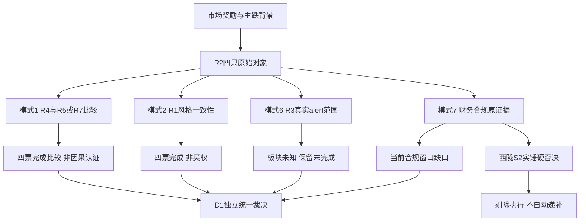

# 2026年11月18日 · 反证 / Devil’s Advocate

## 一句话结论

拦截西陇科学S2；4票已审消息资金与风格，出货及当前合规必要覆盖仍未完成。

## 详细分析

情绪=主跌。市场奖励局部低位首板与少数承接，惩罚广谱高位接力。主线 = 光刻机/胶（国产替代），持续性 = 1日验证窗，封板率 = 70%，明日预期 = 分歧。这是R2研究判断，不是已确认可交易主线；1日不代表历史首次启动。本轮主模板仅“首板隔日”。炸板率35.0877%触线，上游已将8只预选减为4只，R6不再因反证条数二次砍池。

六份JSON均为本批业务日。R2/R5所绑定依赖hash与本次文件相同，四票代码精确匹配；无顶层run_id的上游依hash关联，不编attempt或交付回执。只消费本批六份JSON，没有读MD、raw、昨日计划或额外证据文件，没有拉新数据、MCP或第二模型会话。

模式1对四票完成实质比较：三票R7缺覆盖时采用本版R5五交易日分档/DC及价格；华胜先核R7精确序列再对R5。R4的BIS公众精确分钟在17日收盘后，美方16日发布及盘中转述另存；不认定该分钟消息导致此前涨停，正资金也不证明替代订单已落实。R7旧池漏票不是全局no_trade。

模式2四票均保留完成结果：R2只给临时地位和研究观察，没有授予广谱进攻，与R1局部分化兼容。模式6光刻两板块alert未知、算力885957.TI板块不在检查范围；个股false仅适用已核对象与两日榜首代理，不能扩大成板块阴性。模式7年度审计/三表有实质结果，但S2/S3当前窗口仍逐票未闭环，缺口不是否决票。

西陇历史造假S2已由公司法披逐字引述处罚决定证实，按既有合规轴硬否决。调查审理终结、公司称整改且不触重大违法强退，与这项研究硬否决并存；不是2026年新立案，不推定当前ST或必然退市。FY2025标准无保留审计也不抹去历史造假。

## 必要审核覆盖

| 对象 | 模式1 | 模式2 | 模式6 | 模式7 | 态度 |
|---|---|---|---|---|---|
| 西陇科学 002584.SZ | 完成比较 | 完成比较 | 板块必要项未完成 | 当前窗口未完成 | 拦截：S2 |
| 盛剑科技 603324.SH | 完成比较 | 完成比较 | 板块必要项未完成 | 当前窗口未完成 | 观察：非授权 |
| 华东重机 002685.SZ | 完成比较 | 完成比较 | 板块必要项未完成 | 当前窗口未完成 | 观察：非授权 |
| 华胜天成 600410.SH | 完成比较 | 完成比较 | 板块必要项未完成 | 当前窗口未完成 | 观察：非授权 |

研究对象4，有据评估4，四项必要审核全部完成0，hard_reject对象1。formal_review_completed=false，review_passed=false。辅助缺口不连带否定已完成的1/2；模式执行不是通过。

## 逐票实质判断与依据

### 西陇科学 002584.SZ · 拦截

板型：首板回封；Tushare开板1次，THS为0次，保留冲突。R2排序龙头，纪律四条已过2条，至少3条未满足；不是已认证总龙。盈亏比与止损距离均未知，不造价格。禁止清单confirmed为空仅限已核范围；完整清单、趋势及逐票监管仍未知。R6另确认S2硬否决。

模式1：已比较R4 BIS国产替代传导假设与R5同票11—17日资金/价格：17日涨10.0139%，分档主力+1.211389亿、DC+1.209396亿，五日分别+1.283963/+1.281970亿。正反应不是政策已带来先进光刻胶订单；H1电子化学品仅部分收入且不等同自产先进胶。R7无本票不作阴性。R4公众精确定位在17日收盘之后，保留美方16日发布及盘中转述，不认定该新闻导致此前涨停。

模式2：R1奖励局部低位首板，R2只列光刻形成期观察且未授执行：研究身份一致；不能把首板强等于主升确认。R5收盘仍低MA50、30日负收益，反面边界必须保留。

模式6：光刻胶885864.TI与相关光刻机886054.TI在R3的两日连续榜首检查均unknown/null：前日不在返回样本不是false。本股dc热榜检查也unknown。R5五日分档和DC均正，不满足已证近五日主力净出；未形成模式6硬否决，但必要板块alert审核未完成。S2硬否决另行保留。

模式7：复核三表：F1/F2/F3/F4/F5/F6/F8/F9未触原阈值，F7仅H1已披露经营交易比例，F10缺短期债券不可补0；F11按Q3控制人62.12%/52.59%非旧71.9%。F12 FY2025审计正文至签署为标准无保留，关键审计事项不是强调事项。S1未触；S2公司2023-030公告逐字引述广东[2023]16号决定确认2020/2021/2022H1虚构贸易，历史造假实锤按既有合规轴hard_reject。已结案、公告称整改完毕及不触强退均完整保留，不称新案。S3当前窗口未闭环，本票必要审核未完成，但不撤已形成硬否决。

**大资金意图**：研究解释（资金身份未核）：前排封板带来短线风险偏好回流，但分档与DC需逐日核；不能用负的net_mf_amount把正分档流错误判为出货。
**为什么走强**：71根日K中最新价收复MA5/10/20/30，但仍低于MA50，30交易日收益为负。属于箱体上沿修复，不据一次涨停认证主升；图文的突破观察不等于突破确认。
**逻辑够不够硬**：电子材料叙事不能覆盖原[2023]16号已终结处罚认定的虚构贸易。原文称整改、不触发强退与本研究S2硬反证并存，不冒充新立案。

**买入理由（仅被挑战的上游假设，R6不推荐买入）**：电子材料进口替代提供产业研究理由；11月17日首封09:35且板块有7只封板，提供前排相对地位证据。仅研究，不构成买入。

**风险点**：历史财务虚假记载及未决证券诉讼；电子化学品不等于先进光刻胶；日中期均线未完全转多。

**止损条件（逻辑证伪，非下单价）**：若官方确认新增重大违法、撤销关键业务事实，或次日板块前排集体失去承接，研究假设失效；不在R5给止损价格。 S2不因等待买点解除。

**可验证假设**：未来1—3交易日核光刻胶封板家数是否仍≥3、该票是否保持早于主要助攻的承接；无扩散或出现官方业务否认即否定接力假设。 上述观察来自R5，不是R6新增交易阈值。

定位：R2#/main_lines/0/leaders/0；R5#/profiles/0；逐项RFC6901引用见同版JSON。

### 盛剑科技 603324.SH · 观察

板型：首板未开板；是否一字须逐笔/分钟核。R2排序龙二，纪律四条已过0条，至少3条未满足；不是已认证总龙。盈亏比与止损距离均未知，不造价格。禁止清单confirmed为空仅限已核范围；完整清单、趋势及逐票监管仍未知。未形成R6硬否决不等于门禁全通过。

模式1：已比较国产替代消息与同票同窗资金/价格：17日涨9.9842%，分档+0.190543亿、DC+0.192457亿，五日+0.117787/+0.118735亿。方向同为回流但不能证明机构合力或先进胶大单；H1电子化学品毛利为负，厂务收入占主。R7未覆盖本票不影响使用R5。消息公众分钟证据晚于收盘，事件归因未证。

模式2：R1局部首板与R2第二前排观察并不冲突；R2龙头认证0/3、换手低于板块中位，R5日中期仍弱，因此不得把“早封未开板”升级成已确认右侧主升。西陇被否不使其自动升位。

模式6：沿R2精确光刻板块，R3检查0/1均unknown，未完成该股直接alert检查；不能用空distribution_alert认定无出货。R5五日+0.117787亿、DC+0.118735亿，未出现规则所需净出，仍不补造板块阴性。

模式7：复算F9=855782764.87/791842595.13=108.0749%>40%，soft_suggest；F4存货增31.81%但周转0.8625高于0.8250，原AND条件不触。F6亏损分母不适用，不当负比例通过；前三季亏损保留。F12年度审计正文标准无保留；S1年度非连续两亏且净资产正。F7破折号不是0、获批额度不是实际；F10缺债务；S2/S3当前官方窗口仍unknown，仅本票模式7未完成。

**大资金意图**：研究解释（资金身份未核）：首封早、封单抑制成交与低换手并存，不能只凭未开板宣布充分机构合力；与西陇共享主线证据不重复计票。
**为什么走强**：71根日K显示仅勉强收复MA30，仍低于MA50；涨停是下跌后的箱体反弹，不是已证主升。日内开板0不等于全天一字，开盘与最低价已明确不是全日同价。
**逻辑够不够硬**：F9应收/累计收入>40%为已证软反证；亏损不自动等于ST。监管窗口缺口另列，不做安全认证。

**买入理由（仅被挑战的上游假设，R6不推荐买入）**：绿色厂务与电子化学品提供半导体供应链映射；同批早封板提供短线辨识度，但经营数据未支持加速估值。仅研究。

**风险点**：前三季归母亏损；应收高于累计营收；换手低于板块中位与日中期趋势仍弱。

**止损条件（逻辑证伪，非下单价）**：若主线回流而该股不能同步，或应收回款/新增订单假设被原文证伪，取消第二前排假设；R5不定价格。

**可验证假设**：未来1—3交易日观察同板块扩散能否带动其有效换手并相对强于板块；只剩单票缩量封单不算合力验证。 上述观察来自R5，不是R6新增交易阈值。

定位：R2#/main_lines/0/leaders/1；R5#/profiles/1；逐项RFC6901引用见同版JSON。

### 华东重机 002685.SZ · 观察

板型：3连板；竞价封板且开板0，未独立确认全日一字。R2排序龙头，纪律四条已过1条，至少3条未满足；不是已认证总龙。盈亏比与止损距离均未知，不造价格。禁止清单confirmed为空仅限已核范围；完整清单、趋势及逐票监管仍未知。未形成R6硬否决不等于门禁全通过。

模式1：已比较BIS双向约束、17日公司异动说明与同票五交易日量价：当日分档+0.519566亿、DC+0.513341亿，五日+3.097840/+3.070347亿；但R2保留同日THS -1.210608亿，符号冲突不平均、不择优。三连板价格强不证明纯GPU业绩兑现，H1芯片收入占比低且锐信未完成承诺。R7缺本票不触全局禁买。R4公众精确发布时间不能用作此前股价的因果锚。

模式2：R1二板以上风格负反馈与本票唯一三板并存。R2将其置竞争方向观察而非确认主线、认证仅1/3，故未形成研究身份矛盾；若据高度直接接力，则越过R1风险边界。个股多头不是全市场接力改善。

模式6：R3 stock检查52在dc两末榜19→13，明确false只适用于该两日榜首代理；本次R2板块885957.TI未在sector检查范围，不借其他芯片概念替代。R5五日净额正，模式6硬拒未形成；板块必要项继续未完成。

模式7：三表F1/F2/F3/F4/F5/F6/F8/F9未触原阈值，F7 H1经营交易比例可算不代表Q3全类型；F10缺项未知，F11法人控制人0质押与自然人实控49.05%区分。F12已核FY2025标准无保留及签署；S1不触财务轴。R5空flags不是全查阴性，S2/S3当前窗口缺证使本票必要审核未完成；锐信承诺未达及商誉减值是真实经营反证，不偷换F2商誉占比超标。

**大资金意图**：研究解释（资金身份未核）：高度与极低流通供给形成抢先手，11月16日换手后17日缩量；这种结构也容易在一致转分歧时放大兑现压力。THS/DC冲突不择优消除。
**为什么走强**：71根日K站上全部日均线，连续3板收6.70，30日上涨明显；最新OHLC同价为日线一字形态，量能急缩只表明可交易筹码少，不能证明次日承接。
**逻辑够不够硬**：锐信图芯2025业绩承诺未完成且商誉已减值；现有商誉占比不高不代表产业兑现完成。

**买入理由（仅被挑战的上游假设，R6不推荐买入）**：GPU国产替代提供切换题材；唯一非ST3板与日线多头提供地位及量价证据。只能列计划内试错研究，不授予追板许可。

**风险点**：一致缩量与次日筹码释放；芯片收入占比小、锐信业绩未达标；定增审批及摊薄。

**止损条件（逻辑证伪，非下单价）**：若换手后失去高度与低位助攻，或GPU核心业务事实被证伪，失去高度试错研究理由；不因跌回均线改做左侧抄底。

**可验证假设**：未来1—3交易日核能否以有效换手保留最高标地位，并带动≥3只同题材强势对象；仅自身一字而助攻消失不算确认。 上述观察来自R5，不是R6新增交易阈值。

定位：R2#/secondary_lines/0/leaders/0；R5#/profiles/2；逐项RFC6901引用见同版JSON。

### 华胜天成 600410.SH · 观察

板型：首板回封、3天2板反包，开板1次。R2排序龙二，纪律四条已过2条，至少3条未满足；不是已认证总龙。盈亏比与止损距离均未知，不造价格。禁止清单confirmed为空仅限已核范围；完整清单、趋势及逐票监管仍未知。未形成R6硬否决不等于门禁全通过。

模式1：先核R7精确本票11—17五日：DC+12.699704亿、当日+7.142015亿，R5分档五日+12.319787亿、当日+6.963382亿；5日仅3日正，16日DC -6.139158亿后反包，不是连续五日吸筹。R2所引THS 12—17日负窗不能与11—17五交易日净额直接比较；BIS替代叙事不能抵消进口供给/毛利约束或证明新增订单。

模式2：R1局部承接与R2容量分离观察可兼容；3天2板不是连续2板，R2认证2/3、RR未知、无执行资格。不能把单票反包与正资金升级为国产算力全线主升。

模式6：R3 stock检查27/41在THS 7→8、DC11→2，明确false仅该股票两日榜首代理；885957.TI板块未查，不能据个股false排除板块出货。R5五日正、不以R7替代模式6R5口径。该板块分支未完成，并非已证实出货。

模式7：复算F4存货同比102.2266%>收入20.8336%×1.5且周转2.5204<3.3143，soft_suggest。F6亏损分母不适用，负盈利事实保留。F11无控股股东为有据不适用，但第一大股东质押79.9712%是真实筹码风险，不冒充P0控股股东F11。F12年度审计标准无保留已核至签署；S1不触。F7复杂关联表未可靠合计、F10缺债务为辅助未知；S2/S3当前窗口unknown，仅本票必要审核未完成。

**大资金意图**：研究解释（资金身份未核）：容量与热度使其成为回流载体，DC五日净入需与分档同日比较；H1到Q3现金改善不能代替股价次日买盘。
**为什么走强**：71根日K收复全部短中期均线，3天2板反包；前一天冲高回落仍需消化，不把反包称两连板。长周期历史结构不能用盘前分钟承接措辞。
**逻辑够不够硬**：F4存货增速与周转率构成软反证；第一大股东高质押应披露，但无控股身份时不可偷换F11定义。

**买入理由（仅被挑战的上游假设，R6不推荐买入）**：国产算力系统集成映射与容量地位提供产业和交易研究理由；反包及资金回流有事实，不等于全板块主升。

**风险点**：前三季归母亏损；存货堆积/周转下降；出口限制与毛利压缩；第一大股东质押需单列。

**止损条件（逻辑证伪，非下单价）**：若指数/算力修复而该股不能相对走强、资金持续净出或业务映射被官方证伪，取消容量分离假设；R5不设置交易价格。

**可验证假设**：未来1—3交易日核与高度锚能否独立走强并出现≥3只同题材助攻；反包次日无承接视为短线假设证伪。 上述观察来自R5，不是R6新增交易阈值。

定位：R2#/secondary_lines/0/leaders/1；R5#/profiles/3；逐项RFC6901引用见同版JSON。

## 完整反证清单与限定条件

### R6_M7_001 · 西陇科学 · hard_reject
被挑战：前排地位或标准年审可以覆盖历史合规硬风险
证据：S2：公司2023-030法披逐字引述广东监管局[2023]16号决定：虚构乙二醇/甲醇贸易，2020、2021、2022H1财报虚假记载；公司被警告罚款120万元。本案调查审理终结；公司同文称整改完毕、不触重大违法强退，2025年报仍有延续赔偿披露。
处理：拦截：按既有S2财务造假实锤规则，禁止纳入execution_pool；只能留研究观察，不以“等分歧买点”保执行，不用龙二/低位补涨自动替补。D1无覆盖权。
限定：不是2026年新立案，不宣称当前ST或必然退市；已取得公司法披引述决定，不声称取得监管网站单列决定文件。；S3当前窗口未完成不撤销已证S2；未来解除须有正式有效的规则/事实裁决，不因研究窗口到期自动解禁。
关联：sector_id=885864.TI；round_id=null；event_at=null。精确沿R2本次盘前窗口，到开盘重评；研究窗口到期不是S2自动解除。
定位：R5#/profiles/0/dimensions/valuation_safety/fundamental_checks/S2；R5#/profiles/0/dimensions/valuation_safety/official_evidence/3

### R6_M1_001 · 西陇科学 · soft_suggest
被挑战：国产替代与首板正流入证明先进光刻胶新订单
证据：资金回流属实，但H1电子化学品387832308.65元只是产品收入4307442749.26元的一部分；配套试剂/铜蚀刻研发不等于先进胶量产。BIS原文只提供限制事实，R4替代收益是传导假设，不能以涨停补齐订单。
处理：降级订单确定性表述；保持S2拦截，不据这条一般风险再机械扣仓。
限定：仅否定已证订单/纯胶外推，不否定情绪映射存在；不与S2合并抹去不同事实。
关联：sector_id=885864.TI；round_id=null；event_at=null。精确沿R2本次盘前窗口，到开盘重评；研究窗口到期不是S2自动解除。
定位：R5#/profiles/0/dimensions/catalyst/business_segments；R4#/top_events/23

### R6_M1_002 · 盛剑科技 · strong_suggest
被挑战：首封早且未开板说明充分换手和先进胶量产兑现
证据：R2换手1.65%低于板块中位3.8084%；H1电子化学品销售25079105.22元、毛利-2352669.19元，绿色厂务销售311542756.17元，不能把历史FPD关联升级EUV胶新增大单。
处理：降级“已证核心/先进胶订单”主张，保留观察；西陇被硬否决不使盛剑自动升龙一或递补执行。
限定：首板前排仍是研究事实，低换手本身不构成hard_reject；当日有效换手与直接订单原文可供D1重评。
关联：sector_id=885864.TI；round_id=null；event_at=null。精确沿R2本次盘前窗口，到开盘重评；研究窗口到期不是S2自动解除。
定位：R2#/main_lines/0/leaders/1/selection_basis；R5#/profiles/1/dimensions/catalyst/business_segments

### R6_M1_003 · 华东重机 · strong_suggest
被挑战：正净流入已被多源一致证明
证据：同为17日，R2保留THS -1.210608亿与DC+0.513341亿；R5分档+0.519566亿。真实冲突不能以两正一负投票或平均抹掉；Tushare与DC底层相近也不当两份独立买盘。
处理：保留原资金符号冲突，D1明确解释采用口径及影响；不得把R7未查本票变为全局no_trade。
限定：五日两已核口径均正；冲突是同日口径风险，不等于已证连续净出或霸榜派发。
关联：sector_id=885957.TI；round_id=null；event_at=null。精确沿R2本次盘前窗口，到开盘重评；研究窗口到期不是S2自动解除。
定位：R2#/secondary_lines/0/leaders/0/selection_basis；R5#/profiles/2/dimensions/chip_structure/flow_observations/4

### R6_M3_001 · 华东重机 · strong_suggest
被挑战：GPU高度可以按纯芯片业务给主体估值
证据：H1芯片领域销售9696725.65元，产品合计757030027.4元，主体仍是集装箱装卸设备；锐信图芯2025业绩承诺未完成且已计商誉减值，不能从低商誉占比推出兑现完成。定增用于智能制造基地且待注册，不是GPU销售订单。
处理：降级纯GPU估值/业绩兑现主张；保留高度研究，不新增评分权重或固定仓位上限。
限定：F2商誉比未超30%，不把已减值偷换F2红旗；主营占比不否认纯情绪通道，无独立估值陷阱命中证明。
关联：sector_id=885957.TI；round_id=null；event_at=null。精确沿R2本次盘前窗口，到开盘重评；研究窗口到期不是S2自动解除。
定位：R5#/profiles/2/dimensions/catalyst/business_segments；R5#/profiles/2/known_adverse_facts；R5#/profiles/2/dimensions/catalyst/summary

### R6_M9_001 · 华东重机 · strong_suggest
被挑战：唯一最高三板和一字形态保证隔日接力可达
证据：R1二板以上风格-3.898%，本票17日日线OHLC同价且成交量仅前五日均量0.437585倍。缩量一致减少可交易供给，也可能放大次日释放压力；没有18日承接。
处理：观察高位一致转分歧与可达性；D1不得用预测一字或高度直接签执行，亦不得仅凭高度新增硬否决。
限定：不是已证实出货；本票多头趋势事实保留。高位风险与业务/资金冲突关联但不作多份独立扣仓。
关联：sector_id=885957.TI；round_id=null；event_at=null。精确沿R2本次盘前窗口，到开盘重评；研究窗口到期不是S2自动解除。
定位：R1#/evidence/4；R5#/profiles/2/dimensions/technical_readiness

### R6_M7_002 · 盛剑科技 · soft_suggest
被挑战：主题回流足以覆盖回款质量
证据：F9复算：应收855782764.87元/前三季收入791842595.13元=1.0807485858，超过40%。前三季归母亏损，不凭这一单条软红旗推定退市或四红旗硬拒。
处理：保留应收变现风险交D1；不按条数固定限仓。
限定：存量/9个月收入非全年年化；F7/F10未知不作额外命中；F4周转未下降不触。
关联：sector_id=885864.TI；round_id=null；event_at=null。精确沿R2本次盘前窗口，到开盘重评；研究窗口到期不是S2自动解除。
定位：R5#/profiles/1/dimensions/valuation_safety/fundamental_checks/F9

### R6_M7_003 · 华胜天成 · soft_suggest
被挑战：收入增长等于业务现金与周转同步改善
证据：F4复算存货同比102.2266% > 营收同比20.8336%×1.5，9个月成本/平均库存周转2.520366<3.314277。两条件同时成立，原规则单条soft_suggest。
处理：保留存货积压/验收和利润转化风险交D1统一裁决；不据此机械给0.85/0.7乘数。
限定：H1至Q3经营现金改善事实同时保留，不以累计现金正抹去周转异常；不足以判已证财务造假。
关联：sector_id=885957.TI；round_id=null；event_at=null。精确沿R2本次盘前窗口，到开盘重评；研究窗口到期不是S2自动解除。
定位：R5#/profiles/3/dimensions/valuation_safety/fundamental_checks/F4

### R6_M7_004 · 华胜天成 · soft_suggest
被挑战：F11不适用等于不存在股权质押压力
证据：年报明确无控股股东，F11控股股东阈值不适用；但Q3第一大股东王维航质押26668039股/持33347039股=79.9712%，属于独立筹码风险。
处理：保留大股东质押压力，但不偷换成控股股东P0、不增硬拒。
限定：不是公司全体股东质押率，不宣称新增质押、爆仓或强平已发生；观察窗外需更新。
关联：sector_id=885957.TI；round_id=null；event_at=null。精确沿R2本次盘前窗口，到开盘重评；研究窗口到期不是S2自动解除。
定位：R5#/profiles/3/dimensions/valuation_safety/fundamental_checks/F11

### R6_M1_004 · 华胜天成 · strong_suggest
被挑战：国产算力订单因BIS限制自动增加且资金持续五日认可
证据：DC五日净额正但仅3日净入，16日-6.139158亿；R4同根BIS正替代推演与负供给限制并存，许可制及商业推荐系统豁免不能概括全面封禁；华胜新增订单未证，Q3亏损及毛利压力仍在。THS 12—17负窗不同于DC 11—17五交易日，不能伪称同窗五日矛盾。
处理：降级持续吸筹与订单自动兑现主张；按既有核心观察，不把正负分面净额抵消或用同根事件重复扣仓。
限定：消息精确公众分钟在收盘之后，盘前交叉仅审假设与既有可比反应，不称该官方分钟导致17日涨停；不否定原价格/资金正反馈事实。
关联：sector_id=885957.TI；round_id=null；event_at=null。精确沿R2本次盘前窗口，到开盘重评；研究窗口到期不是S2自动解除。
定位：R7#/main_force/stock_flows/600410.SH/series_5d；R4#/top_events/3；R4#/top_events/23；R5#/profiles/3/dimensions/valuation_safety/summary

## 四象限负面识别

| 象限 | 负面识别 | 限定 |
|---|---|---|
| 正面叙事×价格/资金正反馈 | 国产替代叙事与17日正反馈并存，但新增订单/合规不能由涨停替代；西陇S2硬否决保留。 | not_established |
| 正面叙事×价格/资金负反馈 | 同日THS负与DC/分档正冲突；只能保留反向观测，不能判全票主力统一净出。华胜THS短窗不作为同窗五日阴性。 | not_established |
| 负面约束×价格/资金正反馈 | BIS供给约束与国产替代受益路径同根，四票仍有17日正反馈；利空不跌不等于利空已消化，历史造假、应收与存货风险不被上涨撤销。 | not_established; R4公众精确分钟晚于收盘，不冒充利空发布后已承受检验 |
| 负面约束×价格/资金负反馈 | R2已列CPO热度负收益及R7通信设备五日净出，但本批R2四对象未获同窗、事后可归因的完整双负结论；不扩展个股、不从severity补造历史看空。 | incomplete |

消息方向×既有量价只是并列比较，不等于盘后消息已被收盘消化，不据severity反推历史立场。R4原有叉乘保留在JSON；非本批对象不扩成新票硬否决。

## 辅助反证与局部降级

估值/主营：华东纯GPU外推有分部与承诺未达反证，低商誉比不等于兑现。西陇不靠低PS洗掉S2；盛剑/华胜亏损分母不可用于正PE/一次性收益比例，不补0。V1—V10不足以逐项认证，不造陷阱命中。历史类比只有qingxu四次指数样本，非个股轮次库；昨日兑现内嵌records为空且无E1，不越权读昨日文件。

解套盘缺封板量与套牢区，37涨停也非100+示例前提，不编70%或confidence上限。华东缩量一致尾部风险保留strong_suggest，但不因高度新增硬否决。商品无精确敞口与对应同窗走势，不按概念猜。辅助缺口均不阻已核必要结果。

## 关键证据

- 西陇2023-030法披引述广东[2023]16号：虚构贸易造假实锤，同时保留已结案、整改、不触强退。来源R5#/profiles/0/dimensions/valuation_safety/fundamental_checks/S2。
- 盛剑F9应收/前三季收入108.0749%，原单条soft_suggest。来源R5#/profiles/1/dimensions/valuation_safety/fundamental_checks/F9。
- 华胜F4存货增102.2266%、营收增20.8336%，周转2.5204<3.3143，AND条件成立。来源R5#/profiles/3/dimensions/valuation_safety/fundamental_checks/F4。
- 四票五日分档净额均正；西陇/盛剑/华东缺R7不当无资金。华东同日THS/DC符号冲突不平均，华胜不同五日窗不伪装冲突。来源JSON calculation_audit及模式1。

## 数据源审计

| 源 | 状态 | 日期 | 范围/备注 |
|---|---|---|---|
| R1 | 🟡 degraded | 2026-11-18 | 绑定hash、实际引用范围；上游产出时刻不是市场事实时刻 |
| R2 | 🟡 partial | 2026-11-18 | 绑定hash、实际引用范围；上游产出时刻不是市场事实时刻 |
| R3 | 🟡 degraded | 2026-11-18 | 绑定hash、实际引用范围；上游产出时刻不是市场事实时刻 |
| R4 | 🟡 partial | 2026-11-18 | 绑定hash、实际引用范围；上游产出时刻不是市场事实时刻 |
| R5 | 🟡 partial | 2026-11-18 | 绑定hash、实际引用范围；上游产出时刻不是市场事实时刻 |
| R7 | 🟡 partial | 2026-11-18 | 绑定hash、实际引用范围；上游产出时刻不是市场事实时刻 |
| 本轮专题prepare | 🔴 unknown | 未核 | 不编本次context hash；仅消费JSON内嵌投影 |
| 版本/指针/契约 | 🟢 passed | 2026-11-18 | 确定性校验，不是研究全部完成或买权 |

16份直接内嵌来源投影逐条保留source_id/hash/真实时点/省略范围及裁决。同源重复不加独立性。lianban仅有限正文比较，股性为月度背景，一字预测待实际表现；非本批的成长/红利/增减持旧榜不扩池。空复盘反馈unknown。未读原MD/XLSX、会员/隐藏正文或联网，未将传递写成全文已读。

## 不确定性 / 反证

必要覆盖未完成，不写“无重大反面证据/全绿”。F10缺债务不补0；盛剑/华胜F7未可靠合计不冒充阴性。FY2025审计关键事项和通用持续经营责任不是非标。历史造假原始事实时点不改成本轮生成时刻，round_id/event_at均因R2未知保持null。

R6不拥有仓位预算权，不设1—3%限额、不给0.85/0.7乘数、不按条数/模式数扣仓。同事实关联去重，不删真实反证抬仓。D1对strong_suggest须说明采纳/覆盖理由和实际影响，hard_reject无覆盖。真实用户/账户停买、有效预算含0、仓位硬上限、T+1和人工确认等既有保护不变；本轮预算来源未读保持未知，R1的20%研究建议不是可用资金。

## 与其他 R/D/E 的关系

- 依赖本批R1/R2/R3/R4/R5/R7；只审R2四对象。
- R3补板块真实alert；R5/R4补当前合规/ST预警范围及原文，R6不代抓。
- D1独立裁决；西陇剔除execution_pool，可留研究，但不能等分歧保执行或用龙二/低位自动替补，允许空池。
- E1后续复盘，未核的历史兑现不冒充已执行。
- 市场事实基准11月17日收盘，R2盘前窗口到18日开盘；新竞价/广度/承接即重评，旧市场性零仓不永久继承。
- in_today_plan=null，不在D1首次成案前用false/plan_outside_scan预先排除。

## Sub-Agent 元数据

- skill: analyze_devil_advocate_v1
- artifact: data/research/20261118/R6_devil_advocate.json
- 同版生成标识：2026-11-18T07:29:20+08:00（真实机器时间，非原事实时间）
- model: gpt-6.1-sol
- 生成耗时：全阶段未计量，不造秒数。
- resource: usage_unknown不当0，不保证低于5000万努力目标；08:30仅observe_only。
- validation: 本次Pydantic契约、16条覆盖、全部RFC6901引用和六源hash通过；未运行调用方外部接收器，不冒充已被生产消费。
