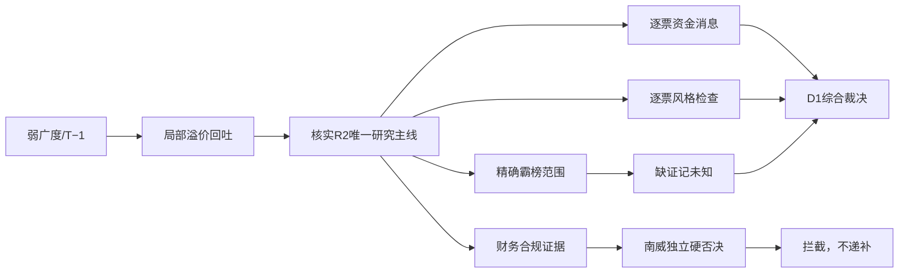

# 2026年11月19日 · 反证 / Devil’s Advocate

> **数据源新鲜度**：partial · **降级状态**：是 · **置信度**：未统一量化

## 一句话结论
弱广度下局部修复，9票逐项复核，必要审核未全；南威软件两项独立法定事实硬否决，不外推停买。

## 详细分析

情绪=震荡/主跌：本轮是偏弱震荡下的局部修复，不是已证主跌。11/18涨1318、跌4133、炸24/65=36.92%；跌停67→39（Tushare），昨板开盘均值+3.19%但收盘+1.57%，连板子组收盘中位-1.01%。只奖局部低位先手和少数核心，非全面主升也非已证主跌。

主线 = 国产算力（算力租赁/昇腾/数据中心），持续性 = 1日，封板率 = 90.48%，明日预期 = 分歧（R2的T−1对11月19日预期）。19封2炸是真，但资金正持续仅1日。PCB为1日、封板率33.33%、预期分歧；6G为1日、封板率40%、预期分歧。两者是支线，不能把同一算力家族或重叠个股拆成独立合力。

**大资金意图**：双口径订单分档只反映成交方向，不指认交易主体。华胜有容量，真视通保留早封身位，但后者边际资金为负，沪电回流也未抹平前四日净卖。**为什么走强**：封板簇和算力需求提供解释；行云、协创事件有各自合同边界，不能当成两只核心票的订单。**逻辑够不够硬**：只够提出局部修复假设。若竞价/开盘溢价转负、核心失承接且助攻不足，不升级；广度与正中位同步好转才重评。

炸板36.92%，沿用R5已减半的4席研究焦点：真视通、华胜天成、深南电路、沪电股份。9席都完成逐票取证，不以焦点数替代审查数，也不入执行池。

## 关键证据

| 必要模式 | 已完成 | 未完成及回送 |
|---|---:|---|
| 1 资金×消息 | 9/9 | R7仅两票同窗个股资金，其余采用R5同版实取×R4；不重计同一东财口径。 |
| 2 风格一致性 | 9/9 | 同窗比较均保留；不授资格。 |
| 6 霸榜出货 | 2/9 | PCB板块精确已查；华胜个股榜首门槛完成、所属算力分支仍未知；其余按R3范围，未查交R3。 |
| 7 财务合规 | 1/9 | 南威决定性风险已核，余票当前合规原件范围不闭环交R5；已算子项保留。 |

### 逐票必要审核与四象限反证

#### 真视通（002771.SZ）｜观察

**大资金意图**：五日小幅净买、封板日净卖，不能指认真正买方。**为什么走强**：算力涨停簇扩散与早封身位一致。**逻辑够不够硬**：没有公司新增订单证据，次日承接未知。

板型：T-1早盘封板未开；龙头认定：R2 龙一（仅研究）；盈亏比：未知，未证可执行结构；禁止清单：11月18日风险名单未见不代表19日或完整阴性。
 
- **资金／模式1**（completed）：早封二板且5日两口径小幅正，但边际转负、3日榜净卖153万元不是日内派发确证。R4的行云首期和协创验收没有真视通发行人映射；NV/腾讯行业脉冲不能解释为公司订单。 可比11/12、13、16、17、18；R5实际 Tushare moneyflow分档／moneyflow_dc（东财），daily；5日+0.5602/+0.5558亿、18日-0.1009/-0.1032亿。R7旧统计池无本票同窗个股资金序列；使用R5实际取数。R4原件事实独立于量价，但间接对象只限行业假说；盘后消息不倒因盘中。
 
- **情绪／模式2、6**（2=completed，6=incomplete）：真视通二板早封是少数前排例外，流通23.60亿、3板断层及连板中位负限制追价；保留身位观察，不把早封写成19日晋级。 东数西算本晚第2，租赁第1，昇腾第3，前晚可比排名不足；不外推本票无派发。
 
- **基本面与估值／模式7**（incomplete）：F9=130.23%；应收同比-32.15%并非暴增，触发F3因营收-37.43%；存货近持平但周转降。Q3累计亏3609万，F6不适用；2025研发资本化0、审计标准，当前监管关键范围仍缺。
 
- **结构／可验证假设**：若华胜同步失承接或租赁封板簇回落，卡位假设失效。 未证目标日可执行结构，RR及止损距离未知；不以形态代买权。 **买入理由**：不授权；**风险点**：实际证据如上；**止损条件**：无可执行结构，不填价。
 
证据：R2#/main_lines/0/leaders/0、R5#/profiles/0；逐模式实际来源与关联：R6_M1_01、R6_M2_01、R6_M7_01、R6_M3_01。

#### 华胜天成（600410.SH）｜观察

**大资金意图**：前期净买较大、18日继续净买但较前日收窄，不等于19日续接。**为什么走强**：容量与题材共振较符合前排修复。**逻辑够不够硬**：异动澄清、亏损及高换手不支持将修复解释为盈利改善。

板型：T-1早盘封板未开；龙头认定：R2 龙二（仅研究）；盈亏比：未知，未证可执行结构；禁止清单：11月18日风险名单未见不代表19日或完整阴性。
 
- **资金／模式1**（completed）：两版东财同根复现正流入、日净较前日明显收窄，资金未否定11/18容量，但不能反驳A1796的异动澄清、19.03%换手和前三季归母亏2.59亿；三日榜不能代替当日。 可比11/12、13、16、17、18；R5实际 Tushare moneyflow分档／moneyflow_dc（东财），daily；5日+15.0711/+15.4471亿、18日+2.1183/+2.0997亿。R7东财同源重合不重复算。R4原件事实独立于量价，但间接对象只限行业假说；盘后消息不倒因盘中。
 
- **情绪／模式2、6**（2=completed，6=incomplete）：华胜容量与R1少数前排修复一致，5日涨34.56%、高换手反复，不宜按低位新首板；容量未证明跨日承接。 华胜个股两榜首位身份核查完成（false，东财2→2、同花顺本晚2）；此结果不覆盖算力所属板块，板块分支未完成。
 
- **基本面与估值／模式7**（incomplete）：F1仅短债21.87%，现金14.53%不构成双高；F4虽存货+102.23%，周转提升未命中。年度研发资本化30.23%；Q3亏2.59亿及异动是风险，未证非标、立案或安全。
 
- **结构／可验证假设**：若涨停溢价开盘即兑现或容量净流入逆转，不再按容量领涨解释。 未证目标日可执行结构，RR及止损距离未知；不以形态代买权。 **买入理由**：不授权；**风险点**：实际证据如上；**止损条件**：无可执行结构，不填价。
 
证据：R2#/main_lines/0/leaders/1、R5#/profiles/1；逐模式实际来源与关联：R6_M1_02、R6_M2_02、R6_M3_02。

#### 天娱数科（002354.SZ）｜降级
板型：T-1未收涨停；龙头认定：R2 候补（仅研究）；盈亏比：未知，未证可执行结构；禁止清单：11月18日风险名单未见不代表19日或完整阴性。
 
- **资金／模式1**（completed）：价格微弹与双口径当日及5日净卖背离；5日下跌16.67%、量比0.66。R4算力事件不落到这家发行人，历史锚不是新增订单；不把缺消息当利空。 可比11/12、13、16、17、18；R5实际 Tushare moneyflow分档／moneyflow_dc（东财），daily；5日-8.3465/-8.3856亿、18日-0.3564/-0.3564亿。R7旧统计池无本票同窗个股资金序列；使用R5实际取数。R4原件事实独立于量价，但间接对象只限行业假说；盘后消息不倒因盘中。
 
- **情绪／模式2、6**（2=completed，6=incomplete）：天娱是历史候补，非板与近窗双流出不符合R1低位首板或前排奖励；价格位置低不等于有效先手。 东数西算本晚第2，租赁第1，昇腾第3，前晚可比排名不足；不外推本票无派发。
 
- **基本面与估值／模式7**（incomplete）：F4存货+28.34%、同期收入-2.04%、周转下降；S1两年亏损成立，2026Q3累计归母转正不改变2024/25财务轴，亦非已ST。商誉28.88%未过30%；当前监管缺证。
 
- **结构／可验证假设**：若板块继续走强而其仍弱于板块中位且流出持续，剔除作为接力对象。 未证目标日可执行结构，RR及止损距离未知；不以形态代买权。 **买入理由**：不授权；**风险点**：实际证据如上；**止损条件**：无可执行结构，不填价。
 
证据：R2#/main_lines/0/leaders/2、R5#/profiles/2；逐模式实际来源与关联：R6_M1_03、R6_M7_02。

#### 中京电子（002579.SZ）｜降级
板型：T-1未收涨停；龙头认定：R2 候补（仅研究）；盈亏比：未知，未证可执行结构；禁止清单：11月18日风险名单未见不代表19日或完整阴性。
 
- **资金／模式1**（completed）：当日两口径约+0.19亿但5日均负、价格5日跌12.98%、量比0.85；板块事件无本票直接验证，PCB标签不改变本席在R2为算力历史候补。 可比11/12、13、16、17、18；R5实际 Tushare moneyflow分档／moneyflow_dc（东财），daily；5日-0.8103/-0.8124亿、18日+0.1921/+0.1921亿。R7旧统计池无本票同窗个股资金序列；使用R5实际取数。R4原件事实独立于量价，但间接对象只限行业假说；盘后消息不倒因盘中。
 
- **情绪／模式2、6**（2=completed，6=incomplete）：中京是历史候补，非板、缩量且仍有5日抛压，不以跨标签或低价替代前排辨识。 东数西算本晚第2，租赁第1，昇腾第3，前晚可比排名不足；不外推本票无派发。
 
- **基本面与估值／模式7**（incomplete）：F3/F4/F9/F10四项复算命中；有息债/权益101.02%，应收/收入44.69%。两季CFO为负但Q3单季归母非正，F8不算红旗。同主体质押21.54%；本票仅历史候补、不属四旗规则触发对象，不把未完成合规写成安全。
 
- **结构／可验证假设**：需要同群修复和连续资金改善，否则历史辨识度无验证力。 未证目标日可执行结构，RR及止损距离未知；不以形态代买权。 **买入理由**：不授权；**风险点**：实际证据如上；**止损条件**：无可执行结构，不填价。
 
证据：R2#/main_lines/0/leaders/3、R5#/profiles/3；逐模式实际来源与关联：R6_M1_04、R6_M7_03。

#### 南威软件（603636.SH）｜拦截
板型：T-1未收涨停；龙头认定：R2 候补（仅研究）；盈亏比：未知，未证可执行结构；禁止清单：11月18日风险名单未见不代表19日或完整阴性，且本票新增确定性硬否决交接。
 
- **资金／模式1**（completed）：5日资金双口径名义小正但受11/13单日拉动且部分日口径偏差，11/18股价-2.05%、非板；R4算力订单与本票无精确映射，须与本票审计/立案事实分读。 可比11/12、13、16、17、18；R5实际 Tushare moneyflow分档／moneyflow_dc（东财），daily；5日+0.4280/+0.4065亿、18日+0.0481/+0.0484亿。R7旧统计池无本票同窗个股资金序列；使用R5实际取数。R4原件事实独立于量价，但间接对象只限行业假说；盘后消息不倒因盘中。
 
- **情绪／模式2、6**（2=completed，6=incomplete）：南威是历史候补，主线反弹仍逆势下跌，低流通与旧股性不构成抗弱实力；保留财务否决，不作为递补。 东数西算本晚第2，租赁第1，昇腾第3，前晚可比排名不足；不外推本票无派发。
 
- **基本面与估值／模式7**（completed）：年度非标F12/S3同根，加一项独立立案S2，均有内嵌法定原文；S1两年亏、应收/收入391.63%，F3/F4在收入缩水背景触发。质押66.27%不越70%；未见本案终局原件，不作处罚、造假、正式ST判断。
 
- **结构／可验证假设**：若下一次主线强而该股仍相对走弱，不升级。 未证目标日可执行结构，RR及止损距离未知；不以形态代买权。 **买入理由**：不授权；**风险点**：实际证据如上；**止损条件**：无可执行结构，不填价。
 
证据：R2#/main_lines/0/leaders/4、R5#/profiles/4；逐模式实际来源与关联：R6_M1_05、R6_M7_04、R6_M3_03、R6_M7_09、R6_M7_10。

#### 深南电路（002916.SZ）｜观察

**大资金意图**：日净买与龙虎榜净买同向，仅能确认披露窗口的成交方向。**为什么走强**：与沪电午后同向修复。**逻辑够不够硬**：PCB炸板多，五日价格仍跌，不能确认独立扩散。

板型：T-1午后封板未开；龙头认定：R2 龙一（仅研究）；盈亏比：未知，未证可执行结构；禁止清单：11月18日风险名单未见不代表19日或完整阴性。
 
- **资金／模式1**（completed）：涨停与当日双口径约+4.16亿吻合、榜净买约3.20亿；5日价格仍-12.15%，量比0.92。R4 NV需求与指引毛利下行同源并存，不认证本票订单或板块独立反转。 可比11/12、13、16、17、18；R5实际 Tushare moneyflow分档／moneyflow_dc（东财），daily；5日+1.7133/+1.6597亿、18日+4.1699/+4.1599亿。R7旧统计池无本票同窗个股资金序列；使用R5实际取数。R4原件事实独立于量价，但间接对象只限行业假说；盘后消息不倒因盘中。
 
- **情绪／模式2、6**（2=completed，6=completed）：深南午后首板属于容量修复，与选择性奖励相容，但PCB 2封4炸、涨停数未比前日增加，不支持独立主线或追价。 PCB概念同代码18→8，连续榜首条件不成立；仅该板块分支完成，不是个股派发全形态阴性。
 
- **基本面与估值／模式7**（incomplete）：F4存货+106.89%超收入+53.84%的1.5倍且周转从2.9762降至2.3422；Q3累计正利润不抵消。R5有6月五年监管公告采集记录但未内嵌正文命中段，不据标题或标准审计判当前合规。
 
- **结构／可验证假设**：需观察次日放量承接与PCB多票修复；若沪电开板兑现、行业无扩散，深南孤强不升级。 未证目标日可执行结构，RR及止损距离未知；不以形态代买权。 **买入理由**：不授权；**风险点**：实际证据如上；**止损条件**：无可执行结构，不填价。
 
证据：R2#/secondary_lines/0/leaders/0、R5#/profiles/5；逐模式实际来源与关联：R6_M1_06、R6_M7_05、R6_M3_04。

#### 沪电股份（002463.SZ）｜观察

**大资金意图**：单日大额回流而五日净流出，支持回补而非连续加码。**为什么走强**：PCB容量股共振与回封一致。**逻辑够不够硬**：前四日净卖仍在，不能仅用板型和低PE分位确认反转。

板型：T-1首封回封；龙头认定：R2 龙二（仅研究）；盈亏比：未知，未证可执行结构；禁止清单：11月18日风险名单未见不代表19日或完整阴性。
 
- **资金／模式1**（completed）：当日东财+13.19亿但前四日均负，5日东财-2.82亿、价格-10.33%，即便回封也支持回补非持续；R7同根复算一致，个别日口径偏差留存；R4 NV需求不等于沪电订单。 可比11/12、13、16、17、18；R5实际 Tushare moneyflow分档／moneyflow_dc（东财），daily；5日-2.6785/-2.8247亿、18日+13.2188/+13.1917亿。R7东财同源重合不重复算。R4原件事实独立于量价，但间接对象只限行业假说；盘后消息不倒因盘中。
 
- **情绪／模式2、6**（2=completed，6=completed）：沪电首板回封只是PCB配套龙二，五日价格、资金同负，不能用一次大额回流覆盖R1弱广度与盘中追涨惩罚。 PCB概念同代码18→8，连续榜首条件不成立；仅该板块分支完成，不是个股派发全形态阴性。
 
- **基本面与估值／模式7**（incomplete）：F9应收/收入41.55%略超40%，F4同比未越条件且现金流核验有正向证据；PE处同字段低分位不排除成本与财务风险。F5无充分研发口径，当前合规原件未闭环。
 
- **结构／可验证假设**：若单日回流不延续或深南先手溢价回吐，不按PCB共同修复解释。 未证目标日可执行结构，RR及止损距离未知；不以形态代买权。 **买入理由**：不授权；**风险点**：实际证据如上；**止损条件**：无可执行结构，不填价。
 
证据：R2#/secondary_lines/0/leaders/1、R5#/profiles/6；逐模式实际来源与关联：R6_M1_07、R6_M2_03、R6_M7_06、R6_M3_05。

#### 武汉凡谷（002194.SZ）｜降级
板型：T-1早盘封板未开；龙头认定：R2 龙一（仅研究）；盈亏比：未知，未证可执行结构；禁止清单：11月18日风险名单未见不代表19日或完整阴性。
 
- **资金／模式1**（completed）：首板当日东财+1.18亿、此前四日均负，5日股价仍-0.96%；R4科信子公司海外电源中标预估2027年出货，发行人和兑现窗均不同，不能证武汉凡谷直接参与。 可比11/12、13、16、17、18；R5实际 Tushare moneyflow分档／moneyflow_dc（东财），daily；5日+0.8307/+0.8267亿、18日+1.1847/+1.1807亿。R7旧统计池无本票同窗个股资金序列；使用R5实际取数。R4原件事实独立于量价，但间接对象只限行业假说；盘后消息不倒因盘中。
 
- **情绪／模式2、6**（2=completed，6=incomplete）：武汉凡谷早封首板与R1个别低位先手相容，6G 2封3炸无连板，流通47.91亿，不扩成第二进攻主线。 6G本晚12，前晚Top20外无精确排名；无本票直接出货检查。
 
- **基本面与估值／模式7**（incomplete）：F3应收+10.61%对收入-3.37%，F4存货+31.10%并周转下降；Q3累计归母-449.76万，F6不适用。标准年度意见及年度资本化0不等于当前监管全阴性。
 
- **结构／可验证假设**：只有新增通信封板簇与两票同步才可重估独立性；单票脉冲降级。 未证目标日可执行结构，RR及止损距离未知；不以形态代买权。 **买入理由**：不授权；**风险点**：实际证据如上；**止损条件**：无可执行结构，不填价。
 
证据：R2#/secondary_lines/1/leaders/0、R5#/profiles/7；逐模式实际来源与关联：R6_M1_08、R6_M7_07。

#### 中贝通信（603220.SH）｜降级
板型：T-1首封回封；龙头认定：R2 龙二（仅研究）；盈亏比：未知，未证可执行结构；禁止清单：11月18日风险名单未见不代表19日或完整阴性。
 
- **资金／模式1**（completed）：当日东财约+1.29亿大于5日合计+1.21亿、量比4.05且开板回封；部分日资金口径分歧不抹掉同向的5日结果。科信中标与算力合同非中贝公告，跨标签不是独立买盘。 可比11/12、13、16、17、18；R5实际 Tushare moneyflow分档／moneyflow_dc（东财），daily；5日+1.1965/+1.2069亿、18日+1.2708/+1.2942亿。R7旧统计池无本票同窗个股资金序列；使用R5实际取数。R4原件事实独立于量价，但间接对象只限行业假说；盘后消息不倒因盘中。
 
- **情绪／模式2、6**（2=completed，6=incomplete）：中贝首板回封和两主题重叠，不能由一票放量把6G视为单独风险分散；弱震荡下若失承接只作对照。 6G本晚12，前晚Top20外无精确排名；无本票直接出货检查。
 
- **基本面与估值／模式7**（incomplete）：F3/F4/F6/F9/F10五项复算命中，含应收/收入95.21%、有息债/权益127.59%、非经常项占正归母55.56%；质押33.83%不越70%。仅R2支线龙二且未具execution_eligible，保留原≥4阈值证据和条件性拦截复核，不虚构已生效硬否决；当前监管缺证。
 
- **结构／可验证假设**：若放量无延续、量价背离或两组同时衰减，不确认独立领先。 未证目标日可执行结构，RR及止损距离未知；不以形态代买权。 **买入理由**：不授权；**风险点**：实际证据如上；**止损条件**：无可执行结构，不填价。
 
证据：R2#/secondary_lines/1/leaders/1、R5#/profiles/8；逐模式实际来源与关联：R6_M1_09、R6_M2_04、R6_M7_08、R6_M3_06。

### 硬否决

南威软件：两项独立法定事实，一只股票。F12/S3为2026年4月30日披露的2025年报同一非标准意见（带强调事项段的无保留意见），不重复计；S2为2026年7月11日披露的立案（证监立案字0262026006号）。内嵌原件见R5 `/profiles/4/official_evidence/documents/9` 与 `/8`。未见终局原件，不定性违法、处罚或正式ST。两个风险均不给虚构的时分或失效窗。禁止进执行池，不递补；不扩到行业。

### 其他实质反证与建议

- R6_M1_01｜002771.SZ 真视通｜soft_suggest：维持研究观察或降级，不用主题映射取代发行人公告；若竞价承接与助攻不同步不升级。 证据：R5#/profiles/0/dimensions/chip_structure；R4#/top_events/0；R4#/top_events/2；R4#/top_events/4；R4#/top_events/5；R4#/top_events/7；R4#/top_events/9；R4#/top_events/10。
- R6_M1_02｜600410.SH 华胜天成｜soft_suggest：维持研究观察或降级，不用主题映射取代发行人公告；若竞价承接与助攻不同步不升级。 证据：R5#/profiles/1/dimensions/chip_structure；R4#/top_events/20；R4#/top_events/0；R4#/top_events/1；R4#/top_events/2；R4#/top_events/4；R4#/top_events/5；R7#/main_force/stock_flows/600410.SH。
- R6_M1_03｜002354.SZ 天娱数科｜soft_suggest：维持研究观察或降级，不用主题映射取代发行人公告；若竞价承接与助攻不同步不升级。 证据：R5#/profiles/2/dimensions/chip_structure；R4#/top_events/0；R4#/top_events/2；R4#/top_events/4；R4#/top_events/5；R4#/top_events/7；R4#/top_events/9；R4#/top_events/10。
- R6_M1_04｜002579.SZ 中京电子｜soft_suggest：维持研究观察或降级，不用主题映射取代发行人公告；若竞价承接与助攻不同步不升级。 证据：R5#/profiles/3/dimensions/chip_structure；R4#/top_events/0；R4#/top_events/2；R4#/top_events/4；R4#/top_events/5；R4#/top_events/7；R4#/top_events/9；R4#/top_events/10。
- R6_M1_05｜603636.SH 南威软件｜soft_suggest：维持研究观察或降级，不用主题映射取代发行人公告；若竞价承接与助攻不同步不升级。 本票独立硬否决不受此条复核影响。 证据：R5#/profiles/4/dimensions/chip_structure；R4#/top_events/0；R4#/top_events/2；R4#/top_events/4；R4#/top_events/5；R4#/top_events/7；R4#/top_events/9；R4#/top_events/10。
- R6_M1_06｜002916.SZ 深南电路｜soft_suggest：维持研究观察或降级，不用主题映射取代发行人公告；若竞价承接与助攻不同步不升级。 证据：R5#/profiles/5/dimensions/chip_structure；R4#/top_events/0；R4#/top_events/4。
- R6_M1_07｜002463.SZ 沪电股份｜soft_suggest：维持研究观察或降级，不用主题映射取代发行人公告；若竞价承接与助攻不同步不升级。 证据：R5#/profiles/6/dimensions/chip_structure；R4#/top_events/0；R4#/top_events/4；R7#/main_force/stock_flows/002463.SZ。
- R6_M1_08｜002194.SZ 武汉凡谷｜soft_suggest：维持研究观察或降级，不用主题映射取代发行人公告；若竞价承接与助攻不同步不升级。 证据：R5#/profiles/7/dimensions/chip_structure；R4#/top_events/32。
- R6_M1_09｜603220.SH 中贝通信｜soft_suggest：维持研究观察或降级，不用主题映射取代发行人公告；若竞价承接与助攻不同步不升级。 证据：R5#/profiles/8/dimensions/chip_structure；R4#/top_events/32。
- R6_M2_01｜002771.SZ 真视通｜strong_suggest：保留限定角色，09:25后仅按有效溢价、核心承接和同群助攻重评；孤强、开板兑现即不升级。 证据：R1#/market_assessment；R2#/main_lines/0/leaders/0。
- R6_M7_01｜002771.SZ 真视通｜strong_suggest：F9=130.23%；应收同比-32.15%并非暴增，触发F3因营收-37.43%；存货近持平但周转降。Q3累计亏3609万，F6不适用；2025研发资本化0、审计标准，当前监管关键范围仍缺。 D1按适用范围明确记录取舍；不设机械仓位乘数。 证据：R5#/profiles/0/dimensions/valuation_safety/fundamental_checks/F9；R5#/profiles/0/dimensions/valuation_safety/fundamental_checks/F3；R5#/profiles/0/dimensions/valuation_safety/fundamental_checks/F4。
- R6_M3_01｜002771.SZ 真视通｜soft_suggest：等待独立盈利/合同及承接验证；低分位不当买点，高分位不新增硬否决。 证据：R5#/profiles/0/dimensions/valuation_safety/valuation_percentile_3y。
- R6_M2_02｜600410.SH 华胜天成｜strong_suggest：保留限定角色，09:25后仅按有效溢价、核心承接和同群助攻重评；孤强、开板兑现即不升级。 证据：R1#/market_assessment；R2#/main_lines/0/leaders/1。
- R6_M3_02｜600410.SH 华胜天成｜soft_suggest：等待独立盈利/合同及承接验证；低分位不当买点，高分位不新增硬否决。 证据：R5#/profiles/1/dimensions/valuation_safety/valuation_percentile_3y。
- R6_M7_02｜002354.SZ 天娱数科｜strong_suggest：F4存货+28.34%、同期收入-2.04%、周转下降；S1两年亏损成立，2026Q3累计归母转正不改变2024/25财务轴，亦非已ST。商誉28.88%未过30%；当前监管缺证。 D1按适用范围明确记录取舍；不设机械仓位乘数。 证据：R5#/profiles/2/dimensions/valuation_safety/fundamental_checks/F4；R5#/profiles/2/dimensions/valuation_safety/fundamental_checks/S1。
- R6_M7_03｜002579.SZ 中京电子｜strong_suggest：F3/F4/F9/F10四项复算命中；有息债/权益101.02%，应收/收入44.69%。两季CFO为负但Q3单季归母非正，F8不算红旗。同主体质押21.54%；本票仅历史候补、不属四旗规则触发对象，不把未完成合规写成安全。 D1按适用范围明确记录取舍；不设机械仓位乘数。 证据：R5#/profiles/3/dimensions/valuation_safety/fundamental_checks/F9；R5#/profiles/3/dimensions/valuation_safety/fundamental_checks/F10；R5#/profiles/3/dimensions/valuation_safety/fundamental_checks/F3；R5#/profiles/3/dimensions/valuation_safety/fundamental_checks/F4。
- R6_M7_04｜603636.SH 南威软件｜strong_suggest：年度非标F12/S3同根，加一项独立立案S2，均有内嵌法定原文；S1两年亏、应收/收入391.63%，F3/F4在收入缩水背景触发。质押66.27%不越70%；未见本案终局原件，不作处罚、造假、正式ST判断。 D1按适用范围明确记录取舍；不设机械仓位乘数。 证据：R5#/profiles/4/dimensions/valuation_safety/fundamental_checks/F9；R5#/profiles/4/dimensions/valuation_safety/fundamental_checks/F3；R5#/profiles/4/dimensions/valuation_safety/fundamental_checks/F4；R5#/profiles/4/dimensions/valuation_safety/fundamental_checks/S1。
- R6_M3_03｜603636.SH 南威软件｜soft_suggest：等待独立盈利/合同及承接验证；低分位不当买点，高分位不新增硬否决。 证据：R5#/profiles/4/dimensions/valuation_safety/valuation_percentile_3y。
- R6_M7_05｜002916.SZ 深南电路｜soft_suggest：F4存货+106.89%超收入+53.84%的1.5倍且周转从2.9762降至2.3422；Q3累计正利润不抵消。R5有6月五年监管公告采集记录但未内嵌正文命中段，不据标题或标准审计判当前合规。 D1按适用范围明确记录取舍；不设机械仓位乘数。 证据：R5#/profiles/5/dimensions/valuation_safety/fundamental_checks/F4。
- R6_M3_04｜002916.SZ 深南电路｜soft_suggest：等待独立盈利/合同及承接验证；低分位不当买点，高分位不新增硬否决。 证据：R5#/profiles/5/dimensions/valuation_safety/valuation_percentile_3y。
- R6_M2_03｜002463.SZ 沪电股份｜strong_suggest：保留限定角色，09:25后仅按有效溢价、核心承接和同群助攻重评；孤强、开板兑现即不升级。 证据：R1#/market_assessment；R2#/secondary_lines/0/leaders/1。
- R6_M7_06｜002463.SZ 沪电股份｜soft_suggest：F9应收/收入41.55%略超40%，F4同比未越条件且现金流核验有正向证据；PE处同字段低分位不排除成本与财务风险。F5无充分研发口径，当前合规原件未闭环。 D1按适用范围明确记录取舍；不设机械仓位乘数。 证据：R5#/profiles/6/dimensions/valuation_safety/fundamental_checks/F9。
- R6_M3_05｜002463.SZ 沪电股份｜soft_suggest：等待独立盈利/合同及承接验证；低分位不当买点，高分位不新增硬否决。 证据：R5#/profiles/6/dimensions/valuation_safety/valuation_percentile_3y。
- R6_M7_07｜002194.SZ 武汉凡谷｜strong_suggest：F3应收+10.61%对收入-3.37%，F4存货+31.10%并周转下降；Q3累计归母-449.76万，F6不适用。标准年度意见及年度资本化0不等于当前监管全阴性。 D1按适用范围明确记录取舍；不设机械仓位乘数。 证据：R5#/profiles/7/dimensions/valuation_safety/fundamental_checks/F3；R5#/profiles/7/dimensions/valuation_safety/fundamental_checks/F4。
- R6_M2_04｜603220.SH 中贝通信｜strong_suggest：保留限定角色，09:25后仅按有效溢价、核心承接和同群助攻重评；孤强、开板兑现即不升级。 证据：R1#/market_assessment；R2#/secondary_lines/1/leaders/1。
- R6_M7_08｜603220.SH 中贝通信｜strong_suggest：F3/F4/F6/F9/F10五项复算命中，含应收/收入95.21%、有息债/权益127.59%、非经常项占正归母55.56%；质押33.83%不越70%。仅R2支线龙二且未具execution_eligible，保留原≥4阈值证据和条件性拦截复核，不虚构已生效硬否决；当前监管缺证。 D1按适用范围明确记录取舍；不设机械仓位乘数。 证据：R5#/profiles/8/dimensions/valuation_safety/fundamental_checks/F9；R5#/profiles/8/dimensions/valuation_safety/fundamental_checks/F10；R5#/profiles/8/dimensions/valuation_safety/fundamental_checks/F3；R5#/profiles/8/dimensions/valuation_safety/fundamental_checks/F4；R5#/profiles/8/dimensions/valuation_safety/fundamental_checks/F6。
- R6_M3_06｜603220.SH 中贝通信｜strong_suggest：等待独立盈利/合同及承接验证；低分位不当买点，高分位不新增硬否决。 证据：R5#/profiles/8/dimensions/valuation_safety/valuation_percentile_3y。
- R6_M2_05｜全市场｜strong_suggest：若竞价/开盘后溢价转负且顶部失承接，重评收缩；若广度、正中位及助攻共同转强才重评扩张。盘前假说最迟09:30失效。 证据：R3#/market_metrics/2；R7#/market_reward_assessment。
- R6_M1_10｜国产算力（算力租赁/昇腾/数据中心）｜strong_suggest：维持研究主线/支线/对照原层级；同口径扩散或核心现金承接不延续不升级，盘前窗口到期重评。 证据：R2#/main_lines/0；R3#/market_metrics/0。
- R6_M1_11｜PCB/算力互连（主线配套支线）｜strong_suggest：维持研究主线/支线/对照原层级；同口径扩散或核心现金承接不延续不升级，盘前窗口到期重评。 证据：R2#/secondary_lines/0；R3#/market_metrics/0。
- R6_M1_12｜6G试点/通信｜strong_suggest：维持研究主线/支线/对照原层级；同口径扩散或核心现金承接不延续不升级，盘前窗口到期重评。 证据：R2#/secondary_lines/1；R3#/market_metrics/0。
- R6_M1_13｜光刻胶（光刻机作对照）｜strong_suggest：维持研究主线/支线/对照原层级；同口径扩散或核心现金承接不延续不升级，盘前窗口到期重评。 证据：R2#/secondary_lines/2；R3#/market_metrics/0。
- R6_M6_01｜002242.SZ 九阳股份｜strong_suggest：维持对照降级，不扩给家电全体；非本批执行龙一/龙二，无对应R5五日条件，不能移植硬否决或扩研究池。 证据：R3#/distribution_alert_checks/0；R4#/top_events/40。
- R6_M9_01｜002685.SZ 华东重机｜strong_suggest：仅高度温度计；若顶部开板兑现且前排缺助攻，不确认接力扩张；不因高度硬否决、不纳入本批9票。 证据：R2#/candidate_comparisons/0；R3#/market_metrics/3。
- R6_M10_01｜国产算力 / PCB 外盘传导｜soft_suggest：把需求与毛利/地域风险分开，外盘不同交易时间只作边界反证，不证原材料成本背离，也不从相关性推出单票订单。 证据：R4#/top_events/4；R4#/top_events/0；R7#/overseas_core_stocks/data/NVDA。

## 数据源审计

| 源 | 状态 | 研究版本日 | 备注 |
|---|---|---|---|
| R1 | 🟡 degraded | 2026-11-19 | data/research/20261119/R1_style.json；SHA与证据指针见同版 JSON。 |
| R2 | 🟡 degraded | 2026-11-19 | data/research/20261119/R2_main_sectors.json；SHA与证据指针见同版 JSON。 |
| R3 | 🟡 degraded | 2026-11-19 | data/research/20261119/R3_sentiment.json；SHA与证据指针见同版 JSON。 |
| R4 | 🟡 partial | 2026-11-19 | data/research/20261119/R4_news.json；SHA与证据指针见同版 JSON。 |
| R5 | 🟡 partial | 2026-11-19 | data/research/20261119/R5_stock_profiles.json；SHA与证据指针见同版 JSON。 |
| R7 | 🟡 partial | 2026-11-19 | data/research/20261119/R7_capital_flow.json；SHA与证据指针见同版 JSON。 |

专题11源逐项裁决见JSON，保留索引、使用时点、partial及投影范围。连板网三页/R1内嵌是同根；无额外公告、网络、原MD或MCP调用。

## 不确定性 / 反证

- 模式3：已核三年正样本分位和适用的亏损/收益质量边界；九只个股分位不统一，未具同窗预测EPS/关联附注/分部估值等，不把估值风险升级为已证V1–V10。
- 模式4：无合格独立历史失败库或同轮证据；qingxu年线下同景只作市场背景，不验证本批轮次与个股。
- 模式5：只读指定本批JSON，未有具原可用时点的昨日R6+E1兑现样本，反馈摘录为空。
- 模式8：T-1同口径41板，100+前提不成立；历史套牢量占比未核，不能填0或触发置信上限。
- 模式9：核唯一4板、3板空档、7只二板；不因高位新增硬否决，华东只作对照。
- 模式10：本批无可确认同一标的商品链及对应可比价格窗口；仅留NV与外盘常规时段传导对照，commodity_divergence未知。
- 溢价及市场窗口只适用盘前，最迟开盘失效；来源仅有日期的旧法定事件不造时分。预算未知不补正值或0。

## 与其他 R/D/E 的关系

- 依赖：本批 R1、R2、R3、R4、R5、R7 JSON。D1须对强建议明确采纳或记录覆盖理由；同一事实按 `fact_ids` 去重。真实硬限制、T+1、授权/人工确认及硬否决原样有效。
- 不按条数、模式数或强建议机械限仓，不出比例乘数、仓位预算或新市场性停买。D1首次成案前计划身份未知。

## Sub-Agent 元数据

- skill: analyze_devil_advocate_v1；artifact: data/research/20261119/R6_devil_advocate.json；mode: pre_delivery；model: gpt-6.2-sol。
- 耗时与用量未统一计量，不能写成0或保证低于连续任务努力目标。
