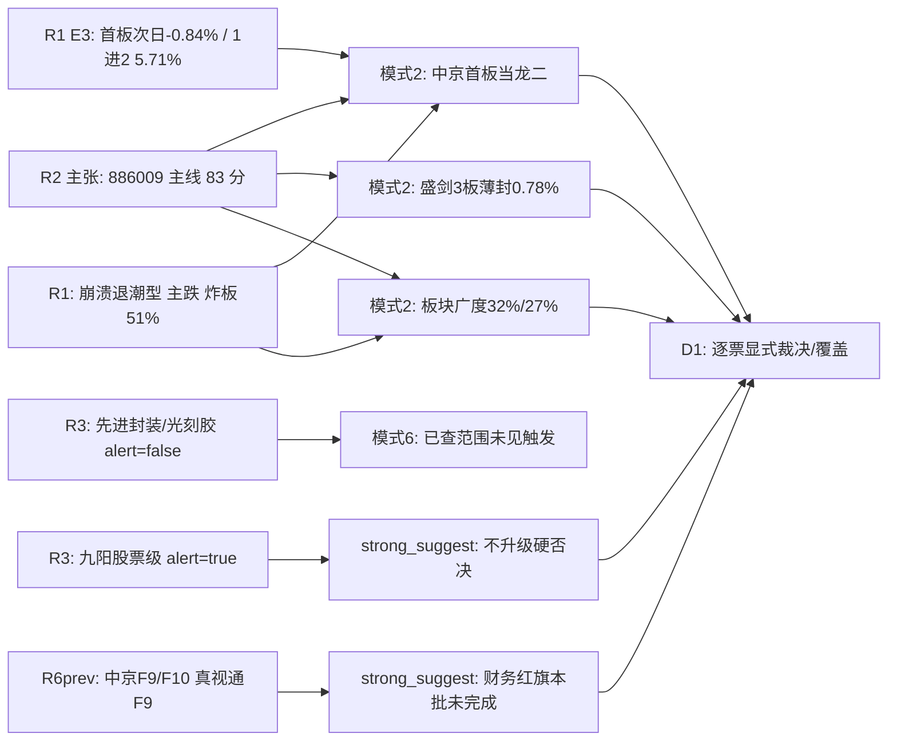

# 2026-11-20 · **反证 / Devil's Advocate**

> **数据源新鲜度**: partial
> **降级状态**: true（R4/R5/R7 缺件；模式1/7 未完成，模式6 有 11 票落在 R3 未查范围）
> **置信度**: 0.55
> **审核范围**: 12 个 R2 候选对象（龙一/龙二/候补）+ 2 个容量核心 · 模式1/2/6/7 逐票实质审 · 模式3/4/5/8/9/10 按适用性执行或降级
> **hard_reject**: 0 条新增（不等于通过）

## 一句话结论

主跌段里唯一的研究主线（半导体制造端 `886009`）三处结构性硬伤：龙二是首板（当日被罚通道）、龙一 3 板但封单仅占流通 0.78%、板块广度 26.9%~33.7% 未成合力——**高度成立、承接未证、β 不可依赖**，本批无一只具备完整必要审核。

## 详细分析

### 1 · 大势：奖励只给"已在板位上"的前排

2026-11-19 的全 A 事实是明确的逆风：5573 只有日线的样本里涨 649 / 跌 4876，中位 `-2.5514%`，连续 5 个交易日中位为负；涨停 23 / 跌停 68 / 炸板 24，当日封板率 48.94%、炸板率 51.06%，最高板仅 3。更关键的是次日反馈：首板池收盘中位 `-0.839%`、开盘到收盘中位 `-2.815%`，而多板池收盘中位 `+6.965%`；1 进 2 只有 5.71%，2 进 3 却有 42.86%。这组数字给出的信号很干净——**市场只给已在板位上的前排接力付钱，首板与日内追价是付费区**。R1 把风格定为"崩溃退潮型 / 主跌"，R6 认同这个定性，但只认同定性，不继承其 10% 的市场研究建议（那是 R1 自述的 `market_research_not_budget`，不是预算）。

### 2 · 主线内部：三层身份各自踩一条罚线

R2 把半导体制造端列为本轮唯一主线（83 分，attitude=进，但 `trade_confirmed=false`、`execution_pool` 为空、`confirmed_tradable_main_lines_count=0`），R6 认为这个研究身份成立，问题在于"身份"与"可承接"之间的三层错位：

| 层级 | 对象 | 板型 | 反面事实 | 反证定性 |
|---|---|---|---|---|
| 龙一 | 盛剑科技 `603324` | 3 板 09:37 首封 0 开板 | 封单 0.285 亿=流通 `0.78%`、换手 `20.00%`、命中龙虎榜上涨净卖背离、公司自述光刻胶占比 4.41% | strong_suggest（高度≠承接） |
| 龙二 | 中京电子 `002579` | 首板 10:27 首封 | 身位仅首板，而 1 进 2 只有 `5.71%`、首板次日中位 `-0.84%` | strong_suggest（身位与奖励结构冲突） |
| 候补 | 海立 / 江化微 / 格林达 | 反包 / 尾盘封 / 早封 | 光刻机为概念交叉（主业家电）、13:06 尾盘首封、5 日主力仅 0.98 亿 | 观察（与 R2 处置一致） |

盛剑是"身位第一但不该被读成承接第一"的典型：0 开板说明当天没被打开，但 0.285 亿封单配 20% 换手，是**薄封厚换**——愿意在这个价位接的人很多，愿意用封单锁住的人很少。这种结构的次日风险不是"会不会跌"，而是"竞价先手兑现后有没有人接"。

### 3 · 主线合力：前排封住、后排杀跌，两头同时成立

| 概念 | 成分数 | 上涨占比 | 中位涨幅 | 当日涨停 |
|---|---|---|---|---|
| 先进封装 `886009` | 215 | 32.1% | -1.10% | 8 |
| 光刻胶 `885864` | 83 | 33.7% | -0.89% | 5 |
| 光刻机 `886054` | 52 | 26.9% | -1.74% | 1 |
| 存储芯片 `886042` | 208 | 30.8% | -1.29% | 5 |

纪律要求"合力来自全市场"，这组数据不满足：**封板的是 11 家，杀跌的是 170 余家**。同时半导体整体 5 日主力 `-96.28 亿`，只有集成电路制造（+42.59 亿）、半导体设备（+56.82 亿）、封测（+4.85 亿）三个子链为正。结论是：付钱的是子链，不是板块；一旦子链资金转向，前排没有任何板块 β 可以兜底，个股 α 要独自承担全部回撤。

### 4 · 必要审核的完成度：12 票、0 票全完成

| 必要模式 | 完成 | 未完成 | 原因 |
|---|:--:|:--:|---|
| 模式1 数据源冲突 | 0 | 12 | R4 本批未落盘，消息侧无可比已核件 |
| 模式2 一致性检查 | 12 | 0 | R1 风格/情绪与 R2 各对象逐一比较 |
| 模式6 霸榜出货 | 3 | 9 | 仅时空/长鑫/九阳落在 R3 已查范围 |
| 模式7 基本面红旗 | 0 | 12 | R5 本批未落盘，12 红旗与审计意见不可核 |

这张表是本报告最重要的诚实项：**"空 hard_reject"只代表尚未形成否决，不代表 12 票通过**。模式6 的 9 票不是"没查出问题"，而是"R3 只查了 光刻胶/存储/CPO/先进封装/华为昇腾 + 九阳等 8 个对象"，芯片概念 `885756`、光刻机 `886054`、机器人 `885517`、算力/CPO `886050`、家电 `885543` 五个概念未在已查范围——按契约一律**未知**，绝不写成阴性。

### 5 · 为什么 0 条 hard_reject，以及为什么不许加码

九阳股份是本批唯一股票级 alert 命中：两榜连续三日 #1、换手 69.07%、开板 13 次，叠加 Tushare 口径 5 日主力 `-7.86 亿`（1/5 日为正）。双条件事实都在，但 R6 仍不判 hard_reject，四条理由必须写明：

1. 命中的是**股票级** alert，板块级 `885543` 未在 R3 已查范围——原规则条件(1)的"所属板块命中"未严格成立；
2. R3 明确写着"不指认任何主体出货"、"`positive_resonance_allowed=false`"，alert 定性是"热度霸榜+高位巨震"，不是已证出货；
3. 九阳在 R2 中是候补/龙三且 `execution_eligible=false`，原规则的触发对象（execution_eligible 的龙一/龙二）不覆盖它；
4. **昨日教训**：E1 对昨日 `R6_M6_01` 的裁定是 `not_fulfilled`——"家电真的接棒，九阳 11-18 天地板→11-19 地天板反包涨停，R6 对家电接棒的否定过度"。同一个错误不在 24 小时内重复第二次。

上一版的两条 hard_reject（南威软件 `603636` 的 F12 非标审计意见 + 证监会立案）不在本批 R2 对象内，按对象绑定原则不继承到本批，也**不得反向放宽**：D1 若涉及该票，仍按上一版原文件执行。

## 关键证据

- **E1 风格/宽度**：全 A 5573 只，涨 649 / 跌 4876，中位 `-2.5514%`，连续 5 日中位为负；成交 1.3146 万亿（前值 1.3800 万亿，-4.74%）· 来源 R1 E1。
- **E2 涨停结构**：U=23 / D=68 / Z=24，封板率 48.94%、炸板率 51.06%，最高板 3；xTick 独立口径 26/72/27 **不可拼接** · 来源 R1 E2。
- **E3 次日反馈**：首板收盘中位 `-0.839%`、开→收 `-2.815%`；多板收盘中位 `+6.965%`；1进2 `5.71%`、2进3 `42.86%` · 来源 R1 E3 / E2。
- **主线广度**：先进封装 32.1%、光刻胶 33.7%、光刻机 26.9%、存储 30.8% 上涨，中位全部为负 · 来源 R2 `line_breadth`。
- **子链资金**：集成电路制造 +24.23/+42.59/+56.48 亿（1/5/20 日）、半导体设备 +18.55/+56.82/+144.54 亿、封测 +14.94/+4.85/-12.68 亿；半导体整体 5 日 `-96.28 亿` · 来源 R2 `sector_flows_yi`（Tushare moneyflow_ind_dc 逐日重算）。
- **九阳双条件**：两榜三日 #1、换手 69.07%、开板 13 次、5 日主力 `-7.86 亿` · 来源 R3 `distribution_alert_checks[0]` + R2 支线 `capital_verification`。
- **昨日兑现率**：37 条反证完全兑现 16 条、partial 5、not_fulfilled 4、unknown 12，rate `0.4324` · 来源 E1 `r6_fulfillment`。
- **跨版财务红旗**：中京电子的 F9 应收/营收 `44.69%`、F10 有息负债/净资产 `101.02%`、F3 应收同比 +22.08% vs 收入同比 +1.83%；真视通的 F9 `130.23%`、F3 触发 · 来源上一版 R6 内嵌 R5（期末 2026-09-30、公告 2026-10-23），**本批 R5 缺席，模式七仍未完成**。

## 顶级反证点 · 推理深度三问（盛剑科技 `603324`）

- **大资金意图**: 3 板高度上是短线情绪资金的"卡位"仓位，不是机构配置仓位——0.285 亿封单（流通 0.78%）说明真正的钱在**换手而不是锁仓**；对手盘是 20% 换手率的接力盘，任何一方竞价松动都会先跑。公司自己说过光刻胶收入占比 4.41%，产业资金没有理由在这个位置做加法。
- **为什么走强**: 位置=本线唯一已核成分内的 3 板（高度第一）；催化=BIS 代工审查新规与伯恩斯坦上调 2027 WFE 至 2170 亿美元（**均为 log 级，本批无 R4 正式件**）；筹码=3 板+薄封+龙虎榜上涨净卖背离。三维里"位置"成立、"催化"未核、"筹码"负面——走强靠位置与情绪，不靠承接。
- **逻辑够不够硬**: 不够硬，且可证伪路径清晰。独立源共振只有两项半：涨停簇（硬）、子链资金（硬）、叙事（log 级未核）；硬业绩为零（本票光刻胶占比 4.41%，无业绩弹性），硬时间锚未知（轮次未核定，11-06 至 11-19 芯片概念涨停 2/3/4/2/4/0/11/3/11，无法判同轮）。**证伪路径**：若竞价不再给承接、或板块当日涨停家数掉到 8 家以下，3→4 板即失去高度支撑。

### 本批最高优先审对象思维链（盛剑科技 · 不是首推票）

**本批无首推。** R6 不给正向结论，下列思维链是"若 D1 仍要处理本票，必须先过这四关"的存证，不是买入建议。

- **买入理由**（仅作为 D1 可能的立论，R6 不背书）：①本线唯一已核成分内 3 板，09:37 首封 0 开板，日内未被打开，身位与时序第一；②5 日主力 `+0.56 亿`、4/5 日为正，子链（集成电路制造 / 半导体设备）5 日与 20 日双正，方向未被资金否决。
- **风险点**：①短期——封单占流通 0.78%、换手 20.00%，属薄封厚换，竞价先手兑现即无承接；②中期——命中龙虎榜上涨净卖背离（派发式上涨疑点），叠加公司自述光刻胶收入占比 4.41%，题材溢价与业绩无关，一旦板块涨停家数收缩即失去高度。
- **止损条件**（可执行）：①竞价给出溢价但开盘 30 分钟内跌破当日均价且未回到封板价附近 → 结构失效；②板块当日涨停家数 < 8 家（本线 11-19 为 11 家）→ 高度失去支撑；③日内再次被打开且回封封单低于 0.15 亿（流通 <0.4%）→ 承接消失。任一触发即视为反证成立，不"灵活调整"。
- **可验证假设**（24–72h）：①09:25 竞价是否给出正溢价且开盘 15 分钟内承接盘不撤（观测量：竞价溢价、开盘后 5/15 分钟均价与成交量）；②当日板块涨停家数能否维持 ≥8 家（观测量：Tushare `limit_cpt_list` 芯片/先进封装 up_nums）；③是否出现二次打开（观测量：`open_times` 由 0 变 ≥1）。三条同时为真才可推翻"薄封=承接不足"的判断。

## 四象限负面识别

| 象限 | 对象 | 判断 |
|---|---|---|
| A 逻辑硬+承接硬 | 中芯国际 `688981`、华虹公司 `688347`（容量核心，不入候选枚举） | +6.21%/+8.05%、主力 +11.00/+6.83 亿，但**无涨停身位**，超短框架内不可交易；价值在验证子链资金真实 |
| B 逻辑硬+承接弱 | 空集 | 半导体整体 5 日 -96.28 亿、板块广度 26.9%~33.7%，无一票同时硬叙事+硬承接 |
| C 逻辑弱+承接硬 | 中京电子、海立股份、格林达 | 封单厚但逻辑弱（首板+PE 不可算 / 光刻机概念交叉 / 5 日资金仅 0.98 亿） |
| D 逻辑弱+承接弱 | 9/14 票 | 薄封、尾盘封、一字锁仓、5 日净流出、开板 9 次、板块退潮——本轮最需警惕的集中区 |

四象限的负向结论是：**A 象限不能买（无身位），C 象限不该追（逻辑不硬），B 象限不存在，D 象限占 64%**。这不是"没有机会"的自证，而是"机会不在可承接形态上"的证据链。

## 数据源审计

| 源 | 日期 | 状态 | 备注 |
|---|---|:--:|---|
| tushare/R1_style（E1–E8） | 2026-11-19 | 🟡 | degraded · conf 0.392 · 5573 只有日线 · 5 日风格序列缺 2 项 |
| tushare/R2_main_sectors | 2026-11-19 | 🟡 | degraded · conf 0.55 · 14 对象 · 主线 1 条 / 支线 4 条 · execution_pool=0 |
| R3_sentiment | 2026-11-19 | 🟡 | degraded · conf 0.38 · 8 个 alert 检查对象 · 概念 Top20 仅覆盖 6 席 |
| R4_news | — | 🔴 | 本批未落盘 → 模式1 全部 12 票未完成 |
| R5_stock_profiles | — | 🔴 | 本批未落盘 → 模式7 全部 12 票未完成、12 红旗不可核 |
| R7_capital_flow | — | 🔴 | 本批未落盘（符号链接不存在）· R2 自算 Tushare 资金替代并标注口径 |
| R6_prev | 2026-11-19 | 🟢 | 37 条反证 · 2 条 hard_reject（南威软件，不在本批对象） |
| E1_data / observation_tracking | 2026-11-19 | 🟢 | 兑现裁定 37 条 · 观察池 13 只 T0 实际收益 |
| xTick 市场情绪 | 2026-11-19 | 🟡 | 26/72/27 与 Tushare 23/68/24 口径不可拼接，未混用 |

## 不确定性 / 反证

- **模式1 全部未完成**是最大缺口：BIS 新规的两处表述（R2 写"11-16 新规"、群聊正文写"11-19 起生效"）可能是发布日/生效日的差异，也可能是一方表述有误——本条**不断言冲突**，只标记未闭合，交 R4 核首发与生效原文。在核清前，主线的"催化强度"按未核处理，不得用于加权。
- **模式7 全部未完成**：中京与真视通的红旗来自上一版（同一披露期 2026Q3、公告 2026-10-23/10-27），事实未过期但**不是本批已核**；且这两条红旗在 11-19 当日**没有阻止价格**（中京涨停、真视通 3 板），说明 1 日尺度上情绪常常覆盖财务反证——这正是不能用"反证已兑现/未兑现"作交易理由的原因。
- **昨日兑现率 0.4324**（16/37 完全兑现）说明反证在单日尺度上命中率有限；但 `not_fulfilled` 里有一条反向教训：对九阳那类"接棒"的否定过度。本报告已据此克制对九阳的加码否定。
- **R3 概念覆盖只有 6/20 席**（光刻胶 #1、存储 #5、CPO #3、先进封装 #11、华为昇腾 #20、外加九阳等个股），芯片概念 #7、国家大基金 #4、光刻机 #8、PCB #14、算力租赁 #2、东数西算 #9 均未查——这不是"没有霸榜"，是"没查"。
- **轮次全部未核定**：R2 明确不授予 `round_id`，故本报告所有条目 `round_id=null`，`sector_id` 一律沿用 R2 已声明，不按概念/日期猜轮次，也不按 severity 推历史立场。
- 本报告**不给仓位**：不按条数、模式数或 strong_suggest 机械给出 1–3% 试仓上限，也不给 0.85/0.7 降仓乘数；同一事实跨模式出现时（如中京的"首板身位"与"F3/F9/F10"）按同一条事实链关联，不当多份独立扣仓。

## 与其他 R/D/E 的关系

- **依赖**：R1_style（风格/情绪/广度/涨停结构）、R2_main_sectors（对象、板型、资金、广度）、R3_sentiment（alert 检查范围、热榜动量）、上一版 R6_devil_advocate（跨版红旗与昨日反证）、E1_data + observation_tracking（兑现裁定与 T0 收益）。
- **缺件（不冒充）**：R4_news、R5_stock_profiles、R7_capital_flow 本批均未落盘；模式1 消息侧与模式7 财务合规因此未完成，已逐票在 JSON `patterns_status` 记 `incomplete` 并注明 owner。
- **被消费**：D1（canghai-plan）——`hard_rejects=[]` 仅代表无新增硬否决，**不是买入权限**；6 组 strong_suggest 须被接受或在 `meta.d1_override[]` 记录理由；5 条 soft_suggest 可选记入 `r6_soft_notes`。E1（canghai-review）——本批 14 条反证可在 T+1/T+5 回填兑现。

## Sub-Agent 元数据

- skill: `analyze_devil_advocate_v1`
- artifact: `data/research/20261120/R6_devil_advocate.json`（120,373 bytes · 183 条证据指针全部校验通过 · 仓库 `r6_coverage` 校验无异常：evaluated=12、formal_review_completed=false）
- 生成耗时: 约 12 分钟（单会话内只读分析，无 MCP、无联网、无新抓数）
- model: deepseek-v4.1-flash
- 审核对象: 候选 12 + 容量核心 2 · 反证 14 条（soft 5 / strong 9 / hard 0）· `formal_review_completed=false`

