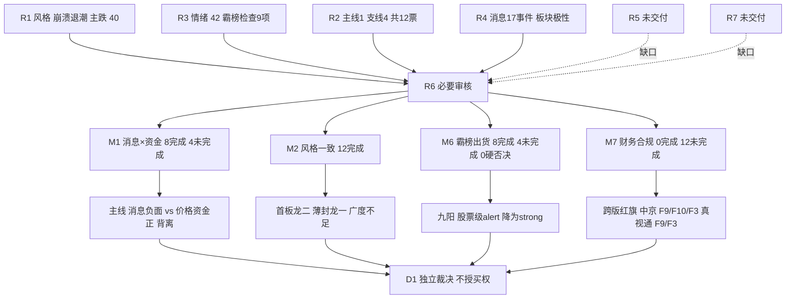

# 2026-11-20 · **反证 / Devil's Advocate**（隔离回放 · 仅stdout）

> **数据源新鲜度**: partial　**降级状态**: true　**置信度**: 0.55
> **适用窗口**: 2026-11-20 盘前 06:55–09:30；本单元形成于 13:11 的事后回放，不因此获得盘中适用性

## 一句话结论

情绪=主跌（炸板51.06%≥35%）。R2 唯一研究主线「半导体制造端」的价格与子链资金为真，但消息面（R4）判负面、板块广度仅26.9%~33.7%上涨、龙一封单仅占流通0.78%且龙虎榜净卖背离、龙二只是首板——12票四项必要审核完成0票，无新增硬否决，全部只到观察/降级/拦截，不授买权。

## 本轮定位（先把边界钉住）

这是一次**一次性受限的盘前事后回放**：真实补做时刻 2026-11-20T13:11:29+08:00，原 run 20261120T061006-66117-15481 的隔离 run isolated-20261120T125210+0800。冻结输入最晚留存 2026-11-20T07:08:52.397410+08:00——**这不是行情截至同一时刻**：R1/R3 的事实观测是 11-19 收盘，R4 的 feed 最晚到 11-20 05:45、美股为 11-19 收盘，R2 是本次补做的 T-1 重算（形成于 13:05，数据仍只到 11-19 收盘）。因此本单元**没有、也不使用任何盘中/午盘/后续更新数据**；凡“开盘会怎样”一律标为未知。

正式接收失败的直接原因是 R7 未发布、原证缺失；R5 同样未交付（NaN 序列化）。所以本单元的完成度不是“合格交付”，而是“在缺两件的条件下做完了能做的反面审查”。材料形态是**字段投影**，不宣称读全原始语料、PDF 全文或全部 feed 条目。

## 详细分析

### 一、环境先认，再认个股

R1 判 **崩溃退潮型 / 主跌（分40）**，R3 判 **主跌（分42）**，两组独立口径同向。硬事实是：全A 5573 只有日线，**中位 -2.5514%**，649涨/4876跌/48平，成交 1.3146 万亿（前值 1.3800 万亿，-4.74%）；涨停23、跌停68、炸板24 → **封板率48.94%、炸板率51.06%**，最高板仅3板；连续5个交易日全A中位为负。

赚钱效应是**分裂**的：赚钱的只有“少数高位连板”（2进3晋级42.86%）和权重/防守（上证50 +0.32%）；被罚的是首板次日（33只收盘中位-0.839%、开→收-2.815%）和日内追价（全池开→收中位-2.812%）。这条分裂线，就是后面所有反证的根：**R2 给的龙二是首板，恰好站在被罚的那一侧。**

### 二、主线核对：真的部分与反证的部分

**真的部分（不删）**：本线核心（先进封装∪光刻胶∪光刻机∪存储芯片成分内）11封4炸、封板率73.3%，显著高于全市场48.94%；子链资金 5日 集成电路制造 +42.59亿、半导体设备 +56.82亿（20日+144.54亿）；中芯 +6.21%（主力+11.00亿）、华虹 +8.05%（+6.83亿）逆势承接，而设计/GPU端被杀（燧原20CM跌停、沐曦-10%、芯原-8.09%）。这是“资金从设计切向制造”的实证。

**反证的部分（本单元的重点）**：

1. **消息面反了。** R4 本次交付明确把 **先进封装/光刻胶判负面(medium)**、**晶圆代工负面(low)**，并自己写下“11/19该分支逆势上涨、消息面与价格面背离”。也就是说：本线是**资金+情绪**驱动，不是消息驱动。隔夜外盘（纳指-2.25%、AMD -7.7%、英伟达-3.3%六连跌）对这种“无消息支撑的逆势孤岛”更致命，而不是更无关。
2. **广度不成立。** 先进封装215只仅32.1%上涨、中位-1.10%；光刻胶83只33.7%/-0.89%；光刻机52只26.9%/-1.74%；存储208只30.8%/-1.29%。纪律要求的“合力来自全市场”没达标，前排封住、后排杀跌同时成立——**个股α要独自承担全部回撤**。
3. **龙一的“高度”不等于“承接”。** 盛剑科技 3板、09:37:40首封、0开板，但封单仅 0.285亿 = 流通的 **0.78%**，换手 **20.00%**，且命中龙虎榜上涨净卖背离；公司自己说明光刻胶收入占比 4.41%。高度是真的，承接是没证的。
4. **龙二站在被罚通道。** 中京电子是首板（10:27:21首封、0开板、封单/流通14.23%、5日主力+2.70亿），但全市场 1→2 接入率只有 5.71%，首板次日中位-0.839%。把一个首板授成龙二，等于用“辨识度”对抗“当日赚钱效应”。
5. **半导体整体资金是负的。** 5日 -96.28亿，只有制造/设备/封测子链为正。所谓“板块资金”，实际是三条子链的局部现象。

### 三、逐票结论（12票，全部不授买权）

| 代码 | 名称 | 角色 | R6 态度 | 关键反面点 | M1 | M2 | M6 | M7 |
|---|---|---|---|---|---|---|---|---|
| 603324.SH | 盛剑科技 | 龙一 | **降级** | 封单/流通0.78%、换手20.00%、龙虎榜净卖背离；高度成立承接未证 | 完成 | 完成 | 完成 | 未完成 |
| 002579.SZ | 中京电子 | 龙二 | **降级** | 首板授龙二，与1→2仅5.71%、首板次日-0.839%相反；跨版F9/F10/F3 | 完成 | 完成 | 完成 | 未完成 |
| 600619.SH | 海立股份 | 候补 | 观察 | 开板2次、换手21.43%、光刻机为概念交叉（主业家电零部件）；R4未覆盖 | 未完成 | 完成 | 未完成 | 未完成 |
| 603078.SH | 江化微 | 候补 | 观察 | 13:06:46尾盘首封属追价末端、换手21.89%、PE110.48无安全垫 | 完成 | 完成 | 完成 | 未完成 |
| 603931.SH | 格林达 | 候补 | 观察 | 早封+换手8.16%质量最好，但5日主力仅+0.98亿、热榜#15靠后 | 完成 | 完成 | 完成 | 未完成 |
| 605178.SH | 时空科技 | 支线龙一 | 观察 | 5日主力仅+0.10亿；存储消息内部正负交织（NAND反转 vs DRAM涨价） | 完成 | 完成 | 完成 | 未完成 |
| 688825.SH | 长鑫科技 | 支线龙二 | 观察 | 回购是硬公告，但5日-45.45亿/20日-75.00亿、股价仅+1.60%；需股东会 | 完成 | 完成 | 完成 | 未完成 |
| 002420.SZ | 毅昌科技 | 支线龙一 | 观察 | 一字不可得、5日主力+0.04亿、机器人广度9.1%；换手字段2.476%与1.84%不自洽 | 未完成 | 完成 | 未完成 | 未完成 |
| 000678.SZ | 襄阳轴承 | 支线龙二 | **降级** | 开板9次、换手59.55%、5日主力+0.54亿（1/5正）、PB9.90 | 未完成 | 完成 | 未完成 | 未完成 |
| 002771.SZ | 真视通 | 支线龙一 | **降级** | 3板一字成交仅0.61亿不可得；板块22→4家、封板率42.86%、广度8.2%；跨版F9/F3 | 完成 | 完成 | 未完成 | 未完成 |
| 300308.SZ | 中际旭创 | 支线候补 | 观察 | 单日+10.69亿，但5日-40.72亿、两融-39.23亿；R4对CPO判负面(high) | 完成 | 完成 | 完成 | 未完成 |
| 002242.SZ | 九阳股份 | 支线候补/温度计 | **拦截** | 三榜三连#1（股票级alert）+5日-7.86亿+换手69.07%+开板13次 | 未完成 | 完成 | 完成 | 未完成 |

**容量核心另列、不计入审核对象**：688981 中芯国际（流通2446亿、+6.21%、主力+11.00亿）、688347 华虹公司（+8.05%、+6.83亿）。它们不在 R2 leaders 列表内，按契约不写 candidate_checks、不计入 candidates_evaluated；记录它们只为说明“高度板与容量核心不是同一批资金”。

### 四、硬否决、T+1 与授权边界

**本单元新增 hard_reject = 0。** 原因不是“安全”，而是两个结构性事实：①模式六的触发对象是 R2 `execution_eligible` 的龙一/龙二，本轮 execution_pool 为空、全部 false，原规则触发对象不成立；②模式七因 R5 未交付，F12（审计师非标意见）与 ST 临近轴无法核验。**缺证不记为无红旗**，九阳的股票级 alert 按 strong_suggest 保留，理由见下。

**九阳为什么不升级为 hard_reject（三条结构理由）**：①命中是**股票级** alert（`sector_id=null`），板块 885543 不在 R3 已查范围，原条件(1)“所属板块命中”未严格成立；②R3 原文写明**“不指认任何主体出货”**，定性是“热度霸榜+高位巨震”，且指出 11-19 主力净额+10.06亿、收盘=最高价并非派发证据；③九阳非 execution_eligible 龙一/龙二。证据完整保留（股票级 alert + 5日-7.86亿 + 换手69.07% + 开板13次），R2 已给“拦截”，D1 若反向采用须显式记录。

**R4 已核的9条硬否决原样保留、不由本单元重新推导或豁免**：天普股份（证监会立案+复牌+前三季亏损）、*ST香雪（重整受理+叠加退市风险警示）、三安光电（26.30%总股本被冻结、轮候166.81%）、鸿博股份（子公司被诉2.7739亿+2754.31万）、燧原科技（3日跌幅偏离≥30%、流通仅4.1595%）、山鹰国际/英力特/珠免集团/ST汇洲（停牌）。它们不在 R2 的12个对象内，但 D1 必须继续强制剔除。

**T+1 生效**：11-19 涨停23只与全部连板梯队一律不追；R2 执行池为空、可交易候选=0；研究观察对象最早只能 2026-11-23 重评，且须 D1 独立门禁与真实预算。

**市场建议不授买权**：R1 的 0.1 是它自述的市场研究建议（`suggestion_kind=market_research_not_budget`），本轮市场性 no_trade 未发布；本单元的任何完成标记、覆盖标记、评分都不构成准入闸门或买入许可。

### 五、三问（反证视角，top3 对象）

**603324 盛剑科技（龙一）**
- **大资金意图**：3板高度但封单只占流通0.78%、换手20%，是“薄封厚换”——更像情绪卡位而非资金锁仓；同日龙虎榜出现上涨净卖背离，说明有资金在涨停价出货。
- **为什么走强**：不是个股增量（公司自述光刻胶收入占比4.41%），是板块高度+制造链资金外溢给的身位。
- **逻辑够不够硬**：不够硬。高度可以外推，承接不能外推；3→4板需要板块当日再给≥8家涨停，而本线广度只有26.9%~33.7%。
- **可验证假设 / 失效条件**：若 09:25 竞价封单显著增厚且换手收敛，承接假设才有初步证据；若竞价被先手兑现、开盘快速放量下杀，则“高度≠承接”成立，按降级处理。

**002579 中京电子（龙二）**
- **大资金意图**：封单/流通14.23%、0开板、5日主力+2.70亿、超大单+2.90亿，是真金承接；但这是**单日**的真金，不是趋势资金。
- **为什么走强**：五个概念心智锚并列第一（先进封装/存储/PCB/CPO/AIDC），辨识度驱动，属“抱团型人气票”。
- **逻辑够不够硬**：身位不硬。首板在当日是被罚通道（收盘中位-0.839%、开→收-2.815%），1→2只有5.71%；用“辨识度”抵“赚钱效应”是逆势。
- **可验证假设 / 失效条件**：若竞价高开且封单翻倍、板块当日再给≥8家涨停，首板晋级假设成立；若高开低走或封单缩水，则按观察不升级。

**002771 真视通（支线龙一）**
- **大资金意图**：3板一字、成交仅0.61亿、换手2.36%（字段另记2.494%），是排板资金的自锁，不是可承接的量。
- **为什么走强**：算力租赁残余高度+一字惯性；但板块已从22家涨停塌到4家，封板率42.86%、广度8.2%，华为昇腾热榜7→20、净额-22.67亿。
- **逻辑够不够硬**：方向强、结构不可得。一字板不是“承接证据”，只是“买不到”。
- **可验证假设 / 失效条件**：若竞价一字打开且给出有效成交量，才谈承接；若继续一字，按不可交易处理。另：跨版 F9/F3 财务红旗保留，不作为本批已核。

### 六、反证分级与“不许叠加扣仓”

共 22 条实际反面发现，其中 **9 条 strong_suggest**、13 条 soft_suggest，**0 条 hard_reject**。

- strong 集中在一处事实链：主线承接与广度（M1_01 消息背离、M2_02 龙一承接、M2_03 板块合力、M2_01 首板龙二、M2_04 真视通退潮、M2_05 襄阳换手）+ 九阳股票级警报（M6_01）+ 两条跨版红旗（M7_01/M7_02）。
- 这 9 条**不是 9 次独立扣仓**：M1_01/M2_02/M2_03 是同一“主线承接不成立”事实的不同侧面；M6_01 与九阳的估值/换手是同一票；M7_01/M7_02 是跨版同一披露期事实。**D1 须逐条说明采纳/不采纳，但不得按条数换算预算或仓位乘数**；本单元不生成任何 1–3% 试仓上限，也不生成 0.85/0.7 降仓乘数。
- 反证条数不是安全指标：本单元没有为了“看起来更安全”去凑条数，也没有为了“提高仓位”删掉任何真实反证。

## 关键证据

- **情绪与广度**：全A 5573只中位-2.5514%、649涨/4876跌、成交1.3146万亿；涨停23/跌停68/炸板24，封板率48.94%、炸板率51.06%、最高板3板（R2 `E1_breadth`/`E2_limits`，与R1同源同值）· 来源 R1/R2
- **赚钱效应分裂**：首板33只收盘中位-0.839%、开→收-2.815%；多板池8只收盘中位+6.965%；1→2晋级率5.71%、2进3为42.86% · 来源 R2 `E3_premium` 与 `execution_pool_reason`、R1 奖励/惩罚描述
- **本线强度与广度同时成立**：核心11封4炸、封板率73.3%；先进封装215只32.1%上涨/中位-1.10%、光刻胶83只33.7%/-0.89%、光刻机52只26.9%/-1.74%、存储208只30.8%/-1.29% · 来源 R2 `metrics`
- **子链资金为正、板块整体为负**：集成电路制造 +24.23/+42.59/+56.48亿、半导体设备 +18.55/+56.82/+144.54亿、封测 +14.94/+4.85/-12.68亿、半导体整体 +30.51/**-96.28**/+12.88亿（1/5/20日）· 来源 R2
- **龙一承接未证**：盛剑封单0.285亿=流通0.78%、换手20.0044%、09:37:40首封、0开板；命中龙虎榜上涨净卖背离；光刻胶收入占比4.41% · 来源 R2 `leaders/0`
- **龙二站在被罚通道**：中京首板、10:27:21首封、0开板、封单/流通14.23%、5日主力+2.70亿；但1→2仅5.71%、首板次日-0.839% · 来源 R2
- **消息面判负**：先进封装/光刻胶 net_polarity=负面(medium)、晶圆代工负面(low)、CPO负面(high)、存储交织、PCB交织 · 来源 R4 `sectors_catalyzed`
- **事件层面**：E002 阿里 capex 可能下调（负面high）、E003 美股AI硬件下跌（AMD-7.7%/NVDA-3.3%/纳指-2.25%）、E004 BIS 14nm代工审批（负面medium）、E005 NAND 2027反转（负面，单源）、E010 WFE上调+39%（正面，单源）、E011 长鑫回购加码（官方原件，正面）· 来源 R4
- **霸榜检查**：九阳股票级 alert=true（两榜三连#1，11-17/18/19），R3 明示不指认派发主体；光刻胶/存储/CPO/先进封装/华胜天成/耐科装备/华为昇腾均为 false；Top20之外 unknown · 来源 R3
- **跨版红旗**：中京 F9应收/营收0.4469、F10有息负债/净资产1.0102、F3应收增速超收入1.5倍（20260930期，20261023公告）；真视通 F9=1.3023、F3触发（20260930期，20261027公告）· 来源 R6_v0 内引述（第三手，不作本批已核）
- **隔夜外盘与内部背离**：纳指-2.25%/标普-2.02%/道指-2.19%，与媒体盘中报道（纳指+1.54%）相反；A股制造端逆势 · 来源 R1 `risks` + R4 `top_events/2`

## 覆盖矩阵（按票 × 必要模式）

| 模式 | 完成 | 未完成 | 完成口径 |
|---|---|---|---|
| M1 数据源冲突 | 8（603324/002579/603078/603931/605178/688825/002771/300308） | 4（600619/002420/000678/002242） | 须有R4同窗口消息 + 可比资金/价格；R7未交付时资金侧用R2同批自算Tushare口径，并在判断依据中注明消息为板块级 |
| M2 一致性检查 | 12 | 0 | R1风格/奖励-惩罚 vs R2同窗口角色主张 |
| M6 霸榜出货 | 8（603324/002579/603078/603931/605178/688825/300308/002242） | 4（600619/002420/000678/002771） | 核心题材板块须被R3显式checked；其余概念未查保留未知；触发对象限execution_eligible龙一/龙二（本轮为空） |
| M7 财务合规 | 0 | 12 | R5未交付，无检出/范围/时点；缺flags不当作无红旗 |

模式3/4/5/8/9/10 为辅助：3 有字段记录但降级（无估值分级）；4 无历史库降级；5 无 E1 与昨日 R6 降级（R6_v0 内引述不作核验）；8 无封板量-套牢区口径，明确不执行；9 高度仅3板，仅提示；10 以外盘背离作扩展记录。

## 数据源审计

| 源 | 状态 | 抓取/形成日期 | 记录数 | 备注 |
|---|---|---|---|---|
| R1_style.json（字段投影） | 🟡 | 2026-11-20 | — | status=degraded，conf=0.392；外盘为11-19收盘 |
| R3_sentiment.json（字段投影） | 🟢 | 2026-11-20 | 9项检查 | L1为11-19晚榜；1项 unknown（Top20之外） |
| R2_main_sectors.json（隔离重做） | 🟡 | 2026-11-20 | 12 leaders / 5 lines | partial，conf=0.58；封单绝对额/换手字段部分不自洽 |
| R4_news.json（隔离重做） | 🟡 | 2026-11-20 | 17 events / 18 PDF / 40 OCR | partial，conf=0.62；BIS原文未读、部分单源 |
| R5_stock_profiles.json | 🔴 | — | 0 | 未交付（NaN） |
| R7_capital_flow.json | 🔴 | — | 0 | 未交付（NaN） |
| 同交易日早前尝试版 R6 | 🟡 | 2026-11-20 | 14 objects | 非昨日R6，仅跨版旁证 |
| E1 20261119 兑现 | 🔴 | — | — | 本批未交付 |
| 群聊转发/OCR 线索 | 🟡 | 2026-11-19 | 40（31非空） | 群组匿名化；全部 partial、时间 basis=cache_mtime，仅定性 |

**逐源时点明细（表内日期已省略时分，便于人读）**：R1 行情 2026-11-19 15:00，valid_from 2026-11-20 06:17:13、valid_until 09:30；R3 热榜 11-19 晚榜，alert 观测 2026-11-20 06:28:42、窗口 11-17 15:00–11-19 22:30；R2 metrics_date 20261119，生成于 2026-11-20 13:05:20；R4 feed 11-19 18:04–11-20 05:45、美股 11-19 收盘、PDF 抓取时分未知、OCR cache_mtime 11-19 06:01–11-20 06:01；R5/R7 无。

## 不确定性 / 自我批判

1. **我把板块级消息用于模式1完成判断。** R4 没有逐票公告式消息（除长鑫、海光、紫金等个别标的），所以 603324/002579/603078/603931/002771 的完成明细里，消息侧是“板块极性”而非“本票公告”。我在判断依据中已逐条注明，但这确实是宽松读法；若按“必须同票消息”的严格读法，这5票应改判未完成，代价是模式1只剩3票。
2. **R2 的封单绝对额不可信。** 中京1.01亿 vs 14.23%、海立0.655亿 vs 5.51%、江化微0.843亿 vs 8.14%、格林达0.844亿 vs 14.50%、时空0.579亿 vs 10.97%、襄阳0.542亿 vs 7.04%、九阳0.645亿 vs 2.71%——按流通反算相差约10倍；换手也有两处与正文不符（毅昌2.476% vs 1.84%、真视通2.494% vs 2.36%）。所以本单元只用**占比、换手、开板次数、首封时序**判断封板质量，绝对封单额一律待核，不据此排序。
3. **跨版红旗是第三手证据。** 中京/真视通的 F9/F10/F3 来自同交易日早前尝试版 R6 内部引述的上一版 R5 + Tushare 财务取数，原始件都不在本批材料里。我据此给 strong_suggest（按原阈值），但明确模式七本票仍未完成；如果 D1 要用，必须自己确认披露期与口径，不能把它当本批签名件。
4. **模式5 完全没法核。** E1 未交付、昨日 R6 原件不在本批。R6_v0 里引述过“真视通一字可外推不等于可分到货（not_fulfilled）”“家电接棒否定过度（not_fulfilled）”“完全兑现率0.4324”，这些我只作结构提示，不据此加减仓位，也不据此声称昨日反证已兑现。
5. **九阳我给了 strong_suggest 而不是 hard_reject**，这是有意的：股票级 alert、板块未查、R3 明说“不指认派发主体”、且非 execution_eligible 龙一/龙二。如果 D1 认为这已经满足原规则，那需要它自己显式记录——本单元不越权替它升级，也不替它豁免。
6. **R4 的传闻层我没有当事实用**：FT 台积电/三星停供仅群聊转述、feed 未证；BIS 原文未见；PCB 短缺为单一底稿。无锡50亿先进封装项目也是单源，未计权。
7. **容量核心没做逐票必要审核。** 688981/688347 只在 `leader_structure` 出现、不在 leaders 列表内，按契约不能写 candidate_checks；这不代表它们“更安全”，只代表本轮审核范围按 R2 的原始对象定义。
8. **本单元没有盘中信息。** 11-20 竞价与开盘强弱在盘前判断时完全未知，所有“若竞价…则…”都是条件式，不是预测；R2/R4 的形成时刻（13:05/12:57）是补做时刻，不是数据覆盖时刻。
9. **反证 22 条不等于 22 个独立风险**：已按事实链关联，避免重复扣仓；但也不删条，删条等于隐瞒。

## 与其他 R / D / E 的关系

- **依赖**：R1（风格/情绪基线，degraded）、R2（主线与12对象，partial）、R3（情绪与霸榜检查）、R4（消息与板块极性，partial）；R5/R7 缺失（模式7零完成、模式1资金侧降级）；同交易日早前尝试版 R6 仅作跨版旁证。
- **被消费**：D1（canghai-plan）作反面证据与覆盖披露；E1（canghai-review）可回看本轮 strong/soft 的兑现情况——但本轮无 E1 输入，兑现率不可断言。
- **不越界**：本单元不给正向结论、不抓新数据、不扩读、不写生产、不改计划/池身份/买点/资格/预算；`hard_rejects=[]` 只表示尚未形成否决，不表示全票通过。

## Sub-Agent 元数据

- skill: analyze_devil_advocate_v1
- artifact: 仅 stdout 回传（isolated-20261120T125210+0800），未落 `data/research/20261120/R6_devil_advocate.json`，未落 `chzl_kg/投研交易/反证/20261120.md`
- 生成耗时: 未记录（受限回放，无计时工具）
- model: deepseek-v4.1-flash（本会话）
- validator: 未运行（本任务禁止工具调用）；candidates_evaluated 按契约口径自算=12
- 正式接收: 失败（R7 未发布、原证缺失），本单元不冒充正式交付
- 交易权限: 无（不授买权、不生成预算/仓位、不执行）