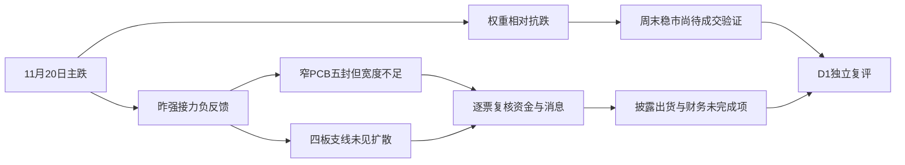

# 2026年11月23日 · 反证 / Devil’s Advocate

## 🧭 一句话结论
11/20主跌，PCB仅局部奖励先手；18票已审，必要审核未全；无已触发活动硬否决。

## 📉 详细分析：先市场、再板块、后个股
- **大资金意图**: 不能从订单分桶或ETF申赎识别买方。上证50 `+0.45%` 对中证1000 `-4.89%` 仅表权重相对承接；周末稳市规则不解释周五成交。
- **为什么走强**: 周五只奖励少数先手：`313涨/5236跌`、昨涨停中位`-5.08%`、首板隔日`1/18`；窄PCB `5封0炸`，但`20/48`红，龙头收益不等于后手有溢价。
- **逻辑够不够硬**: R5资金/价格与R4公告相互独立，但R7东财和R5东财同根。公告对应客户/真实生效时点、竞价后价格承接与容量扩散不全，不能确认进攻。

图表已提供 Mermaid 源码；本环境未有可用本地渲染器，未认证SVG渲染。

## 🧩 四象限负面识别
| 情绪 × 资金 | 审查结论 |
|---|---|
| 情绪强×资金净流入 | 窄PCB五封零炸、东财单日+20.39亿，但20/48红且5日-4.17亿；只作板簇前收共振，不充作全市场正象限。 |
| 情绪强×资金净流出 | 盛剑4板却有三日榜约-0.416亿，华媒涨停却日榜-0.0204亿；两者东财日大单均正，观察兑现与承接，不把榜净卖合成全日净流出。 |
| 情绪弱×资金净流入 | 主跌下XTick当日大+超大逐票合计+23.59亿，与东财市场口径相反；权重/ETF可局部承接但中小盘、创业板弱。不把ETF申赎写成现货净额或推买方身份。 |
| 情绪弱×资金净流出 | 313涨/5236跌，涨跌幅中位-5.08%、首板隔日1/18；东财大盘日-520.88亿、五日-1826.91亿且5日0天净正。炸板率降到20%但触板收缩，非修复确认。 |

另按风险对象分层：市场（主跌与海外科技外溢）、行业（BIS/加州传票及割草机器人限定范围）、板块（高位题材监管报道不扩为全面禁买）、个股（ST、停复牌、立案、治理及供给）。R4负面与未证线索完整随JSON交付；正负同现不抹掉硬事实。

## 🔎 必要覆盖
| 必要模式 | 完成 / 18 | 受限原因 |
|---|---:|---|
| 1 资金×消息 | 15 | 国泰海通、龙版传媒仅部分资金交叉；龙版/华媒还缺精确消息。R7漏覆盖不影响有R5量价的对象。 |
| 2 风格一致性 | 18 | 保留全部有据比较；不是买入通过。 |
| 6 霸榜出货 | 6 | `false`只限精确检查分支，广义PCB不代窄行业；其余未知。 |
| 7 财务合规 | 0 | 14票完成可做的实际计算，但S2/S3未签结有限监管窗；4票无画像。已算命中不丢。 |

**无已触发活动硬否决不等于全票通过。** 中京电子F3/F4/F9/F10四项真实：应收同比22.08%对营收1.83%，存货同比37.31%且周转3.15→2.79，应收/前三季营收44.69%，有息负债/归母权益101.02%。当前是研究龙头而非原硬规则执行对象；若拟纳入执行，原四红旗硬规则适用，不能用榜单阴性抵消，不递补。东方海洋S1两年归母净亏按强提示保留，不能说已*ST或临近退市。宝鼎的警示函不是立案。九阳为票池外双榜警报，不扩发硬否决。

## 🧾 每票必要判断与依据
下列板型、角色、纪律通过数为R2历史研究口径；各票实际RR/止损距均未知，未形成有效价位。允许保留观察，不能用空禁止命中当成门禁通过。

### 中京电子 002579.SZ · 龙头（纪律 4/4）
- **买入理由**（仅审上游候选假设，不发买权）: 2板；首封93624，开板0次。窄行业唯一2板；9:36先封，4家窄行业同伴之后封；东财个股5日+5.35亿但窄行业第4，地位来自带动而非资金第一。
- **风险点**: 二板先封且大单为正，只证局部高度和先手；异动公告明确经营环境无重大变化，不能当订单确认。 11/20涨跌+10.02%，东财单日/11/16–20五日主力+2.374/+5.350亿元。 窄PCB20/48红、中位-1.02%，5封0炸只奖局部先手，不等于扩散。 孤板或高开回吐、容量下破、后排无反馈则证伪。
- **止损条件**: 实际入场/RR与止损距均未核，不编价位；研究假设失效：孤板或高开回吐、容量下破、后排无反馈则证伪。
- **可验证假设**: 保持窄PCB高度观察；如孤板、高开回吐或容量同步变弱，降级；不以超声或后排自动递补。 同时看首轮竞价、开盘的同期板块宽度/昨强回报，不能用盘前预测代替。
- **模式6**（已核限定范围）: 11/19–20可定位双窗：中京电子 dc_renqi 5/3, ths_hot_stock 25/8；PCB概念 ths_hot_concept 14/2，上述精确已查对象未连续第一。完成股票双榜分支；885959.TI广义PCB另列，东财窄行业未核。
- **模式7**（未完成）: 重算命中 F3, F4, F9, F10；F8 Q2/Q3单季CFO、归母净利（百万元）-54.58, -89.17, -95.47, -27.57，未同时满足双负CFO且对应净利为正。FY2025审计标准无保留，不替代S2/S3。S2/S3公告实际查询20260401–20261122，97条索引，理应覆盖窗 20260424–20261122；原站及实控主体有界核验未签结。F11 9/17京港质押25,150,000/116,758,454≈21.54%，不合并杨林；F3/F4/F9/F10四项已经命中数量阈值，当前非硬否决触发域；如D1拟纳入执行，按原mode7硬否决条件处理，不以其余未知解除。 必要缺口：S2；S3。禁止清单已有命中：0条；非清单通过。
- **指针**: `R2 /main_lines/0/leaders/0` · `R5 /profiles/0` · `R7 /main_force/stock_flows/002579.SZ`.

### 超声电子 000823.SZ · 龙二（纪律 3/4）
- **买入理由**（仅审上游候选假设，不发买权）: 1板；首封100045，开板0次。首板首个窄行业助攻，零开板；窄行业东财5日第3，单日净+8.11亿、单日龙虎榜净买+4.41亿（不当持仓）。不是二板高度。
- **风险点**: 零开首板，大单与龙虎榜同向，但日流入超过五日累计，净额集中于周五；单票承接不是高度或持续性。 11/20涨跌+9.98%，东财单日/11/16–20五日主力+8.106/+7.619亿元。 窄PCB20/48红、中位-1.02%，5封0炸只奖局部先手，不等于扩散。 资金集中卖出或一只反包不足支撑板块；不递补龙一。
- **止损条件**: 实际入场/RR与止损距均未核，不编价位；研究假设失效：资金集中卖出或一只反包不足支撑板块；不递补龙一。
- **可验证假设**: 龙二承接对照；须看自身晋级及同伴实际回馈，不能顶替龙一。 同时看首轮竞价、开盘的同期板块宽度/昨强回报，不能用盘前预测代替。
- **模式6**（未完成）: 11/19–20可定位双窗：PCB概念 ths_hot_concept 14/2，上述精确已查对象未连续第一。仅广义PCB；与BK1340.DC不是同一对象且无个股双窗，不足以完成本票窄线分支。
- **模式7**（未完成）: 重算命中 F4；F8 Q2/Q3单季CFO、归母净利（百万元）229.34, 180.05, 80.48, 238.54，未同时满足双负CFO且对应净利为正。FY2025审计标准无保留，不替代S2/S3。S2/S3公告实际查询20260401–20261122，55条索引，理应覆盖窗 20260321–20261122；原站及实控主体有界核验未签结。 必要缺口：F2；F11；S2；S3。禁止清单已有命中：0条；非清单通过。
- **指针**: `R2 /main_lines/0/leaders/1` · `R5 /profiles/1` · `R7 /main_force/stock_flows/000823.SZ`.

### 深南电路 002916.SZ · 龙三（纪律 3/4）
- **买入理由**（仅审上游候选假设，不发买权）: 未封涨停；非板型。18日同沪电两板启动窗口；20日-0.59%相对抗跌、5日资金窄行业第二，证明容量能承接，不能替换板位。
- **风险点**: 五日为正、前收仍跌，且XTick周五与东财方向相反；11/18首批共振不等于11/20仍领涨。 11/20涨跌-0.59%，东财单日/11/16–20五日主力+3.377/+9.045亿元。 窄PCB20/48红、中位-1.02%，5封0炸只奖局部先手，不等于扩散。 仅容量回稳而连板走弱，不推接力。
- **止损条件**: 实际入场/RR与止损距均未核，不编价位；研究假设失效：仅容量回稳而连板走弱，不推接力。
- **可验证假设**: 保留容量验证；不能收复且前排独走时，下调机构共振假说，不从大单推资金身份。 同时看首轮竞价、开盘的同期板块宽度/昨强回报，不能用盘前预测代替。
- **模式6**（未完成）: 11/19–20可定位双窗：PCB概念 ths_hot_concept 14/2，上述精确已查对象未连续第一。仅广义PCB；与BK1340.DC不是同一对象且无个股双窗，不足以完成本票窄线分支。
- **模式7**（未完成）: 重算命中 F4；F8 Q2/Q3单季CFO、归母净利（百万元）1254.45, 456.87, 1401.23, 1877.72，未同时满足双负CFO且对应净利为正。FY2025审计标准无保留，不替代S2/S3。S2/S3公告实际查询20260401–20261122，106条索引，理应覆盖窗 20260313–20261122；原站及实控主体有界核验未签结。6/13最近五年监管措施公告仅索引命中，不能把标题当处罚结论或整窗阴性。 必要缺口：F2；F11；S2；S3。禁止清单已有命中：0条；非清单通过。
- **指针**: `R2 /main_lines/0/leaders/2` · `R5 /profiles/2` · `R7 /main_force/stock_flows/002916.SZ`.

### 沪电股份 002463.SZ · 龙三（纪律 2/4）
- **买入理由**（仅审上游候选假设，不发买权）: 未封涨停；非板型。窄行业5日实测第一+13.83亿，18日有板；20日-0.96%，与中京比较后不把资金排名等同当日龙一。
- **风险点**: 五日资金在样本靠前，但前收跌、仍低于MA20且量比不足1；11/17两口径金额差异，不能把净额排名直接转成价格承接。 11/20涨跌-0.96%，东财单日/11/16–20五日主力+3.273/+13.832亿元。 窄PCB20/48红、中位-1.02%，5封0炸只奖局部先手，不等于扩散。 高开并失去板块承接，不作为替补。
- **止损条件**: 实际入场/RR与止损距均未核，不编价位；研究假设失效：高开并失去板块承接，不作为替补。
- **可验证假设**: 容量观察，不作板位替补；需同窗价格和量能兑现。 同时看首轮竞价、开盘的同期板块宽度/昨强回报，不能用盘前预测代替。
- **模式6**（未完成）: 11/19–20可定位双窗：PCB概念 ths_hot_concept 14/2，上述精确已查对象未连续第一。仅广义PCB；与BK1340.DC不是同一对象且无个股双窗，不足以完成本票窄线分支。
- **模式7**（未完成）: 重算命中 F9；F8 Q2/Q3单季CFO、归母净利（百万元）639.67, 1553.17, 1681.28, 2698.58，未同时满足双负CFO且对应净利为正。FY2025审计标准无保留，不替代S2/S3。S2/S3公告实际查询20260401–20261122，106条索引，理应覆盖窗 20260325–20261122；原站及实控主体有界核验未签结。 必要缺口：F2；F11；S2；S3。禁止清单已有命中：0条；非清单通过。
- **指针**: `R2 /main_lines/0/leaders/3` · `R5 /profiles/3` · R7无个股切片.

### 宝鼎科技 002552.SZ · 龙三（纪律 0/4）
- **买入理由**（仅审上游候选假设，不发买权）: 未封涨停；非板型。广义PCB历史锚次位且在窄行业，但20日-1.02%，5日净额近零，无当日升位证据；保留历史辨识度观察。
- **风险点**: 单日流入未修复五日近零及收跌，走势落后板簇且20日-26.36%；历史辨识度不说明当日赚钱效应。 11/20涨跌-1.02%，东财单日/11/16–20五日主力+0.332/-0.009亿元。 窄PCB20/48红、中位-1.02%，5封0炸只奖局部先手，不等于扩散。 不靠旧股性/人气替代前排。
- **止损条件**: 实际入场/RR与止损距均未核，不编价位；研究假设失效：不靠旧股性/人气替代前排。
- **可验证假设**: 只保留反例；不能在窄行业上行时自行升核心。 同时看首轮竞价、开盘的同期板块宽度/昨强回报，不能用盘前预测代替。
- **模式6**（未完成）: 11/19–20可定位双窗：PCB概念 ths_hot_concept 14/2，上述精确已查对象未连续第一。仅广义PCB；与BK1340.DC不是同一对象且无个股双窗，不足以完成本票窄线分支。
- **模式7**（未完成）: 重算命中 F10；F8 Q2/Q3单季CFO、归母净利（百万元）18.63, 55.75, 69.93, 220.99，未同时满足双负CFO且对应净利为正。FY2025审计标准无保留，不替代S2/S3。S2/S3公告实际查询20260401–20261122，51条索引，理应覆盖窗 20260321–20261122；原站及实控主体有界核验未签结。〔2026〕81号为信披警示函非立案；且制式有效窗早于实际索引查询。 必要缺口：F2；F11；S2；S3。禁止清单已有命中：0条；非清单通过。
- **指针**: `R2 /main_lines/0/leaders/4` · `R5 /profiles/4` · R7无个股切片.

### 盛剑科技 603324.SH · 龙三（纪律 0/4）
- **买入理由**（仅审上游候选假设，不发买权）: 4板；首封92501，开板4次。同花顺先进封装四板；四次开板，5日资金非前排、三日龙虎榜净卖，否认光刻胶；东财先进封装样本不纳入。
- **风险点**: 四板四开、量比6.45，三日榜净卖约0.42亿元与日大单净买可并存。公司否认经营光刻胶，剥离液是配套清洗试剂，相关业务2025营收占主营4.41%。 11/20涨跌+10.00%，东财单日/11/16–20五日主力+0.380/+0.925亿元。 先进封装19/216红；同花顺6封不能替代东财同名仅2封，主跌时高度不证明普遍接力。 自身负反馈与低位同伴退潮同现，转弱。
- **止损条件**: 实际入场/RR与止损距均未核，不编价位；研究假设失效：自身负反馈与低位同伴退潮同现，转弱。
- **可验证假设**: 有兑现迹象不追认派发；维持高位分歧对照，开板不能收敛且同链退潮则降级。 同时看首轮竞价、开盘的同期板块宽度/昨强回报，不能用盘前预测代替。
- **模式6**（未完成）: 本股/对应有效板块无R3精确有界结果；未覆盖不等于无派发。
- **模式7**（未完成）: 重算命中 F9；F8 Q2/Q3单季CFO、归母净利（百万元）-62.27, 30.88, -71.81, -51.91，未同时满足双负CFO且对应净利为正。FY2025审计标准无保留，不替代S2/S3。S2/S3公告实际查询20260401–20261122，95条索引，理应覆盖窗 20260423–20261122；原站及实控主体有界核验未签结。 必要缺口：F11；S2；S3。禁止清单已有命中：0条；非清单通过。
- **指针**: `R2 /secondary_lines/0/leaders/0` · `R5 /profiles/5` · `R7 /main_force/stock_flows/603324.SH`.

### 易天股份 300812.SZ · 龙三（纪律 0/4）
- **买入理由**（仅审上游候选假设，不发买权）: 1板；首封94242，开板3次。同花顺及东财先进封装双归属、20cm首板；与同概念更高位对象分开。
- **风险点**: 20cm首板三开、振幅22.6%，大单多集中周五；成分双归属不能重复算扩散，封测发行/并购公告是其他主体。 11/20涨跌+20.00%，东财单日/11/16–20五日主力+1.565/+1.746亿元。 先进封装19/216红；同花顺6封不能替代东财同名仅2封，主跌时高度不证明普遍接力。 掉队不靠盛剑高度递补。
- **止损条件**: 实际入场/RR与止损距均未核，不编价位；研究假设失效：掉队不靠盛剑高度递补。
- **可验证假设**: 保持弹性观察；放量回吐或同链分离不按硬催化追认。 同时看首轮竞价、开盘的同期板块宽度/昨强回报，不能用盘前预测代替。
- **模式6**（未完成）: 本股/对应有效板块无R3精确有界结果；未覆盖不等于无派发。
- **模式7**（未完成）: 重算命中 F9；F8 Q2/Q3单季CFO、归母净利（百万元）77.63, 20.89, -0.63, 8.94，未同时满足双负CFO且对应净利为正。FY2025审计标准无保留，不替代S2/S3。S2/S3公告实际查询20260401–20261122，50条索引，理应覆盖窗 20260428–20261122；原站及实控主体有界核验未签结。 必要缺口：F2；F11；S2；S3。禁止清单已有命中：0条；非清单通过。
- **指针**: `R2 /secondary_lines/0/leaders/1` · `R5 /profiles/6` · `R7 /main_force/stock_flows/300812.SZ`.

### 建业股份 603948.SH · 龙三（纪律 0/4）
- **买入理由**（仅审上游候选假设，不发买权）: 1板；首封93757，开板4次。同花顺先进封装首板、开板4次和封单不足0.1亿；红利旧截面现金警示与盘中交易属性不同。
- **风险点**: 首板四开、封单不足0.1亿，量比7.32；未突破前20日高且两日口径有金额偏差。封测公告不是其化工订单。 11/20涨跌+10.01%，东财单日/11/16–20五日主力+0.513/+0.537亿元。 先进封装19/216红；同花顺6封不能替代东财同名仅2封，主跌时高度不证明普遍接力。 跌回而无跟随，即不升级。
- **止损条件**: 实际入场/RR与止损距均未核，不编价位；研究假设失效：跌回而无跟随，即不升级。
- **可验证假设**: 封单未修复仍是弱封反例；不得把年度现金覆盖包装成当日红利防守。 同时看首轮竞价、开盘的同期板块宽度/昨强回报，不能用盘前预测代替。
- **模式6**（未完成）: 本股/对应有效板块无R3精确有界结果；未覆盖不等于无派发。
- **模式7**（未完成）: 重算命中 F3, F4；F8 Q2/Q3单季CFO、归母净利（百万元）-22.91, 64.75, -7.71, 42.72，未同时满足双负CFO且对应净利为正。FY2025审计标准无保留，不替代S2/S3。S2/S3公告实际查询20260401–20261122，42条索引，理应覆盖窗 20260424–20261122；原站及实控主体有界核验未签结。 必要缺口：F1；F11；S2；S3。禁止清单已有命中：0条；非清单通过。
- **指针**: `R2 /secondary_lines/0/leaders/2` · `R5 /profiles/7` · R7无个股切片.

### 真视通 002771.SZ · 龙三（纪律 0/4）
- **买入理由**（仅审上游候选假设，不发买权）: 4板；首封93021，开板0次。4板零开，封单1.59亿；算力租赁实测只有它封板。
- **风险点**: 四板零开但板块仅它封，量比3.26非无换手。公告称两日涨幅偏离26.09%；XTick幅度远高于东财，不能跨源加总。BIS未核公司跨境敞口和国内新增订单。 11/20涨跌+10.01%，东财单日/11/16–20五日主力+0.324/+1.298亿元。 租赁11/196涨、一封两炸，属局部高位奖励。 开板失承接且概念负反馈扩张，放弃。
- **止损条件**: 实际入场/RR与止损距均未核，不编价位；研究假设失效：开板失承接且概念负反馈扩张，放弃。
- **可验证假设**: 不作算力成交迁移证据；高位断板或低位不接力时，放弃支线升级。 同时看首轮竞价、开盘的同期板块宽度/昨强回报，不能用盘前预测代替。
- **模式6**（已核限定范围）: 11/19–20可定位双窗：算力租赁 ths_hot_concept 2/7；东数西算(算力) ths_hot_concept 9/19，上述精确已查对象未连续第一。
- **模式7**（未完成）: 重算命中 F3, F4, F9；F8 Q2/Q3单季CFO、归母净利（百万元）19.99, 25.45, -11.77, -11.08，未同时满足双负CFO且对应净利为正。FY2025审计标准无保留，不替代S2/S3。S2/S3公告实际查询20260401–20261122，47条索引，理应覆盖窗 20260409–20261122；原站及实控主体有界核验未签结。 必要缺口：F2；F11；S2；S3。禁止清单已有命中：0条；非清单通过。
- **指针**: `R2 /secondary_lines/1/leaders/0` · `R5 /profiles/8` · `R7 /main_force/stock_flows/002771.SZ`.

### 荣联科技 002642.SZ · 龙三（纪律 0/4）
- **买入理由**（仅审上游候选假设，不发买权）: 1板；首封93133，开板0次。9:31首封零开，但不是算力租赁成分，不用泛板块重叠冒充同链扩散。
- **风险点**: 首板资金集中周五，属于东数西算但不属R2狭义租赁，不能算真视通的同链第二板；BIS国产替代是同一规则的条件推演。 11/20涨跌+10.00%，东财单日/11/16–20五日主力+0.863/+0.930亿元。 租赁11/196涨、一封两炸，属局部高位奖励。 若仅真视通独强，继续降级。
- **止损条件**: 实际入场/RR与止损距均未核，不编价位；研究假设失效：若仅真视通独强，继续降级。
- **可验证假设**: 不升算力主线；需精确同链真实跟随，泛AI标签无效。 同时看首轮竞价、开盘的同期板块宽度/昨强回报，不能用盘前预测代替。
- **模式6**（已核限定范围）: 11/19–20可定位双窗：东数西算(算力) ths_hot_concept 9/19，上述精确已查对象未连续第一。仅完成已核东数西算分支；不把非成分的狭义租赁拼入。
- **模式7**（未完成）: 重算命中 F6, F9；F8 Q2/Q3单季CFO、归母净利（百万元）-187.40, 30.84, 4.52, -0.79，未同时满足双负CFO且对应净利为正。FY2025审计标准无保留，不替代S2/S3。S2/S3公告实际查询20260401–20261122，49条索引，理应覆盖窗 20260328–20261122；原站及实控主体有界核验未签结。 必要缺口：F2；S2；S3。禁止清单已有命中：0条；非清单通过。
- **指针**: `R2 /secondary_lines/1/leaders/1` · `R5 /profiles/9` · R7无个股切片.

### 长华集团 605018.SH · 龙三（纪律 0/4）
- **买入理由**（仅审上游候选假设，不发买权）: 1板；首封101431，开板0次。涨停零开、实测属于人形概念；过滤多伦/中鼎的赛事传播与盘面。
- **风险点**: 首板零开，单日榜与大单同向，只是独立弹性；人形21/502红，赛事传播去重，英国立案只指向中国原产割草机器人。 11/20涨跌+9.97%，东财单日/11/16–20五日主力+0.319/+0.442亿元。 人形21/502红、封板含PCB重叠，周末热度不改前收奖惩。 同稿多转发不加权。
- **止损条件**: 实际入场/RR与止损距均未核，不编价位；研究假设失效：同稿多转发不加权。
- **可验证假设**: 不把同稿或英国案当成此票催化；多个同链核心同步才复核。 同时看首轮竞价、开盘的同期板块宽度/昨强回报，不能用盘前预测代替。
- **模式6**（已核限定范围）: 11/19–20可定位双窗：人形机器人 ths_hot_concept 6/6；机器人概念 ths_hot_concept 15/8，上述精确已查对象未连续第一。
- **模式7**（未完成）: 仅R2历史截面非ST与可见标记，不能推出红旗或合规阴性。 必要缺口：本票R5 F/S实算、FY2025审计意见及S2/S3对象/期间/命中原文/完成回执。禁止清单已有命中：0条；非清单通过。
- **指针**: `R2 /secondary_lines/2/leaders/0` · 无本票R5画像 · `R7 /main_force/stock_flows/605018.SH`.

### 东方海洋 002086.SZ · 龙三（纪律 0/4）
- **买入理由**（仅审上游候选假设，不发买权）: 1板；首封94206，开板0次。公开农业篮子最先封板；首板不炸、单日净+5.63亿/龙虎榜净买+3.14亿；实际水产，非猪肉、非东财农业种植代理。
- **风险点**: 农业篮子最早封之一，日资金强但五日小于日净额；是水产，不是猪肉或种植，近五日价格-22.20%。无同主体新增公告支撑农业切换。 11/20涨跌+9.97%，东财单日/11/16–20五日主力+5.635/+3.719亿元。 猪肉17/32红、指数+0.07%只表相对防御；种植4/88红，不跨支凑数。 只余个股封单或其他农业补跌，不做切换。
- **止损条件**: 实际入场/RR与止损距均未核，不编价位；研究假设失效：只余个股封单或其他农业补跌，不做切换。
- **可验证假设**: 维持水产个股对照；真否定点是孤板/农业同伴补跌，财务风险另审。 同时看首轮竞价、开盘的同期板块宽度/昨强回报，不能用盘前预测代替。
- **模式6**（未完成）: 本股/对应有效板块无R3精确有界结果；未覆盖不等于无派发。
- **模式7**（未完成）: 重算命中 S1；F8 Q2/Q3单季CFO、归母净利（百万元）2.51, 1.12, -36.98, -19.68，未同时满足双负CFO且对应净利为正。FY2025审计标准无保留，不替代S2/S3。S2/S3公告实际查询20260401–20261122，61条索引，理应覆盖窗 20260429–20261122；原站及实控主体有界核验未签结。S1两年度归母分别-1.904/-1.527亿元（S1强提示，不等于当前*ST、S2或临近退市）。 必要缺口：F1；F11；S2；S3。禁止清单已有命中：0条；非清单通过。
- **指针**: `R2 /secondary_lines/3/leaders/0` · `R5 /profiles/10` · `R7 /main_force/stock_flows/002086.SZ`.

### 万向德农 600371.SH · 龙三（纪律 0/4）
- **买入理由**（仅审上游候选假设，不发买权）: 1板；首封101725，开板0次。东财农业种植唯一封板；主营玉米杂交种，锚分来自历史，不支持将农业一篮子当同一轮。
- **风险点**: 种植4/88红且本票唯一封；当日大单多于五日累计，仍低于MA20；旧辨识度与猪肉热榜均不是同支证据。 11/20涨跌+9.98%，东财单日/11/16–20五日主力+0.720/+0.412亿元。 猪肉17/32红、指数+0.07%只表相对防御；种植4/88红，不跨支凑数。 仅旧锚留存，未恢复就不提高。
- **止损条件**: 实际入场/RR与止损距均未核，不编价位；研究假设失效：仅旧锚留存，未恢复就不提高。
- **可验证假设**: 保留种植防守对照；须第二只同支有效跟随，否定跨支凑数。 同时看首轮竞价、开盘的同期板块宽度/昨强回报，不能用盘前预测代替。
- **模式6**（未完成）: 本股/对应有效板块无R3精确有界结果；未覆盖不等于无派发。
- **模式7**（未完成）: 重算命中 无已证项（不等于无红旗）；F8 Q2/Q3单季CFO、归母净利（百万元）-2.84, 38.50, 12.76, -4.05，未同时满足双负CFO且对应净利为正。FY2025审计标准无保留，不替代S2/S3。S2/S3公告实际查询20260401–20261122，66条索引，理应覆盖窗 20260416–20261122；原站及实控主体有界核验未签结。 必要缺口：F1；F2；F11；S2；S3。禁止清单已有命中：0条；非清单通过。
- **指针**: `R2 /secondary_lines/3/leaders/1` · `R5 /profiles/11` · R7无个股切片.

### 金新农 002548.SZ · 龙三（纪律 0/4）
- **买入理由**（仅审上游候选假设，不发买权）: 1板；首封104721，开板0次。猪肉概念已报价17/32涨，板块唯一涨停且零开；与水产分开。
- **风险点**: 猪肉+0.07%且17/32红，本票为唯一首板；自身日流入高于五日，量比0.90。R4无已证同票增量催化。 11/20涨跌+9.94%，东财单日/11/16–20五日主力+0.470/+0.116亿元。 猪肉17/32红、指数+0.07%只表相对防御；种植4/88红，不跨支凑数。 猪肉指数回吐时否定扩散。
- **止损条件**: 实际入场/RR与止损距均未核，不编价位；研究假设失效：猪肉指数回吐时否定扩散。
- **可验证假设**: 猪肉扩散和容量不响应或指数回吐即降，不外推全农业。 同时看首轮竞价、开盘的同期板块宽度/昨强回报，不能用盘前预测代替。
- **模式6**（已核限定范围）: 11/19–20可定位双窗：猪肉 ths_hot_concept 10/1，上述精确已查对象未连续第一。
- **模式7**（未完成）: 重算命中 F3, F10；F8 Q2/Q3单季CFO、归母净利（百万元）80.25, 67.63, -203.78, -153.16，未同时满足双负CFO且对应净利为正。FY2025审计标准无保留，不替代S2/S3。S2/S3公告实际查询20260401–20261122，105条索引，理应覆盖窗 20260428–20261122；原站及实控主体有界核验未签结。F3严格按公式数值命中，但应收绝对同比下降4.57%，仅收入负增速下的比较信号；不要写成应收暴增。 必要缺口：F11；S2；S3。禁止清单已有命中：0条；非清单通过。
- **指针**: `R2 /secondary_lines/3/leaders/2` · `R5 /profiles/12` · R7无个股切片.

### 中信证券 600030.SH · 龙三（纪律 0/4）
- **买入理由**（仅审上游候选假设，不发买权）: 未封涨停；非板型。证券成分、前收+0.79%相对抗跌；大容量对照，非板型。
- **风险点**: 价+0.79%但五日资金为负，券商0板，东财板块与问财口径分歧。周末保证金11/30才施行，降费不等于净流入，做市尚征求意见。 11/20涨跌+0.79%，东财单日/11/16–20五日主力-0.406/-4.720亿元。 券商仅6只上涨（50成分/48有价）、零板；反向稳市场景未验证。 指数托而券商少数抗跌，维持对照。
- **止损条件**: 实际入场/RR与止损距均未核，不编价位；研究假设失效：指数托而券商少数抗跌，维持对照。
- **可验证假设**: 只保留稳市容量反向情景；需券商多股同窗主动价量及宽基传至小盘、昨强改善。 同时看首轮竞价、开盘的同期板块宽度/昨强回报，不能用盘前预测代替。
- **模式6**（未完成）: 本股/对应有效板块无R3精确有界结果；未覆盖不等于无派发。
- **模式7**（未完成）: 重算命中 无已证项（不等于无红旗）；F8 Q2/Q3单季CFO、归母净利（百万元）30458.50, 21159.55, 13127.10, 7678.76，券商口径不适用。FY2025审计标准无保留，不替代S2/S3。S2/S3公告实际查询20260401–20261122，94条索引，理应覆盖窗 20260327–20261122；原站及实控主体有界核验未签结。 必要缺口：F11；S2；S3。禁止清单已有命中：0条；非清单通过。
- **指针**: `R2 /secondary_lines/4/leaders/0` · `R5 /profiles/13` · R7无个股切片.

### 国泰海通 601211.SH · 龙三（纪律 0/4）
- **买入理由**（仅审上游候选假设，不发买权）: 未封涨停；非板型。前收+0.61%，与中信对照，资金迁移未证。
- **风险点**: 前收+0.61%未封，东财五日近零，不能从相对抗跌或周末新政推出已发生切换。 11/20涨跌+0.61%，东财单日/11/16–20五日主力+0.043/-0.000亿元。 券商仅6只上涨（50成分/48有价）、零板；反向稳市场景未验证。 独立高开无广度，不上调。
- **止损条件**: 实际入场/RR与止损距均未核，不编价位；研究假设失效：独立高开无广度，不上调。
- **可验证假设**: 政策容量对照；独立高开无广度不升级。 同时看首轮竞价、开盘的同期板块宽度/昨强回报，不能用盘前预测代替。
- **模式6**（未完成）: 本股/对应有效板块无R3精确有界结果；未覆盖不等于无派发。
- **模式7**（未完成）: 仅R2历史截面非ST与可见标记，不能推出红旗或合规阴性。 必要缺口：本票R5 F/S实算、FY2025审计意见及S2/S3对象/期间/命中原文/完成回执。禁止清单已有命中：0条；非清单通过。
- **指针**: `R2 /secondary_lines/4/leaders/1` · 无本票R5画像 · R7无个股切片.

### 龙版传媒 605577.SH · 龙三（纪律 0/4）
- **买入理由**（仅审上游候选假设，不发买权）: 1板；首封94710，开板1次。公开归组AI视频较早首封，Tushare可核；不等于广义AI应用成分或迁移。
- **风险点**: 视频归组早封但开板一次，非R2广义AI应用已核成员；周末热度与前收资金不构成因果，R4未核精确同票消息。 11/20涨跌+9.99%，东财单日/11/16–20五日主力+1.812/+2.895亿元。 AI应用33/554红；周末热名不等于同窗赚钱效应。 仅周末热榜升，不升位。
- **止损条件**: 实际入场/RR与止损距均未核，不编价位；研究假设失效：仅周末热榜升，不升位。
- **可验证假设**: 仍是视频观察，不直接升位；须精确视频组同窗合力与独立增量消息。 同时看首轮竞价、开盘的同期板块宽度/昨强回报，不能用盘前预测代替。
- **模式6**（未完成）: 本股/对应有效板块无R3精确有界结果；未覆盖不等于无派发。
- **模式7**（未完成）: 仅R2历史截面非ST与可见标记，不能推出红旗或合规阴性。 必要缺口：本票R5 F/S实算、FY2025审计意见及S2/S3对象/期间/命中原文/完成回执。禁止清单已有命中：0条；非清单通过。
- **指针**: `R2 /secondary_lines/5/leaders/0` · 无本票R5画像 · R7无个股切片.

### 华媒控股 000607.SZ · 龙三（纪律 0/4）
- **买入理由**（仅审上游候选假设，不发买权）: 1板；首封111712，开板0次。首板零开、同花顺AI应用有成分，单日龙虎榜略净卖。
- **风险点**: AI应用成员、较晚首封。单日席位净卖约0.0204亿元，大单仍为正；不能把席位方向写成全日出货。R4未核精确同票消息。 11/20涨跌+10.03%，东财单日/11/16–20五日主力+0.379/+0.270亿元。 AI应用33/554红；周末热名不等于同窗赚钱效应。 无同伴不递补。
- **止损条件**: 实际入场/RR与止损距均未核，不编价位；研究假设失效：无同伴不递补。
- **可验证假设**: 晚板不直接递补，板块仅热榜上升无低位跟随时不升级。 同时看首轮竞价、开盘的同期板块宽度/昨强回报，不能用盘前预测代替。
- **模式6**（已核限定范围）: 11/19–20可定位双窗：AI应用 ths_hot_concept 17/15，上述精确已查对象未连续第一。席位微量净卖另见模式1；不等于alert，也不等于已派发。
- **模式7**（未完成）: 仅R2历史截面非ST与可见标记，不能推出红旗或合规阴性。 必要缺口：本票R5 F/S实算、FY2025审计意见及S2/S3对象/期间/命中原文/完成回执。禁止清单已有命中：0条；非清单通过。
- **指针**: `R2 /secondary_lines/5/leaders/1` · 无本票R5画像 · `R7 /main_force/stock_flows/000607.SZ`.

## ⚠️ 逐条反证与建议
以下用编号与同版JSON的原来源、事件时点、适用窗口和共用事实ID关联。不按条数计权。
- `R6_M1_01` **中京电子**（`soft_suggest`）：二板先封且大单为正，只证局部高度和先手；异动公告明确经营环境无重大变化，不能当订单确认。 11/20涨跌+10.02%，东财单日/11/16–20五日主力+2.374/+5.350亿元。 **处理**：保持窄PCB高度观察；如孤板、高开回吐或容量同步变弱，降级；不以超声或后排自动递补。
- `R6_M1_02` **超声电子**（`soft_suggest`）：零开首板，大单与龙虎榜同向，但日流入超过五日累计，净额集中于周五；单票承接不是高度或持续性。 11/20涨跌+9.98%，东财单日/11/16–20五日主力+8.106/+7.619亿元。 **处理**：龙二承接对照；须看自身晋级及同伴实际回馈，不能顶替龙一。
- `R6_M1_03` **深南电路**（`soft_suggest`）：五日为正、前收仍跌，且XTick周五与东财方向相反；11/18首批共振不等于11/20仍领涨。 11/20涨跌-0.59%，东财单日/11/16–20五日主力+3.377/+9.045亿元。 **处理**：保留容量验证；不能收复且前排独走时，下调机构共振假说，不从大单推资金身份。
- `R6_M1_04` **沪电股份**（`soft_suggest`）：五日资金在样本靠前，但前收跌、仍低于MA20且量比不足1；11/17两口径金额差异，不能把净额排名直接转成价格承接。 11/20涨跌-0.96%，东财单日/11/16–20五日主力+3.273/+13.832亿元。 **处理**：容量观察，不作板位替补；需同窗价格和量能兑现。 **限定**：R7旧的前十/龙虎榜切片不涵盖本票，未见不是流出或全局门禁。
- `R6_M1_05` **宝鼎科技**（`soft_suggest`）：单日流入未修复五日近零及收跌，走势落后板簇且20日-26.36%；历史辨识度不说明当日赚钱效应。 11/20涨跌-1.02%，东财单日/11/16–20五日主力+0.332/-0.009亿元。 **处理**：只保留反例；不能在窄行业上行时自行升核心。 **限定**：R7旧的前十/龙虎榜切片不涵盖本票，未见不是流出或全局门禁。
- `R6_M1_06` **盛剑科技**（`strong_suggest`）：四板四开、量比6.45，三日榜净卖约0.42亿元与日大单净买可并存。公司否认经营光刻胶，剥离液是配套清洗试剂，相关业务2025营收占主营4.41%。 11/20涨跌+10.00%，东财单日/11/16–20五日主力+0.380/+0.925亿元。 **处理**：有兑现迹象不追认派发；维持高位分歧对照，开板不能收敛且同链退潮则降级。
- `R6_M1_07` **易天股份**（`soft_suggest`）：20cm首板三开、振幅22.6%，大单多集中周五；成分双归属不能重复算扩散，封测发行/并购公告是其他主体。 11/20涨跌+20.00%，东财单日/11/16–20五日主力+1.565/+1.746亿元。 **处理**：保持弹性观察；放量回吐或同链分离不按硬催化追认。
- `R6_M1_08` **建业股份**（`soft_suggest`）：首板四开、封单不足0.1亿，量比7.32；未突破前20日高且两日口径有金额偏差。封测公告不是其化工订单。 11/20涨跌+10.01%，东财单日/11/16–20五日主力+0.513/+0.537亿元。 **处理**：封单未修复仍是弱封反例；不得把年度现金覆盖包装成当日红利防守。 **限定**：R7旧的前十/龙虎榜切片不涵盖本票，未见不是流出或全局门禁。
- `R6_M1_09` **真视通**（`strong_suggest`）：四板零开但板块仅它封，量比3.26非无换手。公告称两日涨幅偏离26.09%；XTick幅度远高于东财，不能跨源加总。BIS未核公司跨境敞口和国内新增订单。 11/20涨跌+10.01%，东财单日/11/16–20五日主力+0.324/+1.298亿元。 **处理**：不作算力成交迁移证据；高位断板或低位不接力时，放弃支线升级。
- `R6_M1_10` **荣联科技**（`soft_suggest`）：首板资金集中周五，属于东数西算但不属R2狭义租赁，不能算真视通的同链第二板；BIS国产替代是同一规则的条件推演。 11/20涨跌+10.00%，东财单日/11/16–20五日主力+0.863/+0.930亿元。 **处理**：不升算力主线；需精确同链真实跟随，泛AI标签无效。 **限定**：R7旧的前十/龙虎榜切片不涵盖本票，未见不是流出或全局门禁。
- `R6_M1_11` **长华集团**（`soft_suggest`）：首板零开，单日榜与大单同向，只是独立弹性；人形21/502红，赛事传播去重，英国立案只指向中国原产割草机器人。 11/20涨跌+9.97%，东财单日/11/16–20五日主力+0.319/+0.442亿元。 **处理**：不把同稿或英国案当成此票催化；多个同链核心同步才复核。
- `R6_M1_12` **东方海洋**（`soft_suggest`）：农业篮子最早封之一，日资金强但五日小于日净额；是水产，不是猪肉或种植，近五日价格-22.20%。无同主体新增公告支撑农业切换。 11/20涨跌+9.97%，东财单日/11/16–20五日主力+5.635/+3.719亿元。 **处理**：维持水产个股对照；真否定点是孤板/农业同伴补跌，财务风险另审。 **限定**：仅在R4本版范围未有同票同链硬事件；不作全市场新闻阴性。
- `R6_M1_13` **万向德农**（`soft_suggest`）：种植4/88红且本票唯一封；当日大单多于五日累计，仍低于MA20；旧辨识度与猪肉热榜均不是同支证据。 11/20涨跌+9.98%，东财单日/11/16–20五日主力+0.720/+0.412亿元。 **处理**：保留种植防守对照；须第二只同支有效跟随，否定跨支凑数。 **限定**：R7旧的前十/龙虎榜切片不涵盖本票，未见不是流出或全局门禁；仅在R4本版范围未有同票同链硬事件；不作全市场新闻阴性。
- `R6_M1_14` **金新农**（`soft_suggest`）：猪肉+0.07%且17/32红，本票为唯一首板；自身日流入高于五日，量比0.90。R4无已证同票增量催化。 11/20涨跌+9.94%，东财单日/11/16–20五日主力+0.470/+0.116亿元。 **处理**：猪肉扩散和容量不响应或指数回吐即降，不外推全农业。 **限定**：R7旧的前十/龙虎榜切片不涵盖本票，未见不是流出或全局门禁；仅在R4本版范围未有同票同链硬事件；不作全市场新闻阴性。
- `R6_M1_15` **中信证券**（`soft_suggest`）：价+0.79%但五日资金为负，券商0板，东财板块与问财口径分歧。周末保证金11/30才施行，降费不等于净流入，做市尚征求意见。 11/20涨跌+0.79%，东财单日/11/16–20五日主力-0.406/-4.720亿元。 **处理**：只保留稳市容量反向情景；需券商多股同窗主动价量及宽基传至小盘、昨强改善。 **限定**：R7旧的前十/龙虎榜切片不涵盖本票，未见不是流出或全局门禁。
- `R6_M1_16` **国泰海通**（`soft_suggest`）：前收+0.61%未封，东财五日近零，不能从相对抗跌或周末新政推出已发生切换。 11/20涨跌+0.61%，东财单日/11/16–20五日主力+0.043/-0.000亿元。 **处理**：政策容量对照；独立高开无广度不升级。 **限定**：R7旧的前十/龙虎榜切片不涵盖本票，未见不是流出或全局门禁；仅R2聚合及截面，缺本票R5或R7可追溯的逐日资金/价格交叉回包。
- `R6_M1_17` **龙版传媒**（`soft_suggest`）：视频归组早封但开板一次，非R2广义AI应用已核成员；周末热度与前收资金不构成因果，R4未核精确同票消息。 11/20涨跌+9.99%，东财单日/11/16–20五日主力+1.812/+2.895亿元。 **处理**：仍是视频观察，不直接升位；须精确视频组同窗合力与独立增量消息。 **限定**：R7旧的前十/龙虎榜切片不涵盖本票，未见不是流出或全局门禁；仅R2聚合及截面，缺本票R5或R7可追溯的逐日资金/价格交叉回包；R4本版未核对应AI视频/应用对象的精确消息原文及反应窗口。
- `R6_M1_18` **华媒控股**（`soft_suggest`）：AI应用成员、较晚首封。单日席位净卖约0.0204亿元，大单仍为正；不能把席位方向写成全日出货。R4未核精确同票消息。 11/20涨跌+10.03%，东财单日/11/16–20五日主力+0.379/+0.270亿元。 **处理**：晚板不直接递补，板块仅热榜上升无低位跟随时不升级。 **限定**：R4本版未核对应AI视频/应用对象的精确消息原文及反应窗口。
- `R6_M2_01` **印制电路板（窄行业）**（`strong_suggest`）：窄PCB20/48红、中位-1.02%，5封0炸只奖局部先手，不等于扩散。 **处理**：不增加执行资格；D1用同窗广度、昨强反馈和对应同链容量/低位验证，单点不替代市场改善。
- `R6_M2_02` **先进封装（区别半导体设备及光刻胶）**（`strong_suggest`）：先进封装19/216红；同花顺6封不能替代东财同名仅2封，主跌时高度不证明普遍接力。 **处理**：不增加执行资格；D1用同窗广度、昨强反馈和对应同链容量/低位验证，单点不替代市场改善。
- `R6_M2_03` **算力租赁／AIDC弱支线**（`strong_suggest`）：租赁11/196涨、一封两炸，属局部高位奖励。 **处理**：不增加执行资格；D1用同窗广度、昨强反馈和对应同链容量/低位验证，单点不替代市场改善。
- `R6_M2_04` **人形机器人**（`soft_suggest`）：人形21/502红、封板含PCB重叠，周末热度不改前收奖惩。 **处理**：不增加执行资格；D1用同窗广度、昨强反馈和对应同链容量/低位验证，单点不替代市场改善。
- `R6_M2_05` **猪肉及农业防守轮动**（`soft_suggest`）：猪肉17/32红、指数+0.07%只表相对防御；种植4/88红，不跨支凑数。 **处理**：不增加执行资格；D1用同窗广度、昨强反馈和对应同链容量/低位验证，单点不替代市场改善。
- `R6_M2_06` **证券／稳市反向情景**（`soft_suggest`）：券商仅6只上涨（50成分/48有价）、零板；反向稳市场景未验证。 **处理**：不增加执行资格；D1用同窗广度、昨强反馈和对应同链容量/低位验证，单点不替代市场改善。
- `R6_M2_07` **AI应用／视频**（`soft_suggest`）：AI应用33/554红；周末热名不等于同窗赚钱效应。 **处理**：不增加执行资格；D1用同窗广度、昨强反馈和对应同链容量/低位验证，单点不替代市场改善。
- `R6_M6_01` **九阳股份**（`strong_suggest`）：九阳股份11/19–20东财、同花顺双平台连续第一；11/20跌7.21%，XTick大+超大单约-6.31亿元（前日+6.38），东财/同花顺五日约-12.27/-10.44亿元；成交仅前五均值1.04倍且席位信息有限，不定性已派发。 **处理**：独立观察警报；不在R2正式票池且无R5同票触发口径，不造hard_reject，不外推到本批。
- `R6_M7_01` **中京电子**（`strong_suggest`）：F3 应收同比>累计营收同比×1.5；F4 存货同比>累计营收同比×1.5 且同口径存货周转率同比下降；F9 期末应收账款/可比Q1–Q3累计营业收入>40%；F10 已披露有息负债指标/归母净资产>80% **处理**：四项硬阈值真实命中；当前R2/R5均无执行对象，不发当前活动硬拒；D1如拟纳入执行，按原模式7四红旗规则剔除，不可用分歧买点、榜单阴性或辅助缺失抵消；不可因而递补低位票。
- `R6_M7_02` **超声电子**（`soft_suggest`）：F4 存货同比>累计营收同比×1.5 且同口径存货周转率同比下降 **处理**：D1逐项处理盈利质量/资产负担；不给仓位乘数，保持研究，合规缺口不视通过。
- `R6_M7_03` **深南电路**（`soft_suggest`）：F4 存货同比>累计营收同比×1.5 且同口径存货周转率同比下降 **处理**：D1逐项处理盈利质量/资产负担；不给仓位乘数，保持研究，合规缺口不视通过。
- `R6_M7_04` **沪电股份**（`soft_suggest`）：F9 期末应收账款/可比Q1–Q3累计营业收入>40% **处理**：D1逐项处理盈利质量/资产负担；不给仓位乘数，保持研究，合规缺口不视通过。
- `R6_M7_05` **宝鼎科技**（`soft_suggest`）：F10 已披露有息负债指标/归母净资产>80% **处理**：D1逐项处理盈利质量/资产负担；不给仓位乘数，保持研究，合规缺口不视通过。
- `R6_M7_06` **宝鼎科技**（`soft_suggest`）：证监局〔2026〕81号：子公司临时停产安全整治未按规披露，上市公司及相关人员被出具警示函、记入诚信档案；不是立案告知或重大违法退市认定。 **处理**：警示函独立披露为治理风险；D1不假定已消除，R5/R4补有界原文与有效范围。
- `R6_M7_07` **盛剑科技**（`soft_suggest`）：F9 期末应收账款/可比Q1–Q3累计营业收入>40% **处理**：D1逐项处理盈利质量/资产负担；不给仓位乘数，保持研究，合规缺口不视通过。
- `R6_M7_08` **易天股份**（`soft_suggest`）：F9 期末应收账款/可比Q1–Q3累计营业收入>40% **处理**：D1逐项处理盈利质量/资产负担；不给仓位乘数，保持研究，合规缺口不视通过。
- `R6_M7_09` **建业股份**（`strong_suggest`）：F3 应收同比>累计营收同比×1.5；F4 存货同比>累计营收同比×1.5 且同口径存货周转率同比下降 **处理**：D1逐项处理盈利质量/资产负担；不给仓位乘数，保持研究，合规缺口不视通过。
- `R6_M7_10` **真视通**（`strong_suggest`）：F3 应收同比>累计营收同比×1.5；F4 存货同比>累计营收同比×1.5 且同口径存货周转率同比下降；F9 期末应收账款/可比Q1–Q3累计营业收入>40% **处理**：D1逐项处理盈利质量/资产负担；不给仓位乘数，保持研究，合规缺口不视通过。
- `R6_M7_11` **荣联科技**（`strong_suggest`）：F6 (归母净利润−扣非归母净利润)/归母净利润>30%；F9 期末应收账款/可比Q1–Q3累计营业收入>40% **处理**：D1逐项处理盈利质量/资产负担；不给仓位乘数，保持研究，合规缺口不视通过。
- `R6_M7_12` **东方海洋**（`strong_suggest`）：S1 连续两年归母净亏 或 最新净资产<0 或 最新年度营业收入口径<1亿 **处理**：S1财务轴强提示；不把回封或资金正向当安全，不虚构正式ST或退市；D1须显式处理。
- `R6_M7_13` **金新农**（`strong_suggest`）：F3 应收同比>累计营收同比×1.5；F10 已披露有息负债指标/归母净资产>80% **处理**：D1逐项处理盈利质量/资产负担；不给仓位乘数，保持研究，合规缺口不视通过。重点是有息债/归母权益394.35%，不要把负增长下F3单独外推。
- `R6_M3_01` **中京电子**（`soft_suggest`）：PE亏损或不适用，11/20收13.39仍低于前20日高13.88、20日-2.76%；只证阶段修复，不构成估值护城河。 **处理**：高度可作观察，不能用图像或涨停对冲已复算红旗。
- `R6_M3_02` **易天股份**（`soft_suggest`）：11/20 PE(TTM)约2860倍而前三季增长代理为负，不解释为有效PEG；应收比另属模式7，不重复。 **处理**：保持估值敏感的弹性观察，不把高振幅或封板当盈利验证；未证V2一次性收益成因，非硬拒。
- `R6_M3_03` **建业股份**（`soft_suggest`）：Q1–Q3累计CFO 0.6754亿/归母0.8794亿≈0.768；旧投影FY现金覆盖2.30倍期间不一致。TTM股息率5.1125%不达V9>10%，并非V9命中；Q2单季CFO为负且净利为负，F8也不触发。 **处理**：正负期间并列；只作弱封对照，不按旧红利标签升级；不把F8/V9未触发称安全。
- `R6_M9_01` **盛剑科技**（`strong_suggest`）：盛剑：四板四开、三日席位净卖，量比6.45；短期涨幅快且主营已澄清。 **处理**：强推降为高位尾部风险观察；D1若取用说明如何排除断板、回吐与同伴失效；不凭高度硬拒。
- `R6_M9_02` **真视通**（`strong_suggest`）：真视通：四板零开、量比3.26、短期涨幅偏离26.09%，同链只有它封；不将零开板写成无成交。 **处理**：强推降为高位尾部风险观察；D1若取用说明如何排除断板、回吐与同伴失效；不凭高度硬拒。
- `R6_M10_01` **市场/行业**（`strong_suggest`）：11/20上证50+0.45%，中证1000-4.89%、纳指-5.28%；ETF篮子+801.86亿元不是直接识别国家队或同日买家。海外硬件风险先映射估值，不推A股个股取消订单。SOX原指数空缺不以代理充当。 **处理**：仅权重相对抗跌；D1要求实际扩散与承接再重评。非商品硬否决。
- `R6_M1_19` **市场/行业**（`soft_suggest`）：加州确认传票不等于调查结论；SEC匿名媒体报道未获证，TPU 8i为同源且8t可能上修；BIS门槛且只在规则适用条件下触发，国产替代是假设，不是已得订单。 **处理**：分离监管事实、报道和传导；只在客户/产地/部署明确后落票，当前不以广义PCB、设备或算力猜轮次。 **限定**：官方发布时间精度仅日，不补时分；许可及原文事件窗口不转成R2轮次。

## 📚 辅助与比较对象
- 估值只按可比口径：易天高PE不等于有效PEG；建业TTM股息率未触发V9且前三季现金覆盖低于0.8，不能用旧年度2.30倍抵消。
- 历史类比/昨日兑现：无同对象同轮次可回放记录，不造历史立场。解套盘：28/30板均未到100+先决条件，套牢比例未知。商品同窗缺证，不把海外科技当大宗。
- 高位：盛剑四开与真视通零开但孤板是两种风险，均强推观察，不按高度加硬拒。
- R4首板观察与R2比较对象不计正式18票：
- **华友钴业**：维护价值类10–15亿、三个月；比复星方案更集中，但不是材料主线。 反证：有色弱势背景及原料周期未核；45元是回购上限不是目标；对照复星用途和周期不同。 若早盘放量承接且板块有跟随，由独立D1核结构和必要风险；回购/上会节点失效则从观察撤下
- **复星医药**：明确2.5–5亿且前收较抗跌；窗口长、用途偏激励和转股，次于华友。 反证：对照华友：虽较抗跌，但较长窗口且用途不是单纯护盘，未排更前。 若早盘放量承接且板块有跟随，由独立D1核结构和必要风险；回购/上会节点失效则从观察撤下
- **联合光电**：直接业务且11/27有时间锚；跌幅较深、上会不是通过，排在回购观察之后。 反证：不是审核通过，还需同意注册；不等同光模块/CPO订单。 若早盘放量承接且板块有跟随，由独立D1核结构和必要风险；回购/上会节点失效则从观察撤下

## 📋 数据源审计
| 源 | 可用性 | 上游文档生成（北京时间） | 审阅口径 |
|---|---|---|---|
| R1 | 🟡 degraded，可使用实际证据 | 06:18 | 市场与奖励；仅有效窗建议 |
| R2 | 🟡 degraded，可使用实际证据 | 06:44 | 18个正式对象及比较组 |
| R3 | 🟡 degraded，可使用实际证据 | 06:32 | 24个榜型/对象检查；未覆盖不填false |
| R4 | 🟡 partial，可使用实际证据 | 06:22 | 公告、消息及反例，时间按原精度 |
| R5 | 🟡 partial，可使用实际证据 | 07:00 | 14票画像与本版资金/日线；财务合规有缺 |
| R7 | 🟡 partial，可使用实际证据 | 06:19 | 既有Top10/榜单个股切片；DataPro 4013不另开数据源 |

## ❓ 不确定性 / 自我反证
R1的0%是市场研究意见，不是账户额度。其市场锚为11/20 15:00，由R1文件在06:18公布，09:25同口径竞价齐即重评、最迟09:30失效。若真实广度、昨强开盘承接与低位跟随同步转好，原市场观望可被证伪；若高开回吐、跌停与炸板扩张，立即重评，过期不续用。R7意见亦只到首个可比窗口。真实预算及账户停买本阶段未知，不补0也不拨正。

可选专题prepare失败；R6专属传递、读取、采用全部未知。JSON另存同批上游JSON中可见的有限投影、上下文SHA与逐来源有限裁决，不能当原文全读。本次非回放；证据时点不从业务日或交付钟点倒推。

## 🤝 D1交接
- 依赖本批R1–R5/R7 JSON，证据快照与所引范围见机读交付；当日计划归属在D1成案前未知。
- 不能按条数、模式数或strong_suggest机械套1–3%、0.85或0.7；同一事实按shared_fact_ids合并。
- D1接受或覆盖strong_suggest须在meta.d1_override逐项说明事实、取舍和实际影响；软项记r6_soft_notes；真实硬拒不得覆盖。
- 前排不满足时不递补低位和杂毛，不为避免空池软化原有硬规则。
- 必要未完成不是默认通过，也不是程序禁买；真实用户/账户停买、硬预算（含0）、硬上限、T+1、人工确认及执行保护原样保留。

## 🛠 Sub-Agent 元数据
- skill: analyze_devil_advocate_v1@1.0
- artifact: `data/research/20261123/R6_devil_advocate.json`
- model: gpt-6.2-sol
- 本次盘前生成，不据日期冒充市场事实；5000万是努力目标，08:30是观察型交付目标；用量仍未知。
