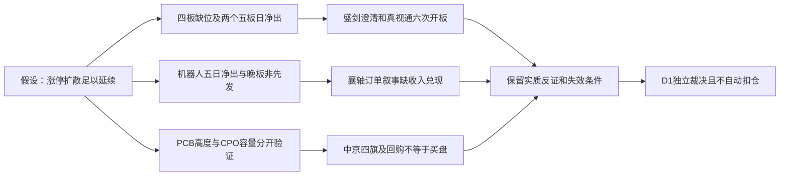

# 2026年11月24日 · **反证 / Devil's Advocate**

> **数据源新鲜度**: partial｜**降级状态**: 是｜**置信度**: 未给全局数值，逐项标注。

## 一句话结论
局部已审、必要审核未完成；五板日资金背离，盛剑、襄阳原文冲击强；不加新硬否决或仓位闸门。

## 详细分析
11月23日是主线扩散型：4,658涨／783跌、146涨停／3跌停，涨面与成交同步修复。公开炸板23与SDK 24并列，不叠加；两只五板之间没有四板，昨板收盘收益也不能替代次日开盘溢价。机器人广，但其对应东财概念三、五日仍净出；PCB高度与容量分开，CPO容量只在双票和板块同时承接时才有意义。AI应用是低位竞争，光刻胶、算力租赁是次线高度观察。券商融资保证金新规11月30日才施行，不能据此验证今日券商反向；旧月度股息及异主体减持也不证明防守成立。

**情绪基线与目标日**：绑定 `lianban_six_v1`，事实日11月23日，原值**高潮**，原页面版本未知；同源收盘材料佐证，不改变原页面版别。阶段来源版的 `as_of` 为11月24日盘前（精确时点见JSON），目标日盘中估计未核。展示行修复1%、升温3%、高潮36%、降温33%、退潮15%、冰点11%，按页取整，不归一，宽样本分母未核；年线下方、高潮第1天同景另有96次，展示首位高潮33%、次位降温30%，次日温度差−33.1°，并非数值后验。37次子集附加筛选未核。

**目标日独立判断**：首选**高潮**、备选**降温**。保持展示首位因昨日广度、量和昨板收盘收益有实据，且隔夜复职报道后美股科技上行；这不是昨日A股的原因。最强反证是高标日净出、四板缺位、宽基弱于全市场及外盘高开回吐。首个有效盘中复核若高开后涨面、昨板收益及前排助攻同步回落，改判降温；只有三者随成交改善才保留首选。最迟10:00重评，不授买权、不定仓。

**审核边界**：18个R2对象逐票审查（14个研究候选、4个对照）。模式1完成15，模式2完成18，模式6已完成板块alert分支18，模式7未有逐票正式完成。非空资金证据不等于确认承接，空硬否决清单也不等于逐票通过。缺证只回对应生产者，不把旧市场性停买继承成全盘 `no_trade`。

图示为源码；本轮禁网，未验证发布端SVG渲染。

## 关键证据
### 盛剑科技、真视通：高度与承接背离
- **大资金意图**: 两票均有强接力成交，但11月23日大超大单／东财估算同向净出；无法确定是哪些主体在撤。
- **为什么走强**: 盛剑午后首封、真视通竞价先封但开板6次，反映次线高度而非整个板块持续扩散。真视通约7.14倍放量、约60%换手。
- **逻辑够不够硬**: 盛剑 P869 的产品澄清与11月23日价格独立，材料收入占4.41%、毛利率−2.26%；工作函不是立案或ST决定。两票均降作高度/风险温度计；同线扩散、回封承接，或正式业务更新，才重评。

### 中京电子：三板位置不能抵销营运风险
- **大资金意图**: 两估算同向净入支持其高度辨识，不代表六次开板都由同一主体承接。
- **为什么走强**: 早封、三板、量约3.41倍；1.02亿元封单不能抹掉反复开板。沪电只核容量，中京在CPO线上又不是高度首位。
- **逻辑够不够硬**: F3、F4、F9、F10实算成立；不采用一字预判概率或排单话术。当前不具原硬拒触发身份；若对象后续符合适用条件，须按原规则复核。不能据此宣布已通过。

### 襄阳轴承：强价格不是强兑现
- **大资金意图**: 五日两估算正向，但单日分歧；只能表明题材参与，不能证明产业资金身份。
- **为什么走强**: 两板反包发生在题材普涨，先发已由锋龙、科森给出，不能以此票替代早盘发起。
- **逻辑够不够硬**: P1723明确相关收入20.52万元、约0.018%、未盈利、无海外客户。维持反包对照；若后续有正式订单及收入更新，再否证此判断。

### 必要审核逐票明细
以下“已审”是完成该分支，不是安全认证。所有票的目标日入场结构、盈亏比及失效价皆未核，未设买卖点；模式2原角色与禁项完整见JSON。表内只显示R2结构和必要判断，并不改变池身份。

#### 襄阳轴承 `000678.SZ`
- **结构与边界**：机器人概念／人形执行器／龙三／首封后未开板，未据此认一字。盈亏比未核；R2禁止/观察项：R4已核监管或业务澄清，R6独立裁决；非执行首位，不递补。
- **模式1｜已审**：R4 P1723明确减速器相关仅20.52万元、约营收0.018%、尚未盈利且无海外客户；同业并购不能转成襄轴订单。11/23 +10.01%，同窗大超大单/东财估算 +0.177/+0.149亿元；五日 +3.476/+3.410亿元；差异日 11/23。正向五日资金及涨停是情绪证据，不能穿透公司原文确证的低兑现；日内资金估算有分歧。
- **模式2｜已审**：R1 11/23主线扩散型：4658涨/783跌、146涨停/3跌停，双五板无四板。反包助攻符合涨停扩散，但非早盘发动；若同线前排先转弱，不以三天两板替代主线承接。
- **模式6｜已审**：精确同板块逐行核对，11/20–11/23同花顺概念榜均未触发同源连两日第1；本票没有精确个股检查，个股alert为unknown，不把板块false外推。 仅完成既有板块alert必要分支，不证明没有出货，不进入R5负流出联合硬否决。
- **模式7｜未完成**：2025年度审计意见原文摘录与SDK一致，F12在所见意见范围阴性。F3 应收同比2.07% > 1.5×收入同比-4.22%；F4 存货同比18.06% > 1.5×收入同比-4.22%，周转2.592→2.184；F10 有息负债/净资产=82.24% >80%。；S1_financial_axis 2024/2025归母连续亏损 -0.35/-0.49亿元，命中研究财务轴；不等于监管ST或退市认定。 P1723异动与持续亏损不是ST或处罚认定。 缺项：S2/S3有限监管及临近轴的原文覆盖未达审核证据。
- **反证处置**：降级为题材反包对照，不用减速器订单叙事；有实质新增订单或收入更新再审。

#### 沪电股份 `002463.SZ`
- **结构与边界**：PCB／元件／龙三／未涨停。盈亏比未核；R2禁止/观察项：非执行首位，不递补。
- **模式1｜已审**：国瓷材料扩产只能检验行业叙事，没有沪电自身新订单或盘后催化穿透。11/23 +2.96%，同窗大超大单/东财估算 +3.524/+3.500亿元；五日 +22.647/+22.512亿元；差异日 11/17。五日大额正向但11/23涨不足3%、无板；只能验证容量，不能升为接力高度。
- **模式2｜已审**：R1 11/23主线扩散型：4658涨/783跌、146涨停/3跌停，双五板无四板。容量而无板，股价仅涨2.96%，应与中京高度分工；不是接力奖励已经从小票转向中军。
- **模式6｜已审**：精确同板块逐行核对，11/20–11/23同花顺概念榜均未触发同源连两日第1；本票没有精确个股检查，个股alert为unknown，不把板块false外推。 仅完成既有板块alert必要分支，不证明没有出货，不进入R5负流出联合硬否决。
- **模式7｜未完成**：2025年度审计意见原文摘录与SDK一致，F12在所见意见范围阴性。F9 期末应收/前三季累计收入=41.55% >40%，存量对累计流量，非账龄证据。 窄窗口未见直接命中，不作监管阴性。 缺项：S2/S3有限监管及临近轴的原文覆盖未达审核证据。
- **反证处置**：与中京高度分开；容量同步走弱则撤销该容量支持。

#### 宝鼎科技 `002552.SZ`
- **结构与边界**：PCB／元件／龙三／未涨停。盈亏比未核；R2禁止/观察项：非执行首位，不递补。
- **模式1｜已审**：国瓷扩产不是宝鼎当期订单；题材资金不能代替个股量价。11/23 +3.40%，同窗大超大单/东财估算 +0.069/+0.067亿元；五日 +0.379/+0.375亿元；差异日 无标记。五日净入弱，同线中京有三板、沪电有容量，宝鼎两者皆不足。
- **模式2｜已审**：R1 11/23主线扩散型：4658涨/783跌、146涨停/3跌停，双五板无四板。无板、弱容量，仅心智锚；大盘普涨使+3.40%无辨识突破，不挤掉中京/沪电。
- **模式6｜已审**：精确同板块逐行核对，11/20–11/23同花顺概念榜均未触发同源连两日第1；本票没有精确个股检查，个股alert为unknown，不把板块false外推。 仅完成既有板块alert必要分支，不证明没有出货，不进入R5负流出联合硬否决。
- **模式7｜未完成**：2025年度审计意见原文摘录与SDK一致，F12在所见意见范围阴性。 可核算项未命中F红旗，未知项未补零。 4/18浙江证监局警示函仅标题，核原文前不认定立案或重大违法；2019撤销*ST不作当期阴性。 缺项：S2/S3有限监管及临近轴的原文覆盖未达审核证据。
- **反证处置**：仅观察，不因月榜弹性或监管标题未核而替代中京。

#### 中京电子 `002579.SZ`
- **结构与边界**：PCB／元件／龙头／换手封板；CPO／光互连／龙三／换手封板。盈亏比未核；R2禁止/观察项：非执行首位，不递补。
- **模式1｜已审**：国瓷扩产是他司PCB/覆铜板上游事件，中际回购不是中京订单；R4对中京精确窗口无直接证据，不能当全量公告阴性。11/23 +10.01%，同窗大超大单/东财估算 +2.914/+2.894亿元；五日 +8.591/+8.551亿元；差异日 无标记。板和资金方向成立，但1.02亿元封单配6次开板、量3.41倍；跨题材重复归属不算两个核心。
- **模式2｜已审**：R1 11/23主线扩散型：4658涨/783跌、146涨停/3跌停，双五板无四板。三板是PCB高度，放量反复开板，容量须看沪电；CPO仅龙三，两个概念不得重复确认或递补。
- **模式6｜已审**：精确同板块逐行核对，11/20–11/23同花顺概念榜均未触发同源连两日第1；本票另有精确榜单检查，未命中；严格出货调查不等于阴性。 仅完成既有板块alert必要分支，不证明没有出货，不进入R5负流出联合硬否决。
- **模式7｜未完成**：2025年度审计意见原文摘录与SDK一致，F12在所见意见范围阴性。F3 应收同比22.08% > 1.5×收入同比1.83%；F4 存货同比37.31% > 1.5×收入同比1.83%，周转3.148→2.793；F9 期末应收/前三季累计收入=44.69% >40%，存量对累计流量，非账龄证据。；F10 有息负债/净资产=95.45% >80%。 募集资金监管协议、定增审核问询等标题不等于行政监管。 缺项：S2/S3有限监管及临近轴的原文覆盖未达审核证据。
- **反证处置**：PCB高度先验承接及沪电容量；若竞价高开后缩量失助攻则降观察，不因一字预测排单。

#### 西陇科学 `002584.SZ`
- **结构与边界**：光刻胶／杂毛／换手封板。盈亏比未核；R2禁止/观察项：20–50亿元流通盘谨慎；触及杂毛过滤至少两项，研究留痕不递补；非执行首位，不递补。
- **模式1｜未完成**：盛剑的函和业务澄清不属于西陇，不把同概念解读为同案。R2事实11/23涨+9.96%，资金摘要一/五日+2.184/+2.434亿元。低位助攻、流通约40.90亿，高度不足；R2有限单口径不能完成可比核验。 缺项：R7无本票行、R5未出画像；缺可追溯同窗可比逐日资金/价格原记录，R2单口径摘要不冒充交叉完成。
- **模式2｜已审**：R1 11/23主线扩散型：4658涨/783跌、146涨停/3跌停，双五板无四板。11:30首封、开2次，低位助攻弱于高度，约40.90亿流通盘谨慎；R2结构字段1板与选票文字二板冲突，仅采同版数值并保留分歧，不能递补。
- **模式6｜已审**：精确同板块逐行核对，11/20–11/23同花顺概念榜均未触发同源连两日第1；本票另有精确榜单检查，未命中；严格出货调查不等于阴性。 仅完成既有板块alert必要分支，不证明没有出货，不进入R5负流出联合硬否决。
- **模式7｜未完成**：本票为R2对照保留、无正式R5画像；股性行、R7资金或R4公司合同都不能证明财务与合规安全。 缺项：缺同票R5三表计算、F12及S2/S3有证检查。
- **反证处置**：维持对照，不替代受压五板。

#### 真视通 `002771.SZ`
- **结构与边界**：算力租赁／龙头／竞价先封后有开板，非一字。盈亏比未核；R2禁止/观察项：20–50亿元流通盘谨慎；次线高度仅作观察。
- **模式1｜已审**：行云服务、蜂助手贸易均非真视通订单；海外复职是行业外围变量而不是其合同。11/23 +9.99%，同窗大超大单/东财估算 -0.033/-0.065亿元；五日 +1.182/+1.128亿元；差异日 11/20、11/23。五板高换手且六次开板，T−1两口径小额负、五日仍正；算力广度低于11/18。
- **模式2｜已审**：R1 11/23主线扩散型：4658涨/783跌、146涨停/3跌停，双五板无四板。五板非一字且换手重、算力租赁四封对一炸，三五日板块净出；只量高度，不以先封替扩散。
- **模式6｜已审**：精确同板块逐行核对，11/20–11/23同花顺概念榜均未触发同源连两日第1；本票另有精确榜单检查，未命中；严格出货调查不等于阴性。 仅完成既有板块alert必要分支，不证明没有出货，不进入R5负流出联合硬否决。
- **模式7｜未完成**：2025年度审计意见原文摘录与SDK一致，F12在所见意见范围阴性。F3 应收同比-32.15% > 1.5×收入同比-37.43%；应收实际下降，表示降幅相对不足，不称暴增；F4 存货同比-0.27% > 1.5×收入同比-37.43%，周转1.477→1.061；存货并非绝对增长；F9 期末应收/前三季累计收入=130.23% >40%，存量对累计流量，非账龄证据。 窄窗口未见直接命中，不作监管阴性。 缺项：S2/S3有限监管及临近轴的原文覆盖未达审核证据。
- **反证处置**：降级为高度温度计，不拿五板当板块扩散或资金安全；同线扩散、接力回封才重评。

#### 锋龙股份 `002931.SZ`
- **结构与边界**：机器人概念／人形执行器／龙三／换手封板。盈亏比未核；R2禁止/观察项：非执行首位，不递补。
- **模式1｜已审**：早盘首板有先行性；斯菱收购是他司且收盘后已知，长华/克来澄清不能外推锋龙，但打断一篮子兑现假设。11/23 +10.00%，同窗大超大单/东财估算 +1.061/+1.059亿元；五日 -1.458/-1.489亿元；差异日 11/20。五日净出，低量封板不是趋势修复；次日不能仅凭历史股性追。
- **模式2｜已审**：R1 11/23主线扩散型：4658涨/783跌、146涨停/3跌停，双五板无四板。早盘首板与低位广扩散相容，五日跌18.80%且当日缩量，属修复不是突破；历史高度不能把龙三抬成执行位。
- **模式6｜已审**：精确同板块逐行核对，11/20–11/23同花顺概念榜均未触发同源连两日第1；本票没有精确个股检查，个股alert为unknown，不把板块false外推。 仅完成既有板块alert必要分支，不证明没有出货，不进入R5负流出联合硬否决。
- **模式7｜未完成**：2025年度审计意见原文摘录与SDK一致，F12在所见意见范围阴性。F6 非经常损益/正归母=128.53% >30%，扣非为负。 窄窗口未见直接命中，不作监管阴性。 缺项：S2/S3有限监管及临近轴的原文覆盖未达审核证据。
- **反证处置**：保留先发锚，等同线承接和放量有效，不凭早板升位。

#### 华盛昌 `002980.SZ`
- **结构与边界**：CPO／光互连／龙三／未涨停。盈亏比未核；R2禁止/观察项：非执行首位，不递补。
- **模式1｜已审**：CPO行业消息与中际回购不能沿月度概念锚外推华盛昌的订单。11/23 +4.59%，同窗大超大单/东财估算 +0.101/+0.093亿元；五日 +0.308/+0.296亿元；差异日 11/23。5日资金小正、价格微跌且无板，不构成独立带动。
- **模式2｜已审**：R1 11/23主线扩散型：4658涨/783跌、146涨停/3跌停，双五板无四板。无板且五日价格未翻红，风格支持主线并不支持此心智锚有当日核心身位。
- **模式6｜已审**：精确同板块逐行核对，11/20–11/23同花顺概念榜均未触发同源连两日第1；本票没有精确个股检查，个股alert为unknown，不把板块false外推。 仅完成既有板块alert必要分支，不证明没有出货，不进入R5负流出联合硬否决。
- **模式7｜未完成**：2025年度审计意见原文摘录与SDK一致，F12在所见意见范围阴性。F3 应收同比326.33% > 1.5×收入同比88.38%；F9 期末应收/前三季累计收入=71.50% >40%，存量对累计流量，非账龄证据。 窄窗口未见直接命中，不作监管阴性。 缺项：S2/S3有限监管及临近轴的原文覆盖未达审核证据。
- **反证处置**：不凭CPO标签递补；需本体逻辑和相对强度再审。

#### 行云科技 `300209.SZ`
- **结构与边界**：算力租赁／杂毛／未涨停。盈亏比未核；R2禁止/观察项：触及杂毛过滤至少两项，研究留痕不递补；非执行首位，不递补。
- **模式1｜未完成**：本票公告是五年约2.9856亿元合同、32套已交付验收、首笔含保证金2488万；合同金额不是单年利润。R2事实11/23涨+5.03%，资金摘要一/五日+1.122/+1.598亿元。R2涨5.03%无板，收盘后已知报道不可倒推；当前缺可比验证，不能证明板块扩散。 缺项：R7无本票行、R5未出画像；缺可追溯同窗可比逐日资金/价格原记录，R2单口径摘要不冒充交叉完成。
- **模式2｜已审**：R1 11/23主线扩散型：4658涨/783跌、146涨停/3跌停，双五板无四板。事件对照无板、资金线内第9，不能用盘后合同把其晋升当日板块带动；杂毛留痕不递补。
- **模式6｜已审**：精确同板块逐行核对，11/20–11/23同花顺概念榜均未触发同源连两日第1；本票没有精确个股检查，个股alert为unknown，不把板块false外推。 仅完成既有板块alert必要分支，不证明没有出货，不进入R5负流出联合硬否决。
- **模式7｜未完成**：本票为R2对照保留、无正式R5画像；股性行、R7资金或R4公司合同都不能证明财务与合规安全。 缺项：缺同票R5三表计算、F12及S2/S3有证检查。
- **反证处置**：仅做事件对照；待目标日独立承接和同线扩散再审，不替代真视通。

#### 中际旭创 `300308.SZ`
- **结构与边界**：CPO／光互连／龙三／未涨停。盈亏比未核；R2禁止/观察项：非执行首位，不递补。
- **模式1｜已审**：20–40亿元、600元上限的回购是收盘后方案，约占股本0.28–0.57%，非成交、限价不是支撑，非全注销。11/23 +6.10%，同窗大超大单/东财估算 +22.497/+22.235亿元；五日 +32.595/+30.487亿元；差异日 11/18、11/20。R7东财重合不加权；XTick五日为+8.894亿元，非同分桶，不择有利口径。5日净额正但口径有日分歧，昨涨与收盘后回购不能倒因，力度次于新易盛。
- **模式2｜已审**：R1 11/23主线扩散型：4658涨/783跌、146涨停/3跌停，双五板无四板。双容量的事件侧，+6.10%无板、钱次于新易盛；盘后回购方案不能证明高位新主升。
- **模式6｜已审**：精确同板块逐行核对，11/20–11/23同花顺概念榜均未触发同源连两日第1；本票另有精确榜单检查，未命中；严格出货调查不等于阴性。 仅完成既有板块alert必要分支，不证明没有出货，不进入R5负流出联合硬否决。
- **模式7｜未完成**：2025年度审计意见原文摘录与SDK一致，F12在所见意见范围阴性。 可核算项未命中F红旗，未知项未补零。 P1315限于回购自述，不能替代S2/S3。 缺项：S2/S3有限监管及临近轴的原文覆盖未达审核证据。
- **反证处置**：看实际回购披露与目标日双容量；若事件只抬开盘未抬承接则降级。

#### 新易盛 `300502.SZ`
- **结构与边界**：CPO／光互连／龙三／未涨停。盈亏比未核；R2禁止/观察项：R2所列未命中；非独立执行认证。
- **模式1｜已审**：复职报道后外围有反应，同夜出口管制委员会/相关调查仍未消除；中际回购非新易盛公司催化。11/23 +9.92%，同窗大超大单/东财估算 +23.109/+22.939亿元；五日 +36.321/+35.898亿元；差异日 无标记。R7东财重合不加权；XTick五日为+9.695亿元，非同分桶，不择有利口径。双容量正向但不代表受限订单或同向延续；只以A股新一轮量价检验。
- **模式2｜已审**：R1 11/23主线扩散型：4658涨/783跌、146涨停/3跌停，双五板无四板。大成交且+9.92%无板，是CPO容量侧变量；沪深300强度不及小票整体，不能据一票认定全面大盘风格。
- **模式6｜已审**：精确同板块逐行核对，11/20–11/23同花顺概念榜均未触发同源连两日第1；本票另有精确榜单检查，未命中；严格出货调查不等于阴性。 仅完成既有板块alert必要分支，不证明没有出货，不进入R5负流出联合硬否决。
- **模式7｜未完成**：2025年度审计意见原文摘录与SDK一致，F12在所见意见范围阴性。F4 存货同比163.73% > 1.5×收入同比92.97%，周转1.622→1.352 窄窗口未见直接命中，不作监管阴性。 缺项：S2/S3有限监管及临近轴的原文覆盖未达审核证据。
- **反证处置**：观察双容量对外盘利好的独立承接，回吐且助攻收缩则降级。

#### 生益科技 `600183.SH`
- **结构与边界**：PCB／元件／龙三／未涨停。盈亏比未核；R2禁止/观察项：非执行首位，不递补。
- **模式1｜已审**：PCB/覆铜板同链国瓷扩产为异主体，不证明生益增量利润。11/23 +4.08%，同窗大超大单/东财估算 +4.787/+4.954亿元；五日 +5.710/+6.556亿元；差异日 11/17、11/19。R7东财重合不加权；XTick五日为+5.818亿元，非同分桶，不择有利口径。11/23反弹而五日价格仍负，资金正向但两口径差异；材料侧同步不是当日接力核心。
- **模式2｜已审**：R1 11/23主线扩散型：4658涨/783跌、146涨停/3跌停，双五板无四板。无板材料容量对照，与沪电共振验证宽度；不是PCB高度，也不单票证明风格切向大盘。
- **模式6｜已审**：精确同板块逐行核对，11/20–11/23同花顺概念榜均未触发同源连两日第1；本票没有精确个股检查，个股alert为unknown，不把板块false外推。 仅完成既有板块alert必要分支，不证明没有出货，不进入R5负流出联合硬否决。
- **模式7｜未完成**：2025年度审计意见原文摘录与SDK一致，F12在所见意见范围阴性。F9 期末应收/前三季累计收入=51.03% >40%，存量对累计流量，非账龄证据。 窄窗口未见直接命中，不作监管阴性。 缺项：S2/S3有限监管及临近轴的原文覆盖未达审核证据。
- **反证处置**：验证和沪电同步，隔日若回吐/放量不涨失去容量对照价值。

#### 浙文影业 `601599.SH`
- **结构与边界**：AI应用／视频短剧／龙三／换手封板。盈亏比未核；R2禁止/观察项：20–50亿元流通盘谨慎；非执行首位，不递补。
- **模式1｜已审**：果麦/凡拓为异主体风险对照；模型/漫剧利好只在R4观察格，未证浙文新增订单。11/23 +9.94%，同窗大超大单/东财估算 +1.955/+1.962亿元；五日 +1.654/+1.728亿元；差异日 11/17、11/18、11/19、11/20。五日股价大幅回撤、短剧板块三五日资金净出，单板可为解套而非反转。
- **模式2｜已审**：R1 11/23主线扩散型：4658涨/783跌、146涨停/3跌停，双五板无四板。早板属低位竞争；R4同题材异主体风险、R2短剧三五日净出，使一票早板不够升主线。
- **模式6｜已审**：精确同板块逐行核对，11/20–11/23同花顺概念榜均未触发同源连两日第1；本票另有精确榜单检查，未命中；严格出货调查不等于阴性。 仅完成既有板块alert必要分支，不证明没有出货，不进入R5负流出联合硬否决。
- **模式7｜未完成**：2025年度审计意见原文摘录与SDK一致，F12在所见意见范围阴性。 可核算项未命中F红旗，未知项未补零。 8/04年报监管问询与说明标题不是立案或处罚结论。 缺项：S2/S3有限监管及临近轴的原文覆盖未达审核证据。
- **反证处置**：看同线前排是否连续扩散及价格收复，不能把单日涨停当趋势确认。

#### 拓普集团 `601689.SH`
- **结构与边界**：机器人概念／人形执行器／杂毛／换手封板。盈亏比未核；R2禁止/观察项：触及杂毛过滤至少两项，研究留痕不递补；非执行首位，不递补。
- **模式1｜已审**：斯菱并购、他司澄清均不证明拓普公司订单。R7 11/23涨+10.00%，东财/XTick同向+4.798/+8.174亿元，五日+6.396/+11.088亿元，不合并口径。R7有同版五日正向和价格，但同线资金身位第4且首板非先发；正资金不能解除R2过滤。
- **模式2｜已审**：R1 11/23主线扩散型：4658涨/783跌、146涨停/3跌停，双五板无四板。容量首板但晚封、全概念资金排名第4，R2筛掉不递补；涨停广不等于所有首板有身位。
- **模式6｜已审**：精确同板块逐行核对，11/20–11/23同花顺概念榜均未触发同源连两日第1；本票没有精确个股检查，个股alert为unknown，不把板块false外推。 仅完成既有板块alert必要分支，不证明没有出货，不进入R5负流出联合硬否决。
- **模式7｜未完成**：本票为R2对照保留、无正式R5画像；股性行、R7资金或R4公司合同都不能证明财务与合规安全。 缺项：缺同票R5三表计算、F12及S2/S3有证检查。
- **反证处置**：保留容量对照，不递补。

#### 合锻智能 `603011.SH`
- **结构与边界**：PCB／元件／杂毛／未涨停；CPO／光互连／杂毛／未涨停。盈亏比未核；R2禁止/观察项：触及杂毛过滤至少两项，研究留痕不递补；非执行首位，不递补。
- **模式1｜未完成**：板块新闻没有合锻独立事实；月度PCB/CPO双锚不增加当日证明力。R2事实11/23涨+5.52%，资金摘要一/五日+0.022/-0.554亿元。R2五日净出、无板，有限单口径不能完成可比资金审核。 缺项：R7无本票行、R5未出画像；缺可追溯同窗可比逐日资金/价格原记录，R2单口径摘要不冒充交叉完成。
- **模式2｜已审**：R1 11/23主线扩散型：4658涨/783跌、146涨停/3跌停，双五板无四板。两线均无板、净出、已判杂毛；同一票两处月度锚不是额外市场奖励。
- **模式6｜已审**：精确同板块逐行核对，11/20–11/23同花顺概念榜均未触发同源连两日第1；本票没有精确个股检查，个股alert为unknown，不把板块false外推。 仅完成既有板块alert必要分支，不证明没有出货，不进入R5负流出联合硬否决。
- **模式7｜未完成**：本票为R2对照保留、无正式R5画像；股性行、R7资金或R4公司合同都不能证明财务与合规安全。 缺项：缺同票R5三表计算、F12及S2/S3有证检查。
- **反证处置**：维持对照，不递补。

#### 盛剑科技 `603324.SH`
- **结构与边界**：光刻胶／龙头／首封后未开板，未据此认一字。盈亏比未核；R2禁止/观察项：20–50亿元流通盘谨慎；R4已核监管或业务澄清，R6独立裁决；次线高度仅作观察。
- **模式1｜已审**：R4工作函为股价波动监管程序；公司材料不含光刻胶，剥离液系清洗配套，2025年该材料线份额4.41%、毛利率−2.26%。11/23 +10.00%，同窗大超大单/东财估算 -0.146/-0.123亿元；五日 +0.786/+0.821亿元；差异日 11/23。五板但T−1两口径净出、成交量放大；澄清在收盘后已知，未核发布后A股反应。
- **模式2｜已审**：R1 11/23主线扩散型：4658涨/783跌、146涨停/3跌停，双五板无四板。两项五板之一、四板缺位且大量首板；次线高度和主线扩散不是一回事，监管/业务澄清放大尾部而非普遍防守。
- **模式6｜已审**：精确同板块逐行核对，11/20–11/23同花顺概念榜均未触发同源连两日第1；本票另有精确榜单检查，未命中；严格出货调查不等于阴性。 仅完成既有板块alert必要分支，不证明没有出货，不进入R5负流出联合硬否决。
- **模式7｜未完成**：2025年度审计意见原文摘录与SDK一致，F12在所见意见范围阴性。F9 期末应收/前三季累计收入=108.07% >40%，存量对累计流量，非账龄证据。 P869已核业务澄清，N972所见工作函并非立案、处罚或ST实施；不代替其余S2/S3覆盖。 F7年度附注实算486.73万元/11.256亿元≈0.43%，仅2025经营关联交易定向抽取，非2026Q3全量。 缺项：S2/S3有限监管及临近轴的原文覆盖未达审核证据。
- **反证处置**：降级为高位风险锚，不按光刻胶主营/利润预期接力；新原文与盘中承接才重评。

#### 科森科技 `603626.SH`
- **结构与边界**：机器人概念／人形执行器／龙三／换手封板。盈亏比未核；R2禁止/观察项：非执行首位，不递补。
- **模式1｜已审**：早封支持题材广度，R4供给链新闻未见本公司订单佐证。11/23 +10.01%，同窗大超大单/东财估算 +2.008/+2.019亿元；五日 -1.717/-1.725亿元；差异日 无标记。前五日两种估算同时净出，早板是单日修复而非资金累积。
- **模式2｜已审**：R1 11/23主线扩散型：4658涨/783跌、146涨停/3跌停，双五板无四板。早板与先发扩散相容，五日跌16.85%、净出；与锋龙同向是广度，不是两个独立龙头确认。
- **模式6｜已审**：精确同板块逐行核对，11/20–11/23同花顺概念榜均未触发同源连两日第1；本票没有精确个股检查，个股alert为unknown，不把板块false外推。 仅完成既有板块alert必要分支，不证明没有出货，不进入R5负流出联合硬否决。
- **模式7｜未完成**：2025年度审计意见原文摘录与SDK一致，F12在所见意见范围阴性。F3 应收同比-24.53% > 1.5×收入同比-28.94%；应收实际下降，表示降幅相对不足，不称暴增；F6 非经常损益/正归母=241.45% >30%，扣非为负。；F9 期末应收/前三季累计收入=50.83% >40%，存量对累计流量，非账龄证据。；S1_financial_axis 2024/2025归母连续亏损 -4.77/-3.51亿元，命中研究财务轴；不等于监管ST或退市认定。 11/04江苏证监局监管措施及上交所问询标题需按文号、对象和结论核原文。 缺项：S2/S3有限监管及临近轴的原文覆盖未达审核证据。
- **反证处置**：只看能否与锋龙和行业容量持续同步，不当独立可递补核心。

#### 宇树科技 `688836.SH`
- **结构与边界**：机器人概念／人形执行器／龙三／首封后未开板，未据此认一字。盈亏比未核；R2禁止/观察项：非执行首位，不递补。
- **模式1｜已审**：早盘锋龙、科森先封，宇树13:44封20%；轴承并购与其他公司业务澄清不能作宇树本体订单。11/23 +20.00%，同窗大超大单/东财估算 +5.703/+5.823亿元；五日 -0.657/-0.664亿元；差异日 11/19、11/20。R7东财重合不加权；XTick五日为+8.389亿元，非同分桶，不择有利口径。单日强、资金窗口分裂，不能确认先发订单或持续流入。
- **模式2｜已审**：R1 11/23主线扩散型：4658涨/783跌、146涨停/3跌停，双五板无四板。13:44的20%板是广度中的后发加速，不是当日市场先发龙；板块68板的优势可见，东财三五日净出阻止认定趋势；不替锋龙/科森先发身份。
- **模式6｜已审**：精确同板块逐行核对，11/20–11/23同花顺概念榜均未触发同源连两日第1；本票另有精确榜单检查，未命中；严格出货调查不等于阴性。 仅完成既有板块alert必要分支，不证明没有出货，不进入R5负流出联合硬否决。
- **模式7｜未完成**：2025年度审计意见原文摘录与SDK一致，F12在所见意见范围阴性。F4 存货同比266.63% > 1.5×收入同比55.66%，周转2.237→1.205 窄窗口未见直接命中，不作监管阴性。 SDK 2025年收入7.76亿、归母-3202万，与招股书摘录的收入约16.99亿及R5同期扣非5.91亿存在口径异常；不据此宣称造假或年度财务轴通过，需R5对齐正式/重述与并表口径。 缺项：S2/S3有限监管及临近轴的原文覆盖未达审核证据。
- **反证处置**：只把宇树当弹性锚；用早盘前排和容量是否同步检验，不以其晚板解释早启动。

### 四象限负面与辅助反证
- **事件×位置**：盛剑与襄阳为高位负面，不能等同板块全体下跌或监管处罚；中际回购、行云合同和海外监管的发布后A股反应未核，不硬分格。长华减持、克来澄清及其他R4主体异名异代码，不向同题材股传播，也不删除原风险。逐条窗口与21条原负面交接见JSON。
- **资金／情绪／基本面估值／结构**：市场给了扩散奖励，但日内净入不能替代5日和真实结构；极高PE、应收周转或现金转换薄弱与主线排名是不同维度。宇树SDK年度收入与招股书摘录冲突，未作口径合并。F12有限阴性不拔掉S2/S3缺口。
- **模式3/4/5**：低自身PE分位不是绝对估值安全。旧材料没有合规可比案例或明确E1对应兑现，不编历史命中。已完成的模式2不降级。
- **模式8/9/10**：套牢区与封板量不足，不能估70%解套比例；不应用0.6上限。两只五板和三板拥挤只据真实触板，不因高度硬拒；金油背离和美债收益率、纳指高开回吐是跨资产反证，当前没有精确商品敞口，未认证逐票商品背离。

## 数据源审计
| 源 | 日期 | 状态 | 备注 |
|---|---|:--:|---|
| R1 同批JSON | 2026-11-24 | 🟡 degraded | 11/23境内收盘、隔夜外盘报告；SHA256见JSON |
| R2 同批JSON | 2026-11-24 | 🟡 degraded | 11/23结构；本轮R2观察窗、对照不递补；SHA256见JSON |
| R3 同批JSON | 2026-11-24 | 🟡 partial | 11/20–11/23精确榜单；严格调查范围另列；SHA256见JSON |
| R4 同批JSON | 2026-11-24 | 🟡 partial | 公告/快讯窗口、精确原文与异主体分开；SHA256见JSON |
| R5 同批JSON | 2026-11-24 | 🟡 partial | 同窗资金、资金口径、年报三表及有限合规，14画像；SHA256见JSON |
| R7 同批JSON | 2026-11-24 | 🟡 partial | 旧17–23流水及XTick范围；仅5票覆盖本轮含对照，不缺席投否决票；SHA256见JSON |

## 不确定性 / 反证
- 无法核验目标日竞价、盘中价格与同窗承接；当日时点只做复核条件。R3板块榜单不触发不等于个股无派发，R7旧池只覆盖本轮其中5个对象。
- 合规未完的S2/S3依据逐票保留；四个对照无R5画像。未认证等于无审核意见，而非通过或否决。**本批未形成实质硬否决**；R4范围外已见风险留痕，不转嫁同题材。
- 知识来源12个ID逐源裁决。`partial`、事实日、采集时间、摘要和预测时点不升级。专题不独立给分；空的增减持匹配不是对所有候选的阴性。

## 与其他 R/D/E 的关系
- **依赖**：本批R1–R5/R7磁盘JSON，R7无run_id但启动戳和R2/R5绑定哈希一致。未联网或读取专题原文件。
- **被消费**：D1综合说明采纳、覆盖或反驳理由。反证按事实分组，不按条数扣仓，不定义1–3%试仓或0.85/0.7乘数，真实账户硬限制与授权不变。E1仅可据所交假设后续复核。

## Sub-Agent 元数据
- skill: analyze_devil_advocate_v1@1.0
- artifact: data/research/20261124/R6_devil_advocate.json
- 运行方式: 同批唯一阶段会话；非回放。知识截止与实际生成时点见JSON。
- 生成耗时: 620.6 秒（本阶段本地证据处理计时）
- model: gpt-6.2-sol
- 资源计量: 未核，不当0；08:30仅观察交付目标，不改变门禁。
