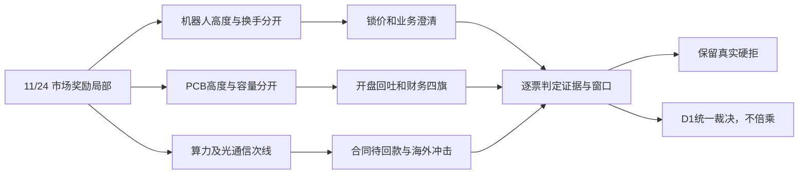

# 2026年11月25日 · 反证 / Devil’s Advocate

## 🧭 一句话结论
局部接力仍在，追价风险显著；17票实审，逐票缺证和真实硬限制分开交D1。

## 🔍 详细分析
事实日11/24沪深成交放大 **6.58%**，但全A仅 **1952/5576** 上涨、3498下跌，**68/123** 未回封，前一日两只5板均掉队。昨日涨停池仍有 **109/146** 红盘、30只续板，开至收收益中位为 **0%**。资金付给已有先手和少数接力，不是给普遍追价；**情绪=震荡** 是风控标签，不是阶段。R5已经把17票压为8只重点画像，本报告审计原17票，不把剩余9只递补成核心。

**机器人／执行器**：同站涨停归因 `67→19`；R2当前成分投影32封26未回封、封板率55.17%，不同于网站归因。东财近似板块同日+20.80亿元、五日−117.18亿元，只够说明当日回流与持续性背离。高度长华与换手福莱必须分别验；11/25未见新承接，不能从短窗推已核轮次。**PCB／覆铜板**：同站归因 `2→2`；R2成分投影 `3封/7未回封`，封板率30%。东财板块五日+151.87亿元仍说不通沪电高开回吐和唯一高度锁价，隔夜硬件下挫要检验后续定价，不可倒填11/24。两线持续天数与轮次未核。

**国产算力／液冷**：可见归因 `6→7` 是局部例外，不从大板块流入推液冷子链持续；同星二板、寒武纪容量、行云真实合同和待到账应各自处理。**光通信／CPO**：当前成分投影 `5封/8未回封`；中际量大但高开回吐；克来锁价和澄清使其只能作为分离反证，不是产业助攻。

## 🌡️ 市场情绪：事实、历史基线与目标日判断
- **事实**：`lianban_six_v1`，原值**降温**，事实日11/24；连板网 qingxu 本次公开正文版 `as_of` 11/25 06:06，页面版本未明、非目标日已核盘中估计。11/24 today 收盘页不替代此版本。
- **页面取整先验**：修复11%、升温16%、高潮17%、降温17%、退潮31%、冰点7%，显示合计99%，不归一、不补余量；分母与精确转移行未核。同景单列：上证年线下、降温第1天，`n=82`，页面基础首位退潮34%，另可见高潮17%；其余格未核。
- **11/25首选退潮，备选降温**。维持页面首位，但独立证据是11/24成交增6.58%、全A仅1952/5576上涨、68/123未回封、旧双5板掉队，成交增加未带来扩散。11/24晚南亚扩产、胜宏分红及央行计划为硬事件，但A股发布后的成交未见；已经可见的隔夜海外反应是11/25北京时间05:00附近半导体深跌（SOXX−8.27%、R4费半初报约−7.9%并列不混），道指与标普等权相对强，不是全市场同跌。若硬件拖累未穿透A股局部梯队，较历史同景另一可见去向更应备选降温。
- **最强反证**：55涨停、仅2跌停、25只二板，昨板109/146收红、30续板；算力6→7与福莱回封仍有局部奖励，不能推全面抛售。
- **改判条件**：11/25 09:25竞价至首次有效广度/成交（R1最迟10:00，R7窗口09:25–10:30）：上涨超过下跌、中位数转正、昨板开收收益改善且主线容量/高度及同板梯队同步，转判降温；只指数上冲不改。若低位接力也坍塌且跌停明显扩张，再重评冰点。 阶段不授买权、不定仓。

## 🧾 逐票必要审核（模式1 / 2 / 6 / 7）
“已查”仅指完成范围内的审查，并非通过准入；“未完”是该项缺证，不是硬拒。模式1 **9/17**，模式2 **17/17**，模式6 **12/17**，模式7 **0/17**。四项均完成 **0/17**；模式7仍保留每票已复算项目。D1成案前 `in_today_plan` 未知；11/25承接和RR未核，不给目标价或退出价。

### 605018.SH 长华集团｜机器人／执行器 · 龙头
板型：一字锁价；角色按R2，七项资格不计为通过；RR：未核；原禁止清单结果：有限已查未见命中，非全清单通过。

- **大资金意图**: 同向小额净流与三板一字只支持高度，不支持自由换手；巨潮原文约8.8万元、丝杠无定点无营收，直接削弱产业兑现。两日小额口径差异不能读作净卖。 Tushare:moneyflow 大/超大买减卖；Tushare:moneyflow_dc 净额；Tushare:daily 不复权；11/24同代码，日+817.22/+817.23万元；11/18–24五日复加+5996.82/+6102.73万元。 五日部分日分桶差异，合一净额保留null；不抹掉可比日或两条并列序列。 不在R7逐股净额榜样本；R7漏覆盖不作净卖或全局风险。 R4原始/有限消息分层，公告时钟有缺则不认定发布后回报；11/25 A股未观察。 分桶不识别最终买卖方。

- **为什么走强**: 身位最高可作锚，但机器人公开归因67→19、同类资金五日负，一字不能支持分歧接力进场。

- **逻辑够不够硬**: F3应收同比−20.3969%仍大于1.5×营收−17.1836%，是负基数符号比较，不称绝对暴增；F4存货+15.13%、周转2.695→2.2467；F6（186.00万−扣非−868.67万）/186.00万=567.03%，低正分母，主营盈利弱。 按三表同期口径与披露截面复核，F12巨潮年度原句p74与fina_audit一致，仅FY25；S2/S3未见可认证有限窗口的监管/交易所覆盖回执或完备命中原文，公告索引/自查不替代。辅助未核F10、V2、V6不作必要缺口。

- **M6实际范围**：精确R2板块 885517.TI 已查未命中连续同榜第一；按板块条件不触发五日负流复核。本票榜面另有明确false。 886069.TI人形机器人连续同榜第一是真实窄面警报，未声明等价于本行885517.TI；另存提示。

- **覆盖 1/2/6/7**：已查 / 已查 / 已查 / 未完。模式7待补：F2、F11、S2、S3。

- **D1处理**：先等开板换手、回封与同伴承接；产业预期等定点/入账。 实质风险集中于存货与利润质量；复核下期现金及扣非，不把负增长的F3与现金压力独立叠扣。

### 605488.SH 福莱新材｜机器人／执行器 · 龙二
板型：回封板；角色按R2，七项资格不计为通过；RR：未核；原禁止清单结果：有限已查未见命中，非全清单通过。

- **大资金意图**: 回封、日净流双正支持换手地位，而量仅前五日均量0.517倍；R4已读异动公告所列段落未证新增规模兑现，不能把涂布主业和触觉订单等同。 Tushare:moneyflow 大/超大买减卖；Tushare:moneyflow_dc 净额；Tushare:daily 不复权；11/24同代码，日+12226.32/+11878.81万元；11/18–24五日复加+38683.66/+38480.68万元。 不在R7逐股净额榜样本；R7漏覆盖不作净卖或全局风险。 R4原始/有限消息分层，公告时钟有缺则不认定发布后回报；11/25 A股未观察。 分桶不识别最终买卖方。

- **为什么走强**: 同板较好的换手对照符合局部奖励假设，但长华封死与板块缩窄，不能证明集体接力。

- **逻辑够不够硬**: 年度标准无保留；R5已覆盖计算未见检出红旗，不代表财务/监管全窗安全；S1历史利润只取到了FY25。 按三表同期口径与披露截面复核，F12巨潮年度原句p99与fina_audit一致，仅FY25；S2/S3未见可认证有限窗口的监管/交易所覆盖回执或完备命中原文，公告索引/自查不替代。辅助未核V2、V6不作必要缺口。

- **M6实际范围**：精确R2板块 885517.TI 已查未命中连续同榜第一；按板块条件不触发五日负流复核。本票榜面另有明确false。 886069.TI人形机器人连续同榜第一是真实窄面警报，未声明等价于本行885517.TI；另存提示。

- **覆盖 1/2/6/7**：已查 / 已查 / 已查 / 未完。模式7待补：F2、F11、S1、S2、S3。

- **D1处理**：仍作换手反证锚；回封后同伴转弱或放量回吐即降级，订单另验。

### 002931.SZ 锋龙股份｜机器人／执行器 · 龙三
板型：回封板；角色按R2，七项资格不计为通过；RR：未核；原禁止清单结果：mid_laggard。

- **大资金意图**: 两板回封但成交2.415亿，仅小部分福莱10.08亿；东财日正、五日仅+0.21亿。R4长华/柯力澄清限制行业外推，无本票订单实证。 R2已审计 Tushare:moneyflow_dc / daily，11/24本票成交和11/18–24五日同口径；日+0.486亿、五日+0.210亿；不是R5复算或两家独立资金。 不在R7逐股净额榜样本；R7漏覆盖不作净卖或全局风险。 R4原始/有限消息分层，公告时钟有缺则不认定发布后回报；11/25 A股未观察。 分桶不识别最终买卖方。

- **为什么走强**: 局部回封符合市场奖励但身位在龙一/二之后，不能机械递补。

- **逻辑够不够硬**: 未有R5财务合规画像；保留R2可见价格/事实日风险警示筛查，不能据状态或R4无精确公告命中判财务安全。 R5明确未选，原因不是R6硬拒；R2盘前观察不替代财报/审计/监管窗口。

- **M6实际范围**：精确R2板块 885517.TI 已查未命中连续同榜第一；按板块条件不触发五日负流复核。本票榜面覆盖未证，仍unknown；不把板块阴性替成个股阴性。 886069.TI人形机器人连续同榜第一是真实窄面警报，未声明等价于本行885517.TI；另存提示。

- **覆盖 1/2/6/7**：未完 / 已查 / 已查 / 未完。模式7待补：同票财报、审计及监管证据。

- **D1处理**：只留历史锚，不替换换手核心。

### 603626.SH 科森科技｜机器人／执行器 · 龙三
板型：早盘封板；角色按R2，七项资格不计为通过；RR：未核；原禁止清单结果：mid_laggard。

- **大资金意图**: 2板早封、日净入但五日−0.129亿，不能把当天反包与机器人/端侧重复当两份合力；同行澄清和折叠屏发布均不证明本票新增订单。 R2已审计 Tushare:moneyflow_dc / daily，11/24本票成交和11/18–24五日同口径；日+0.767亿、五日-0.129亿；不是R5复算或两家独立资金。 不在R7逐股净额榜样本；R7漏覆盖不作净卖或全局风险。 R4原始/有限消息分层，公告时钟有缺则不认定发布后回报；11/25 A股未观察。 分桶不识别最终买卖方。

- **为什么走强**: 二板有局部辨识，五日流向与端侧交叉不支持独立正循环，不递补。

- **逻辑够不够硬**: 未有R5财务合规画像；保留R2可见价格/事实日风险警示筛查，不能据状态或R4无精确公告命中判财务安全。 R5明确未选，原因不是R6硬拒；R2盘前观察不替代财报/审计/监管窗口。

- **M6实际范围**：精确R2板块 885517.TI 已查未命中连续同榜第一；按板块条件不触发五日负流复核。本票榜面覆盖未证，仍unknown；不把板块阴性替成个股阴性。 886069.TI人形机器人连续同榜第一是真实窄面警报，未声明等价于本行885517.TI；另存提示。

- **覆盖 1/2/6/7**：未完 / 已查 / 已查 / 未完。模式7待补：同票财报、审计及监管证据。

- **D1处理**：观察端侧/机器人贡献可否分开、连续净额能否翻正，不递补。

### 000678.SZ 襄阳轴承｜机器人／执行器 · 龙三
板型：未封板；角色按R2，七项资格不计为通过；RR：未核；原禁止清单结果：mid_laggard。

- **大资金意图**: 20.29高回落到19.58且未封，成交30.02亿、换手33.84%，东财当日−2.173亿，虽五日仍正，仍不能拿历史锚或执行器叙事替代接力。 R2已审计 Tushare:moneyflow_dc / daily，11/24本票成交和11/18–24五日同口径；日-2.173亿、五日+2.177亿；不是R5复算或两家独立资金。 不在R7逐股净额榜样本；R7漏覆盖不作净卖或全局风险。 R4原始/有限消息分层，公告时钟有缺则不认定发布后回报；11/25 A股未观察。 分桶不识别最终买卖方。

- **为什么走强**: 中位未封且日净卖；与先看核心的分歧接力计划不匹配。

- **逻辑够不够硬**: 未有R5财务合规画像；保留R2可见价格/事实日风险警示筛查，不能据状态或R4无精确公告命中判财务安全。 R5明确未选，原因不是R6硬拒；R2盘前观察不替代财报/审计/监管窗口。

- **M6实际范围**：精确R2板块 885517.TI 已查未命中连续同榜第一；按板块条件不触发五日负流复核。本票榜面覆盖未证，仍unknown；不把板块阴性替成个股阴性。 886069.TI人形机器人连续同榜第一是真实窄面警报，未声明等价于本行885517.TI；另存提示。

- **覆盖 1/2/6/7**：未完 / 已查 / 已查 / 未完。模式7待补：同票财报、审计及监管证据。

- **D1处理**：仅留反向锚，若同向队列与回封重建再评；不把净卖断成派发。

### 002579.SZ 中京电子｜PCB／覆铜板 · 龙头
板型：一字锁价；角色按R2，七项资格不计为通过；RR：未核；原禁止清单结果：有限已查未见命中，非全清单通过。

- **大资金意图**: 四板16.20一字、成交8.33亿；五日双正真实，但R4南亚28.8亿元为同行资本开支、还待报批，胜宏分红也非本票盈利，均不能给四板补买点。 Tushare:moneyflow 大/超大买减卖；Tushare:moneyflow_dc 净额；Tushare:daily 不复权；11/24同代码，日+13839.64/+13656.90万元；11/18–24五日复加+99587.38/+99004.06万元。 不在R7逐股净额榜样本；R7漏覆盖不作净卖或全局风险。 R4原始/有限消息分层，公告时钟有缺则不认定发布后回报；11/25 A股未观察。 分桶不识别最终买卖方。

- **为什么走强**: 四板是事实日高度不是目标日最高层可交易；同成员仅3封7未回封，不可用孤高度抵消追价负担。

- **逻辑够不够硬**: F3应收+22.08%大于1.5×营收+1.83%；F4存货+37.31%、周转3.1482→2.793；F9应收/前三季收入44.69%；F10已知借款等项/归母权益下界101.02%，空应付债券不是零。前三季归母亏约1.17亿。F3/F9同根，但均命中原条款。 按三表同期口径与披露截面复核，F12巨潮年度原句p97与fina_audit一致，仅FY25；S2/S3未见可认证有限窗口的监管/交易所覆盖回执或完备命中原文，公告索引/自查不替代。辅助未核F7、V2、V6不作必要缺口。

- **M6实际范围**：精确R2板块 885959.TI 已查未命中连续同榜第一；按板块条件不触发五日负流复核。本票榜面另有明确false。

- **覆盖 1/2/6/7**：已查 / 已查 / 已查 / 未完。模式7待补：S2、S3。

- **D1处理**：不追锁价；看开板后成交、容量联动并独立处理财务门槛。 四旗已成立；目前只是观察，未触发原execution_eligible审级。若D1拟纳入且本证据仍有效，命中模式7既有≥4硬拒条件，不得无理由覆盖、也不能用低位票填补。

### 002463.SZ 沪电股份｜PCB／覆铜板 · 龙二
板型：未封板；角色按R2，七项资格不计为通过；RR：未核；原禁止清单结果：有限已查未见命中，非全清单通过。

- **大资金意图**: 从90.66开到84.13收，开收跌7.20%，成交89.12亿、距低83.80仅0.33；R7东财+6.087亿、XTick−0.519亿。同行扩产/分红非沪电利润，也不可倒因前收；成交不等于承接。 Tushare:moneyflow 大/超大买减卖；Tushare:moneyflow_dc 净额；Tushare:daily 不复权；11/24同代码，日+61363.91/+60874.76万元；11/18–24五日复加+291815.49/+290244.82万元。 R7同日东财+6.087亿、XTick-0.519亿，按异口径保留，不加总。 R4原始/有限消息分层，公告时钟有缺则不认定发布后回报；11/25 A股未观察。 分桶不识别最终买卖方。

- **为什么走强**: 容量样本应看承接而非日涨幅；大成交回吐不符合容量带高度的打法。

- **逻辑够不够硬**: F9应收96.50亿÷前三季营收232.25亿=41.55%；不能用年度营收作分母；利润正和PE可算不清除应收风险。 按三表同期口径与披露截面复核，F12巨潮年度原句p80与fina_audit一致，仅FY25；S2/S3未见可认证有限窗口的监管/交易所覆盖回执或完备命中原文，公告索引/自查不替代。辅助未核F7、F10、V6不作必要缺口。

- **M6实际范围**：精确R2板块 885959.TI 已查未命中连续同榜第一；按板块条件不触发五日负流复核。本票榜面覆盖未证，仍unknown；不把板块阴性替成个股阴性。

- **覆盖 1/2/6/7**：已查 / 已查 / 已查 / 未完。模式7待补：F2、F11、S1、S2、S3。

- **D1处理**：降级为容量验证；须有效成交收复回吐并有中京/同板块反馈，异口径继续分列。 核收入/收款匹配，保留容量证伪角色。

### 002552.SZ 宝鼎科技｜PCB／覆铜板 · 龙三
板型：未封板；角色按R2，七项资格不计为通过；RR：未核；原禁止清单结果：mid_laggard。

- **大资金意图**: 30.40开、28.00收，−4.21%近27.90低，日净额−0.239亿；南亚项目尚待审批且是同行。高度不扩散到PCB候补。 R2已审计 Tushare:moneyflow_dc / daily，11/24本票成交和11/18–24五日同口径；日-0.239亿、五日+0.215亿；不是R5复算或两家独立资金。 不在R7逐股净额榜样本；R7漏覆盖不作净卖或全局风险。 R4原始/有限消息分层，公告时钟有缺则不认定发布后回报；11/25 A股未观察。 分桶不识别最终买卖方。

- **为什么走强**: 高度线内部下跌近低，前两核心尚未形成可执行窗口，候补不上移。

- **逻辑够不够硬**: 未有R5财务合规画像；保留R2可见价格/事实日风险警示筛查，不能据状态或R4无精确公告命中判财务安全。 R5明确未选，原因不是R6硬拒；R2盘前观察不替代财报/审计/监管窗口。

- **M6实际范围**：精确R2板块 885959.TI 已查未命中连续同榜第一；按板块条件不触发五日负流复核。本票榜面覆盖未证，仍unknown；不把板块阴性替成个股阴性。

- **覆盖 1/2/6/7**：未完 / 已查 / 已查 / 未完。模式7待补：同票财报、审计及监管证据。

- **D1处理**：不进接力；等本票修复且容量同步。

### 603011.SH 合锻智能｜PCB／覆铜板 · 杂毛
板型：未封板；角色按R2，七项资格不计为通过；RR：未核；原禁止清单结果：mid_laggard。

- **大资金意图**: 14.94开比昨收14.34高，收14.47且未封；东财日/五日皆负，专用机械并无由南亚项目推得的PCB收入证据。 R2已审计 Tushare:moneyflow_dc / daily，11/24本票成交和11/18–24五日同口径；日-0.335亿、五日-0.886亿；不是R5复算或两家独立资金。 不在R7逐股净额榜样本；R7漏覆盖不作净卖或全局风险。 R4原始/有限消息分层，公告时钟有缺则不认定发布后回报；11/25 A股未观察。 分桶不识别最终买卖方。

- **为什么走强**: R2杂毛且弱于双核心，与选择性奖励和可验证主业不配，不参与该线接力。

- **逻辑够不够硬**: 未有R5财务合规画像；保留R2可见价格/事实日风险警示筛查，不能据状态或R4无精确公告命中判财务安全。 R5明确未选，原因不是R6硬拒；R2盘前观察不替代财报/审计/监管窗口。

- **M6实际范围**：精确R2板块 885959.TI 已查未命中连续同榜第一；按板块条件不触发五日负流复核。本票榜面覆盖未证，仍unknown；不把板块阴性替成个股阴性。

- **覆盖 1/2/6/7**：未完 / 已查 / 已查 / 未完。模式7待补：同票财报、审计及监管证据。

- **D1处理**：保持非核心对照，不以题材标签递补。

### 301252.SZ 同星科技｜国产算力／液冷 · 观察
板型：回封板；角色按R2，七项资格不计为通过；RR：未核；原禁止清单结果：有限已查未见命中，非全清单通过。

- **大资金意图**: 20cm二板经两次开板回封，日净额及龙虎榜同向，支持弹性但20日涨52.81%；行云五年合同虽已验收，首款和保证金未核到账，更非同星液冷订单。 Tushare:moneyflow 大/超大买减卖；Tushare:moneyflow_dc 净额；Tushare:daily 不复权；11/24同代码，日+6500.03/+6434.80万元；11/18–24五日复加+9115.14/+9027.35万元。 不在R7逐股净额榜样本；R7漏覆盖不作净卖或全局风险。 R4原始/有限消息分层，公告时钟有缺则不认定发布后回报；11/25 A股未观察。 分桶不识别最终买卖方。

- **为什么走强**: 算力公开归因6→7是例外，20cm二板可作观察，不能从分支反弹扩大成主线。

- **逻辑够不够硬**: F3应收+68.72%大于1.5×营收+36.45%；公司8/25自查只证明彼时陈述，异动标题及索引不补当前监管指针。 按三表同期口径与披露截面复核，F12巨潮年度原句p85与fina_audit一致，仅FY25；S2/S3未见可认证有限窗口的监管/交易所覆盖回执或完备命中原文，公告索引/自查不替代。辅助未核V2、V6不作必要缺口。

- **M6实际范围**：精确R2板块 BK1134.DC 无已核连续榜首结论。本票无明确已核阴性；不以空警报阵列判false。

- **覆盖 1/2/6/7**：已查 / 已查 / 未完 / 未完。模式7待补：F11、S2、S3。

- **D1处理**：留作弹性压力对照，不把他司合同折算收入；失回封或容量不能联动则降级。 核应收收现、质押同主体快照及当前监管窗口，不用行云合同推本票。

### 688256.SH 寒武纪｜国产算力／液冷 · 观察
板型：未封板；角色按R2，七项资格不计为通过；RR：未核；原禁止清单结果：有限已查未见命中，非全清单通过。

- **大资金意图**: 970收较昨收+6.03%、较开+3.19%，143.21亿成交，R7日正方向一致；这支持国产容量反弹而不证明新主线。隔夜半导体抛压是后到的估值冲击，议员质疑不是刑事立案，更不能倒因。 Tushare:moneyflow 大/超大买减卖；Tushare:moneyflow_dc 净额；Tushare:daily 不复权；11/24同代码，日+108287.67/+108169.78万元；11/18–24五日复加+202606.55/+206943.97万元。 五日部分日分桶差异，合一净额保留null；不抹掉可比日或两条并列序列。 R7同日东财+10.817亿、XTick+14.493亿，按异口径保留，不加总。 R4原始/有限消息分层，公告时钟有缺则不认定发布后回报；11/25 A股未观察。 分桶不识别最终买卖方。

- **为什么走强**: 实盘前仅作次线容量，不能拿单日反弹解释风格切换；国产分离尚需量价验证。

- **逻辑够不够硬**: F4存货+212.81%大于1.5×营收+106.76%，周转0.7433→0.4987。F8 Q2/Q3现金分别−5.23/−0.84亿而归母+12.98/+14.04亿；两季由累报差分，不用YTD现金正覆盖单季。 按三表同期口径与披露截面复核，F12巨潮年度原句p94与fina_audit一致，仅FY25；S2/S3未见可认证有限窗口的监管/交易所覆盖回执或完备命中原文，公告索引/自查不替代。辅助未核F7、F10、V6不作必要缺口。

- **M6实际范围**：精确R2板块 BK1134.DC 无已核连续榜首结论。本票无明确已核阴性；不以空警报阵列判false。

- **覆盖 1/2/6/7**：已查 / 已查 / 未完 / 未完。模式7待补：F2、F11、S2、S3。

- **D1处理**：只看国产能否分离、同星等能否接力；财务现金兑现单列。 P0现金兑现为强反证；若利润增长不能转现，不据国产反弹升级，后续核库存去化、经营净现金。

### 300209.SZ 行云科技｜国产算力／液冷 · 观察
板型：未封板；角色按R2，七项资格不计为通过；RR：未核；原禁止清单结果：有限已查未见命中，非全清单通过。

- **大资金意图**: 五年2.9856亿元含税合同、32套GPU已验收是硬事实；首款与保证金共2488万元到账未知。24.50高、21.71收仅+0.05%，东财日正不抵回吐；公告准确时分未核。 R2已审计 Tushare:moneyflow_dc / daily，11/24本票成交和11/18–24五日同口径；日+0.855亿、五日+3.689亿；不是R5复算或两家独立资金。 不在R7逐股净额榜样本；R7漏覆盖不作净卖或全局风险。 R4原始/有限消息分层，公告时钟有缺则不认定发布后回报；11/25 A股未观察。 分桶不识别最终买卖方。

- **为什么走强**: 订单可证伪但收平且未封，不把消息线索当风格上的接力核心。

- **逻辑够不够硬**: 未有R5财务合规画像；保留R2可见价格/事实日风险警示筛查，不能据状态或R4无精确公告命中判财务安全。 R5明确未选，原因不是R6硬拒；R2盘前观察不替代财报/审计/监管窗口。

- **M6实际范围**：精确R2板块 BK1134.DC 无已核连续榜首结论。本票无明确已核阴性；不以空警报阵列判false。

- **覆盖 1/2/6/7**：未完 / 已查 / 未完 / 未完。模式7待补：同票财报、审计及监管证据。

- **D1处理**：交D1核首笔回款及公告后独立量价，不把事实日涨幅归因公告。

### 300308.SZ 中际旭创｜光通信／CPO · 观察
板型：未封板；角色按R2，七项资格不计为通过；RR：未核；原禁止清单结果：有限已查未见命中，非全清单通过。

- **大资金意图**: 463.20开至417.00收，开收跌9.97%且收近415.21低，量1.405倍；R7东财+11.772亿、XTick−20.836亿，10/20日东财仍负。回购20–40亿元、600元上限不是执行或地板；隔夜费半不能解释早先回吐。 Tushare:moneyflow 大/超大买减卖；Tushare:moneyflow_dc 净额；Tushare:daily 不复权；11/24同代码，日+120228.71/+117721.60万元；11/18–24五日复加+527487.10/+506065.61万元。 五日部分日分桶差异，合一净额保留null；不抹掉可比日或两条并列序列。 R7同日东财+11.772亿、XTick-20.836亿，按异口径保留，不加总。 R4原始/有限消息分层，公告时钟有缺则不认定发布后回报；11/25 A股未观察。 分桶不识别最终买卖方。

- **为什么走强**: 隔夜硬件逆风且事实日回吐，容量锚此时用于证伪，不适合作追价理由。

- **逻辑够不够硬**: F12记录为FY25标准无保留；F11同一控股股东已核披露截面，不等于目标日精确值；R5有限已查没有检出F旗，F6/F7/F10仍未知，不能由估值/回购免审。 按三表同期口径与披露截面复核，F12巨潮年度原句p86与fina_audit一致，仅FY25；S2/S3未见可认证有限窗口的监管/交易所覆盖回执或完备命中原文，公告索引/自查不替代。辅助未核F6、F7、F10、V6不作必要缺口。

- **M6实际范围**：精确R2板块 886033.TI 已查未命中连续同榜第一；按板块条件不触发五日负流复核。本票榜面另有明确false。

- **覆盖 1/2/6/7**：已查 / 已查 / 已查 / 未完。模式7待补：S2、S3。

- **D1处理**：降级为反向容量锚；待实际回购进度及有效成交收复、并见同业扩散，不把分桶判为实际机构卖出。

### 603960.SH 克来机电｜光通信／CPO · 观察
板型：一字锁价；角色按R2，七项资格不计为通过；RR：未核；原禁止清单结果：有限已查未见命中，非全清单通过。

- **大资金意图**: 16.91一字、0.261亿成交、0.331倍量，双口径约+0.205亿只属锁价截面；澄清不涉人形机器人，不能外推为已证CPO利润或助攻。 Tushare:moneyflow 大/超大买减卖；Tushare:moneyflow_dc 净额；Tushare:daily 不复权；11/24同代码，日+2053.04/+2053.04万元；11/18–24五日复加+8421.83/+8400.19万元。 五日部分日分桶差异，合一净额保留null；不抹掉可比日或两条并列序列。 不在R7逐股净额榜样本；R7漏覆盖不作净卖或全局风险。 R4原始/有限消息分层，公告时钟有缺则不认定发布后回报；11/25 A股未观察。 分桶不识别最终买卖方。

- **为什么走强**: 一字表面强但产业归属不硬且容量不跟，是分离反证，不进。

- **逻辑够不够硬**: F3应收+67.72%大于1.5×营收+15.80%；F4存货+75.21%、周转1.4693→1.1951；F9应收/前三季收入47.77%；Q3累计亏544.91万，F6正分母不适用。 按三表同期口径与披露截面复核，F12巨潮年度原句p76与fina_audit一致，仅FY25；S2/S3未见可认证有限窗口的监管/交易所覆盖回执或完备命中原文，公告索引/自查不替代。辅助未核F7、F10、V2、V6不作必要缺口。

- **M6实际范围**：精确R2板块 886033.TI 已查未命中连续同榜第一；按板块条件不触发五日负流复核。本票榜面覆盖未证，仍unknown；不把板块阴性替成个股阴性。

- **覆盖 1/2/6/7**：已查 / 已查 / 已查 / 未完。模式7待补：F11、S2、S3。

- **D1处理**：不进；保留分离反证，须新披露确认业务及初次可交易承接。 不进；题材澄清和盈利质量保留为不同事实，不把低流通警告抬成硬线。

### 002036.SZ 联创电子｜消费电子／端侧 · 观察
板型：一字锁价；角色按R2，七项资格不计为通过；RR：未核；原禁止清单结果：有限已查未见命中，非全清单通过。

- **大资金意图**: 5.36一字、成交0.452亿，日正但五日−0.075亿；华为产品发布真实，却不证明本票供货和折叠屏利润，车载标签也不能替代。 R2已审计 Tushare:moneyflow_dc / daily，11/24本票成交和11/18–24五日同口径；日+0.243亿、五日-0.075亿；不是R5复算或两家独立资金。 不在R7逐股净额榜样本；R7漏覆盖不作净卖或全局风险。 R4原始/有限消息分层，公告时钟有缺则不认定发布后回报；11/25 A股未观察。 分桶不识别最终买卖方。

- **为什么走强**: 低位身位仍可留锚，锁价和无容量共振不支持迁移主线。

- **逻辑够不够硬**: 未有R5财务合规画像；保留R2可见价格/事实日风险警示筛查，不能据状态或R4无精确公告命中判财务安全。 R5明确未选，原因不是R6硬拒；R2盘前观察不替代财报/审计/监管窗口。

- **M6实际范围**：精确R2板块 885800.TI 无已核连续榜首结论。即使本票有限榜面明确false，也不能代替板块条件。

- **覆盖 1/2/6/7**：未完 / 已查 / 未完 / 未完。模式7待补：同票财报、审计及监管证据。

- **D1处理**：观察打开一字后的有效交易及端侧独立梯队；未验证不递补。

### 301189.SZ 奥尼电子｜消费电子／端侧 · 观察
板型：早盘封板；角色按R2，七项资格不计为通过；RR：未核；原禁止清单结果：有限已查未见命中，非全清单通过。

- **大资金意图**: 43.72早板、价量和R7单日榜同向；1.959亿成交只证局部弹性，华为发布/小米财报均非本票订单，多标签不计双份助攻。 R2已审计 Tushare:moneyflow_dc / daily，11/24本票成交和11/18–24五日同口径；日+0.632亿、五日+0.350亿；不是R5复算或两家独立资金。 不在R7逐股净额榜样本；R7漏覆盖不作净卖或全局风险。 R4原始/有限消息分层，公告时钟有缺则不认定发布后回报；11/25 A股未观察。 R7精确单日榜：净买0.416971亿、披露机构0.082983亿、东财0.632293亿；可与本票日价及R4产品发布对照，不认证五日跨源。 分桶不识别最终买卖方。

- **为什么走强**: 低位首板符合局部试错的观察样本，缺容量/队列证据，不替主线。

- **逻辑够不够硬**: 未有R5财务合规画像；保留R2可见价格/事实日风险警示筛查，不能据状态或R4无精确公告命中判财务安全。 R5明确未选，原因不是R6硬拒；R2盘前观察不替代财报/审计/监管窗口。

- **M6实际范围**：精确R2板块 885800.TI 无已核连续榜首结论。本票无明确已核阴性；不以空警报阵列判false。

- **覆盖 1/2/6/7**：已查 / 已查 / 未完 / 未完。模式7待补：同票财报、审计及监管证据。

- **D1处理**：观察是否出现独立端侧队列及真实供应商披露。

### 601599.SH 浙文影业｜AI应用／短剧 · 观察
板型：回封板；角色按R2，七项资格不计为通过；RR：未核；原禁止清单结果：有限已查未见命中，非全清单通过。

- **大资金意图**: 五次开板后收4.02、东财五日正，但AI应用公开归因17→4；媒体所说联合发布未复读原始技术/商业部署，不可借单票回封确认主线。 R2已审计 Tushare:moneyflow_dc / daily，11/24本票成交和11/18–24五日同口径；日+1.179亿、五日+2.699亿；不是R5复算或两家独立资金。 不在R7逐股净额榜样本；R7漏覆盖不作净卖或全局风险。 R4原始/有限消息分层，公告时钟有缺则不认定发布后回报；11/25 A股未观察。 分桶不识别最终买卖方。

- **为什么走强**: 低位回封并未抵消板块缩窄和五次开板，不能从媒体热度推风格适配。

- **逻辑够不够硬**: 未有R5财务合规画像；保留R2可见价格/事实日风险警示筛查，不能据状态或R4无精确公告命中判财务安全。 R5明确未选，原因不是R6硬拒；R2盘前观察不替代财报/审计/监管窗口。

- **M6实际范围**：精确R2板块 886108.TI 已查未命中连续同榜第一；按板块条件不触发五日负流复核。本票榜面覆盖未证，仍unknown；不把板块阴性替成个股阴性。

- **覆盖 1/2/6/7**：未完 / 已查 / 已查 / 未完。模式7待补：同票财报、审计及监管证据。

- **D1处理**：留弱主题锚，不进无容量梯队接力；等发布和部署原件、扩散共同出现。

## ⚠️ 四象限负面识别与辅助降级
资金、情绪、基本面估值、结构逐票分列在JSON。结论最敏感的是：沪电、中际有大额价量背离且R7不同分桶方向相反；**不是已证机构出货**。长华和克来是锁价及业务澄清；中京是锁价与独立财务四旗；寒武纪是反弹与单季现金兑现背离。不能把这些风险按模式数相加。

| 事件×位置（与上面四证据轴不同） | 已见反证和适用性 |
|---|---|

| 利好×低位 | 奥尼是事实日20cm首板但产品发布/小米财报非供货证据；−5.15%对MA20不等于底部，未认证本票利好象限。 |

| 利好×高位 | 中京四板下的南亚扩产是同行且尚待批；同星20日+52.81%下的行云合同不是液冷供货，回款未核。列高位预期透支风险，非已证出货。 |

| 利空×高位 | 长华和克来三板锁价，直接业务澄清仍有效，强势不反证原文。列高位负面，不由此确认派发或硬拒。 |

| 利空×低位 | 中际低于MA20约12.67%但成交放大而高开回吐、隔夜硬件下挫；相对低位不代表利空见底，回购待执行。 |

- **模式3**：长华、福莱PE TTM分别161.43、224.44倍；极贵不能推出已命中V2/V6，不能造预测PEG。中京亏损不用PE，沪电同股PE参照不等于横截面折价。财务重复事实只记一次处置。
- **模式4/5**：无获准且可回放的同对象、同轮次样本；无昨日R6原立场和E1兑现。不从严重度反推立场，不把事实日高标落队算作昨日反证兑现。
- **模式8/9/10**：55涨停不触发100+假繁荣前提，解套盘比例未核；已知高度只给尾部风险提示；无已证对应商品型候选，海外SOX/SOXX归模式1，不充商品负面。R7 ETF份额/两融滞后、汇率未核，不能给个股认定当日买方。
- **R3真警报**：`886069.TI` 人形机器人连续两日同花顺同榜第一，属于热度集中；不等同 `885517.TI`，不猜R2板块/轮次、不证真实派发。四个龙一/龙二的R5并列五日口径为正或合一净额未核，均无已证同对象五日负流硬触发。板块已查未命中与个股榜面未知分别记账。
- **R4**：37条负面与8条待核一并保留原事件指针、事实时点、有效条件，单票事故不自动外推板块。英伟达议员质疑不是新增刑事立案；12/3听证未直核。福莱异动原件所读部分未证新增硬兑现，不等于“无负面”。

## ⛔ 既有硬限制与D1取舍
下列均为本批17对象以外的已证逐对象事项，保留来源原范围。大烨、神雾、瑞茂通、美丽生态进入R6硬拒；一彬沿用R2筛查，ST中路沿用风险警示执行门禁，东尼及纳指ETF沿用公告临停，不重复升级成R6财务/出货硬拒。不能扩全市场，也不造成机械递补。事件精确时钟或窗口无证之处，JSON置null并保留公告时段/失效条件。

| 对象 | 限制事实 | 适用窗口与重评 |
|---|---|---|

| 001278.SZ 一彬科技 | 二板但实核流通约12.6亿，命中现行<20亿既有线，不进R5研究池。 | R2现行逐票硬筛，保持原拦截；流通/风险警示有新正式截面才重评。 |

| 600818.SH ST中路 | 身位不能覆盖实际风险警示；ST中路从本轮候选排除。 | R2现行逐票硬筛，保持原拦截；流通/风险警示有新正式截面才重评。 |

| 300670.SZ 大烨智能 | 江苏证监局事先告知认定2021、2022年报存在虚假记载，拟罚公司400万元。11/25停牌一天，11/26 ST大烨复牌，涨跌幅仍20%；公告称本次不触及重大违法强制退市。 | 11/25停牌；11/26复牌并ST；后续以监管最终决定和交易所状态为准 |

| 000820.SZ 神雾节能 | 江西证监局事先告知认定2024年报存在虚假记载，虚增营收6945.83万元、利润总额1296.89万元。11/25停牌，11/26 ST节能复牌，涨跌幅仍10%；公告称本次不触及重大违法强制退市。 | 11/25停牌；11/26复牌并ST；后续以监管最终决定和交易所状态为准 |

| 603595.SH 东尼电子 | 11/25全天停牌，11/26复牌并撤销其他风险警示。 | 11/25全天停；11/26复牌撤销其他风险警示 |

| 600180.SH 瑞茂通 | 公司及子公司累计金融机构、商票及债券未按期兑付本金约62.74亿元；年报审计无法表示意见、内控否定；仍有终止上市风险。 | 持续至重整、审计、债务或交易状态有正式更新 |

| 000010.SZ 美丽生态 | 11/24收0.90元；公司原有退市风险警示及证监会立案，新增面值退市风险提示。 | 11/25起面值风险窗口；持续看连续收盘价和财务/监管结论 |

| 159632.SZ 华安纳斯达克100ETF | 据基金公告转载，收盘2.332元、参考净值2.0320元；开市临停，拟10:30复牌，赎回照常。 | 11/25开市停牌至10:30，若溢价未降可再临停 |

**中京电子**：F3/F4/F9/F10四项据R5输入复算成立，F3/F9同根不重复扣仓；目前不是执行候选，记录条件硬线而不冒称已形成执行态否决。D1若拟纳入且证据仍有效，按原四旗门禁剔除，不用后排递补。S2/S3必要缺证不掩盖四旗，也不当作新的合规命中。

**D1统一裁决**：复用 `fact_group`，说明强反证的采纳/覆盖理由和实际影响；真实硬拒在其适用窗口不得覆盖。既有硬预算（含0）、账户停买、硬上限、T+1、人工确认、保护和授权不变。R1、R7本轮市场意见分别附事实时点、窗口和失效条件交D1重评；旧市场意见非账户政策。R6不产生仓位数值、倍乘、买权或全市场禁买；未知预算不升级成正额度。

## 🔗 关键证据
- `R1 /market_evidence/prior_limit_ups` 与 `R3 /market_assessment` 给出市场奖励和广度基线。
- `R7 /main_force/stock_flows` 的沪电、中际截面保留相反方向，不和R5同源净额重复计票；R5财务原句与逐项复算均可从JSON的RFC 6901指针定位。
- 巨潮长华、克来澄清 `P351/P354` 与福莱有限原文 `P1756` 已从R4复核；南亚和胜宏为同行事件，不作本票订单。盘前新增披露后的A股量价未发生。

## 数据源审计
| 源 | 日期 | 状态 | 备注 |
|---|---|:---:|---|

| R1 · `R1_style.json` | 2026-11-24 | 🟡 | 本批哈希已核；11/24风格、前收报酬及盘前意见；非账户额度 |

| R2 · `R2_main_sectors.json` | 2026-11-24 | 🟡 | 本批哈希已核；两主线、六次线，真实leaders去重17；未成案 |

| R3 · `R3_sentiment.json` | 2026-11-24 | 🟡 | 本批哈希已核；有限双日榜面；不外推至目标日；文本/OCR缺口 |

| R4 · `R4_news.json` | 2026-11-25 | 🟡 | 本批哈希已核；57事件、37负面+8待核；巨潮为有限查阅，不认证监管全窗 |

| R5 · `R5_stock_profiles.json` | 2026-11-24 | 🟡 | 本批哈希已核；8画像：资金价格、三表、FY25审计原句；必要合规按票留缺 |

| R7 · `R7_capital_flow.json` | 2026-11-24 | 🟡 | 本批哈希已核；已核20只净额极值与部分日榜；非当批候选覆盖；DataPro业务4013、ETF份额/两融滞后 |

| 可选专题 | 2026-11-25 | 🔴 | 本阶段 prepare 失败，传递、读取、采用未知；R6专题SHA无可核值。上游索引与公开阶段/矩阵实际采用片段另记，不宣称通读原件。 |

## 📝 不确定性 / 反证
目标日现金行情未观察，盘口与真实账户条件均不由R6补数。最强自我反证是市场仍有选择性赚钱效应，且部分反弹票的可比同日资金真实为正；其余分桶冲突、现金兑现与业务边界仍须保留。按各源原时钟归因；本次是实际盘前对同批版本的只读审查，不是历史回放。

## 🔄 与其他 R/D/E 的关系
R1–R5/R7为输入。票级缺口分别回R3/R4/R5/R7原生产者；D1独立决策，E1可按事实和有效窗口回填，不以severity回写历史立场。

## Sub-Agent 元数据

- skill: `analyze_devil_advocate_v1@1.0`
- artifact: `data/research/20261125/R6_devil_advocate.json`
- run: `20261125T061054-28855-30004`，真实生成时点见首部；08:30为观察目标，外部交付结果未判，usage未知非0。
- JSON为必要完成、时点、范围及引用主档；Mermaid已本地渲染SVG验证。
