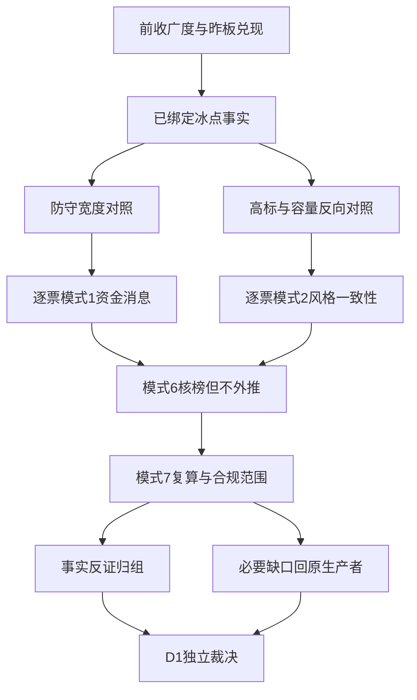

# 2026年11月26日 · 反证 / Devil’s Advocate

> **数据源新鲜度**：partial ｜ **降级状态**：是 ｜ **置信度**：未量化。仅本轮冻结 JSON，未使用目标日竞价和盘中报价。

## 一句话结论
13票逐项审查，必要审核尚未完成；保留已证反证，当前未触发硬否决。

## 详细分析

11/25 全A 586涨、4,926跌，中位−3.77%，沪深成交约1.38万亿元、较前日−16.43%；涨停51、跌停43、未回封30。炸板率37.04%触发纪律提示 **情绪=震荡/主跌**；这是纪律标签，不是阶段。原候选收缩上限6保留，本轮只列4个优先研究观察对象（亨迪药业、杭州解百、国芳集团、天孚通信），其余仍作为原样本审查，不准用后排递补。市场只为局部防守和少数高度买单：昨板全55票开盘均值+2.05%，收盘中位−4.47%，仅19红；高板孤强不能替代普遍晋级。

阶段事实：原生六态“冰点”，事实日11/25，已绑定公开同源版本（版次unknown，收盘概览同源对照）；目标日盘中估计未核。总体先验是修复53%、冰点26%、高潮12%、退潮4%、升温2%、降温未核；总分母未核，取整合计97%，不补余量。连续≥4天同景5例，冰点60%、高潮20%，其他未核；年线下另列5例指数次日均值+0.10%、上涨40%，两组是否交集未核。

11/26 情景首选冰点、备选修复。最强反证是R7看见海外低位回升、炸板率环比降至37.04%、首板回到37家及天孚有承接。但PCE报值冲突，发布后外盘量能/广度未核，纳指综合最终仍−0.62%；戴尔订单消息未令国内算力扩散。国内缩量、跌停增加、昨板回吐更直接。若同窗广度、成交、昨日涨停池持续兑现且容量与低位共同反馈，再将修复提首；单指数翻红或高标独封不够。

流感／药品端：持续性1日、封板率82.35%、目标日预期分歧；行业进入流行季不是票的新增订单，流感资金口径不一致。一般零售／百货：持续性1日、封板率57.14%、目标日预期分歧；杭州高度尚在，跨地域扩散未证。猪肉不是整条农业，单票四板不比药品/零售的宽度更可信；PCB五板不等于光通信容量转向；克来主营澄清及四板一字只当高度对照，不另选；珠免/南亚是公司事件，不自动换票。

## 关键证据

- 模式1 **11/13**：逐日核分档与东财同窗金额，R7只有天孚在本批个股五日跟踪中，本批其余10个完成项用同版R5可比资金/价格和R4消息。国芳、家家悦缺可归本票的R4独立消息传导。模式2 **13/13**，保留已完成。
- 模式6 **10/13**：5票有同花顺个股结果；另5只流感票完成**精确板块**分支，个股结果仍未知。宁波东力不可借人形机器人榜，国芳、家家悦无精确覆盖；九阳同花顺触发、东财未核，三个五日资金口径均正，单日方向冲突，不能认定真实派发。
- 模式7 **0/13整项闭环**：F12有年度标准无保留意见，已对可用财务输入和阈值逐项复算，但逐票S2/S3缺已签有限窗口监管覆盖回执与相关正文，不能认证完整。行业和普通异动风险不等于处罚、*ST或实际停牌。
- 无已核硬否决。中京电子F3/F4/F9/F10四条属实，保留原硬否阈值对其未来适用执行身份的条件；本轮只作观察，不等于通过。海南海药财务轴警报成立但未证临近轴。财务、价量、公告原证据分存，同一事实跨模式归组，不作重复扣罚。

### 特一药业（002728.SZ）｜降级

**大资金意图**：大单代理五日分档 / 东财 +0.23 / +0.23 亿元；不识别资金主体。流行季已交易；无新增订单/销量。首封领先但5日资金在流感成分仅第15/185，问财当日净卖与R5资金代理有口径分歧；仅作扩散时序。

**为什么走强或没有走强**：早封不等于龙一；R2两项杂毛条件命中，亨迪与第二梯队不承接则首封失去带动性。 板型：1连板／首封093133／开板0次；龙头认定：低位前排／杂毛，低位首日指标与R2资金/杂毛判定并列；不是交易准入

**逻辑够不够硬**：M1 已核／M2 已核／M6 已核／M7 未完成。精确流感板块ID在R3同花顺窗口非连续第一，完成所属板块规则分支；个股没有独立已核alert，不写个股false或“无派发”。 财务已核：F3、F4。F3 应收同比43.77%高于同期9M营收增速-9.87%×1.5，余额变动31.86百万元；负同比命中不等于应收暴增。；F4 存货同比-2.93%高于营收同比-9.87%×1.5，周转天数270.9→321.3（周转变慢）。 F12 FY2025 标准无保留意见（披露20260324）；不覆盖2026Q3或监管轴。S2/S3原有限核查窗从20260324到20261126，已见发行人公告和当期风险警示快照，但缺交易所/证监会及属地相关主体映射、有限分页回执和命中正文。

**风险点、止损条件与可验证假设**：低位前排／杂毛；偏贵，TTM PE 65.0359、PB 2.3801。不把单独估值标签和非龙一/龙二硬凑为双条件；仍保留估值及真实风险。 RR及有效止损价均未核（不开示买点）；前收研究禁止项：mid_laggard。若二板不能形成、亨迪和第二梯队回吐，则首板时序失效。

### 亨迪药业（301211.SZ）｜观察

**大资金意图**：大单代理五日分档 / 东财 +0.63 / +0.62 亿元；不识别资金主体。涨停约20%、前五日量比3.33，单票弹性与资金方向吻合；流感为行业信息，11/19共投进展不证明流感供给订单。

**为什么走强或没有走强**：低位同组确认而非唯一核心；没有特一或其他药品首板承接时，不能用20cm幅度替代宽度。 板型：1连板／首封093324／开板0次；龙头认定：低位前排／龙三，低位首日指标与R2资金/杂毛判定并列；不是交易准入

**逻辑够不够硬**：M1 已核／M2 已核／M6 已核／M7 未完成。精确流感板块ID在R3同花顺窗口非连续第一，完成所属板块规则分支；个股没有独立已核alert，不写个股false或“无派发”。 财务已核：F3、F6。F3 应收同比33.39%高于同期9M营收增速11.14%×1.5，余额变动14.14百万元；负同比命中不等于应收暴增。；F6 同期非经损益占正归母利润63.75%，超过30%。 F12 FY2025 标准无保留意见（披露20260331）；不覆盖2026Q3或监管轴。S2/S3原有限核查窗从20260331到20261126，已见发行人公告和当期风险警示快照，但缺交易所/证监会及属地相关主体映射、有限分页回执和命中正文。

**风险点、止损条件与可验证假设**：低位前排／龙三；偏贵，TTM PE 86.502、PB 2.0279。不把单独估值标签和非龙一/龙二硬凑为双条件；仍保留估值及真实风险。 RR及有效止损价均未核（不开示买点）；前收研究禁止项：本有限清单无已证命中，非全项通过。若首板溢价在盘中吐回或只有亨迪、没有药品同伴，不升级。

### 九安医疗（002432.SZ）｜降级

**大资金意图**：大单代理五日分档 / 东财 -3.40 / -3.41 亿元；不识别资金主体。流感虽然扩散，本票收日低46.00且当日/五日均净流出；11/21出售已回购股份结果不能替代本轮催化，也不等于董监高减持。

**为什么走强或没有走强**：历史锚不能抵消−2.79%及资金撤出；PB低不是弱势反转。 板型：非涨停／收盘趋势或容量观察；龙头认定：候补／龙三，低位首日指标与R2资金/杂毛判定并列；不是交易准入

**逻辑够不够硬**：M1 已核／M2 已核／M6 已核／M7 未完成。精确流感板块ID在R3同花顺窗口非连续第一，完成所属板块规则分支；个股没有独立已核alert，不写个股false或“无派发”。 财务已核：F3、F4、F8。F3 应收同比31.52%高于同期9M营收增速-24.67%×1.5，余额变动16.99百万元；负同比命中不等于应收暴增。；F4 存货同比20.09%高于营收同比-24.67%×1.5，周转天数161.5→220.3（周转变慢）。；F8 累计拆单季Q2/Q3经营现金流-21.24百万元/-50.52百万元，Q3归母盈利2135.14百万元，P0。 F12 FY2025 标准无保留意见（披露20260429）；不覆盖2026Q3或监管轴。S2/S3原有限核查窗从20260429到20261126，已见发行人公告和当期风险警示快照，但缺交易所/证监会及属地相关主体映射、有限分页回执和命中正文。

**风险点、止损条件与可验证假设**：候补／龙三；估值不作低风险确认，TTM PE 3.6457、PB 0.8423。不把单独估值标签和非龙一/龙二硬凑为双条件；仍保留估值及真实风险。 PB 0.84伴双季CFO为负，低PB不修复现金流；F2未达商誉门槛，不标V3。 RR及有效止损价均未核（不开示买点）；前收研究禁止项：mid_laggard。先要量价与同组连续相向；仅PB低不能改判。

### 海南海药（000566.SZ）｜降级

**大资金意图**：大单代理五日分档 / 东财 +0.45 / +0.45 亿元；不识别资金主体。流感扩散与个股大单净流入同向，但4.56倍量能触板后收3.66低于3.78，不支持持续控盘。

**为什么走强或没有走强**：收涨不改变未回封及R2杂毛/候补属性；只作炸板对照。 板型：曾触板未回封；龙头认定：候补／杂毛，低位首日指标与R2资金/杂毛判定并列；不是交易准入

**逻辑够不够硬**：M1 已核／M2 已核／M6 已核／M7 未完成。精确流感板块ID在R3同花顺窗口非连续第一，完成所属板块规则分支；个股没有独立已核alert，不写个股false或“无派发”。 财务已核：F3、F5、F9、S1。F3 应收同比-27.52%高于同期9M营收增速-24.75%×1.5，余额变动-92.79百万元；负同比命中不等于应收暴增。；F5 FY25研发资本化55.20百万元/94.88百万元=58.17%，超过50%。；F9 期末应收/9M营收50.77%，超过40%。；S1 财务轴：两年归母利润-1525.20百万元/-429.99百万元、归母权益-265.43百万元；连亏/负权益是研究警报，不等于实际ST或imminent。 F12 FY2025 标准无保留意见（披露20260411）；不覆盖2026Q3或监管轴。S2/S3原有限核查窗从20260411到20261126，已见发行人公告和当期风险警示快照，但缺交易所/证监会及属地相关主体映射、有限分页回执和命中正文。

**风险点、止损条件与可验证假设**：候补／杂毛；估值不作低风险确认，TTM PE 未核或不适用、PB 未核或不适用。不把单独估值标签和非龙一/龙二硬凑为双条件；仍保留估值及真实风险。 FY25研发资本化58.17%，但缺高ROIC确认，不自动标V5；负权益PE/PB不能作便宜。 RR及有效止损价均未核（不开示买点）；前收研究禁止项：mid_laggard。若同组扩散而海南仍反复冲高回落，不能计入药品前排。

### 百花医药（600721.SH）｜降级

**大资金意图**：大单代理五日分档 / 东财 -0.62 / -0.63 亿元；不识别资金主体。题材扩散时本票收7.68（−1.79%），接近日低，两个同窗代理方向均净流出，23/24金额有冲突。无已核公司需求事件。

**为什么走强或没有走强**：历史锚不证明药品端带动；不得因流感同组扩散纳为补涨。 板型：非涨停／收盘趋势或容量观察；龙头认定：候补／龙三，低位首日指标与R2资金/杂毛判定并列；不是交易准入

**逻辑够不够硬**：M1 已核／M2 已核／M6 已核／M7 未完成。精确流感板块ID在R3同花顺窗口非连续第一，完成所属板块规则分支；个股没有独立已核alert，不写个股false或“无派发”。 财务已核：F3、F9。F3 应收同比20.84%高于同期9M营收增速-22.79%×1.5，余额变动22.72百万元；负同比命中不等于应收暴增。；F9 期末应收/9M营收57.13%，超过40%。 F12 FY2025 标准无保留意见（披露20260328）；不覆盖2026Q3或监管轴。S2/S3原有限核查窗从20260328到20261126，已见发行人公告和当期风险警示快照，但缺交易所/证监会及属地相关主体映射、有限分页回执和命中正文。

**风险点、止损条件与可验证假设**：候补／龙三；偏贵，TTM PE 118.9253、PB 3.6793。不把单独估值标签和非龙一/龙二硬凑为双条件；仍保留估值及真实风险。 RR及有效止损价均未核（不开示买点）；前收研究禁止项：mid_laggard。主题红盘并不能修补本票负资金；要有可核业务催化与相对强度反转。

### 杭州解百（600814.SH）｜观察

**大资金意图**：大单代理五日分档 / 东财 +1.68 / +1.66 亿元；不识别资金主体。前收三板、分档当日与五日均流入，但P1769提示短期涨幅大、回落风险；公告时分未核，不能用11/25封板反驳新披露。

**为什么走强或没有走强**：零售高度与市场局部防守相容，但4封3未回封、宽口径新零售−0.59%；杭州独封不是跨地域联动。 板型：3连板／首封093003／开板0次；龙头认定：龙一／龙头，低位首日指标与R2资金/杂毛判定并列；不是交易准入

**逻辑够不够硬**：M1 已核／M2 已核／M6 已核／M7 未完成。R3同花顺本窗口个股非连续第一；仅该有限规则未命中，实际派发与别的平台未知。 财务已核：已核项无命中。已核子项未命中；不能把未核子项升级为阴性。 F12 FY2025 标准无保留意见（披露20260327）；不覆盖2026Q3或监管轴。S2/S3原有限核查窗从20260327到20261126，已见发行人公告和当期风险警示快照，但缺交易所/证监会及属地相关主体映射、有限分页回执和命中正文。 本票可见R4直接公告：杭州解百披露交易风险；普通异动/风险提示不等同立案或*ST。

**风险点、止损条件与可验证假设**：龙一／龙头；估值不作低风险确认，TTM PE 25.7305、PB 1.5955。不把单独估值标签和非龙一/龙二硬凑为双条件；仍保留估值及真实风险。 RR及有效止损价均未核（不开示买点）；前收研究禁止项：本有限清单无已证命中，非全项通过。若国芳与同组首板无一晋级，或杭州开板后不能回封，判抱团而非零售带动。

### 国芳集团（601086.SH）｜观察

**大资金意图**：大单代理五日分档 / 东财 +1.10 / +1.21 亿元；不识别资金主体。低位首板与资金方向吻合，但两口径多日金额偏差；R4杭州风险只能作为零售领涨器的间接反证，珠免是免税交易而非国芳催化，11/18异动也非新驱动。

**为什么走强或没有走强**：补涨有条件：龙一失去承接时国芳不自动递补；前收尚低于MA20约10.55%。 板型：1连板／首封100601／开板0次；龙头认定：B计划补涨／龙二，低位首日指标与R2资金/杂毛判定并列；不是交易准入

**逻辑够不够硬**：M1 未完成／M2 已核／M6 未完成／M7 未完成。没有有效已核结果，alert未知。 财务已核：F3、F6。F3 应收同比227.31%高于同期9M营收增速8.25%×1.5，余额变动8.31百万元；负同比命中不等于应收暴增。；F6 同期非经损益占正归母利润43.75%，超过30%。 F12 FY2025 标准无保留意见（披露20260418）；不覆盖2026Q3或监管轴。S2/S3原有限核查窗从20260418到20261126，已见发行人公告和当期风险警示快照，但缺交易所/证监会及属地相关主体映射、有限分页回执和命中正文。

**风险点、止损条件与可验证假设**：B计划补涨／龙二；偏贵，TTM PE 71.2806、PB 4.4374。满足估值×身位筛选；既有陷阱未证实，算作估值压力。 RR及有效止损价均未核（不开示买点）；前收研究禁止项：本有限清单无已证命中，非全项通过。杭州未形成反馈且后排回吐时，不称补涨成立；同组扩散、国芳承接才算修复证据。

### 家家悦（603708.SH）｜降级

**大资金意图**：大单代理五日分档 / 东财 +0.15 / +0.15 亿元；不识别资金主体。首板收9.68但五日分档仅净入0.15亿、11/24代理金额偏差84%；R4龙头风险及珠免定价不确定不能套为本票，业绩会通知不是经营增量。

**为什么走强或没有走强**：角色为同伴宽度，R2杂毛标签不因首板翻转；持续大单及非杭州联动不足时只计样本。 板型：1连板／首封100450／开板0次；龙头认定：候补／杂毛，低位首日指标与R2资金/杂毛判定并列；不是交易准入

**逻辑够不够硬**：M1 未完成／M2 已核／M6 未完成／M7 未完成。没有有效已核结果，alert未知。 财务已核：F10。F10 披露有息负债/归母权益128.73%，超过80%。 F12 FY2025 标准无保留意见（披露20260418）；不覆盖2026Q3或监管轴。S2/S3原有限核查窗从20260418到20261126，已见发行人公告和当期风险警示快照，但缺交易所/证监会及属地相关主体映射、有限分页回执和命中正文。

**风险点、止损条件与可验证假设**：候补／杂毛；估值不作低风险确认，TTM PE 28.122、PB 2.5232。不把单独估值标签和非龙一/龙二硬凑为双条件；仍保留估值及真实风险。 RR及有效止损价均未核（不开示买点）；前收研究禁止项：mid_laggard。若同组走强而本票继续无持续大单，仅用于宽度计数。

### 天孚通信（300394.SZ）｜观察

**大资金意图**：大单代理五日分档 / 东财 +29.56 / +29.25 亿元；不识别资金主体。本票逆势涨7.65%、日内138回至130.87，五日大单仍正；11/19代理差异超阈。戴尔利好被所属链条弱势反证，PCE发布晚于A股收盘；产业协议不等于新增订单。

**为什么走强或没有走强**：容量反向剧本，非板块一致：CPO成分仅10/100上涨、行业净流出61.58亿；中际/新易盛应共同验证。 板型：非涨停／收盘趋势或容量观察；龙头认定：中军／龙三，低位首日指标与R2资金/杂毛判定并列；不是交易准入

**逻辑够不够硬**：M1 已核／M2 已核／M6 已核／M7 未完成。R3同花顺本窗口个股非连续第一；仅该有限规则未命中，实际派发与别的平台未知。 财务已核：F3、F4、F9。F3 应收同比77.31%高于同期9M营收增速21.25%×1.5，余额变动847.92百万元；负同比命中不等于应收暴增。；F4 存货同比277.59%高于营收同比21.25%×1.5，周转天数113.7→218.6（周转变慢）。；F9 期末应收/9M营收40.93%，超过40%。 F12 FY2025 标准无保留意见（披露20260408）；不覆盖2026Q3或监管轴。S2/S3原有限核查窗从20260408到20261126，已见发行人公告和当期风险警示快照，但缺交易所/证监会及属地相关主体映射、有限分页回执和命中正文。

**风险点、止损条件与可验证假设**：中军／龙三；偏贵，TTM PE 54.1694、PB 21.6961。不把单独估值标签和非龙一/龙二硬凑为双条件；仍保留估值及真实风险。 RR及有效止损价均未核（不开示买点）；前收研究禁止项：本有限清单无已证命中，非全项通过。中际旭创/新易盛等容量同伴与板块广度不改善，天孚独强仍是局部。

### 金新农（002548.SZ）｜降级

**大资金意图**：大单代理五日分档 / 东财 +2.73 / +2.71 亿元；不识别资金主体。四板且五日大单流入不等于行业获利；开放两次、振幅大，P2293明示猪价跌致养殖亏损。农业会谈无进口配额，不是国内养殖收入增量。

**为什么走强或没有走强**：猪肉仅2封、8/39涨，不能把农业5板家数归猪肉；四板是抱团压力测试。 板型：4连板／首封092500／开板2次；龙头认定：龙一／龙头，低位首日指标与R2资金/杂毛判定并列；不是交易准入

**逻辑够不够硬**：M1 已核／M2 已核／M6 已核／M7 未完成。R3同花顺本窗口个股非连续第一；仅该有限规则未命中，实际派发与别的平台未知。 财务已核：F3、F10。F3 应收同比-4.57%高于同期9M营收增速-4.52%×1.5，余额变动-9.51百万元；负同比命中不等于应收暴增。；F10 披露有息负债/归母权益394.35%，超过80%。 F12 FY2025 标准无保留意见（披露20260428）；不覆盖2026Q3或监管轴。S2/S3原有限核查窗从20260428到20261126，已见发行人公告和当期风险警示快照，但缺交易所/证监会及属地相关主体映射、有限分页回执和命中正文。 本票可见R4直接公告：金新农生猪业务亏损与涨幅背离；普通异动/风险提示不等同立案或*ST。

**风险点、止损条件与可验证假设**：龙一／龙头；估值不作低风险确认，TTM PE 未核或不适用、PB 5.9464。不把单独估值标签和非龙一/龙二硬凑为双条件；仍保留估值及真实风险。 RR及有效止损价均未核（不开示买点）；前收研究禁止项：本有限清单无已证命中，非全项通过。若没有有效低位同伴或再次开板回吐，先证伪农业接力。

### 中京电子（002579.SZ）｜降级

**大资金意图**：大单代理五日分档 / 东财 +7.68 / +7.58 亿元；不识别资金主体。5板尾封、成交量前五日比2.95；当日两代理卖出但五日累计仍正。P2291无未披露事项，南亚产线有审批/执行前提，不是中京新增订单。

**为什么走强或没有走强**：PCB仅9/215红盘、仅本票封板，大单流出69.54亿；不重复计作CPO与PCB两个宽度贡献。 板型：5连板／首封145448／开板0次；龙头认定：高度锚／龙头，低位首日指标与R2资金/杂毛判定并列；不是交易准入

**逻辑够不够硬**：M1 已核／M2 已核／M6 已核／M7 未完成。R3同花顺本窗口个股非连续第一；仅该有限规则未命中，实际派发与别的平台未知。 财务已核：F3、F4、F9、F10。F3 应收同比22.08%高于同期9M营收增速1.83%×1.5，余额变动197.67百万元；负同比命中不等于应收暴增。；F4 存货同比37.31%高于营收同比1.83%×1.5，周转天数184.1→201.2（周转变慢）。；F9 期末应收/9M营收44.69%，超过40%。；F10 披露有息负债/归母权益101.02%，超过80%。 F12 FY2025 标准无保留意见（披露20260424）；不覆盖2026Q3或监管轴。S2/S3原有限核查窗从20260424到20261126，已见发行人公告和当期风险警示快照，但缺交易所/证监会及属地相关主体映射、有限分页回执和命中正文。 本票可见R4直接公告：中京电子五板后披露异常波动；普通异动/风险提示不等同立案或*ST。 已核四个F项；如以后依法进入本规则的可执行对象，原≥4项硬否条件不得被绕开，须用有效版本逐票核。当前为R2/R5观察对照，未触发针对执行候选的硬否。

**风险点、止损条件与可验证假设**：高度锚／龙头；估值不作低风险确认，TTM PE 未核或不适用、PB 3.9738。不把单独估值标签和非龙一/龙二硬凑为双条件；仍保留估值及真实风险。 亏损不看低PE，负增速也不证明V6；PEG动因未核。 RR及有效止损价均未核（不开示买点）；前收研究禁止项：late_speculation。只有尾封/次日独封不改判；须见PCB同伴和前一日涨停池收益同时改善。

### 宁波东力（002164.SZ）｜降级

**大资金意图**：大单代理五日分档 / 东财 +1.14 / +1.12 亿元；不识别资金主体。本票三板且资金方向净入，不能反证机器人行业缩量撤资；小鹏16:13传播晚于收盘且无宁波定点，11/26异动标题不是立案。

**为什么走强或没有走强**：机器人涨停67→19→3与成分口径67→31→11同降；有两次开板，旧高度非增量共振。 板型：3连板／首封093009／开板2次；龙头认定：高度观察／龙三，低位首日指标与R2资金/杂毛判定并列；不是交易准入

**逻辑够不够硬**：M1 已核／M2 已核／M6 未完成／M7 未完成。没有有效已核结果，alert未知。 人形机器人886069.TI连续第一提示属不同对象，不替代885517.TI或本票；R5五日+1.14亿不支持净流出。 财务已核：F9。F9 期末应收/9M营收43.53%，超过40%。 F12 FY2025 标准无保留意见（披露20260429）；不覆盖2026Q3或监管轴。S2/S3原有限核查窗从20260429到20261126，已见发行人公告和当期风险警示快照，但缺交易所/证监会及属地相关主体映射、有限分页回执和命中正文。

**风险点、止损条件与可验证假设**：高度观察／龙三；偏贵，TTM PE 52.74、PB 7.3616。不把单独估值标签和非龙一/龙二硬凑为双条件；仍保留估值及真实风险。 RR及有效止损价均未核（不开示买点）；前收研究禁止项：本有限清单无已证命中，非全项通过。若锋龙/科森等继续走弱且领涨不能扩散，仍是存量高标。

### 九阳股份（002242.SZ）｜降级

**大资金意图**：大单代理五日分档 / 东财 +4.79 / +4.60 亿元；不识别资金主体。R5当日大单−2.89亿、东财−2.95亿，而R3 xTick同日+6.26亿；五日三口径均正。叠加7次开板及第二次风险提示，只能确定拥挤/日内资金口径分歧，不能认定出货。

**为什么走强或没有走强**：行业涨停仍1→1→1、小家电−1.71%/−2.48亿；单一人气不能替代行业扩散，高股息题材也不是红利资格。 板型：3连板／首封094521／开板7次；龙头认定：抱团锚／龙三，低位首日指标与R2资金/杂毛判定并列；不是交易准入

**逻辑够不够硬**：M1 已核／M2 已核／M6 已核／M7 未完成。同花顺个股连续第一提示命中；东财第二日未覆盖。R5分档五日+4.79亿且东财+4.60亿；R3 xTick五日+20.48亿，同日与R5方向相反而五日皆正。未证实近五日主力净流出或实际派发；个股热榜也不是所属板块触发。 财务已核：已核项无命中。已核子项未命中；不能把未核子项升级为阴性。 F12 FY2025 标准无保留意见（披露20260327）；不覆盖2026Q3或监管轴。S2/S3原有限核查窗从20260327到20261126，已见发行人公告和当期风险警示快照，但缺交易所/证监会及属地相关主体映射、有限分页回执和命中正文。 本票可见R4直接公告：九阳股份第二次风险提示；普通异动/风险提示不等同立案或*ST。

**风险点、止损条件与可验证假设**：抱团锚／龙三；极贵，TTM PE 445.4519、PB 9.1281。不把单独估值标签和非龙一/龙二硬凑为双条件；仍保留估值及真实风险。 前三季归母同比−41.75%，PE 445.45倍，现金/利润−2.06，但TTM息率仅0.389%，V9的高息门槛不满足；不虚构分红陷阱。 RR及有效止损价均未核（不开示买点）；前收研究禁止项：本有限清单无已证命中，非全项通过。若家电同伴和利润/现金证据均不改善，即使独封也不升级。

## 数据源审计

| 源 | 读取与研究状态 | 已绑定研究事实或窗口 | 对象数／已核范围 | 备注 |
|---|---|---|---|---|
| R1 | 🟢 已绑定；🟡 degraded | 11/25市场 | 见JSON | 原始采集不等同JSON生成 |
| R2 | 🟢 已绑定；🟡 degraded | 11/25主线及13票 | 13 | 原始采集不等同JSON生成 |
| R3 | 🟢 已绑定；🟡 degraded | 11/24—25榜单 | 19 | 原始采集不等同JSON生成 |
| R4 | 🟢 已绑定；🟡 partial | 消息首知/公告个别时点 | 56 | 原始采集不等同JSON生成 |
| R5 | 🟢 已绑定；🟡 partial | 11/25价量＋期报 | 13 | 原始采集不等同JSON生成 |
| R7 | 🟢 已绑定；🟡 partial | 11/19—25资金 | 见JSON | 原始采集不等同JSON生成 |

🔴 未核：本批目标日实际竞价/盘口、部分个股热榜覆盖和S2/S3适用窗；非全局禁令。专题逐源证据与来源时点见同版JSON的 `knowledge_context` / `knowledge_adjudications`；不读原MD，不把网页同源多计。

## 不确定性 / 反证

模式3仅保留已核估值及适用陷阱，模式4/5历史类比与昨日兑现未闭环，模式8未达前收百板前提，模式9只审高度和真量价，模式10无同窗对应商品序列。所有必要和辅助未核分别记录。Mermaid仅离线结构校验，未渲染SVG。R1/R2市场性意见限首次有效早盘复核或10:00（较早为准）；R7反向研究到10:30，不用上述旧窗口替代预算。

## 与其他 R/D/E 的关系

只读 R1–R5、R7。D1逐票裁决，强反证须接受或显式说明覆盖理由；无权覆盖真实硬否。不设仓位或乘数，账户有效预算未知；T+1、硬上限、有效零预算/停买、人工确认及逐票保护无变更。

## Sub-Agent 元数据

- skill: analyze_devil_advocate_v1
- artifact: data/research/20261126/R6_devil_advocate.json
- run_id: 20261126T061055-62560-3434
- knowledge_context.context_sha256: 3e81a146d5cc0e9e2b15420e7c049492648ce3c8267732c053b5614be01acbed
- 生成耗时：逐票核查至落盘的观察时长约 475 秒（不含前置输入定位，非会话总耗时）
- model: gpt-6.2-sol
- 时间口径：本轮盘前冻结证据；生成时间见页首，不回填来源时点。使用量未知，08:30仅观察性交付目标。
